# KiInitializeBootStructures

- RVA: `0x00B68530`–`0x00B68A11` (길이 `1,249` bytes)
- VA: `0x0000000140B68530`
- 실행 섹션: `PAGELK`
- PDB 이름 있음: `예`; PDB Function 태그: `아니요`
- unwind 정보 RVA: `0x000CA82C`
- 디코드: `286`개 명령, `1,249/1,249` bytes 표시
- 미해석 바이트: `0` (있으면 어셈블리에 `.byte`로 보존)

> 이 문서는 커널 이미지의 기계어와 PDB 기호를 분석해 생성했습니다. 4번과 5번은 함수 원형과 자료형을 바이너리 사용 방식에서 추정한 C 해석이며 원본 소스 복구 결과는 아닙니다.

## 1. Dependencies

- 직접 호출 지점: **26**; 고유 호출 대상: **26**
- 직접 호출자로 확인된 함수: **1**
- RIP 상대 이미지 참조: **39**

### Outgoing calls
- `0x00B685AB` → [KiInitializeGlobalState](../../text/5B/KiInitializeGlobalState_function_005B8154.md) (function, `0x005B8154`)
- `0x00B685B7` → [InitializeBuildStrings](../../init/C1/InitializeBuildStrings_function_00C1C1D0.md) (function, `0x00C1C1D0`)
- `0x00B686D9` → [CmInitBootFeatureConfigurations](../../init/C5/CmInitBootFeatureConfigurations_function_00C559B4.md) (function, `0x00C559B4`)
- `0x00B686E1` → [KiConfigureInitialNodes](../../text/5B/KiConfigureInitialNodes_function_005BC738.md) (function, `0x005BC738`)
- `0x00B68749` → [KiGetProcessorSignature](../../text/5C/KiGetProcessorSignature_function_005C48A8.md) (function, `0x005C48A8`)
- `0x00B687AE` → [KiSetProcessorSignature](../../text/5C/KiSetProcessorSignature_function_005C48C0.md) (function, `0x005C48C0`)
- `0x00B687BD` → [HvlEnableVsmCalls](../../init/C2/HvlEnableVsmCalls_function_00C29AB0.md) (function, `0x00C29AB0`)
- `0x00B687C2` → [ExRngInitializeSystem](../../init/C5/ExRngInitializeSystem_function_00C54050.md) (function, `0x00C54050`)
- `0x00B687CA` → [KiDetermineImportOptimizationEnablement](../../text/5B/KiDetermineImportOptimizationEnablement_function_005BF178.md) (function, `0x005BF178`)
- `0x00B687D2` → [KiDetermineRetpolineEnablement](../../text/5B/KiDetermineRetpolineEnablement_function_005BF1C0.md) (function, `0x005BF1C0`)
- `0x00B687DD` → [MmInitSystem](../../init/BE/MmInitSystem_function_00BEE990.md) (function, `0x00BEE990`)
- `0x00B6880D` → [KiInitializeIdt](KiInitializeIdt_function_00B68B50.md) (function, `0x00B68B50`)
- `0x00B6881A` → [HalInitializeBios](../../text/53/HalInitializeBios_function_0053D9A0.md) (function, `0x0053D9A0`)
- `0x00B68827` → [InbvDriverInitialize](../../init/C2/InbvDriverInitialize_function_00C2A420.md) (function, `0x00C2A420`)
- `0x00B6883F` → [strstr](../../text/4F/strstr_function_004FF680.md) (function, `0x004FF680`)
- `0x00B6886C` → [atoi](../../text/4F/atoi_function_004FF8B0.md) (function, `0x004FF8B0`)
- `0x00B688A0` → [KiInitializeNxSupportDiscard](../../init/C3/KiInitializeNxSupportDiscard_function_00C39888.md) (function, `0x00C39888`)
- `0x00B688AA` → [HalInitializeProcessor](../../text/53/HalInitializeProcessor_function_0053D950.md) (function, `0x0053D950`)
- `0x00B688B2` → [KiSetFeatureBits](KiSetFeatureBits_function_00B6A03C.md) (function, `0x00B6A03C`)
- `0x00B688DC` → [KiEnableKvaShadowing](KiEnableKvaShadowing_function_00B6ACBC.md) (function, `0x00B6ACBC`)
- `0x00B688FF` → [KiDetectTsx](../../text/4E/KiDetectTsx_function_004E34FC.md) (function, `0x004E34FC`)
- `0x00B6899F` → [KiInitPrcb](KiInitPrcb_function_00B66644.md) (function, `0x00B66644`)
- `0x00B689A4` → [ExInitPoolLookasidePointers](../B7/ExInitPoolLookasidePointers_function_00B72B00.md) (function, `0x00B72B00`)
- `0x00B689DA` → [memset](../../text/6C/memset_function_006C6C40.md) (function, `0x006C6C40`)
- `0x00B689E8` → [KeAddProcessorAffinityEx](../../text/25/KeAddProcessorAffinityEx_function_0025B6F0.md) (function, `0x0025B6F0`)
- `0x00B689F4` → [KiSaveInitialProcessorControlState](../../text/4F/KiSaveInitialProcessorControlState_function_004FD890.md) (function, `0x004FD890`)

### Direct callers
- [KiSystemStartup](../B5/KiSystemStartup_function_00B5B3C0.md) at `0x00B5B575`

### Static image references
- `0x00B685D0` → RVA `0x00F10EC0` (`.data`; write)
- `0x00B685E3` → RVA `0x00F10EC4` (`.data`; write)
- `0x00B685E9` → RVA `0x00FCFF00` (`CACHEALI`; read)
- `0x00B685F3` → RVA `0x00FD25C0` (`CACHEALI`; read)
- `0x00B685FD` → RVA `0x00FC5020` (`ALMOSTRO`; write)
- `0x00B68610` → RVA `0x00FC51B4` (`ALMOSTRO`; write)
- `0x00B68616` → RVA `0x00FC51D4` (`ALMOSTRO`; write)
- `0x00B6861C` → RVA `0x00FC507C` (`ALMOSTRO`; write)
- `0x00B68622` → RVA `0x00FC505C` (`ALMOSTRO`; write)
- `0x00B68628` → RVA `0x00FC5060` (`ALMOSTRO`; write)
- `0x00B68635` → RVA `0x00FC5088` (`ALMOSTRO`; write)
- `0x00B68646` → RVA `0x00FC51D8` (`ALMOSTRO`; write)
- `0x00B68653` → RVA `0x006B1BA0` (`KiExceptionDispatchOnExceptionStackContinue`; read)
- `0x00B6865A` → RVA `0x00FC507C` (`ALMOSTRO`; read)
- `0x00B6866E` → RVA `0x00FD1EC0` (`CACHEALI`; read)
- `0x00B6869C` → RVA `0x00F23200` (`.data`; read)
- `0x00B686E6` → RVA `0x00FC8C40` (`ALMOSTRO`; read)
- `0x00B686F1` → RVA `0x006B96CF` (`KiPlatformSwapStacksAndCallReturn`; read)
- `0x00B687F4` → RVA `0x010086F0` (`INITDATA`; write)
- `0x00B68801` → RVA `0x0100815C` (`INITDATA`; write)
- `0x00B68838` → RVA `0x00B7FC90` (` ?? ::OKHAJAOM::`string'`; read)
- `0x00B68871` → RVA `0x00FC5044` (`ALMOSTRO`; write)
- `0x00B688BA` → RVA `0x006C4500` (`KiSystemCall32`; read)
- `0x00B688C1` → RVA `0x006C4A40` (`KiSystemCall64`; read)
- `0x00B688E4` → RVA `0x01201840` (`CFGRO`; read)
- `0x00B688ED` → RVA `0x00BCCE40` (`KiSystemCall32Shadow`; read)
- `0x00B688F4` → RVA `0x00BCD200` (`KiSystemCall64Shadow`; read)
- `0x00B68904` → RVA `0x00FC6FE8` (`ALMOSTRO`; write)
- `0x00B6892A` → RVA `0x01008680` (`INITDATA`; read)
- `0x00B68930` → RVA `0x01201900` (`CFGRO`; read)
- `0x00B68937` → RVA `0x00E086F0` (`.data`; write)
- `0x00B6893E` → RVA `0x00E086F8` (`.data`; write)
- `0x00B68956` → RVA `0x01008680` (`INITDATA`; write)
- `0x00B689AD` → RVA `0x00FC7124` (`ALMOSTRO`; read/write)
- `0x00B689B3` → RVA `0x00FC7128` (`ALMOSTRO`; read)
- `0x00B689BA` → RVA `0x00FC6A80` (`ALMOSTRO`; write)
- `0x00B689C9` → RVA `0x00FC6BC7` (`ALMOSTRO`; write)
- `0x00B689D0` → RVA `0x00FC7120` (`ALMOSTRO`; write)
- `0x00B689E1` → RVA `0x00FC7120` (`ALMOSTRO`; read)

## 2. Other-region calls and transfers

- 다른 실행 섹션으로 향하는 call: **21**
  - `0x00B685AB` → [KiInitializeGlobalState](../../text/5B/KiInitializeGlobalState_function_005B8154.md) (`PAGELK` → `.text`)
  - `0x00B685B7` → [InitializeBuildStrings](../../init/C1/InitializeBuildStrings_function_00C1C1D0.md) (`PAGELK` → `INIT`)
  - `0x00B686D9` → [CmInitBootFeatureConfigurations](../../init/C5/CmInitBootFeatureConfigurations_function_00C559B4.md) (`PAGELK` → `INIT`)
  - `0x00B686E1` → [KiConfigureInitialNodes](../../text/5B/KiConfigureInitialNodes_function_005BC738.md) (`PAGELK` → `.text`)
  - `0x00B68749` → [KiGetProcessorSignature](../../text/5C/KiGetProcessorSignature_function_005C48A8.md) (`PAGELK` → `.text`)
  - `0x00B687AE` → [KiSetProcessorSignature](../../text/5C/KiSetProcessorSignature_function_005C48C0.md) (`PAGELK` → `.text`)
  - `0x00B687BD` → [HvlEnableVsmCalls](../../init/C2/HvlEnableVsmCalls_function_00C29AB0.md) (`PAGELK` → `INIT`)
  - `0x00B687C2` → [ExRngInitializeSystem](../../init/C5/ExRngInitializeSystem_function_00C54050.md) (`PAGELK` → `INIT`)
  - `0x00B687CA` → [KiDetermineImportOptimizationEnablement](../../text/5B/KiDetermineImportOptimizationEnablement_function_005BF178.md) (`PAGELK` → `.text`)
  - `0x00B687D2` → [KiDetermineRetpolineEnablement](../../text/5B/KiDetermineRetpolineEnablement_function_005BF1C0.md) (`PAGELK` → `.text`)
  - `0x00B687DD` → [MmInitSystem](../../init/BE/MmInitSystem_function_00BEE990.md) (`PAGELK` → `INIT`)
  - `0x00B6881A` → [HalInitializeBios](../../text/53/HalInitializeBios_function_0053D9A0.md) (`PAGELK` → `.text`)
  - `0x00B68827` → [InbvDriverInitialize](../../init/C2/InbvDriverInitialize_function_00C2A420.md) (`PAGELK` → `INIT`)
  - `0x00B6883F` → [strstr](../../text/4F/strstr_function_004FF680.md) (`PAGELK` → `.text`)
  - `0x00B6886C` → [atoi](../../text/4F/atoi_function_004FF8B0.md) (`PAGELK` → `.text`)
  - `0x00B688A0` → [KiInitializeNxSupportDiscard](../../init/C3/KiInitializeNxSupportDiscard_function_00C39888.md) (`PAGELK` → `INIT`)
  - `0x00B688AA` → [HalInitializeProcessor](../../text/53/HalInitializeProcessor_function_0053D950.md) (`PAGELK` → `.text`)
  - `0x00B688FF` → [KiDetectTsx](../../text/4E/KiDetectTsx_function_004E34FC.md) (`PAGELK` → `.text`)
  - `0x00B689DA` → [memset](../../text/6C/memset_function_006C6C40.md) (`PAGELK` → `.text`)
  - `0x00B689E8` → [KeAddProcessorAffinityEx](../../text/25/KeAddProcessorAffinityEx_function_0025B6F0.md) (`PAGELK` → `.text`)
  - `0x00B689F4` → [KiSaveInitialProcessorControlState](../../text/4F/KiSaveInitialProcessorControlState_function_004FD890.md) (`PAGELK` → `.text`)
- 별도 외부 분기/꼬리 이동을 확인하지 못했습니다.

## 3. Assembly (complete function range)

```asm
00B68530  48 8B C4                        mov rax, rsp
00B68533  48 89 58 18                     mov qword ptr [rax + 0x18], rbx
00B68537  48 89 68 20                     mov qword ptr [rax + 0x20], rbp
00B6853B  56                              push rsi
00B6853C  57                              push rdi
00B6853D  41 55                           push r13
00B6853F  41 56                           push r14
00B68541  41 57                           push r15
00B68543  48 83 EC 30                     sub rsp, 0x30
00B68547  65 4C 8B 34 25 18 00 00 00      mov r14, qword ptr gs:[0x18]
00B68550  48 8D 99 90 00 00 00            lea rbx, [rcx + 0x90]
00B68557  65 48 8B 3C 25 20 00 00 00      mov rdi, qword ptr gs:[0x20]
00B68560  4C 8D B9 80 00 00 00            lea r15, [rcx + 0x80]
00B68567  83 60 C8 00                     and dword ptr [rax - 0x38], 0
00B6856B  4C 8D 99 98 00 00 00            lea r11, [rcx + 0x98]
00B68572  83 60 08 00                     and dword ptr [rax + 8], 0
00B68576  48 8B F1                        mov rsi, rcx
00B68579  83 60 10 00                     and dword ptr [rax + 0x10], 0
00B6857D  41 BD 01 00 00 00               mov r13d, 1
00B68583  41 C7 46 60 01 00 01 00         mov dword ptr [r14 + 0x60], 0x10001
00B6858B  C7 87 88 00 00 00 01 00 01 00   mov dword ptr [rdi + 0x88], 0x10001
00B68595  C6 87 8C 00 00 00 00            mov byte ptr [rdi + 0x8c], 0
00B6859C  41 8B AE A4 01 00 00            mov ebp, dword ptr [r14 + 0x1a4]
00B685A3  85 ED                           test ebp, ebp
00B685A5  0F 85 DF 00 00 00               jne 0x140b6868a
00B685AB  E8 A4 FB A4 FF                  call 0x1405b8154
00B685B0  48 8B 89 F0 00 00 00            mov rcx, qword ptr [rcx + 0xf0]
00B685B7  E8 14 3C 0B 00                  call 0x140c1c1d0
00B685BC  4C 8B 96 F0 00 00 00            mov r10, qword ptr [rsi + 0xf0]
00B685C3  8B 8E A0 00 00 00               mov ecx, dword ptr [rsi + 0xa0]
00B685C9  41 8B 82 A4 0D 00 00            mov eax, dword ptr [r10 + 0xda4]
00B685D0  89 05 EA 88 3A 00               mov dword ptr [rip + 0x3a88ea], eax
00B685D6  41 8B 82 84 00 00 00            mov eax, dword ptr [r10 + 0x84]
00B685DD  C1 E8 15                        shr eax, 0x15
00B685E0  83 E0 3F                        and eax, 0x3f
00B685E3  89 05 DB 88 3A 00               mov dword ptr [rip + 0x3a88db], eax
00B685E9  48 8D 05 10 79 46 00            lea rax, [rip + 0x467910]
00B685F0  48 89 03                        mov qword ptr [rbx], rax
00B685F3  48 8D 05 C6 9F 46 00            lea rax, [rip + 0x469fc6]
00B685FA  49 89 03                        mov qword ptr [r11], rax
00B685FD  89 0D 1D CA 45 00               mov dword ptr [rip + 0x45ca1d], ecx
00B68603  48 8B 86 F0 00 00 00            mov rax, qword ptr [rsi + 0xf0]
00B6860A  8B 80 14 0F 00 00               mov eax, dword ptr [rax + 0xf14]
00B68610  89 0D 9E CB 45 00               mov dword ptr [rip + 0x45cb9e], ecx
00B68616  89 0D B8 CB 45 00               mov dword ptr [rip + 0x45cbb8], ecx
00B6861C  89 0D 5A CA 45 00               mov dword ptr [rip + 0x45ca5a], ecx
00B68622  89 0D 34 CA 45 00               mov dword ptr [rip + 0x45ca34], ecx
00B68628  89 0D 32 CA 45 00               mov dword ptr [rip + 0x45ca32], ecx
00B6862E  48 81 C1 00 10 00 00            add rcx, 0x1000
00B68635  89 05 4D CA 45 00               mov dword ptr [rip + 0x45ca4d], eax
00B6863B  05 00 F8 FF FF                  add eax, 0xfffff800
00B68640  49 8B 17                        mov rdx, qword ptr [r15]
00B68643  48 03 D1                        add rdx, rcx
00B68646  89 05 8C CB 45 00               mov dword ptr [rip + 0x45cb8c], eax
00B6864C  48 89 97 D8 8F 00 00            mov qword ptr [rdi + 0x8fd8], rdx
00B68653  48 8D 05 46 95 B4 FF            lea rax, [rip - 0x4b6aba]
00B6865A  8B 0D 1C CA 45 00               mov ecx, dword ptr [rip + 0x45ca1c]
00B68660  48 81 C1 B0 0F 00 00            add rcx, 0xfb0
00B68667  48 03 CA                        add rcx, rdx
00B6866A  48 89 41 28                     mov qword ptr [rcx + 0x28], rax
00B6866E  48 8D 05 4B 98 46 00            lea rax, [rip + 0x46984b]
00B68675  48 89 87 00 94 00 00            mov qword ptr [rdi + 0x9400], rax
00B6867C  48 89 8F 68 87 00 00            mov qword ptr [rdi + 0x8768], rcx
00B68683  4C 89 AF C8 00 00 00            mov qword ptr [rdi + 0xc8], r13
00B6868A  48 8B 87 00 94 00 00            mov rax, qword ptr [rdi + 0x9400]
00B68691  48 89 87 48 8E 00 00            mov qword ptr [rdi + 0x8e48], rax
00B68698  85 ED                           test ebp, ebp
00B6869A  75 0E                           jne 0x140b686aa
00B6869C  48 8D 05 5D AB 3B 00            lea rax, [rip + 0x3bab5d]
00B686A3  48 89 87 E8 37 00 00            mov qword ptr [rdi + 0x37e8], rax
00B686AA  49 8B 0B                        mov rcx, qword ptr [r11]
00B686AD  48 83 67 10 00                  and qword ptr [rdi + 0x10], 0
00B686B2  48 89 4F 08                     mov qword ptr [rdi + 8], rcx
00B686B6  48 89 4F 18                     mov qword ptr [rdi + 0x18], rcx
00B686BA  48 8B 03                        mov rax, qword ptr [rbx]
00B686BD  48 89 81 B8 00 00 00            mov qword ptr [rcx + 0xb8], rax
00B686C4  48 8D 81 98 00 00 00            lea rax, [rcx + 0x98]
00B686CB  48 89 40 08                     mov qword ptr [rax + 8], rax
00B686CF  48 89 00                        mov qword ptr [rax], rax
00B686D2  85 ED                           test ebp, ebp
00B686D4  75 10                           jne 0x140b686e6
00B686D6  48 8B CE                        mov rcx, rsi
00B686D9  E8 D6 D2 0E 00                  call 0x140c559b4
00B686DE  48 8B CF                        mov rcx, rdi
00B686E1  E8 52 40 A5 FF                  call 0x1405bc738
00B686E6  48 8D 0D 53 05 46 00            lea rcx, [rip + 0x460553]
00B686ED  48 89 3C E9                     mov qword ptr [rcx + rbp*8], rdi
00B686F1  48 8D 0D D7 0F B5 FF            lea rcx, [rip - 0x4af029]
00B686F8  49 8B 07                        mov rax, qword ptr [r15]
00B686FB  48 83 E8 50                     sub rax, 0x50
00B686FF  48 89 48 28                     mov qword ptr [rax + 0x28], rcx
00B68703  48 83 BF C0 8F 00 00 00         cmp qword ptr [rdi + 0x8fc0], 0
00B6870B  48 89 87 A0 38 00 00            mov qword ptr [rdi + 0x38a0], rax
00B68712  75 18                           jne 0x140b6872c
00B68714  48 8D 87 F0 01 00 00            lea rax, [rdi + 0x1f0]
00B6871B  C7 87 C8 8F 00 00 0B 00 10 00   mov dword ptr [rdi + 0x8fc8], 0x10000b
00B68725  48 89 87 C0 8F 00 00            mov qword ptr [rdi + 0x8fc0], rax
00B6872C  4D 8B 7E 38                     mov r15, qword ptr [r14 + 0x38]
00B68730  48 8D 9F 8D 00 00 00            lea rbx, [rdi + 0x8d]
00B68737  48 8B CB                        mov rcx, rbx
00B6873A  4C 8D 4C 24 68                  lea r9, [rsp + 0x68]
00B6873F  4C 8D 44 24 60                  lea r8, [rsp + 0x60]
00B68744  48 8D 54 24 20                  lea rdx, [rsp + 0x20]
00B68749  E8 5A C1 A5 FF                  call 0x1405c48a8
00B6874E  0F B7 4C 24 60                  movzx ecx, word ptr [rsp + 0x60]
00B68753  44 8B C0                        mov r8d, eax
00B68756  8B 54 24 20                     mov edx, dword ptr [rsp + 0x20]
00B6875A  66 C1 E1 08                     shl cx, 8
00B6875E  66 0B 4C 24 68                  or cx, word ptr [rsp + 0x68]
00B68763  80 3B 02                        cmp byte ptr [rbx], 2
00B68766  44 88 6F 41                     mov byte ptr [rdi + 0x41], r13b
00B6876A  88 57 40                        mov byte ptr [rdi + 0x40], dl
00B6876D  66 89 4F 42                     mov word ptr [rdi + 0x42], cx
00B68771  75 2D                           jne 0x140b687a0
00B68773  83 FA 0F                        cmp edx, 0xf
00B68776  73 0C                           jae 0x140b68784
00B68778  83 FA 06                        cmp edx, 6
00B6877B  75 23                           jne 0x140b687a0
00B6877D  83 7C 24 60 0D                  cmp dword ptr [rsp + 0x60], 0xd
00B68782  76 1C                           jbe 0x140b687a0
00B68784  B9 A0 01 00 00                  mov ecx, 0x1a0
00B68789  0F 32                           rdmsr
00B6878B  48 C1 E2 20                     shl rdx, 0x20
00B6878F  48 0B C2                        or rax, rdx
00B68792  48 0F BA F0 16                  btr rax, 0x16
00B68797  48 8B D0                        mov rdx, rax
00B6879A  48 C1 EA 20                     shr rdx, 0x20
00B6879E  0F 30                           wrmsr
00B687A0  85 ED                           test ebp, ebp
00B687A2  0F 85 E2 00 00 00               jne 0x140b6888a
00B687A8  41 8B D0                        mov edx, r8d
00B687AB  48 8B CF                        mov rcx, rdi
00B687AE  E8 0D C1 A5 FF                  call 0x1405c48c0
00B687B3  48 8B CE                        mov rcx, rsi
00B687B6  4D 89 B7 70 10 00 00            mov qword ptr [r15 + 0x1070], r14
00B687BD  E8 EE 12 0C 00                  call 0x140c29ab0
00B687C2  E8 89 B8 0E 00                  call 0x140c54050
00B687C7  48 8B CE                        mov rcx, rsi
00B687CA  E8 A9 69 A5 FF                  call 0x1405bf178
00B687CF  48 8B CE                        mov rcx, rsi
00B687D2  E8 E9 69 A5 FF                  call 0x1405bf1c0
00B687D7  48 8B D6                        mov rdx, rsi
00B687DA  83 C9 FF                        or ecx, 0xffffffff
00B687DD  E8 AE 61 08 00                  call 0x140bee990
00B687E2  48 8B 86 F0 00 00 00            mov rax, qword ptr [rsi + 0xf0]
00B687E9  8B 90 84 00 00 00               mov edx, dword ptr [rax + 0x84]
00B687EF  F6 C2 08                        test dl, 8
00B687F2  74 07                           je 0x140b687fb
00B687F4  44 89 2D F5 FE 49 00            mov dword ptr [rip + 0x49fef5], r13d
00B687FB  0F BA E2 08                     bt edx, 8
00B687FF  73 07                           jae 0x140b68808
00B68801  44 89 2D 54 F9 49 00            mov dword ptr [rip + 0x49f954], r13d
00B68808  33 D2                           xor edx, edx
00B6880A  49 8B CF                        mov rcx, r15
00B6880D  E8 3E 03 00 00                  call 0x140b68b50
00B68812  83 CB FF                        or ebx, 0xffffffff
00B68815  48 8B D6                        mov rdx, rsi
00B68818  8B CB                           mov ecx, ebx
00B6881A  E8 81 51 9D FF                  call 0x14053d9a0
00B6881F  45 33 C0                        xor r8d, r8d
00B68822  48 8B D6                        mov rdx, rsi
00B68825  8B CB                           mov ecx, ebx
00B68827  E8 F4 1B 0C 00                  call 0x140c2a420
00B6882C  48 8B 8E D8 00 00 00            mov rcx, qword ptr [rsi + 0xd8]
00B68833  48 85 C9                        test rcx, rcx
00B68836  74 52                           je 0x140b6888a
00B68838  48 8D 15 51 74 01 00            lea rdx, [rip + 0x17451]
00B6883F  E8 3C 6E 99 FF                  call 0x1404ff680
00B68844  48 85 C0                        test rax, rax
00B68847  74 41                           je 0x140b6888a
00B68849  8A 08                           mov cl, byte ptr [rax]
00B6884B  84 C9                           test cl, cl
00B6884D  74 1A                           je 0x140b68869
00B6884F  44 8D 7B 21                     lea r15d, [rbx + 0x21]
00B68853  41 3A CF                        cmp cl, r15b
00B68856  74 11                           je 0x140b68869
00B68858  80 E9 30                        sub cl, 0x30
00B6885B  80 F9 09                        cmp cl, 9
00B6885E  76 09                           jbe 0x140b68869
00B68860  49 03 C5                        add rax, r13
00B68863  8A 08                           mov cl, byte ptr [rax]
00B68865  84 C9                           test cl, cl
00B68867  75 EA                           jne 0x140b68853
00B68869  48 8B C8                        mov rcx, rax
00B6886C  E8 3F 70 99 FF                  call 0x1404ff8b0
00B68871  89 05 CD C7 45 00               mov dword ptr [rip + 0x45c7cd], eax
00B68877  85 C0                           test eax, eax
00B68879  74 05                           je 0x140b68880
00B6887B  83 F8 40                        cmp eax, 0x40
00B6887E  76 0A                           jbe 0x140b6888a
00B68880  C7 05 BA C7 45 00 40 00 00 00   mov dword ptr [rip + 0x45c7ba], 0x40
00B6888A  49 8B 46 08                     mov rax, qword ptr [r14 + 8]
00B6888E  66 C7 40 66 68 00               mov word ptr [rax + 0x66], 0x68
00B68894  65 8B 04 25 A4 01 00 00         mov eax, dword ptr gs:[0x1a4]
00B6889C  85 C0                           test eax, eax
00B6889E  75 05                           jne 0x140b688a5
00B688A0  E8 E3 0F 0D 00                  call 0x140c39888
00B688A5  48 8B D6                        mov rdx, rsi
00B688A8  8B CD                           mov ecx, ebp
00B688AA  E8 A1 50 9D FF                  call 0x14053d950
00B688AF  48 8B CF                        mov rcx, rdi
00B688B2  E8 85 17 00 00                  call 0x140b6a03c
00B688B7  8B 47 24                        mov eax, dword ptr [rdi + 0x24]
00B688BA  48 8D 1D 3F BC B5 FF            lea rbx, [rip - 0x4a43c1]
00B688C1  48 8D 35 78 C1 B5 FF            lea rsi, [rip - 0x4a3e88]
00B688C8  85 C0                           test eax, eax
00B688CA  75 18                           jne 0x140b688e4
00B688CC  49 8B 16                        mov rdx, qword ptr [r14]
00B688CF  45 33 C0                        xor r8d, r8d
00B688D2  48 81 EA B0 2F 00 00            sub rdx, 0x2fb0
00B688D9  48 8B CF                        mov rcx, rdi
00B688DC  E8 DB 23 00 00                  call 0x140b6acbc
00B688E1  8B 47 24                        mov eax, dword ptr [rdi + 0x24]
00B688E4  80 3D 55 8F 69 00 00            cmp byte ptr [rip + 0x698f55], 0
00B688EB  74 0E                           je 0x140b688fb
00B688ED  48 8D 1D 4C 45 06 00            lea rbx, [rip + 0x6454c]
00B688F4  48 8D 35 05 49 06 00            lea rsi, [rip + 0x64905]
00B688FB  85 C0                           test eax, eax
00B688FD  75 0B                           jne 0x140b6890a
00B688FF  E8 F8 AB 97 FF                  call 0x1404e34fc
00B68904  89 05 DE E6 45 00               mov dword ptr [rip + 0x45e6de], eax
00B6890A  48 8B 97 00 2D 00 00            mov rdx, qword ptr [rdi + 0x2d00]
00B68911  48 85 D2                        test rdx, rdx
00B68914  74 0E                           je 0x140b68924
00B68916  48 8B C2                        mov rax, rdx
00B68919  B9 22 01 00 00                  mov ecx, 0x122
00B6891E  48 C1 EA 20                     shr rdx, 0x20
00B68922  0F 30                           wrmsr
00B68924  83 7F 24 00                     cmp dword ptr [rdi + 0x24], 0
00B68928  75 32                           jne 0x140b6895c
00B6892A  8B 0D 50 FD 49 00               mov ecx, dword ptr [rip + 0x49fd50]
00B68930  48 8D 15 C9 8F 69 00            lea rdx, [rip + 0x698fc9]
00B68937  48 89 15 B2 FD 29 00            mov qword ptr [rip + 0x29fdb2], rdx
00B6893E  48 C7 05 AF FD 29 00 40 00 00 00  mov qword ptr [rip + 0x29fdaf], 0x40
00B68949  48 89 34 CA                     mov qword ptr [rdx + rcx*8], rsi
00B6894D  FF C1                           inc ecx
00B6894F  8D 41 01                        lea eax, [rcx + 1]
00B68952  48 89 1C CA                     mov qword ptr [rdx + rcx*8], rbx
00B68956  89 05 24 FD 49 00               mov dword ptr [rip + 0x49fd24], eax
00B6895C  33 C0                           xor eax, eax
00B6895E  BA 10 00 23 00                  mov edx, 0x230010
00B68963  B9 81 00 00 C0                  mov ecx, 0xc0000081
00B68968  0F 30                           wrmsr
00B6896A  48 8B D3                        mov rdx, rbx
00B6896D  48 8B C3                        mov rax, rbx
00B68970  48 C1 EA 20                     shr rdx, 0x20
00B68974  B9 83 00 00 C0                  mov ecx, 0xc0000083
00B68979  0F 30                           wrmsr
00B6897B  48 8B D6                        mov rdx, rsi
00B6897E  48 8B C6                        mov rax, rsi
00B68981  48 C1 EA 20                     shr rdx, 0x20
00B68985  B9 82 00 00 C0                  mov ecx, 0xc0000082
00B6898A  0F 30                           wrmsr
00B6898C  B8 00 47 00 00                  mov eax, 0x4700
00B68991  33 D2                           xor edx, edx
00B68993  B9 84 00 00 C0                  mov ecx, 0xc0000084
00B68998  0F 30                           wrmsr
00B6899A  8B D5                           mov edx, ebp
00B6899C  48 8B CF                        mov rcx, rdi
00B6899F  E8 A0 DC FF FF                  call 0x140b66644
00B689A4  E8 57 A1 00 00                  call 0x140b72b00
00B689A9  85 ED                           test ebp, ebp
00B689AB  75 40                           jne 0x140b689ed
00B689AD  21 2D 71 E7 45 00               and dword ptr [rip + 0x45e771], ebp
00B689B3  48 8D 0D 6E E7 45 00            lea rcx, [rip + 0x45e76e]
00B689BA  44 89 2D BF E0 45 00            mov dword ptr [rip + 0x45e0bf], r13d
00B689C1  33 D2                           xor edx, edx
00B689C3  41 B8 00 01 00 00               mov r8d, 0x100
00B689C9  44 88 2D F7 E1 45 00            mov byte ptr [rip + 0x45e1f7], r13b
00B689D0  C7 05 46 E7 45 00 01 00 20 00   mov dword ptr [rip + 0x45e746], 0x200001
00B689DA  E8 61 E2 B5 FF                  call 0x1406c6c40
00B689DF  33 D2                           xor edx, edx
00B689E1  48 8D 0D 38 E7 45 00            lea rcx, [rip + 0x45e738]
00B689E8  E8 03 2D 6F FF                  call 0x14025b6f0
00B689ED  48 8D 8F 00 01 00 00            lea rcx, [rdi + 0x100]
00B689F4  E8 97 4E 99 FF                  call 0x1404fd890
00B689F9  48 8B 5C 24 70                  mov rbx, qword ptr [rsp + 0x70]
00B689FE  48 8B 6C 24 78                  mov rbp, qword ptr [rsp + 0x78]
00B68A03  48 83 C4 30                     add rsp, 0x30
00B68A07  41 5F                           pop r15
00B68A09  41 5E                           pop r14
00B68A0B  41 5D                           pop r13
00B68A0D  5F                              pop rdi
00B68A0E  5E                              pop rsi
00B68A0F  C3                              ret
00B68A10  CC                              int3
```

## 4. C-style interpretation (structured pseudocode)

```c
__int64 __fastcall KiInitializeBootStructures(__int64 a1)
{
    __int64 result;
    __int64 v_r10;
    __int64 v_rbx;
    __int64 v_rsi;
    __int64 v_rsp;
    unsigned __int64 v_stack_m38;
    unsigned __int64 v_stack_p10;
    unsigned __int64 v_stack_p18;
    unsigned __int64 v_stack_p20;
    unsigned __int64 v_stack_p8;

    *(unsigned __int64 *)(v_rsp + 24) = v_rbx;
    *(unsigned __int64 *)(v_rsp + 32) = v_rbp;
    v_rsp = (v_rsp) - (48);
    *(unsigned int *)(*(unsigned __int64 *)(gs_base + (0 + 24)) + 96) = 0x10001ULL;
    *(unsigned int *)(*(unsigned __int64 *)(gs_base + (0 + 32)) + 136) = 0x10001ULL;
    *(unsigned __int8 *)(*(unsigned __int64 *)(gs_base + (0 + 32)) + 140) = 0;
    result = v_rsp;
    if ((unsigned int)((unsigned int)(*(unsigned int *)(*(unsigned __int64 *)(gs_base + (0 + 24)) + 420))) == 0) {
        result = KiInitializeGlobalState(a1, a2, a3, a4);
        a1 = *(unsigned __int64 *)(a1 + 240);
        result = InitializeBuildStrings(a1, a2, a3, a4);
        v_r10 = *(unsigned __int64 *)(a1 + 240);
        a1 = *(unsigned int *)(a1 + 160);
        result = *(unsigned int *)(v_r10 + 3492);
        *(unsigned int *)(v_rip + 3836138) = (unsigned int)(result);
        result = *(unsigned int *)(v_r10 + 132);
        result = (unsigned int)((result) >> (21));
        result = (unsigned int)((result) & (63));
        *(unsigned int *)(v_rip + 3836123) = (unsigned int)(result);
        result = v_rip + 4618512;
        *(unsigned __int64 *)(a1 + 144) = result;
        result = v_rip + 4628422;
        *(unsigned __int64 *)(a1 + 152) = result;
        *(unsigned int *)(v_rip + 4573725) = (unsigned int)(a1);
        result = *(unsigned __int64 *)(a1 + 240);
        result = *(unsigned int *)(result + 3860);
        *(unsigned int *)(v_rip + 4574110) = (unsigned int)(a1);
        *(unsigned int *)(v_rip + 4574136) = (unsigned int)(a1);
        *(unsigned int *)(v_rip + 4573786) = (unsigned int)(a1);
        *(unsigned int *)(v_rip + 4573748) = (unsigned int)(a1);
        *(unsigned int *)(v_rip + 4573746) = (unsigned int)(a1);
        a1 = (a1) + (0x1000ULL);
        *(unsigned int *)(v_rip + 4573773) = (unsigned int)(result);
        result = (unsigned int)((result) + (0xFFFFF800ULL));
        a2 = *(unsigned __int64 *)(a1 + 128);
        a2 = (a2) + (a1);
        *(unsigned int *)(v_rip + 4574092) = (unsigned int)(result);
        *(unsigned __int64 *)(*(unsigned __int64 *)(gs_base + (0 + 32)) + 36824) = a2;
        result = v_rip - 4942522;
        a1 = *(unsigned int *)(v_rip + 4573724);
        a1 = (a1) + (0xFB0ULL);
        a1 = (a1) + (a2);
        *(unsigned __int64 *)(a1 + 40) = result;
        result = v_rip + 4626507;
        *(unsigned __int64 *)(*(unsigned __int64 *)(gs_base + (0 + 32)) + 37888) = result;
        *(unsigned __int64 *)(*(unsigned __int64 *)(gs_base + (0 + 32)) + 34664) = a1;
        *(unsigned __int64 *)(*(unsigned __int64 *)(gs_base + (0 + 32)) + 200) = 1;
    }
    *(unsigned __int64 *)(*(unsigned __int64 *)(gs_base + (0 + 32)) + 36424) = *(unsigned __int64 *)(*(unsigned __int64 *)(gs_base + (0 + 32)) + 37888);
    result = *(unsigned __int64 *)(*(unsigned __int64 *)(gs_base + (0 + 32)) + 37888);
    if ((unsigned int)((unsigned int)(*(unsigned int *)(*(unsigned __int64 *)(gs_base + (0 + 24)) + 420))) == 0) {
        result = v_rip + 3910493;
        *(unsigned __int64 *)(*(unsigned __int64 *)(gs_base + (0 + 32)) + 14312) = result;
    }
    *(unsigned __int64 *)(*(unsigned __int64 *)(gs_base + (0 + 32)) + 8) = *(unsigned __int64 *)(a1 + 152);
    *(unsigned __int64 *)(*(unsigned __int64 *)(gs_base + (0 + 32)) + 24) = *(unsigned __int64 *)(a1 + 152);
    *(unsigned __int64 *)(*(unsigned __int64 *)(a1 + 152) + 184) = *(unsigned __int64 *)(a1 + 144);
    *(unsigned __int64 *)(*(unsigned __int64 *)(a1 + 152) + 152 + 8) = *(unsigned __int64 *)(a1 + 152) + 152;
    *(unsigned __int64 *)(*(unsigned __int64 *)(a1 + 152) + 152) = *(unsigned __int64 *)(a1 + 152) + 152;
    result = *(unsigned __int64 *)(a1 + 152) + 152;
    if ((unsigned int)((unsigned int)(*(unsigned int *)(*(unsigned __int64 *)(gs_base + (0 + 24)) + 420))) == 0) {
        a1 = a1;
        result = CmInitBootFeatureConfigurations(a1, a2, a3, a4);
        a1 = *(unsigned __int64 *)(gs_base + (0 + 32));
        result = KiConfigureInitialNodes(a1, a2, a3, a4);
    }
    *(unsigned __int64 *)(v_rip + 4588883 + (unsigned int)(*(unsigned int *)(*(unsigned __int64 *)(gs_base + (0 + 24)) + 420)) * 8) = *(unsigned __int64 *)(gs_base + (0 + 32));
    result = (*(unsigned __int64 *)(a1 + 128)) - (80);
    *(unsigned __int64 *)(result + 40) = v_rip - 4911145;
    *(unsigned __int64 *)(*(unsigned __int64 *)(gs_base + (0 + 32)) + 14496) = result;
    if ((*(unsigned __int64 *)(*(unsigned __int64 *)(gs_base + (0 + 32)) + 36800)) == 0) {
        result = *(unsigned __int64 *)(gs_base + (0 + 32)) + 496;
        *(unsigned int *)(*(unsigned __int64 *)(gs_base + (0 + 32)) + 36808) = 0x10000BULL;
        *(unsigned __int64 *)(*(unsigned __int64 *)(gs_base + (0 + 32)) + 36800) = result;
    }
    result = KiGetProcessorSignature(*(unsigned __int64 *)(gs_base + (0 + 32)) + 141, v_stack_m38, v_stack_p8, v_stack_p10);
    a1 = (unsigned __int16)((v_stack_p8) << (8));
    a1 = (unsigned __int16)((a1) | (v_stack_p10));
    *(unsigned __int8 *)(*(unsigned __int64 *)(gs_base + (0 + 32)) + 65) = 1;
    *(unsigned __int8 *)(*(unsigned __int64 *)(gs_base + (0 + 32)) + 64) = (unsigned __int8)((unsigned int)(v_stack_m38));
    *(unsigned __int16 *)(*(unsigned __int64 *)(gs_base + (0 + 32)) + 66) = (unsigned __int16)(a1);
    if ((*(unsigned __int8 *)(*(unsigned __int64 *)(gs_base + (0 + 32)) + 141)) != 2) goto loc_00B687A0;
    if (((unsigned int)((unsigned int)(v_stack_m38))) >= 15) goto loc_00B68784;
    if (((unsigned int)((unsigned int)(v_stack_m38))) != 6) goto loc_00B687A0;
    if (v_stack_p8 >= = 13) {
        a1 = 416;
        a2 = ((unsigned int)(v_stack_m38)) << (32);
        result = (result) | (a2);
        a2 = result;
        a2 = (a2) >> (32);
    }
    if ((unsigned int)((unsigned int)(*(unsigned int *)(*(unsigned __int64 *)(gs_base + (0 + 24)) + 420))) != 0) goto loc_00B6888A;
    result = KiSetProcessorSignature(*(unsigned __int64 *)(gs_base + (0 + 32)), (unsigned int)((unsigned int)((unsigned int)((unsigned int)(result)))), (unsigned int)((unsigned int)(result)), v_stack_p10);
    *(unsigned __int64 *)(*(unsigned __int64 *)(*(unsigned __int64 *)(gs_base + (0 + 24)) + 56) + 4208) = *(unsigned __int64 *)(gs_base + (0 + 24));
    result = HvlEnableVsmCalls(a1, (unsigned int)((unsigned int)((unsigned int)((unsigned int)(result)))), (unsigned int)((unsigned int)(result)), v_stack_p10);
    result = ExRngInitializeSystem(a1, (unsigned int)((unsigned int)((unsigned int)((unsigned int)(result)))), (unsigned int)((unsigned int)(result)), v_stack_p10);
    result = KiDetermineImportOptimizationEnablement(a1, (unsigned int)((unsigned int)((unsigned int)((unsigned int)(result)))), (unsigned int)((unsigned int)(result)), v_stack_p10);
    result = KiDetermineRetpolineEnablement(a1, (unsigned int)((unsigned int)((unsigned int)((unsigned int)(result)))), (unsigned int)((unsigned int)(result)), v_stack_p10);
    a1 = (unsigned int)((a1) | (0xFFFFFFFFULL));
    result = MmInitSystem(a1, a1, (unsigned int)((unsigned int)(result)), v_stack_p10);
    if ((((unsigned __int8)((unsigned int)(*(unsigned int *)(*(unsigned __int64 *)(a1 + 240) + 132)))) & (8)) != 0) {
        *(unsigned int *)(v_rip + 4849397) = 1;
    }
    if (!(condition_is_above_or_equal)) {
        *(unsigned int *)(v_rip + 4847956) = 1;
    }
    a2 = 0;
    result = KiInitializeIdt(*(unsigned __int64 *)(*(unsigned __int64 *)(gs_base + (0 + 24)) + 56), a2, (unsigned int)((unsigned int)(result)), v_stack_p10);
    v_rbx = (unsigned int)((*(unsigned __int64 *)(gs_base + (0 + 32)) + 141) | (0xFFFFFFFFULL));
    result = HalInitializeBios((unsigned int)((unsigned int)(v_rbx)), a1, (unsigned int)((unsigned int)(result)), v_stack_p10);
    a3 = 0;
    result = InbvDriverInitialize((unsigned int)((unsigned int)(v_rbx)), a1, a3, v_stack_p10);
    if (*(unsigned __int64 *)(a1 + 216) == 0) goto loc_00B6888A;
    result = strstr(*(unsigned __int64 *)(a1 + 216), v_rip + 95313, a3, v_stack_p10);
    if (result == 0) goto loc_00B6888A;
    if ((unsigned __int8)(*(unsigned __int8 *)(result)) == 0) goto loc_00B68869;
loc_00B68853:
    if (((unsigned __int8)(*(unsigned __int8 *)(result))) == ((unsigned __int8)(v_rbx + 33))) goto loc_00B68869;
    a1 = (unsigned __int8)((*(unsigned __int8 *)(result)) - (48));
    if (((unsigned __int8)(a1)) <= 9) goto loc_00B68869;
    result = (result) + (1);
    if ((unsigned __int8)(*(unsigned __int8 *)(result)) != 0) goto loc_00B68853;
loc_00B68869:
    result = atoi(result, v_rip + 95313, a3, v_stack_p10);
    *(unsigned int *)(v_rip + 4573133) = (unsigned int)(result);
    if ((unsigned int)(result) == 0) goto loc_00B68880;
    if (((unsigned int)(result)) >= = 64) {
        *(unsigned int *)(v_rip + 4573114) = 64;
    }
    *(unsigned __int16 *)(*(unsigned __int64 *)(*(unsigned __int64 *)(gs_base + (0 + 24)) + 8) + 102) = 104;
    result = (unsigned int)(*(unsigned int *)(gs_base + (0 + 420)));
    if ((unsigned int)((unsigned int)(*(unsigned int *)(gs_base + (0 + 420)))) == 0) {
        result = KiInitializeNxSupportDiscard(result, v_rip + 95313, a3, v_stack_p10);
    }
    result = HalInitializeProcessor((unsigned int)((unsigned int)((unsigned int)(*(unsigned int *)(*(unsigned __int64 *)(gs_base + (0 + 24)) + 420)))), a1, a3, v_stack_p10);
    result = KiSetFeatureBits(*(unsigned __int64 *)(gs_base + (0 + 32)), a1, a3, v_stack_p10);
    result = (unsigned int)(*(unsigned int *)(*(unsigned __int64 *)(gs_base + (0 + 32)) + 36));
    if ((unsigned int)((unsigned int)(*(unsigned int *)(*(unsigned __int64 *)(gs_base + (0 + 32)) + 36))) == 0) {
        a2 = *(unsigned __int64 *)(*(unsigned __int64 *)(gs_base + (0 + 24)));
        a3 = 0;
        a2 = (a2) - (0x2FB0ULL);
        a1 = *(unsigned __int64 *)(gs_base + (0 + 32));
        result = KiEnableKvaShadowing(a1, a2, a3, v_stack_p10);
        result = *(unsigned int *)(*(unsigned __int64 *)(gs_base + (0 + 32)) + 36);
    }
    v_rbx = v_rip - 4867009;
    v_rsi = v_rip - 4865672;
    if ((*(unsigned __int8 *)(v_rip + 6917973)) != 0) {
        v_rbx = v_rip + 410956;
        v_rsi = v_rip + 411909;
    }
    if ((unsigned int)(result) == 0) {
        result = KiDetectTsx(a1, a2, a3, v_stack_p10);
        *(unsigned int *)(v_rip + 4581086) = (unsigned int)(result);
    }
    if (*(unsigned __int64 *)(*(unsigned __int64 *)(gs_base + (0 + 32)) + 11520) != 0) {
        result = *(unsigned __int64 *)(*(unsigned __int64 *)(gs_base + (0 + 32)) + 11520);
        a1 = 290;
        a2 = (*(unsigned __int64 *)(*(unsigned __int64 *)(gs_base + (0 + 32)) + 11520)) >> (32);
    }
    if ((*(unsigned int *)(*(unsigned __int64 *)(gs_base + (0 + 32)) + 36)) == 0) {
        a1 = *(unsigned int *)(v_rip + 4848976);
        a2 = v_rip + 6918089;
        *(unsigned __int64 *)(v_rip + 2751922) = a2;
        *(unsigned __int64 *)(v_rip + 2751919) = 64;
        *(unsigned __int64 *)(a2 + a1 * 8) = v_rsi;
        a1 = (unsigned int)((a1) + 1);
        result = a1 + 1;
        *(unsigned __int64 *)(a2 + a1 * 8) = v_rbx;
        *(unsigned int *)(v_rip + 4848932) = (unsigned int)(result);
    }
    result = 0;
    a2 = (v_rbx) >> (32);
    a2 = (v_rsi) >> (32);
    a2 = 0;
    result = KiInitPrcb(*(unsigned __int64 *)(gs_base + (0 + 32)), (unsigned int)((unsigned int)((unsigned int)(*(unsigned int *)(*(unsigned __int64 *)(gs_base + (0 + 24)) + 420)))), a3, v_stack_p10);
    result = ExInitPoolLookasidePointers(*(unsigned __int64 *)(gs_base + (0 + 32)), (unsigned int)((unsigned int)((unsigned int)(*(unsigned int *)(*(unsigned __int64 *)(gs_base + (0 + 24)) + 420)))), a3, v_stack_p10);
    if ((unsigned int)((unsigned int)(*(unsigned int *)(*(unsigned __int64 *)(gs_base + (0 + 24)) + 420))) == 0) {
        a1 = v_rip + 4581230;
        *(unsigned int *)(v_rip + 4579519) = 1;
        a2 = 0;
        a3 = 256;
        *(unsigned __int8 *)(v_rip + 4579831) = 1;
        *(unsigned int *)(v_rip + 4581190) = 0x200001ULL;
        result = memset(a1, a2, a3, v_stack_p10);
        a2 = 0;
        a1 = v_rip + 4581176;
        result = KeAddProcessorAffinityEx(a1, a2, a3, v_stack_p10);
    }
    result = KiSaveInitialProcessorControlState(*(unsigned __int64 *)(gs_base + (0 + 32)) + 256, a2, a3, v_stack_p10);
    v_rsp = (v_rsp) + (48);
    return result;
}
```

## 5. (Beta) C Style

```c
int64_t KiInitializeBootStructures(void *Arg1)
{
    uint8_t *arg1 = (uint8_t *)Arg1;

    int64_t result;
    int64_t local_r10;
    int64_t local_rbx;
    int64_t local_rsi;
    int64_t local_rsp;
    uint64_t v_stack_m38;
    uint64_t v_stack_p10;
    uint64_t v_stack_p18;
    uint64_t v_stack_p20;
    uint64_t v_stack_p8;

    *(uint64_t *)(local_rsp + 0x18) = local_rbx;
    *(uint64_t *)(local_rsp + 0x20) = local_rbp;
    local_rsp = (local_rsp) - (48);
    *(uint32_t *)(*(uint64_t *)(gs_base + (0 + 0x18)) + 0x60) = 0x10001ULL;
    *(uint32_t *)(*(uint64_t *)(gs_base + (0 + 0x20)) + 0x88) = 0x10001ULL;
    *(uint8_t *)(*(uint64_t *)(gs_base + (0 + 0x20)) + 0x8C) = 0;
    result = local_rsp;
    if ((uint32_t)((uint32_t)(*(uint32_t *)(*(uint64_t *)(gs_base + (0 + 0x18)) + 0x1A4))) == 0) {
        result = KiInitializeGlobalState(Arg1, a2, a3, a4);
        Arg1 = *(uint64_t *)(arg1 + 0xF0);
        result = InitializeBuildStrings(Arg1, a2, a3, a4);
        local_r10 = *(uint64_t *)(arg1 + 0xF0);
        Arg1 = *(uint32_t *)(arg1 + 0xA0);
        result = *(uint32_t *)(local_r10 + 0xDA4);
        *(uint32_t *)(v_rip + 0x3A88EA) = (uint32_t)(result);
        result = *(uint32_t *)(local_r10 + 0x84);
        result = (uint32_t)((result) >> (21));
        result = (uint32_t)((result) & (63));
        *(uint32_t *)(v_rip + 0x3A88DB) = (uint32_t)(result);
        result = v_rip + 4618512;
        *(uint64_t *)(arg1 + 0x90) = result;
        result = v_rip + 4628422;
        *(uint64_t *)(arg1 + 0x98) = result;
        *(uint32_t *)(v_rip + 0x45CA1D) = (uint32_t)(Arg1);
        result = *(uint64_t *)(arg1 + 0xF0);
        result = *(uint32_t *)(result + 0xF14);
        *(uint32_t *)(v_rip + 0x45CB9E) = (uint32_t)(Arg1);
        *(uint32_t *)(v_rip + 0x45CBB8) = (uint32_t)(Arg1);
        *(uint32_t *)(v_rip + 0x45CA5A) = (uint32_t)(Arg1);
        *(uint32_t *)(v_rip + 0x45CA34) = (uint32_t)(Arg1);
        *(uint32_t *)(v_rip + 0x45CA32) = (uint32_t)(Arg1);
        Arg1 = (Arg1) + (0x1000ULL);
        *(uint32_t *)(v_rip + 0x45CA4D) = (uint32_t)(result);
        result = (uint32_t)((result) + (0xFFFFF800ULL));
        a2 = *(uint64_t *)(arg1 + 0x80);
        a2 = (a2) + (Arg1);
        *(uint32_t *)(v_rip + 0x45CB8C) = (uint32_t)(result);
        *(uint64_t *)(*(uint64_t *)(gs_base + (0 + 0x20)) + 0x8FD8) = a2;
        result = v_rip - 4942522;
        Arg1 = *(uint32_t *)(v_rip + 0x45CA1C);
        Arg1 = (Arg1) + (0xFB0ULL);
        Arg1 = (Arg1) + (a2);
        *(uint64_t *)(arg1 + 0x28) = result;
        result = v_rip + 4626507;
        *(uint64_t *)(*(uint64_t *)(gs_base + (0 + 0x20)) + 0x9400) = result;
        *(void **)(*(uint64_t *)(gs_base + (0 + 0x20)) + 0x8768) = Arg1;
        *(uint64_t *)(*(uint64_t *)(gs_base + (0 + 0x20)) + 0xC8) = 1;
    }
    *(uint64_t *)(*(uint64_t *)(gs_base + (0 + 0x20)) + 0x8E48) = *(uint64_t *)(*(uint64_t *)(gs_base + (0 + 0x20)) + 0x9400);
    result = *(uint64_t *)(*(uint64_t *)(gs_base + (0 + 0x20)) + 0x9400);
    if ((uint32_t)((uint32_t)(*(uint32_t *)(*(uint64_t *)(gs_base + (0 + 0x18)) + 0x1A4))) == 0) {
        result = v_rip + 3910493;
        *(uint64_t *)(*(uint64_t *)(gs_base + (0 + 0x20)) + 0x37E8) = result;
    }
    *(uint64_t *)(*(uint64_t *)(gs_base + (0 + 0x20)) + 0x8) = *(uint64_t *)(arg1 + 0x98);
    *(uint64_t *)(*(uint64_t *)(gs_base + (0 + 0x20)) + 0x18) = *(uint64_t *)(arg1 + 0x98);
    *(uint64_t *)(*(uint64_t *)(arg1 + 0x98) + 0xB8) = *(uint64_t *)(arg1 + 0x90);
    *(uint64_t *)(*(uint64_t *)(arg1 + 0x98) + 0x98 + 0x8) = *(uint64_t *)(arg1 + 0x98) + 152;
    *(uint64_t *)(*(uint64_t *)(arg1 + 0x98) + 0x98) = *(uint64_t *)(arg1 + 0x98) + 152;
    result = *(uint64_t *)(arg1 + 0x98) + 152;
    if ((uint32_t)((uint32_t)(*(uint32_t *)(*(uint64_t *)(gs_base + (0 + 0x18)) + 0x1A4))) == 0) {
        Arg1 = Arg1;
        result = CmInitBootFeatureConfigurations(Arg1, a2, a3, a4);
        Arg1 = *(uint64_t *)(gs_base + (0 + 0x20));
        result = KiConfigureInitialNodes(Arg1, a2, a3, a4);
    }
    *(uint64_t *)(v_rip + 0x460553 + (uint32_t)(*(uint32_t *)(*(uint64_t *)(gs_base + (0 + 0x18)) + 0x1A4)) * 8) = *(uint64_t *)(gs_base + (0 + 0x20));
    result = (*(uint64_t *)(arg1 + 0x80)) - (80);
    *(uint64_t *)(result + 0x28) = v_rip - 4911145;
    *(uint64_t *)(*(uint64_t *)(gs_base + (0 + 0x20)) + 0x38A0) = result;
    if ((*(uint64_t *)(*(uint64_t *)(gs_base + (0 + 0x20)) + 0x8FC0)) == 0) {
        result = *(uint64_t *)(gs_base + (0 + 0x20)) + 496;
        *(uint32_t *)(*(uint64_t *)(gs_base + (0 + 0x20)) + 0x8FC8) = 0x10000BULL;
        *(uint64_t *)(*(uint64_t *)(gs_base + (0 + 0x20)) + 0x8FC0) = result;
    }
    result = KiGetProcessorSignature(*(uint64_t *)(gs_base + (0 + 0x20)) + 141, v_stack_m38, v_stack_p8, v_stack_p10);
    Arg1 = (uint16_t)((v_stack_p8) << (8));
    Arg1 = (uint16_t)((Arg1) | (v_stack_p10));
    *(uint8_t *)(*(uint64_t *)(gs_base + (0 + 0x20)) + 0x41) = 1;
    *(uint8_t *)(*(uint64_t *)(gs_base + (0 + 0x20)) + 0x40) = (uint8_t)((uint32_t)(v_stack_m38));
    *(uint16_t *)(*(uint64_t *)(gs_base + (0 + 0x20)) + 0x42) = (uint16_t)(Arg1);
    if ((*(uint8_t *)(*(uint64_t *)(gs_base + (0 + 0x20)) + 0x8D)) != 2) goto loc_00B687A0;
    if (((uint32_t)((uint32_t)(v_stack_m38))) >= 15) goto loc_00B68784;
    if (((uint32_t)((uint32_t)(v_stack_m38))) != 6) goto loc_00B687A0;
    if (v_stack_p8 >= = 13) {
        Arg1 = 416;
        a2 = ((uint32_t)(v_stack_m38)) << (32);
        result = (result) | (a2);
        a2 = result;
        a2 = (a2) >> (32);
    }
    if ((uint32_t)((uint32_t)(*(uint32_t *)(*(uint64_t *)(gs_base + (0 + 0x18)) + 0x1A4))) != 0) goto loc_00B6888A;
    result = KiSetProcessorSignature(*(uint64_t *)(gs_base + (0 + 0x20)), (uint32_t)((uint32_t)((uint32_t)((uint32_t)(result)))), (uint32_t)((uint32_t)(result)), v_stack_p10);
    *(uint64_t *)(*(uint64_t *)(*(uint64_t *)(gs_base + (0 + 0x18)) + 0x38) + 0x1070) = *(uint64_t *)(gs_base + (0 + 0x18));
    result = HvlEnableVsmCalls(Arg1, (uint32_t)((uint32_t)((uint32_t)((uint32_t)(result)))), (uint32_t)((uint32_t)(result)), v_stack_p10);
    result = ExRngInitializeSystem(Arg1, (uint32_t)((uint32_t)((uint32_t)((uint32_t)(result)))), (uint32_t)((uint32_t)(result)), v_stack_p10);
    result = KiDetermineImportOptimizationEnablement(Arg1, (uint32_t)((uint32_t)((uint32_t)((uint32_t)(result)))), (uint32_t)((uint32_t)(result)), v_stack_p10);
    result = KiDetermineRetpolineEnablement(Arg1, (uint32_t)((uint32_t)((uint32_t)((uint32_t)(result)))), (uint32_t)((uint32_t)(result)), v_stack_p10);
    Arg1 = (uint32_t)((Arg1) | (0xFFFFFFFFULL));
    result = MmInitSystem(Arg1, Arg1, (uint32_t)((uint32_t)(result)), v_stack_p10);
    if ((((uint8_t)((uint32_t)(*(uint32_t *)(*(uint64_t *)(arg1 + 0xF0) + 0x84)))) & (8)) != 0) {
        *(uint32_t *)(v_rip + 0x49FEF5) = 1;
    }
    if (!(condition_is_above_or_equal)) {
        *(uint32_t *)(v_rip + 0x49F954) = 1;
    }
    a2 = 0;
    result = KiInitializeIdt(*(uint64_t *)(*(uint64_t *)(gs_base + (0 + 0x18)) + 0x38), a2, (uint32_t)((uint32_t)(result)), v_stack_p10);
    local_rbx = (uint32_t)((*(uint64_t *)(gs_base + (0 + 0x20)) + 141) | (0xFFFFFFFFULL));
    result = HalInitializeBios((uint32_t)((uint32_t)(local_rbx)), Arg1, (uint32_t)((uint32_t)(result)), v_stack_p10);
    a3 = 0;
    result = InbvDriverInitialize((uint32_t)((uint32_t)(local_rbx)), Arg1, a3, v_stack_p10);
    if (*(uint64_t *)(arg1 + 0xD8) == 0) goto loc_00B6888A;
    result = strstr(*(uint64_t *)(arg1 + 0xD8), v_rip + 95313, a3, v_stack_p10);
    if (result == 0) goto loc_00B6888A;
    if ((uint8_t)(*(uint8_t *)(result)) == 0) goto loc_00B68869;
loc_00B68853:
    if (((uint8_t)(*(uint8_t *)(result))) == ((uint8_t)(local_rbx + 33))) goto loc_00B68869;
    Arg1 = (uint8_t)((*(uint8_t *)(result)) - (48));
    if (((uint8_t)(Arg1)) <= 9) goto loc_00B68869;
    result = (result) + (1);
    if ((uint8_t)(*(uint8_t *)(result)) != 0) goto loc_00B68853;
loc_00B68869:
    result = atoi(result, v_rip + 95313, a3, v_stack_p10);
    *(uint32_t *)(v_rip + 0x45C7CD) = (uint32_t)(result);
    if ((uint32_t)(result) == 0) goto loc_00B68880;
    if (((uint32_t)(result)) >= = 64) {
        *(uint32_t *)(v_rip + 0x45C7BA) = 64;
    }
    *(uint16_t *)(*(uint64_t *)(*(uint64_t *)(gs_base + (0 + 0x18)) + 0x8) + 0x66) = 104;
    result = (uint32_t)(*(uint32_t *)(gs_base + (0 + 0x1A4)));
    if ((uint32_t)((uint32_t)(*(uint32_t *)(gs_base + (0 + 0x1A4)))) == 0) {
        result = KiInitializeNxSupportDiscard(result, v_rip + 95313, a3, v_stack_p10);
    }
    result = HalInitializeProcessor((uint32_t)((uint32_t)((uint32_t)(*(uint32_t *)(*(uint64_t *)(gs_base + (0 + 0x18)) + 0x1A4)))), Arg1, a3, v_stack_p10);
    result = KiSetFeatureBits(*(uint64_t *)(gs_base + (0 + 0x20)), Arg1, a3, v_stack_p10);
    result = (uint32_t)(*(uint32_t *)(*(uint64_t *)(gs_base + (0 + 0x20)) + 0x24));
    if ((uint32_t)((uint32_t)(*(uint32_t *)(*(uint64_t *)(gs_base + (0 + 0x20)) + 0x24))) == 0) {
        a2 = *(uint64_t *)(*(uint64_t *)(gs_base + (0 + 0x18)));
        a3 = 0;
        a2 = (a2) - (0x2FB0ULL);
        Arg1 = *(uint64_t *)(gs_base + (0 + 0x20));
        result = KiEnableKvaShadowing(Arg1, a2, a3, v_stack_p10);
        result = *(uint32_t *)(*(uint64_t *)(gs_base + (0 + 0x20)) + 0x24);
    }
    local_rbx = v_rip - 4867009;
    local_rsi = v_rip - 4865672;
    if ((*(uint8_t *)(v_rip + 0x698F55)) != 0) {
        local_rbx = v_rip + 410956;
        local_rsi = v_rip + 411909;
    }
    if ((uint32_t)(result) == 0) {
        result = KiDetectTsx(Arg1, a2, a3, v_stack_p10);
        *(uint32_t *)(v_rip + 0x45E6DE) = (uint32_t)(result);
    }
    if (*(uint64_t *)(*(uint64_t *)(gs_base + (0 + 0x20)) + 0x2D00) != 0) {
        result = *(uint64_t *)(*(uint64_t *)(gs_base + (0 + 0x20)) + 0x2D00);
        Arg1 = 290;
        a2 = (*(uint64_t *)(*(uint64_t *)(gs_base + (0 + 0x20)) + 0x2D00)) >> (32);
    }
    if ((*(uint32_t *)(*(uint64_t *)(gs_base + (0 + 0x20)) + 0x24)) == 0) {
        Arg1 = *(uint32_t *)(v_rip + 0x49FD50);
        a2 = v_rip + 6918089;
        *(uint64_t *)(v_rip + 0x29FDB2) = a2;
        *(uint64_t *)(v_rip + 0x29FDAF) = 64;
        *(uint64_t *)(a2 + arg1 * 8) = local_rsi;
        Arg1 = (uint32_t)((Arg1) + 1);
        result = Arg1 + 1;
        *(uint64_t *)(a2 + arg1 * 8) = local_rbx;
        *(uint32_t *)(v_rip + 0x49FD24) = (uint32_t)(result);
    }
    result = 0;
    a2 = (local_rbx) >> (32);
    a2 = (local_rsi) >> (32);
    a2 = 0;
    result = KiInitPrcb(*(uint64_t *)(gs_base + (0 + 0x20)), (uint32_t)((uint32_t)((uint32_t)(*(uint32_t *)(*(uint64_t *)(gs_base + (0 + 0x18)) + 0x1A4)))), a3, v_stack_p10);
    result = ExInitPoolLookasidePointers(*(uint64_t *)(gs_base + (0 + 0x20)), (uint32_t)((uint32_t)((uint32_t)(*(uint32_t *)(*(uint64_t *)(gs_base + (0 + 0x18)) + 0x1A4)))), a3, v_stack_p10);
    if ((uint32_t)((uint32_t)(*(uint32_t *)(*(uint64_t *)(gs_base + (0 + 0x18)) + 0x1A4))) == 0) {
        Arg1 = v_rip + 4581230;
        *(uint32_t *)(v_rip + 0x45E0BF) = 1;
        a2 = 0;
        a3 = 256;
        *(uint8_t *)(v_rip + 0x45E1F7) = 1;
        *(uint32_t *)(v_rip + 0x45E746) = 0x200001ULL;
        result = memset(Arg1, a2, a3, v_stack_p10);
        a2 = 0;
        Arg1 = v_rip + 4581176;
        result = KeAddProcessorAffinityEx(Arg1, a2, a3, v_stack_p10);
    }
    result = KiSaveInitialProcessorControlState(*(uint64_t *)(gs_base + (0 + 0x20)) + 256, a2, a3, v_stack_p10);
    local_rsp = (local_rsp) + (48);
    return result;
}
```

### 관측된 메모리 오프셋

구조체 형식이 확인되지 않은 접근은 인자 기준의 오프셋으로만 기록했습니다.

| 기준 인자 | 오프셋 표현 | 폭 (bit) | 접근 |
|---|---:|---:|---|
| `Arg1` | `+ 0x0` | `64` | `R` |
| `Arg1` | `+ 0x0` | `64` | `W` |
| `Arg1` | `+ 0x80` | `64` | `R` |
| `Arg1` | `+ 0x90` | `64` | `R` |
| `Arg1` | `+ 0x98` | `64` | `R` |
| `Arg1` | `+ 0xA0` | `32` | `R` |
| `Arg1` | `+ 0xD8` | `64` | `R` |
| `Arg1` | `+ 0xF0` | `64` | `R` |

## 6. Execution-region graph

[열기: 2D/3D 그래프와 함수 탐색 컨트롤 패널](../../../control-panel.html?section=pagelk&rva=0x00B68530&view=graph)

- 2D 그래프는 위에서 아래로 흐르고, 3D 그래프는 빈 공간을 드래그해 회전합니다. Shift+드래그는 이동, 휠은 확대·축소, 함수 노드 선택은 대상 보고서 이동입니다.

### Static fallback

```mermaid
flowchart TD
  bb_00B68530[BB_00B68530]
  bb_00B685AB[BB_00B685AB]
  bb_00B6868A[BB_00B6868A]
  bb_00B6869C[BB_00B6869C]
  bb_00B686AA[BB_00B686AA]
  bb_00B686D6[BB_00B686D6]
  bb_00B686E6[BB_00B686E6]
  bb_00B68714[BB_00B68714]
  bb_00B6872C[BB_00B6872C]
  bb_00B68773[BB_00B68773]
  bb_00B68778[BB_00B68778]
  bb_00B6877D[BB_00B6877D]
  bb_00B68784[BB_00B68784]
  bb_00B687A0[BB_00B687A0]
  bb_00B687A8[BB_00B687A8]
  bb_00B687F4[BB_00B687F4]
  bb_00B687FB[BB_00B687FB]
  bb_00B68801[BB_00B68801]
  bb_00B68808[BB_00B68808]
  bb_00B68838[BB_00B68838]
  bb_00B68849[BB_00B68849]
  bb_00B6884F[BB_00B6884F]
  bb_00B68853[BB_00B68853]
  bb_00B68858[BB_00B68858]
  bb_00B68860[BB_00B68860]
  bb_00B68869[BB_00B68869]
  bb_00B6887B[BB_00B6887B]
  bb_00B68880[BB_00B68880]
  bb_00B6888A[BB_00B6888A]
  bb_00B688A0[BB_00B688A0]
  bb_00B688A5[BB_00B688A5]
  bb_00B688CC[BB_00B688CC]
  bb_00B688E4[BB_00B688E4]
  bb_00B688ED[BB_00B688ED]
  bb_00B688FB[BB_00B688FB]
  bb_00B688FF[BB_00B688FF]
  bb_00B6890A[BB_00B6890A]
  bb_00B68916[BB_00B68916]
  bb_00B68924[BB_00B68924]
  bb_00B6892A[BB_00B6892A]
  bb_00B6895C[BB_00B6895C]
  bb_00B689AD[BB_00B689AD]
  bb_00B689ED[BB_00B689ED]
  bb_00B68A10[BB_00B68A10]
  bb_00B68530 -->|branch| bb_00B6868A
  bb_00B68530 -->|fallthrough| bb_00B685AB
  bb_00B685AB -->|flow| bb_00B6868A
  bb_00B6868A -->|branch| bb_00B686AA
  bb_00B6868A -->|fallthrough| bb_00B6869C
  bb_00B6869C -->|flow| bb_00B686AA
  bb_00B686AA -->|branch| bb_00B686E6
  bb_00B686AA -->|fallthrough| bb_00B686D6
  bb_00B686D6 -->|flow| bb_00B686E6
  bb_00B686E6 -->|branch| bb_00B6872C
  bb_00B686E6 -->|fallthrough| bb_00B68714
  bb_00B68714 -->|flow| bb_00B6872C
  bb_00B6872C -->|branch| bb_00B687A0
  bb_00B6872C -->|fallthrough| bb_00B68773
  bb_00B68773 -->|branch| bb_00B68784
  bb_00B68773 -->|fallthrough| bb_00B68778
  bb_00B68778 -->|branch| bb_00B687A0
  bb_00B68778 -->|fallthrough| bb_00B6877D
  bb_00B6877D -->|branch| bb_00B687A0
  bb_00B6877D -->|fallthrough| bb_00B68784
  bb_00B68784 -->|flow| bb_00B687A0
  bb_00B687A0 -->|branch| bb_00B6888A
  bb_00B687A0 -->|fallthrough| bb_00B687A8
  bb_00B687A8 -->|branch| bb_00B687FB
  bb_00B687A8 -->|fallthrough| bb_00B687F4
  bb_00B687F4 -->|flow| bb_00B687FB
  bb_00B687FB -->|branch| bb_00B68808
  bb_00B687FB -->|fallthrough| bb_00B68801
  bb_00B68801 -->|flow| bb_00B68808
  bb_00B68808 -->|branch| bb_00B6888A
  bb_00B68808 -->|fallthrough| bb_00B68838
  bb_00B68838 -->|branch| bb_00B6888A
  bb_00B68838 -->|fallthrough| bb_00B68849
  bb_00B68849 -->|branch| bb_00B68869
  bb_00B68849 -->|fallthrough| bb_00B6884F
  bb_00B6884F -->|flow| bb_00B68853
  bb_00B68853 -->|branch| bb_00B68869
  bb_00B68853 -->|fallthrough| bb_00B68858
  bb_00B68858 -->|branch| bb_00B68869
  bb_00B68858 -->|fallthrough| bb_00B68860
  bb_00B68860 -->|branch| bb_00B68853
  bb_00B68860 -->|fallthrough| bb_00B68869
  bb_00B68869 -->|branch| bb_00B68880
  bb_00B68869 -->|fallthrough| bb_00B6887B
  bb_00B6887B -->|branch| bb_00B6888A
  bb_00B6887B -->|fallthrough| bb_00B68880
  bb_00B68880 -->|flow| bb_00B6888A
  bb_00B6888A -->|branch| bb_00B688A5
  bb_00B6888A -->|fallthrough| bb_00B688A0
  bb_00B688A0 -->|flow| bb_00B688A5
  bb_00B688A5 -->|branch| bb_00B688E4
  bb_00B688A5 -->|fallthrough| bb_00B688CC
  bb_00B688CC -->|flow| bb_00B688E4
  bb_00B688E4 -->|branch| bb_00B688FB
  bb_00B688E4 -->|fallthrough| bb_00B688ED
  bb_00B688ED -->|flow| bb_00B688FB
  bb_00B688FB -->|branch| bb_00B6890A
  bb_00B688FB -->|fallthrough| bb_00B688FF
  bb_00B688FF -->|flow| bb_00B6890A
  bb_00B6890A -->|branch| bb_00B68924
  bb_00B6890A -->|fallthrough| bb_00B68916
  bb_00B68916 -->|flow| bb_00B68924
  bb_00B68924 -->|branch| bb_00B6895C
  bb_00B68924 -->|fallthrough| bb_00B6892A
  bb_00B6892A -->|flow| bb_00B6895C
  bb_00B6895C -->|branch| bb_00B689ED
  bb_00B6895C -->|fallthrough| bb_00B689AD
  bb_00B689AD -->|flow| bb_00B689ED
```


