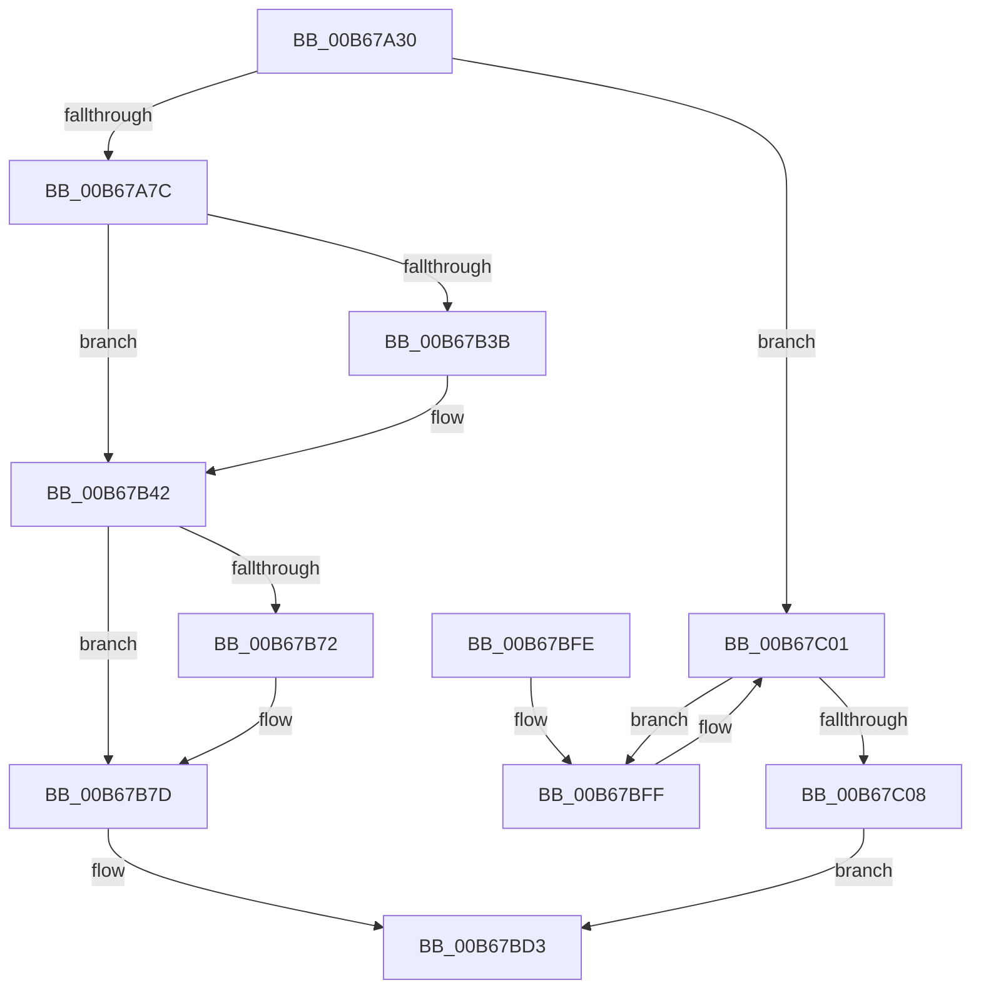

# KiInitializeDynamicProcessorDpc

- RVA: `0x00B67A30`–`0x00B67C0A` (길이 `474` bytes)
- VA: `0x0000000140B67A30`
- 실행 섹션: `PAGELK`
- PDB 이름 있음: `예`; PDB Function 태그: `아니요`
- unwind 정보 RVA: `0x000CA498`
- 디코드: `114`개 명령, `474/474` bytes 표시
- 미해석 바이트: `0` (있으면 어셈블리에 `.byte`로 보존)

> 이 문서는 커널 이미지의 기계어와 PDB 기호를 분석해 생성했습니다. 4번과 5번은 함수 원형과 자료형을 바이너리 사용 방식에서 추정한 C 해석이며 원본 소스 복구 결과는 아닙니다.

## 1. Dependencies

- 직접 호출 지점: **20**; 고유 호출 대상: **18**
- 직접 호출자로 확인된 함수: **0**
- RIP 상대 이미지 참조: **9**

### Outgoing calls
- `0x00B67A67` → [memset](../../text/6C/memset_function_006C6C40.md) (function, `0x006C6C40`)
- `0x00B67A6F` → [KeSignalCallDpcSynchronize](../../text/43/KeSignalCallDpcSynchronize_function_0043DFA0.md) (function, `0x0043DFA0`)
- `0x00B67ACC` → [KeIpiGenericCall](../../text/47/KeIpiGenericCall_function_00471720.md) (function, `0x00471720`)
- `0x00B67AD4` → [KiInitializeProcessor](KiInitializeProcessor_function_00B66A0C.md) (function, `0x00B66A0C`)
- `0x00B67ADC` → [KiConfigureProcessorBlock](KiConfigureProcessorBlock_function_00B663E8.md) (function, `0x00B663E8`)
- `0x00B67AF1` → [KeSetAffinityProcess](../../text/3C/KeSetAffinityProcess_function_003C0A60.md) (function, `0x003C0A60`)
- `0x00B67B10` → [memset](../../text/6C/memset_function_006C6C40.md) (function, `0x006C6C40`)
- `0x00B67B20` → [KeAddProcessorAffinityEx](../../text/25/KeAddProcessorAffinityEx_function_0025B6F0.md) (function, `0x0025B6F0`)
- `0x00B67B3D` → [KiRaiseIrqlProcessIrqlFlags](../../text/4F/KiRaiseIrqlProcessIrqlFlags_function_004F56FC.md) (function, `0x004F56FC`)
- `0x00B67B5F` → [KiIpiSendPacket](../../text/47/KiIpiSendPacket_function_004711DC.md) (function, `0x004711DC`)
- `0x00B67B64` → [KiIpiStallOnPacketTargets](../../text/47/KiIpiStallOnPacketTargets_function_004718D8.md) (function, `0x004718D8`)
- `0x00B67B78` → [KiLowerIrqlProcessIrqlFlags](../../text/4F/KiLowerIrqlProcessIrqlFlags_function_004F5698.md) (function, `0x004F5698`)
- `0x00B67B84` → [KeRestoreMtrrBroadcast](KeRestoreMtrrBroadcast_function_00B67C90.md) (function, `0x00B67C90`)
- `0x00B67B99` → [guard_dispatch_icall](../../text/6B/guard_dispatch_icall_function_006BAAD0.md) (function, `0x006BAAD0`)
- `0x00B67BA1` → [KiConfigureSchedulingInformation](KiConfigureSchedulingInformation_function_00B66518.md) (function, `0x00B66518`)
- `0x00B67BA9` → [KiFinalizeCoreControlBlockAssignment](../../text/5B/KiFinalizeCoreControlBlockAssignment_function_005B7D0C.md) (function, `0x005B7D0C`)
- `0x00B67BBB` → [KiReconfigureSubNodeSchedulingInformation](../../text/5B/KiReconfigureSubNodeSchedulingInformation_function_005B844C.md) (function, `0x005B844C`)
- `0x00B67BC0` → [KiConfigureCooperativeIdleSearchTargets](../../text/5B/KiConfigureCooperativeIdleSearchTargets_function_005B79D4.md) (function, `0x005B79D4`)
- `0x00B67BDC` → [KiConfigureSchedulingInformation](KiConfigureSchedulingInformation_function_00B66518.md) (function, `0x00B66518`)
- `0x00B67BEB` → [_security_check_cookie](../../text/6A/_security_check_cookie_function_006AC640.md) (function, `0x006AC640`)

### Direct callers
- 이 함수 시작 RVA로 연결되는 직접 call은 확인되지 않았습니다. 간접 호출은 완전히 역산할 수 없습니다.

### Static image references
- `0x00B67A43` → RVA `0x00E0A740` (`.data`; read)
- `0x00B67A9C` → RVA `0x00B67C10` (`KiUpdateNumberProcessorsIpi`; read)
- `0x00B67AAF` → RVA `0x00FC6A80` (`ALMOSTRO`; read)
- `0x00B67AE1` → RVA `0x00FC6AB0` (`ALMOSTRO`; read)
- `0x00B67AE8` → RVA `0x00FC7120` (`ALMOSTRO`; read)
- `0x00B67B32` → RVA `0x00FC6D20` (`ALMOSTRO`; read)
- `0x00B67B48` → RVA `0x005BD9A0` (`KiInitDynamicProcessorIpi`; read)
- `0x00B67B8E` → RVA `0x00E00910` (`.data`; read)
- `0x00B67BC5` → RVA `0x00FC6C50` (`ALMOSTRO`; write)

## 2. Other-region calls and transfers

- 다른 실행 섹션으로 향하는 call: **15**
  - `0x00B67A67` → [memset](../../text/6C/memset_function_006C6C40.md) (`PAGELK` → `.text`)
  - `0x00B67A6F` → [KeSignalCallDpcSynchronize](../../text/43/KeSignalCallDpcSynchronize_function_0043DFA0.md) (`PAGELK` → `.text`)
  - `0x00B67ACC` → [KeIpiGenericCall](../../text/47/KeIpiGenericCall_function_00471720.md) (`PAGELK` → `.text`)
  - `0x00B67AF1` → [KeSetAffinityProcess](../../text/3C/KeSetAffinityProcess_function_003C0A60.md) (`PAGELK` → `.text`)
  - `0x00B67B10` → [memset](../../text/6C/memset_function_006C6C40.md) (`PAGELK` → `.text`)
  - `0x00B67B20` → [KeAddProcessorAffinityEx](../../text/25/KeAddProcessorAffinityEx_function_0025B6F0.md) (`PAGELK` → `.text`)
  - `0x00B67B3D` → [KiRaiseIrqlProcessIrqlFlags](../../text/4F/KiRaiseIrqlProcessIrqlFlags_function_004F56FC.md) (`PAGELK` → `.text`)
  - `0x00B67B5F` → [KiIpiSendPacket](../../text/47/KiIpiSendPacket_function_004711DC.md) (`PAGELK` → `.text`)
  - `0x00B67B64` → [KiIpiStallOnPacketTargets](../../text/47/KiIpiStallOnPacketTargets_function_004718D8.md) (`PAGELK` → `.text`)
  - `0x00B67B78` → [KiLowerIrqlProcessIrqlFlags](../../text/4F/KiLowerIrqlProcessIrqlFlags_function_004F5698.md) (`PAGELK` → `.text`)
  - `0x00B67B99` → [guard_dispatch_icall](../../text/6B/guard_dispatch_icall_function_006BAAD0.md) (`PAGELK` → `.text`)
  - `0x00B67BA9` → [KiFinalizeCoreControlBlockAssignment](../../text/5B/KiFinalizeCoreControlBlockAssignment_function_005B7D0C.md) (`PAGELK` → `.text`)
  - `0x00B67BBB` → [KiReconfigureSubNodeSchedulingInformation](../../text/5B/KiReconfigureSubNodeSchedulingInformation_function_005B844C.md) (`PAGELK` → `.text`)
  - `0x00B67BC0` → [KiConfigureCooperativeIdleSearchTargets](../../text/5B/KiConfigureCooperativeIdleSearchTargets_function_005B79D4.md) (`PAGELK` → `.text`)
  - `0x00B67BEB` → [_security_check_cookie](../../text/6A/_security_check_cookie_function_006AC640.md) (`PAGELK` → `.text`)
- 별도 외부 분기/꼬리 이동을 확인하지 못했습니다.

## 3. Assembly (complete function range)

```asm
00B67A30  40 55                           push rbp
00B67A32  53                              push rbx
00B67A33  56                              push rsi
00B67A34  57                              push rdi
00B67A35  41 54                           push r12
00B67A37  48 8D 6C 24 90                  lea rbp, [rsp - 0x70]
00B67A3C  48 81 EC 70 01 00 00            sub rsp, 0x170
00B67A43  48 8B 05 F6 2C 2A 00            mov rax, qword ptr [rip + 0x2a2cf6]
00B67A4A  48 33 C4                        xor rax, rsp
00B67A4D  48 89 45 60                     mov qword ptr [rbp + 0x60], rax
00B67A51  49 8B F0                        mov rsi, r8
00B67A54  48 8D 4C 24 58                  lea rcx, [rsp + 0x58]
00B67A59  48 8B FA                        mov rdi, rdx
00B67A5C  41 B8 00 01 00 00               mov r8d, 0x100
00B67A62  33 D2                           xor edx, edx
00B67A64  49 8B D9                        mov rbx, r9
00B67A67  E8 D4 F1 B5 FF                  call 0x1406c6c40
00B67A6C  48 8B CB                        mov rcx, rbx
00B67A6F  E8 2C 65 8D FF                  call 0x14043dfa0
00B67A74  85 C0                           test eax, eax
00B67A76  0F 84 85 01 00 00               je 0x140b67c01
00B67A7C  48 8B 07                        mov rax, qword ptr [rdi]
00B67A7F  48 8D 54 24 30                  lea rdx, [rsp + 0x30]
00B67A84  48 83 64 24 38 00               and qword ptr [rsp + 0x38], 0
00B67A8A  41 BC 01 00 00 00               mov r12d, 1
00B67A90  83 64 24 40 00                  and dword ptr [rsp + 0x40], 0
00B67A95  8B 48 24                        mov ecx, dword ptr [rax + 0x24]
00B67A98  89 4C 24 30                     mov dword ptr [rsp + 0x30], ecx
00B67A9C  48 8D 0D 6D 01 00 00            lea rcx, [rip + 0x16d]
00B67AA3  65 8B 04 25 A4 01 00 00         mov eax, dword ptr gs:[0x1a4]
00B67AAB  89 44 24 34                     mov dword ptr [rsp + 0x34], eax
00B67AAF  8B 05 CB EF 45 00               mov eax, dword ptr [rip + 0x45efcb]
00B67AB5  41 2B C4                        sub eax, r12d
00B67AB8  89 44 24 38                     mov dword ptr [rsp + 0x38], eax
00B67ABC  8B 44 24 38                     mov eax, dword ptr [rsp + 0x38]
00B67AC0  89 44 24 3C                     mov dword ptr [rsp + 0x3c], eax
00B67AC4  C7 44 24 40 00 00 00 00         mov dword ptr [rsp + 0x40], 0
00B67ACC  E8 4F 9C 90 FF                  call 0x140471720
00B67AD1  48 8B 0F                        mov rcx, qword ptr [rdi]
00B67AD4  E8 33 EF FF FF                  call 0x140b66a0c
00B67AD9  48 8B 0F                        mov rcx, qword ptr [rdi]
00B67ADC  E8 07 E9 FF FF                  call 0x140b663e8
00B67AE1  48 8B 0D C8 EF 45 00            mov rcx, qword ptr [rip + 0x45efc8]
00B67AE8  4C 8D 05 31 F6 45 00            lea r8, [rip + 0x45f631]
00B67AEF  33 D2                           xor edx, edx
00B67AF1  E8 6A 8F 85 FF                  call 0x1403c0a60
00B67AF6  83 64 24 54 00                  and dword ptr [rsp + 0x54], 0
00B67AFB  48 8D 4C 24 58                  lea rcx, [rsp + 0x58]
00B67B00  33 D2                           xor edx, edx
00B67B02  C7 44 24 50 01 00 20 00         mov dword ptr [rsp + 0x50], 0x200001
00B67B0A  41 B8 00 01 00 00               mov r8d, 0x100
00B67B10  E8 2B F1 B5 FF                  call 0x1406c6c40
00B67B15  48 8B 17                        mov rdx, qword ptr [rdi]
00B67B18  48 8D 4C 24 50                  lea rcx, [rsp + 0x50]
00B67B1D  8B 52 24                        mov edx, dword ptr [rdx + 0x24]
00B67B20  E8 CB 3B 6F FF                  call 0x14025b6f0
00B67B25  44 0F 20 C3                     mov rbx, cr8
00B67B29  41 8D 54 24 0B                  lea edx, [r12 + 0xb]
00B67B2E  44 0F 22 C2                     mov cr8, rdx
00B67B32  83 3D E7 F1 45 00 00            cmp dword ptr [rip + 0x45f1e7], 0
00B67B39  74 07                           je 0x140b67b42
00B67B3B  8A CB                           mov cl, bl
00B67B3D  E8 BA DB 98 FF                  call 0x1404f56fc
00B67B42  48 83 64 24 28 00               and qword ptr [rsp + 0x28], 0
00B67B48  4C 8D 05 51 5E A5 FF            lea r8, [rip - 0x5aa1af]
00B67B4F  48 83 64 24 20 00               and qword ptr [rsp + 0x20], 0
00B67B55  48 8D 54 24 50                  lea rdx, [rsp + 0x50]
00B67B5A  45 33 C9                        xor r9d, r9d
00B67B5D  33 C9                           xor ecx, ecx
00B67B5F  E8 78 96 90 FF                  call 0x1404711dc
00B67B64  E8 6F 9D 90 FF                  call 0x1404718d8
00B67B69  83 3D B0 F1 45 00 00            cmp dword ptr [rip + 0x45f1b0], 0
00B67B70  74 0B                           je 0x140b67b7d
00B67B72  44 0F 20 C1                     mov rcx, cr8
00B67B76  8A D3                           mov dl, bl
00B67B78  E8 1B DB 98 FF                  call 0x1404f5698
00B67B7D  0F B6 C3                        movzx eax, bl
00B67B80  44 0F 22 C0                     mov cr8, rax
00B67B84  E8 07 01 00 00                  call 0x140b67c90
00B67B89  48 8B 17                        mov rdx, qword ptr [rdi]
00B67B8C  33 C9                           xor ecx, ecx
00B67B8E  48 8B 05 7B 8D 29 00            mov rax, qword ptr [rip + 0x298d7b]
00B67B95  48 83 C2 24                     add rdx, 0x24
00B67B99  E8 32 2F B5 FF                  call 0x1406baad0
00B67B9E  48 8B 0F                        mov rcx, qword ptr [rdi]
00B67BA1  E8 72 E9 FF FF                  call 0x140b66518
00B67BA6  48 8B 0F                        mov rcx, qword ptr [rdi]
00B67BA9  E8 5E 01 A5 FF                  call 0x1405b7d0c
00B67BAE  48 8B 0F                        mov rcx, qword ptr [rdi]
00B67BB1  48 8B D1                        mov rdx, rcx
00B67BB4  48 8B 89 C0 00 00 00            mov rcx, qword ptr [rcx + 0xc0]
00B67BBB  E8 8C 08 A5 FF                  call 0x1405b844c
00B67BC0  E8 0F FE A4 FF                  call 0x1405b79d4
00B67BC5  C7 05 81 F0 45 00 00 00 00 00   mov dword ptr [rip + 0x45f081], 0
00B67BCF  44 88 67 08                     mov byte ptr [rdi + 8], r12b
00B67BD3  65 48 8B 0C 25 20 00 00 00      mov rcx, qword ptr gs:[0x20]
00B67BDC  E8 37 E9 FF FF                  call 0x140b66518
00B67BE1  F0 FF 0E                        lock dec dword ptr [rsi]
00B67BE4  48 8B 4D 60                     mov rcx, qword ptr [rbp + 0x60]
00B67BE8  48 33 CC                        xor rcx, rsp
00B67BEB  E8 50 4A B4 FF                  call 0x1406ac640
00B67BF0  48 81 C4 70 01 00 00            add rsp, 0x170
00B67BF7  41 5C                           pop r12
00B67BF9  5F                              pop rdi
00B67BFA  5E                              pop rsi
00B67BFB  5B                              pop rbx
00B67BFC  5D                              pop rbp
00B67BFD  C3                              ret
00B67BFE  CC                              int3
00B67BFF  F3 90                           pause
00B67C01  8A 47 08                        mov al, byte ptr [rdi + 8]
00B67C04  84 C0                           test al, al
00B67C06  74 F7                           je 0x140b67bff
00B67C08  EB C9                           jmp 0x140b67bd3
```

## 4. C-style interpretation (structured pseudocode)

```c
__int64 __fastcall KiInitializeDynamicProcessorDpc(__int64 a1, __int64 a2, __int64 a3, __int64 a4)
{
    __int64 result;
    __int64 v_rsp;
    unsigned __int64 v_stack_m140;
    unsigned int v_stack_m144;
    unsigned int v_stack_m148;
    unsigned int v_stack_m158;
    unsigned int v_stack_m15C;
    unsigned __int64 v_stack_m160;
    unsigned int v_stack_m164;
    unsigned __int64 v_stack_m168;
    unsigned __int64 v_stack_m170;
    unsigned __int64 v_stack_m178;
    unsigned __int64 v_stack_m38;
    unsigned __int64 v_stack_m98;

    v_rsp = (v_rsp) - (368);
    result = (*(unsigned __int64 *)(v_rip + 2764022)) ^ (v_rsp);
    v_stack_m38 = result;
    a2 = 0;
    result = memset(v_stack_m140, a2, 256, a4);
    result = KeSignalCallDpcSynchronize(a4, a2, 256, a4);
    if ((unsigned int)(result) == 0) goto loc_00B67C01;
    v_stack_m168 = (unsigned int)((unsigned int)(*(unsigned int *)(*(unsigned __int64 *)(a2) + 36)));
    v_stack_m164 = (unsigned int)((unsigned int)(*(unsigned int *)(gs_base + (0 + 420))));
    result = (unsigned int)(((unsigned int)(*(unsigned int *)(v_rip + 4583371))) - (1));
    v_stack_m160 = (unsigned int)(result);
    v_stack_m15C = (unsigned int)((unsigned int)(v_stack_m160));
    v_stack_m158 = 0;
    result = KeIpiGenericCall(v_rip + 365, v_stack_m168, 256, a4);
    result = KiInitializeProcessor(*(unsigned __int64 *)(a2), v_stack_m168, 256, a4);
    result = KiConfigureProcessorBlock(*(unsigned __int64 *)(a2), v_stack_m168, 256, a4);
    a2 = 0;
    result = KeSetAffinityProcess(*(unsigned __int64 *)(v_rip + 4583368), a2, v_rip + 4585009, a4);
    a2 = 0;
    v_stack_m148 = 0x200001ULL;
    result = memset(v_stack_m140, a2, 256, a4);
    result = KeAddProcessorAffinityEx(v_stack_m148, (unsigned int)(*(unsigned int *)(*(unsigned __int64 *)(a2) + 36)), 256, a4);
    if ((*(unsigned int *)(v_rip + 4583911)) != 0) {
        a1 = (unsigned __int8)(v_cr8);
        result = KiRaiseIrqlProcessIrqlFlags(a1, 1 + 11, 256, a4);
    }
    a4 = 0;
    a1 = 0;
    result = KiIpiSendPacket(a1, v_stack_m148, v_rip - 5939631, a4);
    result = KiIpiStallOnPacketTargets(a1, v_stack_m148, v_rip - 5939631, a4);
    if ((*(unsigned int *)(v_rip + 4583856)) != 0) {
        a1 = 1 + 11;
        a2 = (unsigned __int8)(v_cr8);
        result = KiLowerIrqlProcessIrqlFlags(a1, a2, v_rip - 5939631, a4);
    }
    result = KeRestoreMtrrBroadcast(a1, a2, v_rip - 5939631, a4);
    a1 = 0;
    a2 = (*(unsigned __int64 *)(a2)) + (36);
    result = guard_dispatch_icall(a1, a2, v_rip - 5939631, a4);
    result = KiConfigureSchedulingInformation(*(unsigned __int64 *)(a2), a2, v_rip - 5939631, a4);
    result = KiFinalizeCoreControlBlockAssignment(*(unsigned __int64 *)(a2), a2, v_rip - 5939631, a4);
    result = KiReconfigureSubNodeSchedulingInformation(*(unsigned __int64 *)(*(unsigned __int64 *)(a2) + 192), *(unsigned __int64 *)(a2), v_rip - 5939631, a4);
    result = KiConfigureCooperativeIdleSearchTargets(*(unsigned __int64 *)(*(unsigned __int64 *)(a2) + 192), *(unsigned __int64 *)(a2), v_rip - 5939631, a4);
    *(unsigned int *)(v_rip + 4583553) = 0;
    *(unsigned __int8 *)(a2 + 8) = 1;
loc_00B67BD3:
    result = KiConfigureSchedulingInformation(*(unsigned __int64 *)(gs_base + (0 + 32)), *(unsigned __int64 *)(a2), v_rip - 5939631, a4);
    a1 = (v_stack_m38) ^ (v_rsp);
    result = _security_check_cookie(a1, *(unsigned __int64 *)(a2), v_rip - 5939631, a4);
    v_rsp = (v_rsp) + (368);
    return result;
loc_00B67BFF:
loc_00B67C01:
    if ((unsigned __int8)(*(unsigned __int8 *)(a2 + 8)) == 0) goto loc_00B67BFF;
    goto loc_00B67BD3;
}
```

## 5. (Beta) C Style

```c
int64_t KiInitializeDynamicProcessorDpc(int64_t Arg1, void *Arg2, void *Arg3, int64_t Arg4)
{
    uint8_t *arg2 = (uint8_t *)Arg2;
    uint8_t *arg3 = (uint8_t *)Arg3;

    int64_t result;
    int64_t local_rsp;
    uint64_t v_stack_m140;
    uint32_t v_stack_m144;
    uint32_t v_stack_m148;
    uint32_t v_stack_m158;
    uint32_t v_stack_m15C;
    uint64_t v_stack_m160;
    uint32_t v_stack_m164;
    uint64_t v_stack_m168;
    uint64_t v_stack_m170;
    uint64_t v_stack_m178;
    uint64_t v_stack_m38;
    uint64_t v_stack_m98;

    local_rsp = (local_rsp) - (368);
    result = (*(uint64_t *)(v_rip + 0x2A2CF6)) ^ (local_rsp);
    v_stack_m38 = result;
    Arg2 = 0;
    result = memset(v_stack_m140, Arg2, 256, Arg4);
    result = KeSignalCallDpcSynchronize(Arg4, Arg2, 256, Arg4);
    if ((uint32_t)(result) == 0) goto loc_00B67C01;
    v_stack_m168 = (uint32_t)((uint32_t)(*(uint32_t *)(*(uint64_t *)(arg2) + 0x24)));
    v_stack_m164 = (uint32_t)((uint32_t)(*(uint32_t *)(gs_base + (0 + 0x1A4))));
    result = (uint32_t)(((uint32_t)(*(uint32_t *)(v_rip + 0x45EFCB))) - (1));
    v_stack_m160 = (uint32_t)(result);
    v_stack_m15C = (uint32_t)((uint32_t)(v_stack_m160));
    v_stack_m158 = 0;
    result = KeIpiGenericCall(v_rip + 365, v_stack_m168, 256, Arg4);
    result = KiInitializeProcessor(*(uint64_t *)(arg2), v_stack_m168, 256, Arg4);
    result = KiConfigureProcessorBlock(*(uint64_t *)(arg2), v_stack_m168, 256, Arg4);
    Arg2 = 0;
    result = KeSetAffinityProcess(*(uint64_t *)(v_rip + 0x45EFC8), Arg2, v_rip + 4585009, Arg4);
    Arg2 = 0;
    v_stack_m148 = 0x200001ULL;
    result = memset(v_stack_m140, Arg2, 256, Arg4);
    result = KeAddProcessorAffinityEx(v_stack_m148, (uint32_t)(*(uint32_t *)(*(uint64_t *)(arg2) + 0x24)), 256, Arg4);
    if ((*(uint32_t *)(v_rip + 0x45F1E7)) != 0) {
        Arg1 = (uint8_t)(v_cr8);
        result = KiRaiseIrqlProcessIrqlFlags(Arg1, 1 + 11, 256, Arg4);
    }
    Arg4 = 0;
    Arg1 = 0;
    result = KiIpiSendPacket(Arg1, v_stack_m148, v_rip - 5939631, Arg4);
    result = KiIpiStallOnPacketTargets(Arg1, v_stack_m148, v_rip - 5939631, Arg4);
    if ((*(uint32_t *)(v_rip + 0x45F1B0)) != 0) {
        Arg1 = 1 + 11;
        Arg2 = (uint8_t)(v_cr8);
        result = KiLowerIrqlProcessIrqlFlags(Arg1, Arg2, v_rip - 5939631, Arg4);
    }
    result = KeRestoreMtrrBroadcast(Arg1, Arg2, v_rip - 5939631, Arg4);
    Arg1 = 0;
    Arg2 = (*(uint64_t *)(arg2)) + (36);
    result = guard_dispatch_icall(Arg1, Arg2, v_rip - 5939631, Arg4);
    result = KiConfigureSchedulingInformation(*(uint64_t *)(arg2), Arg2, v_rip - 5939631, Arg4);
    result = KiFinalizeCoreControlBlockAssignment(*(uint64_t *)(arg2), Arg2, v_rip - 5939631, Arg4);
    result = KiReconfigureSubNodeSchedulingInformation(*(uint64_t *)(*(uint64_t *)(arg2) + 0xC0), *(uint64_t *)(arg2), v_rip - 5939631, Arg4);
    result = KiConfigureCooperativeIdleSearchTargets(*(uint64_t *)(*(uint64_t *)(arg2) + 0xC0), *(uint64_t *)(arg2), v_rip - 5939631, Arg4);
    *(uint32_t *)(v_rip + 0x45F081) = 0;
    *(uint8_t *)(arg2 + 0x8) = 1;
loc_00B67BD3:
    result = KiConfigureSchedulingInformation(*(uint64_t *)(gs_base + (0 + 0x20)), *(uint64_t *)(arg2), v_rip - 5939631, Arg4);
    Arg1 = (v_stack_m38) ^ (local_rsp);
    result = _security_check_cookie(Arg1, *(uint64_t *)(arg2), v_rip - 5939631, Arg4);
    local_rsp = (local_rsp) + (368);
    return result;
loc_00B67BFF:
loc_00B67C01:
    if ((uint8_t)(*(uint8_t *)(arg2 + 0x8)) == 0) goto loc_00B67BFF;
    goto loc_00B67BD3;
}
```

### 관측된 메모리 오프셋

구조체 형식이 확인되지 않은 접근은 인자 기준의 오프셋으로만 기록했습니다.

| 기준 인자 | 오프셋 표현 | 폭 (bit) | 접근 |
|---|---:|---:|---|
| `Arg2` | `+ 0x0` | `64` | `R` |
| `Arg2` | `+ 0x8` | `8` | `R` |
| `Arg2` | `+ 0x8` | `8` | `W` |
| `Arg3` | `+ 0x0` | `32` | `R/W` |

## 6. Execution-region graph

[열기: 2D/3D 그래프와 함수 탐색 컨트롤 패널](../../../control-panel.html?section=pagelk&rva=0x00B67A30&view=graph)

- 2D 그래프는 위에서 아래로 흐르고, 3D 그래프는 빈 공간을 드래그해 회전합니다. Shift+드래그는 이동, 휠은 확대·축소, 함수 노드 선택은 대상 보고서 이동입니다.

### Static fallback


