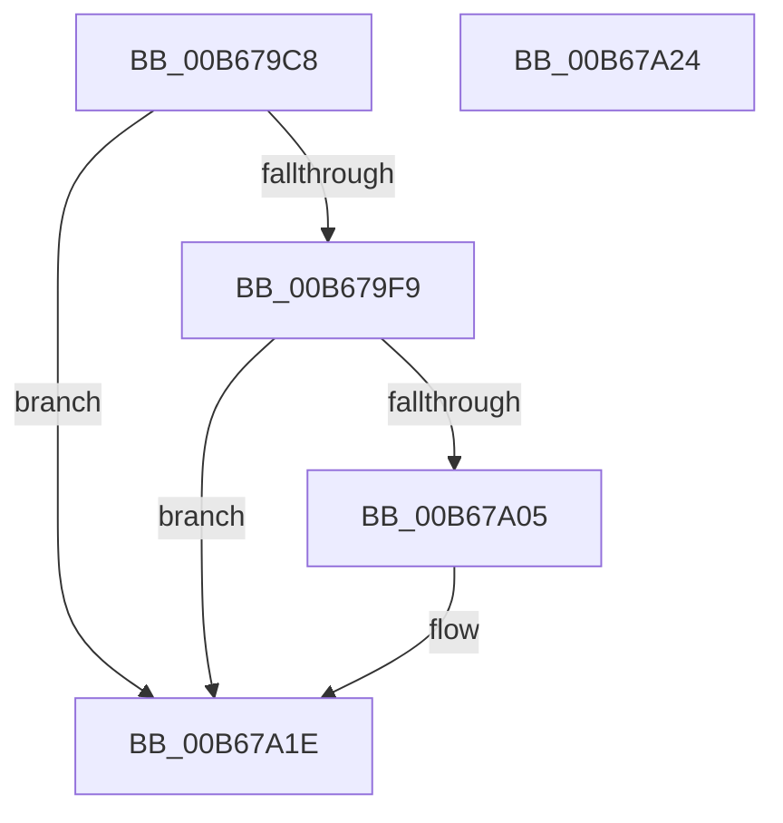

# KiInitializeDynamicProcessor

- RVA: `0x00B679C8`–`0x00B67A25` (길이 `93` bytes)
- VA: `0x0000000140B679C8`
- 실행 섹션: `PAGELK`
- PDB 이름 있음: `예`; PDB Function 태그: `아니요`
- unwind 정보 RVA: `0x0007F554`
- 디코드: `27`개 명령, `93/93` bytes 표시
- 미해석 바이트: `0` (있으면 어셈블리에 `.byte`로 보존)

> 이 문서는 커널 이미지의 기계어와 PDB 기호를 분석해 생성했습니다. 4번과 5번은 함수 원형과 자료형을 바이너리 사용 방식에서 추정한 C 해석이며 원본 소스 복구 결과는 아닙니다.

## 1. Dependencies

- 직접 호출 지점: **3**; 고유 호출 대상: **3**
- 직접 호출자로 확인된 함수: **1**
- RIP 상대 이미지 참조: **2**

### Outgoing calls
- `0x00B679EB` → [KeGenericCallDpc](../../text/49/KeGenericCallDpc_function_0049F980.md) (function, `0x0049F980`)
- `0x00B679FC` → [KiStartDpcThread](../../page/74/KiStartDpcThread_function_00745628.md) (function, `0x00745628`)
- `0x00B67A18` → [KeBugCheckEx](../../text/4F/KeBugCheckEx_function_004FD660.md) (function, `0x004FD660`)

### Direct callers
- [KiStartDynamicProcessor](../../page/74/KiStartDynamicProcessor_function_007456C8.md) at `0x00745B99`

### Static image references
- `0x00B679E0` → RVA `0x00B67A30` (`KiInitializeDynamicProcessorDpc`; read)
- `0x00B679F0` → RVA `0x00FC519C` (`ALMOSTRO`; read)

## 2. Other-region calls and transfers

- 다른 실행 섹션으로 향하는 call: **3**
  - `0x00B679EB` → [KeGenericCallDpc](../../text/49/KeGenericCallDpc_function_0049F980.md) (`PAGELK` → `.text`)
  - `0x00B679FC` → [KiStartDpcThread](../../page/74/KiStartDpcThread_function_00745628.md) (`PAGELK` → `PAGE`)
  - `0x00B67A18` → [KeBugCheckEx](../../text/4F/KeBugCheckEx_function_004FD660.md) (`PAGELK` → `.text`)
- 별도 외부 분기/꼬리 이동을 확인하지 못했습니다.

## 3. Assembly (complete function range)

```asm
00B679C8  48 8B C4                        mov rax, rsp
00B679CB  53                              push rbx
00B679CC  48 83 EC 40                     sub rsp, 0x40
00B679D0  48 83 60 F0 00                  and qword ptr [rax - 0x10], 0
00B679D5  48 8D 50 E8                     lea rdx, [rax - 0x18]
00B679D9  48 8B D9                        mov rbx, rcx
00B679DC  48 89 48 E8                     mov qword ptr [rax - 0x18], rcx
00B679E0  48 8D 0D 49 00 00 00            lea rcx, [rip + 0x49]
00B679E7  C6 40 F0 00                     mov byte ptr [rax - 0x10], 0
00B679EB  E8 90 7F 93 FF                  call 0x14049f980
00B679F0  83 3D A5 D7 45 00 00            cmp dword ptr [rip + 0x45d7a5], 0
00B679F7  74 25                           je 0x140b67a1e
00B679F9  48 8B CB                        mov rcx, rbx
00B679FC  E8 27 DC BD FF                  call 0x140745628
00B67A01  85 C0                           test eax, eax
00B67A03  79 19                           jns 0x140b67a1e
00B67A05  48 83 64 24 20 00               and qword ptr [rsp + 0x20], 0
00B67A0B  45 33 C9                        xor r9d, r9d
00B67A0E  48 63 D0                        movsxd rdx, eax
00B67A11  45 33 C0                        xor r8d, r8d
00B67A14  41 8D 49 33                     lea ecx, [r9 + 0x33]
00B67A18  E8 43 5C 99 FF                  call 0x1404fd660
00B67A1D  CC                              int3
00B67A1E  48 83 C4 40                     add rsp, 0x40
00B67A22  5B                              pop rbx
00B67A23  C3                              ret
00B67A24  CC                              int3
```

## 4. C-style interpretation (structured pseudocode)

```c
__int64 __fastcall KiInitializeDynamicProcessor(__int64 a1, __int64 a2, int a3, int a4)
{
    __int64 result;
    __int64 v_rsp;
    unsigned __int64 v_stack_m28;

    v_rsp = (v_rsp) - (64);
    *(unsigned __int64 *)(v_rsp - 24) = a1;
    *(unsigned __int8 *)(v_rsp - 16) = 0;
    result = KeGenericCallDpc(v_rip + 73, v_rsp - 24, a3, a4);
    if ((*(unsigned int *)(v_rip + 4577189)) == 0) goto loc_00B67A1E;
    result = KiStartDpcThread(a1, v_rsp - 24, a3, a4);
    if (sign_flag) {
        a4 = 0;
        a2 = (int)((unsigned int)(result));
        a3 = 0;
        a1 = a4 + 51;
        result = KeBugCheckEx(a1, a2, a3, a4);
    }
    v_rsp = (v_rsp) + (64);
    return result;
}
```

## 5. (Beta) C Style

```c
int64_t KiInitializeDynamicProcessor(int64_t Arg1, int64_t Arg2, int32_t Arg3, int32_t Arg4)
{
    int64_t result;
    int64_t local_rsp;
    uint64_t v_stack_m28;

    local_rsp = (local_rsp) - (64);
    *(uint64_t *)(local_rsp - 0x18) = Arg1;
    *(uint8_t *)(local_rsp - 0x10) = 0;
    result = KeGenericCallDpc(v_rip + 73, local_rsp - 24, Arg3, Arg4);
    if ((*(uint32_t *)(v_rip + 0x45D7A5)) == 0) goto loc_00B67A1E;
    result = KiStartDpcThread(Arg1, local_rsp - 24, Arg3, Arg4);
    if (sign_flag) {
        Arg4 = 0;
        Arg2 = (int32_t)((uint32_t)(result));
        Arg3 = 0;
        Arg1 = Arg4 + 51;
        result = KeBugCheckEx(Arg1, Arg2, Arg3, Arg4);
    }
    local_rsp = (local_rsp) + (64);
    return result;
}
```

## 6. Execution-region graph

[열기: 2D/3D 그래프와 함수 탐색 컨트롤 패널](../../../control-panel.html?section=pagelk&rva=0x00B679C8&view=graph)

- 2D 그래프는 위에서 아래로 흐르고, 3D 그래프는 빈 공간을 드래그해 회전합니다. Shift+드래그는 이동, 휠은 확대·축소, 함수 노드 선택은 대상 보고서 이동입니다.

### Static fallback


