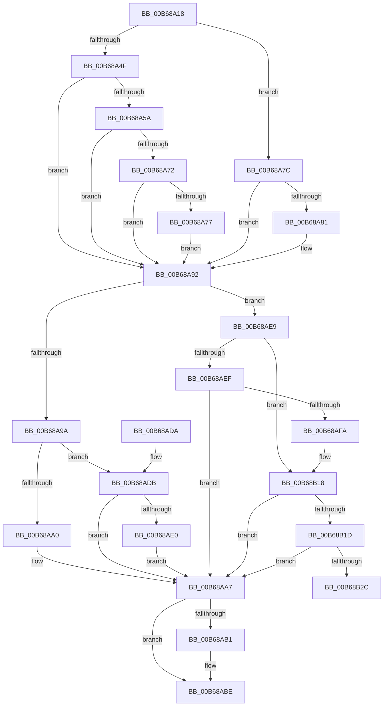

# KiInitializeHresetSupport

- RVA: `0x00B68A18`–`0x00B68B4A` (길이 `306` bytes)
- VA: `0x0000000140B68A18`
- 실행 섹션: `PAGELK`
- PDB 이름 있음: `예`; PDB Function 태그: `아니요`
- unwind 정보 RVA: `0x000CA754`
- 디코드: `91`개 명령, `306/306` bytes 표시
- 미해석 바이트: `0` (있으면 어셈블리에 `.byte`로 보존)

> 이 문서는 커널 이미지의 기계어와 PDB 기호를 분석해 생성했습니다. 4번과 5번은 함수 원형과 자료형을 바이너리 사용 방식에서 추정한 C 해석이며 원본 소스 복구 결과는 아닙니다.

## 1. Dependencies

- 직접 호출 지점: **3**; 고유 호출 대상: **2**
- 직접 호출자로 확인된 함수: **1**
- RIP 상대 이미지 참조: **5**

### Outgoing calls
- `0x00B68AC5` → [_security_check_cookie](../../text/6A/_security_check_cookie_function_006AC640.md) (function, `0x006AC640`)
- `0x00B68B12` → [KeBugCheckEx](../../text/4F/KeBugCheckEx_function_004FD660.md) (function, `0x004FD660`)
- `0x00B68B44` → [KeBugCheckEx](../../text/4F/KeBugCheckEx_function_004FD660.md) (function, `0x004FD660`)

### Direct callers
- [KiSetFeatureBits](KiSetFeatureBits_function_00B6A03C.md) at `0x00B6A8A7`

### Static image references
- `0x00B68A2A` → RVA `0x00E0A740` (`.data`; read)
- `0x00B68AA0` → RVA `0x00FC6CE8` (`ALMOSTRO`; write)
- `0x00B68AA7` → RVA `0x00FC6CE8` (`ALMOSTRO`; read)
- `0x00B68AE0` → RVA `0x00FC6E90` (`ALMOSTRO`; write)
- `0x00B68B1D` → RVA `0x00FC6E90` (`ALMOSTRO`; read)

## 2. Other-region calls and transfers

- 다른 실행 섹션으로 향하는 call: **3**
  - `0x00B68AC5` → [_security_check_cookie](../../text/6A/_security_check_cookie_function_006AC640.md) (`PAGELK` → `.text`)
  - `0x00B68B12` → [KeBugCheckEx](../../text/4F/KeBugCheckEx_function_004FD660.md) (`PAGELK` → `.text`)
  - `0x00B68B44` → [KeBugCheckEx](../../text/4F/KeBugCheckEx_function_004FD660.md) (`PAGELK` → `.text`)
- 별도 외부 분기/꼬리 이동을 확인하지 못했습니다.

## 3. Assembly (complete function range)

```asm
00B68A18  48 89 5C 24 10                  mov qword ptr [rsp + 0x10], rbx
00B68A1D  48 89 7C 24 18                  mov qword ptr [rsp + 0x18], rdi
00B68A22  55                              push rbp
00B68A23  48 8B EC                        mov rbp, rsp
00B68A26  48 83 EC 50                     sub rsp, 0x50
00B68A2A  48 8B 05 0F 1D 2A 00            mov rax, qword ptr [rip + 0x2a1d0f]
00B68A31  48 33 C4                        xor rax, rsp
00B68A34  48 89 45 F0                     mov qword ptr [rbp - 0x10], rax
00B68A38  44 8A 91 8D 00 00 00            mov r10b, byte ptr [rcx + 0x8d]
00B68A3F  45 33 C0                        xor r8d, r8d
00B68A42  4C 8B D9                        mov r11, rcx
00B68A45  41 8D 78 01                     lea edi, [r8 + 1]
00B68A49  41 80 FA 02                     cmp r10b, 2
00B68A4D  75 2D                           jne 0x140b68a7c
00B68A4F  33 C0                           xor eax, eax
00B68A51  33 C9                           xor ecx, ecx
00B68A53  0F A2                           cpuid
00B68A55  83 F8 20                        cmp eax, 0x20
00B68A58  72 38                           jb 0x140b68a92
00B68A5A  8D 47 06                        lea eax, [rdi + 6]
00B68A5D  8B CF                           mov ecx, edi
00B68A5F  0F A2                           cpuid
00B68A61  44 8B C8                        mov r9d, eax
00B68A64  33 C9                           xor ecx, ecx
00B68A66  8D 47 1F                        lea eax, [rdi + 0x1f]
00B68A69  0F A2                           cpuid
00B68A6B  41 0F BA E1 16                  bt r9d, 0x16
00B68A70  73 20                           jae 0x140b68a92
00B68A72  40 84 DF                        test dil, bl
00B68A75  74 1B                           je 0x140b68a92
00B68A77  44 8B C7                        mov r8d, edi
00B68A7A  EB 16                           jmp 0x140b68a92
00B68A7C  44 3A D7                        cmp r10b, dil
00B68A7F  75 11                           jne 0x140b68a92
00B68A81  33 C9                           xor ecx, ecx
00B68A83  B8 21 00 00 80                  mov eax, 0x80000021
00B68A88  0F A2                           cpuid
00B68A8A  0F BA E0 16                     bt eax, 0x16
00B68A8E  44 0F 42 C7                     cmovb r8d, edi
00B68A92  41 8B 53 24                     mov edx, dword ptr [r11 + 0x24]
00B68A96  85 D2                           test edx, edx
00B68A98  75 4F                           jne 0x140b68ae9
00B68A9A  41 80 FA 02                     cmp r10b, 2
00B68A9E  75 3B                           jne 0x140b68adb
00B68AA0  44 89 05 41 E2 45 00            mov dword ptr [rip + 0x45e241], r8d
00B68AA7  8B 05 3B E2 45 00               mov eax, dword ptr [rip + 0x45e23b]
00B68AAD  85 C0                           test eax, eax
00B68AAF  74 0D                           je 0x140b68abe
00B68AB1  8B D0                           mov edx, eax
00B68AB3  B9 DA 17 00 00                  mov ecx, 0x17da
00B68AB8  48 C1 EA 20                     shr rdx, 0x20
00B68ABC  0F 30                           wrmsr
00B68ABE  48 8B 4D F0                     mov rcx, qword ptr [rbp - 0x10]
00B68AC2  48 33 CC                        xor rcx, rsp
00B68AC5  E8 76 3B B4 FF                  call 0x1406ac640
00B68ACA  48 8B 5C 24 68                  mov rbx, qword ptr [rsp + 0x68]
00B68ACF  48 8B 7C 24 70                  mov rdi, qword ptr [rsp + 0x70]
00B68AD4  48 83 C4 50                     add rsp, 0x50
00B68AD8  5D                              pop rbp
00B68AD9  C3                              ret
00B68ADA  CC                              int3
00B68ADB  44 3A D7                        cmp r10b, dil
00B68ADE  75 C7                           jne 0x140b68aa7
00B68AE0  44 89 05 A9 E3 45 00            mov dword ptr [rip + 0x45e3a9], r8d
00B68AE7  EB BE                           jmp 0x140b68aa7
00B68AE9  41 80 FA 02                     cmp r10b, 2
00B68AED  75 29                           jne 0x140b68b18
00B68AEF  8B 05 F3 E1 45 00               mov eax, dword ptr [rip + 0x45e1f3]
00B68AF5  41 3B C0                        cmp eax, r8d
00B68AF8  74 AD                           je 0x140b68aa7
00B68AFA  41 8B C8                        mov ecx, r8d
00B68AFD  44 8B C8                        mov r9d, eax
00B68B00  48 89 4C 24 20                  mov qword ptr [rsp + 0x20], rcx
00B68B05  4C 8B C2                        mov r8, rdx
00B68B08  B9 5D 00 00 00                  mov ecx, 0x5d
00B68B0D  BA 53 45 52 48                  mov edx, 0x48524553
00B68B12  E8 49 4B 99 FF                  call 0x1404fd660
00B68B17  CC                              int3
00B68B18  44 3A D7                        cmp r10b, dil
00B68B1B  75 8A                           jne 0x140b68aa7
00B68B1D  8B 05 6D E3 45 00               mov eax, dword ptr [rip + 0x45e36d]
00B68B23  41 3B C0                        cmp eax, r8d
00B68B26  0F 84 7B FF FF FF               je 0x140b68aa7
00B68B2C  41 8B C8                        mov ecx, r8d
00B68B2F  44 8B C8                        mov r9d, eax
00B68B32  48 89 4C 24 20                  mov qword ptr [rsp + 0x20], rcx
00B68B37  4C 8B C2                        mov r8, rdx
00B68B3A  B9 5D 00 00 00                  mov ecx, 0x5d
00B68B3F  BA 53 45 52 48                  mov edx, 0x48524553
00B68B44  E8 17 4B 99 FF                  call 0x1404fd660
00B68B49  CC                              int3
```

## 4. C-style interpretation (structured pseudocode)

```c
__int64 __fastcall KiInitializeHresetSupport(__int64 a1, __int64 a2, int a3)
{
    __int64 result;
    __int64 v_rsp;
    unsigned __int64 v_stack_m18;
    unsigned __int64 v_stack_p10;
    unsigned __int64 v_stack_p18;
    unsigned __int64 v_stack_p20;

    v_stack_p10 = v_rbx;
    v_stack_p18 = v_rdi;
    v_rsp = (v_rsp) - (80);
    result = (*(unsigned __int64 *)(v_rip + 2759951)) ^ (v_rsp);
    v_stack_m18 = result;
    a3 = 0;
    if (((unsigned __int8)(*(unsigned __int8 *)(a1 + 141))) != 2) goto loc_00B68A7C;
    result = 0;
    a1 = 0;
    if (0 < 32) goto loc_00B68A92;
    a1 = 0;
    if (condition_is_above_or_equal) goto loc_00B68A92;
    if ((((unsigned __int8)(a3 + 1)) & ((unsigned __int8)(v_rbx))) == 0) goto loc_00B68A92;
    goto loc_00B68A92;
loc_00B68A7C:
    result = a3 + 1 + 31;
    if (((unsigned __int8)(*(unsigned __int8 *)(a1 + 141))) == ((unsigned __int8)(a3 + 1))) {
        a1 = 0;
        result = 0x80000021ULL;
        a3 = (unsigned int)((unsigned int)(a3 + 1));
        if (condition_is_below) { a3 = (unsigned int)(a3 + 1); }
    }
    if ((unsigned int)((unsigned int)(*(unsigned int *)(a1 + 36))) != 0) goto loc_00B68AE9;
    if (((unsigned __int8)(*(unsigned __int8 *)(a1 + 141))) != 2) goto loc_00B68ADB;
    *(unsigned int *)(v_rip + 4579905) = a3;
loc_00B68AA7:
    if ((unsigned int)((unsigned int)(*(unsigned int *)(v_rip + 4579899))) != 0) {
        a2 = (unsigned int)((unsigned int)(*(unsigned int *)(v_rip + 4579899)));
        a1 = 0x17DAULL;
        a2 = (a2) >> (32);
    }
    a1 = (v_stack_m18) ^ (v_rsp);
    result = _security_check_cookie(a1, a2, a3, (unsigned int)((unsigned int)(a3 + 1 + 6)));
    v_rsp = (v_rsp) + (80);
    return result;
loc_00B68ADB:
    if (((unsigned __int8)(*(unsigned __int8 *)(a1 + 141))) != ((unsigned __int8)(v_stack_p18))) goto loc_00B68AA7;
    *(unsigned int *)(v_rip + 4580265) = a3;
    goto loc_00B68AA7;
loc_00B68AE9:
    if (((unsigned __int8)(*(unsigned __int8 *)(a1 + 141))) != 2) goto loc_00B68B18;
    if (((unsigned int)((unsigned int)(*(unsigned int *)(v_rip + 4579827)))) == a3) goto loc_00B68AA7;
    v_stack_p20 = (unsigned int)(a3);
    result = KeBugCheckEx(93, (unsigned int)(0x48524553ULL), a2, (unsigned int)((unsigned int)((unsigned int)(*(unsigned int *)(v_rip + 4579827)))));
loc_00B68B18:
    if (((unsigned __int8)(*(unsigned __int8 *)(a1 + 141))) != ((unsigned __int8)(v_stack_p18))) goto loc_00B68AA7;
    if (((unsigned int)((unsigned int)(*(unsigned int *)(v_rip + 4580205)))) == ((unsigned int)(a2))) goto loc_00B68AA7;
    v_stack_p20 = (unsigned int)((unsigned int)(a2));
    result = KeBugCheckEx(93, (unsigned int)(0x48524553ULL), (unsigned int)(0x48524553ULL), (unsigned int)((unsigned int)((unsigned int)(*(unsigned int *)(v_rip + 4580205)))));
    return result;
}
```

## 5. (Beta) C Style

```c
int64_t KiInitializeHresetSupport(void *Arg1, int64_t Arg2, int32_t Arg3)
{
    uint8_t *arg1 = (uint8_t *)Arg1;

    int64_t result;
    int64_t local_rsp;
    uint64_t v_stack_m18;
    uint64_t v_stack_p10;
    uint64_t v_stack_p18;
    uint64_t v_stack_p20;

    v_stack_p10 = local_rbx;
    v_stack_p18 = local_rdi;
    local_rsp = (local_rsp) - (80);
    result = (*(uint64_t *)(v_rip + 0x2A1D0F)) ^ (local_rsp);
    v_stack_m18 = result;
    Arg3 = 0;
    if (((uint8_t)(*(uint8_t *)(arg1 + 0x8D))) != 2) goto loc_00B68A7C;
    result = 0;
    Arg1 = 0;
    if (0 < 32) goto loc_00B68A92;
    Arg1 = 0;
    if (condition_is_above_or_equal) goto loc_00B68A92;
    if ((((uint8_t)(Arg3 + 1)) & ((uint8_t)(local_rbx))) == 0) goto loc_00B68A92;
    goto loc_00B68A92;
loc_00B68A7C:
    result = Arg3 + 1 + 31;
    if (((uint8_t)(*(uint8_t *)(arg1 + 0x8D))) == ((uint8_t)(Arg3 + 1))) {
        Arg1 = 0;
        result = 0x80000021ULL;
        Arg3 = (uint32_t)((uint32_t)(Arg3 + 1));
        if (condition_is_below) { Arg3 = (uint32_t)(Arg3 + 1); }
    }
    if ((uint32_t)((uint32_t)(*(uint32_t *)(arg1 + 0x24))) != 0) goto loc_00B68AE9;
    if (((uint8_t)(*(uint8_t *)(arg1 + 0x8D))) != 2) goto loc_00B68ADB;
    *(uint32_t *)(v_rip + 0x45E241) = Arg3;
loc_00B68AA7:
    if ((uint32_t)((uint32_t)(*(uint32_t *)(v_rip + 0x45E23B))) != 0) {
        Arg2 = (uint32_t)((uint32_t)(*(uint32_t *)(v_rip + 0x45E23B)));
        Arg1 = 0x17DAULL;
        Arg2 = (Arg2) >> (32);
    }
    Arg1 = (v_stack_m18) ^ (local_rsp);
    result = _security_check_cookie(Arg1, Arg2, Arg3, (uint32_t)((uint32_t)(Arg3 + 1 + 6)));
    local_rsp = (local_rsp) + (80);
    return result;
loc_00B68ADB:
    if (((uint8_t)(*(uint8_t *)(arg1 + 0x8D))) != ((uint8_t)(v_stack_p18))) goto loc_00B68AA7;
    *(uint32_t *)(v_rip + 0x45E3A9) = Arg3;
    goto loc_00B68AA7;
loc_00B68AE9:
    if (((uint8_t)(*(uint8_t *)(arg1 + 0x8D))) != 2) goto loc_00B68B18;
    if (((uint32_t)((uint32_t)(*(uint32_t *)(v_rip + 0x45E1F3)))) == Arg3) goto loc_00B68AA7;
    v_stack_p20 = (uint32_t)(Arg3);
    result = KeBugCheckEx(93, (uint32_t)(0x48524553ULL), Arg2, (uint32_t)((uint32_t)((uint32_t)(*(uint32_t *)(v_rip + 0x45E1F3)))));
loc_00B68B18:
    if (((uint8_t)(*(uint8_t *)(arg1 + 0x8D))) != ((uint8_t)(v_stack_p18))) goto loc_00B68AA7;
    if (((uint32_t)((uint32_t)(*(uint32_t *)(v_rip + 0x45E36D)))) == ((uint32_t)(Arg2))) goto loc_00B68AA7;
    v_stack_p20 = (uint32_t)((uint32_t)(Arg2));
    result = KeBugCheckEx(93, (uint32_t)(0x48524553ULL), (uint32_t)(0x48524553ULL), (uint32_t)((uint32_t)((uint32_t)(*(uint32_t *)(v_rip + 0x45E36D)))));
    return result;
}
```

### 관측된 메모리 오프셋

구조체 형식이 확인되지 않은 접근은 인자 기준의 오프셋으로만 기록했습니다.

| 기준 인자 | 오프셋 표현 | 폭 (bit) | 접근 |
|---|---:|---:|---|
| `Arg1` | `+ 0x24` | `32` | `R` |
| `Arg1` | `+ 0x8D` | `8` | `R` |

## 6. Execution-region graph

[열기: 2D/3D 그래프와 함수 탐색 컨트롤 패널](../../../control-panel.html?section=pagelk&rva=0x00B68A18&view=graph)

- 2D 그래프는 위에서 아래로 흐르고, 3D 그래프는 빈 공간을 드래그해 회전합니다. Shift+드래그는 이동, 휠은 확대·축소, 함수 노드 선택은 대상 보고서 이동입니다.

### Static fallback


