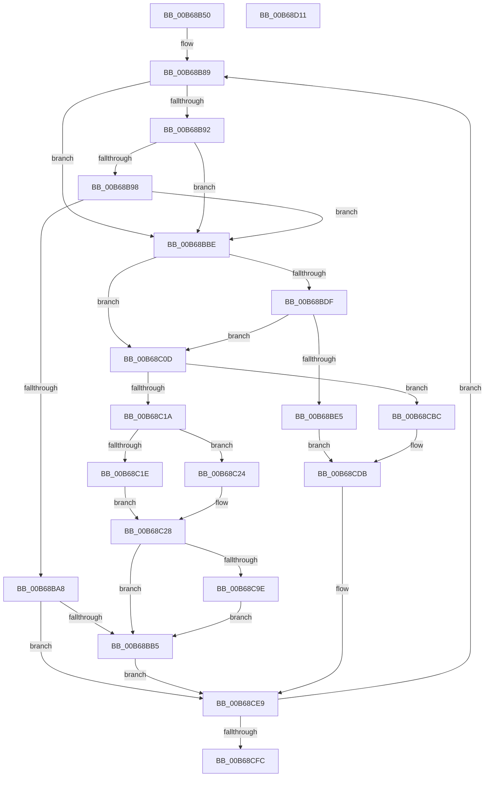

# KiInitializeIdt

- RVA: `0x00B68B50`–`0x00B68D12` (길이 `450` bytes)
- VA: `0x0000000140B68B50`
- 실행 섹션: `PAGELK`
- PDB 이름 있음: `예`; PDB Function 태그: `아니요`
- unwind 정보 RVA: `0x000CA848`
- 디코드: `110`개 명령, `450/450` bytes 표시
- 미해석 바이트: `0` (있으면 어셈블리에 `.byte`로 보존)

> 이 문서는 커널 이미지의 기계어와 PDB 기호를 분석해 생성했습니다. 4번과 5번은 함수 원형과 자료형을 바이너리 사용 방식에서 추정한 C 해석이며 원본 소스 복구 결과는 아닙니다.

## 1. Dependencies

- 직접 호출 지점: **0**; 고유 호출 대상: **0**
- 직접 호출자로 확인된 함수: **2**
- RIP 상대 이미지 참조: **9**

### Outgoing calls
- 직접 디코드된 call 명령이 없습니다.

### Direct callers
- [KiInitializeBootStructures](KiInitializeBootStructures_function_00B68530.md) at `0x00B6880D`
- [KiEnableKvaShadowing](KiEnableKvaShadowing_function_00B6ACBC.md) at `0x00B6AD53`

### Static image references
- `0x00B68B63` → RVA `0x01008680` (`INITDATA`; read/write)
- `0x00B68B6A` → RVA `0x01008270` (`INITDATA`; read)
- `0x00B68B89` → RVA `0x010086F0` (`INITDATA`; read)
- `0x00B68BC0` → RVA `0x006B4E70` (`KiIsrThunk`; read)
- `0x00B68BC7` → RVA `0x00BCC2C0` (`KiIsrThunkShadow`; read)
- `0x00B68BD2` → RVA `0x0100815C` (`INITDATA`; read)
- `0x00B68C9E` → RVA `0x01008680` (`INITDATA`; read)
- `0x00B68CA4` → RVA `0x01201900` (`CFGRO`; read)
- `0x00B68CB1` → RVA `0x01008680` (`INITDATA`; write)

## 2. Other-region calls and transfers

- 다른 실행 섹션으로 향하는 call: **0**
- 별도 외부 분기/꼬리 이동을 확인하지 못했습니다.

## 3. Assembly (complete function range)

```asm
00B68B50  48 8B C4                        mov rax, rsp
00B68B53  48 89 58 08                     mov qword ptr [rax + 8], rbx
00B68B57  48 89 68 10                     mov qword ptr [rax + 0x10], rbp
00B68B5B  48 89 70 18                     mov qword ptr [rax + 0x18], rsi
00B68B5F  4C 89 70 20                     mov qword ptr [rax + 0x20], r14
00B68B63  83 25 16 FB 49 00 00            and dword ptr [rip + 0x49fb16], 0
00B68B6A  4C 8D 0D FF F6 49 00            lea r9, [rip + 0x49f6ff]
00B68B71  45 33 D2                        xor r10d, r10d
00B68B74  4C 8D 41 04                     lea r8, [rcx + 4]
00B68B78  8A DA                           mov bl, dl
00B68B7A  BD F8 00 00 00                  mov ebp, 0xf8
00B68B7F  41 BE 00 8E 00 00               mov r14d, 0x8e00
00B68B85  41 8D 72 10                     lea esi, [r10 + 0x10]
00B68B89  83 3D 60 FB 49 00 00            cmp dword ptr [rip + 0x49fb60], 0
00B68B90  74 2C                           je 0x140b68bbe
00B68B92  41 83 FA 2D                     cmp r10d, 0x2d
00B68B96  77 26                           ja 0x140b68bbe
00B68B98  48 B9 0A 60 00 00 00 30 00 00   movabs rcx, 0x30000000600a
00B68BA2  4C 0F A3 D1                     bt rcx, r10
00B68BA6  73 16                           jae 0x140b68bbe
00B68BA8  41 0F B6 01                     movzx eax, byte ptr [r9]
00B68BAC  44 3B D0                        cmp r10d, eax
00B68BAF  0F 85 34 01 00 00               jne 0x140b68ce9
00B68BB5  49 83 C1 18                     add r9, 0x18
00B68BB9  E9 2B 01 00 00                  jmp 0x140b68ce9
00B68BBE  84 DB                           test bl, bl
00B68BC0  48 8D 05 A9 C2 B4 FF            lea rax, [rip - 0x4b3d57]
00B68BC7  48 8D 0D F2 36 06 00            lea rcx, [rip + 0x636f2]
00B68BCE  48 0F 44 C8                     cmove rcx, rax
00B68BD2  83 3D 83 F5 49 00 01            cmp dword ptr [rip + 0x49f583], 1
00B68BD9  4A 8D 14 D1                     lea rdx, [rcx + r10*8]
00B68BDD  74 2E                           je 0x140b68c0d
00B68BDF  41 83 FA 2E                     cmp r10d, 0x2e
00B68BE3  75 28                           jne 0x140b68c0d
00B68BE5  41 0F B7 00                     movzx eax, word ptr [r8]
00B68BE9  66 23 C5                        and ax, bp
00B68BEC  66 41 89 50 FC                  mov word ptr [r8 - 4], dx
00B68BF1  66 41 0B C6                     or ax, r14w
00B68BF5  66 41 89 00                     mov word ptr [r8], ax
00B68BF9  48 8B C2                        mov rax, rdx
00B68BFC  48 C1 E8 10                     shr rax, 0x10
00B68C00  48 C1 EA 20                     shr rdx, 0x20
00B68C04  49 83 C1 18                     add r9, 0x18
00B68C08  E9 CE 00 00 00                  jmp 0x140b68cdb
00B68C0D  41 0F B6 01                     movzx eax, byte ptr [r9]
00B68C11  44 3B D0                        cmp r10d, eax
00B68C14  0F 85 A2 00 00 00               jne 0x140b68cbc
00B68C1A  84 DB                           test bl, bl
00B68C1C  74 06                           je 0x140b68c24
00B68C1E  4D 8B 59 10                     mov r11, qword ptr [r9 + 0x10]
00B68C22  EB 04                           jmp 0x140b68c28
00B68C24  4D 8B 59 08                     mov r11, qword ptr [r9 + 8]
00B68C28  66 45 89 58 FC                  mov word ptr [r8 - 4], r11w
00B68C2D  B9 F8 FF 00 00                  mov ecx, 0xfff8
00B68C32  66 41 89 70 FE                  mov word ptr [r8 - 2], si
00B68C37  41 8A 41 02                     mov al, byte ptr [r9 + 2]
00B68C3B  24 07                           and al, 7
00B68C3D  0F B6 D0                        movzx edx, al
00B68C40  41 0F B7 00                     movzx eax, word ptr [r8]
00B68C44  66 23 C1                        and ax, cx
00B68C47  66 0B D0                        or dx, ax
00B68C4A  B8 FF EE 00 00                  mov eax, 0xeeff
00B68C4F  66 23 D0                        and dx, ax
00B68C52  B8 00 0E 00 00                  mov eax, 0xe00
00B68C57  66 0B D0                        or dx, ax
00B68C5A  66 41 89 10                     mov word ptr [r8], dx
00B68C5E  41 8A 41 01                     mov al, byte ptr [r9 + 1]
00B68C62  24 03                           and al, 3
00B68C64  0C 04                           or al, 4
00B68C66  0F B6 C8                        movzx ecx, al
00B68C69  B8 FF 1F 00 00                  mov eax, 0x1fff
00B68C6E  66 23 D0                        and dx, ax
00B68C71  66 C1 E1 0D                     shl cx, 0xd
00B68C75  66 0B CA                        or cx, dx
00B68C78  49 8B C3                        mov rax, r11
00B68C7B  48 C1 E8 10                     shr rax, 0x10
00B68C7F  66 41 89 40 02                  mov word ptr [r8 + 2], ax
00B68C84  49 8B C3                        mov rax, r11
00B68C87  48 C1 E8 20                     shr rax, 0x20
00B68C8B  41 89 40 04                     mov dword ptr [r8 + 4], eax
00B68C8F  66 41 89 08                     mov word ptr [r8], cx
00B68C93  41 80 79 01 00                  cmp byte ptr [r9 + 1], 0
00B68C98  0F 84 17 FF FF FF               je 0x140b68bb5
00B68C9E  8B 0D DC F9 49 00               mov ecx, dword ptr [rip + 0x49f9dc]
00B68CA4  48 8D 15 55 8C 69 00            lea rdx, [rip + 0x698c55]
00B68CAB  4C 89 1C CA                     mov qword ptr [rdx + rcx*8], r11
00B68CAF  FF C1                           inc ecx
00B68CB1  89 0D C9 F9 49 00               mov dword ptr [rip + 0x49f9c9], ecx
00B68CB7  E9 F9 FE FF FF                  jmp 0x140b68bb5
00B68CBC  41 0F B7 00                     movzx eax, word ptr [r8]
00B68CC0  66 23 C5                        and ax, bp
00B68CC3  66 41 89 50 FC                  mov word ptr [r8 - 4], dx
00B68CC8  66 41 0B C6                     or ax, r14w
00B68CCC  66 41 89 00                     mov word ptr [r8], ax
00B68CD0  48 8B C2                        mov rax, rdx
00B68CD3  48 C1 E8 10                     shr rax, 0x10
00B68CD7  48 C1 EA 20                     shr rdx, 0x20
00B68CDB  41 89 50 04                     mov dword ptr [r8 + 4], edx
00B68CDF  66 41 89 40 02                  mov word ptr [r8 + 2], ax
00B68CE4  66 41 89 70 FE                  mov word ptr [r8 - 2], si
00B68CE9  41 FF C2                        inc r10d
00B68CEC  4C 03 C6                        add r8, rsi
00B68CEF  41 81 FA FF 00 00 00            cmp r10d, 0xff
00B68CF6  0F 86 8D FE FF FF               jbe 0x140b68b89
00B68CFC  48 8B 5C 24 08                  mov rbx, qword ptr [rsp + 8]
00B68D01  48 8B 6C 24 10                  mov rbp, qword ptr [rsp + 0x10]
00B68D06  48 8B 74 24 18                  mov rsi, qword ptr [rsp + 0x18]
00B68D0B  4C 8B 74 24 20                  mov r14, qword ptr [rsp + 0x20]
00B68D10  C3                              ret
00B68D11  CC                              int3
```

## 4. C-style interpretation (structured pseudocode)

```c
__int64 __fastcall KiInitializeIdt(__int64 a1, unsigned __int8 a2)
{
    __int64 result;
    __int64 v_r10;
    unsigned __int64 v_stack_p10;
    unsigned __int64 v_stack_p18;
    unsigned __int64 v_stack_p20;
    unsigned __int64 v_stack_p8;

    *(unsigned __int64 *)(v_rsp + 8) = v_rbx;
    *(unsigned __int64 *)(v_rsp + 16) = v_rbp;
    *(unsigned __int64 *)(v_rsp + 24) = v_rsi;
    *(unsigned __int64 *)(v_rsp + 32) = v_r14;
    v_r10 = 0;
loc_00B68B89:
    if ((*(unsigned int *)(v_rip + 4848480)) == 0) goto loc_00B68BBE;
    if (0 > 45) goto loc_00B68BBE;
    if (0 >= 45) goto loc_00B68BBE;
    if (0 != ((unsigned int)(*(unsigned __int8 *)(v_rip + 4847359)))) goto loc_00B68CE9;
loc_00B68BB5:
    a4 = (v_rip + 4847359) + (24);
    goto loc_00B68CE9;
loc_00B68BBE:
    a1 = v_rip + 407282;
    if (a2 == 0) { a1 = v_rip - 4930903; }
    if ((*(unsigned int *)(v_rip + 4846979)) == 1) goto loc_00B68C0D;
    if (0 != 46) goto loc_00B68C0D;
    result = (unsigned __int16)((*(unsigned __int16 *)(a1 + 4)) & (248));
    *(unsigned __int16 *)(a1 + 4 - 4) = (unsigned __int16)(a1 + v_r10 * 8);
    result = (unsigned __int16)((result) | ((unsigned __int16)((unsigned int)(0x8E00ULL))));
    *(unsigned __int16 *)(a1 + 4) = (unsigned __int16)(result);
    result = (a1 + v_r10 * 8) >> (16);
    a2 = (a1 + v_r10 * 8) >> (32);
    a4 = (a4) + (24);
    goto loc_00B68CDB;
loc_00B68C0D:
    if (0 != ((unsigned int)(*(unsigned __int8 *)(a4)))) goto loc_00B68CBC;
    if (a2 == 0) goto loc_00B68C24;
    goto loc_00B68C28;
loc_00B68C24:
loc_00B68C28:
    *(unsigned __int16 *)(a1 + 4 - 4) = (unsigned __int16)(*(unsigned __int64 *)(a4 + 8));
    *(unsigned __int16 *)(a1 + 4 - 2) = (unsigned __int16)(v_r10 + 16);
    result = (unsigned __int8)((*(unsigned __int8 *)(a4 + 2)) & (7));
    result = (unsigned __int16)((*(unsigned __int16 *)(a1 + 4)) & ((unsigned __int16)((unsigned int)(0xFFF8ULL))));
    a2 = (unsigned __int16)(((unsigned __int8)(result)) | ((unsigned __int16)(result)));
    a2 = (unsigned __int16)((a2) & ((unsigned __int16)((unsigned int)(0xEEFFULL))));
    a2 = (unsigned __int16)((a2) | ((unsigned __int16)((unsigned int)(0xE00ULL))));
    *(unsigned __int16 *)(a1 + 4) = a2;
    result = (unsigned __int8)((*(unsigned __int8 *)(a4 + 1)) & (3));
    result = (unsigned __int8)((result) | (4));
    a2 = (unsigned __int16)((a2) & ((unsigned __int16)((unsigned int)(0x1FFFULL))));
    a1 = (unsigned __int16)(((unsigned __int8)(result)) << (13));
    a1 = (unsigned __int16)((a1) | (a2));
    result = (*(unsigned __int64 *)(a4 + 8)) >> (16);
    *(unsigned __int16 *)(a1 + 4 + 2) = (unsigned __int16)(result);
    result = (*(unsigned __int64 *)(a4 + 8)) >> (32);
    *(unsigned int *)(a1 + 4 + 4) = (unsigned int)(result);
    *(unsigned __int16 *)(a1 + 4) = (unsigned __int16)(a1);
    if ((*(unsigned __int8 *)(a4 + 1)) == 0) goto loc_00B68BB5;
    *(unsigned __int64 *)(v_rip + 6917205 + (unsigned int)(*(unsigned int *)(v_rip + 4848092)) * 8) = *(unsigned __int64 *)(a4 + 8);
    a1 = (unsigned int)(((unsigned int)(*(unsigned int *)(v_rip + 4848092))) + 1);
    *(unsigned int *)(v_rip + 4848073) = (unsigned int)(a1);
    goto loc_00B68BB5;
loc_00B68CBC:
    result = (unsigned __int16)((*(unsigned __int16 *)(a1 + 4)) & (248));
    *(unsigned __int16 *)(a1 + 4 - 4) = (unsigned __int16)(v_rip + 6917205);
    result = (unsigned __int16)((result) | ((unsigned __int16)((unsigned int)(0x8E00ULL))));
    *(unsigned __int16 *)(a1 + 4) = (unsigned __int16)(result);
    result = (v_rip + 6917205) >> (16);
    a2 = (v_rip + 6917205) >> (32);
loc_00B68CDB:
    *(unsigned int *)(a1 + 4 + 4) = a2;
    *(unsigned __int16 *)(a1 + 4 + 2) = (unsigned __int16)(result);
    *(unsigned __int16 *)(a1 + 4 - 2) = (unsigned __int16)(v_r10 + 16);
loc_00B68CE9:
    v_r10 = (unsigned int)((v_r10) + 1);
    a3 = (a1 + 4) + (v_r10 + 16);
    if (((unsigned int)(v_r10)) <= 255) goto loc_00B68B89;
    return result;
}
```

## 5. (Beta) C Style

```c
int64_t KiInitializeIdt(void *Arg1, uint8_t Arg2)
{
    uint8_t *arg1 = (uint8_t *)Arg1;

    int64_t result;
    int64_t local_r10;
    uint64_t v_stack_p10;
    uint64_t v_stack_p18;
    uint64_t v_stack_p20;
    uint64_t v_stack_p8;

    *(uint64_t *)(local_rsp + 0x8) = local_rbx;
    *(uint64_t *)(local_rsp + 0x10) = local_rbp;
    *(uint64_t *)(local_rsp + 0x18) = local_rsi;
    *(uint64_t *)(local_rsp + 0x20) = local_r14;
    local_r10 = 0;
loc_00B68B89:
    if ((*(uint32_t *)(v_rip + 0x49FB60)) == 0) goto loc_00B68BBE;
    if (0 > 45) goto loc_00B68BBE;
    if (0 >= 45) goto loc_00B68BBE;
    if (0 != ((uint32_t)(*(uint8_t *)(v_rip + 0x49F6FF)))) goto loc_00B68CE9;
loc_00B68BB5:
    a4 = (v_rip + 4847359) + (24);
    goto loc_00B68CE9;
loc_00B68BBE:
    Arg1 = v_rip + 407282;
    if (Arg2 == 0) { Arg1 = v_rip - 4930903; }
    if ((*(uint32_t *)(v_rip + 0x49F583)) == 1) goto loc_00B68C0D;
    if (0 != 46) goto loc_00B68C0D;
    result = (uint16_t)((*(uint16_t *)(arg1 + 0x4)) & (248));
    *(uint16_t *)(arg1 + 0x4 - 0x4) = (uint16_t)(Arg1 + local_r10 * 8);
    result = (uint16_t)((result) | ((uint16_t)((uint32_t)(0x8E00ULL))));
    *(uint16_t *)(arg1 + 0x4) = (uint16_t)(result);
    result = (Arg1 + local_r10 * 8) >> (16);
    Arg2 = (Arg1 + local_r10 * 8) >> (32);
    a4 = (a4) + (24);
    goto loc_00B68CDB;
loc_00B68C0D:
    if (0 != ((uint32_t)(*(uint8_t *)(a4)))) goto loc_00B68CBC;
    if (Arg2 == 0) goto loc_00B68C24;
    goto loc_00B68C28;
loc_00B68C24:
loc_00B68C28:
    *(uint16_t *)(arg1 + 0x4 - 0x4) = (uint16_t)(*(uint64_t *)(a4 + 0x8));
    *(uint16_t *)(arg1 + 0x4 - 0x2) = (uint16_t)(local_r10 + 16);
    result = (uint8_t)((*(uint8_t *)(a4 + 0x2)) & (7));
    result = (uint16_t)((*(uint16_t *)(arg1 + 0x4)) & ((uint16_t)((uint32_t)(0xFFF8ULL))));
    Arg2 = (uint16_t)(((uint8_t)(result)) | ((uint16_t)(result)));
    Arg2 = (uint16_t)((Arg2) & ((uint16_t)((uint32_t)(0xEEFFULL))));
    Arg2 = (uint16_t)((Arg2) | ((uint16_t)((uint32_t)(0xE00ULL))));
    *(uint16_t *)(arg1 + 0x4) = Arg2;
    result = (uint8_t)((*(uint8_t *)(a4 + 0x1)) & (3));
    result = (uint8_t)((result) | (4));
    Arg2 = (uint16_t)((Arg2) & ((uint16_t)((uint32_t)(0x1FFFULL))));
    Arg1 = (uint16_t)(((uint8_t)(result)) << (13));
    Arg1 = (uint16_t)((Arg1) | (Arg2));
    result = (*(uint64_t *)(a4 + 0x8)) >> (16);
    *(uint16_t *)(arg1 + 0x4 + 0x2) = (uint16_t)(result);
    result = (*(uint64_t *)(a4 + 0x8)) >> (32);
    *(uint32_t *)(arg1 + 0x4 + 0x4) = (uint32_t)(result);
    *(uint16_t *)(arg1 + 0x4) = (uint16_t)(Arg1);
    if ((*(uint8_t *)(a4 + 0x1)) == 0) goto loc_00B68BB5;
    *(uint64_t *)(v_rip + 0x698C55 + (uint32_t)(*(uint32_t *)(v_rip + 0x49F9DC)) * 8) = *(uint64_t *)(a4 + 0x8);
    Arg1 = (uint32_t)(((uint32_t)(*(uint32_t *)(v_rip + 0x49F9DC))) + 1);
    *(uint32_t *)(v_rip + 0x49F9C9) = (uint32_t)(Arg1);
    goto loc_00B68BB5;
loc_00B68CBC:
    result = (uint16_t)((*(uint16_t *)(arg1 + 0x4)) & (248));
    *(uint16_t *)(arg1 + 0x4 - 0x4) = (uint16_t)(v_rip + 6917205);
    result = (uint16_t)((result) | ((uint16_t)((uint32_t)(0x8E00ULL))));
    *(uint16_t *)(arg1 + 0x4) = (uint16_t)(result);
    result = (v_rip + 6917205) >> (16);
    Arg2 = (v_rip + 6917205) >> (32);
loc_00B68CDB:
    *(uint32_t *)(arg1 + 0x4 + 0x4) = Arg2;
    *(uint16_t *)(arg1 + 0x4 + 0x2) = (uint16_t)(result);
    *(uint16_t *)(arg1 + 0x4 - 0x2) = (uint16_t)(local_r10 + 16);
loc_00B68CE9:
    local_r10 = (uint32_t)((local_r10) + 1);
    a3 = (Arg1 + 4) + (local_r10 + 16);
    if (((uint32_t)(local_r10)) <= 255) goto loc_00B68B89;
    return result;
}
```

### 관측된 메모리 오프셋

구조체 형식이 확인되지 않은 접근은 인자 기준의 오프셋으로만 기록했습니다.

| 기준 인자 | 오프셋 표현 | 폭 (bit) | 접근 |
|---|---:|---:|---|
| `Arg1` | `- 0x4` | `16` | `W` |
| `Arg1` | `- 0x2` | `16` | `W` |
| `Arg1` | `+ 0x0` | `16` | `R` |
| `Arg1` | `+ 0x0` | `16` | `W` |
| `Arg1` | `+ 0x2` | `16` | `W` |
| `Arg1` | `+ 0x4` | `32` | `W` |
| `Arg1` | `+ 0x4` | `64` | `R` |

## 6. Execution-region graph

[열기: 2D/3D 그래프와 함수 탐색 컨트롤 패널](../../../control-panel.html?section=pagelk&rva=0x00B68B50&view=graph)

- 2D 그래프는 위에서 아래로 흐르고, 3D 그래프는 빈 공간을 드래그해 회전합니다. Shift+드래그는 이동, 휠은 확대·축소, 함수 노드 선택은 대상 보고서 이동입니다.

### Static fallback


