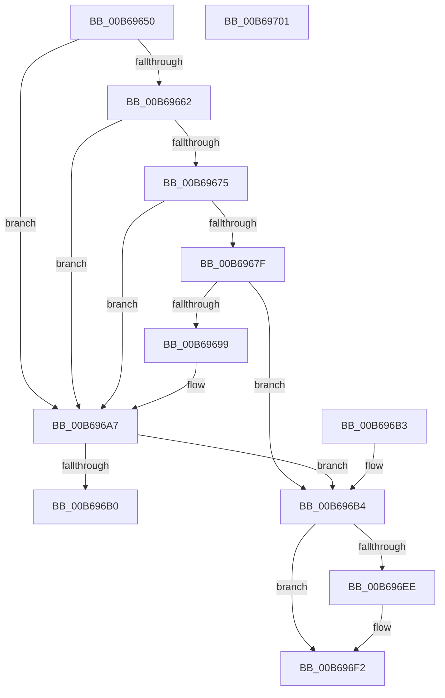

# KiInitializeKernelShadowStacks

- RVA: `0x00B69650`–`0x00B69702` (길이 `178` bytes)
- VA: `0x0000000140B69650`
- 실행 섹션: `PAGELK`
- PDB 이름 있음: `예`; PDB Function 태그: `아니요`
- unwind 정보 RVA: `0x000DB714`
- 디코드: `37`개 명령, `178/178` bytes 표시
- 미해석 바이트: `0` (있으면 어셈블리에 `.byte`로 보존)

> 이 문서는 커널 이미지의 기계어와 PDB 기호를 분석해 생성했습니다. 4번과 5번은 함수 원형과 자료형을 바이너리 사용 방식에서 추정한 C 해석이며 원본 소스 복구 결과는 아닙니다.

## 1. Dependencies

- 직접 호출 지점: **0**; 고유 호출 대상: **0**
- 직접 호출자로 확인된 함수: **1**
- RIP 상대 이미지 참조: **4**

### Outgoing calls
- 직접 디코드된 call 명령이 없습니다.

### Direct callers
- [KiSystemStartup](../B5/KiSystemStartup_function_00B5B3C0.md) at `0x00B5B525`

### Static image references
- `0x00B6967F` → RVA `0x01201841` (`CFGRO`; write)
- `0x00B69699` → RVA `0x01201842` (`CFGRO`; read/write)
- `0x00B696A0` → RVA `0x01201843` (`CFGRO`; write)
- `0x00B696A7` → RVA `0x01201841` (`CFGRO`; read)

## 2. Other-region calls and transfers

- 다른 실행 섹션으로 향하는 call: **0**
- 별도 외부 분기/꼬리 이동을 확인하지 못했습니다.

## 3. Assembly (complete function range)

```asm
00B69650  65 48 8B 14 25 20 00 00 00      mov rdx, qword ptr gs:[0x20]
00B69659  44 8B 4A 24                     mov r9d, dword ptr [rdx + 0x24]
00B6965D  45 85 C9                        test r9d, r9d
00B69660  75 45                           jne 0x140b696a7
00B69662  48 8B 81 F0 00 00 00            mov rax, qword ptr [rcx + 0xf0]
00B69669  F7 80 84 00 00 00 00 40 00 00   test dword ptr [rax + 0x84], 0x4000
00B69673  74 32                           je 0x140b696a7
00B69675  0F 20 E0                        mov rax, cr4
00B69678  48 0F BA E0 17                  bt rax, 0x17
00B6967D  73 28                           jae 0x140b696a7
00B6967F  C6 05 BB 81 69 00 01            mov byte ptr [rip + 0x6981bb], 1
00B69686  48 8B 81 F0 00 00 00            mov rax, qword ptr [rcx + 0xf0]
00B6968D  F7 80 84 00 00 00 00 00 04 00   test dword ptr [rax + 0x84], 0x40000
00B69697  74 1B                           je 0x140b696b4
00B69699  80 0D A2 81 69 00 01            or byte ptr [rip + 0x6981a2], 1
00B696A0  C6 05 9C 81 69 00 01            mov byte ptr [rip + 0x69819c], 1
00B696A7  80 3D 93 81 69 00 00            cmp byte ptr [rip + 0x698193], 0
00B696AE  75 04                           jne 0x140b696b4
00B696B0  33 C0                           xor eax, eax
00B696B2  C3                              ret
00B696B3  CC                              int3
00B696B4  48 B8 00 00 00 00 00 40 00 00   movabs rax, 0x400000000000
00B696BE  4C 8B C2                        mov r8, rdx
00B696C1  48 09 82 A0 8F 00 00            or qword ptr [rdx + 0x8fa0], rax
00B696C8  48 8B 81 F0 00 00 00            mov rax, qword ptr [rcx + 0xf0]
00B696CF  4C 8B 90 90 0E 00 00            mov r10, qword ptr [rax + 0xe90]
00B696D6  4C 8B 98 80 0E 00 00            mov r11, qword ptr [rax + 0xe80]
00B696DD  48 8B 88 88 0E 00 00            mov rcx, qword ptr [rax + 0xe88]
00B696E4  B8 A0 9B 00 00                  mov eax, 0x9ba0
00B696E9  45 85 C9                        test r9d, r9d
00B696EC  75 04                           jne 0x140b696f2
00B696EE  48 83 C1 F8                     add rcx, -8
00B696F2  49 89 0C 00                     mov qword ptr [r8 + rax], rcx
00B696F6  49 8B C3                        mov rax, r11
00B696F9  4C 89 92 B0 9B 00 00            mov qword ptr [rdx + 0x9bb0], r10
00B69700  C3                              ret
00B69701  CC                              int3
```

## 4. C-style interpretation (structured pseudocode)

```c
__int64 __fastcall KiInitializeKernelShadowStacks(__int64 a1)
{
    __int64 result;

    if ((unsigned int)((unsigned int)(*(unsigned int *)(*(unsigned __int64 *)(gs_base + (0 + 32)) + 36))) != 0) goto loc_00B696A7;
    if (((*(unsigned int *)(*(unsigned __int64 *)(a1 + 240) + 132)) & (0x4000ULL)) == 0) goto loc_00B696A7;
    if (condition_is_above_or_equal) goto loc_00B696A7;
    *(unsigned __int8 *)(v_rip + 6914491) = 1;
    if (((*(unsigned int *)(*(unsigned __int64 *)(a1 + 240) + 132)) & (0x40000ULL)) == 0) goto loc_00B696B4;
    *(unsigned __int8 *)(v_rip + 6914460) = 1;
loc_00B696A7:
    if ((*(unsigned __int8 *)(v_rip + 6914451)) != 0) goto loc_00B696B4;
    result = 0;
    return result;
loc_00B696B4:
    if ((unsigned int)((unsigned int)(*(unsigned int *)(*(unsigned __int64 *)(gs_base + (0 + 32)) + 36))) == 0) {
        a1 = (*(unsigned __int64 *)(*(unsigned __int64 *)(a1 + 240) + 3720)) + (-8);
    }
    *(unsigned __int64 *)(*(unsigned __int64 *)(gs_base + (0 + 32)) + (unsigned int)(0x9BA0ULL) * 1) = a1;
    *(unsigned __int64 *)(*(unsigned __int64 *)(gs_base + (0 + 32)) + 39856) = *(unsigned __int64 *)(*(unsigned __int64 *)(a1 + 240) + 3728);
    return *(unsigned __int64 *)(*(unsigned __int64 *)(a1 + 240) + 3712);
}
```

## 5. (Beta) C Style

```c
int64_t KiInitializeKernelShadowStacks(void *Arg1)
{
    uint8_t *arg1 = (uint8_t *)Arg1;

    int64_t result;

    if ((uint32_t)((uint32_t)(*(uint32_t *)(*(uint64_t *)(gs_base + (0 + 0x20)) + 0x24))) != 0) goto loc_00B696A7;
    if (((*(uint32_t *)(*(uint64_t *)(arg1 + 0xF0) + 0x84)) & (0x4000ULL)) == 0) goto loc_00B696A7;
    if (condition_is_above_or_equal) goto loc_00B696A7;
    *(uint8_t *)(v_rip + 0x6981BB) = 1;
    if (((*(uint32_t *)(*(uint64_t *)(arg1 + 0xF0) + 0x84)) & (0x40000ULL)) == 0) goto loc_00B696B4;
    *(uint8_t *)(v_rip + 0x69819C) = 1;
loc_00B696A7:
    if ((*(uint8_t *)(v_rip + 0x698193)) != 0) goto loc_00B696B4;
    result = 0;
    return result;
loc_00B696B4:
    if ((uint32_t)((uint32_t)(*(uint32_t *)(*(uint64_t *)(gs_base + (0 + 0x20)) + 0x24))) == 0) {
        Arg1 = (*(uint64_t *)(*(uint64_t *)(arg1 + 0xF0) + 0xE88)) + (-8);
    }
    *(void **)(*(uint64_t *)(gs_base + (0 + 0x20)) + (uint32_t)(0x9BA0ULL) * 1) = Arg1;
    *(uint64_t *)(*(uint64_t *)(gs_base + (0 + 0x20)) + 0x9BB0) = *(uint64_t *)(*(uint64_t *)(arg1 + 0xF0) + 0xE90);
    return *(uint64_t *)(*(uint64_t *)(arg1 + 0xF0) + 0xE80);
}
```

### 관측된 메모리 오프셋

구조체 형식이 확인되지 않은 접근은 인자 기준의 오프셋으로만 기록했습니다.

| 기준 인자 | 오프셋 표현 | 폭 (bit) | 접근 |
|---|---:|---:|---|
| `Arg1` | `+ 0xF0` | `64` | `R` |

## 6. Execution-region graph

[열기: 2D/3D 그래프와 함수 탐색 컨트롤 패널](../../../control-panel.html?section=pagelk&rva=0x00B69650&view=graph)

- 2D 그래프는 위에서 아래로 흐르고, 3D 그래프는 빈 공간을 드래그해 회전합니다. Shift+드래그는 이동, 휠은 확대·축소, 함수 노드 선택은 대상 보고서 이동입니다.

### Static fallback


