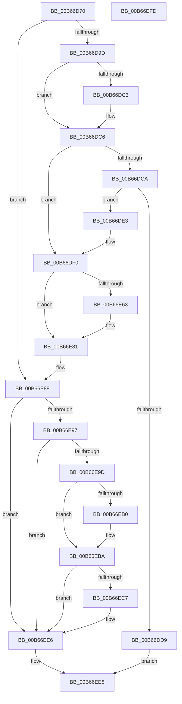

# KiInitializePrcbContext

- RVA: `0x00B66D70`–`0x00B66EFE` (길이 `398` bytes)
- VA: `0x0000000140B66D70`
- 실행 섹션: `PAGELK`
- PDB 이름 있음: `예`; PDB Function 태그: `아니요`
- unwind 정보 RVA: `0x0005C954`
- 디코드: `91`개 명령, `398/398` bytes 표시
- 미해석 바이트: `0` (있으면 어셈블리에 `.byte`로 보존)

> 이 문서는 커널 이미지의 기계어와 PDB 기호를 분석해 생성했습니다. 4번과 5번은 함수 원형과 자료형을 바이너리 사용 방식에서 추정한 C 해석이며 원본 소스 복구 결과는 아닙니다.

## 1. Dependencies

- 직접 호출 지점: **2**; 고유 호출 대상: **2**
- 직접 호출자로 확인된 함수: **3**
- RIP 상대 이미지 참조: **5**

### Outgoing calls
- `0x00B66DCC` → [MmAllocateIndependentPages](../../page/AA/MmAllocateIndependentPages_function_00AA0CE0.md) (function, `0x00AA0CE0`)
- `0x00B66DEB` → [memset](../../text/6C/memset_function_006C6C40.md) (function, `0x006C6C40`)

### Direct callers
- [KiCompleteBootProcessorContextInitialization](../../text/5B/KiCompleteBootProcessorContextInitialization_function_005B7634.md) at `0x005B766D`
- [KiStartDynamicProcessor](../../page/74/KiStartDynamicProcessor_function_007456C8.md) at `0x007458C4`
- [KeStartAllProcessors](../../init/C3/KeStartAllProcessors_function_00C36F78.md) at `0x00C372AD`

### Static image references
- `0x00B66D89` → RVA `0x00FC6B30` (`ALMOSTRO`; read)
- `0x00B66D9D` → RVA `0x00FC51B8` (`ALMOSTRO`; read)
- `0x00B66DA7` → RVA `0x00FC50D0` (`ALMOSTRO`; read)
- `0x00B66DBA` → RVA `0x01201841` (`CFGRO`; read)
- `0x00B66ED4` → RVA `0x00FC6C60` (`ALMOSTRO`; read)

## 2. Other-region calls and transfers

- 다른 실행 섹션으로 향하는 call: **2**
  - `0x00B66DCC` → [MmAllocateIndependentPages](../../page/AA/MmAllocateIndependentPages_function_00AA0CE0.md) (`PAGELK` → `PAGE`)
  - `0x00B66DEB` → [memset](../../text/6C/memset_function_006C6C40.md) (`PAGELK` → `.text`)
- 별도 외부 분기/꼬리 이동을 확인하지 못했습니다.

## 3. Assembly (complete function range)

```asm
00B66D70  48 89 5C 24 08                  mov qword ptr [rsp + 8], rbx
00B66D75  48 89 6C 24 10                  mov qword ptr [rsp + 0x10], rbp
00B66D7A  48 89 74 24 18                  mov qword ptr [rsp + 0x18], rsi
00B66D7F  57                              push rdi
00B66D80  48 83 EC 20                     sub rsp, 0x20
00B66D84  40 32 FF                        xor dil, dil
00B66D87  33 F6                           xor esi, esi
00B66D89  48 F7 05 9C FD 45 00 00 00 80 00  test qword ptr [rip + 0x45fd9c], 0x800000
00B66D94  48 8B D9                        mov rbx, rcx
00B66D97  0F 84 EB 00 00 00               je 0x140b66e88
00B66D9D  44 8B 05 14 E4 45 00            mov r8d, dword ptr [rip + 0x45e414]
00B66DA4  40 B7 01                        mov dil, 1
00B66DA7  8B 0D 23 E3 45 00               mov ecx, dword ptr [rip + 0x45e323]
00B66DAD  41 83 C0 3F                     add r8d, 0x3f
00B66DB1  81 C1 3E 03 00 00               add ecx, 0x33e
00B66DB7  41 03 C8                        add ecx, r8d
00B66DBA  40 38 35 80 AA 69 00            cmp byte ptr [rip + 0x69aa80], sil
00B66DC1  74 03                           je 0x140b66dc6
00B66DC3  83 C1 20                        add ecx, 0x20
00B66DC6  85 C9                           test ecx, ecx
00B66DC8  74 26                           je 0x140b66df0
00B66DCA  8B E9                           mov ebp, ecx
00B66DCC  E8 0F 9F F3 FF                  call 0x140aa0ce0
00B66DD1  48 8B F0                        mov rsi, rax
00B66DD4  48 85 C0                        test rax, rax
00B66DD7  75 0A                           jne 0x140b66de3
00B66DD9  B8 9A 00 00 C0                  mov eax, 0xc000009a
00B66DDE  E9 05 01 00 00                  jmp 0x140b66ee8
00B66DE3  4C 8B C5                        mov r8, rbp
00B66DE6  33 D2                           xor edx, edx
00B66DE8  48 8B C8                        mov rcx, rax
00B66DEB  E8 50 FE B5 FF                  call 0x1406c6c40
00B66DF0  44 8B 05 C1 E3 45 00            mov r8d, dword ptr [rip + 0x45e3c1]
00B66DF7  48 8D 4E 3F                     lea rcx, [rsi + 0x3f]
00B66DFB  44 8B 15 CE E2 45 00            mov r10d, dword ptr [rip + 0x45e2ce]
00B66E02  48 83 E1 C0                     and rcx, 0xffffffffffffffc0
00B66E06  48 89 8B D0 8F 00 00            mov qword ptr [rbx + 0x8fd0], rcx
00B66E0D  49 83 C0 0F                     add r8, 0xf
00B66E11  4C 03 C1                        add r8, rcx
00B66E14  41 81 C2 00 FE FF FF            add r10d, 0xfffffe00
00B66E1B  49 83 E0 F0                     and r8, 0xfffffffffffffff0
00B66E1F  41 BB 30 FB FF FF               mov r11d, 0xfffffb30
00B66E25  41 8D 82 D0 04 00 00            lea eax, [r10 + 0x4d0]
00B66E2C  49 8D 90 D0 04 00 00            lea rdx, [r8 + 0x4d0]
00B66E33  44 8D 4A 5F                     lea r9d, [rdx + 0x5f]
00B66E37  44 89 5A 08                     mov dword ptr [rdx + 8], r11d
00B66E3B  41 83 E1 C0                     and r9d, 0xffffffc0
00B66E3F  C7 42 0C D0 04 00 00            mov dword ptr [rdx + 0xc], 0x4d0
00B66E46  41 8B C9                        mov ecx, r9d
00B66E49  44 89 52 14                     mov dword ptr [rdx + 0x14], r10d
00B66E4D  2B CA                           sub ecx, edx
00B66E4F  44 89 1A                        mov dword ptr [rdx], r11d
00B66E52  03 C1                           add eax, ecx
00B66E54  89 4A 10                        mov dword ptr [rdx + 0x10], ecx
00B66E57  89 42 04                        mov dword ptr [rdx + 4], eax
00B66E5A  80 3D E0 A9 69 00 00            cmp byte ptr [rip + 0x69a9e0], 0
00B66E61  74 1E                           je 0x140b66e81
00B66E63  41 8D 42 07                     lea eax, [r10 + 7]
00B66E67  C7 42 1C 18 00 00 00            mov dword ptr [rdx + 0x1c], 0x18
00B66E6E  41 03 C1                        add eax, r9d
00B66E71  83 E0 F8                        and eax, 0xfffffff8
00B66E74  2B C2                           sub eax, edx
00B66E76  89 42 18                        mov dword ptr [rdx + 0x18], eax
00B66E79  05 E8 04 00 00                  add eax, 0x4e8
00B66E7E  89 42 04                        mov dword ptr [rdx + 4], eax
00B66E81  4C 89 83 C0 8F 00 00            mov qword ptr [rbx + 0x8fc0], r8
00B66E88  C7 83 C8 8F 00 00 0B 00 10 00   mov dword ptr [rbx + 0x8fc8], 0x10000b
00B66E92  40 84 FF                        test dil, dil
00B66E95  74 4F                           je 0x140b66ee6
00B66E97  83 7B 24 00                     cmp dword ptr [rbx + 0x24], 0
00B66E9B  75 49                           jne 0x140b66ee6
00B66E9D  C7 83 C8 8F 00 00 4B 00 10 00   mov dword ptr [rbx + 0x8fc8], 0x10004b
00B66EA7  80 3D 93 A9 69 00 00            cmp byte ptr [rip + 0x69a993], 0
00B66EAE  74 0A                           je 0x140b66eba
00B66EB0  C7 83 C8 8F 00 00 CB 00 10 00   mov dword ptr [rbx + 0x8fc8], 0x1000cb
00B66EBA  A1 EC 03 00 00 80 F7 FF FF      movabs eax, dword ptr [0xfffff780000003ec]
00B66EC3  A8 02                           test al, 2
00B66EC5  74 1F                           je 0x140b66ee6
00B66EC7  48 B8 D8 03 00 00 80 F7 FF FF   movabs rax, 0xfffff780000003d8
00B66ED1  48 8B 00                        mov rax, qword ptr [rax]
00B66ED4  48 0B 05 85 FD 45 00            or rax, qword ptr [rip + 0x45fd85]
00B66EDB  48 83 E0 FC                     and rax, 0xfffffffffffffffc
00B66EDF  48 89 83 10 87 00 00            mov qword ptr [rbx + 0x8710], rax
00B66EE6  33 C0                           xor eax, eax
00B66EE8  48 8B 5C 24 30                  mov rbx, qword ptr [rsp + 0x30]
00B66EED  48 8B 6C 24 38                  mov rbp, qword ptr [rsp + 0x38]
00B66EF2  48 8B 74 24 40                  mov rsi, qword ptr [rsp + 0x40]
00B66EF7  48 83 C4 20                     add rsp, 0x20
00B66EFB  5F                              pop rdi
00B66EFC  C3                              ret
00B66EFD  CC                              int3
```

## 4. C-style interpretation (structured pseudocode)

```c
__int64 __fastcall KiInitializePrcbContext(__int64 a1, int a2)
{
    __int64 result;
    __int64 v_r10;
    __int64 v_rdi;
    __int64 v_rsi;
    __int64 v_rsp;
    unsigned __int64 v_stack_p10;
    unsigned __int64 v_stack_p18;
    unsigned __int64 v_stack_p8;

    v_stack_p8 = v_rbx;
    v_stack_p10 = v_rbp;
    v_stack_p18 = v_rsi;
    v_rsp = (v_rsp) - (32);
    v_rdi = 0;
    v_rsi = 0;
    if (((*(unsigned __int64 *)(v_rip + 4586908)) & (0x800000ULL)) == 0) goto loc_00B66E88;
    a3 = (unsigned int)(((unsigned int)(*(unsigned int *)(v_rip + 4580372))) + (63));
    a1 = (unsigned int)(((unsigned int)(*(unsigned int *)(v_rip + 4580131))) + (830));
    a1 = (unsigned int)((a1) + ((unsigned int)(a3)));
    if ((*(unsigned __int8 *)(v_rip + 6924928)) != 0) {
        a1 = (unsigned int)((a1) + (32));
    }
    if ((unsigned int)(a1) == 0) goto loc_00B66DF0;
    result = MmAllocateIndependentPages(a1, a2, a3, a4);
    if (result != 0) goto loc_00B66DE3;
    goto loc_00B66EE8;
loc_00B66DE3:
    a2 = 0;
    result = memset((unsigned int)(0xC000009AULL), a2, (unsigned int)((unsigned int)(a1)), a4);
loc_00B66DF0:
    a1 = (result + 63) & (-64);
    *(unsigned __int64 *)(a1 + 36816) = a1;
    a3 = ((unsigned int)(*(unsigned int *)(v_rip + 4580289))) + (15);
    a3 = (a3) + (a1);
    v_r10 = (unsigned int)(((unsigned int)(*(unsigned int *)(v_rip + 4580046))) + (0xFFFFFE00ULL));
    a3 = (a3) & (-16);
    *(unsigned int *)(a3 + 1232 + 8) = (unsigned int)((unsigned int)(0xFFFFFB30ULL));
    a4 = (unsigned int)((a3 + 1232 + 95) & (0xFFFFFFC0ULL));
    *(unsigned int *)(a3 + 1232 + 12) = 0x4D0ULL;
    *(unsigned int *)(a3 + 1232 + 20) = (unsigned int)(v_r10);
    a1 = (unsigned int)(((unsigned int)((unsigned int)(a4))) - ((unsigned int)(a3 + 1232)));
    *(unsigned int *)(a3 + 1232) = (unsigned int)((unsigned int)(0xFFFFFB30ULL));
    result = (unsigned int)((v_r10 + 1232) + ((unsigned int)(a1)));
    *(unsigned int *)(a3 + 1232 + 16) = (unsigned int)(a1);
    *(unsigned int *)(a3 + 1232 + 4) = (unsigned int)(result);
    if ((*(unsigned __int8 *)(v_rip + 6924768)) != 0) {
        result = v_r10 + 7;
        *(unsigned int *)(a3 + 1232 + 28) = 24;
        result = (unsigned int)((result) + ((unsigned int)(a4)));
        result = (unsigned int)((result) & (0xFFFFFFF8ULL));
        result = (unsigned int)((result) - ((unsigned int)(a3 + 1232)));
        *(unsigned int *)(a3 + 1232 + 24) = (unsigned int)(result);
        result = (unsigned int)((result) + (0x4E8ULL));
        *(unsigned int *)(a3 + 1232 + 4) = (unsigned int)(result);
    }
    *(unsigned __int64 *)(a1 + 36800) = a3;
loc_00B66E88:
    *(unsigned int *)(a1 + 36808) = 0x10000BULL;
    if (1 == 0) goto loc_00B66EE6;
    if ((*(unsigned int *)(a1 + 36)) != 0) goto loc_00B66EE6;
    *(unsigned int *)(a1 + 36808) = 0x10004BULL;
    if ((*(unsigned __int8 *)(v_rip + 6924691)) != 0) {
        *(unsigned int *)(a1 + 36808) = 0x1000CBULL;
    }
    if ((((unsigned __int8)(result)) & (2)) != 0) {
        result = *(unsigned __int64 *)(result);
        result = (result) | (*(unsigned __int64 *)(v_rip + 4586885));
        result = (result) & (-4);
        *(unsigned __int64 *)(a1 + 34576) = result;
    }
    result = 0;
loc_00B66EE8:
    v_rsp = (v_rsp) + (32);
    return result;
}
```

## 5. (Beta) C Style

```c
int64_t KiInitializePrcbContext(void *Arg1, int32_t Arg2)
{
    uint8_t *arg1 = (uint8_t *)Arg1;

    int64_t result;
    int64_t local_r10;
    int64_t local_rdi;
    int64_t local_rsi;
    int64_t local_rsp;
    uint64_t v_stack_p10;
    uint64_t v_stack_p18;
    uint64_t v_stack_p8;

    v_stack_p8 = local_rbx;
    v_stack_p10 = local_rbp;
    v_stack_p18 = local_rsi;
    local_rsp = (local_rsp) - (32);
    local_rdi = 0;
    local_rsi = 0;
    if (((*(uint64_t *)(v_rip + 0x45FD9C)) & (0x800000ULL)) == 0) goto loc_00B66E88;
    a3 = (uint32_t)(((uint32_t)(*(uint32_t *)(v_rip + 0x45E414))) + (63));
    Arg1 = (uint32_t)(((uint32_t)(*(uint32_t *)(v_rip + 0x45E323))) + (830));
    Arg1 = (uint32_t)((Arg1) + ((uint32_t)(a3)));
    if ((*(uint8_t *)(v_rip + 0x69AA80)) != 0) {
        Arg1 = (uint32_t)((Arg1) + (32));
    }
    if ((uint32_t)(Arg1) == 0) goto loc_00B66DF0;
    result = MmAllocateIndependentPages(Arg1, Arg2, a3, a4);
    if (result != 0) goto loc_00B66DE3;
    goto loc_00B66EE8;
loc_00B66DE3:
    Arg2 = 0;
    result = memset((uint32_t)(0xC000009AULL), Arg2, (uint32_t)((uint32_t)(Arg1)), a4);
loc_00B66DF0:
    Arg1 = (result + 63) & (-64);
    *(void **)(arg1 + 0x8FD0) = Arg1;
    a3 = ((uint32_t)(*(uint32_t *)(v_rip + 0x45E3C1))) + (15);
    a3 = (a3) + (Arg1);
    local_r10 = (uint32_t)(((uint32_t)(*(uint32_t *)(v_rip + 0x45E2CE))) + (0xFFFFFE00ULL));
    a3 = (a3) & (-16);
    *(uint32_t *)(a3 + 0x4D0 + 0x8) = (uint32_t)((uint32_t)(0xFFFFFB30ULL));
    a4 = (uint32_t)((a3 + 1232 + 95) & (0xFFFFFFC0ULL));
    *(uint32_t *)(a3 + 0x4D0 + 0xC) = 0x4D0ULL;
    *(uint32_t *)(a3 + 0x4D0 + 0x14) = (uint32_t)(local_r10);
    Arg1 = (uint32_t)(((uint32_t)((uint32_t)(a4))) - ((uint32_t)(a3 + 1232)));
    *(uint32_t *)(a3 + 0x4D0) = (uint32_t)((uint32_t)(0xFFFFFB30ULL));
    result = (uint32_t)((local_r10 + 1232) + ((uint32_t)(Arg1)));
    *(uint32_t *)(a3 + 0x4D0 + 0x10) = (uint32_t)(Arg1);
    *(uint32_t *)(a3 + 0x4D0 + 0x4) = (uint32_t)(result);
    if ((*(uint8_t *)(v_rip + 0x69A9E0)) != 0) {
        result = local_r10 + 7;
        *(uint32_t *)(a3 + 0x4D0 + 0x1C) = 24;
        result = (uint32_t)((result) + ((uint32_t)(a4)));
        result = (uint32_t)((result) & (0xFFFFFFF8ULL));
        result = (uint32_t)((result) - ((uint32_t)(a3 + 1232)));
        *(uint32_t *)(a3 + 0x4D0 + 0x18) = (uint32_t)(result);
        result = (uint32_t)((result) + (0x4E8ULL));
        *(uint32_t *)(a3 + 0x4D0 + 0x4) = (uint32_t)(result);
    }
    *(uint64_t *)(arg1 + 0x8FC0) = a3;
loc_00B66E88:
    *(uint32_t *)(arg1 + 0x8FC8) = 0x10000BULL;
    if (1 == 0) goto loc_00B66EE6;
    if ((*(uint32_t *)(arg1 + 0x24)) != 0) goto loc_00B66EE6;
    *(uint32_t *)(arg1 + 0x8FC8) = 0x10004BULL;
    if ((*(uint8_t *)(v_rip + 0x69A993)) != 0) {
        *(uint32_t *)(arg1 + 0x8FC8) = 0x1000CBULL;
    }
    if ((((uint8_t)(result)) & (2)) != 0) {
        result = *(uint64_t *)(result);
        result = (result) | (*(uint64_t *)(v_rip + 0x45FD85));
        result = (result) & (-4);
        *(uint64_t *)(arg1 + 0x8710) = result;
    }
    result = 0;
loc_00B66EE8:
    local_rsp = (local_rsp) + (32);
    return result;
}
```

### 관측된 메모리 오프셋

구조체 형식이 확인되지 않은 접근은 인자 기준의 오프셋으로만 기록했습니다.

| 기준 인자 | 오프셋 표현 | 폭 (bit) | 접근 |
|---|---:|---:|---|
| `Arg1` | `+ 0x24` | `32` | `R` |
| `Arg1` | `+ 0x8710` | `64` | `W` |
| `Arg1` | `+ 0x8FC0` | `64` | `W` |
| `Arg1` | `+ 0x8FC8` | `32` | `W` |
| `Arg1` | `+ 0x8FD0` | `64` | `W` |

## 6. Execution-region graph

[열기: 2D/3D 그래프와 함수 탐색 컨트롤 패널](../../../control-panel.html?section=pagelk&rva=0x00B66D70&view=graph)

- 2D 그래프는 위에서 아래로 흐르고, 3D 그래프는 빈 공간을 드래그해 회전합니다. Shift+드래그는 이동, 휠은 확대·축소, 함수 노드 선택은 대상 보고서 이동입니다.

### Static fallback


