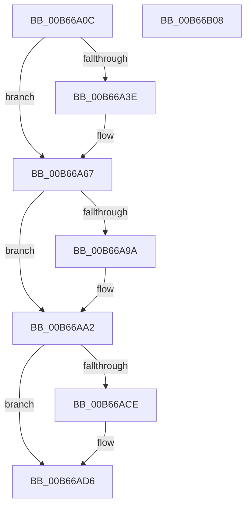

# KiInitializeProcessor

- RVA: `0x00B66A0C`–`0x00B66B09` (길이 `253` bytes)
- VA: `0x0000000140B66A0C`
- 실행 섹션: `PAGELK`
- PDB 이름 있음: `예`; PDB Function 태그: `아니요`
- unwind 정보 RVA: `0x000BCAF8`
- 디코드: `59`개 명령, `253/253` bytes 표시
- 미해석 바이트: `0` (있으면 어셈블리에 `.byte`로 보존)

> 이 문서는 커널 이미지의 기계어와 PDB 기호를 분석해 생성했습니다. 4번과 5번은 함수 원형과 자료형을 바이너리 사용 방식에서 추정한 C 해석이며 원본 소스 복구 결과는 아닙니다.

## 1. Dependencies

- 직접 호출 지점: **6**; 고유 호출 대상: **6**
- 직접 호출자로 확인된 함수: **2**
- RIP 상대 이미지 참조: **4**

### Outgoing calls
- `0x00B66A47` → [KeInitializeGate](../../text/49/KeInitializeGate_function_004953F8.md) (function, `0x004953F8`)
- `0x00B66A53` → [KiInitializeDpcList](../../text/5C/KiInitializeDpcList_function_005C86B8.md) (function, `0x005C86B8`)
- `0x00B66A7C` → [KeInitializeThreadedDpc](../../text/4F/KeInitializeThreadedDpc_function_004FBED0.md) (function, `0x004FBED0`)
- `0x00B66AB6` → [KeInitializeDpc](../../text/45/KeInitializeDpc_function_0045BBD0.md) (function, `0x0045BBD0`)
- `0x00B66AE0` → [KiCreateDpcLimitsProcessorConfiguration](../../text/5B/KiCreateDpcLimitsProcessorConfiguration_function_005B5C48.md) (function, `0x005B5C48`)
- `0x00B66AED` → [KiApplyProcessorDpcLimits](KiApplyProcessorDpcLimits_function_00B6600C.md) (function, `0x00B6600C`)

### Direct callers
- [KiInitializeDynamicProcessorDpc](KiInitializeDynamicProcessorDpc_function_00B67A30.md) at `0x00B67AD4`
- [KeInitSystem](../../init/C7/KeInitSystem_function_00C71660.md) at `0x00C71874`

### Static image references
- `0x00B66A21` → RVA `0x00FC519C` (`ALMOSTRO`; read)
- `0x00B66A2B` → RVA `0x00FC5048` (`ALMOSTRO`; read)
- `0x00B66A75` → RVA `0x005C8490` (`KiDpcWatchdog`; read)
- `0x00B66AAF` → RVA `0x005BD820` (`KiFreeTemporaryStacks`; read)

## 2. Other-region calls and transfers

- 다른 실행 섹션으로 향하는 call: **5**
  - `0x00B66A47` → [KeInitializeGate](../../text/49/KeInitializeGate_function_004953F8.md) (`PAGELK` → `.text`)
  - `0x00B66A53` → [KiInitializeDpcList](../../text/5C/KiInitializeDpcList_function_005C86B8.md) (`PAGELK` → `.text`)
  - `0x00B66A7C` → [KeInitializeThreadedDpc](../../text/4F/KeInitializeThreadedDpc_function_004FBED0.md) (`PAGELK` → `.text`)
  - `0x00B66AB6` → [KeInitializeDpc](../../text/45/KeInitializeDpc_function_0045BBD0.md) (`PAGELK` → `.text`)
  - `0x00B66AE0` → [KiCreateDpcLimitsProcessorConfiguration](../../text/5B/KiCreateDpcLimitsProcessorConfiguration_function_005B5C48.md) (`PAGELK` → `.text`)
- 별도 외부 분기/꼬리 이동을 확인하지 못했습니다.

## 3. Assembly (complete function range)

```asm
00B66A0C  48 8B C4                        mov rax, rsp
00B66A0F  48 89 58 08                     mov qword ptr [rax + 8], rbx
00B66A13  48 89 70 10                     mov qword ptr [rax + 0x10], rsi
00B66A17  48 89 78 18                     mov qword ptr [rax + 0x18], rdi
00B66A1B  41 56                           push r14
00B66A1D  48 83 EC 40                     sub rsp, 0x40
00B66A21  83 3D 74 E7 45 00 00            cmp dword ptr [rip + 0x45e774], 0
00B66A28  0F 57 C0                        xorps xmm0, xmm0
00B66A2B  8B 35 17 E6 45 00               mov esi, dword ptr [rip + 0x45e617]
00B66A31  48 8B D9                        mov rbx, rcx
00B66A34  0F 11 40 D8                     movups xmmword ptr [rax - 0x28], xmm0
00B66A38  0F 11 40 E8                     movups xmmword ptr [rax - 0x18], xmm0
00B66A3C  74 29                           je 0x140b66a67
00B66A3E  48 81 C1 40 83 00 00            add rcx, 0x8340
00B66A45  33 D2                           xor edx, edx
00B66A47  E8 AC E9 92 FF                  call 0x1404953f8
00B66A4C  48 8D 8B 70 38 00 00            lea rcx, [rbx + 0x3870]
00B66A53  E8 60 1C A6 FF                  call 0x1405c86b8
00B66A58  48 83 A3 80 38 00 00 00         and qword ptr [rbx + 0x3880], 0
00B66A60  83 A3 88 38 00 00 00            and dword ptr [rbx + 0x3888], 0
00B66A67  44 8B 43 24                     mov r8d, dword ptr [rbx + 0x24]
00B66A6B  48 8D BB D8 8A 00 00            lea rdi, [rbx + 0x8ad8]
00B66A72  48 8B CF                        mov rcx, rdi
00B66A75  48 8D 15 14 1A A6 FF            lea rdx, [rip - 0x59e5ec]
00B66A7C  E8 4F 54 99 FF                  call 0x1404fbed0
00B66A81  8B 4B 24                        mov ecx, dword ptr [rbx + 0x24]
00B66A84  41 BE 00 08 00 00               mov r14d, 0x800
00B66A8A  C6 83 D9 8A 00 00 02            mov byte ptr [rbx + 0x8ad9], 2
00B66A91  48 8B 47 38                     mov rax, qword ptr [rdi + 0x38]
00B66A95  48 85 C0                        test rax, rax
00B66A98  75 08                           jne 0x140b66aa2
00B66A9A  66 41 03 CE                     add cx, r14w
00B66A9E  66 89 4F 02                     mov word ptr [rdi + 2], cx
00B66AA2  48 8D BB 50 A1 00 00            lea rdi, [rbx + 0xa150]
00B66AA9  45 33 C0                        xor r8d, r8d
00B66AAC  48 8B CF                        mov rcx, rdi
00B66AAF  48 8D 15 6A 6D A5 FF            lea rdx, [rip - 0x5a9296]
00B66AB6  E8 15 51 8F FF                  call 0x14045bbd0
00B66ABB  8B 4B 24                        mov ecx, dword ptr [rbx + 0x24]
00B66ABE  C6 83 51 A1 00 00 02            mov byte ptr [rbx + 0xa151], 2
00B66AC5  48 8B 47 38                     mov rax, qword ptr [rdi + 0x38]
00B66AC9  48 85 C0                        test rax, rax
00B66ACC  75 08                           jne 0x140b66ad6
00B66ACE  66 41 03 CE                     add cx, r14w
00B66AD2  66 89 4F 02                     mov word ptr [rdi + 2], cx
00B66AD6  44 8B C6                        mov r8d, esi
00B66AD9  48 8D 4C 24 20                  lea rcx, [rsp + 0x20]
00B66ADE  33 D2                           xor edx, edx
00B66AE0  E8 63 F1 A4 FF                  call 0x1405b5c48
00B66AE5  48 8D 54 24 20                  lea rdx, [rsp + 0x20]
00B66AEA  48 8B CB                        mov rcx, rbx
00B66AED  E8 1A F5 FF FF                  call 0x140b6600c
00B66AF2  48 8B 5C 24 50                  mov rbx, qword ptr [rsp + 0x50]
00B66AF7  48 8B 74 24 58                  mov rsi, qword ptr [rsp + 0x58]
00B66AFC  48 8B 7C 24 60                  mov rdi, qword ptr [rsp + 0x60]
00B66B01  48 83 C4 40                     add rsp, 0x40
00B66B05  41 5E                           pop r14
00B66B07  C3                              ret
00B66B08  CC                              int3
```

## 4. C-style interpretation (structured pseudocode)

```c
__int64 __fastcall KiInitializeProcessor(__int64 a1, int a2)
{
    __int64 result;
    __int64 v_rsp;
    unsigned __int64 v_stack_m28;
    unsigned __int64 v_stack_p10;
    unsigned __int64 v_stack_p18;
    unsigned __int64 v_stack_p8;

    *(unsigned __int64 *)(v_rsp + 8) = v_rbx;
    *(unsigned __int64 *)(v_rsp + 16) = v_rsi;
    *(unsigned __int64 *)(v_rsp + 24) = v_rdi;
    v_rsp = (v_rsp) - (64);
    *(unsigned __int64 *)(v_rsp - 40) = v_xmm0;
    *(unsigned __int64 *)(v_rsp - 24) = v_xmm0;
    result = v_rsp;
    if ((*(unsigned int *)(v_rip + 4581236)) != 0) {
        a1 = (a1) + (0x8340ULL);
        a2 = 0;
        result = KeInitializeGate(a1, a2, a3, a4);
        a1 = a1 + 14448;
        result = KiInitializeDpcList(a1, a2, a3, a4);
    }
    result = KeInitializeThreadedDpc(a1 + 35544, v_rip - 5891564, (unsigned int)(*(unsigned int *)(a1 + 36)), a4);
    *(unsigned __int8 *)(a1 + 35545) = 2;
    if (*(unsigned __int64 *)(a1 + 35544 + 56) == 0) {
        a1 = (unsigned __int16)(((unsigned int)(*(unsigned int *)(a1 + 36))) + ((unsigned __int16)((unsigned int)(0x800ULL))));
        *(unsigned __int16 *)(a1 + 35544 + 2) = (unsigned __int16)(a1);
    }
    a3 = 0;
    result = KeInitializeDpc(a1 + 41296, v_rip - 5935766, a3, a4);
    *(unsigned __int8 *)(a1 + 41297) = 2;
    if (*(unsigned __int64 *)(a1 + 41296 + 56) == 0) {
        a1 = (unsigned __int16)(((unsigned int)(*(unsigned int *)(a1 + 36))) + ((unsigned __int16)((unsigned int)(0x800ULL))));
        *(unsigned __int16 *)(a1 + 41296 + 2) = (unsigned __int16)(a1);
    }
    a2 = 0;
    result = KiCreateDpcLimitsProcessorConfiguration(v_stack_m28, a2, (unsigned int)((unsigned int)((unsigned int)(*(unsigned int *)(v_rip + 4580887)))), a4);
    result = KiApplyProcessorDpcLimits(a1, v_stack_m28, (unsigned int)((unsigned int)((unsigned int)(*(unsigned int *)(v_rip + 4580887)))), a4);
    v_rsp = (v_rsp) + (64);
    return result;
}
```

## 5. (Beta) C Style

```c
int64_t KiInitializeProcessor(void *Arg1, int32_t Arg2)
{
    uint8_t *arg1 = (uint8_t *)Arg1;

    int64_t result;
    int64_t local_rsp;
    uint64_t v_stack_m28;
    uint64_t v_stack_p10;
    uint64_t v_stack_p18;
    uint64_t v_stack_p8;

    *(uint64_t *)(local_rsp + 0x8) = local_rbx;
    *(uint64_t *)(local_rsp + 0x10) = local_rsi;
    *(uint64_t *)(local_rsp + 0x18) = local_rdi;
    local_rsp = (local_rsp) - (64);
    *(uint64_t *)(local_rsp - 0x28) = v_xmm0;
    *(uint64_t *)(local_rsp - 0x18) = v_xmm0;
    result = local_rsp;
    if ((*(uint32_t *)(v_rip + 0x45E774)) != 0) {
        Arg1 = (Arg1) + (0x8340ULL);
        Arg2 = 0;
        result = KeInitializeGate(Arg1, Arg2, a3, a4);
        Arg1 = Arg1 + 14448;
        result = KiInitializeDpcList(Arg1, Arg2, a3, a4);
    }
    result = KeInitializeThreadedDpc(Arg1 + 35544, v_rip - 5891564, (uint32_t)(*(uint32_t *)(arg1 + 0x24)), a4);
    *(uint8_t *)(arg1 + 0x8AD9) = 2;
    if (*(uint64_t *)(arg1 + 0x8AD8 + 0x38) == 0) {
        Arg1 = (uint16_t)(((uint32_t)(*(uint32_t *)(arg1 + 0x24))) + ((uint16_t)((uint32_t)(0x800ULL))));
        *(uint16_t *)(arg1 + 0x8AD8 + 0x2) = (uint16_t)(Arg1);
    }
    a3 = 0;
    result = KeInitializeDpc(Arg1 + 41296, v_rip - 5935766, a3, a4);
    *(uint8_t *)(arg1 + 0xA151) = 2;
    if (*(uint64_t *)(arg1 + 0xA150 + 0x38) == 0) {
        Arg1 = (uint16_t)(((uint32_t)(*(uint32_t *)(arg1 + 0x24))) + ((uint16_t)((uint32_t)(0x800ULL))));
        *(uint16_t *)(arg1 + 0xA150 + 0x2) = (uint16_t)(Arg1);
    }
    Arg2 = 0;
    result = KiCreateDpcLimitsProcessorConfiguration(v_stack_m28, Arg2, (uint32_t)((uint32_t)((uint32_t)(*(uint32_t *)(v_rip + 0x45E617)))), a4);
    result = KiApplyProcessorDpcLimits(Arg1, v_stack_m28, (uint32_t)((uint32_t)((uint32_t)(*(uint32_t *)(v_rip + 0x45E617)))), a4);
    local_rsp = (local_rsp) + (64);
    return result;
}
```

### 관측된 메모리 오프셋

구조체 형식이 확인되지 않은 접근은 인자 기준의 오프셋으로만 기록했습니다.

| 기준 인자 | 오프셋 표현 | 폭 (bit) | 접근 |
|---|---:|---:|---|
| `Arg1` | `+ 0x2` | `16` | `W` |
| `Arg1` | `+ 0x24` | `32` | `R` |
| `Arg1` | `+ 0x38` | `64` | `R` |
| `Arg1` | `+ 0x3870` | `64` | `R` |
| `Arg1` | `+ 0x3880` | `64` | `R/W` |
| `Arg1` | `+ 0x3888` | `32` | `R/W` |
| `Arg1` | `+ 0x8AD8` | `64` | `R` |
| `Arg1` | `+ 0x8AD9` | `8` | `W` |
| `Arg1` | `+ 0xA150` | `64` | `R` |
| `Arg1` | `+ 0xA151` | `8` | `W` |

## 6. Execution-region graph

[열기: 2D/3D 그래프와 함수 탐색 컨트롤 패널](../../../control-panel.html?section=pagelk&rva=0x00B66A0C&view=graph)

- 2D 그래프는 위에서 아래로 흐르고, 3D 그래프는 빈 공간을 드래그해 회전합니다. Shift+드래그는 이동, 휠은 확대·축소, 함수 노드 선택은 대상 보고서 이동입니다.

### Static fallback


