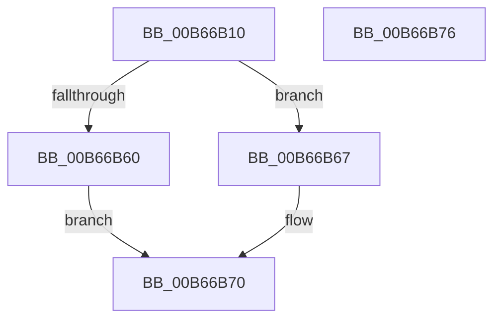

# KiInitializeThreadCycleTable

- RVA: `0x00B66B10`–`0x00B66B77` (길이 `103` bytes)
- VA: `0x0000000140B66B10`
- 실행 섹션: `PAGELK`
- PDB 이름 있음: `예`; PDB Function 태그: `아니요`
- unwind 정보 RVA: `0x000697A4`
- 디코드: `27`개 명령, `103/103` bytes 표시
- 미해석 바이트: `0` (있으면 어셈블리에 `.byte`로 보존)

> 이 문서는 커널 이미지의 기계어와 PDB 기호를 분석해 생성했습니다. 4번과 5번은 함수 원형과 자료형을 바이너리 사용 방식에서 추정한 C 해석이며 원본 소스 복구 결과는 아닙니다.

## 1. Dependencies

- 직접 호출 지점: **3**; 고유 호출 대상: **3**
- 직접 호출자로 확인된 함수: **2**
- RIP 상대 이미지 참조: **0**

### Outgoing calls
- `0x00B66B21` → [KeGetThreadWorkloadClassCount](../../text/4F/KeGetThreadWorkloadClassCount_function_004F8CB4.md) (function, `0x004F8CB4`)
- `0x00B66B2F` → [KeGetProcessorNodeNumber](../../text/43/KeGetProcessorNodeNumber_function_0043F210.md) (function, `0x0043F210`)
- `0x00B66B56` → [ExAllocatePool3](../../poolcode/B8/ExAllocatePool3_function_00B84270.md) (function, `0x00B84270`)

### Direct callers
- [KiStartDynamicProcessor](../../page/74/KiStartDynamicProcessor_function_007456C8.md) at `0x007459CB`
- [KeStartAllProcessors](../../init/C3/KeStartAllProcessors_function_00C36F78.md) at `0x00C37708`

### Static image references
- 디코드된 RIP-relative 메모리 참조가 없습니다.

## 2. Other-region calls and transfers

- 다른 실행 섹션으로 향하는 call: **3**
  - `0x00B66B21` → [KeGetThreadWorkloadClassCount](../../text/4F/KeGetThreadWorkloadClassCount_function_004F8CB4.md) (`PAGELK` → `.text`)
  - `0x00B66B2F` → [KeGetProcessorNodeNumber](../../text/43/KeGetProcessorNodeNumber_function_0043F210.md) (`PAGELK` → `.text`)
  - `0x00B66B56` → [ExAllocatePool3](../../poolcode/B8/ExAllocatePool3_function_00B84270.md) (`PAGELK` → `POOLCODE`)
- 별도 외부 분기/꼬리 이동을 확인하지 못했습니다.

## 3. Assembly (complete function range)

```asm
00B66B10  40 53                           push rbx
00B66B12  48 83 EC 40                     sub rsp, 0x40
00B66B16  0F 57 C0                        xorps xmm0, xmm0
00B66B19  48 8B D9                        mov rbx, rcx
00B66B1C  0F 11 44 24 30                  movups xmmword ptr [rsp + 0x30], xmm0
00B66B21  E8 8E 21 99 FF                  call 0x1404f8cb4
00B66B26  44 6B C0 70                     imul r8d, eax, 0x70
00B66B2A  C6 44 24 30 03                  mov byte ptr [rsp + 0x30], 3
00B66B2F  E8 DC 86 8D FF                  call 0x14043f210
00B66B34  0F B7 D0                        movzx edx, ax
00B66B37  4C 8D 4C 24 30                  lea r9, [rsp + 0x30]
00B66B3C  89 54 24 38                     mov dword ptr [rsp + 0x38], edx
00B66B40  B9 40 00 00 00                  mov ecx, 0x40
00B66B45  41 8B D0                        mov edx, r8d
00B66B48  41 B8 4B 65 54 63               mov r8d, 0x6354654b
00B66B4E  C7 44 24 20 01 00 00 00         mov dword ptr [rsp + 0x20], 1
00B66B56  E8 15 D7 01 00                  call 0x140b84270
00B66B5B  48 85 C0                        test rax, rax
00B66B5E  75 07                           jne 0x140b66b67
00B66B60  B8 9A 00 00 C0                  mov eax, 0xc000009a
00B66B65  EB 09                           jmp 0x140b66b70
00B66B67  48 89 83 B0 86 00 00            mov qword ptr [rbx + 0x86b0], rax
00B66B6E  33 C0                           xor eax, eax
00B66B70  48 83 C4 40                     add rsp, 0x40
00B66B74  5B                              pop rbx
00B66B75  C3                              ret
00B66B76  CC                              int3
```

## 4. C-style interpretation (structured pseudocode)

```c
__int64 __fastcall KiInitializeThreadCycleTable(__int64 a1)
{
    __int64 result;
    __int64 v_rsp;
    unsigned int v_stack_m10;
    unsigned __int64 v_stack_m18;
    unsigned int v_stack_m28;

    v_rsp = (v_rsp) - (64);
    v_stack_m18 = v_xmm0;
    result = KeGetThreadWorkloadClassCount(a1, a2, a3, a4);
    a3 = (unsigned int)((a3) * ((unsigned int)(result)));
    v_stack_m18 = 3;
    result = KeGetProcessorNodeNumber(a1, a2, a3, a4);
    v_stack_m10 = (unsigned int)((unsigned __int16)(result));
    v_stack_m28 = 1;
    result = ExAllocatePool3(64, (unsigned int)((unsigned int)(a3)), (unsigned int)(0x6354654BULL), v_stack_m18);
    if (result != 0) goto loc_00B66B67;
    goto loc_00B66B70;
loc_00B66B67:
    *(unsigned __int64 *)(a1 + 34480) = (unsigned int)(0xC000009AULL);
    result = 0;
loc_00B66B70:
    v_rsp = (v_rsp) + (64);
    return result;
}
```

## 5. (Beta) C Style

```c
int64_t KiInitializeThreadCycleTable(void *Arg1)
{
    uint8_t *arg1 = (uint8_t *)Arg1;

    int64_t result;
    int64_t local_rsp;
    uint32_t v_stack_m10;
    uint64_t v_stack_m18;
    uint32_t v_stack_m28;

    local_rsp = (local_rsp) - (64);
    v_stack_m18 = v_xmm0;
    result = KeGetThreadWorkloadClassCount(Arg1, a2, a3, a4);
    a3 = (uint32_t)((a3) * ((uint32_t)(result)));
    v_stack_m18 = 3;
    result = KeGetProcessorNodeNumber(Arg1, a2, a3, a4);
    v_stack_m10 = (uint32_t)((uint16_t)(result));
    v_stack_m28 = 1;
    result = ExAllocatePool3(64, (uint32_t)((uint32_t)(a3)), (uint32_t)(0x6354654BULL), v_stack_m18);
    if (result != 0) goto loc_00B66B67;
    goto loc_00B66B70;
loc_00B66B67:
    *(uint64_t *)(arg1 + 0x86B0) = (uint32_t)(0xC000009AULL);
    result = 0;
loc_00B66B70:
    local_rsp = (local_rsp) + (64);
    return result;
}
```

### 관측된 메모리 오프셋

구조체 형식이 확인되지 않은 접근은 인자 기준의 오프셋으로만 기록했습니다.

| 기준 인자 | 오프셋 표현 | 폭 (bit) | 접근 |
|---|---:|---:|---|
| `Arg1` | `+ 0x86B0` | `64` | `W` |

## 6. Execution-region graph

[열기: 2D/3D 그래프와 함수 탐색 컨트롤 패널](../../../control-panel.html?section=pagelk&rva=0x00B66B10&view=graph)

- 2D 그래프는 위에서 아래로 흐르고, 3D 그래프는 빈 공간을 드래그해 회전합니다. Shift+드래그는 이동, 휠은 확대·축소, 함수 노드 선택은 대상 보고서 이동입니다.

### Static fallback


