# KiInitializeTopologyStructures

- RVA: `0x00B69708`–`0x00B69B71` (길이 `1,129` bytes)
- VA: `0x0000000140B69708`
- 실행 섹션: `PAGELK`
- PDB 이름 있음: `예`; PDB Function 태그: `아니요`
- unwind 정보 RVA: `0x000CA894`
- 디코드: `288`개 명령, `1,129/1,129` bytes 표시
- 미해석 바이트: `0` (있으면 어셈블리에 `.byte`로 보존)

> 이 문서는 커널 이미지의 기계어와 PDB 기호를 분석해 생성했습니다. 4번과 5번은 함수 원형과 자료형을 바이너리 사용 방식에서 추정한 C 해석이며 원본 소스 복구 결과는 아닙니다.

## 1. Dependencies

- 직접 호출 지점: **13**; 고유 호출 대상: **7**
- 직접 호출자로 확인된 함수: **1**
- RIP 상대 이미지 참조: **3**

### Outgoing calls
- `0x00B69793` → [Feature_PpmParkEx__private_IsEnabledNoReportingNoInline](../../text/4F/Feature_PpmParkEx__private_IsEnabledNoReportingNoInline_function_004F40E0.md) (function, `0x004F40E0`)
- `0x00B698CD` → [memset](../../text/6C/memset_function_006C6C40.md) (function, `0x006C6C40`)
- `0x00B698D8` → [KeAddProcessorAffinityEx](../../text/25/KeAddProcessorAffinityEx_function_0025B6F0.md) (function, `0x0025B6F0`)
- `0x00B699D1` → [KeGetProcessorNode](../../text/4A/KeGetProcessorNode_function_004A4FA8.md) (function, `0x004A4FA8`)
- `0x00B699DC` → [KeGetProcessorNode](../../text/4A/KeGetProcessorNode_function_004A4FA8.md) (function, `0x004A4FA8`)
- `0x00B699F8` → [KeAddProcessorAffinityEx](../../text/25/KeAddProcessorAffinityEx_function_0025B6F0.md) (function, `0x0025B6F0`)
- `0x00B69A09` → [KeAddProcessorAffinityEx](../../text/25/KeAddProcessorAffinityEx_function_0025B6F0.md) (function, `0x0025B6F0`)
- `0x00B69A11` → [KeCountSetBitsAffinityEx](../../text/2C/KeCountSetBitsAffinityEx_function_002CE6E0.md) (function, `0x002CE6E0`)
- `0x00B69A93` → [KeBugCheckEx](../../text/4F/KeBugCheckEx_function_004FD660.md) (function, `0x004FD660`)
- `0x00B69AAE` → [KeCountSetBitsAffinityEx](../../text/2C/KeCountSetBitsAffinityEx_function_002CE6E0.md) (function, `0x002CE6E0`)
- `0x00B69AE4` → [KeBugCheckEx](../../text/4F/KeBugCheckEx_function_004FD660.md) (function, `0x004FD660`)
- `0x00B69AED` → [KeGetProcessorNode](../../text/4A/KeGetProcessorNode_function_004A4FA8.md) (function, `0x004A4FA8`)
- `0x00B69B4A` → [_security_check_cookie](../../text/6A/_security_check_cookie_function_006AC640.md) (function, `0x006AC640`)

### Direct callers
- [KiInitializeKernel](KiInitializeKernel_function_00B68D20.md) at `0x00B68F2F`
- [KiInitializeKernel](KiInitializeKernel_function_00B68D20.md) at `0x00B68F9E`

### Static image references
- `0x00B6972E` → RVA `0x00E0A740` (`.data`; read)
- `0x00B698EE` → RVA `0x00FC6A80` (`ALMOSTRO`; read)
- `0x00B69928` → RVA `0x00FC8C40` (`ALMOSTRO`; read)

## 2. Other-region calls and transfers

- 다른 실행 섹션으로 향하는 call: **13**
  - `0x00B69793` → [Feature_PpmParkEx__private_IsEnabledNoReportingNoInline](../../text/4F/Feature_PpmParkEx__private_IsEnabledNoReportingNoInline_function_004F40E0.md) (`PAGELK` → `.text`)
  - `0x00B698CD` → [memset](../../text/6C/memset_function_006C6C40.md) (`PAGELK` → `.text`)
  - `0x00B698D8` → [KeAddProcessorAffinityEx](../../text/25/KeAddProcessorAffinityEx_function_0025B6F0.md) (`PAGELK` → `.text`)
  - `0x00B699D1` → [KeGetProcessorNode](../../text/4A/KeGetProcessorNode_function_004A4FA8.md) (`PAGELK` → `.text`)
  - `0x00B699DC` → [KeGetProcessorNode](../../text/4A/KeGetProcessorNode_function_004A4FA8.md) (`PAGELK` → `.text`)
  - `0x00B699F8` → [KeAddProcessorAffinityEx](../../text/25/KeAddProcessorAffinityEx_function_0025B6F0.md) (`PAGELK` → `.text`)
  - `0x00B69A09` → [KeAddProcessorAffinityEx](../../text/25/KeAddProcessorAffinityEx_function_0025B6F0.md) (`PAGELK` → `.text`)
  - `0x00B69A11` → [KeCountSetBitsAffinityEx](../../text/2C/KeCountSetBitsAffinityEx_function_002CE6E0.md) (`PAGELK` → `.text`)
  - `0x00B69A93` → [KeBugCheckEx](../../text/4F/KeBugCheckEx_function_004FD660.md) (`PAGELK` → `.text`)
  - `0x00B69AAE` → [KeCountSetBitsAffinityEx](../../text/2C/KeCountSetBitsAffinityEx_function_002CE6E0.md) (`PAGELK` → `.text`)
  - `0x00B69AE4` → [KeBugCheckEx](../../text/4F/KeBugCheckEx_function_004FD660.md) (`PAGELK` → `.text`)
  - `0x00B69AED` → [KeGetProcessorNode](../../text/4A/KeGetProcessorNode_function_004A4FA8.md) (`PAGELK` → `.text`)
  - `0x00B69B4A` → [_security_check_cookie](../../text/6A/_security_check_cookie_function_006AC640.md) (`PAGELK` → `.text`)
- 별도 외부 분기/꼬리 이동을 확인하지 못했습니다.

## 3. Assembly (complete function range)

```asm
00B69708  48 8B C4                        mov rax, rsp
00B6970B  48 89 58 10                     mov qword ptr [rax + 0x10], rbx
00B6970F  48 89 70 18                     mov qword ptr [rax + 0x18], rsi
00B69713  48 89 78 20                     mov qword ptr [rax + 0x20], rdi
00B69717  55                              push rbp
00B69718  41 54                           push r12
00B6971A  41 55                           push r13
00B6971C  41 56                           push r14
00B6971E  41 57                           push r15
00B69720  48 8D A8 28 FF FF FF            lea rbp, [rax - 0xd8]
00B69727  48 81 EC B0 01 00 00            sub rsp, 0x1b0
00B6972E  48 8B 05 0B 10 2A 00            mov rax, qword ptr [rip + 0x2a100b]
00B69735  48 33 C4                        xor rax, rsp
00B69738  48 89 85 A8 00 00 00            mov qword ptr [rbp + 0xa8], rax
00B6973F  8B 81 D4 00 00 00               mov eax, dword ptr [rcx + 0xd4]
00B69745  4C 8D 69 24                     lea r13, [rcx + 0x24]
00B69749  45 8B 65 00                     mov r12d, dword ptr [r13]
00B6974D  0F 57 C0                        xorps xmm0, xmm0
00B69750  0F 57 C9                        xorps xmm1, xmm1
00B69753  44 89 64 24 3C                  mov dword ptr [rsp + 0x3c], r12d
00B69758  48 8B F9                        mov rdi, rcx
00B6975B  89 44 24 38                     mov dword ptr [rsp + 0x38], eax
00B6975F  F3 0F 7F 45 E0                  movdqu xmmword ptr [rbp - 0x20], xmm0
00B69764  4C 89 6C 24 50                  mov qword ptr [rsp + 0x50], r13
00B69769  F3 0F 7F 4D F0                  movdqu xmmword ptr [rbp - 0x10], xmm1
00B6976E  0F 11 44 24 70                  movups xmmword ptr [rsp + 0x70], xmm0
00B69773  0F 11 45 80                     movups xmmword ptr [rbp - 0x80], xmm0
00B69777  0F 11 45 90                     movups xmmword ptr [rbp - 0x70], xmm0
00B6977B  0F 11 4D 00                     movups xmmword ptr [rbp], xmm1
00B6977F  0F 11 4D 10                     movups xmmword ptr [rbp + 0x10], xmm1
00B69783  0F 11 4D 20                     movups xmmword ptr [rbp + 0x20], xmm1
00B69787  0F 11 45 A0                     movups xmmword ptr [rbp - 0x60], xmm0
00B6978B  0F 11 45 B0                     movups xmmword ptr [rbp - 0x50], xmm0
00B6978F  0F 11 45 C0                     movups xmmword ptr [rbp - 0x40], xmm0
00B69793  E8 48 A9 98 FF                  call 0x1404f40e0
00B69798  45 33 DB                        xor r11d, r11d
00B6979B  0F 57 C0                        xorps xmm0, xmm0
00B6979E  85 C0                           test eax, eax
00B697A0  48 8D 87 10 9F 00 00            lea rax, [rdi + 0x9f10]
00B697A7  48 89 45 E0                     mov qword ptr [rbp - 0x20], rax
00B697AB  48 8D 87 C0 9C 00 00            lea rax, [rdi + 0x9cc0]
00B697B2  41 0F 95 C6                     setne r14b
00B697B6  48 89 45 E8                     mov qword ptr [rbp - 0x18], rax
00B697BA  44 88 74 24 30                  mov byte ptr [rsp + 0x30], r14b
00B697BF  48 8D 87 10 8C 00 00            lea rax, [rdi + 0x8c10]
00B697C6  48 89 45 F0                     mov qword ptr [rbp - 0x10], rax
00B697CA  0F 11 45 D0                     movups xmmword ptr [rbp - 0x30], xmm0
00B697CE  45 84 F6                        test r14b, r14b
00B697D1  74 0B                           je 0x140b697de
00B697D3  48 8D 87 40 B9 00 00            lea rax, [rdi + 0xb940]
00B697DA  48 89 45 F8                     mov qword ptr [rbp - 8], rax
00B697DE  8B 8F A4 00 00 00               mov ecx, dword ptr [rdi + 0xa4]
00B697E4  48 8D 87 60 8E 00 00            lea rax, [rdi + 0x8e60]
00B697EB  48 89 44 24 78                  mov qword ptr [rsp + 0x78], rax
00B697F0  45 84 F6                        test r14b, r14b
00B697F3  48 8D 87 78 8E 00 00            lea rax, [rdi + 0x8e78]
00B697FA  89 4C 24 5C                     mov dword ptr [rsp + 0x5c], ecx
00B697FE  48 89 45 80                     mov qword ptr [rbp - 0x80], rax
00B69802  41 BA 01 00 00 00               mov r10d, 1
00B69808  48 8B 45 98                     mov rax, qword ptr [rbp - 0x68]
00B6980C  49 0F 45 C3                     cmovne rax, r11
00B69810  44 89 54 24 58                  mov dword ptr [rsp + 0x58], r10d
00B69815  48 89 45 98                     mov qword ptr [rbp - 0x68], rax
00B69819  8B 87 CC 9E 00 00               mov eax, dword ptr [rdi + 0x9ecc]
00B6981F  89 44 24 60                     mov dword ptr [rsp + 0x60], eax
00B69823  8B C1                           mov eax, ecx
00B69825  0F AF 87 C8 9E 00 00            imul eax, dword ptr [rdi + 0x9ec8]
00B6982C  0F AF 8F A0 00 00 00            imul ecx, dword ptr [rdi + 0xa0]
00B69833  0F 11 45 88                     movups xmmword ptr [rbp - 0x78], xmm0
00B69837  89 44 24 64                     mov dword ptr [rsp + 0x64], eax
00B6983B  89 4C 24 68                     mov dword ptr [rsp + 0x68], ecx
00B6983F  45 84 F6                        test r14b, r14b
00B69842  74 0A                           je 0x140b6984e
00B69844  8B 87 48 BB 00 00               mov eax, dword ptr [rdi + 0xbb48]
00B6984A  89 44 24 6C                     mov dword ptr [rsp + 0x6c], eax
00B6984E  45 0F B6 FE                     movzx r15d, r14b
00B69852  48 8D 44 24 58                  lea rax, [rsp + 0x58]
00B69857  49 83 C7 05                     add r15, 5
00B6985B  4C 8B CF                        mov r9, rdi
00B6985E  4C 2B C8                        sub r9, rax
00B69861  4D 8B C3                        mov r8, r11
00B69864  8B 87 D4 00 00 00               mov eax, dword ptr [rdi + 0xd4]
00B6986A  48 8D 54 24 58                  lea rdx, [rsp + 0x58]
00B6986F  4A 8D 14 82                     lea rdx, [rdx + r8*4]
00B69873  8B 0A                           mov ecx, dword ptr [rdx]
00B69875  41 2B CA                        sub ecx, r10d
00B69878  F7 D1                           not ecx
00B6987A  23 C1                           and eax, ecx
00B6987C  42 89 4C 85 60                  mov dword ptr [rbp + r8*4 + 0x60], ecx
00B69881  4D 03 C2                        add r8, r10
00B69884  42 89 84 0A 18 8E 00 00         mov dword ptr [rdx + r9 + 0x8e18], eax
00B6988C  4D 3B C7                        cmp r8, r15
00B6988F  7C D3                           jl 0x140b69864
00B69891  49 8B DA                        mov rbx, r10
00B69894  4C 8D 74 24 70                  lea r14, [rsp + 0x70]
00B69899  4C 8D 6D D0                     lea r13, [rbp - 0x30]
00B6989D  49 8B 0C DE                     mov rcx, qword ptr [r14 + rbx*8]
00B698A1  48 85 C9                        test rcx, rcx
00B698A4  74 0A                           je 0x140b698b0
00B698A6  48 8B 87 C8 00 00 00            mov rax, qword ptr [rdi + 0xc8]
00B698AD  48 89 01                        mov qword ptr [rcx], rax
00B698B0  49 8B 74 DD 00                  mov rsi, qword ptr [r13 + rbx*8]
00B698B5  48 85 F6                        test rsi, rsi
00B698B8  74 2C                           je 0x140b698e6
00B698BA  48 8D 4E 08                     lea rcx, [rsi + 8]
00B698BE  48 C7 06 01 00 20 00            mov qword ptr [rsi], 0x200001
00B698C5  33 D2                           xor edx, edx
00B698C7  41 B8 00 01 00 00               mov r8d, 0x100
00B698CD  E8 6E D3 B5 FF                  call 0x1406c6c40
00B698D2  41 8B D4                        mov edx, r12d
00B698D5  48 8B CE                        mov rcx, rsi
00B698D8  E8 13 1E 6F FF                  call 0x14025b6f0
00B698DD  41 BA 01 00 00 00               mov r10d, 1
00B698E3  45 33 DB                        xor r11d, r11d
00B698E6  49 03 DA                        add rbx, r10
00B698E9  49 3B DF                        cmp rbx, r15
00B698EC  7C AF                           jl 0x140b6989d
00B698EE  8B 0D 8C D1 45 00               mov ecx, dword ptr [rip + 0x45d18c]
00B698F4  0F 57 C9                        xorps xmm1, xmm1
00B698F7  41 8B C4                        mov eax, r12d
00B698FA  45 8B E3                        mov r12d, r11d
00B698FD  F7 D8                           neg eax
00B698FF  0F 11 4D 30                     movups xmmword ptr [rbp + 0x30], xmm1
00B69903  1B C0                           sbb eax, eax
00B69905  23 C1                           and eax, ecx
00B69907  48 8B 4D C8                     mov rcx, qword ptr [rbp - 0x38]
00B6990B  89 44 24 40                     mov dword ptr [rsp + 0x40], eax
00B6990F  0F 11 4D 40                     movups xmmword ptr [rbp + 0x40], xmm1
00B69913  0F 11 4D 50                     movups xmmword ptr [rbp + 0x50], xmm1
00B69917  44 8A 74 24 30                  mov r14b, byte ptr [rsp + 0x30]
00B6991C  44 3B E0                        cmp r12d, eax
00B6991F  0F 83 74 01 00 00               jae 0x140b69a99
00B69925  41 8B C4                        mov eax, r12d
00B69928  48 8D 35 11 F3 45 00            lea rsi, [rip + 0x45f311]
00B6992F  0F 57 C0                        xorps xmm0, xmm0
00B69932  0F 11 45 00                     movups xmmword ptr [rbp], xmm0
00B69936  48 8B 34 C6                     mov rsi, qword ptr [rsi + rax*8]
00B6993A  8B 96 D4 00 00 00               mov edx, dword ptr [rsi + 0xd4]
00B69940  48 8D 86 10 9F 00 00            lea rax, [rsi + 0x9f10]
00B69947  48 89 45 10                     mov qword ptr [rbp + 0x10], rax
00B6994B  48 8D 86 C0 9C 00 00            lea rax, [rsi + 0x9cc0]
00B69952  48 89 45 18                     mov qword ptr [rbp + 0x18], rax
00B69956  48 8D 86 10 8C 00 00            lea rax, [rsi + 0x8c10]
00B6995D  48 89 45 20                     mov qword ptr [rbp + 0x20], rax
00B69961  89 54 24 34                     mov dword ptr [rsp + 0x34], edx
00B69965  45 84 F6                        test r14b, r14b
00B69968  74 0B                           je 0x140b69975
00B6996A  48 8D 86 40 B9 00 00            lea rax, [rsi + 0xb940]
00B69971  48 89 45 28                     mov qword ptr [rbp + 0x28], rax
00B69975  48 8D 86 60 8E 00 00            lea rax, [rsi + 0x8e60]
00B6997C  4C 89 5D A0                     mov qword ptr [rbp - 0x60], r11
00B69980  45 84 F6                        test r14b, r14b
00B69983  48 89 45 A8                     mov qword ptr [rbp - 0x58], rax
00B69987  48 8D 86 78 8E 00 00            lea rax, [rsi + 0x8e78]
00B6998E  45 8B EA                        mov r13d, r10d
00B69991  49 0F 45 CB                     cmovne rcx, r11
00B69995  48 89 45 B0                     mov qword ptr [rbp - 0x50], rax
00B69999  48 89 4C 24 48                  mov qword ptr [rsp + 0x48], rcx
00B6999E  4D 8B F2                        mov r14, r10
00B699A1  48 89 4D C8                     mov qword ptr [rbp - 0x38], rcx
00B699A5  0F 11 45 B8                     movups xmmword ptr [rbp - 0x48], xmm0
00B699A9  4D 3B F7                        cmp r14, r15
00B699AC  0F 8D BA 00 00 00               jge 0x140b69a6c
00B699B2  42 8B 4C B5 60                  mov ecx, dword ptr [rbp + r14*4 + 0x60]
00B699B7  8B C1                           mov eax, ecx
00B699B9  23 4C 24 38                     and ecx, dword ptr [rsp + 0x38]
00B699BD  23 C2                           and eax, edx
00B699BF  3B C1                           cmp eax, ecx
00B699C1  0F 85 9A 00 00 00               jne 0x140b69a61
00B699C7  4E 39 5C F5 30                  cmp qword ptr [rbp + r14*8 + 0x30], r11
00B699CC  75 1D                           jne 0x140b699eb
00B699CE  48 8B CE                        mov rcx, rsi
00B699D1  E8 D2 B5 93 FF                  call 0x1404a4fa8
00B699D6  48 8B CF                        mov rcx, rdi
00B699D9  48 8B D0                        mov rdx, rax
00B699DC  E8 C7 B5 93 FF                  call 0x1404a4fa8
00B699E1  48 3B D0                        cmp rdx, rax
00B699E4  75 05                           jne 0x140b699eb
00B699E6  4A 89 74 F5 30                  mov qword ptr [rbp + r14*8 + 0x30], rsi
00B699EB  4A 8B 4C F5 D0                  mov rcx, qword ptr [rbp + r14*8 - 0x30]
00B699F0  48 85 C9                        test rcx, rcx
00B699F3  74 35                           je 0x140b69a2a
00B699F5  41 8B D4                        mov edx, r12d
00B699F8  E8 F3 1C 6F FF                  call 0x14025b6f0
00B699FD  4A 8B 5C F5 00                  mov rbx, qword ptr [rbp + r14*8]
00B69A02  8B 54 24 3C                     mov edx, dword ptr [rsp + 0x3c]
00B69A06  48 8B CB                        mov rcx, rbx
00B69A09  E8 E2 1C 6F FF                  call 0x14025b6f0
00B69A0E  48 8B CB                        mov rcx, rbx
00B69A11  E8 CA 4C 76 FF                  call 0x1402ce6e0
00B69A16  42 8B 54 B4 58                  mov edx, dword ptr [rsp + r14*4 + 0x58]
00B69A1B  8B C8                           mov ecx, eax
00B69A1D  3B C2                           cmp eax, edx
00B69A1F  77 5C                           ja 0x140b69a7d
00B69A21  41 BA 01 00 00 00               mov r10d, 1
00B69A27  45 33 DB                        xor r11d, r11d
00B69A2A  4A 8B 4C F4 70                  mov rcx, qword ptr [rsp + r14*8 + 0x70]
00B69A2F  8B 54 24 34                     mov edx, dword ptr [rsp + 0x34]
00B69A33  48 85 C9                        test rcx, rcx
00B69A36  74 29                           je 0x140b69a61
00B69A38  48 8B 86 C0 00 00 00            mov rax, qword ptr [rsi + 0xc0]
00B69A3F  48 39 87 C0 00 00 00            cmp qword ptr [rdi + 0xc0], rax
00B69A46  75 19                           jne 0x140b69a61
00B69A48  48 8B 86 C8 00 00 00            mov rax, qword ptr [rsi + 0xc8]
00B69A4F  48 09 01                        or qword ptr [rcx], rax
00B69A52  4A 8B 4C F5 A0                  mov rcx, qword ptr [rbp + r14*8 - 0x60]
00B69A57  48 8B 87 C8 00 00 00            mov rax, qword ptr [rdi + 0xc8]
00B69A5E  48 09 01                        or qword ptr [rcx], rax
00B69A61  45 03 EA                        add r13d, r10d
00B69A64  4D 03 F2                        add r14, r10
00B69A67  E9 3D FF FF FF                  jmp 0x140b699a9
00B69A6C  48 8B 4C 24 48                  mov rcx, qword ptr [rsp + 0x48]
00B69A71  45 03 E2                        add r12d, r10d
00B69A74  8B 44 24 40                     mov eax, dword ptr [rsp + 0x40]
00B69A78  E9 9A FE FF FF                  jmp 0x140b69917
00B69A7D  49 63 C5                        movsxd rax, r13d
00B69A80  4C 8B CA                        mov r9, rdx
00B69A83  4C 8B C1                        mov r8, rcx
00B69A86  48 89 44 24 20                  mov qword ptr [rsp + 0x20], rax
00B69A8B  48 8B D6                        mov rdx, rsi
00B69A8E  B9 3E 00 00 00                  mov ecx, 0x3e
00B69A93  E8 C8 3B 99 FF                  call 0x1404fd660
00B69A98  CC                              int3
00B69A99  41 8B F2                        mov esi, r10d
00B69A9C  49 8B DA                        mov rbx, r10
00B69A9F  49 3B DF                        cmp rbx, r15
00B69AA2  7D 46                           jge 0x140b69aea
00B69AA4  48 8B 4C DD D0                  mov rcx, qword ptr [rbp + rbx*8 - 0x30]
00B69AA9  48 85 C9                        test rcx, rcx
00B69AAC  74 18                           je 0x140b69ac6
00B69AAE  E8 2D 4C 76 FF                  call 0x1402ce6e0
00B69AB3  8B 54 9C 58                     mov edx, dword ptr [rsp + rbx*4 + 0x58]
00B69AB7  8B C8                           mov ecx, eax
00B69AB9  3B C2                           cmp eax, edx
00B69ABB  77 11                           ja 0x140b69ace
00B69ABD  41 BA 01 00 00 00               mov r10d, 1
00B69AC3  45 33 DB                        xor r11d, r11d
00B69AC6  41 03 F2                        add esi, r10d
00B69AC9  49 03 DA                        add rbx, r10
00B69ACC  EB D1                           jmp 0x140b69a9f
00B69ACE  48 63 C6                        movsxd rax, esi
00B69AD1  4C 8B CA                        mov r9, rdx
00B69AD4  4C 8B C1                        mov r8, rcx
00B69AD7  48 89 44 24 20                  mov qword ptr [rsp + 0x20], rax
00B69ADC  48 8B D7                        mov rdx, rdi
00B69ADF  B9 3E 00 00 00                  mov ecx, 0x3e
00B69AE4  E8 77 3B 99 FF                  call 0x1404fd660
00B69AE9  CC                              int3
00B69AEA  48 8B CF                        mov rcx, rdi
00B69AED  E8 B6 B4 93 FF                  call 0x1404a4fa8
00B69AF2  4C 8B 6C 24 50                  mov r13, qword ptr [rsp + 0x50]
00B69AF7  48 2B F8                        sub rdi, rax
00B69AFA  41 B9 08 B8 00 00               mov r9d, 0xb808
00B69B00  4D 8B C3                        mov r8, r11
00B69B03  49 03 F9                        add rdi, r9
00B69B06  4C 2B C8                        sub r9, rax
00B69B09  48 8D 90 20 01 00 00            lea rdx, [rax + 0x120]
00B69B10  4A 8B 4C C5 30                  mov rcx, qword ptr [rbp + r8*8 + 0x30]
00B69B15  45 39 5D 00                     cmp dword ptr [r13], r11d
00B69B19  74 19                           je 0x140b69b34
00B69B1B  48 85 C9                        test rcx, rcx
00B69B1E  74 0C                           je 0x140b69b2c
00B69B20  49 8D 04 11                     lea rax, [r9 + rdx]
00B69B24  8B 0C 08                        mov ecx, dword ptr [rax + rcx]
00B69B27  89 0C 17                        mov dword ptr [rdi + rdx], ecx
00B69B2A  EB 08                           jmp 0x140b69b34
00B69B2C  8B 02                           mov eax, dword ptr [rdx]
00B69B2E  89 04 17                        mov dword ptr [rdi + rdx], eax
00B69B31  44 01 12                        add dword ptr [rdx], r10d
00B69B34  4D 03 C2                        add r8, r10
00B69B37  48 83 C2 04                     add rdx, 4
00B69B3B  4D 3B C7                        cmp r8, r15
00B69B3E  7C D0                           jl 0x140b69b10
00B69B40  48 8B 8D A8 00 00 00            mov rcx, qword ptr [rbp + 0xa8]
00B69B47  48 33 CC                        xor rcx, rsp
00B69B4A  E8 F1 2A B4 FF                  call 0x1406ac640
00B69B4F  4C 8D 9C 24 B0 01 00 00         lea r11, [rsp + 0x1b0]
00B69B57  49 8B 5B 38                     mov rbx, qword ptr [r11 + 0x38]
00B69B5B  49 8B 73 40                     mov rsi, qword ptr [r11 + 0x40]
00B69B5F  49 8B 7B 48                     mov rdi, qword ptr [r11 + 0x48]
00B69B63  49 8B E3                        mov rsp, r11
00B69B66  41 5F                           pop r15
00B69B68  41 5E                           pop r14
00B69B6A  41 5D                           pop r13
00B69B6C  41 5C                           pop r12
00B69B6E  5D                              pop rbp
00B69B6F  C3                              ret
00B69B70  CC                              int3
```

## 4. C-style interpretation (structured pseudocode)

```c
__int64 __fastcall KiInitializeTopologyStructures(__int64 a1)
{
    __int64 result;
    __int64 v_r10;
    __int64 v_r11;
    __int64 v_r12;
    __int64 v_r13;
    __int64 v_r14;
    __int64 v_r15;
    __int64 v_rbx;
    __int64 v_rdi;
    __int64 v_rsi;
    __int64 v_rsp;
    unsigned __int64 v_stack_m160;
    unsigned __int64 v_stack_m168;
    unsigned int v_stack_m16C;
    unsigned int v_stack_m170;
    unsigned int v_stack_m174;
    unsigned int v_stack_m178;
    unsigned int v_stack_m17C;
    unsigned int v_stack_m180;
    unsigned __int64 v_stack_m188;
    unsigned __int64 v_stack_m190;
    unsigned int v_stack_m198;
    unsigned int v_stack_m19C;
    unsigned int v_stack_m1A0;
    unsigned int v_stack_m1A4;
    unsigned __int8 v_stack_m1A8;
    unsigned __int64 v_stack_m1B8;
    unsigned __int64 v_stack_m28;

    *(unsigned __int64 *)(v_rsp + 16) = v_rbx;
    *(unsigned __int64 *)(v_rsp + 24) = v_rsi;
    *(unsigned __int64 *)(v_rsp + 32) = v_rdi;
    v_rsp = (v_rsp) - (432);
    result = (*(unsigned __int64 *)(v_rip + 2756619)) ^ (v_rsp);
    *(unsigned __int64 *)(v_rsp - 216 + 168) = result;
    v_stack_m19C = (unsigned int)((unsigned int)(*(unsigned int *)(a1 + 36)));
    v_stack_m1A0 = (unsigned int)((unsigned int)(*(unsigned int *)(a1 + 212)));
    *(unsigned __int64 *)(v_rsp - 216 - 32) = v_xmm0;
    v_stack_m188 = a1 + 36;
    *(unsigned __int64 *)(v_rsp - 216 - 16) = v_xmm1;
    v_stack_m168 = v_xmm0;
    *(unsigned __int64 *)(v_rsp - 216 - 128) = v_xmm0;
    *(unsigned __int64 *)(v_rsp - 216 - 112) = v_xmm0;
    *(unsigned __int64 *)(v_rsp - 216) = v_xmm1;
    *(unsigned __int64 *)(v_rsp - 216 + 16) = v_xmm1;
    *(unsigned __int64 *)(v_rsp - 216 + 32) = v_xmm1;
    *(unsigned __int64 *)(v_rsp - 216 - 96) = v_xmm0;
    *(unsigned __int64 *)(v_rsp - 216 - 80) = v_xmm0;
    *(unsigned __int64 *)(v_rsp - 216 - 64) = v_xmm0;
    result = Feature_PpmParkEx__private_IsEnabledNoReportingNoInline(a1, a2, a3, a4);
    v_r11 = 0;
    *(unsigned __int64 *)(v_rsp - 216 - 32) = a1 + 40720;
    v_r14 = ((unsigned int)(result) != 0) ? 1 : 0;
    *(unsigned __int64 *)(v_rsp - 216 - 24) = a1 + 40128;
    v_stack_m1A8 = (unsigned __int8)(v_r14);
    *(unsigned __int64 *)(v_rsp - 216 - 16) = a1 + 35856;
    *(unsigned __int64 *)(v_rsp - 216 - 48) = v_xmm0;
    result = a1 + 35856;
    if ((unsigned __int8)(v_r14) != 0) {
        result = a1 + 47424;
        *(unsigned __int64 *)(v_rsp - 216 - 8) = result;
    }
    v_stack_m160 = a1 + 36448;
    v_stack_m17C = (unsigned int)((unsigned int)(*(unsigned int *)(a1 + 164)));
    *(unsigned __int64 *)(v_rsp - 216 - 128) = a1 + 36472;
    result = *(unsigned __int64 *)(v_rsp - 216 - 104);
    if ((unsigned __int8)(v_r14) != 0) { result = 0; }
    v_stack_m180 = 1;
    *(unsigned __int64 *)(v_rsp - 216 - 104) = result;
    v_stack_m178 = (unsigned int)((unsigned int)(*(unsigned int *)(a1 + 40652)));
    result = (unsigned int)(((unsigned int)((unsigned int)((unsigned int)(*(unsigned int *)(a1 + 164))))) * (*(unsigned int *)(a1 + 40648)));
    a1 = (unsigned int)(((unsigned int)(*(unsigned int *)(a1 + 164))) * (*(unsigned int *)(a1 + 160)));
    *(unsigned __int64 *)(v_rsp - 216 - 120) = v_xmm0;
    v_stack_m174 = (unsigned int)(result);
    v_stack_m170 = (unsigned int)(a1);
    if ((unsigned __int8)(v_r14) != 0) {
        result = *(unsigned int *)(a1 + 47944);
        v_stack_m16C = (unsigned int)(result);
    }
    v_r15 = ((unsigned __int8)(v_r14)) + (5);
    a4 = (a1) - (v_stack_m180);
loc_00B69864:
    a1 = (unsigned int)(((unsigned int)(*(unsigned int *)(v_stack_m180 + 0 * 4))) - (1));
    a1 = (unsigned int)(~(a1));
    result = (unsigned int)(((unsigned int)(*(unsigned int *)(a1 + 212))) & ((unsigned int)(a1)));
    *(unsigned int *)(v_rsp - 216 + 0 * 4 + 96) = (unsigned int)(a1);
    a3 = (0) + (1);
    *(unsigned int *)(v_stack_m180 + 0 * 4 + a4 * 1 + 36376) = (unsigned int)(result);
    if (a3 < v_r15) goto loc_00B69864;
loc_00B6989D:
    if (*(unsigned __int64 *)(v_stack_m168 + 1 * 8) != 0) {
        result = *(unsigned __int64 *)(a1 + 200);
        *(unsigned __int64 *)(*(unsigned __int64 *)(v_stack_m168 + 1 * 8)) = result;
    }
    v_r10 = 1;
    if (*(unsigned __int64 *)(v_rsp - 216 - 48 + 1 * 8) != 0) {
        a1 = *(unsigned __int64 *)(v_rsp - 216 - 48 + 1 * 8) + 8;
        *(unsigned __int64 *)(*(unsigned __int64 *)(v_rsp - 216 - 48 + 1 * 8)) = 0x200001ULL;
        a2 = 0;
        a3 = 256;
        result = memset(a1, a2, a3, a4);
        a2 = (unsigned int)((unsigned int)(*(unsigned int *)(a1 + 36)));
        a1 = *(unsigned __int64 *)(v_rsp - 216 - 48 + 1 * 8);
        result = KeAddProcessorAffinityEx(a1, a2, a3, a4);
        v_r10 = 1;
        v_r11 = 0;
    }
    v_rbx = (1) + (v_r10);
    if (v_rbx < v_r15) goto loc_00B6989D;
    result = (unsigned int)(-((unsigned int)((unsigned int)((unsigned int)(*(unsigned int *)(a1 + 36))))));
    *(unsigned __int64 *)(v_rsp - 216 + 48) = v_xmm1;
    result = (unsigned int)((result) & ((unsigned int)((unsigned int)(*(unsigned int *)(v_rip + 4575628)))));
    v_stack_m198 = (unsigned int)(result);
    *(unsigned __int64 *)(v_rsp - 216 + 64) = v_xmm1;
    *(unsigned __int64 *)(v_rsp - 216 + 80) = v_xmm1;
loc_00B69917:
    if (0 >= ((unsigned int)(result))) goto loc_00B69A99;
    *(unsigned __int64 *)(v_rsp - 216) = v_xmm0;
    *(unsigned __int64 *)(v_rsp - 216 + 16) = *(unsigned __int64 *)(v_rip + 4584209 + 0 * 8) + 40720;
    *(unsigned __int64 *)(v_rsp - 216 + 24) = *(unsigned __int64 *)(v_rip + 4584209 + 0 * 8) + 40128;
    *(unsigned __int64 *)(v_rsp - 216 + 32) = *(unsigned __int64 *)(v_rip + 4584209 + 0 * 8) + 35856;
    v_stack_m1A4 = (unsigned int)((unsigned int)(*(unsigned int *)(*(unsigned __int64 *)(v_rip + 4584209 + 0 * 8) + 212)));
    result = *(unsigned __int64 *)(v_rip + 4584209 + 0 * 8) + 35856;
    if ((unsigned __int8)(v_stack_m1A8) != 0) {
        result = *(unsigned __int64 *)(v_rip + 4584209 + 0 * 8) + 47424;
        *(unsigned __int64 *)(v_rsp - 216 + 40) = result;
    }
    *(unsigned __int64 *)(v_rsp - 216 - 96) = 0;
    *(unsigned __int64 *)(v_rsp - 216 - 88) = *(unsigned __int64 *)(v_rip + 4584209 + 0 * 8) + 36448;
    a1 = *(unsigned __int64 *)(v_rsp - 216 - 56);
    if ((unsigned __int8)(v_stack_m1A8) != 0) { a1 = 0; }
    *(unsigned __int64 *)(v_rsp - 216 - 80) = *(unsigned __int64 *)(v_rip + 4584209 + 0 * 8) + 36472;
    v_stack_m190 = a1;
    *(unsigned __int64 *)(v_rsp - 216 - 56) = a1;
    *(unsigned __int64 *)(v_rsp - 216 - 72) = v_xmm0;
loc_00B699A9:
    if (v_r10 >= v_r15) goto loc_00B69A6C;
    a1 = (unsigned int)(((unsigned int)(*(unsigned int *)(v_rsp - 216 + v_r10 * 4 + 96))) & (v_stack_m1A0));
    result = (unsigned int)(((unsigned int)((unsigned int)((unsigned int)(*(unsigned int *)(v_rsp - 216 + v_r10 * 4 + 96))))) & ((unsigned int)((unsigned int)(*(unsigned int *)(*(unsigned __int64 *)(v_rip + 4584209 + 0 * 8) + 212)))));
    if (((unsigned int)(result)) != ((unsigned int)(a1))) goto loc_00B69A61;
    if ((*(unsigned __int64 *)(v_rsp - 216 + v_r10 * 8 + 48)) != 0) goto loc_00B699EB;
    result = KeGetProcessorNode(*(unsigned __int64 *)(v_rip + 4584209 + 0 * 8), (unsigned int)(*(unsigned int *)(*(unsigned __int64 *)(v_rip + 4584209 + 0 * 8) + 212)), a3, a4);
    result = KeGetProcessorNode(a1, result, a3, a4);
    if (result == result) {
        *(unsigned __int64 *)(v_rsp - 216 + v_r10 * 8 + 48) = *(unsigned __int64 *)(v_rip + 4584209 + 0 * 8);
    }
    if (*(unsigned __int64 *)(v_rsp - 216 + v_r10 * 8 - 48) == 0) goto loc_00B69A2A;
    result = KeAddProcessorAffinityEx(*(unsigned __int64 *)(v_rsp - 216 + v_r10 * 8 - 48), 0, a3, a4);
    result = KeAddProcessorAffinityEx(*(unsigned __int64 *)(v_rsp - 216 + v_r10 * 8), (unsigned int)(v_stack_m19C), a3, a4);
    result = KeCountSetBitsAffinityEx(*(unsigned __int64 *)(v_rsp - 216 + v_r10 * 8), (unsigned int)(v_stack_m19C), a3, a4);
    if (((unsigned int)(result)) > ((unsigned int)((unsigned int)(*(unsigned int *)(v_rsp + v_r10 * 4 + 88))))) goto loc_00B69A7D;
    v_r11 = 0;
loc_00B69A2A:
    if (*(unsigned __int64 *)(v_rsp + v_r10 * 8 + 112) == 0) goto loc_00B69A61;
    result = *(unsigned __int64 *)(*(unsigned __int64 *)(v_rip + 4584209 + 0 * 8) + 192);
    if ((*(unsigned __int64 *)(a1 + 192)) == (*(unsigned __int64 *)(*(unsigned __int64 *)(v_rip + 4584209 + 0 * 8) + 192))) {
        result = *(unsigned __int64 *)(*(unsigned __int64 *)(v_rip + 4584209 + 0 * 8) + 200);
        a1 = *(unsigned __int64 *)(v_rsp - 216 + v_r10 * 8 - 96);
        result = *(unsigned __int64 *)(a1 + 200);
    }
    v_r13 = (unsigned int)(((unsigned int)((unsigned int)(v_r10))) + (1));
    v_r14 = (v_r10) + (1);
    goto loc_00B699A9;
loc_00B69A6C:
    v_r12 = (unsigned int)((0) + (1));
    goto loc_00B69917;
loc_00B69A7D:
    v_stack_m1B8 = (int)((unsigned int)(v_r13));
    result = KeBugCheckEx(62, *(unsigned __int64 *)(v_rip + 4584209 + 0 * 8), v_stack_m190, (unsigned int)(v_stack_m1A4));
loc_00B69A99:
loc_00B69A9F:
    if (1 >= v_r15) goto loc_00B69AEA;
    if (*(unsigned __int64 *)(v_rsp - 216 + 1 * 8 - 48) == 0) goto loc_00B69AC6;
    result = KeCountSetBitsAffinityEx(*(unsigned __int64 *)(v_rsp - 216 + 1 * 8 - 48), *(unsigned __int64 *)(v_rip + 4584209 + 0 * 8), v_stack_m190, (unsigned int)(v_stack_m1A4));
    if (((unsigned int)(result)) > ((unsigned int)((unsigned int)(*(unsigned int *)(v_rsp + 1 * 4 + 88))))) goto loc_00B69ACE;
    v_r11 = 0;
loc_00B69AC6:
    v_rsi = (unsigned int)((1) + (1));
    v_rbx = (1) + (1);
    goto loc_00B69A9F;
loc_00B69ACE:
    v_stack_m1B8 = (int)((unsigned int)(v_rsi));
    result = KeBugCheckEx(62, a1, (unsigned int)((unsigned int)(result)), (unsigned int)(*(unsigned int *)(v_rsp + 1 * 4 + 88)));
loc_00B69AEA:
    result = KeGetProcessorNode(a1, a1, (unsigned int)((unsigned int)(result)), (unsigned int)(*(unsigned int *)(v_rsp + 1 * 4 + 88)));
    v_rdi = (a1) - (result);
    v_rdi = (v_rdi) + ((unsigned int)(0xB808ULL));
    a4 = ((unsigned int)(0xB808ULL)) - (result);
loc_00B69B10:
    if ((*(unsigned int *)(v_stack_m188)) == 0) goto loc_00B69B34;
    if (*(unsigned __int64 *)(v_rsp - 216 + 0 * 8 + 48) == 0) goto loc_00B69B2C;
    *(unsigned int *)(v_rdi + result + 288 * 1) = (unsigned int)((unsigned int)(*(unsigned int *)(a4 + result + 288 * 1 + *(unsigned __int64 *)(v_rsp - 216 + 0 * 8 + 48) * 1)));
    goto loc_00B69B34;
loc_00B69B2C:
    *(unsigned int *)(v_rdi + result + 288 * 1) = (unsigned int)((unsigned int)(*(unsigned int *)(result + 288)));
loc_00B69B34:
    a3 = (0) + (1);
    a2 = (result + 288) + (4);
    if (a3 < v_r15) goto loc_00B69B10;
    a1 = (*(unsigned __int64 *)(v_rsp - 216 + 168)) ^ (v_rsp);
    result = _security_check_cookie(a1, a2, a3, a4);
    return result;
}
```

## 5. (Beta) C Style

```c
int64_t KiInitializeTopologyStructures(void *Arg1)
{
    uint8_t *arg1 = (uint8_t *)Arg1;

    int64_t result;
    int64_t local_r10;
    int64_t local_r11;
    int64_t local_r12;
    int64_t local_r13;
    int64_t local_r14;
    int64_t local_r15;
    int64_t local_rbx;
    int64_t local_rdi;
    int64_t local_rsi;
    int64_t local_rsp;
    uint64_t v_stack_m160;
    uint64_t v_stack_m168;
    uint32_t v_stack_m16C;
    uint32_t v_stack_m170;
    uint32_t v_stack_m174;
    uint32_t v_stack_m178;
    uint32_t v_stack_m17C;
    uint32_t v_stack_m180;
    uint64_t v_stack_m188;
    uint64_t v_stack_m190;
    uint32_t v_stack_m198;
    uint32_t v_stack_m19C;
    uint32_t v_stack_m1A0;
    uint32_t v_stack_m1A4;
    uint8_t v_stack_m1A8;
    uint64_t v_stack_m1B8;
    uint64_t v_stack_m28;

    *(uint64_t *)(local_rsp + 0x10) = local_rbx;
    *(uint64_t *)(local_rsp + 0x18) = local_rsi;
    *(uint64_t *)(local_rsp + 0x20) = local_rdi;
    local_rsp = (local_rsp) - (432);
    result = (*(uint64_t *)(v_rip + 0x2A100B)) ^ (local_rsp);
    *(uint64_t *)(local_rsp - 0xD8 + 0xA8) = result;
    v_stack_m19C = (uint32_t)((uint32_t)(*(uint32_t *)(arg1 + 0x24)));
    v_stack_m1A0 = (uint32_t)((uint32_t)(*(uint32_t *)(arg1 + 0xD4)));
    *(uint64_t *)(local_rsp - 0xD8 - 0x20) = v_xmm0;
    v_stack_m188 = Arg1 + 36;
    *(uint64_t *)(local_rsp - 0xD8 - 0x10) = v_xmm1;
    v_stack_m168 = v_xmm0;
    *(uint64_t *)(local_rsp - 0xD8 - 0x80) = v_xmm0;
    *(uint64_t *)(local_rsp - 0xD8 - 0x70) = v_xmm0;
    *(uint64_t *)(local_rsp - 0xD8) = v_xmm1;
    *(uint64_t *)(local_rsp - 0xD8 + 0x10) = v_xmm1;
    *(uint64_t *)(local_rsp - 0xD8 + 0x20) = v_xmm1;
    *(uint64_t *)(local_rsp - 0xD8 - 0x60) = v_xmm0;
    *(uint64_t *)(local_rsp - 0xD8 - 0x50) = v_xmm0;
    *(uint64_t *)(local_rsp - 0xD8 - 0x40) = v_xmm0;
    result = Feature_PpmParkEx__private_IsEnabledNoReportingNoInline(Arg1, a2, a3, a4);
    local_r11 = 0;
    *(void **)(local_rsp - 0xD8 - 0x20) = Arg1 + 40720;
    local_r14 = ((uint32_t)(result) != 0) ? 1 : 0;
    *(void **)(local_rsp - 0xD8 - 0x18) = Arg1 + 40128;
    v_stack_m1A8 = (uint8_t)(local_r14);
    *(void **)(local_rsp - 0xD8 - 0x10) = Arg1 + 35856;
    *(uint64_t *)(local_rsp - 0xD8 - 0x30) = v_xmm0;
    result = Arg1 + 35856;
    if ((uint8_t)(local_r14) != 0) {
        result = Arg1 + 47424;
        *(uint64_t *)(local_rsp - 0xD8 - 0x8) = result;
    }
    v_stack_m160 = Arg1 + 36448;
    v_stack_m17C = (uint32_t)((uint32_t)(*(uint32_t *)(arg1 + 0xA4)));
    *(void **)(local_rsp - 0xD8 - 0x80) = Arg1 + 36472;
    result = *(uint64_t *)(local_rsp - 0xD8 - 0x68);
    if ((uint8_t)(local_r14) != 0) { result = 0; }
    v_stack_m180 = 1;
    *(uint64_t *)(local_rsp - 0xD8 - 0x68) = result;
    v_stack_m178 = (uint32_t)((uint32_t)(*(uint32_t *)(arg1 + 0x9ECC)));
    result = (uint32_t)(((uint32_t)((uint32_t)((uint32_t)(*(uint32_t *)(arg1 + 0xA4))))) * (*(uint32_t *)(arg1 + 0x9EC8)));
    Arg1 = (uint32_t)(((uint32_t)(*(uint32_t *)(arg1 + 0xA4))) * (*(uint32_t *)(arg1 + 0xA0)));
    *(uint64_t *)(local_rsp - 0xD8 - 0x78) = v_xmm0;
    v_stack_m174 = (uint32_t)(result);
    v_stack_m170 = (uint32_t)(Arg1);
    if ((uint8_t)(local_r14) != 0) {
        result = *(uint32_t *)(arg1 + 0xBB48);
        v_stack_m16C = (uint32_t)(result);
    }
    local_r15 = ((uint8_t)(local_r14)) + (5);
    a4 = (Arg1) - (v_stack_m180);
loc_00B69864:
    Arg1 = (uint32_t)(((uint32_t)(*(uint32_t *)(v_stack_m180 + 0x0 * 4))) - (1));
    Arg1 = (uint32_t)(~(Arg1));
    result = (uint32_t)(((uint32_t)(*(uint32_t *)(arg1 + 0xD4))) & ((uint32_t)(Arg1)));
    *(uint32_t *)(local_rsp - 0xD8 + 0x0 * 4 + 0x60) = (uint32_t)(Arg1);
    a3 = (0) + (1);
    *(uint32_t *)(v_stack_m180 + 0x0 * 4 + a4 * 1 + 0x8E18) = (uint32_t)(result);
    if (a3 < local_r15) goto loc_00B69864;
loc_00B6989D:
    if (*(uint64_t *)(v_stack_m168 + 0x1 * 8) != 0) {
        result = *(uint64_t *)(arg1 + 0xC8);
        *(uint64_t *)(*(uint64_t *)(v_stack_m168 + 0x1 * 8)) = result;
    }
    local_r10 = 1;
    if (*(uint64_t *)(local_rsp - 0xD8 - 0x30 + 0x1 * 8) != 0) {
        Arg1 = *(uint64_t *)(local_rsp - 0xD8 - 0x30 + 0x1 * 8) + 8;
        *(uint64_t *)(*(uint64_t *)(local_rsp - 0xD8 - 0x30 + 0x1 * 8)) = 0x200001ULL;
        a2 = 0;
        a3 = 256;
        result = memset(Arg1, a2, a3, a4);
        a2 = (uint32_t)((uint32_t)(*(uint32_t *)(arg1 + 0x24)));
        Arg1 = *(uint64_t *)(local_rsp - 0xD8 - 0x30 + 0x1 * 8);
        result = KeAddProcessorAffinityEx(Arg1, a2, a3, a4);
        local_r10 = 1;
        local_r11 = 0;
    }
    local_rbx = (1) + (local_r10);
    if (local_rbx < local_r15) goto loc_00B6989D;
    result = (uint32_t)(-((uint32_t)((uint32_t)((uint32_t)(*(uint32_t *)(arg1 + 0x24))))));
    *(uint64_t *)(local_rsp - 0xD8 + 0x30) = v_xmm1;
    result = (uint32_t)((result) & ((uint32_t)((uint32_t)(*(uint32_t *)(v_rip + 0x45D18C)))));
    v_stack_m198 = (uint32_t)(result);
    *(uint64_t *)(local_rsp - 0xD8 + 0x40) = v_xmm1;
    *(uint64_t *)(local_rsp - 0xD8 + 0x50) = v_xmm1;
loc_00B69917:
    if (0 >= ((uint32_t)(result))) goto loc_00B69A99;
    *(uint64_t *)(local_rsp - 0xD8) = v_xmm0;
    *(uint64_t *)(local_rsp - 0xD8 + 0x10) = *(uint64_t *)(v_rip + 0x45F311 + 0x0 * 8) + 40720;
    *(uint64_t *)(local_rsp - 0xD8 + 0x18) = *(uint64_t *)(v_rip + 0x45F311 + 0x0 * 8) + 40128;
    *(uint64_t *)(local_rsp - 0xD8 + 0x20) = *(uint64_t *)(v_rip + 0x45F311 + 0x0 * 8) + 35856;
    v_stack_m1A4 = (uint32_t)((uint32_t)(*(uint32_t *)(*(uint64_t *)(v_rip + 0x45F311 + 0x0 * 8) + 0xD4)));
    result = *(uint64_t *)(v_rip + 0x45F311 + 0x0 * 8) + 35856;
    if ((uint8_t)(v_stack_m1A8) != 0) {
        result = *(uint64_t *)(v_rip + 0x45F311 + 0x0 * 8) + 47424;
        *(uint64_t *)(local_rsp - 0xD8 + 0x28) = result;
    }
    *(uint64_t *)(local_rsp - 0xD8 - 0x60) = 0;
    *(uint64_t *)(local_rsp - 0xD8 - 0x58) = *(uint64_t *)(v_rip + 0x45F311 + 0x0 * 8) + 36448;
    Arg1 = *(uint64_t *)(local_rsp - 0xD8 - 0x38);
    if ((uint8_t)(v_stack_m1A8) != 0) { Arg1 = 0; }
    *(uint64_t *)(local_rsp - 0xD8 - 0x50) = *(uint64_t *)(v_rip + 0x45F311 + 0x0 * 8) + 36472;
    v_stack_m190 = Arg1;
    *(void **)(local_rsp - 0xD8 - 0x38) = Arg1;
    *(uint64_t *)(local_rsp - 0xD8 - 0x48) = v_xmm0;
loc_00B699A9:
    if (local_r10 >= local_r15) goto loc_00B69A6C;
    Arg1 = (uint32_t)(((uint32_t)(*(uint32_t *)(local_rsp - 0xD8 + local_r10 * 4 + 0x60))) & (v_stack_m1A0));
    result = (uint32_t)(((uint32_t)((uint32_t)((uint32_t)(*(uint32_t *)(local_rsp - 0xD8 + local_r10 * 4 + 0x60))))) & ((uint32_t)((uint32_t)(*(uint32_t *)(*(uint64_t *)(v_rip + 0x45F311 + 0x0 * 8) + 0xD4)))));
    if (((uint32_t)(result)) != ((uint32_t)(Arg1))) goto loc_00B69A61;
    if ((*(uint64_t *)(local_rsp - 0xD8 + local_r10 * 8 + 0x30)) != 0) goto loc_00B699EB;
    result = KeGetProcessorNode(*(uint64_t *)(v_rip + 0x45F311 + 0x0 * 8), (uint32_t)(*(uint32_t *)(*(uint64_t *)(v_rip + 0x45F311 + 0x0 * 8) + 0xD4)), a3, a4);
    result = KeGetProcessorNode(Arg1, result, a3, a4);
    if (result == result) {
        *(uint64_t *)(local_rsp - 0xD8 + local_r10 * 8 + 0x30) = *(uint64_t *)(v_rip + 0x45F311 + 0x0 * 8);
    }
    if (*(uint64_t *)(local_rsp - 0xD8 + local_r10 * 8 - 0x30) == 0) goto loc_00B69A2A;
    result = KeAddProcessorAffinityEx(*(uint64_t *)(local_rsp - 0xD8 + local_r10 * 8 - 0x30), 0, a3, a4);
    result = KeAddProcessorAffinityEx(*(uint64_t *)(local_rsp - 0xD8 + local_r10 * 8), (uint32_t)(v_stack_m19C), a3, a4);
    result = KeCountSetBitsAffinityEx(*(uint64_t *)(local_rsp - 0xD8 + local_r10 * 8), (uint32_t)(v_stack_m19C), a3, a4);
    if (((uint32_t)(result)) > ((uint32_t)((uint32_t)(*(uint32_t *)(local_rsp + local_r10 * 4 + 0x58))))) goto loc_00B69A7D;
    local_r11 = 0;
loc_00B69A2A:
    if (*(uint64_t *)(local_rsp + local_r10 * 8 + 0x70) == 0) goto loc_00B69A61;
    result = *(uint64_t *)(*(uint64_t *)(v_rip + 0x45F311 + 0x0 * 8) + 0xC0);
    if ((*(uint64_t *)(arg1 + 0xC0)) == (*(uint64_t *)(*(uint64_t *)(v_rip + 0x45F311 + 0x0 * 8) + 0xC0))) {
        result = *(uint64_t *)(*(uint64_t *)(v_rip + 0x45F311 + 0x0 * 8) + 0xC8);
        Arg1 = *(uint64_t *)(local_rsp - 0xD8 + local_r10 * 8 - 0x60);
        result = *(uint64_t *)(arg1 + 0xC8);
    }
    local_r13 = (uint32_t)(((uint32_t)((uint32_t)(local_r10))) + (1));
    local_r14 = (local_r10) + (1);
    goto loc_00B699A9;
loc_00B69A6C:
    local_r12 = (uint32_t)((0) + (1));
    goto loc_00B69917;
loc_00B69A7D:
    v_stack_m1B8 = (int32_t)((uint32_t)(local_r13));
    result = KeBugCheckEx(62, *(uint64_t *)(v_rip + 0x45F311 + 0x0 * 8), v_stack_m190, (uint32_t)(v_stack_m1A4));
loc_00B69A99:
loc_00B69A9F:
    if (1 >= local_r15) goto loc_00B69AEA;
    if (*(uint64_t *)(local_rsp - 0xD8 + 0x1 * 8 - 0x30) == 0) goto loc_00B69AC6;
    result = KeCountSetBitsAffinityEx(*(uint64_t *)(local_rsp - 0xD8 + 0x1 * 8 - 0x30), *(uint64_t *)(v_rip + 0x45F311 + 0x0 * 8), v_stack_m190, (uint32_t)(v_stack_m1A4));
    if (((uint32_t)(result)) > ((uint32_t)((uint32_t)(*(uint32_t *)(local_rsp + 0x1 * 4 + 0x58))))) goto loc_00B69ACE;
    local_r11 = 0;
loc_00B69AC6:
    local_rsi = (uint32_t)((1) + (1));
    local_rbx = (1) + (1);
    goto loc_00B69A9F;
loc_00B69ACE:
    v_stack_m1B8 = (int32_t)((uint32_t)(local_rsi));
    result = KeBugCheckEx(62, Arg1, (uint32_t)((uint32_t)(result)), (uint32_t)(*(uint32_t *)(local_rsp + 0x1 * 4 + 0x58)));
loc_00B69AEA:
    result = KeGetProcessorNode(Arg1, Arg1, (uint32_t)((uint32_t)(result)), (uint32_t)(*(uint32_t *)(local_rsp + 0x1 * 4 + 0x58)));
    local_rdi = (Arg1) - (result);
    local_rdi = (local_rdi) + ((uint32_t)(0xB808ULL));
    a4 = ((uint32_t)(0xB808ULL)) - (result);
loc_00B69B10:
    if ((*(uint32_t *)(v_stack_m188)) == 0) goto loc_00B69B34;
    if (*(uint64_t *)(local_rsp - 0xD8 + 0x0 * 8 + 0x30) == 0) goto loc_00B69B2C;
    *(uint32_t *)(local_rdi + result + 0x120 * 1) = (uint32_t)((uint32_t)(*(uint32_t *)(a4 + result + 0x120 * 1 + *(uint64_t *)(local_rsp - 0xD8 + 0x0 * 8 + 0x30) * 1)));
    goto loc_00B69B34;
loc_00B69B2C:
    *(uint32_t *)(local_rdi + result + 0x120 * 1) = (uint32_t)((uint32_t)(*(uint32_t *)(result + 0x120)));
loc_00B69B34:
    a3 = (0) + (1);
    a2 = (result + 288) + (4);
    if (a3 < local_r15) goto loc_00B69B10;
    Arg1 = (*(uint64_t *)(local_rsp - 0xD8 + 0xA8)) ^ (local_rsp);
    result = _security_check_cookie(Arg1, a2, a3, a4);
    return result;
}
```

### 관측된 메모리 오프셋

구조체 형식이 확인되지 않은 접근은 인자 기준의 오프셋으로만 기록했습니다.

| 기준 인자 | 오프셋 표현 | 폭 (bit) | 접근 |
|---|---:|---:|---|
| `Arg1` | `+ 0x0` | `32` | `R` |
| `Arg1` | `+ 0x0 + rdx*1` | `32` | `W` |
| `Arg1` | `+ 0x24` | `64` | `R` |
| `Arg1` | `+ 0xA0` | `32` | `R` |
| `Arg1` | `+ 0xA4` | `32` | `R` |
| `Arg1` | `+ 0xC0` | `64` | `R` |
| `Arg1` | `+ 0xC8` | `64` | `R` |
| `Arg1` | `+ 0xD4` | `32` | `R` |
| `Arg1` | `+ 0x8C10` | `64` | `R` |
| `Arg1` | `+ 0x8E60` | `64` | `R` |
| `Arg1` | `+ 0x8E78` | `64` | `R` |
| `Arg1` | `+ 0x9CC0` | `64` | `R` |
| `Arg1` | `+ 0x9EC8` | `32` | `R` |
| `Arg1` | `+ 0x9ECC` | `32` | `R` |
| `Arg1` | `+ 0x9F10` | `64` | `R` |
| `Arg1` | `+ 0xB940` | `64` | `R` |
| `Arg1` | `+ 0xBB48` | `32` | `R` |

## 6. Execution-region graph

[열기: 2D/3D 그래프와 함수 탐색 컨트롤 패널](../../../control-panel.html?section=pagelk&rva=0x00B69708&view=graph)

- 2D 그래프는 위에서 아래로 흐르고, 3D 그래프는 빈 공간을 드래그해 회전합니다. Shift+드래그는 이동, 휠은 확대·축소, 함수 노드 선택은 대상 보고서 이동입니다.

### Static fallback

```mermaid
flowchart TD
  bb_00B69708[BB_00B69708]
  bb_00B697D3[BB_00B697D3]
  bb_00B697DE[BB_00B697DE]
  bb_00B69844[BB_00B69844]
  bb_00B6984E[BB_00B6984E]
  bb_00B69864[BB_00B69864]
  bb_00B69891[BB_00B69891]
  bb_00B6989D[BB_00B6989D]
  bb_00B698A6[BB_00B698A6]
  bb_00B698B0[BB_00B698B0]
  bb_00B698BA[BB_00B698BA]
  bb_00B698E6[BB_00B698E6]
  bb_00B698EE[BB_00B698EE]
  bb_00B69917[BB_00B69917]
  bb_00B69925[BB_00B69925]
  bb_00B6996A[BB_00B6996A]
  bb_00B69975[BB_00B69975]
  bb_00B699A9[BB_00B699A9]
  bb_00B699B2[BB_00B699B2]
  bb_00B699C7[BB_00B699C7]
  bb_00B699CE[BB_00B699CE]
  bb_00B699E6[BB_00B699E6]
  bb_00B699EB[BB_00B699EB]
  bb_00B699F5[BB_00B699F5]
  bb_00B69A21[BB_00B69A21]
  bb_00B69A2A[BB_00B69A2A]
  bb_00B69A38[BB_00B69A38]
  bb_00B69A48[BB_00B69A48]
  bb_00B69A61[BB_00B69A61]
  bb_00B69A6C[BB_00B69A6C]
  bb_00B69A7D[BB_00B69A7D]
  bb_00B69A99[BB_00B69A99]
  bb_00B69A9F[BB_00B69A9F]
  bb_00B69AA4[BB_00B69AA4]
  bb_00B69AAE[BB_00B69AAE]
  bb_00B69ABD[BB_00B69ABD]
  bb_00B69AC6[BB_00B69AC6]
  bb_00B69ACE[BB_00B69ACE]
  bb_00B69AEA[BB_00B69AEA]
  bb_00B69B10[BB_00B69B10]
  bb_00B69B1B[BB_00B69B1B]
  bb_00B69B20[BB_00B69B20]
  bb_00B69B2C[BB_00B69B2C]
  bb_00B69B34[BB_00B69B34]
  bb_00B69B40[BB_00B69B40]
  bb_00B69B70[BB_00B69B70]
  bb_00B69708 -->|branch| bb_00B697DE
  bb_00B69708 -->|fallthrough| bb_00B697D3
  bb_00B697D3 -->|flow| bb_00B697DE
  bb_00B697DE -->|branch| bb_00B6984E
  bb_00B697DE -->|fallthrough| bb_00B69844
  bb_00B69844 -->|flow| bb_00B6984E
  bb_00B6984E -->|flow| bb_00B69864
  bb_00B69864 -->|branch| bb_00B69864
  bb_00B69864 -->|fallthrough| bb_00B69891
  bb_00B69891 -->|flow| bb_00B6989D
  bb_00B6989D -->|branch| bb_00B698B0
  bb_00B6989D -->|fallthrough| bb_00B698A6
  bb_00B698A6 -->|flow| bb_00B698B0
  bb_00B698B0 -->|branch| bb_00B698E6
  bb_00B698B0 -->|fallthrough| bb_00B698BA
  bb_00B698BA -->|flow| bb_00B698E6
  bb_00B698E6 -->|branch| bb_00B6989D
  bb_00B698E6 -->|fallthrough| bb_00B698EE
  bb_00B698EE -->|flow| bb_00B69917
  bb_00B69917 -->|branch| bb_00B69A99
  bb_00B69917 -->|fallthrough| bb_00B69925
  bb_00B69925 -->|branch| bb_00B69975
  bb_00B69925 -->|fallthrough| bb_00B6996A
  bb_00B6996A -->|flow| bb_00B69975
  bb_00B69975 -->|flow| bb_00B699A9
  bb_00B699A9 -->|branch| bb_00B69A6C
  bb_00B699A9 -->|fallthrough| bb_00B699B2
  bb_00B699B2 -->|branch| bb_00B69A61
  bb_00B699B2 -->|fallthrough| bb_00B699C7
  bb_00B699C7 -->|branch| bb_00B699EB
  bb_00B699C7 -->|fallthrough| bb_00B699CE
  bb_00B699CE -->|branch| bb_00B699EB
  bb_00B699CE -->|fallthrough| bb_00B699E6
  bb_00B699E6 -->|flow| bb_00B699EB
  bb_00B699EB -->|branch| bb_00B69A2A
  bb_00B699EB -->|fallthrough| bb_00B699F5
  bb_00B699F5 -->|branch| bb_00B69A7D
  bb_00B699F5 -->|fallthrough| bb_00B69A21
  bb_00B69A21 -->|flow| bb_00B69A2A
  bb_00B69A2A -->|branch| bb_00B69A61
  bb_00B69A2A -->|fallthrough| bb_00B69A38
  bb_00B69A38 -->|branch| bb_00B69A61
  bb_00B69A38 -->|fallthrough| bb_00B69A48
  bb_00B69A48 -->|flow| bb_00B69A61
  bb_00B69A61 -->|branch| bb_00B699A9
  bb_00B69A6C -->|branch| bb_00B69917
  bb_00B69A7D -->|flow| bb_00B69A99
  bb_00B69A99 -->|flow| bb_00B69A9F
  bb_00B69A9F -->|branch| bb_00B69AEA
  bb_00B69A9F -->|fallthrough| bb_00B69AA4
  bb_00B69AA4 -->|branch| bb_00B69AC6
  bb_00B69AA4 -->|fallthrough| bb_00B69AAE
  bb_00B69AAE -->|branch| bb_00B69ACE
  bb_00B69AAE -->|fallthrough| bb_00B69ABD
  bb_00B69ABD -->|flow| bb_00B69AC6
  bb_00B69AC6 -->|branch| bb_00B69A9F
  bb_00B69ACE -->|flow| bb_00B69AEA
  bb_00B69AEA -->|flow| bb_00B69B10
  bb_00B69B10 -->|branch| bb_00B69B34
  bb_00B69B10 -->|fallthrough| bb_00B69B1B
  bb_00B69B1B -->|branch| bb_00B69B2C
  bb_00B69B1B -->|fallthrough| bb_00B69B20
  bb_00B69B20 -->|branch| bb_00B69B34
  bb_00B69B2C -->|flow| bb_00B69B34
  bb_00B69B34 -->|branch| bb_00B69B10
  bb_00B69B34 -->|fallthrough| bb_00B69B40
```


