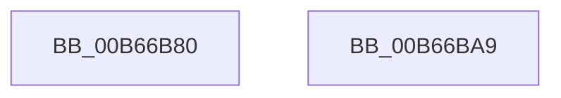

# KiInitializeWpsWorkloadClasses

- RVA: `0x00B66B80`–`0x00B66BAA` (길이 `42` bytes)
- VA: `0x0000000140B66B80`
- 실행 섹션: `PAGELK`
- PDB 이름 있음: `예`; PDB Function 태그: `아니요`
- unwind 정보 RVA: `0x00085914`
- 디코드: `10`개 명령, `42/42` bytes 표시
- 미해석 바이트: `0` (있으면 어셈블리에 `.byte`로 보존)

> 이 문서는 커널 이미지의 기계어와 PDB 기호를 분석해 생성했습니다. 4번과 5번은 함수 원형과 자료형을 바이너리 사용 방식에서 추정한 C 해석이며 원본 소스 복구 결과는 아닙니다.

## 1. Dependencies

- 직접 호출 지점: **1**; 고유 호출 대상: **1**
- 직접 호출자로 확인된 함수: **1**
- RIP 상대 이미지 참조: **1**

### Outgoing calls
- `0x00B66B93` → [PoGetWorkloadClassCount](../B7/PoGetWorkloadClassCount_function_00B71508.md) (function, `0x00B71508`)

### Direct callers
- [PoInitHeteroDetection](../../init/C3/PoInitHeteroDetection_function_00C3D244.md) at `0x00C3D28E`

### Static image references
- `0x00B66B9D` → RVA `0x00FC53E0` (`ALMOSTRO`; write)

## 2. Other-region calls and transfers

- 다른 실행 섹션으로 향하는 call: **0**
- 별도 외부 분기/꼬리 이동을 확인하지 못했습니다.

## 3. Assembly (complete function range)

```asm
00B66B80  48 89 4C 24 08                  mov qword ptr [rsp + 8], rcx
00B66B85  48 83 EC 28                     sub rsp, 0x28
00B66B89  83 64 24 30 00                  and dword ptr [rsp + 0x30], 0
00B66B8E  48 8D 4C 24 30                  lea rcx, [rsp + 0x30]
00B66B93  E8 70 A9 00 00                  call 0x140b71508
00B66B98  44 8B 5C 24 30                  mov r11d, dword ptr [rsp + 0x30]
00B66B9D  44 89 1D 3C E8 45 00            mov dword ptr [rip + 0x45e83c], r11d
00B66BA4  48 83 C4 28                     add rsp, 0x28
00B66BA8  C3                              ret
00B66BA9  CC                              int3
```

## 4. C-style interpretation (structured pseudocode)

```c
__int64 __fastcall KiInitializeWpsWorkloadClasses(__int64 a1)
{
    __int64 result;
    __int64 v_rsp;
    unsigned __int64 v_stack_p8;

    v_stack_p8 = a1;
    v_rsp = (v_rsp) - (40);
    result = PoGetWorkloadClassCount(v_stack_p8, a2, a3, a4);
    *(unsigned int *)(v_rip + 4581436) = (unsigned int)((unsigned int)(v_stack_p8));
    v_rsp = (v_rsp) + (40);
    return result;
}
```

## 5. (Beta) C Style

```c
int64_t KiInitializeWpsWorkloadClasses(int64_t Arg1)
{
    int64_t result;
    int64_t local_rsp;
    uint64_t v_stack_p8;

    v_stack_p8 = Arg1;
    local_rsp = (local_rsp) - (40);
    result = PoGetWorkloadClassCount(v_stack_p8, a2, a3, a4);
    *(uint32_t *)(v_rip + 0x45E83C) = (uint32_t)((uint32_t)(v_stack_p8));
    local_rsp = (local_rsp) + (40);
    return result;
}
```

## 6. Execution-region graph

[열기: 2D/3D 그래프와 함수 탐색 컨트롤 패널](../../../control-panel.html?section=pagelk&rva=0x00B66B80&view=graph)

- 2D 그래프는 위에서 아래로 흐르고, 3D 그래프는 빈 공간을 드래그해 회전합니다. Shift+드래그는 이동, 휠은 확대·축소, 함수 노드 선택은 대상 보고서 이동입니다.

### Static fallback


