# KiInitializeXSaveConfiguration

- RVA: `0x00B66F10`–`0x00B6731D` (길이 `1,037` bytes)
- VA: `0x0000000140B66F10`
- 실행 섹션: `PAGELK`
- PDB 이름 있음: `예`; PDB Function 태그: `아니요`
- unwind 정보 RVA: `0x000CA104`
- 디코드: `241`개 명령, `1,037/1,037` bytes 표시
- 미해석 바이트: `0` (있으면 어셈블리에 `.byte`로 보존)

> 이 문서는 커널 이미지의 기계어와 PDB 기호를 분석해 생성했습니다. 4번과 5번은 함수 원형과 자료형을 바이너리 사용 방식에서 추정한 C 해석이며 원본 소스 복구 결과는 아닙니다.

## 1. Dependencies

- 직접 호출 지점: **12**; 고유 호출 대상: **10**
- 직접 호출자로 확인된 함수: **1**
- RIP 상대 이미지 참조: **16**

### Outgoing calls
- `0x00B66F4B` → [KiParseLoadOptions](KiParseLoadOptions_function_00B675E0.md) (function, `0x00B675E0`)
- `0x00B66F5D` → [memset](../../text/6C/memset_function_006C6C40.md) (function, `0x006C6C40`)
- `0x00B66F67` → [RtlGetXSaveSupportedFeatures](../../text/5E/RtlGetXSaveSupportedFeatures_function_005EED68.md) (function, `0x005EED68`)
- `0x00B66F80` → [KiGetIptInfo](../../text/5B/KiGetIptInfo_function_005B9D38.md) (function, `0x005B9D38`)
- `0x00B66FEA` → [KiIntersectFeaturesWithPolicy](KiIntersectFeaturesWithPolicy_function_00B67324.md) (function, `0x00B67324`)
- `0x00B67085` → [RtlUpdateXSaveSizeAndVolatileFeatures](../../text/5E/RtlUpdateXSaveSizeAndVolatileFeatures_function_005E6D2C.md) (function, `0x005E6D2C`)
- `0x00B671B8` → [HvlQueryVsmConnection](../../text/45/HvlQueryVsmConnection_function_0045D180.md) (function, `0x0045D180`)
- `0x00B671D5` → [VslSynchronizeXSave](../../text/58/VslSynchronizeXSave_function_0058F7C0.md) (function, `0x0058F7C0`)
- `0x00B671F7` → [KeBugCheckEx](../../text/4F/KeBugCheckEx_function_004FD660.md) (function, `0x004FD660`)
- `0x00B672D7` → [KeBugCheckEx](../../text/4F/KeBugCheckEx_function_004FD660.md) (function, `0x004FD660`)
- `0x00B672F2` → [KeBugCheckEx](../../text/4F/KeBugCheckEx_function_004FD660.md) (function, `0x004FD660`)
- `0x00B67302` → [_security_check_cookie](../../text/6A/_security_check_cookie_function_006AC640.md) (function, `0x006AC640`)

### Direct callers
- [KiSystemStartup](../B5/KiSystemStartup_function_00B5B3C0.md) at `0x00B5B5A8`

### Static image references
- `0x00B66F2A` → RVA `0x00E0A740` (`.data`; read)
- `0x00B66FEF` → RVA `0x00E668C8` (`.data`; read)
- `0x00B67012` → RVA `0x00E668D0` (`.data`; read)
- `0x00B6708A` → RVA `0x00FC5008` (`ALMOSTRO`; read)
- `0x00B67122` → RVA `0x00FC6C60` (`ALMOSTRO`; write)
- `0x00B67146` → RVA `0x00FC50D0` (`ALMOSTRO`; write)
- `0x00B6714C` → RVA `0x00FC5110` (`ALMOSTRO`; write)
- `0x00B67152` → RVA `0x00FC51B8` (`ALMOSTRO`; write)
- `0x00B6716E` → RVA `0x00FC6C54` (`ALMOSTRO`; write)
- `0x00B6717E` → RVA `0x00FC6CF8` (`ALMOSTRO`; write)
- `0x00B6719A` → RVA `0x00FC5110` (`ALMOSTRO`; read/write)
- `0x00B671A4` → RVA `0x00FC51B8` (`ALMOSTRO`; read/write)
- `0x00B671AA` → RVA `0x00FC6C30` (`ALMOSTRO`; write)
- `0x00B671B0` → RVA `0x00FC6B94` (`ALMOSTRO`; write)
- `0x00B672AB` → RVA `0x00FC6B94` (`ALMOSTRO`; read)
- `0x00B672CC` → RVA `0x00FC6C30` (`ALMOSTRO`; read)

## 2. Other-region calls and transfers

- 다른 실행 섹션으로 향하는 call: **10**
  - `0x00B66F5D` → [memset](../../text/6C/memset_function_006C6C40.md) (`PAGELK` → `.text`)
  - `0x00B66F67` → [RtlGetXSaveSupportedFeatures](../../text/5E/RtlGetXSaveSupportedFeatures_function_005EED68.md) (`PAGELK` → `.text`)
  - `0x00B66F80` → [KiGetIptInfo](../../text/5B/KiGetIptInfo_function_005B9D38.md) (`PAGELK` → `.text`)
  - `0x00B67085` → [RtlUpdateXSaveSizeAndVolatileFeatures](../../text/5E/RtlUpdateXSaveSizeAndVolatileFeatures_function_005E6D2C.md) (`PAGELK` → `.text`)
  - `0x00B671B8` → [HvlQueryVsmConnection](../../text/45/HvlQueryVsmConnection_function_0045D180.md) (`PAGELK` → `.text`)
  - `0x00B671D5` → [VslSynchronizeXSave](../../text/58/VslSynchronizeXSave_function_0058F7C0.md) (`PAGELK` → `.text`)
  - `0x00B671F7` → [KeBugCheckEx](../../text/4F/KeBugCheckEx_function_004FD660.md) (`PAGELK` → `.text`)
  - `0x00B672D7` → [KeBugCheckEx](../../text/4F/KeBugCheckEx_function_004FD660.md) (`PAGELK` → `.text`)
  - `0x00B672F2` → [KeBugCheckEx](../../text/4F/KeBugCheckEx_function_004FD660.md) (`PAGELK` → `.text`)
  - `0x00B67302` → [_security_check_cookie](../../text/6A/_security_check_cookie_function_006AC640.md) (`PAGELK` → `.text`)
- 별도 외부 분기/꼬리 이동을 확인하지 못했습니다.

## 3. Assembly (complete function range)

```asm
00B66F10  48 89 5C 24 10                  mov qword ptr [rsp + 0x10], rbx
00B66F15  48 89 7C 24 18                  mov qword ptr [rsp + 0x18], rdi
00B66F1A  55                              push rbp
00B66F1B  48 8D AC 24 60 FD FF FF         lea rbp, [rsp - 0x2a0]
00B66F23  48 81 EC A0 03 00 00            sub rsp, 0x3a0
00B66F2A  48 8B 05 0F 38 2A 00            mov rax, qword ptr [rip + 0x2a380f]
00B66F31  48 33 C4                        xor rax, rsp
00B66F34  48 89 85 90 02 00 00            mov qword ptr [rbp + 0x290], rax
00B66F3B  8B FA                           mov edi, edx
00B66F3D  48 8B D9                        mov rbx, rcx
00B66F40  85 D2                           test edx, edx
00B66F42  75 0C                           jne 0x140b66f50
00B66F44  48 8B 89 D8 00 00 00            mov rcx, qword ptr [rcx + 0xd8]
00B66F4B  E8 90 06 00 00                  call 0x140b675e0
00B66F50  33 D2                           xor edx, edx
00B66F52  48 8D 4C 24 40                  lea rcx, [rsp + 0x40]
00B66F57  41 B8 48 03 00 00               mov r8d, 0x348
00B66F5D  E8 DE FC B5 FF                  call 0x1406c6c40
00B66F62  48 8D 4C 24 40                  lea rcx, [rsp + 0x40]
00B66F67  E8 FC 7D A8 FF                  call 0x1405eed68
00B66F6C  83 64 24 34 00                  and dword ptr [rsp + 0x34], 0
00B66F71  48 8D 54 24 30                  lea rdx, [rsp + 0x30]
00B66F76  83 64 24 30 00                  and dword ptr [rsp + 0x30], 0
00B66F7B  48 8D 4C 24 34                  lea rcx, [rsp + 0x34]
00B66F80  E8 B3 2D A5 FF                  call 0x1405b9d38
00B66F85  85 FF                           test edi, edi
00B66F87  0F 85 70 02 00 00               jne 0x140b671fd
00B66F8D  48 8B 83 F0 00 00 00            mov rax, qword ptr [rbx + 0xf0]
00B66F94  48 8B 4C 24 40                  mov rcx, qword ptr [rsp + 0x40]
00B66F99  8B 90 38 0B 00 00               mov edx, dword ptr [rax + 0xb38]
00B66F9F  48 85 C9                        test rcx, rcx
00B66FA2  74 3E                           je 0x140b66fe2
00B66FA4  48 8B 80 30 0B 00 00            mov rax, qword ptr [rax + 0xb30]
00B66FAB  48 21 85 58 01 00 00            and qword ptr [rbp + 0x158], rax
00B66FB2  48 23 C8                        and rcx, rax
00B66FB5  8B 44 24 54                     mov eax, dword ptr [rsp + 0x54]
00B66FB9  48 89 4C 24 40                  mov qword ptr [rsp + 0x40], rcx
00B66FBE  F6 C2 10                        test dl, 0x10
00B66FC1  75 07                           jne 0x140b66fca
00B66FC3  83 E0 FD                        and eax, 0xfffffffd
00B66FC6  89 44 24 54                     mov dword ptr [rsp + 0x54], eax
00B66FCA  F6 C2 08                        test dl, 8
00B66FCD  75 07                           jne 0x140b66fd6
00B66FCF  83 E0 FE                        and eax, 0xfffffffe
00B66FD2  89 44 24 54                     mov dword ptr [rsp + 0x54], eax
00B66FD6  F6 C2 40                        test dl, 0x40
00B66FD9  75 07                           jne 0x140b66fe2
00B66FDB  83 E0 FB                        and eax, 0xfffffffb
00B66FDE  89 44 24 54                     mov dword ptr [rsp + 0x54], eax
00B66FE2  48 8D 54 24 40                  lea rdx, [rsp + 0x40]
00B66FE7  48 8B CB                        mov rcx, rbx
00B66FEA  E8 35 03 00 00                  call 0x140b67324
00B66FEF  48 8B 05 D2 F8 2F 00            mov rax, qword ptr [rip + 0x2ff8d2]
00B66FF6  48 8B 54 24 40                  mov rdx, qword ptr [rsp + 0x40]
00B66FFB  48 85 C0                        test rax, rax
00B66FFE  74 12                           je 0x140b67012
00B67000  48 F7 D0                        not rax
00B67003  48 23 D0                        and rdx, rax
00B67006  48 21 85 58 01 00 00            and qword ptr [rbp + 0x158], rax
00B6700D  48 89 54 24 40                  mov qword ptr [rsp + 0x40], rdx
00B67012  80 3D B7 F8 2F 00 00            cmp byte ptr [rip + 0x2ff8b7], 0
00B67019  8B 44 24 54                     mov eax, dword ptr [rsp + 0x54]
00B6701D  74 15                           je 0x140b67034
00B6701F  33 D2                           xor edx, edx
00B67021  48 21 95 58 01 00 00            and qword ptr [rbp + 0x158], rdx
00B67028  83 E0 F8                        and eax, 0xfffffff8
00B6702B  48 89 54 24 40                  mov qword ptr [rsp + 0x40], rdx
00B67030  89 44 24 54                     mov dword ptr [rsp + 0x54], eax
00B67034  48 0F BA E2 12                  bt rdx, 0x12
00B67039  73 24                           jae 0x140b6705f
00B6703B  A8 02                           test al, 2
00B6703D  74 16                           je 0x140b67055
00B6703F  A8 04                           test al, 4
00B67041  74 12                           je 0x140b67055
00B67043  48 8B 85 78 02 00 00            mov rax, qword ptr [rbp + 0x278]
00B6704A  48 0D FF FF FB FF               or rax, 0xfffffffffffbffff
00B67050  48 23 D0                        and rdx, rax
00B67053  EB 05                           jmp 0x140b6705a
00B67055  48 0F BA F2 12                  btr rdx, 0x12
00B6705A  48 89 54 24 40                  mov qword ptr [rsp + 0x40], rdx
00B6705F  48 8B CA                        mov rcx, rdx
00B67062  48 8B C2                        mov rax, rdx
00B67065  48 C1 E9 12                     shr rcx, 0x12
00B67069  48 C1 E8 11                     shr rax, 0x11
00B6706D  32 C8                           xor cl, al
00B6706F  F6 C1 01                        test cl, 1
00B67072  74 0C                           je 0x140b67080
00B67074  48 81 E2 FF FF F9 FF            and rdx, 0xfffffffffff9ffff
00B6707B  48 89 54 24 40                  mov qword ptr [rsp + 0x40], rdx
00B67080  48 8D 4C 24 40                  lea rcx, [rsp + 0x40]
00B67085  E8 A2 FC A7 FF                  call 0x1405e6d2c
00B6708A  48 8B 0D 77 DF 45 00            mov rcx, qword ptr [rip + 0x45df77]
00B67091  48 8D 44 24 40                  lea rax, [rsp + 0x40]
00B67096  BA 06 00 00 00                  mov edx, 6
00B6709B  48 81 C1 D8 03 00 00            add rcx, 0x3d8
00B670A2  44 8D 42 7A                     lea r8d, [rdx + 0x7a]
00B670A6  0F 10 00                        movups xmm0, xmmword ptr [rax]
00B670A9  0F 11 01                        movups xmmword ptr [rcx], xmm0
00B670AC  0F 10 48 10                     movups xmm1, xmmword ptr [rax + 0x10]
00B670B0  0F 11 49 10                     movups xmmword ptr [rcx + 0x10], xmm1
00B670B4  0F 10 40 20                     movups xmm0, xmmword ptr [rax + 0x20]
00B670B8  0F 11 41 20                     movups xmmword ptr [rcx + 0x20], xmm0
00B670BC  0F 10 48 30                     movups xmm1, xmmword ptr [rax + 0x30]
00B670C0  0F 11 49 30                     movups xmmword ptr [rcx + 0x30], xmm1
00B670C4  0F 10 40 40                     movups xmm0, xmmword ptr [rax + 0x40]
00B670C8  0F 11 41 40                     movups xmmword ptr [rcx + 0x40], xmm0
00B670CC  0F 10 48 50                     movups xmm1, xmmword ptr [rax + 0x50]
00B670D0  0F 11 49 50                     movups xmmword ptr [rcx + 0x50], xmm1
00B670D4  0F 10 40 60                     movups xmm0, xmmword ptr [rax + 0x60]
00B670D8  0F 11 41 60                     movups xmmword ptr [rcx + 0x60], xmm0
00B670DC  49 03 C8                        add rcx, r8
00B670DF  0F 10 48 70                     movups xmm1, xmmword ptr [rax + 0x70]
00B670E3  49 03 C0                        add rax, r8
00B670E6  0F 11 49 F0                     movups xmmword ptr [rcx - 0x10], xmm1
00B670EA  48 83 EA 01                     sub rdx, 1
00B670EE  75 B6                           jne 0x140b670a6
00B670F0  0F 10 00                        movups xmm0, xmmword ptr [rax]
00B670F3  0F 11 01                        movups xmmword ptr [rcx], xmm0
00B670F6  0F 10 48 10                     movups xmm1, xmmword ptr [rax + 0x10]
00B670FA  0F 11 49 10                     movups xmmword ptr [rcx + 0x10], xmm1
00B670FE  0F 10 40 20                     movups xmm0, xmmword ptr [rax + 0x20]
00B67102  0F 11 41 20                     movups xmmword ptr [rcx + 0x20], xmm0
00B67106  0F 10 48 30                     movups xmm1, xmmword ptr [rax + 0x30]
00B6710A  0F 11 49 30                     movups xmmword ptr [rcx + 0x30], xmm1
00B6710E  48 8B 40 40                     mov rax, qword ptr [rax + 0x40]
00B67112  48 89 41 40                     mov qword ptr [rcx + 0x40], rax
00B67116  48 8B 54 24 40                  mov rdx, qword ptr [rsp + 0x40]
00B6711B  48 8B 85 58 01 00 00            mov rax, qword ptr [rbp + 0x158]
00B67122  48 89 05 37 FB 45 00            mov qword ptr [rip + 0x45fb37], rax
00B67129  48 85 D2                        test rdx, rdx
00B6712C  74 2A                           je 0x140b67158
00B6712E  48 B9 00 06 00 00 80 F7 FF FF   movabs rcx, 0xfffff78000000600
00B67138  48 B8 18 07 00 00 80 F7 FF FF   movabs rax, 0xfffff78000000718
00B67142  8B 09                           mov ecx, dword ptr [rcx]
00B67144  8B 00                           mov eax, dword ptr [rax]
00B67146  89 0D 84 DF 45 00               mov dword ptr [rip + 0x45df84], ecx
00B6714C  89 05 BE DF 45 00               mov dword ptr [rip + 0x45dfbe], eax
00B67152  89 0D 60 E0 45 00               mov dword ptr [rip + 0x45e060], ecx
00B67158  48 0F BA E2 12                  bt rdx, 0x12
00B6715D  73 25                           jae 0x140b67184
00B6715F  A1 00 06 00 00 80 F7 FF FF      movabs eax, dword ptr [0xfffff78000000600]
00B67168  83 C0 3F                        add eax, 0x3f
00B6716B  83 E0 C0                        and eax, 0xffffffc0
00B6716E  89 05 E0 FA 45 00               mov dword ptr [rip + 0x45fae0], eax
00B67174  05 FF 0F 00 00                  add eax, 0xfff
00B67179  25 00 F0 FF FF                  and eax, 0xfffff000
00B6717E  89 05 74 FB 45 00               mov dword ptr [rip + 0x45fb74], eax
00B67184  48 8B 83 F0 00 00 00            mov rax, qword ptr [rbx + 0xf0]
00B6718B  8B 88 38 0B 00 00               mov ecx, dword ptr [rax + 0xb38]
00B67191  F6 C1 20                        test cl, 0x20
00B67194  74 20                           je 0x140b671b6
00B67196  8B 4C 24 34                     mov ecx, dword ptr [rsp + 0x34]
00B6719A  01 0D 70 DF 45 00               add dword ptr [rip + 0x45df70], ecx
00B671A0  8B 44 24 30                     mov eax, dword ptr [rsp + 0x30]
00B671A4  01 0D 0E E0 45 00               add dword ptr [rip + 0x45e00e], ecx
00B671AA  89 0D 80 FA 45 00               mov dword ptr [rip + 0x45fa80], ecx
00B671B0  89 05 DE F9 45 00               mov dword ptr [rip + 0x45f9de], eax
00B671B6  33 C9                           xor ecx, ecx
00B671B8  E8 C3 5F 8F FF                  call 0x14045d180
00B671BD  84 C0                           test al, al
00B671BF  0F 84 33 01 00 00               je 0x140b672f8
00B671C5  48 8B 8D 58 01 00 00            mov rcx, qword ptr [rbp + 0x158]
00B671CC  48 0B 4C 24 40                  or rcx, qword ptr [rsp + 0x40]
00B671D1  8B 54 24 54                     mov edx, dword ptr [rsp + 0x54]
00B671D5  E8 E6 85 A2 FF                  call 0x14058f7c0
00B671DA  85 C0                           test eax, eax
00B671DC  0F 89 16 01 00 00               jns 0x140b672f8
00B671E2  48 83 64 24 20 00               and qword ptr [rsp + 0x20], 0
00B671E8  45 33 C9                        xor r9d, r9d
00B671EB  4C 63 C0                        movsxd r8, eax
00B671EE  B9 31 01 00 00                  mov ecx, 0x131
00B671F3  41 8D 51 06                     lea edx, [r9 + 6]
00B671F7  E8 64 64 99 FF                  call 0x1404fd660
00B671FC  CC                              int3
00B671FD  49 B8 D8 03 00 00 80 F7 FF FF   movabs r8, 0xfffff780000003d8
00B67207  49 8B 08                        mov rcx, qword ptr [r8]
00B6720A  48 8B C1                        mov rax, rcx
00B6720D  48 23 44 24 40                  and rax, qword ptr [rsp + 0x40]
00B67212  48 3B C1                        cmp rax, rcx
00B67215  0F 85 C2 00 00 00               jne 0x140b672dd
00B6721B  48 B9 F0 05 00 00 80 F7 FF FF   movabs rcx, 0xfffff780000005f0
00B67225  48 8B 09                        mov rcx, qword ptr [rcx]
00B67228  48 8B C1                        mov rax, rcx
00B6722B  48 23 85 58 01 00 00            and rax, qword ptr [rbp + 0x158]
00B67232  48 3B C1                        cmp rax, rcx
00B67235  0F 85 A2 00 00 00               jne 0x140b672dd
00B6723B  48 B9 10 07 00 00 80 F7 FF FF   movabs rcx, 0xfffff78000000710
00B67245  48 8B 09                        mov rcx, qword ptr [rcx]
00B67248  48 8B C1                        mov rax, rcx
00B6724B  48 23 85 78 02 00 00            and rax, qword ptr [rbp + 0x278]
00B67252  48 3B C1                        cmp rax, rcx
00B67255  0F 85 82 00 00 00               jne 0x140b672dd
00B6725B  8B 4C 24 54                     mov ecx, dword ptr [rsp + 0x54]
00B6725F  F6 C1 01                        test cl, 1
00B67262  75 0D                           jne 0x140b67271
00B67264  A1 EC 03 00 00 80 F7 FF FF      movabs eax, dword ptr [0xfffff780000003ec]
00B6726D  A8 01                           test al, 1
00B6726F  75 6C                           jne 0x140b672dd
00B67271  F6 C1 02                        test cl, 2
00B67274  75 0D                           jne 0x140b67283
00B67276  A1 EC 03 00 00 80 F7 FF FF      movabs eax, dword ptr [0xfffff780000003ec]
00B6727F  A8 02                           test al, 2
00B67281  75 5A                           jne 0x140b672dd
00B67283  F6 C1 04                        test cl, 4
00B67286  75 0D                           jne 0x140b67295
00B67288  A1 EC 03 00 00 80 F7 FF FF      movabs eax, dword ptr [0xfffff780000003ec]
00B67291  A8 04                           test al, 4
00B67293  75 48                           jne 0x140b672dd
00B67295  48 B8 1C 07 00 00 80 F7 FF FF   movabs rax, 0xfffff7800000071c
00B6729F  0F B7 00                        movzx eax, word ptr [rax]
00B672A2  66 39 85 84 02 00 00            cmp word ptr [rbp + 0x284], ax
00B672A9  72 32                           jb 0x140b672dd
00B672AB  8B 0D E3 F8 45 00               mov ecx, dword ptr [rip + 0x45f8e3]
00B672B1  8B C1                           mov eax, ecx
00B672B3  23 44 24 30                     and eax, dword ptr [rsp + 0x30]
00B672B7  3B C1                           cmp eax, ecx
00B672B9  74 3D                           je 0x140b672f8
00B672BB  8B 44 24 30                     mov eax, dword ptr [rsp + 0x30]
00B672BF  44 8B C1                        mov r8d, ecx
00B672C2  44 8B 4C 24 34                  mov r9d, dword ptr [rsp + 0x34]
00B672C7  B9 3E 00 00 00                  mov ecx, 0x3e
00B672CC  8B 15 5E F9 45 00               mov edx, dword ptr [rip + 0x45f95e]
00B672D2  48 89 44 24 20                  mov qword ptr [rsp + 0x20], rax
00B672D7  E8 84 63 99 FF                  call 0x1404fd660
00B672DC  CC                              int3
00B672DD  48 83 64 24 20 00               and qword ptr [rsp + 0x20], 0
00B672E3  48 8D 54 24 40                  lea rdx, [rsp + 0x40]
00B672E8  41 B9 01 00 00 00               mov r9d, 1
00B672EE  41 8D 49 3D                     lea ecx, [r9 + 0x3d]
00B672F2  E8 69 63 99 FF                  call 0x1404fd660
00B672F7  CC                              int3
00B672F8  48 8B 8D 90 02 00 00            mov rcx, qword ptr [rbp + 0x290]
00B672FF  48 33 CC                        xor rcx, rsp
00B67302  E8 39 53 B4 FF                  call 0x1406ac640
00B67307  4C 8D 9C 24 A0 03 00 00         lea r11, [rsp + 0x3a0]
00B6730F  49 8B 5B 18                     mov rbx, qword ptr [r11 + 0x18]
00B67313  49 8B 7B 20                     mov rdi, qword ptr [r11 + 0x20]
00B67317  49 8B E3                        mov rsp, r11
00B6731A  5D                              pop rbp
00B6731B  C3                              ret
00B6731C  CC                              int3
```

## 4. C-style interpretation (structured pseudocode)

```c
__int64 __fastcall KiInitializeXSaveConfiguration(__int64 a1, int a2, __int64 a3, int a4)
{
    __int64 result;
    __int64 v_rsp;
    unsigned __int64 v_stack_m150;
    unsigned __int64 v_stack_m18;
    unsigned __int16 v_stack_m24;
    unsigned __int64 v_stack_m2A8;
    unsigned __int64 v_stack_m30;
    unsigned int v_stack_m354;
    unsigned __int64 v_stack_m368;
    unsigned int v_stack_m374;
    unsigned __int64 v_stack_m378;
    unsigned __int64 v_stack_m388;
    unsigned __int64 v_stack_m8;
    unsigned __int64 v_stack_p10;
    unsigned __int64 v_stack_p18;

    v_stack_p10 = v_rbx;
    v_stack_p18 = v_rdi;
    v_rsp = (v_rsp) - (928);
    result = (*(unsigned __int64 *)(v_rip + 2766863)) ^ (v_rsp);
    v_stack_m18 = result;
    if (a2 == 0) {
        a1 = *(unsigned __int64 *)(a1 + 216);
        result = KiParseLoadOptions(a1, a2, a3, a4);
    }
    a2 = 0;
    result = memset(v_stack_m368, a2, 840, a4);
    result = RtlGetXSaveSupportedFeatures(v_stack_m368, a2, 840, a4);
    result = KiGetIptInfo(v_stack_m374, v_stack_m378, 840, a4);
    if ((unsigned int)((unsigned int)(a2)) != 0) goto loc_00B671FD;
    if (v_stack_m368 == 0) goto loc_00B66FE2;
    a1 = (v_stack_m368) & (*(unsigned __int64 *)(*(unsigned __int64 *)(a1 + 240) + 2864));
    v_stack_m368 = a1;
    result = (unsigned int)(v_stack_m354);
    if ((((unsigned __int8)((unsigned int)(*(unsigned int *)(*(unsigned __int64 *)(a1 + 240) + 2872)))) & (16)) == 0) {
        result = (unsigned int)(((unsigned int)(v_stack_m354)) & (0xFFFFFFFDULL));
        v_stack_m354 = (unsigned int)(result);
    }
    if ((((unsigned __int8)((unsigned int)(*(unsigned int *)(*(unsigned __int64 *)(a1 + 240) + 2872)))) & (8)) == 0) {
        result = (unsigned int)((result) & (0xFFFFFFFEULL));
        v_stack_m354 = (unsigned int)(result);
    }
    if ((((unsigned __int8)((unsigned int)(*(unsigned int *)(*(unsigned __int64 *)(a1 + 240) + 2872)))) & (64)) == 0) {
        result = (unsigned int)((result) & (0xFFFFFFFBULL));
        v_stack_m354 = (unsigned int)(result);
    }
    result = KiIntersectFeaturesWithPolicy(a1, v_stack_m368, 840, a4);
    result = *(unsigned __int64 *)(v_rip + 3143890);
    if (*(unsigned __int64 *)(v_rip + 3143890) != 0) {
        result = ~(*(unsigned __int64 *)(v_rip + 3143890));
        a2 = (v_stack_m368) & (result);
        v_stack_m368 = a2;
    }
    result = (unsigned int)(v_stack_m354);
    if ((*(unsigned __int8 *)(v_rip + 3143863)) != 0) {
        a2 = 0;
        result = (unsigned int)(((unsigned int)(v_stack_m354)) & (0xFFFFFFF8ULL));
        v_stack_m368 = 0;
        v_stack_m354 = (unsigned int)(result);
    }
    if (condition_is_above_or_equal) goto loc_00B6705F;
    if ((((unsigned __int8)(result)) & (2)) == 0) goto loc_00B67055;
    if ((((unsigned __int8)(result)) & (4)) == 0) goto loc_00B67055;
    result = (v_stack_m30) | (0xFFFFFFFFFFFBFFFFULL);
    a2 = (a2) & (result);
    goto loc_00B6705A;
loc_00B67055:
loc_00B6705A:
    v_stack_m368 = a2;
loc_00B6705F:
    a1 = (a2) >> (18);
    result = (a2) >> (17);
    a1 = (unsigned __int8)((a1) ^ ((unsigned __int8)(result)));
    if ((((unsigned __int8)(a1)) & (1)) != 0) {
        a2 = (a2) & (0xFFFFFFFFFFF9FFFFULL);
        v_stack_m368 = a2;
    }
    result = RtlUpdateXSaveSizeAndVolatileFeatures(v_stack_m368, a2, 840, a4);
    a1 = (*(unsigned __int64 *)(v_rip + 4579191)) + (984);
loc_00B670A6:
    *(unsigned __int64 *)(a1) = v_xmm0;
    *(unsigned __int64 *)(a1 + 16) = v_xmm1;
    *(unsigned __int64 *)(a1 + 32) = v_xmm0;
    *(unsigned __int64 *)(a1 + 48) = v_xmm1;
    *(unsigned __int64 *)(a1 + 64) = v_xmm0;
    *(unsigned __int64 *)(a1 + 80) = v_xmm1;
    *(unsigned __int64 *)(a1 + 96) = v_xmm0;
    a1 = (a1) + (6 + 122);
    result = (v_stack_m368) + (6 + 122);
    *(unsigned __int64 *)(a1 - 16) = v_xmm1;
    a2 = (6) - (1);
    if (condition_is_not_equal) goto loc_00B670A6;
    *(unsigned __int64 *)(a1) = v_xmm0;
    *(unsigned __int64 *)(a1 + 16) = v_xmm1;
    *(unsigned __int64 *)(a1 + 32) = v_xmm0;
    *(unsigned __int64 *)(a1 + 48) = v_xmm1;
    *(unsigned __int64 *)(a1 + 64) = *(unsigned __int64 *)(result + 64);
    *(unsigned __int64 *)(v_rip + 4586295) = v_stack_m150;
    result = v_stack_m150;
    if (v_stack_m368 != 0) {
        a1 = *(unsigned int *)(a1);
        result = *(unsigned int *)(v_stack_m150);
        *(unsigned int *)(v_rip + 4579204) = (unsigned int)(a1);
        *(unsigned int *)(v_rip + 4579262) = (unsigned int)(result);
        *(unsigned int *)(v_rip + 4579424) = (unsigned int)(a1);
    }
    if (!(condition_is_above_or_equal)) {
        result = (unsigned int)((result) + (63));
        result = (unsigned int)((result) & (0xFFFFFFC0ULL));
        *(unsigned int *)(v_rip + 4586208) = (unsigned int)(result);
        result = (unsigned int)((result) + (0xFFFULL));
        result = (unsigned int)((result) & (0xFFFFF000ULL));
        *(unsigned int *)(v_rip + 4586356) = (unsigned int)(result);
    }
    result = *(unsigned __int64 *)(a1 + 240);
    if ((((unsigned __int8)((unsigned int)(*(unsigned int *)(*(unsigned __int64 *)(a1 + 240) + 2872)))) & (32)) != 0) {
        a1 = v_stack_m374;
        result = v_stack_m378;
        *(unsigned int *)(v_rip + 4586112) = (unsigned int)(a1);
        *(unsigned int *)(v_rip + 4585950) = (unsigned int)(result);
    }
    a1 = 0;
    result = HvlQueryVsmConnection(a1, v_stack_m368, 6 + 122, a4);
    if ((unsigned __int8)(result) == 0) goto loc_00B672F8;
    a1 = (v_stack_m150) | (v_stack_m368);
    result = VslSynchronizeXSave(a1, (unsigned int)(v_stack_m354), 6 + 122, a4);
    if (!sign_flag) goto loc_00B672F8;
    a4 = 0;
    result = KeBugCheckEx(305, a4 + 6, (int)((unsigned int)(result)), a4);
loc_00B671FD:
    result = (*(unsigned __int64 *)((int)((unsigned int)(result)))) & (v_stack_m368);
    if (result != (*(unsigned __int64 *)((int)((unsigned int)(result))))) goto loc_00B672DD;
    result = (*(unsigned __int64 *)(*(unsigned __int64 *)((int)((unsigned int)(result))))) & (v_stack_m150);
    if (result != (*(unsigned __int64 *)(*(unsigned __int64 *)((int)((unsigned int)(result)))))) goto loc_00B672DD;
    result = (*(unsigned __int64 *)(*(unsigned __int64 *)(*(unsigned __int64 *)((int)((unsigned int)(result)))))) & (v_stack_m30);
    if (result != (*(unsigned __int64 *)(*(unsigned __int64 *)(*(unsigned __int64 *)((int)((unsigned int)(result))))))) goto loc_00B672DD;
    if ((((unsigned __int8)((unsigned int)(v_stack_m354))) & (1)) != 0) goto loc_00B67271;
    if ((((unsigned __int8)(result)) & (1)) != 0) goto loc_00B672DD;
loc_00B67271:
    if ((((unsigned __int8)((unsigned int)(v_stack_m354))) & (2)) != 0) goto loc_00B67283;
    if ((((unsigned __int8)(result)) & (2)) != 0) goto loc_00B672DD;
loc_00B67283:
    if ((((unsigned __int8)((unsigned int)(v_stack_m354))) & (4)) != 0) goto loc_00B67295;
    if ((((unsigned __int8)(result)) & (4)) != 0) goto loc_00B672DD;
loc_00B67295:
    if (v_stack_m24 < ((unsigned __int16)(*(unsigned __int16 *)(result)))) goto loc_00B672DD;
    result = (unsigned int)(((unsigned int)((unsigned int)((unsigned int)(*(unsigned int *)(v_rip + 4585699))))) & (v_stack_m378));
    if (((unsigned int)(result)) == ((unsigned int)((unsigned int)(*(unsigned int *)(v_rip + 4585699))))) goto loc_00B672F8;
    v_stack_m388 = (unsigned int)(v_stack_m378);
    result = KeBugCheckEx(62, (unsigned int)(*(unsigned int *)(v_rip + 4585822)), (unsigned int)((unsigned int)((unsigned int)(*(unsigned int *)(v_rip + 4585699)))), (unsigned int)(v_stack_m374));
loc_00B672DD:
    result = KeBugCheckEx(1 + 61, v_stack_m368, (unsigned int)((unsigned int)((unsigned int)(*(unsigned int *)(v_rip + 4585699)))), 1);
loc_00B672F8:
    a1 = (v_stack_m18) ^ (v_rsp);
    result = _security_check_cookie(a1, v_stack_m368, (unsigned int)((unsigned int)((unsigned int)(*(unsigned int *)(v_rip + 4585699)))), 1);
    return result;
}
```

## 5. (Beta) C Style

```c
int64_t KiInitializeXSaveConfiguration(void *Arg1, int32_t Arg2, int64_t Arg3, int32_t Arg4)
{
    uint8_t *arg1 = (uint8_t *)Arg1;

    int64_t result;
    int64_t local_rsp;
    uint64_t v_stack_m150;
    uint64_t v_stack_m18;
    uint16_t v_stack_m24;
    uint64_t v_stack_m2A8;
    uint64_t v_stack_m30;
    uint32_t v_stack_m354;
    uint64_t v_stack_m368;
    uint32_t v_stack_m374;
    uint64_t v_stack_m378;
    uint64_t v_stack_m388;
    uint64_t v_stack_m8;
    uint64_t v_stack_p10;
    uint64_t v_stack_p18;

    v_stack_p10 = local_rbx;
    v_stack_p18 = local_rdi;
    local_rsp = (local_rsp) - (928);
    result = (*(uint64_t *)(v_rip + 0x2A380F)) ^ (local_rsp);
    v_stack_m18 = result;
    if (Arg2 == 0) {
        Arg1 = *(uint64_t *)(arg1 + 0xD8);
        result = KiParseLoadOptions(Arg1, Arg2, Arg3, Arg4);
    }
    Arg2 = 0;
    result = memset(v_stack_m368, Arg2, 840, Arg4);
    result = RtlGetXSaveSupportedFeatures(v_stack_m368, Arg2, 840, Arg4);
    result = KiGetIptInfo(v_stack_m374, v_stack_m378, 840, Arg4);
    if ((uint32_t)((uint32_t)(Arg2)) != 0) goto loc_00B671FD;
    if (v_stack_m368 == 0) goto loc_00B66FE2;
    Arg1 = (v_stack_m368) & (*(uint64_t *)(*(uint64_t *)(arg1 + 0xF0) + 0xB30));
    v_stack_m368 = Arg1;
    result = (uint32_t)(v_stack_m354);
    if ((((uint8_t)((uint32_t)(*(uint32_t *)(*(uint64_t *)(arg1 + 0xF0) + 0xB38)))) & (16)) == 0) {
        result = (uint32_t)(((uint32_t)(v_stack_m354)) & (0xFFFFFFFDULL));
        v_stack_m354 = (uint32_t)(result);
    }
    if ((((uint8_t)((uint32_t)(*(uint32_t *)(*(uint64_t *)(arg1 + 0xF0) + 0xB38)))) & (8)) == 0) {
        result = (uint32_t)((result) & (0xFFFFFFFEULL));
        v_stack_m354 = (uint32_t)(result);
    }
    if ((((uint8_t)((uint32_t)(*(uint32_t *)(*(uint64_t *)(arg1 + 0xF0) + 0xB38)))) & (64)) == 0) {
        result = (uint32_t)((result) & (0xFFFFFFFBULL));
        v_stack_m354 = (uint32_t)(result);
    }
    result = KiIntersectFeaturesWithPolicy(Arg1, v_stack_m368, 840, Arg4);
    result = *(uint64_t *)(v_rip + 0x2FF8D2);
    if (*(uint64_t *)(v_rip + 0x2FF8D2) != 0) {
        result = ~(*(uint64_t *)(v_rip + 0x2FF8D2));
        Arg2 = (v_stack_m368) & (result);
        v_stack_m368 = Arg2;
    }
    result = (uint32_t)(v_stack_m354);
    if ((*(uint8_t *)(v_rip + 0x2FF8B7)) != 0) {
        Arg2 = 0;
        result = (uint32_t)(((uint32_t)(v_stack_m354)) & (0xFFFFFFF8ULL));
        v_stack_m368 = 0;
        v_stack_m354 = (uint32_t)(result);
    }
    if (condition_is_above_or_equal) goto loc_00B6705F;
    if ((((uint8_t)(result)) & (2)) == 0) goto loc_00B67055;
    if ((((uint8_t)(result)) & (4)) == 0) goto loc_00B67055;
    result = (v_stack_m30) | (0xFFFFFFFFFFFBFFFFULL);
    Arg2 = (Arg2) & (result);
    goto loc_00B6705A;
loc_00B67055:
loc_00B6705A:
    v_stack_m368 = Arg2;
loc_00B6705F:
    Arg1 = (Arg2) >> (18);
    result = (Arg2) >> (17);
    Arg1 = (uint8_t)((Arg1) ^ ((uint8_t)(result)));
    if ((((uint8_t)(Arg1)) & (1)) != 0) {
        Arg2 = (Arg2) & (0xFFFFFFFFFFF9FFFFULL);
        v_stack_m368 = Arg2;
    }
    result = RtlUpdateXSaveSizeAndVolatileFeatures(v_stack_m368, Arg2, 840, Arg4);
    Arg1 = (*(uint64_t *)(v_rip + 0x45DF77)) + (984);
loc_00B670A6:
    *(uint64_t *)(arg1) = v_xmm0;
    *(uint64_t *)(arg1 + 0x10) = v_xmm1;
    *(uint64_t *)(arg1 + 0x20) = v_xmm0;
    *(uint64_t *)(arg1 + 0x30) = v_xmm1;
    *(uint64_t *)(arg1 + 0x40) = v_xmm0;
    *(uint64_t *)(arg1 + 0x50) = v_xmm1;
    *(uint64_t *)(arg1 + 0x60) = v_xmm0;
    Arg1 = (Arg1) + (6 + 122);
    result = (v_stack_m368) + (6 + 122);
    *(uint64_t *)(arg1 - 0x10) = v_xmm1;
    Arg2 = (6) - (1);
    if (condition_is_not_equal) goto loc_00B670A6;
    *(uint64_t *)(arg1) = v_xmm0;
    *(uint64_t *)(arg1 + 0x10) = v_xmm1;
    *(uint64_t *)(arg1 + 0x20) = v_xmm0;
    *(uint64_t *)(arg1 + 0x30) = v_xmm1;
    *(uint64_t *)(arg1 + 0x40) = *(uint64_t *)(result + 0x40);
    *(uint64_t *)(v_rip + 0x45FB37) = v_stack_m150;
    result = v_stack_m150;
    if (v_stack_m368 != 0) {
        Arg1 = *(uint32_t *)(arg1);
        result = *(uint32_t *)(v_stack_m150);
        *(uint32_t *)(v_rip + 0x45DF84) = (uint32_t)(Arg1);
        *(uint32_t *)(v_rip + 0x45DFBE) = (uint32_t)(result);
        *(uint32_t *)(v_rip + 0x45E060) = (uint32_t)(Arg1);
    }
    if (!(condition_is_above_or_equal)) {
        result = (uint32_t)((result) + (63));
        result = (uint32_t)((result) & (0xFFFFFFC0ULL));
        *(uint32_t *)(v_rip + 0x45FAE0) = (uint32_t)(result);
        result = (uint32_t)((result) + (0xFFFULL));
        result = (uint32_t)((result) & (0xFFFFF000ULL));
        *(uint32_t *)(v_rip + 0x45FB74) = (uint32_t)(result);
    }
    result = *(uint64_t *)(arg1 + 0xF0);
    if ((((uint8_t)((uint32_t)(*(uint32_t *)(*(uint64_t *)(arg1 + 0xF0) + 0xB38)))) & (32)) != 0) {
        Arg1 = v_stack_m374;
        result = v_stack_m378;
        *(uint32_t *)(v_rip + 0x45FA80) = (uint32_t)(Arg1);
        *(uint32_t *)(v_rip + 0x45F9DE) = (uint32_t)(result);
    }
    Arg1 = 0;
    result = HvlQueryVsmConnection(Arg1, v_stack_m368, 6 + 122, Arg4);
    if ((uint8_t)(result) == 0) goto loc_00B672F8;
    Arg1 = (v_stack_m150) | (v_stack_m368);
    result = VslSynchronizeXSave(Arg1, (uint32_t)(v_stack_m354), 6 + 122, Arg4);
    if (!sign_flag) goto loc_00B672F8;
    Arg4 = 0;
    result = KeBugCheckEx(305, Arg4 + 6, (int32_t)((uint32_t)(result)), Arg4);
loc_00B671FD:
    result = (*(uint64_t *)((int32_t)((uint32_t)(result)))) & (v_stack_m368);
    if (result != (*(uint64_t *)((int32_t)((uint32_t)(result))))) goto loc_00B672DD;
    result = (*(uint64_t *)(*(uint64_t *)((int32_t)((uint32_t)(result))))) & (v_stack_m150);
    if (result != (*(uint64_t *)(*(uint64_t *)((int32_t)((uint32_t)(result)))))) goto loc_00B672DD;
    result = (*(uint64_t *)(*(uint64_t *)(*(uint64_t *)((int32_t)((uint32_t)(result)))))) & (v_stack_m30);
    if (result != (*(uint64_t *)(*(uint64_t *)(*(uint64_t *)((int32_t)((uint32_t)(result))))))) goto loc_00B672DD;
    if ((((uint8_t)((uint32_t)(v_stack_m354))) & (1)) != 0) goto loc_00B67271;
    if ((((uint8_t)(result)) & (1)) != 0) goto loc_00B672DD;
loc_00B67271:
    if ((((uint8_t)((uint32_t)(v_stack_m354))) & (2)) != 0) goto loc_00B67283;
    if ((((uint8_t)(result)) & (2)) != 0) goto loc_00B672DD;
loc_00B67283:
    if ((((uint8_t)((uint32_t)(v_stack_m354))) & (4)) != 0) goto loc_00B67295;
    if ((((uint8_t)(result)) & (4)) != 0) goto loc_00B672DD;
loc_00B67295:
    if (v_stack_m24 < ((uint16_t)(*(uint16_t *)(result)))) goto loc_00B672DD;
    result = (uint32_t)(((uint32_t)((uint32_t)((uint32_t)(*(uint32_t *)(v_rip + 0x45F8E3))))) & (v_stack_m378));
    if (((uint32_t)(result)) == ((uint32_t)((uint32_t)(*(uint32_t *)(v_rip + 0x45F8E3))))) goto loc_00B672F8;
    v_stack_m388 = (uint32_t)(v_stack_m378);
    result = KeBugCheckEx(62, (uint32_t)(*(uint32_t *)(v_rip + 0x45F95E)), (uint32_t)((uint32_t)((uint32_t)(*(uint32_t *)(v_rip + 0x45F8E3)))), (uint32_t)(v_stack_m374));
loc_00B672DD:
    result = KeBugCheckEx(1 + 61, v_stack_m368, (uint32_t)((uint32_t)((uint32_t)(*(uint32_t *)(v_rip + 0x45F8E3)))), 1);
loc_00B672F8:
    Arg1 = (v_stack_m18) ^ (local_rsp);
    result = _security_check_cookie(Arg1, v_stack_m368, (uint32_t)((uint32_t)((uint32_t)(*(uint32_t *)(v_rip + 0x45F8E3)))), 1);
    return result;
}
```

### 관측된 메모리 오프셋

구조체 형식이 확인되지 않은 접근은 인자 기준의 오프셋으로만 기록했습니다.

| 기준 인자 | 오프셋 표현 | 폭 (bit) | 접근 |
|---|---:|---:|---|
| `Arg1` | `+ 0xD8` | `64` | `R` |
| `Arg1` | `+ 0xF0` | `64` | `R` |

## 6. Execution-region graph

[열기: 2D/3D 그래프와 함수 탐색 컨트롤 패널](../../../control-panel.html?section=pagelk&rva=0x00B66F10&view=graph)

- 2D 그래프는 위에서 아래로 흐르고, 3D 그래프는 빈 공간을 드래그해 회전합니다. Shift+드래그는 이동, 휠은 확대·축소, 함수 노드 선택은 대상 보고서 이동입니다.

### Static fallback

```mermaid
flowchart TD
  bb_00B66F10[BB_00B66F10]
  bb_00B66F44[BB_00B66F44]
  bb_00B66F50[BB_00B66F50]
  bb_00B66F8D[BB_00B66F8D]
  bb_00B66FA4[BB_00B66FA4]
  bb_00B66FC3[BB_00B66FC3]
  bb_00B66FCA[BB_00B66FCA]
  bb_00B66FCF[BB_00B66FCF]
  bb_00B66FD6[BB_00B66FD6]
  bb_00B66FDB[BB_00B66FDB]
  bb_00B66FE2[BB_00B66FE2]
  bb_00B67000[BB_00B67000]
  bb_00B67012[BB_00B67012]
  bb_00B6701F[BB_00B6701F]
  bb_00B67034[BB_00B67034]
  bb_00B6703B[BB_00B6703B]
  bb_00B6703F[BB_00B6703F]
  bb_00B67043[BB_00B67043]
  bb_00B67055[BB_00B67055]
  bb_00B6705A[BB_00B6705A]
  bb_00B6705F[BB_00B6705F]
  bb_00B67074[BB_00B67074]
  bb_00B67080[BB_00B67080]
  bb_00B670A6[BB_00B670A6]
  bb_00B670F0[BB_00B670F0]
  bb_00B6712E[BB_00B6712E]
  bb_00B67158[BB_00B67158]
  bb_00B6715F[BB_00B6715F]
  bb_00B67184[BB_00B67184]
  bb_00B67196[BB_00B67196]
  bb_00B671B6[BB_00B671B6]
  bb_00B671C5[BB_00B671C5]
  bb_00B671E2[BB_00B671E2]
  bb_00B671FD[BB_00B671FD]
  bb_00B6721B[BB_00B6721B]
  bb_00B6723B[BB_00B6723B]
  bb_00B6725B[BB_00B6725B]
  bb_00B67264[BB_00B67264]
  bb_00B67271[BB_00B67271]
  bb_00B67276[BB_00B67276]
  bb_00B67283[BB_00B67283]
  bb_00B67288[BB_00B67288]
  bb_00B67295[BB_00B67295]
  bb_00B672AB[BB_00B672AB]
  bb_00B672BB[BB_00B672BB]
  bb_00B672DD[BB_00B672DD]
  bb_00B672F8[BB_00B672F8]
  bb_00B6731C[BB_00B6731C]
  bb_00B66F10 -->|branch| bb_00B66F50
  bb_00B66F10 -->|fallthrough| bb_00B66F44
  bb_00B66F44 -->|flow| bb_00B66F50
  bb_00B66F50 -->|branch| bb_00B671FD
  bb_00B66F50 -->|fallthrough| bb_00B66F8D
  bb_00B66F8D -->|branch| bb_00B66FE2
  bb_00B66F8D -->|fallthrough| bb_00B66FA4
  bb_00B66FA4 -->|branch| bb_00B66FCA
  bb_00B66FA4 -->|fallthrough| bb_00B66FC3
  bb_00B66FC3 -->|flow| bb_00B66FCA
  bb_00B66FCA -->|branch| bb_00B66FD6
  bb_00B66FCA -->|fallthrough| bb_00B66FCF
  bb_00B66FCF -->|flow| bb_00B66FD6
  bb_00B66FD6 -->|branch| bb_00B66FE2
  bb_00B66FD6 -->|fallthrough| bb_00B66FDB
  bb_00B66FDB -->|flow| bb_00B66FE2
  bb_00B66FE2 -->|branch| bb_00B67012
  bb_00B66FE2 -->|fallthrough| bb_00B67000
  bb_00B67000 -->|flow| bb_00B67012
  bb_00B67012 -->|branch| bb_00B67034
  bb_00B67012 -->|fallthrough| bb_00B6701F
  bb_00B6701F -->|flow| bb_00B67034
  bb_00B67034 -->|branch| bb_00B6705F
  bb_00B67034 -->|fallthrough| bb_00B6703B
  bb_00B6703B -->|branch| bb_00B67055
  bb_00B6703B -->|fallthrough| bb_00B6703F
  bb_00B6703F -->|branch| bb_00B67055
  bb_00B6703F -->|fallthrough| bb_00B67043
  bb_00B67043 -->|branch| bb_00B6705A
  bb_00B67055 -->|flow| bb_00B6705A
  bb_00B6705A -->|flow| bb_00B6705F
  bb_00B6705F -->|branch| bb_00B67080
  bb_00B6705F -->|fallthrough| bb_00B67074
  bb_00B67074 -->|flow| bb_00B67080
  bb_00B67080 -->|flow| bb_00B670A6
  bb_00B670A6 -->|branch| bb_00B670A6
  bb_00B670A6 -->|fallthrough| bb_00B670F0
  bb_00B670F0 -->|branch| bb_00B67158
  bb_00B670F0 -->|fallthrough| bb_00B6712E
  bb_00B6712E -->|flow| bb_00B67158
  bb_00B67158 -->|branch| bb_00B67184
  bb_00B67158 -->|fallthrough| bb_00B6715F
  bb_00B6715F -->|flow| bb_00B67184
  bb_00B67184 -->|branch| bb_00B671B6
  bb_00B67184 -->|fallthrough| bb_00B67196
  bb_00B67196 -->|flow| bb_00B671B6
  bb_00B671B6 -->|branch| bb_00B672F8
  bb_00B671B6 -->|fallthrough| bb_00B671C5
  bb_00B671C5 -->|branch| bb_00B672F8
  bb_00B671C5 -->|fallthrough| bb_00B671E2
  bb_00B671E2 -->|flow| bb_00B671FD
  bb_00B671FD -->|branch| bb_00B672DD
  bb_00B671FD -->|fallthrough| bb_00B6721B
  bb_00B6721B -->|branch| bb_00B672DD
  bb_00B6721B -->|fallthrough| bb_00B6723B
  bb_00B6723B -->|branch| bb_00B672DD
  bb_00B6723B -->|fallthrough| bb_00B6725B
  bb_00B6725B -->|branch| bb_00B67271
  bb_00B6725B -->|fallthrough| bb_00B67264
  bb_00B67264 -->|branch| bb_00B672DD
  bb_00B67264 -->|fallthrough| bb_00B67271
  bb_00B67271 -->|branch| bb_00B67283
  bb_00B67271 -->|fallthrough| bb_00B67276
  bb_00B67276 -->|branch| bb_00B672DD
  bb_00B67276 -->|fallthrough| bb_00B67283
  bb_00B67283 -->|branch| bb_00B67295
  bb_00B67283 -->|fallthrough| bb_00B67288
  bb_00B67288 -->|branch| bb_00B672DD
  bb_00B67288 -->|fallthrough| bb_00B67295
  bb_00B67295 -->|branch| bb_00B672DD
  bb_00B67295 -->|fallthrough| bb_00B672AB
  bb_00B672AB -->|branch| bb_00B672F8
  bb_00B672AB -->|fallthrough| bb_00B672BB
  bb_00B672BB -->|flow| bb_00B672DD
  bb_00B672DD -->|flow| bb_00B672F8
```


