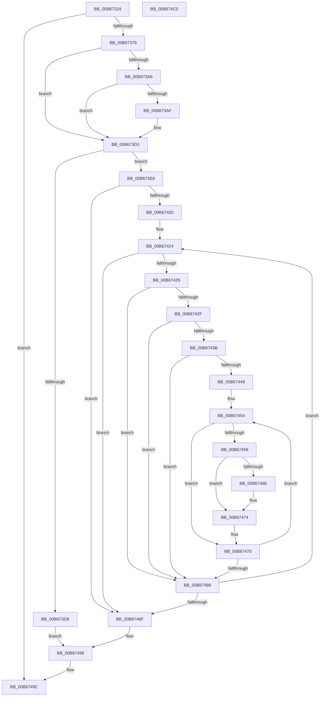

# KiIntersectFeaturesWithPolicy

- RVA: `0x00B67324`–`0x00B674C1` (길이 `413` bytes)
- VA: `0x0000000140B67324`
- 실행 섹션: `PAGELK`
- PDB 이름 있음: `예`; PDB Function 태그: `아니요`
- unwind 정보 RVA: `0x0009F5C4`
- 디코드: `119`개 명령, `413/413` bytes 표시
- 미해석 바이트: `0` (있으면 어셈블리에 `.byte`로 보존)

> 이 문서는 커널 이미지의 기계어와 PDB 기호를 분석해 생성했습니다. 4번과 5번은 함수 원형과 자료형을 바이너리 사용 방식에서 추정한 C 해석이며 원본 소스 복구 결과는 아닙니다.

## 1. Dependencies

- 직접 호출 지점: **5**; 고유 호출 대상: **4**
- 직접 호출자로 확인된 함수: **1**
- RIP 상대 이미지 참조: **3**

### Outgoing calls
- `0x00B67399` → [KeHwPolicyLocateResource](../../init/C3/KeHwPolicyLocateResource_function_00C38A80.md) (function, `0x00C38A80`)
- `0x00B673CC` → [KeHwPolicyLocateResource](../../init/C3/KeHwPolicyLocateResource_function_00C38A80.md) (function, `0x00C38A80`)
- `0x00B673F8` → [KiGetProcessorInformation](../../text/5C/KiGetProcessorInformation_function_005C1828.md) (function, `0x005C1828`)
- `0x00B67462` → [KiIsXSaveFeatureAllowed](KiIsXSaveFeatureAllowed_function_00B674C8.md) (function, `0x00B674C8`)
- `0x00B674A3` → [_security_check_cookie](../../text/6A/_security_check_cookie_function_006AC640.md) (function, `0x006AC640`)

### Direct callers
- [KiInitializeXSaveConfiguration](KiInitializeXSaveConfiguration_function_00B66F10.md) at `0x00B66FEA`

### Static image references
- `0x00B6733B` → RVA `0x00E0A740` (`.data`; read)
- `0x00B67376` → RVA `0x00E0B0D8` (`.data`; read)
- `0x00B673AF` → RVA `0x00E0B0D8` (`.data`; write)

## 2. Other-region calls and transfers

- 다른 실행 섹션으로 향하는 call: **4**
  - `0x00B67399` → [KeHwPolicyLocateResource](../../init/C3/KeHwPolicyLocateResource_function_00C38A80.md) (`PAGELK` → `INIT`)
  - `0x00B673CC` → [KeHwPolicyLocateResource](../../init/C3/KeHwPolicyLocateResource_function_00C38A80.md) (`PAGELK` → `INIT`)
  - `0x00B673F8` → [KiGetProcessorInformation](../../text/5C/KiGetProcessorInformation_function_005C1828.md) (`PAGELK` → `.text`)
  - `0x00B674A3` → [_security_check_cookie](../../text/6A/_security_check_cookie_function_006AC640.md) (`PAGELK` → `.text`)
- 별도 외부 분기/꼬리 이동을 확인하지 못했습니다.

## 3. Assembly (complete function range)

```asm
00B67324  48 89 5C 24 18                  mov qword ptr [rsp + 0x18], rbx
00B67329  55                              push rbp
00B6732A  56                              push rsi
00B6732B  57                              push rdi
00B6732C  41 54                           push r12
00B6732E  41 55                           push r13
00B67330  41 56                           push r14
00B67332  41 57                           push r15
00B67334  48 8B EC                        mov rbp, rsp
00B67337  48 83 EC 70                     sub rsp, 0x70
00B6733B  48 8B 05 FE 33 2A 00            mov rax, qword ptr [rip + 0x2a33fe]
00B67342  48 33 C4                        xor rax, rsp
00B67345  48 89 45 F8                     mov qword ptr [rbp - 8], rax
00B67349  45 33 F6                        xor r14d, r14d
00B6734C  33 C0                           xor eax, eax
00B6734E  0F 57 C0                        xorps xmm0, xmm0
00B67351  48 8B DA                        mov rbx, rdx
00B67354  48 8B F1                        mov rsi, rcx
00B67357  48 89 45 F0                     mov qword ptr [rbp - 0x10], rax
00B6735B  41 8B FE                        mov edi, r14d
00B6735E  44 89 75 C8                     mov dword ptr [rbp - 0x38], r14d
00B67362  45 8B FE                        mov r15d, r14d
00B67365  44 89 75 C0                     mov dword ptr [rbp - 0x40], r14d
00B67369  0F 11 45 E0                     movups xmmword ptr [rbp - 0x20], xmm0
00B6736D  4C 39 32                        cmp qword ptr [rdx], r14
00B67370  0F 84 26 01 00 00               je 0x140b6749c
00B67376  4C 8B 05 5B 3D 2A 00            mov r8, qword ptr [rip + 0x2a3d5b]
00B6737D  48 8D 45 D8                     lea rax, [rbp - 0x28]
00B67381  45 8D 66 65                     lea r12d, [r14 + 0x65]
00B67385  4C 89 75 D0                     mov qword ptr [rbp - 0x30], r14
00B67389  41 8B D4                        mov edx, r12d
00B6738C  4C 89 75 D8                     mov qword ptr [rbp - 0x28], r14
00B67390  4C 8D 4D D0                     lea r9, [rbp - 0x30]
00B67394  48 89 44 24 20                  mov qword ptr [rsp + 0x20], rax
00B67399  E8 E2 16 0D 00                  call 0x140c38a80
00B6739E  41 8D 4E 01                     lea ecx, [r14 + 1]
00B673A2  85 C0                           test eax, eax
00B673A4  79 2B                           jns 0x140b673d1
00B673A6  48 39 0D 2B 3D 2A 00            cmp qword ptr [rip + 0x2a3d2b], rcx
00B673AD  74 22                           je 0x140b673d1
00B673AF  48 89 0D 22 3D 2A 00            mov qword ptr [rip + 0x2a3d22], rcx
00B673B6  48 8D 45 D8                     lea rax, [rbp - 0x28]
00B673BA  44 8B C1                        mov r8d, ecx
00B673BD  48 89 44 24 20                  mov qword ptr [rsp + 0x20], rax
00B673C2  48 8B CE                        mov rcx, rsi
00B673C5  4C 8D 4D D0                     lea r9, [rbp - 0x30]
00B673C9  41 8B D4                        mov edx, r12d
00B673CC  E8 AF 16 0D 00                  call 0x140c38a80
00B673D1  3D 6C 02 00 C0                  cmp eax, 0xc000026c
00B673D6  75 10                           jne 0x140b673e8
00B673D8  83 63 14 F8                     and dword ptr [rbx + 0x14], 0xfffffff8
00B673DC  4C 89 B3 18 02 00 00            mov qword ptr [rbx + 0x218], r14
00B673E3  E9 B1 00 00 00                  jmp 0x140b67499
00B673E8  4C 8D 4D C0                     lea r9, [rbp - 0x40]
00B673EC  4C 8D 45 C8                     lea r8, [rbp - 0x38]
00B673F0  48 8D 55 EC                     lea rdx, [rbp - 0x14]
00B673F4  48 8D 4D E0                     lea rcx, [rbp - 0x20]
00B673F8  E8 2B A4 A5 FF                  call 0x1405c1828
00B673FD  65 4C 8B 04 25 20 00 00 00      mov r8, qword ptr gs:[0x20]
00B67406  4C 8B 33                        mov r14, qword ptr [rbx]
00B67409  49 8B F6                        mov rsi, r14
00B6740C  48 0B B3 18 02 00 00            or rsi, qword ptr [rbx + 0x218]
00B67413  49 8B 80 A8 8F 00 00            mov rax, qword ptr [r8 + 0x8fa8]
00B6741A  48 89 45 F0                     mov qword ptr [rbp - 0x10], rax
00B6741E  74 6F                           je 0x140b6748f
00B67420  4C 8B 6D D0                     mov r13, qword ptr [rbp - 0x30]
00B67424  83 FF 40                        cmp edi, 0x40
00B67427  73 66                           jae 0x140b6748f
00B67429  40 F6 C6 01                     test sil, 1
00B6742D  74 59                           je 0x140b67488
00B6742F  49 8B 45 10                     mov rax, qword ptr [r13 + 0x10]
00B67433  8B CF                           mov ecx, edi
00B67435  48 0F A3 C8                     bt rax, rcx
00B67439  73 4D                           jae 0x140b67488
00B6743B  41 8B 45 18                     mov eax, dword ptr [r13 + 0x18]
00B6743F  45 33 E4                        xor r12d, r12d
00B67442  89 45 C0                        mov dword ptr [rbp - 0x40], eax
00B67445  85 C0                           test eax, eax
00B67447  74 3F                           je 0x140b67488
00B67449  8B 4D C0                        mov ecx, dword ptr [rbp - 0x40]
00B6744C  49 8D 45 20                     lea rax, [r13 + 0x20]
00B67450  48 89 45 C8                     mov qword ptr [rbp - 0x38], rax
00B67454  39 38                           cmp dword ptr [rax], edi
00B67456  75 20                           jne 0x140b67478
00B67458  4C 8D 4D E0                     lea r9, [rbp - 0x20]
00B6745C  41 8B D4                        mov edx, r12d
00B6745F  49 8B CD                        mov rcx, r13
00B67462  E8 61 00 00 00                  call 0x140b674c8
00B67467  8B 4D C0                        mov ecx, dword ptr [rbp - 0x40]
00B6746A  84 C0                           test al, al
00B6746C  74 06                           je 0x140b67474
00B6746E  8B C7                           mov eax, edi
00B67470  49 0F AB C7                     bts r15, rax
00B67474  48 8B 45 C8                     mov rax, qword ptr [rbp - 0x38]
00B67478  48 83 C0 10                     add rax, 0x10
00B6747C  41 FF C4                        inc r12d
00B6747F  48 89 45 C8                     mov qword ptr [rbp - 0x38], rax
00B67483  44 3B E1                        cmp r12d, ecx
00B67486  72 CC                           jb 0x140b67454
00B67488  FF C7                           inc edi
00B6748A  48 D1 EE                        shr rsi, 1
00B6748D  75 95                           jne 0x140b67424
00B6748F  4D 23 F7                        and r14, r15
00B67492  4C 21 BB 18 02 00 00            and qword ptr [rbx + 0x218], r15
00B67499  4C 89 33                        mov qword ptr [rbx], r14
00B6749C  48 8B 4D F8                     mov rcx, qword ptr [rbp - 8]
00B674A0  48 33 CC                        xor rcx, rsp
00B674A3  E8 98 51 B4 FF                  call 0x1406ac640
00B674A8  48 8B 9C 24 C0 00 00 00         mov rbx, qword ptr [rsp + 0xc0]
00B674B0  48 83 C4 70                     add rsp, 0x70
00B674B4  41 5F                           pop r15
00B674B6  41 5E                           pop r14
00B674B8  41 5D                           pop r13
00B674BA  41 5C                           pop r12
00B674BC  5F                              pop rdi
00B674BD  5E                              pop rsi
00B674BE  5D                              pop rbp
00B674BF  C3                              ret
00B674C0  CC                              int3
```

## 4. C-style interpretation (structured pseudocode)

```c
__int64 __fastcall KiIntersectFeaturesWithPolicy(__int64 a1, __int64 a2)
{
    __int64 result;
    __int64 v_r12;
    __int64 v_r14;
    __int64 v_rdi;
    __int64 v_rsi;
    __int64 v_rsp;
    unsigned __int64 v_stack_m40;
    unsigned __int64 v_stack_m48;
    unsigned __int64 v_stack_m4C;
    unsigned __int64 v_stack_m58;
    unsigned __int64 v_stack_m60;
    unsigned __int64 v_stack_m68;
    unsigned int v_stack_m70;
    unsigned int v_stack_m78;
    unsigned __int64 v_stack_m88;
    unsigned __int64 v_stack_p18;

    v_stack_p18 = v_rbx;
    v_rsp = (v_rsp) - (112);
    result = (*(unsigned __int64 *)(v_rip + 2765822)) ^ (v_rsp);
    v_stack_m40 = result;
    v_r14 = 0;
    result = 0;
    v_stack_m48 = 0;
    v_stack_m70 = 0;
    v_stack_m78 = 0;
    v_stack_m58 = v_xmm0;
    if ((*(unsigned __int64 *)(a2)) == 0) goto loc_00B6749C;
    v_stack_m68 = 0;
    v_stack_m60 = 0;
    v_stack_m88 = v_stack_m60;
    result = KeHwPolicyLocateResource(a1, (unsigned int)((unsigned int)(v_r14 + 101)), *(unsigned __int64 *)(v_rip + 2768219), v_stack_m68);
    if (!sign_flag) goto loc_00B673D1;
    if ((*(unsigned __int64 *)(v_rip + 2768171)) != (v_r14 + 1)) {
        *(unsigned __int64 *)(v_rip + 2768162) = v_r14 + 1;
        result = v_stack_m60;
        a3 = (unsigned int)(v_r14 + 1);
        v_stack_m88 = result;
        a1 = a1;
        a4 = v_stack_m68;
        a2 = (unsigned int)(v_r14 + 101);
        result = KeHwPolicyLocateResource(a1, a2, a3, a4);
    }
    if (((unsigned int)(result)) != 0xC000026CULL) goto loc_00B673E8;
    *(unsigned __int64 *)(a2 + 536) = 0;
    goto loc_00B67499;
loc_00B673E8:
    result = KiGetProcessorInformation(v_stack_m58, v_stack_m4C, v_stack_m70, v_stack_m78);
    v_rsi = (*(unsigned __int64 *)(a2)) | (*(unsigned __int64 *)(a2 + 536));
    v_stack_m48 = *(unsigned __int64 *)(*(unsigned __int64 *)(gs_base + (0 + 32)) + 36776);
    if (condition_is_equal) goto loc_00B6748F;
loc_00B67424:
    if (0 >= 64) goto loc_00B6748F;
    if ((((unsigned __int8)(v_rsi)) & (1)) == 0) goto loc_00B67488;
    if (condition_is_above_or_equal) goto loc_00B67488;
    v_r12 = 0;
    v_stack_m78 = (unsigned int)((unsigned int)(*(unsigned int *)(v_stack_m68 + 24)));
    if ((unsigned int)((unsigned int)(*(unsigned int *)(v_stack_m68 + 24))) == 0) goto loc_00B67488;
    v_stack_m70 = v_stack_m68 + 32;
loc_00B67454:
    if ((*(unsigned int *)(v_stack_m68 + 32)) != 0) goto loc_00B67478;
    result = KiIsXSaveFeatureAllowed(v_stack_m68, 0, *(unsigned __int64 *)(gs_base + (0 + 32)), v_stack_m58);
    if ((unsigned __int8)(result) != 0) {
        result = 0;
    }
loc_00B67478:
    result = (v_stack_m70) + (16);
    v_r12 = (unsigned int)((v_r12) + 1);
    v_stack_m70 = result;
    if (((unsigned int)(v_r12)) < ((unsigned int)((unsigned int)(v_stack_m78)))) goto loc_00B67454;
loc_00B67488:
    v_rdi = (unsigned int)((0) + 1);
    v_rsi = (v_rsi) >> (1);
    if (condition_is_not_equal) goto loc_00B67424;
loc_00B6748F:
    v_r14 = (*(unsigned __int64 *)(a2)) & (0);
loc_00B67499:
    *(unsigned __int64 *)(a2) = v_r14;
loc_00B6749C:
    a1 = (v_stack_m40) ^ (v_rsp);
    result = _security_check_cookie(a1, 0, *(unsigned __int64 *)(gs_base + (0 + 32)), v_stack_m58);
    v_rsp = (v_rsp) + (112);
    return result;
}
```

## 5. (Beta) C Style

```c
int64_t KiIntersectFeaturesWithPolicy(int64_t Arg1, void *Arg2)
{
    uint8_t *arg2 = (uint8_t *)Arg2;

    int64_t result;
    int64_t local_r12;
    int64_t local_r14;
    int64_t local_rdi;
    int64_t local_rsi;
    int64_t local_rsp;
    uint64_t v_stack_m40;
    uint64_t v_stack_m48;
    uint64_t v_stack_m4C;
    uint64_t v_stack_m58;
    uint64_t v_stack_m60;
    uint64_t v_stack_m68;
    uint32_t v_stack_m70;
    uint32_t v_stack_m78;
    uint64_t v_stack_m88;
    uint64_t v_stack_p18;

    v_stack_p18 = local_rbx;
    local_rsp = (local_rsp) - (112);
    result = (*(uint64_t *)(v_rip + 0x2A33FE)) ^ (local_rsp);
    v_stack_m40 = result;
    local_r14 = 0;
    result = 0;
    v_stack_m48 = 0;
    v_stack_m70 = 0;
    v_stack_m78 = 0;
    v_stack_m58 = v_xmm0;
    if ((*(uint64_t *)(arg2)) == 0) goto loc_00B6749C;
    v_stack_m68 = 0;
    v_stack_m60 = 0;
    v_stack_m88 = v_stack_m60;
    result = KeHwPolicyLocateResource(Arg1, (uint32_t)((uint32_t)(local_r14 + 101)), *(uint64_t *)(v_rip + 0x2A3D5B), v_stack_m68);
    if (!sign_flag) goto loc_00B673D1;
    if ((*(uint64_t *)(v_rip + 0x2A3D2B)) != (local_r14 + 1)) {
        *(uint64_t *)(v_rip + 0x2A3D22) = local_r14 + 1;
        result = v_stack_m60;
        a3 = (uint32_t)(local_r14 + 1);
        v_stack_m88 = result;
        Arg1 = Arg1;
        a4 = v_stack_m68;
        Arg2 = (uint32_t)(local_r14 + 101);
        result = KeHwPolicyLocateResource(Arg1, Arg2, a3, a4);
    }
    if (((uint32_t)(result)) != 0xC000026CULL) goto loc_00B673E8;
    *(uint64_t *)(arg2 + 0x218) = 0;
    goto loc_00B67499;
loc_00B673E8:
    result = KiGetProcessorInformation(v_stack_m58, v_stack_m4C, v_stack_m70, v_stack_m78);
    local_rsi = (*(uint64_t *)(arg2)) | (*(uint64_t *)(arg2 + 0x218));
    v_stack_m48 = *(uint64_t *)(*(uint64_t *)(gs_base + (0 + 0x20)) + 0x8FA8);
    if (condition_is_equal) goto loc_00B6748F;
loc_00B67424:
    if (0 >= 64) goto loc_00B6748F;
    if ((((uint8_t)(local_rsi)) & (1)) == 0) goto loc_00B67488;
    if (condition_is_above_or_equal) goto loc_00B67488;
    local_r12 = 0;
    v_stack_m78 = (uint32_t)((uint32_t)(*(uint32_t *)(v_stack_m68 + 0x18)));
    if ((uint32_t)((uint32_t)(*(uint32_t *)(v_stack_m68 + 0x18))) == 0) goto loc_00B67488;
    v_stack_m70 = v_stack_m68 + 32;
loc_00B67454:
    if ((*(uint32_t *)(v_stack_m68 + 0x20)) != 0) goto loc_00B67478;
    result = KiIsXSaveFeatureAllowed(v_stack_m68, 0, *(uint64_t *)(gs_base + (0 + 0x20)), v_stack_m58);
    if ((uint8_t)(result) != 0) {
        result = 0;
    }
loc_00B67478:
    result = (v_stack_m70) + (16);
    local_r12 = (uint32_t)((local_r12) + 1);
    v_stack_m70 = result;
    if (((uint32_t)(local_r12)) < ((uint32_t)((uint32_t)(v_stack_m78)))) goto loc_00B67454;
loc_00B67488:
    local_rdi = (uint32_t)((0) + 1);
    local_rsi = (local_rsi) >> (1);
    if (condition_is_not_equal) goto loc_00B67424;
loc_00B6748F:
    local_r14 = (*(uint64_t *)(arg2)) & (0);
loc_00B67499:
    *(uint64_t *)(arg2) = local_r14;
loc_00B6749C:
    Arg1 = (v_stack_m40) ^ (local_rsp);
    result = _security_check_cookie(Arg1, 0, *(uint64_t *)(gs_base + (0 + 0x20)), v_stack_m58);
    local_rsp = (local_rsp) + (112);
    return result;
}
```

### 관측된 메모리 오프셋

구조체 형식이 확인되지 않은 접근은 인자 기준의 오프셋으로만 기록했습니다.

| 기준 인자 | 오프셋 표현 | 폭 (bit) | 접근 |
|---|---:|---:|---|
| `Arg2` | `+ 0x0` | `64` | `R` |
| `Arg2` | `+ 0x0` | `64` | `W` |
| `Arg2` | `+ 0x14` | `32` | `R/W` |
| `Arg2` | `+ 0x218` | `64` | `R` |
| `Arg2` | `+ 0x218` | `64` | `R/W` |
| `Arg2` | `+ 0x218` | `64` | `W` |

## 6. Execution-region graph

[열기: 2D/3D 그래프와 함수 탐색 컨트롤 패널](../../../control-panel.html?section=pagelk&rva=0x00B67324&view=graph)

- 2D 그래프는 위에서 아래로 흐르고, 3D 그래프는 빈 공간을 드래그해 회전합니다. Shift+드래그는 이동, 휠은 확대·축소, 함수 노드 선택은 대상 보고서 이동입니다.

### Static fallback


