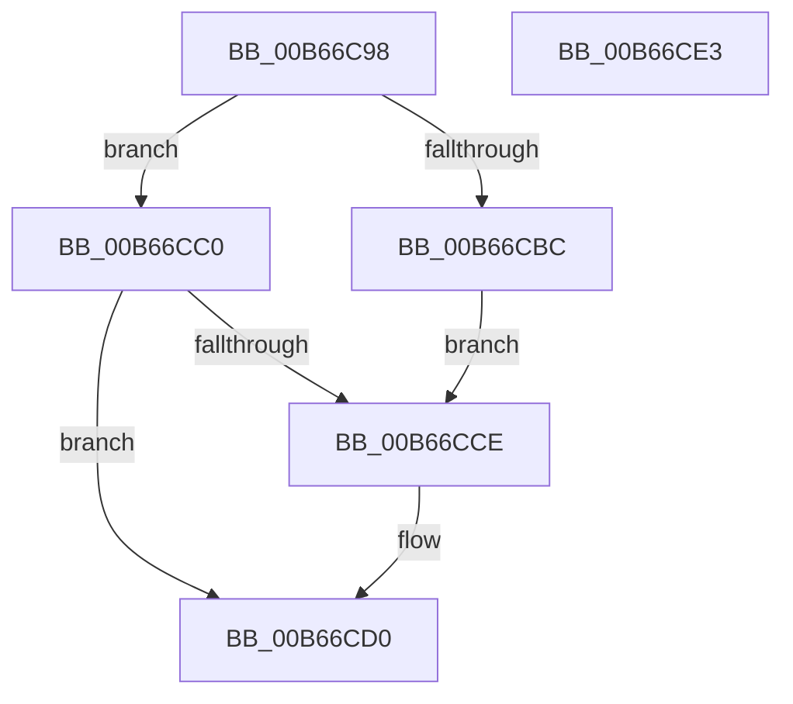

# KiIsNXSupported

- RVA: `0x00B66C98`–`0x00B66CE4` (길이 `76` bytes)
- VA: `0x0000000140B66C98`
- 실행 섹션: `PAGELK`
- PDB 이름 있음: `예`; PDB Function 태그: `아니요`
- unwind 정보 RVA: `0x000AB2E4`
- 디코드: `25`개 명령, `76/76` bytes 표시
- 미해석 바이트: `0` (있으면 어셈블리에 `.byte`로 보존)

> 이 문서는 커널 이미지의 기계어와 PDB 기호를 분석해 생성했습니다. 4번과 5번은 함수 원형과 자료형을 바이너리 사용 방식에서 추정한 C 해석이며 원본 소스 복구 결과는 아닙니다.

## 1. Dependencies

- 직접 호출 지점: **2**; 고유 호출 대상: **2**
- 직접 호출자로 확인된 함수: **1**
- RIP 상대 이미지 참조: **1**

### Outgoing calls
- `0x00B66CC2` → [KiGetCpuVendor](../B7/KiGetCpuVendor_function_00B7D5B4.md) (function, `0x00B7D5B4`)
- `0x00B66CD8` → [_security_check_cookie](../../text/6A/_security_check_cookie_function_006AC640.md) (function, `0x006AC640`)

### Direct callers
- [KiInitializeNxSupportDiscard](../../init/C3/KiInitializeNxSupportDiscard_function_00C39888.md) at `0x00C399CC`

### Static image references
- `0x00B66C9E` → RVA `0x00E0A740` (`.data`; read)

## 2. Other-region calls and transfers

- 다른 실행 섹션으로 향하는 call: **1**
  - `0x00B66CD8` → [_security_check_cookie](../../text/6A/_security_check_cookie_function_006AC640.md) (`PAGELK` → `.text`)
- 별도 외부 분기/꼬리 이동을 확인하지 못했습니다.

## 3. Assembly (complete function range)

```asm
00B66C98  40 53                           push rbx
00B66C9A  48 83 EC 40                     sub rsp, 0x40
00B66C9E  48 8B 05 9B 3A 2A 00            mov rax, qword ptr [rip + 0x2a3a9b]
00B66CA5  48 33 C4                        xor rax, rsp
00B66CA8  48 89 44 24 30                  mov qword ptr [rsp + 0x30], rax
00B66CAD  33 C9                           xor ecx, ecx
00B66CAF  B8 01 00 00 80                  mov eax, 0x80000001
00B66CB4  0F A2                           cpuid
00B66CB6  0F BA E2 14                     bt edx, 0x14
00B66CBA  73 04                           jae 0x140b66cc0
00B66CBC  B3 01                           mov bl, 1
00B66CBE  EB 0E                           jmp 0x140b66cce
00B66CC0  32 DB                           xor bl, bl
00B66CC2  E8 ED 68 01 00                  call 0x140b7d5b4
00B66CC7  83 F8 01                        cmp eax, 1
00B66CCA  B0 01                           mov al, 1
00B66CCC  74 02                           je 0x140b66cd0
00B66CCE  8A C3                           mov al, bl
00B66CD0  48 8B 4C 24 30                  mov rcx, qword ptr [rsp + 0x30]
00B66CD5  48 33 CC                        xor rcx, rsp
00B66CD8  E8 63 59 B4 FF                  call 0x1406ac640
00B66CDD  48 83 C4 40                     add rsp, 0x40
00B66CE1  5B                              pop rbx
00B66CE2  C3                              ret
00B66CE3  CC                              int3
```

## 4. C-style interpretation (structured pseudocode)

```c
__int64 __fastcall KiIsNXSupported(int a1, int a2)
{
    __int64 result;
    __int64 v_rbx;
    __int64 v_rsp;
    unsigned __int64 v_stack_m18;

    v_rsp = (v_rsp) - (64);
    result = (*(unsigned __int64 *)(v_rip + 2767515)) ^ (v_rsp);
    v_stack_m18 = result;
    a1 = 0;
    if (condition_is_above_or_equal) goto loc_00B66CC0;
    goto loc_00B66CCE;
loc_00B66CC0:
    v_rbx = 0;
    result = KiGetCpuVendor(a1, a2, a3, a4);
    result = 1;
    if (((unsigned int)(result)) != 1) {
        result = 0;
    }
    a1 = (v_stack_m18) ^ (v_rsp);
    result = _security_check_cookie(a1, a2, a3, a4);
    v_rsp = (v_rsp) + (64);
    return result;
}
```

## 5. (Beta) C Style

```c
int64_t KiIsNXSupported(int32_t Arg1, int32_t Arg2)
{
    int64_t result;
    int64_t local_rbx;
    int64_t local_rsp;
    uint64_t v_stack_m18;

    local_rsp = (local_rsp) - (64);
    result = (*(uint64_t *)(v_rip + 0x2A3A9B)) ^ (local_rsp);
    v_stack_m18 = result;
    Arg1 = 0;
    if (condition_is_above_or_equal) goto loc_00B66CC0;
    goto loc_00B66CCE;
loc_00B66CC0:
    local_rbx = 0;
    result = KiGetCpuVendor(Arg1, Arg2, a3, a4);
    result = 1;
    if (((uint32_t)(result)) != 1) {
        result = 0;
    }
    Arg1 = (v_stack_m18) ^ (local_rsp);
    result = _security_check_cookie(Arg1, Arg2, a3, a4);
    local_rsp = (local_rsp) + (64);
    return result;
}
```

## 6. Execution-region graph

[열기: 2D/3D 그래프와 함수 탐색 컨트롤 패널](../../../control-panel.html?section=pagelk&rva=0x00B66C98&view=graph)

- 2D 그래프는 위에서 아래로 흐르고, 3D 그래프는 빈 공간을 드래그해 회전합니다. Shift+드래그는 이동, 휠은 확대·축소, 함수 노드 선택은 대상 보고서 이동입니다.

### Static fallback


