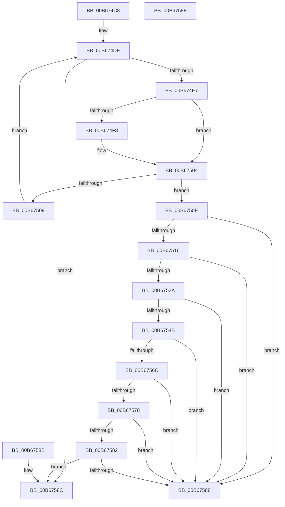

# KiIsXSaveFeatureAllowed

- RVA: `0x00B674C8`–`0x00B67590` (길이 `200` bytes)
- VA: `0x0000000140B674C8`
- 실행 섹션: `PAGELK`
- PDB 이름 있음: `예`; PDB Function 태그: `아니요`
- unwind 정보 RVA: `0x000DB714`
- 디코드: `63`개 명령, `200/200` bytes 표시
- 미해석 바이트: `0` (있으면 어셈블리에 `.byte`로 보존)

> 이 문서는 커널 이미지의 기계어와 PDB 기호를 분석해 생성했습니다. 4번과 5번은 함수 원형과 자료형을 바이너리 사용 방식에서 추정한 C 해석이며 원본 소스 복구 결과는 아닙니다.

## 1. Dependencies

- 직접 호출 지점: **0**; 고유 호출 대상: **0**
- 직접 호출자로 확인된 함수: **1**
- RIP 상대 이미지 참조: **0**

### Outgoing calls
- 직접 디코드된 call 명령이 없습니다.

### Direct callers
- [KiIntersectFeaturesWithPolicy](KiIntersectFeaturesWithPolicy_function_00B67324.md) at `0x00B67462`

### Static image references
- 디코드된 RIP-relative 메모리 참조가 없습니다.

## 2. Other-region calls and transfers

- 다른 실행 섹션으로 향하는 call: **0**
- 별도 외부 분기/꼬리 이동을 확인하지 못했습니다.

## 3. Assembly (complete function range)

```asm
00B674C8  8B C2                           mov eax, edx
00B674CA  4D 8B D9                        mov r11, r9
00B674CD  48 03 C0                        add rax, rax
00B674D0  48 8B 54 C1 28                  mov rdx, qword ptr [rcx + rax*8 + 0x28]
00B674D5  48 03 D1                        add rdx, rcx
00B674D8  45 33 D2                        xor r10d, r10d
00B674DB  44 8B 0A                        mov r9d, dword ptr [rdx]
00B674DE  45 3B D1                        cmp r10d, r9d
00B674E1  0F 83 A5 00 00 00               jae 0x140b6758c
00B674E7  41 8B C2                        mov eax, r10d
00B674EA  4C 6B C0 38                     imul r8, rax, 0x38
00B674EE  49 8B 4C 10 08                  mov rcx, qword ptr [r8 + rdx + 8]
00B674F3  49 2B 0B                        sub rcx, qword ptr [r11]
00B674F6  75 0C                           jne 0x140b67504
00B674F8  41 8B 4C 10 10                  mov ecx, dword ptr [r8 + rdx + 0x10]
00B674FD  41 8B 43 08                     mov eax, dword ptr [r11 + 8]
00B67501  48 2B C8                        sub rcx, rax
00B67504  48 85 C9                        test rcx, rcx
00B67507  74 05                           je 0x140b6750e
00B67509  41 FF C2                        inc r10d
00B6750C  EB D0                           jmp 0x140b674de
00B6750E  49 83 7C 10 38 00               cmp qword ptr [r8 + rdx + 0x38], 0
00B67514  74 72                           je 0x140b67588
00B67516  45 8B 4B 0C                     mov r9d, dword ptr [r11 + 0xc]
00B6751A  41 8B C9                        mov ecx, r9d
00B6751D  C1 E9 0C                        shr ecx, 0xc
00B67520  83 E1 03                        and ecx, 3
00B67523  41 3A 4C 10 18                  cmp cl, byte ptr [r8 + rdx + 0x18]
00B67528  75 5E                           jne 0x140b67588
00B6752A  41 8B C9                        mov ecx, r9d
00B6752D  41 8B C1                        mov eax, r9d
00B67530  C1 E9 0A                        shr ecx, 0xa
00B67533  C1 E8 04                        shr eax, 4
00B67536  81 E1 F0 00 00 00               and ecx, 0xf0
00B6753C  83 E0 0F                        and eax, 0xf
00B6753F  03 C8                           add ecx, eax
00B67541  41 0F B7 44 10 1C               movzx eax, word ptr [r8 + rdx + 0x1c]
00B67547  3B C8                           cmp ecx, eax
00B67549  75 3D                           jne 0x140b67588
00B6754B  41 8B C9                        mov ecx, r9d
00B6754E  41 8B C1                        mov eax, r9d
00B67551  C1 E9 0E                        shr ecx, 0xe
00B67554  C1 E8 08                        shr eax, 8
00B67557  81 E1 F0 0F 00 00               and ecx, 0xff0
00B6755D  83 E0 0F                        and eax, 0xf
00B67560  03 C8                           add ecx, eax
00B67562  41 0F B7 44 10 1A               movzx eax, word ptr [r8 + rdx + 0x1a]
00B67568  3B C8                           cmp ecx, eax
00B6756A  75 1C                           jne 0x140b67588
00B6756C  41 83 E1 0F                     and r9d, 0xf
00B67570  66 45 3B 4C 10 1E               cmp r9w, word ptr [r8 + rdx + 0x1e]
00B67576  75 10                           jne 0x140b67588
00B67578  49 8B 4C 10 28                  mov rcx, qword ptr [r8 + rdx + 0x28]
00B6757D  48 85 C9                        test rcx, rcx
00B67580  74 06                           je 0x140b67588
00B67582  49 39 4B 10                     cmp qword ptr [r11 + 0x10], rcx
00B67586  76 04                           jbe 0x140b6758c
00B67588  B0 01                           mov al, 1
00B6758A  C3                              ret
00B6758B  CC                              int3
00B6758C  32 C0                           xor al, al
00B6758E  C3                              ret
00B6758F  CC                              int3
```

## 4. C-style interpretation (structured pseudocode)

```c
__int64 __fastcall KiIsXSaveFeatureAllowed(__int64 a1, int a2, __int64 a3, __int64 a4)
{
    __int64 result;
    __int64 v_r10;

    result = ((unsigned int)(a2)) + ((unsigned int)(a2));
    a2 = (*(unsigned __int64 *)(a1 + result * 8 + 40)) + (a1);
    v_r10 = 0;
loc_00B674DE:
    if (0 >= ((unsigned int)((unsigned int)(*(unsigned int *)(a2))))) goto loc_00B6758C;
    a3 = (a3) * (0);
    a1 = (*(unsigned __int64 *)(a3 + a2 * 1 + 8)) - (*(unsigned __int64 *)(a4));
    result = 0;
    if (!(condition_is_not_equal)) {
        a1 = *(unsigned int *)(a3 + a2 * 1 + 16);
        result = *(unsigned int *)(a4 + 8);
        a1 = (a1) - (result);
    }
    if (a1 == 0) goto loc_00B6750E;
    v_r10 = (unsigned int)((v_r10) + 1);
    goto loc_00B674DE;
loc_00B6750E:
    if ((*(unsigned __int64 *)(a3 + a2 * 1 + 56)) == 0) goto loc_00B67588;
    a1 = (unsigned int)(((unsigned int)((unsigned int)((unsigned int)(*(unsigned int *)(a4 + 12))))) >> (12));
    a1 = (unsigned int)((a1) & (3));
    if (((unsigned __int8)(a1)) != (*(unsigned __int8 *)(a3 + a2 * 1 + 24))) goto loc_00B67588;
    a1 = (unsigned int)(((unsigned int)((unsigned int)((unsigned int)(*(unsigned int *)(a4 + 12))))) >> (10));
    result = (unsigned int)(((unsigned int)((unsigned int)((unsigned int)(*(unsigned int *)(a4 + 12))))) >> (4));
    a1 = (unsigned int)((a1) & (240));
    result = (unsigned int)((result) & (15));
    a1 = (unsigned int)((a1) + ((unsigned int)(result)));
    if (((unsigned int)(a1)) != ((unsigned int)(*(unsigned __int16 *)(a3 + a2 * 1 + 28)))) goto loc_00B67588;
    a1 = (unsigned int)(((unsigned int)((unsigned int)((unsigned int)(*(unsigned int *)(a4 + 12))))) >> (14));
    result = (unsigned int)(((unsigned int)((unsigned int)((unsigned int)(*(unsigned int *)(a4 + 12))))) >> (8));
    a1 = (unsigned int)((a1) & (0xFF0ULL));
    result = (unsigned int)((result) & (15));
    a1 = (unsigned int)((a1) + ((unsigned int)(result)));
    if (((unsigned int)(a1)) != ((unsigned int)(*(unsigned __int16 *)(a3 + a2 * 1 + 26)))) goto loc_00B67588;
    a4 = (unsigned int)(((unsigned int)(*(unsigned int *)(a4 + 12))) & (15));
    if (((unsigned __int16)(a4)) != (*(unsigned __int16 *)(a3 + a2 * 1 + 30))) goto loc_00B67588;
    if (*(unsigned __int64 *)(a3 + a2 * 1 + 40) == 0) goto loc_00B67588;
    if ((*(unsigned __int64 *)(a4 + 16)) <= (*(unsigned __int64 *)(a3 + a2 * 1 + 40))) goto loc_00B6758C;
loc_00B67588:
    return 1;
loc_00B6758C:
    result = 0;
    return result;
}
```

## 5. (Beta) C Style

```c
int64_t KiIsXSaveFeatureAllowed(void *Arg1, int32_t Arg2, void *Arg3, void *Arg4)
{
    uint8_t *arg1 = (uint8_t *)Arg1;
    uint8_t *arg3 = (uint8_t *)Arg3;
    uint8_t *arg4 = (uint8_t *)Arg4;

    int64_t result;
    int64_t local_r10;

    result = ((uint32_t)(Arg2)) + ((uint32_t)(Arg2));
    Arg2 = (*(uint64_t *)(arg1 + result * 8 + 0x28)) + (Arg1);
    local_r10 = 0;
loc_00B674DE:
    if (0 >= ((uint32_t)((uint32_t)(*(uint32_t *)(Arg2))))) goto loc_00B6758C;
    Arg3 = (Arg3) * (0);
    Arg1 = (*(uint64_t *)(arg3 + Arg2 * 1 + 0x8)) - (*(uint64_t *)(arg4));
    result = 0;
    if (!(condition_is_not_equal)) {
        Arg1 = *(uint32_t *)(arg3 + Arg2 * 1 + 0x10);
        result = *(uint32_t *)(arg4 + 0x8);
        Arg1 = (Arg1) - (result);
    }
    if (Arg1 == NULL) goto loc_00B6750E;
    local_r10 = (uint32_t)((local_r10) + 1);
    goto loc_00B674DE;
loc_00B6750E:
    if ((*(uint64_t *)(arg3 + Arg2 * 1 + 0x38)) == 0) goto loc_00B67588;
    Arg1 = (uint32_t)(((uint32_t)((uint32_t)((uint32_t)(*(uint32_t *)(arg4 + 0xC))))) >> (12));
    Arg1 = (uint32_t)((Arg1) & (3));
    if (((uint8_t)(Arg1)) != (*(uint8_t *)(arg3 + Arg2 * 1 + 0x18))) goto loc_00B67588;
    Arg1 = (uint32_t)(((uint32_t)((uint32_t)((uint32_t)(*(uint32_t *)(arg4 + 0xC))))) >> (10));
    result = (uint32_t)(((uint32_t)((uint32_t)((uint32_t)(*(uint32_t *)(arg4 + 0xC))))) >> (4));
    Arg1 = (uint32_t)((Arg1) & (240));
    result = (uint32_t)((result) & (15));
    Arg1 = (uint32_t)((Arg1) + ((uint32_t)(result)));
    if (((uint32_t)(Arg1)) != ((uint32_t)(*(uint16_t *)(arg3 + Arg2 * 1 + 0x1C)))) goto loc_00B67588;
    Arg1 = (uint32_t)(((uint32_t)((uint32_t)((uint32_t)(*(uint32_t *)(arg4 + 0xC))))) >> (14));
    result = (uint32_t)(((uint32_t)((uint32_t)((uint32_t)(*(uint32_t *)(arg4 + 0xC))))) >> (8));
    Arg1 = (uint32_t)((Arg1) & (0xFF0ULL));
    result = (uint32_t)((result) & (15));
    Arg1 = (uint32_t)((Arg1) + ((uint32_t)(result)));
    if (((uint32_t)(Arg1)) != ((uint32_t)(*(uint16_t *)(arg3 + Arg2 * 1 + 0x1A)))) goto loc_00B67588;
    Arg4 = (uint32_t)(((uint32_t)(*(uint32_t *)(arg4 + 0xC))) & (15));
    if (((uint16_t)(Arg4)) != (*(uint16_t *)(arg3 + Arg2 * 1 + 0x1E))) goto loc_00B67588;
    if (*(uint64_t *)(arg3 + Arg2 * 1 + 0x28) == 0) goto loc_00B67588;
    if ((*(uint64_t *)(arg4 + 0x10)) <= (*(uint64_t *)(arg3 + Arg2 * 1 + 0x28))) goto loc_00B6758C;
loc_00B67588:
    return 1;
loc_00B6758C:
    result = 0;
    return result;
}
```

### 관측된 메모리 오프셋

구조체 형식이 확인되지 않은 접근은 인자 기준의 오프셋으로만 기록했습니다.

| 기준 인자 | 오프셋 표현 | 폭 (bit) | 접근 |
|---|---:|---:|---|
| `Arg1` | `+ 0x28 + rax*8` | `64` | `R` |
| `Arg3` | `+ 0x8 + rdx*1` | `64` | `R` |
| `Arg3` | `+ 0x10 + rdx*1` | `32` | `R` |
| `Arg3` | `+ 0x18 + rdx*1` | `8` | `R` |
| `Arg3` | `+ 0x1A + rdx*1` | `16` | `R` |
| `Arg3` | `+ 0x1C + rdx*1` | `16` | `R` |
| `Arg3` | `+ 0x1E + rdx*1` | `16` | `R` |
| `Arg3` | `+ 0x28 + rdx*1` | `64` | `R` |
| `Arg3` | `+ 0x38 + rdx*1` | `64` | `R` |
| `Arg4` | `+ 0x0` | `64` | `R` |
| `Arg4` | `+ 0x8` | `32` | `R` |
| `Arg4` | `+ 0xC` | `32` | `R` |
| `Arg4` | `+ 0x10` | `64` | `R` |

## 6. Execution-region graph

[열기: 2D/3D 그래프와 함수 탐색 컨트롤 패널](../../../control-panel.html?section=pagelk&rva=0x00B674C8&view=graph)

- 2D 그래프는 위에서 아래로 흐르고, 3D 그래프는 빈 공간을 드래그해 회전합니다. Shift+드래그는 이동, 휠은 확대·축소, 함수 노드 선택은 대상 보고서 이동입니다.

### Static fallback


