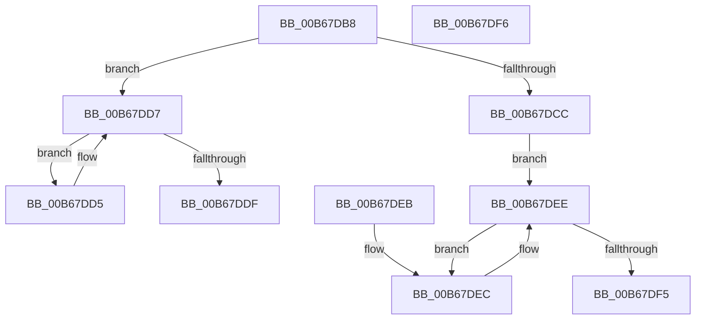

# KiLockStepExecution

- RVA: `0x00B67DB8`–`0x00B67DF7` (길이 `63` bytes)
- VA: `0x0000000140B67DB8`
- 실행 섹션: `PAGELK`
- PDB 이름 있음: `예`; PDB Function 태그: `아니요`
- unwind 정보 RVA: `0x000DB714`
- 디코드: `22`개 명령, `63/63` bytes 표시
- 미해석 바이트: `0` (있으면 어셈블리에 `.byte`로 보존)

> 이 문서는 커널 이미지의 기계어와 PDB 기호를 분석해 생성했습니다. 4번과 5번은 함수 원형과 자료형을 바이너리 사용 방식에서 추정한 C 해석이며 원본 소스 복구 결과는 아닙니다.

## 1. Dependencies

- 직접 호출 지점: **0**; 고유 호출 대상: **0**
- 직접 호출자로 확인된 함수: **1**
- RIP 상대 이미지 참조: **0**

### Outgoing calls
- 직접 디코드된 call 명령이 없습니다.

### Direct callers
- [KeLoadMTRR](../B7/KeLoadMTRR_function_00B7DDA0.md) at `0x00B7DE3D`
- [KeLoadMTRR](../B7/KeLoadMTRR_function_00B7DDA0.md) at `0x00B7DF29`

### Static image references
- 디코드된 RIP-relative 메모리 참조가 없습니다.

## 2. Other-region calls and transfers

- 다른 실행 섹션으로 향하는 call: **0**
- 별도 외부 분기/꼬리 이동을 확인하지 못했습니다.

## 3. Assembly (complete function range)

```asm
00B67DB8  65 48 8B 14 25 20 00 00 00      mov rdx, qword ptr gs:[0x20]
00B67DC1  8B 01                           mov eax, dword ptr [rcx]
00B67DC3  4C 8B 41 10                     mov r8, qword ptr [rcx + 0x10]
00B67DC7  39 42 24                        cmp dword ptr [rdx + 0x24], eax
00B67DCA  74 0B                           je 0x140b67dd7
00B67DCC  41 8B 10                        mov edx, dword ptr [r8]
00B67DCF  F0 FF 41 08                     lock inc dword ptr [rcx + 8]
00B67DD3  EB 19                           jmp 0x140b67dee
00B67DD5  F3 90                           pause
00B67DD7  8B 41 08                        mov eax, dword ptr [rcx + 8]
00B67DDA  3B 41 04                        cmp eax, dword ptr [rcx + 4]
00B67DDD  75 F6                           jne 0x140b67dd5
00B67DDF  C7 41 08 00 00 00 00            mov dword ptr [rcx + 8], 0
00B67DE6  F0 41 FF 00                     lock inc dword ptr [r8]
00B67DEA  C3                              ret
00B67DEB  CC                              int3
00B67DEC  F3 90                           pause
00B67DEE  41 8B 00                        mov eax, dword ptr [r8]
00B67DF1  3B C2                           cmp eax, edx
00B67DF3  74 F7                           je 0x140b67dec
00B67DF5  C3                              ret
00B67DF6  CC                              int3
```

## 4. C-style interpretation (structured pseudocode)

```c
__int64 __fastcall KiLockStepExecution(__int64 a1)
{
    if ((*(unsigned int *)(*(unsigned __int64 *)(gs_base + (0 + 32)) + 36)) == ((unsigned int)((unsigned int)(*(unsigned int *)(a1))))) goto loc_00B67DD7;
    goto loc_00B67DEE;
loc_00B67DD5:
loc_00B67DD7:
    if (((unsigned int)((unsigned int)(*(unsigned int *)(a1 + 8)))) != (*(unsigned int *)(a1 + 4))) goto loc_00B67DD5;
    *(unsigned int *)(a1 + 8) = 0;
    return (unsigned int)(*(unsigned int *)(a1 + 8));
loc_00B67DEC:
loc_00B67DEE:
    if (((unsigned int)((unsigned int)(*(unsigned int *)(*(unsigned __int64 *)(a1 + 16))))) == ((unsigned int)((unsigned int)(*(unsigned int *)(*(unsigned __int64 *)(a1 + 16)))))) goto loc_00B67DEC;
    return (unsigned int)(*(unsigned int *)(*(unsigned __int64 *)(a1 + 16)));
}
```

## 5. (Beta) C Style

```c
int64_t KiLockStepExecution(void *Arg1)
{
    uint8_t *arg1 = (uint8_t *)Arg1;

    if ((*(uint32_t *)(*(uint64_t *)(gs_base + (0 + 0x20)) + 0x24)) == ((uint32_t)((uint32_t)(*(uint32_t *)(arg1))))) goto loc_00B67DD7;
    goto loc_00B67DEE;
loc_00B67DD5:
loc_00B67DD7:
    if (((uint32_t)((uint32_t)(*(uint32_t *)(arg1 + 0x8)))) != (*(uint32_t *)(arg1 + 0x4))) goto loc_00B67DD5;
    *(uint32_t *)(arg1 + 0x8) = 0;
    return (uint32_t)(*(uint32_t *)(arg1 + 0x8));
loc_00B67DEC:
loc_00B67DEE:
    if (((uint32_t)((uint32_t)(*(uint32_t *)(*(uint64_t *)(arg1 + 0x10))))) == ((uint32_t)((uint32_t)(*(uint32_t *)(*(uint64_t *)(arg1 + 0x10)))))) goto loc_00B67DEC;
    return (uint32_t)(*(uint32_t *)(*(uint64_t *)(arg1 + 0x10)));
}
```

### 관측된 메모리 오프셋

구조체 형식이 확인되지 않은 접근은 인자 기준의 오프셋으로만 기록했습니다.

| 기준 인자 | 오프셋 표현 | 폭 (bit) | 접근 |
|---|---:|---:|---|
| `Arg1` | `+ 0x0` | `32` | `R` |
| `Arg1` | `+ 0x4` | `32` | `R` |
| `Arg1` | `+ 0x8` | `32` | `R` |
| `Arg1` | `+ 0x8` | `32` | `R/W` |
| `Arg1` | `+ 0x8` | `32` | `W` |
| `Arg1` | `+ 0x10` | `64` | `R` |

## 6. Execution-region graph

[열기: 2D/3D 그래프와 함수 탐색 컨트롤 패널](../../../control-panel.html?section=pagelk&rva=0x00B67DB8&view=graph)

- 2D 그래프는 위에서 아래로 흐르고, 3D 그래프는 빈 공간을 드래그해 회전합니다. Shift+드래그는 이동, 휠은 확대·축소, 함수 노드 선택은 대상 보고서 이동입니다.

### Static fallback


