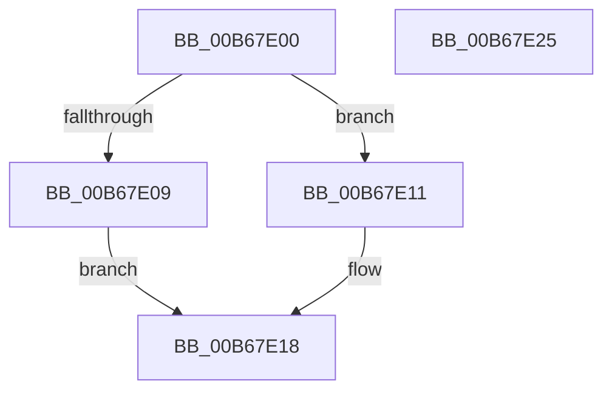

# KiMaskToLength

- RVA: `0x00B67E00`–`0x00B67E26` (길이 `38` bytes)
- VA: `0x0000000140B67E00`
- 실행 섹션: `PAGELK`
- PDB 이름 있음: `예`; PDB Function 태그: `아니요`
- unwind 정보 RVA: `0x0005C788`
- 디코드: `12`개 명령, `38/38` bytes 표시
- 미해석 바이트: `0` (있으면 어셈블리에 `.byte`로 보존)

> 이 문서는 커널 이미지의 기계어와 PDB 기호를 분석해 생성했습니다. 4번과 5번은 함수 원형과 자료형을 바이너리 사용 방식에서 추정한 C 해석이며 원본 소스 복구 결과는 아닙니다.

## 1. Dependencies

- 직접 호출 지점: **1**; 고유 호출 대상: **1**
- 직접 호출자로 확인된 함수: **1**
- RIP 상대 이미지 참조: **1**

### Outgoing calls
- `0x00B67E11` → [RtlFindLeastSignificantBit](../../text/46/RtlFindLeastSignificantBit_function_00464710.md) (function, `0x00464710`)

### Direct callers
- [KiInitializeMTRR](../../init/C3/KiInitializeMTRR_function_00C39A1C.md) at `0x00C39CBA`

### Static image references
- `0x00B67E09` → RVA `0x00E0B0F0` (`.data`; read)

## 2. Other-region calls and transfers

- 다른 실행 섹션으로 향하는 call: **1**
  - `0x00B67E11` → [RtlFindLeastSignificantBit](../../text/46/RtlFindLeastSignificantBit_function_00464710.md) (`PAGELK` → `.text`)
- 별도 외부 분기/꼬리 이동을 확인하지 못했습니다.

## 3. Assembly (complete function range)

```asm
00B67E00  48 83 EC 28                     sub rsp, 0x28
00B67E04  48 85 C9                        test rcx, rcx
00B67E07  75 08                           jne 0x140b67e11
00B67E09  8A 0D E1 32 2A 00               mov cl, byte ptr [rip + 0x2a32e1]
00B67E0F  EB 07                           jmp 0x140b67e18
00B67E11  E8 FA C8 8F FF                  call 0x140464710
00B67E16  8A C8                           mov cl, al
00B67E18  B8 01 00 00 00                  mov eax, 1
00B67E1D  48 D3 E0                        shl rax, cl
00B67E20  48 83 C4 28                     add rsp, 0x28
00B67E24  C3                              ret
00B67E25  CC                              int3
```

## 4. C-style interpretation (structured pseudocode)

```c
__int64 __fastcall KiMaskToLength(__int64 a1)
{
    __int64 result;
    __int64 v_rsp;

    v_rsp = (v_rsp) - (40);
    if (a1 != 0) goto loc_00B67E11;
    goto loc_00B67E18;
loc_00B67E11:
    result = RtlFindLeastSignificantBit(*(unsigned __int8 *)(v_rip + 2765537), a2, a3, a4);
loc_00B67E18:
    result = (1) << ((unsigned __int8)((unsigned __int8)(result)));
    v_rsp = (v_rsp) + (40);
    return result;
}
```

## 5. (Beta) C Style

```c
int64_t KiMaskToLength(int64_t Arg1)
{
    int64_t result;
    int64_t local_rsp;

    local_rsp = (local_rsp) - (40);
    if (Arg1 != 0) goto loc_00B67E11;
    goto loc_00B67E18;
loc_00B67E11:
    result = RtlFindLeastSignificantBit(*(uint8_t *)(v_rip + 0x2A32E1), a2, a3, a4);
loc_00B67E18:
    result = (1) << ((uint8_t)((uint8_t)(result)));
    local_rsp = (local_rsp) + (40);
    return result;
}
```

## 6. Execution-region graph

[열기: 2D/3D 그래프와 함수 탐색 컨트롤 패널](../../../control-panel.html?section=pagelk&rva=0x00B67E00&view=graph)

- 2D 그래프는 위에서 아래로 흐르고, 3D 그래프는 빈 공간을 드래그해 회전합니다. Shift+드래그는 이동, 휠은 확대·축소, 함수 노드 선택은 대상 보고서 이동입니다.

### Static fallback


