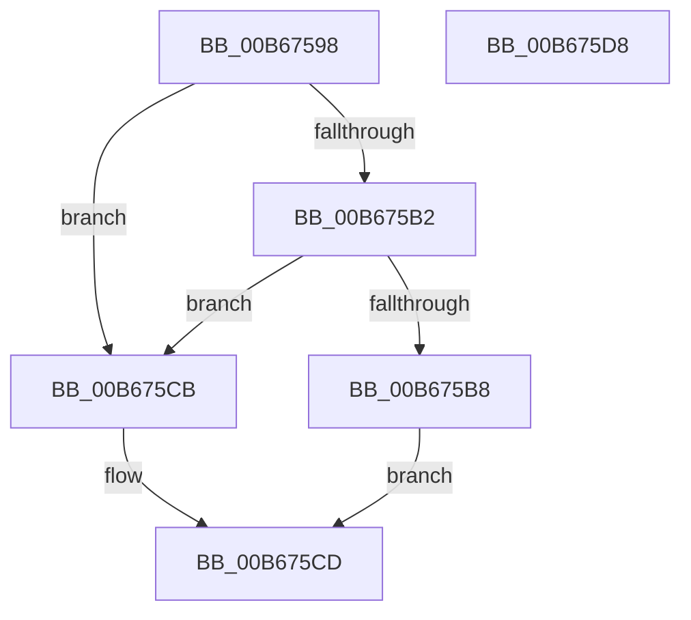

# KiMatchLoadOption

- RVA: `0x00B67598`–`0x00B675D9` (길이 `65` bytes)
- VA: `0x0000000140B67598`
- 실행 섹션: `PAGELK`
- PDB 이름 있음: `예`; PDB Function 태그: `아니요`
- unwind 정보 RVA: `0x0005CAAC`
- 디코드: `22`개 명령, `65/65` bytes 표시
- 미해석 바이트: `0` (있으면 어셈블리에 `.byte`로 보존)

> 이 문서는 커널 이미지의 기계어와 PDB 기호를 분석해 생성했습니다. 4번과 5번은 함수 원형과 자료형을 바이너리 사용 방식에서 추정한 C 해석이며 원본 소스 복구 결과는 아닙니다.

## 1. Dependencies

- 직접 호출 지점: **2**; 고유 호출 대상: **2**
- 직접 호출자로 확인된 함수: **1**
- RIP 상대 이미지 참조: **0**

### Outgoing calls
- `0x00B675A8` → [strstr](../../text/4F/strstr_function_004FF680.md) (function, `0x004FF680`)
- `0x00B675BF` → [atoi64](../../text/4F/atoi64_function_004FF880.md) (function, `0x004FF880`)

### Direct callers
- [KiParseLoadOptions](KiParseLoadOptions_function_00B675E0.md) at `0x00B67609`
- [KiParseLoadOptions](KiParseLoadOptions_function_00B675E0.md) at `0x00B67633`
- [KiParseLoadOptions](KiParseLoadOptions_function_00B675E0.md) at `0x00B67666`

### Static image references
- 디코드된 RIP-relative 메모리 참조가 없습니다.

## 2. Other-region calls and transfers

- 다른 실행 섹션으로 향하는 call: **2**
  - `0x00B675A8` → [strstr](../../text/4F/strstr_function_004FF680.md) (`PAGELK` → `.text`)
  - `0x00B675BF` → [atoi64](../../text/4F/atoi64_function_004FF880.md) (`PAGELK` → `.text`)
- 별도 외부 분기/꼬리 이동을 확인하지 못했습니다.

## 3. Assembly (complete function range)

```asm
00B67598  48 89 5C 24 08                  mov qword ptr [rsp + 8], rbx
00B6759D  57                              push rdi
00B6759E  48 83 EC 20                     sub rsp, 0x20
00B675A2  49 8B F9                        mov rdi, r9
00B675A5  49 8B D8                        mov rbx, r8
00B675A8  E8 D3 80 99 FF                  call 0x1404ff680
00B675AD  48 85 C0                        test rax, rax
00B675B0  74 19                           je 0x140b675cb
00B675B2  80 3C 18 3D                     cmp byte ptr [rax + rbx], 0x3d
00B675B6  75 13                           jne 0x140b675cb
00B675B8  48 8D 4B 01                     lea rcx, [rbx + 1]
00B675BC  48 03 C8                        add rcx, rax
00B675BF  E8 BC 82 99 FF                  call 0x1404ff880
00B675C4  48 89 07                        mov qword ptr [rdi], rax
00B675C7  B0 01                           mov al, 1
00B675C9  EB 02                           jmp 0x140b675cd
00B675CB  32 C0                           xor al, al
00B675CD  48 8B 5C 24 30                  mov rbx, qword ptr [rsp + 0x30]
00B675D2  48 83 C4 20                     add rsp, 0x20
00B675D6  5F                              pop rdi
00B675D7  C3                              ret
00B675D8  CC                              int3
```

## 4. C-style interpretation (structured pseudocode)

```c
__int64 __fastcall KiMatchLoadOption(__int64 a1, __int64 a2, __int64 a3, __int64 a4)
{
    __int64 result;
    __int64 v_rsp;
    unsigned __int64 v_stack_p8;

    v_stack_p8 = v_rbx;
    v_rsp = (v_rsp) - (32);
    result = strstr(a1, a2, a3, a4);
    if (result == 0) goto loc_00B675CB;
    if ((*(unsigned __int8 *)(result + a3 * 1)) != 61) goto loc_00B675CB;
    a1 = (a3 + 1) + (result);
    result = atoi64(a1, a2, a3, a4);
    *(unsigned __int64 *)(a4) = result;
    goto loc_00B675CD;
loc_00B675CB:
    result = 0;
loc_00B675CD:
    v_rsp = (v_rsp) + (32);
    return result;
}
```

## 5. (Beta) C Style

```c
int64_t KiMatchLoadOption(int64_t Arg1, int64_t Arg2, void *Arg3, void *Arg4)
{
    uint8_t *arg3 = (uint8_t *)Arg3;
    uint8_t *arg4 = (uint8_t *)Arg4;

    int64_t result;
    int64_t local_rsp;
    uint64_t v_stack_p8;

    v_stack_p8 = local_rbx;
    local_rsp = (local_rsp) - (32);
    result = strstr(Arg1, Arg2, Arg3, Arg4);
    if (result == 0) goto loc_00B675CB;
    if ((*(uint8_t *)(result + arg3 * 1)) != 61) goto loc_00B675CB;
    Arg1 = (Arg3 + 1) + (result);
    result = atoi64(Arg1, Arg2, Arg3, Arg4);
    *(uint64_t *)(arg4) = result;
    goto loc_00B675CD;
loc_00B675CB:
    result = 0;
loc_00B675CD:
    local_rsp = (local_rsp) + (32);
    return result;
}
```

### 관측된 메모리 오프셋

구조체 형식이 확인되지 않은 접근은 인자 기준의 오프셋으로만 기록했습니다.

| 기준 인자 | 오프셋 표현 | 폭 (bit) | 접근 |
|---|---:|---:|---|
| `Arg3` | `+ 0x1` | `64` | `R` |
| `Arg4` | `+ 0x0` | `64` | `W` |

## 6. Execution-region graph

[열기: 2D/3D 그래프와 함수 탐색 컨트롤 패널](../../../control-panel.html?section=pagelk&rva=0x00B67598&view=graph)

- 2D 그래프는 위에서 아래로 흐르고, 3D 그래프는 빈 공간을 드래그해 회전합니다. Shift+드래그는 이동, 휠은 확대·축소, 함수 노드 선택은 대상 보고서 이동입니다.

### Static fallback


