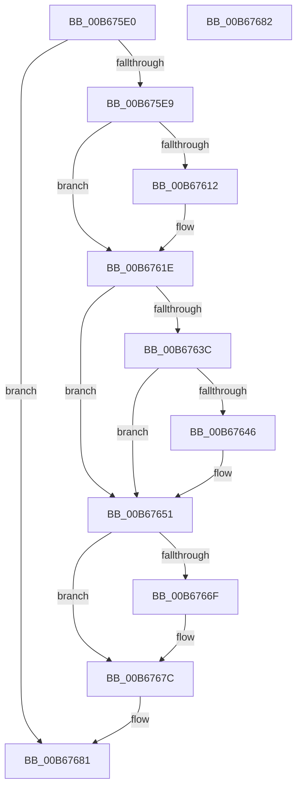

# KiParseLoadOptions

- RVA: `0x00B675E0`–`0x00B67683` (길이 `163` bytes)
- VA: `0x0000000140B675E0`
- 실행 섹션: `PAGELK`
- PDB 이름 있음: `예`; PDB Function 태그: `아니요`
- unwind 정보 RVA: `0x000BDAD8`
- 디코드: `39`개 명령, `163/163` bytes 표시
- 미해석 바이트: `0` (있으면 어셈블리에 `.byte`로 보존)

> 이 문서는 커널 이미지의 기계어와 PDB 기호를 분석해 생성했습니다. 4번과 5번은 함수 원형과 자료형을 바이너리 사용 방식에서 추정한 C 해석이며 원본 소스 복구 결과는 아닙니다.

## 1. Dependencies

- 직접 호출 지점: **3**; 고유 호출 대상: **1**
- 직접 호출자로 확인된 함수: **1**
- RIP 상대 이미지 참조: **6**

### Outgoing calls
- `0x00B67609` → [KiMatchLoadOption](KiMatchLoadOption_function_00B67598.md) (function, `0x00B67598`)
- `0x00B67633` → [KiMatchLoadOption](KiMatchLoadOption_function_00B67598.md) (function, `0x00B67598`)
- `0x00B67666` → [KiMatchLoadOption](KiMatchLoadOption_function_00B67598.md) (function, `0x00B67598`)

### Direct callers
- [KiInitializeXSaveConfiguration](KiInitializeXSaveConfiguration_function_00B66F10.md) at `0x00B66F4B`

### Static image references
- `0x00B675FF` → RVA `0x00B7FC80` (` ?? ::OKHAJAOM::`string'`; read)
- `0x00B67617` → RVA `0x00E0B0D8` (`.data`; write)
- `0x00B67629` → RVA `0x00B7FC60` (` ?? ::OKHAJAOM::`string'`; read)
- `0x00B6764A` → RVA `0x00E668C8` (`.data`; write)
- `0x00B6765C` → RVA `0x00B7FC50` (` ?? ::OKHAJAOM::`string'`; read)
- `0x00B67675` → RVA `0x00E668D0` (`.data`; write)

## 2. Other-region calls and transfers

- 다른 실행 섹션으로 향하는 call: **0**
- 별도 외부 분기/꼬리 이동을 확인하지 못했습니다.

## 3. Assembly (complete function range)

```asm
00B675E0  48 85 C9                        test rcx, rcx
00B675E3  0F 84 98 00 00 00               je 0x140b67681
00B675E9  53                              push rbx
00B675EA  48 83 EC 20                     sub rsp, 0x20
00B675EE  48 83 64 24 30 00               and qword ptr [rsp + 0x30], 0
00B675F4  4C 8D 4C 24 30                  lea r9, [rsp + 0x30]
00B675F9  41 B8 0B 00 00 00               mov r8d, 0xb
00B675FF  48 8D 15 7A 86 01 00            lea rdx, [rip + 0x1867a]
00B67606  48 8B D9                        mov rbx, rcx
00B67609  E8 8A FF FF FF                  call 0x140b67598
00B6760E  84 C0                           test al, al
00B67610  74 0C                           je 0x140b6761e
00B67612  48 8B 44 24 30                  mov rax, qword ptr [rsp + 0x30]
00B67617  48 89 05 BA 3A 2A 00            mov qword ptr [rip + 0x2a3aba], rax
00B6761E  4C 8D 4C 24 30                  lea r9, [rsp + 0x30]
00B67623  41 B8 12 00 00 00               mov r8d, 0x12
00B67629  48 8D 15 30 86 01 00            lea rdx, [rip + 0x18630]
00B67630  48 8B CB                        mov rcx, rbx
00B67633  E8 60 FF FF FF                  call 0x140b67598
00B67638  84 C0                           test al, al
00B6763A  74 15                           je 0x140b67651
00B6763C  48 8B 44 24 30                  mov rax, qword ptr [rsp + 0x30]
00B67641  48 85 C0                        test rax, rax
00B67644  74 0B                           je 0x140b67651
00B67646  48 83 E0 FC                     and rax, 0xfffffffffffffffc
00B6764A  48 89 05 77 F2 2F 00            mov qword ptr [rip + 0x2ff277], rax
00B67651  4C 8D 4C 24 30                  lea r9, [rsp + 0x30]
00B67656  41 B8 0C 00 00 00               mov r8d, 0xc
00B6765C  48 8D 15 ED 85 01 00            lea rdx, [rip + 0x185ed]
00B67663  48 8B CB                        mov rcx, rbx
00B67666  E8 2D FF FF FF                  call 0x140b67598
00B6766B  84 C0                           test al, al
00B6766D  74 0D                           je 0x140b6767c
00B6766F  48 83 7C 24 30 00               cmp qword ptr [rsp + 0x30], 0
00B67675  0F 95 05 54 F2 2F 00            setne byte ptr [rip + 0x2ff254]
00B6767C  48 83 C4 20                     add rsp, 0x20
00B67680  5B                              pop rbx
00B67681  C3                              ret
00B67682  CC                              int3
```

## 4. C-style interpretation (structured pseudocode)

```c
__int64 __fastcall KiParseLoadOptions(__int64 a1)
{
    __int64 result;
    __int64 v_rsp;
    unsigned __int64 v_stack_p8;

    if (a1 == 0) goto loc_00B67681;
    v_rsp = (v_rsp) - (32);
    result = KiMatchLoadOption(a1, v_rip + 99962, 11, v_stack_p8);
    if ((unsigned __int8)(result) != 0) {
        result = v_stack_p8;
        *(unsigned __int64 *)(v_rip + 2767546) = result;
    }
    result = KiMatchLoadOption(a1, v_rip + 99888, 18, v_stack_p8);
    if ((unsigned __int8)(result) == 0) goto loc_00B67651;
    result = v_stack_p8;
    if (v_stack_p8 != 0) {
        result = (v_stack_p8) & (-4);
        *(unsigned __int64 *)(v_rip + 3142263) = result;
    }
    result = KiMatchLoadOption(a1, v_rip + 99821, 12, v_stack_p8);
    if ((unsigned __int8)(result) != 0) {
    }
    v_rsp = (v_rsp) + (32);
loc_00B67681:
    return result;
}
```

## 5. (Beta) C Style

```c
int64_t KiParseLoadOptions(int64_t Arg1)
{
    int64_t result;
    int64_t local_rsp;
    uint64_t v_stack_p8;

    if (Arg1 == 0) goto loc_00B67681;
    local_rsp = (local_rsp) - (32);
    result = KiMatchLoadOption(Arg1, v_rip + 99962, 11, v_stack_p8);
    if ((uint8_t)(result) != 0) {
        result = v_stack_p8;
        *(uint64_t *)(v_rip + 0x2A3ABA) = result;
    }
    result = KiMatchLoadOption(Arg1, v_rip + 99888, 18, v_stack_p8);
    if ((uint8_t)(result) == 0) goto loc_00B67651;
    result = v_stack_p8;
    if (v_stack_p8 != 0) {
        result = (v_stack_p8) & (-4);
        *(uint64_t *)(v_rip + 0x2FF277) = result;
    }
    result = KiMatchLoadOption(Arg1, v_rip + 99821, 12, v_stack_p8);
    if ((uint8_t)(result) != 0) {
    }
    local_rsp = (local_rsp) + (32);
loc_00B67681:
    return result;
}
```

## 6. Execution-region graph

[열기: 2D/3D 그래프와 함수 탐색 컨트롤 패널](../../../control-panel.html?section=pagelk&rva=0x00B675E0&view=graph)

- 2D 그래프는 위에서 아래로 흐르고, 3D 그래프는 빈 공간을 드래그해 회전합니다. Shift+드래그는 이동, 휠은 확대·축소, 함수 노드 선택은 대상 보고서 이동입니다.

### Static fallback


