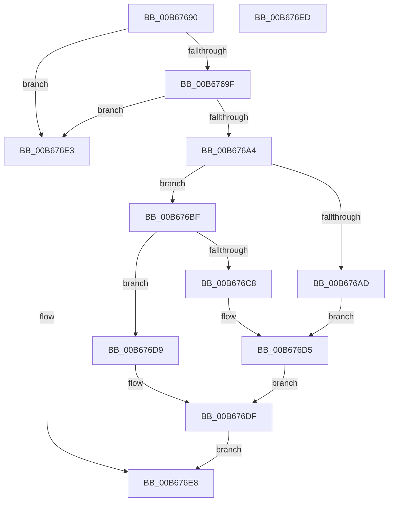

# KiQueryIptSupport

- RVA: `0x00B67690`–`0x00B676EE` (길이 `94` bytes)
- VA: `0x0000000140B67690`
- 실행 섹션: `PAGELK`
- PDB 이름 있음: `예`; PDB Function 태그: `아니요`
- unwind 정보 RVA: `0x0005C788`
- 디코드: `27`개 명령, `94/94` bytes 표시
- 미해석 바이트: `0` (있으면 어셈블리에 `.byte`로 보존)

> 이 문서는 커널 이미지의 기계어와 PDB 기호를 분석해 생성했습니다. 4번과 5번은 함수 원형과 자료형을 바이너리 사용 방식에서 추정한 C 해석이며 원본 소스 복구 결과는 아닙니다.

## 1. Dependencies

- 직접 호출 지점: **1**; 고유 호출 대상: **1**
- 직접 호출자로 확인된 함수: **0**
- RIP 상대 이미지 참조: **2**

### Outgoing calls
- `0x00B676A4` → [KiXSavesManagesIpt](../../text/5B/KiXSavesManagesIpt_function_005BA13C.md) (function, `0x005BA13C`)

### Direct callers
- 이 함수 시작 RVA로 연결되는 직접 call은 확인되지 않았습니다. 간접 호출은 완전히 역산할 수 없습니다.

### Static image references
- `0x00B676BF` → RVA `0x00FC6B94` (`ALMOSTRO`; read)
- `0x00B676C8` → RVA `0x00FC6C30` (`ALMOSTRO`; read)

## 2. Other-region calls and transfers

- 다른 실행 섹션으로 향하는 call: **1**
  - `0x00B676A4` → [KiXSavesManagesIpt](../../text/5B/KiXSavesManagesIpt_function_005BA13C.md) (`PAGELK` → `.text`)
- 별도 외부 분기/꼬리 이동을 확인하지 못했습니다.

## 3. Assembly (complete function range)

```asm
00B67690  48 83 EC 28                     sub rsp, 0x28
00B67694  45 33 C9                        xor r9d, r9d
00B67697  4C 8B C1                        mov r8, rcx
00B6769A  48 85 C9                        test rcx, rcx
00B6769D  74 44                           je 0x140b676e3
00B6769F  48 85 D2                        test rdx, rdx
00B676A2  74 3F                           je 0x140b676e3
00B676A4  E8 93 2A A5 FF                  call 0x1405ba13c
00B676A9  84 C0                           test al, al
00B676AB  74 12                           je 0x140b676bf
00B676AD  41 C7 00 01 00 00 00            mov dword ptr [r8], 1
00B676B4  A1 24 06 00 00 80 F7 FF FF      movabs eax, dword ptr [0xfffff78000000624]
00B676BD  EB 16                           jmp 0x140b676d5
00B676BF  44 39 0D CE F4 45 00            cmp dword ptr [rip + 0x45f4ce], r9d
00B676C6  74 11                           je 0x140b676d9
00B676C8  8B 05 62 F5 45 00               mov eax, dword ptr [rip + 0x45f562]
00B676CE  41 C7 00 02 00 00 00            mov dword ptr [r8], 2
00B676D5  89 02                           mov dword ptr [rdx], eax
00B676D7  EB 06                           jmp 0x140b676df
00B676D9  45 89 08                        mov dword ptr [r8], r9d
00B676DC  44 89 0A                        mov dword ptr [rdx], r9d
00B676DF  33 C0                           xor eax, eax
00B676E1  EB 05                           jmp 0x140b676e8
00B676E3  B8 0D 00 00 C0                  mov eax, 0xc000000d
00B676E8  48 83 C4 28                     add rsp, 0x28
00B676EC  C3                              ret
00B676ED  CC                              int3
```

## 4. C-style interpretation (structured pseudocode)

```c
__int64 __fastcall KiQueryIptSupport(__int64 a1, __int64 a2, __int64 a3, int a4)
{
    __int64 result;
    __int64 v_rsp;

    v_rsp = (v_rsp) - (40);
    a4 = 0;
    if (a1 == 0) goto loc_00B676E3;
    if (a2 == 0) goto loc_00B676E3;
    result = KiXSavesManagesIpt(a1, a2, a1, a4);
    if ((unsigned __int8)(result) == 0) goto loc_00B676BF;
    *(unsigned int *)(a1) = 1;
    goto loc_00B676D5;
loc_00B676BF:
    if ((*(unsigned int *)(v_rip + 4584654)) == 0) goto loc_00B676D9;
    *(unsigned int *)(a1) = 2;
loc_00B676D5:
    *(unsigned int *)(a2) = (unsigned int)((unsigned int)(*(unsigned int *)(v_rip + 4584802)));
    goto loc_00B676DF;
loc_00B676D9:
    *(unsigned int *)(a1) = 0;
    *(unsigned int *)(a2) = 0;
loc_00B676DF:
    result = 0;
    goto loc_00B676E8;
loc_00B676E3:
loc_00B676E8:
    v_rsp = (v_rsp) + (40);
    return (unsigned int)(0xC000000DULL);
}
```

## 5. (Beta) C Style

```c
int64_t KiQueryIptSupport(int64_t Arg1, int64_t Arg2, int64_t Arg3, int32_t Arg4)
{
    int64_t result;
    int64_t local_rsp;

    local_rsp = (local_rsp) - (40);
    Arg4 = 0;
    if (Arg1 == 0) goto loc_00B676E3;
    if (Arg2 == 0) goto loc_00B676E3;
    result = KiXSavesManagesIpt(Arg1, Arg2, Arg1, Arg4);
    if ((uint8_t)(result) == 0) goto loc_00B676BF;
    *(uint32_t *)(Arg1) = 1;
    goto loc_00B676D5;
loc_00B676BF:
    if ((*(uint32_t *)(v_rip + 0x45F4CE)) == 0) goto loc_00B676D9;
    *(uint32_t *)(Arg1) = 2;
loc_00B676D5:
    *(uint32_t *)(Arg2) = (uint32_t)((uint32_t)(*(uint32_t *)(v_rip + 0x45F562)));
    goto loc_00B676DF;
loc_00B676D9:
    *(uint32_t *)(Arg1) = 0;
    *(uint32_t *)(Arg2) = 0;
loc_00B676DF:
    result = 0;
    goto loc_00B676E8;
loc_00B676E3:
loc_00B676E8:
    local_rsp = (local_rsp) + (40);
    return (uint32_t)(0xC000000DULL);
}
```

## 6. Execution-region graph

[열기: 2D/3D 그래프와 함수 탐색 컨트롤 패널](../../../control-panel.html?section=pagelk&rva=0x00B67690&view=graph)

- 2D 그래프는 위에서 아래로 흐르고, 3D 그래프는 빈 공간을 드래그해 회전합니다. Shift+드래그는 이동, 휠은 확대·축소, 함수 노드 선택은 대상 보고서 이동입니다.

### Static fallback


