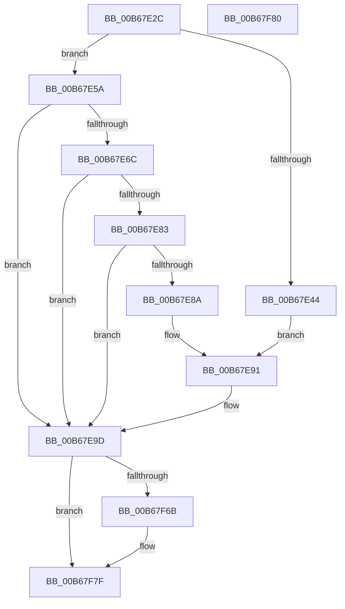

# KiReadFixedMtrr

- RVA: `0x00B67E2C`–`0x00B67F81` (길이 `341` bytes)
- VA: `0x0000000140B67E2C`
- 실행 섹션: `PAGELK`
- PDB 이름 있음: `예`; PDB Function 태그: `아니요`
- unwind 정보 RVA: `0x000DB714`
- 디코드: `95`개 명령, `341/341` bytes 표시
- 미해석 바이트: `0` (있으면 어셈블리에 `.byte`로 보존)

> 이 문서는 커널 이미지의 기계어와 PDB 기호를 분석해 생성했습니다. 4번과 5번은 함수 원형과 자료형을 바이너리 사용 방식에서 추정한 C 해석이며 원본 소스 복구 결과는 아닙니다.

## 1. Dependencies

- 직접 호출 지점: **0**; 고유 호출 대상: **0**
- 직접 호출자로 확인된 함수: **2**
- RIP 상대 이미지 참조: **1**

### Outgoing calls
- 직접 디코드된 call 명령이 없습니다.

### Direct callers
- [KeLoadMTRR](../B7/KeLoadMTRR_function_00B7DDA0.md) at `0x00B7DDFA`
- [KiInitializeMTRR](../../init/C3/KiInitializeMTRR_function_00C39A1C.md) at `0x00C39C6A`

### Static image references
- `0x00B67E32` → RVA `0x00F10EF1` (`.data`; read)

## 2. Other-region calls and transfers

- 다른 실행 섹션으로 향하는 call: **0**
- 별도 외부 분기/꼬리 이동을 확인하지 못했습니다.

## 3. Assembly (complete function range)

```asm
00B67E2C  45 33 C0                        xor r8d, r8d
00B67E2F  41 B3 01                        mov r11b, 1
00B67E32  44 38 1D B8 90 3A 00            cmp byte ptr [rip + 0x3a90b8], r11b
00B67E39  4C 8B C9                        mov r9, rcx
00B67E3C  41 BA 10 00 01 C0               mov r10d, 0xc0010010
00B67E42  75 16                           jne 0x140b67e5a
00B67E44  41 8B CA                        mov ecx, r10d
00B67E47  0F 32                           rdmsr
00B67E49  48 C1 E2 20                     shl rdx, 0x20
00B67E4D  48 0B C2                        or rax, rdx
00B67E50  4C 8B C0                        mov r8, rax
00B67E53  49 0F BA E8 13                  bts r8, 0x13
00B67E58  EB 37                           jmp 0x140b67e91
00B67E5A  65 48 8B 04 25 20 00 00 00      mov rax, qword ptr gs:[0x20]
00B67E63  44 38 98 8D 00 00 00            cmp byte ptr [rax + 0x8d], r11b
00B67E6A  75 31                           jne 0x140b67e9d
00B67E6C  41 8B CA                        mov ecx, r10d
00B67E6F  0F 32                           rdmsr
00B67E71  48 C1 E2 20                     shl rdx, 0x20
00B67E75  48 0B C2                        or rax, rdx
00B67E78  4C 8B C0                        mov r8, rax
00B67E7B  48 A9 00 00 0C 00               test rax, 0xc0000
00B67E81  74 1A                           je 0x140b67e9d
00B67E83  48 0F BA E0 18                  bt rax, 0x18
00B67E88  72 13                           jb 0x140b67e9d
00B67E8A  49 81 E0 FF FF F3 FF            and r8, 0xfffffffffff3ffff
00B67E91  49 8B D0                        mov rdx, r8
00B67E94  49 8B C0                        mov rax, r8
00B67E97  48 C1 EA 20                     shr rdx, 0x20
00B67E9B  0F 30                           wrmsr
00B67E9D  B9 50 02 00 00                  mov ecx, 0x250
00B67EA2  0F 32                           rdmsr
00B67EA4  48 C1 E2 20                     shl rdx, 0x20
00B67EA8  B9 58 02 00 00                  mov ecx, 0x258
00B67EAD  48 0B C2                        or rax, rdx
00B67EB0  49 89 01                        mov qword ptr [r9], rax
00B67EB3  0F 32                           rdmsr
00B67EB5  48 C1 E2 20                     shl rdx, 0x20
00B67EB9  B9 59 02 00 00                  mov ecx, 0x259
00B67EBE  48 0B C2                        or rax, rdx
00B67EC1  49 89 41 08                     mov qword ptr [r9 + 8], rax
00B67EC5  0F 32                           rdmsr
00B67EC7  48 C1 E2 20                     shl rdx, 0x20
00B67ECB  B9 68 02 00 00                  mov ecx, 0x268
00B67ED0  48 0B C2                        or rax, rdx
00B67ED3  49 89 41 10                     mov qword ptr [r9 + 0x10], rax
00B67ED7  0F 32                           rdmsr
00B67ED9  48 C1 E2 20                     shl rdx, 0x20
00B67EDD  B9 69 02 00 00                  mov ecx, 0x269
00B67EE2  48 0B C2                        or rax, rdx
00B67EE5  49 89 41 18                     mov qword ptr [r9 + 0x18], rax
00B67EE9  0F 32                           rdmsr
00B67EEB  48 C1 E2 20                     shl rdx, 0x20
00B67EEF  B9 6A 02 00 00                  mov ecx, 0x26a
00B67EF4  48 0B C2                        or rax, rdx
00B67EF7  49 89 41 20                     mov qword ptr [r9 + 0x20], rax
00B67EFB  0F 32                           rdmsr
00B67EFD  48 C1 E2 20                     shl rdx, 0x20
00B67F01  B9 6B 02 00 00                  mov ecx, 0x26b
00B67F06  48 0B C2                        or rax, rdx
00B67F09  49 89 41 28                     mov qword ptr [r9 + 0x28], rax
00B67F0D  0F 32                           rdmsr
00B67F0F  48 C1 E2 20                     shl rdx, 0x20
00B67F13  B9 6C 02 00 00                  mov ecx, 0x26c
00B67F18  48 0B C2                        or rax, rdx
00B67F1B  49 89 41 30                     mov qword ptr [r9 + 0x30], rax
00B67F1F  0F 32                           rdmsr
00B67F21  48 C1 E2 20                     shl rdx, 0x20
00B67F25  B9 6D 02 00 00                  mov ecx, 0x26d
00B67F2A  48 0B C2                        or rax, rdx
00B67F2D  49 89 41 38                     mov qword ptr [r9 + 0x38], rax
00B67F31  0F 32                           rdmsr
00B67F33  48 C1 E2 20                     shl rdx, 0x20
00B67F37  B9 6E 02 00 00                  mov ecx, 0x26e
00B67F3C  48 0B C2                        or rax, rdx
00B67F3F  49 89 41 40                     mov qword ptr [r9 + 0x40], rax
00B67F43  0F 32                           rdmsr
00B67F45  48 C1 E2 20                     shl rdx, 0x20
00B67F49  B9 6F 02 00 00                  mov ecx, 0x26f
00B67F4E  48 0B C2                        or rax, rdx
00B67F51  49 89 41 48                     mov qword ptr [r9 + 0x48], rax
00B67F55  0F 32                           rdmsr
00B67F57  48 C1 E2 20                     shl rdx, 0x20
00B67F5B  48 0B C2                        or rax, rdx
00B67F5E  49 89 41 50                     mov qword ptr [r9 + 0x50], rax
00B67F62  44 38 1D 88 8F 3A 00            cmp byte ptr [rip + 0x3a8f88], r11b
00B67F69  75 14                           jne 0x140b67f7f
00B67F6B  49 0F BA F0 13                  btr r8, 0x13
00B67F70  41 8B CA                        mov ecx, r10d
00B67F73  49 8B D0                        mov rdx, r8
00B67F76  49 8B C0                        mov rax, r8
00B67F79  48 C1 EA 20                     shr rdx, 0x20
00B67F7D  0F 30                           wrmsr
00B67F7F  C3                              ret
00B67F80  CC                              int3
```

## 4. C-style interpretation (structured pseudocode)

```c
__int64 __fastcall KiReadFixedMtrr(__int64 a1, __int64 a2, int a3)
{
    __int64 result;

    a3 = 0;
    if ((*(unsigned __int8 *)(v_rip + 3838136)) != 1) goto loc_00B67E5A;
    a2 = (a2) << (32);
    result = (result) | (a2);
    goto loc_00B67E91;
loc_00B67E5A:
    if ((*(unsigned __int8 *)(*(unsigned __int64 *)(gs_base + (0 + 32)) + 141)) != 1) goto loc_00B67E9D;
    a2 = (a2) << (32);
    result = (*(unsigned __int64 *)(gs_base + (0 + 32))) | (a2);
    if (((result) & (0xC0000ULL)) == 0) goto loc_00B67E9D;
    if (condition_is_below) goto loc_00B67E9D;
    a3 = (result) & (0xFFFFFFFFFFF3FFFFULL);
loc_00B67E91:
    a2 = (a3) >> (32);
loc_00B67E9D:
    a2 = (a2) << (32);
    result = (a3) | (a2);
    *(unsigned __int64 *)(a1) = result;
    a2 = (a2) << (32);
    result = (result) | (a2);
    *(unsigned __int64 *)(a1 + 8) = result;
    a2 = (a2) << (32);
    result = (result) | (a2);
    *(unsigned __int64 *)(a1 + 16) = result;
    a2 = (a2) << (32);
    result = (result) | (a2);
    *(unsigned __int64 *)(a1 + 24) = result;
    a2 = (a2) << (32);
    result = (result) | (a2);
    *(unsigned __int64 *)(a1 + 32) = result;
    a2 = (a2) << (32);
    result = (result) | (a2);
    *(unsigned __int64 *)(a1 + 40) = result;
    a2 = (a2) << (32);
    result = (result) | (a2);
    *(unsigned __int64 *)(a1 + 48) = result;
    a2 = (a2) << (32);
    result = (result) | (a2);
    *(unsigned __int64 *)(a1 + 56) = result;
    a2 = (a2) << (32);
    result = (result) | (a2);
    *(unsigned __int64 *)(a1 + 64) = result;
    a2 = (a2) << (32);
    result = (result) | (a2);
    *(unsigned __int64 *)(a1 + 72) = result;
    a2 = (a2) << (32);
    result = (result) | (a2);
    *(unsigned __int64 *)(a1 + 80) = result;
    if ((*(unsigned __int8 *)(v_rip + 3837832)) == 1) {
        a1 = (unsigned int)((unsigned int)(0xC0010010ULL));
        a2 = a3;
        result = a3;
        a2 = (a2) >> (32);
    }
    return result;
}
```

## 5. (Beta) C Style

```c
int64_t KiReadFixedMtrr(void *Arg1, int64_t Arg2, int32_t Arg3)
{
    uint8_t *arg1 = (uint8_t *)Arg1;

    int64_t result;

    Arg3 = 0;
    if ((*(uint8_t *)(v_rip + 0x3A90B8)) != 1) goto loc_00B67E5A;
    Arg2 = (Arg2) << (32);
    result = (result) | (Arg2);
    goto loc_00B67E91;
loc_00B67E5A:
    if ((*(uint8_t *)(*(uint64_t *)(gs_base + (0 + 0x20)) + 0x8D)) != 1) goto loc_00B67E9D;
    Arg2 = (Arg2) << (32);
    result = (*(uint64_t *)(gs_base + (0 + 0x20))) | (Arg2);
    if (((result) & (0xC0000ULL)) == 0) goto loc_00B67E9D;
    if (condition_is_below) goto loc_00B67E9D;
    Arg3 = (result) & (0xFFFFFFFFFFF3FFFFULL);
loc_00B67E91:
    Arg2 = (Arg3) >> (32);
loc_00B67E9D:
    Arg2 = (Arg2) << (32);
    result = (Arg3) | (Arg2);
    *(uint64_t *)(arg1) = result;
    Arg2 = (Arg2) << (32);
    result = (result) | (Arg2);
    *(uint64_t *)(arg1 + 0x8) = result;
    Arg2 = (Arg2) << (32);
    result = (result) | (Arg2);
    *(uint64_t *)(arg1 + 0x10) = result;
    Arg2 = (Arg2) << (32);
    result = (result) | (Arg2);
    *(uint64_t *)(arg1 + 0x18) = result;
    Arg2 = (Arg2) << (32);
    result = (result) | (Arg2);
    *(uint64_t *)(arg1 + 0x20) = result;
    Arg2 = (Arg2) << (32);
    result = (result) | (Arg2);
    *(uint64_t *)(arg1 + 0x28) = result;
    Arg2 = (Arg2) << (32);
    result = (result) | (Arg2);
    *(uint64_t *)(arg1 + 0x30) = result;
    Arg2 = (Arg2) << (32);
    result = (result) | (Arg2);
    *(uint64_t *)(arg1 + 0x38) = result;
    Arg2 = (Arg2) << (32);
    result = (result) | (Arg2);
    *(uint64_t *)(arg1 + 0x40) = result;
    Arg2 = (Arg2) << (32);
    result = (result) | (Arg2);
    *(uint64_t *)(arg1 + 0x48) = result;
    Arg2 = (Arg2) << (32);
    result = (result) | (Arg2);
    *(uint64_t *)(arg1 + 0x50) = result;
    if ((*(uint8_t *)(v_rip + 0x3A8F88)) == 1) {
        Arg1 = (uint32_t)((uint32_t)(0xC0010010ULL));
        Arg2 = Arg3;
        result = Arg3;
        Arg2 = (Arg2) >> (32);
    }
    return result;
}
```

### 관측된 메모리 오프셋

구조체 형식이 확인되지 않은 접근은 인자 기준의 오프셋으로만 기록했습니다.

| 기준 인자 | 오프셋 표현 | 폭 (bit) | 접근 |
|---|---:|---:|---|
| `Arg1` | `+ 0x0` | `64` | `W` |
| `Arg1` | `+ 0x8` | `64` | `W` |
| `Arg1` | `+ 0x10` | `64` | `W` |
| `Arg1` | `+ 0x18` | `64` | `W` |
| `Arg1` | `+ 0x20` | `64` | `W` |
| `Arg1` | `+ 0x28` | `64` | `W` |
| `Arg1` | `+ 0x30` | `64` | `W` |
| `Arg1` | `+ 0x38` | `64` | `W` |
| `Arg1` | `+ 0x40` | `64` | `W` |
| `Arg1` | `+ 0x48` | `64` | `W` |
| `Arg1` | `+ 0x50` | `64` | `W` |

## 6. Execution-region graph

[열기: 2D/3D 그래프와 함수 탐색 컨트롤 패널](../../../control-panel.html?section=pagelk&rva=0x00B67E2C&view=graph)

- 2D 그래프는 위에서 아래로 흐르고, 3D 그래프는 빈 공간을 드래그해 회전합니다. Shift+드래그는 이동, 휠은 확대·축소, 함수 노드 선택은 대상 보고서 이동입니다.

### Static fallback


