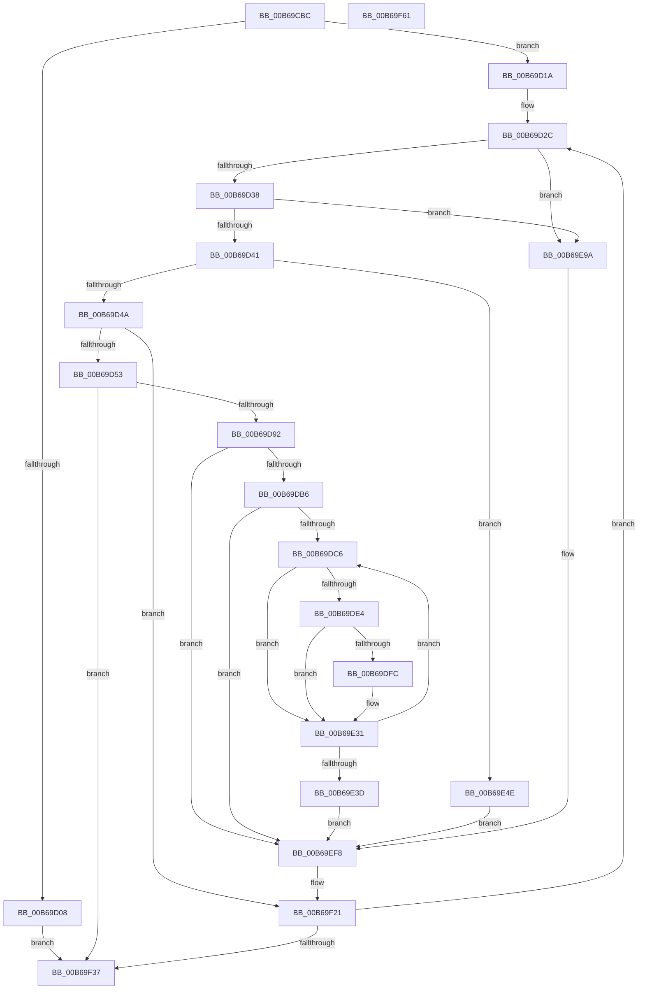

# KiSetCacheInformationAmd

- RVA: `0x00B69CBC`–`0x00B69F62` (길이 `678` bytes)
- VA: `0x0000000140B69CBC`
- 실행 섹션: `PAGELK`
- PDB 이름 있음: `예`; PDB Function 태그: `아니요`
- unwind 정보 RVA: `0x000CA7E8`
- 디코드: `168`개 명령, `678/678` bytes 표시
- 미해석 바이트: `0` (있으면 어셈블리에 `.byte`로 보존)

> 이 문서는 커널 이미지의 기계어와 PDB 기호를 분석해 생성했습니다. 4번과 5번은 함수 원형과 자료형을 바이너리 사용 방식에서 추정한 C 해석이며 원본 소스 복구 결과는 아닙니다.

## 1. Dependencies

- 직접 호출 지점: **12**; 고유 호출 대상: **6**
- 직접 호출자로 확인된 함수: **1**
- RIP 상대 이미지 참조: **3**

### Outgoing calls
- `0x00B69D10` → [KiSetStandardizedCacheInformation](KiSetStandardizedCacheInformation_function_00B6A940.md) (function, `0x00B6A940`)
- `0x00B69D79` → [KiGetL2L3AssociativityAmd](KiGetL2L3AssociativityAmd_function_00B684F0.md) (function, `0x00B684F0`)
- `0x00B69DA7` → [KeAddGroupAffinityEx](../../text/25/KeAddGroupAffinityEx_function_0025B6C0.md) (function, `0x0025B6C0`)
- `0x00B69DDB` → [KeCheckProcessorAffinityEx](../../text/30/KeCheckProcessorAffinityEx_function_00305150.md) (function, `0x00305150`)
- `0x00B69DE7` → [KeGetProcessorNode](../../text/4A/KeGetProcessorNode_function_004A4FA8.md) (function, `0x004A4FA8`)
- `0x00B69DF2` → [KeGetProcessorNode](../../text/4A/KeGetProcessorNode_function_004A4FA8.md) (function, `0x004A4FA8`)
- `0x00B69E12` → [KeAddGroupAffinityEx](../../text/25/KeAddGroupAffinityEx_function_0025B6C0.md) (function, `0x0025B6C0`)
- `0x00B69E2C` → [KeAddGroupAffinityEx](../../text/25/KeAddGroupAffinityEx_function_0025B6C0.md) (function, `0x0025B6C0`)
- `0x00B69E76` → [KiGetL2L3AssociativityAmd](KiGetL2L3AssociativityAmd_function_00B684F0.md) (function, `0x00B684F0`)
- `0x00B69E93` → [KeAddGroupAffinityEx](../../text/25/KeAddGroupAffinityEx_function_0025B6C0.md) (function, `0x0025B6C0`)
- `0x00B69EE7` → [KeAddGroupAffinityEx](../../text/25/KeAddGroupAffinityEx_function_0025B6C0.md) (function, `0x0025B6C0`)
- `0x00B69F3E` → [_security_check_cookie](../../text/6A/_security_check_cookie_function_006AC640.md) (function, `0x006AC640`)

### Direct callers
- [KiSetCacheInformation](KiSetCacheInformation_function_00B69B78.md) at `0x00B69BF9`

### Static image references
- `0x00B69CDB` → RVA `0x00E0A740` (`.data`; read)
- `0x00B69DB6` → RVA `0x00FC6A80` (`ALMOSTRO`; read)
- `0x00B69DC6` → RVA `0x00FC8C40` (`ALMOSTRO`; read)

## 2. Other-region calls and transfers

- 다른 실행 섹션으로 향하는 call: **9**
  - `0x00B69DA7` → [KeAddGroupAffinityEx](../../text/25/KeAddGroupAffinityEx_function_0025B6C0.md) (`PAGELK` → `.text`)
  - `0x00B69DDB` → [KeCheckProcessorAffinityEx](../../text/30/KeCheckProcessorAffinityEx_function_00305150.md) (`PAGELK` → `.text`)
  - `0x00B69DE7` → [KeGetProcessorNode](../../text/4A/KeGetProcessorNode_function_004A4FA8.md) (`PAGELK` → `.text`)
  - `0x00B69DF2` → [KeGetProcessorNode](../../text/4A/KeGetProcessorNode_function_004A4FA8.md) (`PAGELK` → `.text`)
  - `0x00B69E12` → [KeAddGroupAffinityEx](../../text/25/KeAddGroupAffinityEx_function_0025B6C0.md) (`PAGELK` → `.text`)
  - `0x00B69E2C` → [KeAddGroupAffinityEx](../../text/25/KeAddGroupAffinityEx_function_0025B6C0.md) (`PAGELK` → `.text`)
  - `0x00B69E93` → [KeAddGroupAffinityEx](../../text/25/KeAddGroupAffinityEx_function_0025B6C0.md) (`PAGELK` → `.text`)
  - `0x00B69EE7` → [KeAddGroupAffinityEx](../../text/25/KeAddGroupAffinityEx_function_0025B6C0.md) (`PAGELK` → `.text`)
  - `0x00B69F3E` → [_security_check_cookie](../../text/6A/_security_check_cookie_function_006AC640.md) (`PAGELK` → `.text`)
- 별도 외부 분기/꼬리 이동을 확인하지 못했습니다.

## 3. Assembly (complete function range)

```asm
00B69CBC  48 89 5C 24 08                  mov qword ptr [rsp + 8], rbx
00B69CC1  48 89 74 24 10                  mov qword ptr [rsp + 0x10], rsi
00B69CC6  48 89 7C 24 18                  mov qword ptr [rsp + 0x18], rdi
00B69CCB  55                              push rbp
00B69CCC  41 54                           push r12
00B69CCE  41 55                           push r13
00B69CD0  41 56                           push r14
00B69CD2  41 57                           push r15
00B69CD4  48 8B EC                        mov rbp, rsp
00B69CD7  48 83 EC 50                     sub rsp, 0x50
00B69CDB  48 8B 05 5E 0A 2A 00            mov rax, qword ptr [rip + 0x2a0a5e]
00B69CE2  48 33 C4                        xor rax, rsp
00B69CE5  48 89 45 F8                     mov qword ptr [rbp - 8], rax
00B69CE9  65 48 8B 34 25 20 00 00 00      mov rsi, qword ptr gs:[0x20]
00B69CF2  33 C9                           xor ecx, ecx
00B69CF4  B8 01 00 00 80                  mov eax, 0x80000001
00B69CF9  0F A2                           cpuid
00B69CFB  83 A6 94 8B 00 00 00            and dword ptr [rsi + 0x8b94], 0
00B69D02  0F BA E1 16                     bt ecx, 0x16
00B69D06  73 12                           jae 0x140b69d1a
00B69D08  BA 1D 00 00 80                  mov edx, 0x8000001d
00B69D0D  48 8B CE                        mov rcx, rsi
00B69D10  E8 2B 0C 00 00                  call 0x140b6a940
00B69D15  E9 1D 02 00 00                  jmp 0x140b69f37
00B69D1A  4C 8D BE 58 8B 00 00            lea r15, [rsi + 0x8b58]
00B69D21  45 33 F6                        xor r14d, r14d
00B69D24  4C 89 7D E0                     mov qword ptr [rbp - 0x20], r15
00B69D28  44 89 75 D4                     mov dword ptr [rbp - 0x2c], r14d
00B69D2C  41 8B C6                        mov eax, r14d
00B69D2F  45 85 F6                        test r14d, r14d
00B69D32  0F 84 62 01 00 00               je 0x140b69e9a
00B69D38  83 E8 01                        sub eax, 1
00B69D3B  0F 84 59 01 00 00               je 0x140b69e9a
00B69D41  83 E8 01                        sub eax, 1
00B69D44  0F 84 04 01 00 00               je 0x140b69e4e
00B69D4A  83 F8 01                        cmp eax, 1
00B69D4D  0F 85 CE 01 00 00               jne 0x140b69f21
00B69D53  33 C9                           xor ecx, ecx
00B69D55  C6 45 D0 03                     mov byte ptr [rbp - 0x30], 3
00B69D59  B8 06 00 00 80                  mov eax, 0x80000006
00B69D5E  45 33 ED                        xor r13d, r13d
00B69D61  0F A2                           cpuid
00B69D63  8B CA                           mov ecx, edx
00B69D65  0F B6 C2                        movzx eax, dl
00B69D68  C1 E9 08                        shr ecx, 8
00B69D6B  44 8B E2                        mov r12d, edx
00B69D6E  C0 E9 04                        shr cl, 4
00B69D71  44 89 6D D8                     mov dword ptr [rbp - 0x28], r13d
00B69D75  66 89 45 D2                     mov word ptr [rbp - 0x2e], ax
00B69D79  E8 72 E7 FF FF                  call 0x140b684f0
00B69D7E  41 C1 EC 12                     shr r12d, 0x12
00B69D82  40 8A F8                        mov dil, al
00B69D85  41 C1 E4 13                     shl r12d, 0x13
00B69D89  45 85 E4                        test r12d, r12d
00B69D8C  0F 84 A5 01 00 00               je 0x140b69f37
00B69D92  0F B6 96 D0 00 00 00            movzx edx, byte ptr [rsi + 0xd0]
00B69D99  48 8D 8E 18 B2 00 00            lea rcx, [rsi + 0xb218]
00B69DA0  4C 8B 86 C8 00 00 00            mov r8, qword ptr [rsi + 0xc8]
00B69DA7  E8 14 19 6F FF                  call 0x14025b6c0
00B69DAC  80 7E 40 15                     cmp byte ptr [rsi + 0x40], 0x15
00B69DB0  0F 8F 42 01 00 00               jg 0x140b69ef8
00B69DB6  8B 05 C4 CC 45 00               mov eax, dword ptr [rip + 0x45ccc4]
00B69DBC  33 DB                           xor ebx, ebx
00B69DBE  85 C0                           test eax, eax
00B69DC0  0F 84 32 01 00 00               je 0x140b69ef8
00B69DC6  4C 8D 2D 73 EE 45 00            lea r13, [rip + 0x45ee73]
00B69DCD  8B D3                           mov edx, ebx
00B69DCF  4D 8B 6C DD 00                  mov r13, qword ptr [r13 + rbx*8]
00B69DD4  48 8D 8E 10 8C 00 00            lea rcx, [rsi + 0x8c10]
00B69DDB  E8 70 B3 79 FF                  call 0x140305150
00B69DE0  85 C0                           test eax, eax
00B69DE2  74 4D                           je 0x140b69e31
00B69DE4  48 8B CE                        mov rcx, rsi
00B69DE7  E8 BC B1 93 FF                  call 0x1404a4fa8
00B69DEC  49 8B CD                        mov rcx, r13
00B69DEF  48 8B D0                        mov rdx, rax
00B69DF2  E8 B1 B1 93 FF                  call 0x1404a4fa8
00B69DF7  48 3B D0                        cmp rdx, rax
00B69DFA  75 35                           jne 0x140b69e31
00B69DFC  41 0F B6 95 D0 00 00 00         movzx edx, byte ptr [r13 + 0xd0]
00B69E04  48 8D 8E 18 B2 00 00            lea rcx, [rsi + 0xb218]
00B69E0B  4D 8B 85 C8 00 00 00            mov r8, qword ptr [r13 + 0xc8]
00B69E12  E8 A9 18 6F FF                  call 0x14025b6c0
00B69E17  0F B6 96 D0 00 00 00            movzx edx, byte ptr [rsi + 0xd0]
00B69E1E  49 8D 8D 18 B2 00 00            lea rcx, [r13 + 0xb218]
00B69E25  4C 8B 86 C8 00 00 00            mov r8, qword ptr [rsi + 0xc8]
00B69E2C  E8 8F 18 6F FF                  call 0x14025b6c0
00B69E31  8B 05 49 CC 45 00               mov eax, dword ptr [rip + 0x45cc49]
00B69E37  FF C3                           inc ebx
00B69E39  3B D8                           cmp ebx, eax
00B69E3B  72 89                           jb 0x140b69dc6
00B69E3D  44 8B 75 D4                     mov r14d, dword ptr [rbp - 0x2c]
00B69E41  4C 8B 7D E0                     mov r15, qword ptr [rbp - 0x20]
00B69E45  44 8B 6D D8                     mov r13d, dword ptr [rbp - 0x28]
00B69E49  E9 AA 00 00 00                  jmp 0x140b69ef8
00B69E4E  33 C9                           xor ecx, ecx
00B69E50  C6 45 D0 02                     mov byte ptr [rbp - 0x30], 2
00B69E54  B8 06 00 00 80                  mov eax, 0x80000006
00B69E59  45 33 ED                        xor r13d, r13d
00B69E5C  0F A2                           cpuid
00B69E5E  0F B6 C1                        movzx eax, cl
00B69E61  44 8B E1                        mov r12d, ecx
00B69E64  C1 E9 08                        shr ecx, 8
00B69E67  41 C1 EC 10                     shr r12d, 0x10
00B69E6B  C0 E9 04                        shr cl, 4
00B69E6E  41 C1 E4 0A                     shl r12d, 0xa
00B69E72  66 89 45 D2                     mov word ptr [rbp - 0x2e], ax
00B69E76  E8 75 E6 FF FF                  call 0x140b684f0
00B69E7B  0F B6 96 D0 00 00 00            movzx edx, byte ptr [rsi + 0xd0]
00B69E82  48 8D 8E 10 B1 00 00            lea rcx, [rsi + 0xb110]
00B69E89  4C 8B 86 C8 00 00 00            mov r8, qword ptr [rsi + 0xc8]
00B69E90  40 8A F8                        mov dil, al
00B69E93  E8 28 18 6F FF                  call 0x14025b6c0
00B69E98  EB 5E                           jmp 0x140b69ef8
00B69E9A  4C 8B 86 C8 00 00 00            mov r8, qword ptr [rsi + 0xc8]
00B69EA1  33 C9                           xor ecx, ecx
00B69EA3  B8 05 00 00 80                  mov eax, 0x80000005
00B69EA8  C6 45 D0 01                     mov byte ptr [rbp - 0x30], 1
00B69EAC  0F A2                           cpuid
00B69EAE  8B FA                           mov edi, edx
00B69EB0  45 85 F6                        test r14d, r14d
00B69EB3  0F B6 96 D0 00 00 00            movzx edx, byte ptr [rsi + 0xd0]
00B69EBA  0F 44 F9                        cmove edi, ecx
00B69EBD  40 0F B6 C7                     movzx eax, dil
00B69EC1  44 8B E7                        mov r12d, edi
00B69EC4  66 89 45 D2                     mov word ptr [rbp - 0x2e], ax
00B69EC8  41 8B C6                        mov eax, r14d
00B69ECB  48 69 C8 08 01 00 00            imul rcx, rax, 0x108
00B69ED2  41 C1 EC 18                     shr r12d, 0x18
00B69ED6  48 81 C1 00 AF 00 00            add rcx, 0xaf00
00B69EDD  41 C1 E4 0A                     shl r12d, 0xa
00B69EE1  48 03 CE                        add rcx, rsi
00B69EE4  C1 EF 10                        shr edi, 0x10
00B69EE7  E8 D4 17 6F FF                  call 0x14025b6c0
00B69EEC  41 8B C6                        mov eax, r14d
00B69EEF  F7 D8                           neg eax
00B69EF1  45 1B ED                        sbb r13d, r13d
00B69EF4  41 83 C5 02                     add r13d, 2
00B69EF8  8A 45 D0                        mov al, byte ptr [rbp - 0x30]
00B69EFB  41 88 07                        mov byte ptr [r15], al
00B69EFE  0F B7 45 D2                     movzx eax, word ptr [rbp - 0x2e]
00B69F02  66 41 89 47 02                  mov word ptr [r15 + 2], ax
00B69F07  45 89 6F 08                     mov dword ptr [r15 + 8], r13d
00B69F0B  41 88 7F 01                     mov byte ptr [r15 + 1], dil
00B69F0F  45 89 67 04                     mov dword ptr [r15 + 4], r12d
00B69F13  49 83 C7 0C                     add r15, 0xc
00B69F17  FF 86 94 8B 00 00               inc dword ptr [rsi + 0x8b94]
00B69F1D  4C 89 7D E0                     mov qword ptr [rbp - 0x20], r15
00B69F21  B8 01 00 00 00                  mov eax, 1
00B69F26  44 03 F0                        add r14d, eax
00B69F29  44 89 75 D4                     mov dword ptr [rbp - 0x2c], r14d
00B69F2D  41 83 FE 04                     cmp r14d, 4
00B69F31  0F 82 F5 FD FF FF               jb 0x140b69d2c
00B69F37  48 8B 4D F8                     mov rcx, qword ptr [rbp - 8]
00B69F3B  48 33 CC                        xor rcx, rsp
00B69F3E  E8 FD 26 B4 FF                  call 0x1406ac640
00B69F43  4C 8D 5C 24 50                  lea r11, [rsp + 0x50]
00B69F48  49 8B 5B 30                     mov rbx, qword ptr [r11 + 0x30]
00B69F4C  49 8B 73 38                     mov rsi, qword ptr [r11 + 0x38]
00B69F50  49 8B 7B 40                     mov rdi, qword ptr [r11 + 0x40]
00B69F54  49 8B E3                        mov rsp, r11
00B69F57  41 5F                           pop r15
00B69F59  41 5E                           pop r14
00B69F5B  41 5D                           pop r13
00B69F5D  41 5C                           pop r12
00B69F5F  5D                              pop rbp
00B69F60  C3                              ret
00B69F61  CC                              int3
```

## 4. C-style interpretation (structured pseudocode)

```c
__int64 __fastcall KiSetCacheInformationAmd(int a1)
{
    __int64 result;
    __int64 v_r12;
    __int64 v_r13;
    __int64 v_r14;
    __int64 v_r15;
    __int64 v_rbx;
    __int64 v_rdi;
    __int64 v_rsp;
    unsigned __int64 v_stack_m28;
    unsigned __int64 v_stack_m30;
    unsigned __int64 v_stack_m48;
    unsigned int v_stack_m50;
    unsigned int v_stack_m54;
    unsigned __int16 v_stack_m56;
    unsigned __int8 v_stack_m58;
    unsigned __int64 v_stack_p10;
    unsigned __int64 v_stack_p18;
    unsigned __int64 v_stack_p8;

    v_stack_p8 = v_rbx;
    v_stack_p10 = v_rsi;
    v_stack_p18 = v_rdi;
    v_rsp = (v_rsp) - (80);
    result = (*(unsigned __int64 *)(v_rip + 2755166)) ^ (v_rsp);
    v_stack_m30 = result;
    a1 = 0;
    if (condition_is_above_or_equal) goto loc_00B69D1A;
    result = KiSetStandardizedCacheInformation(*(unsigned __int64 *)(gs_base + (0 + 32)), (unsigned int)(0x8000001DULL), a3, a4);
    goto loc_00B69F37;
loc_00B69D1A:
    v_r14 = 0;
    v_stack_m48 = *(unsigned __int64 *)(gs_base + (0 + 32)) + 35672;
    v_stack_m54 = 0;
loc_00B69D2C:
    if (0 == 0) goto loc_00B69E9A;
    result = (unsigned int)((0) - (1));
    if (condition_is_equal) goto loc_00B69E9A;
    result = (unsigned int)((result) - (1));
    if (condition_is_equal) goto loc_00B69E4E;
    if (((unsigned int)(result)) != 1) goto loc_00B69F21;
    a1 = 0;
    v_stack_m58 = 3;
    v_r13 = 0;
    a1 = (unsigned int)(((unsigned int)((unsigned int)((unsigned int)(0x8000001DULL)))) >> (8));
    a1 = (unsigned __int8)((a1) >> (4));
    v_stack_m50 = 0;
    v_stack_m56 = (unsigned __int16)((unsigned __int8)((unsigned int)(0x8000001DULL)));
    result = KiGetL2L3AssociativityAmd(a1, (unsigned int)(0x8000001DULL), a3, a4);
    v_r12 = (unsigned int)(((unsigned int)((unsigned int)((unsigned int)(0x8000001DULL)))) >> (18));
    v_r12 = (unsigned int)((v_r12) << (19));
    if ((unsigned int)(v_r12) == 0) goto loc_00B69F37;
    result = KeAddGroupAffinityEx(*(unsigned __int64 *)(gs_base + (0 + 32)) + 45592, *(unsigned __int8 *)(*(unsigned __int64 *)(gs_base + (0 + 32)) + 208), *(unsigned __int64 *)(*(unsigned __int64 *)(gs_base + (0 + 32)) + 200), a4);
    if ((*(unsigned __int8 *)(*(unsigned __int64 *)(gs_base + (0 + 32)) + 64)) > 21) goto loc_00B69EF8;
    v_rbx = 0;
    if ((unsigned int)((unsigned int)(*(unsigned int *)(v_rip + 4574404))) == 0) goto loc_00B69EF8;
loc_00B69DC6:
    result = KeCheckProcessorAffinityEx(*(unsigned __int64 *)(gs_base + (0 + 32)) + 35856, 0, *(unsigned __int64 *)(*(unsigned __int64 *)(gs_base + (0 + 32)) + 200), a4);
    if ((unsigned int)(result) == 0) goto loc_00B69E31;
    result = KeGetProcessorNode(*(unsigned __int64 *)(gs_base + (0 + 32)), 0, *(unsigned __int64 *)(*(unsigned __int64 *)(gs_base + (0 + 32)) + 200), a4);
    result = KeGetProcessorNode(*(unsigned __int64 *)(v_rip + 4583027 + v_rbx * 8), result, *(unsigned __int64 *)(*(unsigned __int64 *)(gs_base + (0 + 32)) + 200), a4);
    if (result == result) {
        a2 = *(unsigned __int8 *)(*(unsigned __int64 *)(v_rip + 4583027 + v_rbx * 8) + 208);
        a1 = *(unsigned __int64 *)(gs_base + (0 + 32)) + 45592;
        a3 = *(unsigned __int64 *)(*(unsigned __int64 *)(v_rip + 4583027 + v_rbx * 8) + 200);
        result = KeAddGroupAffinityEx(a1, a2, a3, a4);
        a2 = *(unsigned __int8 *)(*(unsigned __int64 *)(gs_base + (0 + 32)) + 208);
        a1 = *(unsigned __int64 *)(v_rip + 4583027 + v_rbx * 8) + 45592;
        a3 = *(unsigned __int64 *)(*(unsigned __int64 *)(gs_base + (0 + 32)) + 200);
        result = KeAddGroupAffinityEx(a1, a2, a3, a4);
    }
    v_rbx = (unsigned int)((v_rbx) + 1);
    if (((unsigned int)(v_rbx)) < ((unsigned int)((unsigned int)(*(unsigned int *)(v_rip + 4574281))))) goto loc_00B69DC6;
    goto loc_00B69EF8;
loc_00B69E4E:
    a1 = 0;
    v_stack_m58 = 2;
    v_r13 = 0;
    a1 = (unsigned int)((a1) >> (8));
    v_r12 = (unsigned int)((0) >> (16));
    a1 = (unsigned __int8)((a1) >> (4));
    v_r12 = (unsigned int)((v_r12) << (10));
    v_stack_m56 = 0;
    result = KiGetL2L3AssociativityAmd(a1, a2, a3, a4);
    result = KeAddGroupAffinityEx(*(unsigned __int64 *)(gs_base + (0 + 32)) + 45328, *(unsigned __int8 *)(*(unsigned __int64 *)(gs_base + (0 + 32)) + 208), *(unsigned __int64 *)(*(unsigned __int64 *)(gs_base + (0 + 32)) + 200), a4);
    goto loc_00B69EF8;
loc_00B69E9A:
    a1 = 0;
    v_stack_m58 = 1;
    v_rdi = (unsigned int)((unsigned int)(*(unsigned __int8 *)(*(unsigned __int64 *)(gs_base + (0 + 32)) + 208)));
    if ((unsigned int)((unsigned int)(v_stack_m54)) == 0) { v_rdi = 0; }
    v_stack_m56 = (unsigned __int16)((unsigned __int8)(v_rdi));
    a1 = (a1) * ((unsigned int)((unsigned int)((unsigned int)(v_stack_m54))));
    v_r12 = (unsigned int)(((unsigned int)((unsigned int)(v_rdi))) >> (24));
    a1 = (a1) + (0xAF00ULL);
    v_r12 = (unsigned int)((v_r12) << (10));
    a1 = (a1) + (*(unsigned __int64 *)(gs_base + (0 + 32)));
    v_rdi = (unsigned int)((v_rdi) >> (16));
    result = KeAddGroupAffinityEx(a1, *(unsigned __int8 *)(*(unsigned __int64 *)(gs_base + (0 + 32)) + 208), *(unsigned __int64 *)(*(unsigned __int64 *)(gs_base + (0 + 32)) + 200), a4);
    result = (unsigned int)(-((unsigned int)((unsigned int)((unsigned int)(v_stack_m54)))));
    v_r13 = (unsigned int)((v_r13) + (2));
loc_00B69EF8:
    *(unsigned __int8 *)(v_stack_m48) = (unsigned __int8)(v_stack_m58);
    *(unsigned __int16 *)(v_stack_m48 + 2) = (unsigned __int16)(v_stack_m56);
    *(unsigned int *)(v_stack_m48 + 8) = (unsigned int)(v_r13);
    *(unsigned __int8 *)(v_stack_m48 + 1) = (unsigned __int8)(v_rdi);
    *(unsigned int *)(v_stack_m48 + 4) = (unsigned int)(v_r12);
    v_r15 = (v_stack_m48) + (12);
    v_stack_m48 = v_r15;
loc_00B69F21:
    v_r14 = (unsigned int)(((unsigned int)(v_stack_m54)) + (1));
    v_stack_m54 = (unsigned int)(v_r14);
    if (((unsigned int)(v_r14)) < 4) goto loc_00B69D2C;
loc_00B69F37:
    a1 = (v_stack_m30) ^ (v_rsp);
    result = _security_check_cookie(a1, *(unsigned __int8 *)(*(unsigned __int64 *)(gs_base + (0 + 32)) + 208), *(unsigned __int64 *)(*(unsigned __int64 *)(gs_base + (0 + 32)) + 200), a4);
    return result;
}
```

## 5. (Beta) C Style

```c
int64_t KiSetCacheInformationAmd(int32_t Arg1)
{
    int64_t result;
    int64_t local_r12;
    int64_t local_r13;
    int64_t local_r14;
    int64_t local_r15;
    int64_t local_rbx;
    int64_t local_rdi;
    int64_t local_rsp;
    uint64_t v_stack_m28;
    uint64_t v_stack_m30;
    uint64_t v_stack_m48;
    uint32_t v_stack_m50;
    uint32_t v_stack_m54;
    uint16_t v_stack_m56;
    uint8_t v_stack_m58;
    uint64_t v_stack_p10;
    uint64_t v_stack_p18;
    uint64_t v_stack_p8;

    v_stack_p8 = local_rbx;
    v_stack_p10 = local_rsi;
    v_stack_p18 = local_rdi;
    local_rsp = (local_rsp) - (80);
    result = (*(uint64_t *)(v_rip + 0x2A0A5E)) ^ (local_rsp);
    v_stack_m30 = result;
    Arg1 = 0;
    if (condition_is_above_or_equal) goto loc_00B69D1A;
    result = KiSetStandardizedCacheInformation(*(uint64_t *)(gs_base + (0 + 0x20)), (uint32_t)(0x8000001DULL), a3, a4);
    goto loc_00B69F37;
loc_00B69D1A:
    local_r14 = 0;
    v_stack_m48 = *(uint64_t *)(gs_base + (0 + 0x20)) + 35672;
    v_stack_m54 = 0;
loc_00B69D2C:
    if (0 == 0) goto loc_00B69E9A;
    result = (uint32_t)((0) - (1));
    if (condition_is_equal) goto loc_00B69E9A;
    result = (uint32_t)((result) - (1));
    if (condition_is_equal) goto loc_00B69E4E;
    if (((uint32_t)(result)) != 1) goto loc_00B69F21;
    Arg1 = 0;
    v_stack_m58 = 3;
    local_r13 = 0;
    Arg1 = (uint32_t)(((uint32_t)((uint32_t)((uint32_t)(0x8000001DULL)))) >> (8));
    Arg1 = (uint8_t)((Arg1) >> (4));
    v_stack_m50 = 0;
    v_stack_m56 = (uint16_t)((uint8_t)((uint32_t)(0x8000001DULL)));
    result = KiGetL2L3AssociativityAmd(Arg1, (uint32_t)(0x8000001DULL), a3, a4);
    local_r12 = (uint32_t)(((uint32_t)((uint32_t)((uint32_t)(0x8000001DULL)))) >> (18));
    local_r12 = (uint32_t)((local_r12) << (19));
    if ((uint32_t)(local_r12) == 0) goto loc_00B69F37;
    result = KeAddGroupAffinityEx(*(uint64_t *)(gs_base + (0 + 0x20)) + 45592, *(uint8_t *)(*(uint64_t *)(gs_base + (0 + 0x20)) + 0xD0), *(uint64_t *)(*(uint64_t *)(gs_base + (0 + 0x20)) + 0xC8), a4);
    if ((*(uint8_t *)(*(uint64_t *)(gs_base + (0 + 0x20)) + 0x40)) > 21) goto loc_00B69EF8;
    local_rbx = 0;
    if ((uint32_t)((uint32_t)(*(uint32_t *)(v_rip + 0x45CCC4))) == 0) goto loc_00B69EF8;
loc_00B69DC6:
    result = KeCheckProcessorAffinityEx(*(uint64_t *)(gs_base + (0 + 0x20)) + 35856, 0, *(uint64_t *)(*(uint64_t *)(gs_base + (0 + 0x20)) + 0xC8), a4);
    if ((uint32_t)(result) == 0) goto loc_00B69E31;
    result = KeGetProcessorNode(*(uint64_t *)(gs_base + (0 + 0x20)), 0, *(uint64_t *)(*(uint64_t *)(gs_base + (0 + 0x20)) + 0xC8), a4);
    result = KeGetProcessorNode(*(uint64_t *)(v_rip + 0x45EE73 + local_rbx * 8), result, *(uint64_t *)(*(uint64_t *)(gs_base + (0 + 0x20)) + 0xC8), a4);
    if (result == result) {
        a2 = *(uint8_t *)(*(uint64_t *)(v_rip + 0x45EE73 + local_rbx * 8) + 0xD0);
        Arg1 = *(uint64_t *)(gs_base + (0 + 0x20)) + 45592;
        a3 = *(uint64_t *)(*(uint64_t *)(v_rip + 0x45EE73 + local_rbx * 8) + 0xC8);
        result = KeAddGroupAffinityEx(Arg1, a2, a3, a4);
        a2 = *(uint8_t *)(*(uint64_t *)(gs_base + (0 + 0x20)) + 0xD0);
        Arg1 = *(uint64_t *)(v_rip + 0x45EE73 + local_rbx * 8) + 45592;
        a3 = *(uint64_t *)(*(uint64_t *)(gs_base + (0 + 0x20)) + 0xC8);
        result = KeAddGroupAffinityEx(Arg1, a2, a3, a4);
    }
    local_rbx = (uint32_t)((local_rbx) + 1);
    if (((uint32_t)(local_rbx)) < ((uint32_t)((uint32_t)(*(uint32_t *)(v_rip + 0x45CC49))))) goto loc_00B69DC6;
    goto loc_00B69EF8;
loc_00B69E4E:
    Arg1 = 0;
    v_stack_m58 = 2;
    local_r13 = 0;
    Arg1 = (uint32_t)((Arg1) >> (8));
    local_r12 = (uint32_t)((0) >> (16));
    Arg1 = (uint8_t)((Arg1) >> (4));
    local_r12 = (uint32_t)((local_r12) << (10));
    v_stack_m56 = 0;
    result = KiGetL2L3AssociativityAmd(Arg1, a2, a3, a4);
    result = KeAddGroupAffinityEx(*(uint64_t *)(gs_base + (0 + 0x20)) + 45328, *(uint8_t *)(*(uint64_t *)(gs_base + (0 + 0x20)) + 0xD0), *(uint64_t *)(*(uint64_t *)(gs_base + (0 + 0x20)) + 0xC8), a4);
    goto loc_00B69EF8;
loc_00B69E9A:
    Arg1 = 0;
    v_stack_m58 = 1;
    local_rdi = (uint32_t)((uint32_t)(*(uint8_t *)(*(uint64_t *)(gs_base + (0 + 0x20)) + 0xD0)));
    if ((uint32_t)((uint32_t)(v_stack_m54)) == 0) { local_rdi = 0; }
    v_stack_m56 = (uint16_t)((uint8_t)(local_rdi));
    Arg1 = (Arg1) * ((uint32_t)((uint32_t)((uint32_t)(v_stack_m54))));
    local_r12 = (uint32_t)(((uint32_t)((uint32_t)(local_rdi))) >> (24));
    Arg1 = (Arg1) + (0xAF00ULL);
    local_r12 = (uint32_t)((local_r12) << (10));
    Arg1 = (Arg1) + (*(uint64_t *)(gs_base + (0 + 0x20)));
    local_rdi = (uint32_t)((local_rdi) >> (16));
    result = KeAddGroupAffinityEx(Arg1, *(uint8_t *)(*(uint64_t *)(gs_base + (0 + 0x20)) + 0xD0), *(uint64_t *)(*(uint64_t *)(gs_base + (0 + 0x20)) + 0xC8), a4);
    result = (uint32_t)(-((uint32_t)((uint32_t)((uint32_t)(v_stack_m54)))));
    local_r13 = (uint32_t)((local_r13) + (2));
loc_00B69EF8:
    *(uint8_t *)(v_stack_m48) = (uint8_t)(v_stack_m58);
    *(uint16_t *)(v_stack_m48 + 0x2) = (uint16_t)(v_stack_m56);
    *(uint32_t *)(v_stack_m48 + 0x8) = (uint32_t)(local_r13);
    *(uint8_t *)(v_stack_m48 + 0x1) = (uint8_t)(local_rdi);
    *(uint32_t *)(v_stack_m48 + 0x4) = (uint32_t)(local_r12);
    local_r15 = (v_stack_m48) + (12);
    v_stack_m48 = local_r15;
loc_00B69F21:
    local_r14 = (uint32_t)(((uint32_t)(v_stack_m54)) + (1));
    v_stack_m54 = (uint32_t)(local_r14);
    if (((uint32_t)(local_r14)) < 4) goto loc_00B69D2C;
loc_00B69F37:
    Arg1 = (v_stack_m30) ^ (local_rsp);
    result = _security_check_cookie(Arg1, *(uint8_t *)(*(uint64_t *)(gs_base + (0 + 0x20)) + 0xD0), *(uint64_t *)(*(uint64_t *)(gs_base + (0 + 0x20)) + 0xC8), a4);
    return result;
}
```

## 6. Execution-region graph

[열기: 2D/3D 그래프와 함수 탐색 컨트롤 패널](../../../control-panel.html?section=pagelk&rva=0x00B69CBC&view=graph)

- 2D 그래프는 위에서 아래로 흐르고, 3D 그래프는 빈 공간을 드래그해 회전합니다. Shift+드래그는 이동, 휠은 확대·축소, 함수 노드 선택은 대상 보고서 이동입니다.

### Static fallback


