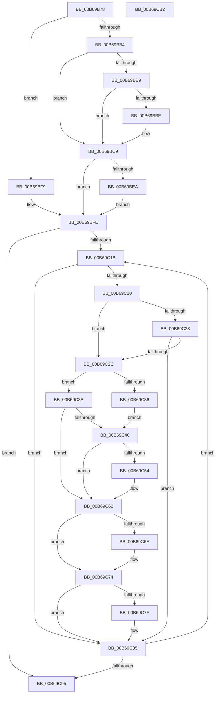

# KiSetCacheInformation

- RVA: `0x00B69B78`–`0x00B69CB3` (길이 `315` bytes)
- VA: `0x0000000140B69B78`
- 실행 섹션: `PAGELK`
- PDB 이름 있음: `예`; PDB Function 태그: `아니요`
- unwind 정보 RVA: `0x000CA810`
- 디코드: `83`개 명령, `315/315` bytes 표시
- 미해석 바이트: `0` (있으면 어셈블리에 `.byte`로 보존)

> 이 문서는 커널 이미지의 기계어와 PDB 기호를 분석해 생성했습니다. 4번과 5번은 함수 원형과 자료형을 바이너리 사용 방식에서 추정한 C 해석이며 원본 소스 복구 결과는 아닙니다.

## 1. Dependencies

- 직접 호출 지점: **4**; 고유 호출 대상: **4**
- 직접 호출자로 확인된 함수: **1**
- RIP 상대 이미지 참조: **5**

### Outgoing calls
- `0x00B69BC3` → [KeBugCheck](../../text/4F/KeBugCheck_function_004FD640.md) (function, `0x004FD640`)
- `0x00B69BF2` → [KiSetStandardizedCacheInformation](KiSetStandardizedCacheInformation_function_00B6A940.md) (function, `0x00B6A940`)
- `0x00B69BF9` → [KiSetCacheInformationAmd](KiSetCacheInformationAmd_function_00B69CBC.md) (function, `0x00B69CBC`)
- `0x00B69C9D` → [_security_check_cookie](../../text/6A/_security_check_cookie_function_006AC640.md) (function, `0x006AC640`)

### Direct callers
- [KiInitializeKernel](KiInitializeKernel_function_00B68D20.md) at `0x00B68FD1`

### Static image references
- `0x00B69B87` → RVA `0x00E0A740` (`.data`; read)
- `0x00B69C66` → RVA `0x00FC5120` (`ALMOSTRO`; read)
- `0x00B69C6E` → RVA `0x00FC5120` (`ALMOSTRO`; write)
- `0x00B69C77` → RVA `0x00FC51C8` (`ALMOSTRO`; read)
- `0x00B69C7F` → RVA `0x00FC51C8` (`ALMOSTRO`; write)

## 2. Other-region calls and transfers

- 다른 실행 섹션으로 향하는 call: **2**
  - `0x00B69BC3` → [KeBugCheck](../../text/4F/KeBugCheck_function_004FD640.md) (`PAGELK` → `.text`)
  - `0x00B69C9D` → [_security_check_cookie](../../text/6A/_security_check_cookie_function_006AC640.md) (`PAGELK` → `.text`)
- 별도 외부 분기/꼬리 이동을 확인하지 못했습니다.

## 3. Assembly (complete function range)

```asm
00B69B78  48 89 5C 24 08                  mov qword ptr [rsp + 8], rbx
00B69B7D  48 89 74 24 10                  mov qword ptr [rsp + 0x10], rsi
00B69B82  57                              push rdi
00B69B83  48 83 EC 40                     sub rsp, 0x40
00B69B87  48 8B 05 B2 0B 2A 00            mov rax, qword ptr [rip + 0x2a0bb2]
00B69B8E  48 33 C4                        xor rax, rsp
00B69B91  48 89 44 24 30                  mov qword ptr [rsp + 0x30], rax
00B69B96  65 48 8B 34 25 18 00 00 00      mov rsi, qword ptr gs:[0x18]
00B69B9F  65 48 8B 3C 25 20 00 00 00      mov rdi, qword ptr gs:[0x20]
00B69BA8  0F B6 8F 8D 00 00 00            movzx ecx, byte ptr [rdi + 0x8d]
00B69BAF  83 E9 01                        sub ecx, 1
00B69BB2  74 45                           je 0x140b69bf9
00B69BB4  83 E9 01                        sub ecx, 1
00B69BB7  74 10                           je 0x140b69bc9
00B69BB9  83 F9 01                        cmp ecx, 1
00B69BBC  74 0B                           je 0x140b69bc9
00B69BBE  B9 5D 00 00 00                  mov ecx, 0x5d
00B69BC3  E8 78 3A 99 FF                  call 0x1404fd640
00B69BC8  CC                              int3
00B69BC9  65 4C 8B 04 25 20 00 00 00      mov r8, qword ptr gs:[0x20]
00B69BD2  33 C0                           xor eax, eax
00B69BD4  33 C9                           xor ecx, ecx
00B69BD6  0F A2                           cpuid
00B69BD8  83 C0 FD                        add eax, -3
00B69BDB  41 83 A0 94 8B 00 00 00         and dword ptr [r8 + 0x8b94], 0
00B69BE3  3D FC FF FF 7F                  cmp eax, 0x7ffffffc
00B69BE8  77 14                           ja 0x140b69bfe
00B69BEA  BA 04 00 00 00                  mov edx, 4
00B69BEF  49 8B C8                        mov rcx, r8
00B69BF2  E8 49 0D 00 00                  call 0x140b6a940
00B69BF7  EB 05                           jmp 0x140b69bfe
00B69BF9  E8 BE 00 00 00                  call 0x140b69cbc
00B69BFE  45 33 DB                        xor r11d, r11d
00B69C01  48 8D 9F 58 8B 00 00            lea rbx, [rdi + 0x8b58]
00B69C08  44 21 9E BC 00 00 00            and dword ptr [rsi + 0xbc], r11d
00B69C0F  45 33 C9                        xor r9d, r9d
00B69C12  44 39 8F 94 8B 00 00            cmp dword ptr [rdi + 0x8b94], r9d
00B69C19  76 7A                           jbe 0x140b69c95
00B69C1B  80 3B 02                        cmp byte ptr [rbx], 2
00B69C1E  72 65                           jb 0x140b69c85
00B69C20  8B 43 08                        mov eax, dword ptr [rbx + 8]
00B69C23  83 F8 02                        cmp eax, 2
00B69C26  74 04                           je 0x140b69c2c
00B69C28  85 C0                           test eax, eax
00B69C2A  75 59                           jne 0x140b69c85
00B69C2C  44 8A 43 01                     mov r8b, byte ptr [rbx + 1]
00B69C30  41 80 F8 FF                     cmp r8b, 0xff
00B69C34  75 05                           jne 0x140b69c3b
00B69C36  41 B0 10                        mov r8b, 0x10
00B69C39  EB 05                           jmp 0x140b69c40
00B69C3B  45 84 C0                        test r8b, r8b
00B69C3E  74 22                           je 0x140b69c62
00B69C40  44 8B 53 04                     mov r10d, dword ptr [rbx + 4]
00B69C44  33 D2                           xor edx, edx
00B69C46  41 8B C2                        mov eax, r10d
00B69C49  41 0F B6 C8                     movzx ecx, r8b
00B69C4D  F7 F1                           div ecx
00B69C4F  41 3B C3                        cmp eax, r11d
00B69C52  76 0E                           jbe 0x140b69c62
00B69C54  44 8B D8                        mov r11d, eax
00B69C57  44 89 96 BC 00 00 00            mov dword ptr [rsi + 0xbc], r10d
00B69C5E  44 88 46 51                     mov byte ptr [rsi + 0x51], r8b
00B69C62  0F B7 4B 02                     movzx ecx, word ptr [rbx + 2]
00B69C66  3B 0D B4 B4 45 00               cmp ecx, dword ptr [rip + 0x45b4b4]
00B69C6C  76 06                           jbe 0x140b69c74
00B69C6E  89 0D AC B4 45 00               mov dword ptr [rip + 0x45b4ac], ecx
00B69C74  8B 43 04                        mov eax, dword ptr [rbx + 4]
00B69C77  3B 05 4B B5 45 00               cmp eax, dword ptr [rip + 0x45b54b]
00B69C7D  76 06                           jbe 0x140b69c85
00B69C7F  89 05 43 B5 45 00               mov dword ptr [rip + 0x45b543], eax
00B69C85  48 83 C3 0C                     add rbx, 0xc
00B69C89  41 FF C1                        inc r9d
00B69C8C  44 3B 8F 94 8B 00 00            cmp r9d, dword ptr [rdi + 0x8b94]
00B69C93  72 86                           jb 0x140b69c1b
00B69C95  48 8B 4C 24 30                  mov rcx, qword ptr [rsp + 0x30]
00B69C9A  48 33 CC                        xor rcx, rsp
00B69C9D  E8 9E 29 B4 FF                  call 0x1406ac640
00B69CA2  48 8B 5C 24 50                  mov rbx, qword ptr [rsp + 0x50]
00B69CA7  48 8B 74 24 58                  mov rsi, qword ptr [rsp + 0x58]
00B69CAC  48 83 C4 40                     add rsp, 0x40
00B69CB0  5F                              pop rdi
00B69CB1  C3                              ret
00B69CB2  CC                              int3
```

## 4. C-style interpretation (structured pseudocode)

```c
__int64 __fastcall KiSetCacheInformation(__int64 a1, __int64 a2, __int64 a3, int a4)
{
    __int64 result;
    __int64 v_r11;
    __int64 v_rbx;
    __int64 v_rsp;
    unsigned __int64 v_stack_m18;
    unsigned __int64 v_stack_p10;
    unsigned __int64 v_stack_p8;

    v_stack_p8 = v_rbx;
    v_stack_p10 = v_rsi;
    v_rsp = (v_rsp) - (64);
    result = (*(unsigned __int64 *)(v_rip + 2755506)) ^ (v_rsp);
    v_stack_m18 = result;
    a1 = (unsigned int)((*(unsigned __int8 *)(*(unsigned __int64 *)(gs_base + (0 + 32)) + 141)) - (1));
    if (condition_is_equal) goto loc_00B69BF9;
    a1 = (unsigned int)((a1) - (1));
    if (condition_is_equal) goto loc_00B69BC9;
    if (((unsigned int)(a1)) != 1) {
        a1 = 93;
        result = KeBugCheck(a1, a2, a3, a4);
    }
    result = 0;
    a1 = 0;
    result = (unsigned int)((result) + (-3));
    if (((unsigned int)(result)) > 0x7FFFFFFCULL) goto loc_00B69BFE;
    result = KiSetStandardizedCacheInformation(*(unsigned __int64 *)(gs_base + (0 + 32)), 4, *(unsigned __int64 *)(gs_base + (0 + 32)), a4);
    goto loc_00B69BFE;
loc_00B69BF9:
    result = KiSetCacheInformationAmd(*(unsigned __int64 *)(gs_base + (0 + 32)), 4, *(unsigned __int64 *)(gs_base + (0 + 32)), a4);
loc_00B69BFE:
    v_r11 = 0;
    a4 = 0;
    if ((*(unsigned int *)(*(unsigned __int64 *)(gs_base + (0 + 32)) + 35732)) <= 0) goto loc_00B69C95;
loc_00B69C1B:
    if ((*(unsigned __int8 *)(*(unsigned __int64 *)(gs_base + (0 + 32)) + 35672)) < 2) goto loc_00B69C85;
    if (((unsigned int)((unsigned int)(*(unsigned int *)(*(unsigned __int64 *)(gs_base + (0 + 32)) + 35672 + 8)))) == 2) goto loc_00B69C2C;
    if ((unsigned int)((unsigned int)(*(unsigned int *)(*(unsigned __int64 *)(gs_base + (0 + 32)) + 35672 + 8))) != 0) goto loc_00B69C85;
loc_00B69C2C:
    if (((unsigned __int8)(*(unsigned __int8 *)(*(unsigned __int64 *)(gs_base + (0 + 32)) + 35672 + 1))) != 255) goto loc_00B69C3B;
    goto loc_00B69C40;
loc_00B69C3B:
    if (16 == 0) goto loc_00B69C62;
loc_00B69C40:
    a2 = 0;
    if (((unsigned int)((unsigned int)((unsigned int)((unsigned int)(*(unsigned int *)(*(unsigned __int64 *)(gs_base + (0 + 32)) + 35672 + 4)))))) >= = 0) {
        v_r11 = (unsigned int)((unsigned int)((unsigned int)((unsigned int)(*(unsigned int *)(*(unsigned __int64 *)(gs_base + (0 + 32)) + 35672 + 4)))));
        *(unsigned int *)(*(unsigned __int64 *)(gs_base + (0 + 24)) + 188) = (unsigned int)((unsigned int)(*(unsigned int *)(*(unsigned __int64 *)(gs_base + (0 + 32)) + 35672 + 4)));
        *(unsigned __int8 *)(*(unsigned __int64 *)(gs_base + (0 + 24)) + 81) = 16;
    }
    if (((unsigned int)(*(unsigned __int16 *)(*(unsigned __int64 *)(gs_base + (0 + 32)) + 35672 + 2))) >= = (*(unsigned int *)(v_rip + 4568244))) {
        *(unsigned int *)(v_rip + 4568236) = (unsigned int)(*(unsigned __int16 *)(*(unsigned __int64 *)(gs_base + (0 + 32)) + 35672 + 2));
    }
    if (((unsigned int)((unsigned int)(*(unsigned int *)(*(unsigned __int64 *)(gs_base + (0 + 32)) + 35672 + 4)))) >= = (*(unsigned int *)(v_rip + 4568395))) {
        *(unsigned int *)(v_rip + 4568387) = (unsigned int)((unsigned int)(*(unsigned int *)(*(unsigned __int64 *)(gs_base + (0 + 32)) + 35672 + 4)));
    }
    v_rbx = (*(unsigned __int64 *)(gs_base + (0 + 32)) + 35672) + (12);
    a4 = (unsigned int)((a4) + 1);
    if (a4 < (*(unsigned int *)(*(unsigned __int64 *)(gs_base + (0 + 32)) + 35732))) goto loc_00B69C1B;
loc_00B69C95:
    a1 = (v_stack_m18) ^ (v_rsp);
    result = _security_check_cookie(a1, a2, 16, a4);
    v_rsp = (v_rsp) + (64);
    return result;
}
```

## 5. (Beta) C Style

```c
int64_t KiSetCacheInformation(int64_t Arg1, int64_t Arg2, int64_t Arg3, int32_t Arg4)
{
    int64_t result;
    int64_t local_r11;
    int64_t local_rbx;
    int64_t local_rsp;
    uint64_t v_stack_m18;
    uint64_t v_stack_p10;
    uint64_t v_stack_p8;

    v_stack_p8 = local_rbx;
    v_stack_p10 = local_rsi;
    local_rsp = (local_rsp) - (64);
    result = (*(uint64_t *)(v_rip + 0x2A0BB2)) ^ (local_rsp);
    v_stack_m18 = result;
    Arg1 = (uint32_t)((*(uint8_t *)(*(uint64_t *)(gs_base + (0 + 0x20)) + 0x8D)) - (1));
    if (condition_is_equal) goto loc_00B69BF9;
    Arg1 = (uint32_t)((Arg1) - (1));
    if (condition_is_equal) goto loc_00B69BC9;
    if (((uint32_t)(Arg1)) != 1) {
        Arg1 = 93;
        result = KeBugCheck(Arg1, Arg2, Arg3, Arg4);
    }
    result = 0;
    Arg1 = 0;
    result = (uint32_t)((result) + (-3));
    if (((uint32_t)(result)) > 0x7FFFFFFCULL) goto loc_00B69BFE;
    result = KiSetStandardizedCacheInformation(*(uint64_t *)(gs_base + (0 + 0x20)), 4, *(uint64_t *)(gs_base + (0 + 0x20)), Arg4);
    goto loc_00B69BFE;
loc_00B69BF9:
    result = KiSetCacheInformationAmd(*(uint64_t *)(gs_base + (0 + 0x20)), 4, *(uint64_t *)(gs_base + (0 + 0x20)), Arg4);
loc_00B69BFE:
    local_r11 = 0;
    Arg4 = 0;
    if ((*(uint32_t *)(*(uint64_t *)(gs_base + (0 + 0x20)) + 0x8B94)) <= 0) goto loc_00B69C95;
loc_00B69C1B:
    if ((*(uint8_t *)(*(uint64_t *)(gs_base + (0 + 0x20)) + 0x8B58)) < 2) goto loc_00B69C85;
    if (((uint32_t)((uint32_t)(*(uint32_t *)(*(uint64_t *)(gs_base + (0 + 0x20)) + 0x8B58 + 0x8)))) == 2) goto loc_00B69C2C;
    if ((uint32_t)((uint32_t)(*(uint32_t *)(*(uint64_t *)(gs_base + (0 + 0x20)) + 0x8B58 + 0x8))) != 0) goto loc_00B69C85;
loc_00B69C2C:
    if (((uint8_t)(*(uint8_t *)(*(uint64_t *)(gs_base + (0 + 0x20)) + 0x8B58 + 0x1))) != 255) goto loc_00B69C3B;
    goto loc_00B69C40;
loc_00B69C3B:
    if (16 == 0) goto loc_00B69C62;
loc_00B69C40:
    Arg2 = 0;
    if (((uint32_t)((uint32_t)((uint32_t)((uint32_t)(*(uint32_t *)(*(uint64_t *)(gs_base + (0 + 0x20)) + 0x8B58 + 0x4)))))) >= = 0) {
        local_r11 = (uint32_t)((uint32_t)((uint32_t)((uint32_t)(*(uint32_t *)(*(uint64_t *)(gs_base + (0 + 0x20)) + 0x8B58 + 0x4)))));
        *(uint32_t *)(*(uint64_t *)(gs_base + (0 + 0x18)) + 0xBC) = (uint32_t)((uint32_t)(*(uint32_t *)(*(uint64_t *)(gs_base + (0 + 0x20)) + 0x8B58 + 0x4)));
        *(uint8_t *)(*(uint64_t *)(gs_base + (0 + 0x18)) + 0x51) = 16;
    }
    if (((uint32_t)(*(uint16_t *)(*(uint64_t *)(gs_base + (0 + 0x20)) + 0x8B58 + 0x2))) >= = (*(uint32_t *)(v_rip + 0x45B4B4))) {
        *(uint32_t *)(v_rip + 0x45B4AC) = (uint32_t)(*(uint16_t *)(*(uint64_t *)(gs_base + (0 + 0x20)) + 0x8B58 + 0x2));
    }
    if (((uint32_t)((uint32_t)(*(uint32_t *)(*(uint64_t *)(gs_base + (0 + 0x20)) + 0x8B58 + 0x4)))) >= = (*(uint32_t *)(v_rip + 0x45B54B))) {
        *(uint32_t *)(v_rip + 0x45B543) = (uint32_t)((uint32_t)(*(uint32_t *)(*(uint64_t *)(gs_base + (0 + 0x20)) + 0x8B58 + 0x4)));
    }
    local_rbx = (*(uint64_t *)(gs_base + (0 + 0x20)) + 35672) + (12);
    Arg4 = (uint32_t)((Arg4) + 1);
    if (Arg4 < (*(uint32_t *)(*(uint64_t *)(gs_base + (0 + 0x20)) + 0x8B94))) goto loc_00B69C1B;
loc_00B69C95:
    Arg1 = (v_stack_m18) ^ (local_rsp);
    result = _security_check_cookie(Arg1, Arg2, 16, Arg4);
    local_rsp = (local_rsp) + (64);
    return result;
}
```

## 6. Execution-region graph

[열기: 2D/3D 그래프와 함수 탐색 컨트롤 패널](../../../control-panel.html?section=pagelk&rva=0x00B69B78&view=graph)

- 2D 그래프는 위에서 아래로 흐르고, 3D 그래프는 빈 공간을 드래그해 회전합니다. Shift+드래그는 이동, 휠은 확대·축소, 함수 노드 선택은 대상 보고서 이동입니다.

### Static fallback


