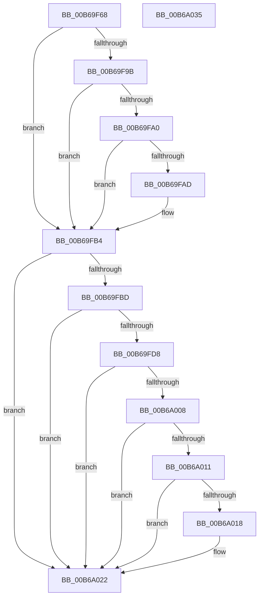

# KiSetControlEnforcement

- RVA: `0x00B69F68`–`0x00B6A036` (길이 `206` bytes)
- VA: `0x0000000140B69F68`
- 실행 섹션: `PAGELK`
- PDB 이름 있음: `예`; PDB Function 태그: `아니요`
- unwind 정보 RVA: `0x000B64AC`
- 디코드: `54`개 명령, `206/206` bytes 표시
- 미해석 바이트: `0` (있으면 어셈블리에 `.byte`로 보존)

> 이 문서는 커널 이미지의 기계어와 PDB 기호를 분석해 생성했습니다. 4번과 5번은 함수 원형과 자료형을 바이너리 사용 방식에서 추정한 C 해석이며 원본 소스 복구 결과는 아닙니다.

## 1. Dependencies

- 직접 호출 지점: **1**; 고유 호출 대상: **1**
- 직접 호출자로 확인된 함수: **1**
- RIP 상대 이미지 참조: **6**

### Outgoing calls
- `0x00B6A02A` → [_security_check_cookie](../../text/6A/_security_check_cookie_function_006AC640.md) (function, `0x006AC640`)

### Direct callers
- [KiInitializeKernel](KiInitializeKernel_function_00B68D20.md) at `0x00B6905F`

### Static image references
- `0x00B69F6E` → RVA `0x00E0A740` (`.data`; read)
- `0x00B69FAD` → RVA `0x00FC501B` (`ALMOSTRO`; write)
- `0x00B69FB4` → RVA `0x00FC501B` (`ALMOSTRO`; read)
- `0x00B69FC8` → RVA `0x00FC6C60` (`ALMOSTRO`; read)
- `0x00B69FFA` → RVA `0x00FC5064` (`ALMOSTRO`; write)
- `0x00B6A018` → RVA `0x00FC7264` (`ALMOSTRO`; write)

## 2. Other-region calls and transfers

- 다른 실행 섹션으로 향하는 call: **1**
  - `0x00B6A02A` → [_security_check_cookie](../../text/6A/_security_check_cookie_function_006AC640.md) (`PAGELK` → `.text`)
- 별도 외부 분기/꼬리 이동을 확인하지 못했습니다.

## 3. Assembly (complete function range)

```asm
00B69F68  40 53                           push rbx
00B69F6A  48 83 EC 20                     sub rsp, 0x20
00B69F6E  48 8B 05 CB 07 2A 00            mov rax, qword ptr [rip + 0x2a07cb]
00B69F75  48 33 C4                        xor rax, rsp
00B69F78  48 89 44 24 10                  mov qword ptr [rsp + 0x10], rax
00B69F7D  4C 8B C1                        mov r8, rcx
00B69F80  33 C0                           xor eax, eax
00B69F82  33 C9                           xor ecx, ecx
00B69F84  41 B2 01                        mov r10b, 1
00B69F87  4C 8B CA                        mov r9, rdx
00B69F8A  0F A2                           cpuid
00B69F8C  41 8A 88 8D 00 00 00            mov cl, byte ptr [r8 + 0x8d]
00B69F93  41 2A CA                        sub cl, r10b
00B69F96  41 3A CA                        cmp cl, r10b
00B69F99  77 19                           ja 0x140b69fb4
00B69F9B  83 F8 07                        cmp eax, 7
00B69F9E  72 14                           jb 0x140b69fb4
00B69FA0  33 C9                           xor ecx, ecx
00B69FA2  B8 07 00 00 00                  mov eax, 7
00B69FA7  0F A2                           cpuid
00B69FA9  84 C9                           test cl, cl
00B69FAB  79 07                           jns 0x140b69fb4
00B69FAD  44 88 15 67 B0 45 00            mov byte ptr [rip + 0x45b067], r10b
00B69FB4  80 3D 60 B0 45 00 00            cmp byte ptr [rip + 0x45b060], 0
00B69FBB  74 65                           je 0x140b6a022
00B69FBD  49 8B 11                        mov rdx, qword ptr [r9]
00B69FC0  48 0F BA E2 17                  bt rdx, 0x17
00B69FC5  0F 92 C1                        setb cl
00B69FC8  48 0F BA 25 8F CC 45 00 0B      bt qword ptr [rip + 0x45cc8f], 0xb
00B69FD1  0F 92 C0                        setb al
00B69FD4  84 C8                           test al, cl
00B69FD6  74 4A                           je 0x140b6a022
00B69FD8  48 B8 00 00 00 00 00 40 00 00   movabs rax, 0x400000000000
00B69FE2  48 0B D0                        or rdx, rax
00B69FE5  49 89 11                        mov qword ptr [r9], rdx
00B69FE8  49 09 80 A0 8F 00 00            or qword ptr [r8 + 0x8fa0], rax
00B69FEF  0F 20 E0                        mov rax, cr4
00B69FF2  48 0F BA E8 17                  bts rax, 0x17
00B69FF7  0F 22 E0                        mov cr4, rax
00B69FFA  44 88 15 63 B0 45 00            mov byte ptr [rip + 0x45b063], r10b
00B6A001  41 83 78 24 00                  cmp dword ptr [r8 + 0x24], 0
00B6A006  75 1A                           jne 0x140b6a022
00B6A008  45 38 90 8D 00 00 00            cmp byte ptr [r8 + 0x8d], r10b
00B6A00F  75 11                           jne 0x140b6a022
00B6A011  41 80 78 40 19                  cmp byte ptr [r8 + 0x40], 0x19
00B6A016  75 0A                           jne 0x140b6a022
00B6A018  C7 05 42 D2 45 00 FF 7F 00 00   mov dword ptr [rip + 0x45d242], 0x7fff
00B6A022  48 8B 4C 24 10                  mov rcx, qword ptr [rsp + 0x10]
00B6A027  48 33 CC                        xor rcx, rsp
00B6A02A  E8 11 26 B4 FF                  call 0x1406ac640
00B6A02F  48 83 C4 20                     add rsp, 0x20
00B6A033  5B                              pop rbx
00B6A034  C3                              ret
00B6A035  CC                              int3
```

## 4. C-style interpretation (structured pseudocode)

```c
__int64 __fastcall KiSetControlEnforcement(__int64 a1, __int64 a2)
{
    __int64 result;
    __int64 v_rsp;
    unsigned __int64 v_stack_m18;

    v_rsp = (v_rsp) - (32);
    result = (*(unsigned __int64 *)(v_rip + 2754507)) ^ (v_rsp);
    v_stack_m18 = result;
    result = 0;
    a1 = 0;
    a1 = (unsigned __int8)((*(unsigned __int8 *)(a1 + 141)) - (1));
    if (((unsigned __int8)(a1)) > 1) goto loc_00B69FB4;
    if (0 < 7) goto loc_00B69FB4;
    a1 = 0;
    if (sign_flag) {
        *(unsigned __int8 *)(v_rip + 4567143) = 1;
    }
    if ((*(unsigned __int8 *)(v_rip + 4567136)) == 0) goto loc_00B6A022;
    a1 = ((*(unsigned __int8 *)(v_rip + 4567136)) < 0) ? 1 : 0;
    result = ((*(unsigned __int8 *)(v_rip + 4567136)) < 0) ? 1 : 0;
    if ((((unsigned __int8)(result)) & ((unsigned __int8)(a1))) == 0) goto loc_00B6A022;
    a2 = (*(unsigned __int64 *)(a2)) | (result);
    *(unsigned __int64 *)(a2) = a2;
    *(unsigned __int8 *)(v_rip + 4567139) = 1;
    if ((*(unsigned int *)(a1 + 36)) != 0) goto loc_00B6A022;
    if ((*(unsigned __int8 *)(a1 + 141)) != 1) goto loc_00B6A022;
    if ((*(unsigned __int8 *)(a1 + 64)) == 25) {
        *(unsigned int *)(v_rip + 4575810) = 0x7FFFULL;
    }
    a1 = (v_stack_m18) ^ (v_rsp);
    result = _security_check_cookie(a1, a2, a1, a2);
    v_rsp = (v_rsp) + (32);
    return result;
}
```

## 5. (Beta) C Style

```c
int64_t KiSetControlEnforcement(void *Arg1, void *Arg2)
{
    uint8_t *arg1 = (uint8_t *)Arg1;
    uint8_t *arg2 = (uint8_t *)Arg2;

    int64_t result;
    int64_t local_rsp;
    uint64_t v_stack_m18;

    local_rsp = (local_rsp) - (32);
    result = (*(uint64_t *)(v_rip + 0x2A07CB)) ^ (local_rsp);
    v_stack_m18 = result;
    result = 0;
    Arg1 = 0;
    Arg1 = (uint8_t)((*(uint8_t *)(arg1 + 0x8D)) - (1));
    if (((uint8_t)(Arg1)) > 1) goto loc_00B69FB4;
    if (0 < 7) goto loc_00B69FB4;
    Arg1 = 0;
    if (sign_flag) {
        *(uint8_t *)(v_rip + 0x45B067) = 1;
    }
    if ((*(uint8_t *)(v_rip + 0x45B060)) == 0) goto loc_00B6A022;
    Arg1 = ((*(uint8_t *)(v_rip + 0x45B060)) < 0) ? 1 : 0;
    result = ((*(uint8_t *)(v_rip + 0x45B060)) < 0) ? 1 : 0;
    if ((((uint8_t)(result)) & ((uint8_t)(Arg1))) == 0) goto loc_00B6A022;
    Arg2 = (*(uint64_t *)(arg2)) | (result);
    *(void **)(arg2) = Arg2;
    *(uint8_t *)(v_rip + 0x45B063) = 1;
    if ((*(uint32_t *)(arg1 + 0x24)) != 0) goto loc_00B6A022;
    if ((*(uint8_t *)(arg1 + 0x8D)) != 1) goto loc_00B6A022;
    if ((*(uint8_t *)(arg1 + 0x40)) == 25) {
        *(uint32_t *)(v_rip + 0x45D242) = 0x7FFFULL;
    }
    Arg1 = (v_stack_m18) ^ (local_rsp);
    result = _security_check_cookie(Arg1, Arg2, Arg1, Arg2);
    local_rsp = (local_rsp) + (32);
    return result;
}
```

### 관측된 메모리 오프셋

구조체 형식이 확인되지 않은 접근은 인자 기준의 오프셋으로만 기록했습니다.

| 기준 인자 | 오프셋 표현 | 폭 (bit) | 접근 |
|---|---:|---:|---|
| `Arg1` | `+ 0x24` | `32` | `R` |
| `Arg1` | `+ 0x40` | `8` | `R` |
| `Arg1` | `+ 0x8D` | `8` | `R` |
| `Arg1` | `+ 0x8FA0` | `64` | `R/W` |
| `Arg2` | `+ 0x0` | `64` | `R` |
| `Arg2` | `+ 0x0` | `64` | `W` |

## 6. Execution-region graph

[열기: 2D/3D 그래프와 함수 탐색 컨트롤 패널](../../../control-panel.html?section=pagelk&rva=0x00B69F68&view=graph)

- 2D 그래프는 위에서 아래로 흐르고, 3D 그래프는 빈 공간을 드래그해 회전합니다. Shift+드래그는 이동, 휠은 확대·축소, 함수 노드 선택은 대상 보고서 이동입니다.

### Static fallback


