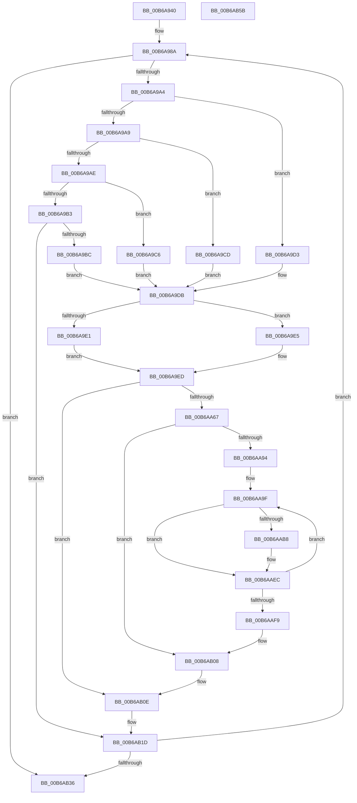

# KiSetStandardizedCacheInformation

- RVA: `0x00B6A940`–`0x00B6AB5C` (길이 `540` bytes)
- VA: `0x0000000140B6A940`
- 실행 섹션: `PAGELK`
- PDB 이름 있음: `예`; PDB Function 태그: `아니요`
- unwind 정보 RVA: `0x000CA7C4`
- 디코드: `145`개 명령, `540/540` bytes 표시
- 미해석 바이트: `0` (있으면 어셈블리에 `.byte`로 보존)

> 이 문서는 커널 이미지의 기계어와 PDB 기호를 분석해 생성했습니다. 4번과 5번은 함수 원형과 자료형을 바이너리 사용 방식에서 추정한 C 해석이며 원본 소스 복구 결과는 아닙니다.

## 1. Dependencies

- 직접 호출 지점: **4**; 고유 호출 대상: **2**
- 직접 호출자로 확인된 함수: **2**
- RIP 상대 이미지 참조: **3**

### Outgoing calls
- `0x00B6AA56` → [KeAddGroupAffinityEx](../../text/25/KeAddGroupAffinityEx_function_0025B6C0.md) (function, `0x0025B6C0`)
- `0x00B6AACA` → [KeAddGroupAffinityEx](../../text/25/KeAddGroupAffinityEx_function_0025B6C0.md) (function, `0x0025B6C0`)
- `0x00B6AAE7` → [KeAddGroupAffinityEx](../../text/25/KeAddGroupAffinityEx_function_0025B6C0.md) (function, `0x0025B6C0`)
- `0x00B6AB3E` → [_security_check_cookie](../../text/6A/_security_check_cookie_function_006AC640.md) (function, `0x006AC640`)

### Direct callers
- [KiSetCacheInformation](KiSetCacheInformation_function_00B69B78.md) at `0x00B69BF2`
- [KiSetCacheInformationAmd](KiSetCacheInformationAmd_function_00B69CBC.md) at `0x00B69D10`

### Static image references
- `0x00B6A954` → RVA `0x00E0A740` (`.data`; read)
- `0x00B6AA7C` → RVA `0x00FC6A80` (`ALMOSTRO`; read)
- `0x00B6AA9F` → RVA `0x00FC8C40` (`ALMOSTRO`; read)

## 2. Other-region calls and transfers

- 다른 실행 섹션으로 향하는 call: **4**
  - `0x00B6AA56` → [KeAddGroupAffinityEx](../../text/25/KeAddGroupAffinityEx_function_0025B6C0.md) (`PAGELK` → `.text`)
  - `0x00B6AACA` → [KeAddGroupAffinityEx](../../text/25/KeAddGroupAffinityEx_function_0025B6C0.md) (`PAGELK` → `.text`)
  - `0x00B6AAE7` → [KeAddGroupAffinityEx](../../text/25/KeAddGroupAffinityEx_function_0025B6C0.md) (`PAGELK` → `.text`)
  - `0x00B6AB3E` → [_security_check_cookie](../../text/6A/_security_check_cookie_function_006AC640.md) (`PAGELK` → `.text`)
- 별도 외부 분기/꼬리 이동을 확인하지 못했습니다.

## 3. Assembly (complete function range)

```asm
00B6A940  48 89 5C 24 18                  mov qword ptr [rsp + 0x18], rbx
00B6A945  55                              push rbp
00B6A946  56                              push rsi
00B6A947  57                              push rdi
00B6A948  41 54                           push r12
00B6A94A  41 55                           push r13
00B6A94C  41 56                           push r14
00B6A94E  41 57                           push r15
00B6A950  48 83 EC 50                     sub rsp, 0x50
00B6A954  48 8B 05 E5 FD 29 00            mov rax, qword ptr [rip + 0x29fde5]
00B6A95B  48 33 C4                        xor rax, rsp
00B6A95E  48 89 44 24 48                  mov qword ptr [rsp + 0x48], rax
00B6A963  45 33 FF                        xor r15d, r15d
00B6A966  89 54 24 24                     mov dword ptr [rsp + 0x24], edx
00B6A96A  4C 8D B1 58 8B 00 00            lea r14, [rcx + 0x8b58]
00B6A971  44 89 7C 24 20                  mov dword ptr [rsp + 0x20], r15d
00B6A976  8B C2                           mov eax, edx
00B6A978  4C 89 74 24 28                  mov qword ptr [rsp + 0x28], r14
00B6A97D  48 8B F1                        mov rsi, rcx
00B6A980  41 BC FF 0F 00 00               mov r12d, 0xfff
00B6A986  41 8D 6F 01                     lea ebp, [r15 + 1]
00B6A98A  41 8B CF                        mov ecx, r15d
00B6A98D  0F A2                           cpuid
00B6A98F  8B D0                           mov edx, eax
00B6A991  44 8B C1                        mov r8d, ecx
00B6A994  C1 E2 1B                        shl edx, 0x1b
00B6A997  8B F8                           mov edi, eax
00B6A999  C1 FA 1B                        sar edx, 0x1b
00B6A99C  85 D2                           test edx, edx
00B6A99E  0F 84 92 01 00 00               je 0x140b6ab36
00B6A9A4  83 EA 01                        sub edx, 1
00B6A9A7  74 2A                           je 0x140b6a9d3
00B6A9A9  83 EA 01                        sub edx, 1
00B6A9AC  74 1F                           je 0x140b6a9cd
00B6A9AE  83 EA 01                        sub edx, 1
00B6A9B1  74 13                           je 0x140b6a9c6
00B6A9B3  83 FA 02                        cmp edx, 2
00B6A9B6  0F 85 61 01 00 00               jne 0x140b6ab1d
00B6A9BC  41 C7 46 08 03 00 00 00         mov dword ptr [r14 + 8], 3
00B6A9C4  EB 15                           jmp 0x140b6a9db
00B6A9C6  41 83 66 08 00                  and dword ptr [r14 + 8], 0
00B6A9CB  EB 0E                           jmp 0x140b6a9db
00B6A9CD  41 89 6E 08                     mov dword ptr [r14 + 8], ebp
00B6A9D1  EB 08                           jmp 0x140b6a9db
00B6A9D3  41 C7 46 08 02 00 00 00         mov dword ptr [r14 + 8], 2
00B6A9DB  0F BA E7 09                     bt edi, 9
00B6A9DF  73 04                           jae 0x140b6a9e5
00B6A9E1  B0 FF                           mov al, 0xff
00B6A9E3  EB 08                           jmp 0x140b6a9ed
00B6A9E5  8B C3                           mov eax, ebx
00B6A9E7  C1 E8 16                        shr eax, 0x16
00B6A9EA  40 02 C5                        add al, bpl
00B6A9ED  41 88 46 01                     mov byte ptr [r14 + 1], al
00B6A9F1  8B CB                           mov ecx, ebx
00B6A9F3  C1 E9 0C                        shr ecx, 0xc
00B6A9F6  8B C7                           mov eax, edi
00B6A9F8  C1 E8 05                        shr eax, 5
00B6A9FB  81 E1 FF 03 00 00               and ecx, 0x3ff
00B6AA01  24 07                           and al, 7
00B6AA03  03 CD                           add ecx, ebp
00B6AA05  41 88 06                        mov byte ptr [r14], al
00B6AA08  0F B7 C3                        movzx eax, bx
00B6AA0B  66 41 23 C4                     and ax, r12w
00B6AA0F  66 03 C5                        add ax, bp
00B6AA12  66 41 89 46 02                  mov word ptr [r14 + 2], ax
00B6AA17  8B C3                           mov eax, ebx
00B6AA19  C1 E8 16                        shr eax, 0x16
00B6AA1C  41 23 DC                        and ebx, r12d
00B6AA1F  03 C5                           add eax, ebp
00B6AA21  03 DD                           add ebx, ebp
00B6AA23  0F AF C8                        imul ecx, eax
00B6AA26  41 8D 40 01                     lea eax, [r8 + 1]
00B6AA2A  0F AF CB                        imul ecx, ebx
00B6AA2D  0F AF C8                        imul ecx, eax
00B6AA30  41 8B C7                        mov eax, r15d
00B6AA33  4C 69 E8 08 01 00 00            imul r13, rax, 0x108
00B6AA3A  41 89 4E 04                     mov dword ptr [r14 + 4], ecx
00B6AA3E  48 8D 8E 00 AF 00 00            lea rcx, [rsi + 0xaf00]
00B6AA45  0F B6 96 D0 00 00 00            movzx edx, byte ptr [rsi + 0xd0]
00B6AA4C  49 03 CD                        add rcx, r13
00B6AA4F  4C 8B 86 C8 00 00 00            mov r8, qword ptr [rsi + 0xc8]
00B6AA56  E8 65 0C 6F FF                  call 0x14025b6c0
00B6AA5B  C1 EF 0E                        shr edi, 0xe
00B6AA5E  41 23 FC                        and edi, r12d
00B6AA61  0F 84 A7 00 00 00               je 0x140b6ab0e
00B6AA67  44 8B A6 D4 00 00 00            mov r12d, dword ptr [rsi + 0xd4]
00B6AA6E  8D 3C 7D 01 00 00 00            lea edi, [rdi*2 + 1]
00B6AA75  83 64 24 30 00                  and dword ptr [rsp + 0x30], 0
00B6AA7A  8B DD                           mov ebx, ebp
00B6AA7C  8B 05 FE BF 45 00               mov eax, dword ptr [rip + 0x45bffe]
00B6AA82  0F BD CF                        bsr ecx, edi
00B6AA85  33 FF                           xor edi, edi
00B6AA87  D3 E3                           shl ebx, cl
00B6AA89  2B DD                           sub ebx, ebp
00B6AA8B  F7 D3                           not ebx
00B6AA8D  44 23 E3                        and r12d, ebx
00B6AA90  85 C0                           test eax, eax
00B6AA92  74 74                           je 0x140b6ab08
00B6AA94  4D 8D BD 00 AF 00 00            lea r15, [r13 + 0xaf00]
00B6AA9B  44 8D 77 01                     lea r14d, [rdi + 1]
00B6AA9F  48 8D 2D 9A E1 45 00            lea rbp, [rip + 0x45e19a]
00B6AAA6  48 8B 6C FD 00                  mov rbp, qword ptr [rbp + rdi*8]
00B6AAAB  8B 85 D4 00 00 00               mov eax, dword ptr [rbp + 0xd4]
00B6AAB1  23 C3                           and eax, ebx
00B6AAB3  41 3B C4                        cmp eax, r12d
00B6AAB6  75 34                           jne 0x140b6aaec
00B6AAB8  0F B6 95 D0 00 00 00            movzx edx, byte ptr [rbp + 0xd0]
00B6AABF  49 8D 0C 37                     lea rcx, [r15 + rsi]
00B6AAC3  4C 8B 85 C8 00 00 00            mov r8, qword ptr [rbp + 0xc8]
00B6AACA  E8 F1 0B 6F FF                  call 0x14025b6c0
00B6AACF  0F B6 96 D0 00 00 00            movzx edx, byte ptr [rsi + 0xd0]
00B6AAD6  49 8D 8D 00 AF 00 00            lea rcx, [r13 + 0xaf00]
00B6AADD  4C 8B 86 C8 00 00 00            mov r8, qword ptr [rsi + 0xc8]
00B6AAE4  48 03 CD                        add rcx, rbp
00B6AAE7  E8 D4 0B 6F FF                  call 0x14025b6c0
00B6AAEC  8B 05 8E BF 45 00               mov eax, dword ptr [rip + 0x45bf8e]
00B6AAF2  41 03 FE                        add edi, r14d
00B6AAF5  3B F8                           cmp edi, eax
00B6AAF7  72 A6                           jb 0x140b6aa9f
00B6AAF9  4C 8B 74 24 28                  mov r14, qword ptr [rsp + 0x28]
00B6AAFE  BD 01 00 00 00                  mov ebp, 1
00B6AB03  44 8B 7C 24 20                  mov r15d, dword ptr [rsp + 0x20]
00B6AB08  41 BC FF 0F 00 00               mov r12d, 0xfff
00B6AB0E  49 83 C6 0C                     add r14, 0xc
00B6AB12  01 AE 94 8B 00 00               add dword ptr [rsi + 0x8b94], ebp
00B6AB18  4C 89 74 24 28                  mov qword ptr [rsp + 0x28], r14
00B6AB1D  8B 44 24 24                     mov eax, dword ptr [rsp + 0x24]
00B6AB21  44 03 FD                        add r15d, ebp
00B6AB24  83 BE 94 8B 00 00 05            cmp dword ptr [rsi + 0x8b94], 5
00B6AB2B  44 89 7C 24 20                  mov dword ptr [rsp + 0x20], r15d
00B6AB30  0F 82 54 FE FF FF               jb 0x140b6a98a
00B6AB36  48 8B 4C 24 48                  mov rcx, qword ptr [rsp + 0x48]
00B6AB3B  48 33 CC                        xor rcx, rsp
00B6AB3E  E8 FD 1A B4 FF                  call 0x1406ac640
00B6AB43  48 8B 9C 24 A0 00 00 00         mov rbx, qword ptr [rsp + 0xa0]
00B6AB4B  48 83 C4 50                     add rsp, 0x50
00B6AB4F  41 5F                           pop r15
00B6AB51  41 5E                           pop r14
00B6AB53  41 5D                           pop r13
00B6AB55  41 5C                           pop r12
00B6AB57  5F                              pop rdi
00B6AB58  5E                              pop rsi
00B6AB59  5D                              pop rbp
00B6AB5A  C3                              ret
00B6AB5B  CC                              int3
```

## 4. C-style interpretation (structured pseudocode)

```c
__int64 __fastcall KiSetStandardizedCacheInformation(__int64 a1, int a2)
{
    __int64 result;
    __int64 v_r12;
    __int64 v_r13;
    __int64 v_r14;
    __int64 v_r15;
    __int64 v_rbx;
    __int64 v_rdi;
    __int64 v_rsp;
    unsigned __int64 v_stack_m40;
    unsigned int v_stack_m58;
    unsigned __int64 v_stack_m60;
    unsigned int v_stack_m64;
    unsigned int v_stack_m68;
    unsigned __int64 v_stack_p18;

    v_stack_p18 = v_rbx;
    v_rsp = (v_rsp) - (80);
    result = (*(unsigned __int64 *)(v_rip + 2751973)) ^ (v_rsp);
    v_stack_m40 = result;
    v_r15 = 0;
    v_stack_m64 = a2;
    v_stack_m68 = 0;
    v_stack_m60 = a1 + 35672;
loc_00B6A98A:
    a2 = (unsigned int)(((unsigned int)((unsigned int)((unsigned int)(a2)))) << (27));
    a2 = (unsigned int)((a2) >> (27));
    if (a2 == 0) goto loc_00B6AB36;
    a2 = (unsigned int)((a2) - (1));
    if (condition_is_equal) goto loc_00B6A9D3;
    a2 = (unsigned int)((a2) - (1));
    if (condition_is_equal) goto loc_00B6A9CD;
    a2 = (unsigned int)((a2) - (1));
    if (condition_is_equal) goto loc_00B6A9C6;
    if (a2 != 2) goto loc_00B6AB1D;
    *(unsigned int *)(a1 + 35672 + 8) = 3;
    goto loc_00B6A9DB;
loc_00B6A9C6:
    goto loc_00B6A9DB;
loc_00B6A9CD:
    *(unsigned int *)(a1 + 35672 + 8) = (unsigned int)(v_r15 + 1);
    goto loc_00B6A9DB;
loc_00B6A9D3:
    *(unsigned int *)(a1 + 35672 + 8) = 2;
loc_00B6A9DB:
    if (a2 >= 2) goto loc_00B6A9E5;
    goto loc_00B6A9ED;
loc_00B6A9E5:
    result = (unsigned int)(((unsigned int)((unsigned int)(v_rbx))) >> (22));
    result = (unsigned __int8)((result) + ((unsigned __int8)(v_r15 + 1)));
loc_00B6A9ED:
    *(unsigned __int8 *)(a1 + 35672 + 1) = (unsigned __int8)(result);
    a1 = (unsigned int)(((unsigned int)((unsigned int)(v_rbx))) >> (12));
    result = (unsigned int)(((unsigned int)((unsigned int)((unsigned int)((unsigned int)((unsigned int)(a2)))))) >> (5));
    a1 = (unsigned int)((a1) & (0x3FFULL));
    result = (unsigned __int8)((result) & (7));
    a1 = (unsigned int)((a1) + ((unsigned int)(v_r15 + 1)));
    *(unsigned __int8 *)(a1 + 35672) = (unsigned __int8)(result);
    result = (unsigned __int16)(((unsigned __int16)(v_rbx)) & ((unsigned __int16)((unsigned int)(0xFFFULL))));
    result = (unsigned __int16)((result) + ((unsigned __int16)(v_r15 + 1)));
    *(unsigned __int16 *)(a1 + 35672 + 2) = (unsigned __int16)(result);
    result = (unsigned int)(((unsigned int)((unsigned int)(v_rbx))) >> (22));
    v_rbx = (unsigned int)((v_rbx) & ((unsigned int)((unsigned int)(0xFFFULL))));
    result = (unsigned int)((result) + ((unsigned int)(v_r15 + 1)));
    v_rbx = (unsigned int)((v_rbx) + ((unsigned int)(v_r15 + 1)));
    a1 = (unsigned int)((a1) * ((unsigned int)(result)));
    a1 = (unsigned int)((a1) * ((unsigned int)(v_rbx)));
    a1 = (unsigned int)((a1) * ((unsigned int)(0 + 1)));
    v_r13 = (v_r13) * (0);
    *(unsigned int *)(a1 + 35672 + 4) = (unsigned int)(a1);
    a1 = (a1 + 44800) + (v_r13);
    result = KeAddGroupAffinityEx(a1, *(unsigned __int8 *)(a1 + 208), *(unsigned __int64 *)(a1 + 200), a4);
    v_rdi = (unsigned int)(((unsigned int)((unsigned int)((unsigned int)(a2)))) >> (14));
    v_rdi = (unsigned int)((v_rdi) & ((unsigned int)((unsigned int)(0xFFFULL))));
    if (condition_is_equal) goto loc_00B6AB0E;
    v_rdi = 0;
    v_rbx = (unsigned int)(((unsigned int)((unsigned int)(v_r15 + 1))) << ((unsigned __int8)(a1)));
    v_rbx = (unsigned int)((v_rbx) - ((unsigned int)(v_r15 + 1)));
    v_rbx = (unsigned int)(~(v_rbx));
    v_r12 = (unsigned int)(((unsigned int)(*(unsigned int *)(a1 + 212))) & ((unsigned int)(v_rbx)));
    if ((unsigned int)((unsigned int)(*(unsigned int *)(v_rip + 4571134))) == 0) goto loc_00B6AB08;
loc_00B6AA9F:
    result = (unsigned int)(((unsigned int)(*(unsigned int *)(*(unsigned __int64 *)(v_rip + 4579738 + v_rdi * 8) + 212))) & ((unsigned int)(v_rbx)));
    if (((unsigned int)(result)) == ((unsigned int)(v_r12))) {
        a2 = *(unsigned __int8 *)(*(unsigned __int64 *)(v_rip + 4579738 + v_rdi * 8) + 208);
        a1 = v_r13 + 44800 + a1 * 1;
        a3 = *(unsigned __int64 *)(*(unsigned __int64 *)(v_rip + 4579738 + v_rdi * 8) + 200);
        result = KeAddGroupAffinityEx(a1, a2, a3, a4);
        a2 = *(unsigned __int8 *)(a1 + 208);
        a1 = v_r13 + 44800;
        a3 = *(unsigned __int64 *)(a1 + 200);
        a1 = (a1) + (*(unsigned __int64 *)(v_rip + 4579738 + v_rdi * 8));
        result = KeAddGroupAffinityEx(a1, a2, a3, a4);
    }
    v_rdi = (unsigned int)((v_rdi) + ((unsigned int)(v_rdi + 1)));
    if (((unsigned int)(v_rdi)) < ((unsigned int)((unsigned int)(*(unsigned int *)(v_rip + 4571022))))) goto loc_00B6AA9F;
loc_00B6AB08:
loc_00B6AB0E:
    v_r14 = (v_stack_m60) + (12);
    v_stack_m60 = v_r14;
loc_00B6AB1D:
    v_r15 = (unsigned int)(((unsigned int)(v_stack_m68)) + (1));
    v_stack_m68 = (unsigned int)(v_r15);
    if ((*(unsigned int *)(a1 + 35732)) < 5) goto loc_00B6A98A;
loc_00B6AB36:
    a1 = (v_stack_m40) ^ (v_rsp);
    result = _security_check_cookie(a1, a2, a3, a4);
    v_rsp = (v_rsp) + (80);
    return result;
}
```

## 5. (Beta) C Style

```c
int64_t KiSetStandardizedCacheInformation(void *Arg1, int32_t Arg2)
{
    uint8_t *arg1 = (uint8_t *)Arg1;

    int64_t result;
    int64_t local_r12;
    int64_t local_r13;
    int64_t local_r14;
    int64_t local_r15;
    int64_t local_rbx;
    int64_t local_rdi;
    int64_t local_rsp;
    uint64_t v_stack_m40;
    uint32_t v_stack_m58;
    uint64_t v_stack_m60;
    uint32_t v_stack_m64;
    uint32_t v_stack_m68;
    uint64_t v_stack_p18;

    v_stack_p18 = local_rbx;
    local_rsp = (local_rsp) - (80);
    result = (*(uint64_t *)(v_rip + 0x29FDE5)) ^ (local_rsp);
    v_stack_m40 = result;
    local_r15 = 0;
    v_stack_m64 = Arg2;
    v_stack_m68 = 0;
    v_stack_m60 = Arg1 + 35672;
loc_00B6A98A:
    Arg2 = (uint32_t)(((uint32_t)((uint32_t)((uint32_t)(Arg2)))) << (27));
    Arg2 = (uint32_t)((Arg2) >> (27));
    if (Arg2 == 0) goto loc_00B6AB36;
    Arg2 = (uint32_t)((Arg2) - (1));
    if (condition_is_equal) goto loc_00B6A9D3;
    Arg2 = (uint32_t)((Arg2) - (1));
    if (condition_is_equal) goto loc_00B6A9CD;
    Arg2 = (uint32_t)((Arg2) - (1));
    if (condition_is_equal) goto loc_00B6A9C6;
    if (Arg2 != 2) goto loc_00B6AB1D;
    *(uint32_t *)(arg1 + 0x8B58 + 0x8) = 3;
    goto loc_00B6A9DB;
loc_00B6A9C6:
    goto loc_00B6A9DB;
loc_00B6A9CD:
    *(uint32_t *)(arg1 + 0x8B58 + 0x8) = (uint32_t)(local_r15 + 1);
    goto loc_00B6A9DB;
loc_00B6A9D3:
    *(uint32_t *)(arg1 + 0x8B58 + 0x8) = 2;
loc_00B6A9DB:
    if (Arg2 >= 2) goto loc_00B6A9E5;
    goto loc_00B6A9ED;
loc_00B6A9E5:
    result = (uint32_t)(((uint32_t)((uint32_t)(local_rbx))) >> (22));
    result = (uint8_t)((result) + ((uint8_t)(local_r15 + 1)));
loc_00B6A9ED:
    *(uint8_t *)(arg1 + 0x8B58 + 0x1) = (uint8_t)(result);
    Arg1 = (uint32_t)(((uint32_t)((uint32_t)(local_rbx))) >> (12));
    result = (uint32_t)(((uint32_t)((uint32_t)((uint32_t)((uint32_t)((uint32_t)(Arg2)))))) >> (5));
    Arg1 = (uint32_t)((Arg1) & (0x3FFULL));
    result = (uint8_t)((result) & (7));
    Arg1 = (uint32_t)((Arg1) + ((uint32_t)(local_r15 + 1)));
    *(uint8_t *)(arg1 + 0x8B58) = (uint8_t)(result);
    result = (uint16_t)(((uint16_t)(local_rbx)) & ((uint16_t)((uint32_t)(0xFFFULL))));
    result = (uint16_t)((result) + ((uint16_t)(local_r15 + 1)));
    *(uint16_t *)(arg1 + 0x8B58 + 0x2) = (uint16_t)(result);
    result = (uint32_t)(((uint32_t)((uint32_t)(local_rbx))) >> (22));
    local_rbx = (uint32_t)((local_rbx) & ((uint32_t)((uint32_t)(0xFFFULL))));
    result = (uint32_t)((result) + ((uint32_t)(local_r15 + 1)));
    local_rbx = (uint32_t)((local_rbx) + ((uint32_t)(local_r15 + 1)));
    Arg1 = (uint32_t)((Arg1) * ((uint32_t)(result)));
    Arg1 = (uint32_t)((Arg1) * ((uint32_t)(local_rbx)));
    Arg1 = (uint32_t)((Arg1) * ((uint32_t)(0 + 1)));
    local_r13 = (local_r13) * (0);
    *(uint32_t *)(arg1 + 0x8B58 + 0x4) = (uint32_t)(Arg1);
    Arg1 = (Arg1 + 44800) + (local_r13);
    result = KeAddGroupAffinityEx(Arg1, *(uint8_t *)(arg1 + 0xD0), *(uint64_t *)(arg1 + 0xC8), a4);
    local_rdi = (uint32_t)(((uint32_t)((uint32_t)((uint32_t)(Arg2)))) >> (14));
    local_rdi = (uint32_t)((local_rdi) & ((uint32_t)((uint32_t)(0xFFFULL))));
    if (condition_is_equal) goto loc_00B6AB0E;
    local_rdi = 0;
    local_rbx = (uint32_t)(((uint32_t)((uint32_t)(local_r15 + 1))) << ((uint8_t)(Arg1)));
    local_rbx = (uint32_t)((local_rbx) - ((uint32_t)(local_r15 + 1)));
    local_rbx = (uint32_t)(~(local_rbx));
    local_r12 = (uint32_t)(((uint32_t)(*(uint32_t *)(arg1 + 0xD4))) & ((uint32_t)(local_rbx)));
    if ((uint32_t)((uint32_t)(*(uint32_t *)(v_rip + 0x45BFFE))) == 0) goto loc_00B6AB08;
loc_00B6AA9F:
    result = (uint32_t)(((uint32_t)(*(uint32_t *)(*(uint64_t *)(v_rip + 0x45E19A + local_rdi * 8) + 0xD4))) & ((uint32_t)(local_rbx)));
    if (((uint32_t)(result)) == ((uint32_t)(local_r12))) {
        Arg2 = *(uint8_t *)(*(uint64_t *)(v_rip + 0x45E19A + local_rdi * 8) + 0xD0);
        Arg1 = local_r13 + 44800 + Arg1 * 1;
        a3 = *(uint64_t *)(*(uint64_t *)(v_rip + 0x45E19A + local_rdi * 8) + 0xC8);
        result = KeAddGroupAffinityEx(Arg1, Arg2, a3, a4);
        Arg2 = *(uint8_t *)(arg1 + 0xD0);
        Arg1 = local_r13 + 44800;
        a3 = *(uint64_t *)(arg1 + 0xC8);
        Arg1 = (Arg1) + (*(uint64_t *)(v_rip + 0x45E19A + local_rdi * 8));
        result = KeAddGroupAffinityEx(Arg1, Arg2, a3, a4);
    }
    local_rdi = (uint32_t)((local_rdi) + ((uint32_t)(local_rdi + 1)));
    if (((uint32_t)(local_rdi)) < ((uint32_t)((uint32_t)(*(uint32_t *)(v_rip + 0x45BF8E))))) goto loc_00B6AA9F;
loc_00B6AB08:
loc_00B6AB0E:
    local_r14 = (v_stack_m60) + (12);
    v_stack_m60 = local_r14;
loc_00B6AB1D:
    local_r15 = (uint32_t)(((uint32_t)(v_stack_m68)) + (1));
    v_stack_m68 = (uint32_t)(local_r15);
    if ((*(uint32_t *)(arg1 + 0x8B94)) < 5) goto loc_00B6A98A;
loc_00B6AB36:
    Arg1 = (v_stack_m40) ^ (local_rsp);
    result = _security_check_cookie(Arg1, Arg2, a3, a4);
    local_rsp = (local_rsp) + (80);
    return result;
}
```

### 관측된 메모리 오프셋

구조체 형식이 확인되지 않은 접근은 인자 기준의 오프셋으로만 기록했습니다.

| 기준 인자 | 오프셋 표현 | 폭 (bit) | 접근 |
|---|---:|---:|---|
| `Arg1` | `+ 0xC8` | `64` | `R` |
| `Arg1` | `+ 0xD0` | `8` | `R` |
| `Arg1` | `+ 0xD4` | `32` | `R` |
| `Arg1` | `+ 0x8B58` | `64` | `R` |
| `Arg1` | `+ 0x8B94` | `32` | `R` |
| `Arg1` | `+ 0x8B94` | `32` | `R/W` |
| `Arg1` | `+ 0xAF00` | `64` | `R` |

## 6. Execution-region graph

[열기: 2D/3D 그래프와 함수 탐색 컨트롤 패널](../../../control-panel.html?section=pagelk&rva=0x00B6A940&view=graph)

- 2D 그래프는 위에서 아래로 흐르고, 3D 그래프는 빈 공간을 드래그해 회전합니다. Shift+드래그는 이동, 휠은 확대·축소, 함수 노드 선택은 대상 보고서 이동입니다.

### Static fallback


