# KiShadowProcessorAllocation

- RVA: `0x00B6AE5C`–`0x00B6B0DF` (길이 `643` bytes)
- VA: `0x0000000140B6AE5C`
- 실행 섹션: `PAGELK`
- PDB 이름 있음: `예`; PDB Function 태그: `아니요`
- unwind 정보 RVA: `0x000C4178`
- 디코드: `161`개 명령, `643/643` bytes 표시
- 미해석 바이트: `0` (있으면 어셈블리에 `.byte`로 보존)

> 이 문서는 커널 이미지의 기계어와 PDB 기호를 분석해 생성했습니다. 4번과 5번은 함수 원형과 자료형을 바이너리 사용 방식에서 추정한 C 해석이며 원본 소스 복구 결과는 아닙니다.

## 1. Dependencies

- 직접 호출 지점: **12**; 고유 호출 대상: **4**
- 직접 호출자로 확인된 함수: **2**
- RIP 상대 이미지 참조: **2**

### Outgoing calls
- `0x00B6AE9C` → [MmCreateShadowMapping](../../page/80/MmCreateShadowMapping_function_00807AB0.md) (function, `0x00807AB0`)
- `0x00B6AEBE` → [MmCreateShadowMapping](../../page/80/MmCreateShadowMapping_function_00807AB0.md) (function, `0x00807AB0`)
- `0x00B6AEDC` → [KiShadowKernelSectionByAddress](../../text/5C/KiShadowKernelSectionByAddress_function_005C5040.md) (function, `0x005C5040`)
- `0x00B6AF31` → [MmCreateShadowMapping](../../page/80/MmCreateShadowMapping_function_00807AB0.md) (function, `0x00807AB0`)
- `0x00B6AF61` → [MmCreateShadowMapping](../../page/80/MmCreateShadowMapping_function_00807AB0.md) (function, `0x00807AB0`)
- `0x00B6AFB3` → [MmCreateShadowMapping](../../page/80/MmCreateShadowMapping_function_00807AB0.md) (function, `0x00807AB0`)
- `0x00B6B028` → [MmDeleteShadowMapping](../../page/80/MmDeleteShadowMapping_function_00807D00.md) (function, `0x00807D00`)
- `0x00B6B055` → [MmDeleteShadowMapping](../../page/80/MmDeleteShadowMapping_function_00807D00.md) (function, `0x00807D00`)
- `0x00B6B08E` → [MmDeleteShadowMapping](../../page/80/MmDeleteShadowMapping_function_00807D00.md) (function, `0x00807D00`)
- `0x00B6B098` → [KiUnshadowKernelSectionByAddress](../../text/5C/KiUnshadowKernelSectionByAddress_function_005C50B4.md) (function, `0x005C50B4`)
- `0x00B6B0AE` → [MmDeleteShadowMapping](../../page/80/MmDeleteShadowMapping_function_00807D00.md) (function, `0x00807D00`)
- `0x00B6B0C0` → [MmDeleteShadowMapping](../../page/80/MmDeleteShadowMapping_function_00807D00.md) (function, `0x00807D00`)

### Direct callers
- [KeWriteProtectProcessorState](KeWriteProtectProcessorState_function_00B66BB0.md) at `0x00B66C4C`
- [KiEnableKvaShadowing](KiEnableKvaShadowing_function_00B6ACBC.md) at `0x00B6AE0A`

### Static image references
- `0x00B6AE7B` → RVA `0x01201840` (`CFGRO`; read)
- `0x00B6AEF3` → RVA `0x01201841` (`CFGRO`; read)

## 2. Other-region calls and transfers

- 다른 실행 섹션으로 향하는 call: **12**
  - `0x00B6AE9C` → [MmCreateShadowMapping](../../page/80/MmCreateShadowMapping_function_00807AB0.md) (`PAGELK` → `PAGE`)
  - `0x00B6AEBE` → [MmCreateShadowMapping](../../page/80/MmCreateShadowMapping_function_00807AB0.md) (`PAGELK` → `PAGE`)
  - `0x00B6AEDC` → [KiShadowKernelSectionByAddress](../../text/5C/KiShadowKernelSectionByAddress_function_005C5040.md) (`PAGELK` → `.text`)
  - `0x00B6AF31` → [MmCreateShadowMapping](../../page/80/MmCreateShadowMapping_function_00807AB0.md) (`PAGELK` → `PAGE`)
  - `0x00B6AF61` → [MmCreateShadowMapping](../../page/80/MmCreateShadowMapping_function_00807AB0.md) (`PAGELK` → `PAGE`)
  - `0x00B6AFB3` → [MmCreateShadowMapping](../../page/80/MmCreateShadowMapping_function_00807AB0.md) (`PAGELK` → `PAGE`)
  - `0x00B6B028` → [MmDeleteShadowMapping](../../page/80/MmDeleteShadowMapping_function_00807D00.md) (`PAGELK` → `PAGE`)
  - `0x00B6B055` → [MmDeleteShadowMapping](../../page/80/MmDeleteShadowMapping_function_00807D00.md) (`PAGELK` → `PAGE`)
  - `0x00B6B08E` → [MmDeleteShadowMapping](../../page/80/MmDeleteShadowMapping_function_00807D00.md) (`PAGELK` → `PAGE`)
  - `0x00B6B098` → [KiUnshadowKernelSectionByAddress](../../text/5C/KiUnshadowKernelSectionByAddress_function_005C50B4.md) (`PAGELK` → `.text`)
  - `0x00B6B0AE` → [MmDeleteShadowMapping](../../page/80/MmDeleteShadowMapping_function_00807D00.md) (`PAGELK` → `PAGE`)
  - `0x00B6B0C0` → [MmDeleteShadowMapping](../../page/80/MmDeleteShadowMapping_function_00807D00.md) (`PAGELK` → `PAGE`)
- 별도 외부 분기/꼬리 이동을 확인하지 못했습니다.

## 3. Assembly (complete function range)

```asm
00B6AE5C  48 89 5C 24 08                  mov qword ptr [rsp + 8], rbx
00B6AE61  48 89 6C 24 10                  mov qword ptr [rsp + 0x10], rbp
00B6AE66  56                              push rsi
00B6AE67  57                              push rdi
00B6AE68  41 55                           push r13
00B6AE6A  41 56                           push r14
00B6AE6C  41 57                           push r15
00B6AE6E  48 83 EC 20                     sub rsp, 0x20
00B6AE72  48 83 64 24 68 00               and qword ptr [rsp + 0x68], 0
00B6AE78  49 8B F0                        mov rsi, r8
00B6AE7B  80 3D BE 69 69 00 00            cmp byte ptr [rip + 0x6969be], 0
00B6AE82  4C 8B FA                        mov r15, rdx
00B6AE85  4C 8B F1                        mov r14, rcx
00B6AE88  41 BD 01 00 00 00               mov r13d, 1
00B6AE8E  0F 84 39 01 00 00               je 0x140b6afcd
00B6AE94  BA 00 50 00 00                  mov edx, 0x5000
00B6AE99  49 8B CF                        mov rcx, r15
00B6AE9C  E8 0F CC C9 FF                  call 0x140807ab0
00B6AEA1  8B F8                           mov edi, eax
00B6AEA3  85 C0                           test eax, eax
00B6AEA5  0F 84 25 01 00 00               je 0x140b6afd0
00B6AEAB  41 8B DD                        mov ebx, r13d
00B6AEAE  49 8D 8E 80 AE 00 00            lea rcx, [r14 + 0xae80]
00B6AEB5  BA 00 10 00 00                  mov edx, 0x1000
00B6AEBA  89 5C 24 68                     mov dword ptr [rsp + 0x68], ebx
00B6AEBE  E8 ED CB C9 FF                  call 0x140807ab0
00B6AEC3  8B F8                           mov edi, eax
00B6AEC5  85 C0                           test eax, eax
00B6AEC7  0F 84 07 01 00 00               je 0x140b6afd4
00B6AECD  41 83 7E 24 00                  cmp dword ptr [r14 + 0x24], 0
00B6AED2  41 8D 5D 02                     lea ebx, [r13 + 2]
00B6AED6  89 5C 24 68                     mov dword ptr [rsp + 0x68], ebx
00B6AEDA  75 17                           jne 0x140b6aef3
00B6AEDC  E8 5F A1 A5 FF                  call 0x1405c5040
00B6AEE1  8B F8                           mov edi, eax
00B6AEE3  85 C0                           test eax, eax
00B6AEE5  0F 84 E9 00 00 00               je 0x140b6afd4
00B6AEEB  41 8D 5D 06                     lea ebx, [r13 + 6]
00B6AEEF  89 5C 24 68                     mov dword ptr [rsp + 0x68], ebx
00B6AEF3  80 3D 47 69 69 00 00            cmp byte ptr [rip + 0x696947], 0
00B6AEFA  8B EB                           mov ebp, ebx
00B6AEFC  0F 84 C5 00 00 00               je 0x140b6afc7
00B6AF02  48 85 F6                        test rsi, rsi
00B6AF05  74 09                           je 0x140b6af10
00B6AF07  48 8B 8E 88 00 00 00            mov rcx, qword ptr [rsi + 0x88]
00B6AF0E  EB 15                           jmp 0x140b6af25
00B6AF10  49 8B 8E A0 9B 00 00            mov rcx, qword ptr [r14 + 0x9ba0]
00B6AF17  48 81 E1 00 F0 FF FF            and rcx, 0xfffffffffffff000
00B6AF1E  48 81 C1 00 20 00 00            add rcx, 0x2000
00B6AF25  48 81 C1 00 E0 FF FF            add rcx, -0x2000
00B6AF2C  BA 00 10 00 00                  mov edx, 0x1000
00B6AF31  E8 7A CB C9 FF                  call 0x140807ab0
00B6AF36  8B F8                           mov edi, eax
00B6AF38  85 C0                           test eax, eax
00B6AF3A  0F 84 94 00 00 00               je 0x140b6afd4
00B6AF40  83 CB 08                        or ebx, 8
00B6AF43  89 5C 24 68                     mov dword ptr [rsp + 0x68], ebx
00B6AF47  48 85 F6                        test rsi, rsi
00B6AF4A  74 09                           je 0x140b6af55
00B6AF4C  48 8B 8E E0 00 00 00            mov rcx, qword ptr [rsi + 0xe0]
00B6AF53  EB 07                           jmp 0x140b6af5c
00B6AF55  49 8B 8E B0 9B 00 00            mov rcx, qword ptr [r14 + 0x9bb0]
00B6AF5C  BA 00 10 00 00                  mov edx, 0x1000
00B6AF61  E8 4A CB C9 FF                  call 0x140807ab0
00B6AF66  8B F8                           mov edi, eax
00B6AF68  85 C0                           test eax, eax
00B6AF6A  74 68                           je 0x140b6afd4
00B6AF6C  8B DD                           mov ebx, ebp
00B6AF6E  41 8B ED                        mov ebp, r13d
00B6AF71  83 CB 18                        or ebx, 0x18
00B6AF74  89 5C 24 68                     mov dword ptr [rsp + 0x68], ebx
00B6AF78  83 FD 04                        cmp ebp, 4
00B6AF7B  77 4A                           ja 0x140b6afc7
00B6AF7D  8B CD                           mov ecx, ebp
00B6AF7F  48 85 F6                        test rsi, rsi
00B6AF82  74 0A                           je 0x140b6af8e
00B6AF84  48 8B 8C CE B8 00 00 00         mov rcx, qword ptr [rsi + rcx*8 + 0xb8]
00B6AF8C  EB 19                           jmp 0x140b6afa7
00B6AF8E  49 8B 86 B0 9B 00 00            mov rax, qword ptr [r14 + 0x9bb0]
00B6AF95  48 8B 0C C8                     mov rcx, qword ptr [rax + rcx*8]
00B6AF99  48 81 E1 00 F0 FF FF            and rcx, 0xfffffffffffff000
00B6AFA0  48 81 C1 00 20 00 00            add rcx, 0x2000
00B6AFA7  48 81 C1 00 E0 FF FF            add rcx, -0x2000
00B6AFAE  BA 00 10 00 00                  mov edx, 0x1000
00B6AFB3  E8 F8 CA C9 FF                  call 0x140807ab0
00B6AFB8  8B F8                           mov edi, eax
00B6AFBA  85 C0                           test eax, eax
00B6AFBC  74 16                           je 0x140b6afd4
00B6AFBE  89 6C 24 6C                     mov dword ptr [rsp + 0x6c], ebp
00B6AFC2  41 03 ED                        add ebp, r13d
00B6AFC5  EB B1                           jmp 0x140b6af78
00B6AFC7  48 83 64 24 68 00               and qword ptr [rsp + 0x68], 0
00B6AFCD  41 8B FD                        mov edi, r13d
00B6AFD0  8B 5C 24 68                     mov ebx, dword ptr [rsp + 0x68]
00B6AFD4  80 3D 66 68 69 00 00            cmp byte ptr [rip + 0x696866], 0
00B6AFDB  0F 84 B2 00 00 00               je 0x140b6b093
00B6AFE1  48 8B 44 24 68                  mov rax, qword ptr [rsp + 0x68]
00B6AFE6  41 8B ED                        mov ebp, r13d
00B6AFE9  48 C1 E8 20                     shr rax, 0x20
00B6AFED  41 3B C5                        cmp eax, r13d
00B6AFF0  72 44                           jb 0x140b6b036
00B6AFF2  8B CD                           mov ecx, ebp
00B6AFF4  48 85 F6                        test rsi, rsi
00B6AFF7  74 0A                           je 0x140b6b003
00B6AFF9  48 8B 8C CE B8 00 00 00         mov rcx, qword ptr [rsi + rcx*8 + 0xb8]
00B6B001  EB 19                           jmp 0x140b6b01c
00B6B003  49 8B 86 B0 9B 00 00            mov rax, qword ptr [r14 + 0x9bb0]
00B6B00A  48 8B 0C C8                     mov rcx, qword ptr [rax + rcx*8]
00B6B00E  48 81 E1 00 F0 FF FF            and rcx, 0xfffffffffffff000
00B6B015  48 81 C1 00 20 00 00            add rcx, 0x2000
00B6B01C  48 81 C1 00 E0 FF FF            add rcx, -0x2000
00B6B023  BA 00 10 00 00                  mov edx, 0x1000
00B6B028  E8 D3 CC C9 FF                  call 0x140807d00
00B6B02D  41 03 ED                        add ebp, r13d
00B6B030  3B 6C 24 6C                     cmp ebp, dword ptr [rsp + 0x6c]
00B6B034  76 BC                           jbe 0x140b6aff2
00B6B036  F6 C3 10                        test bl, 0x10
00B6B039  74 1F                           je 0x140b6b05a
00B6B03B  48 85 F6                        test rsi, rsi
00B6B03E  74 09                           je 0x140b6b049
00B6B040  48 8B 8E E0 00 00 00            mov rcx, qword ptr [rsi + 0xe0]
00B6B047  EB 07                           jmp 0x140b6b050
00B6B049  49 8B 8E B0 9B 00 00            mov rcx, qword ptr [r14 + 0x9bb0]
00B6B050  BA 00 10 00 00                  mov edx, 0x1000
00B6B055  E8 A6 CC C9 FF                  call 0x140807d00
00B6B05A  F6 C3 08                        test bl, 8
00B6B05D  74 34                           je 0x140b6b093
00B6B05F  48 85 F6                        test rsi, rsi
00B6B062  74 09                           je 0x140b6b06d
00B6B064  48 8B 8E 88 00 00 00            mov rcx, qword ptr [rsi + 0x88]
00B6B06B  EB 15                           jmp 0x140b6b082
00B6B06D  49 8B 8E A0 9B 00 00            mov rcx, qword ptr [r14 + 0x9ba0]
00B6B074  48 81 E1 00 F0 FF FF            and rcx, 0xfffffffffffff000
00B6B07B  48 81 C1 00 20 00 00            add rcx, 0x2000
00B6B082  48 81 C1 00 E0 FF FF            add rcx, -0x2000
00B6B089  BA 00 10 00 00                  mov edx, 0x1000
00B6B08E  E8 6D CC C9 FF                  call 0x140807d00
00B6B093  F6 C3 04                        test bl, 4
00B6B096  74 05                           je 0x140b6b09d
00B6B098  E8 17 A0 A5 FF                  call 0x1405c50b4
00B6B09D  F6 C3 02                        test bl, 2
00B6B0A0  74 11                           je 0x140b6b0b3
00B6B0A2  49 8D 8E 80 AE 00 00            lea rcx, [r14 + 0xae80]
00B6B0A9  BA 00 10 00 00                  mov edx, 0x1000
00B6B0AE  E8 4D CC C9 FF                  call 0x140807d00
00B6B0B3  41 84 DD                        test r13b, bl
00B6B0B6  74 0D                           je 0x140b6b0c5
00B6B0B8  BA 00 50 00 00                  mov edx, 0x5000
00B6B0BD  49 8B CF                        mov rcx, r15
00B6B0C0  E8 3B CC C9 FF                  call 0x140807d00
00B6B0C5  48 8B 5C 24 50                  mov rbx, qword ptr [rsp + 0x50]
00B6B0CA  8B C7                           mov eax, edi
00B6B0CC  48 8B 6C 24 58                  mov rbp, qword ptr [rsp + 0x58]
00B6B0D1  48 83 C4 20                     add rsp, 0x20
00B6B0D5  41 5F                           pop r15
00B6B0D7  41 5E                           pop r14
00B6B0D9  41 5D                           pop r13
00B6B0DB  5F                              pop rdi
00B6B0DC  5E                              pop rsi
00B6B0DD  C3                              ret
00B6B0DE  CC                              int3
```

## 4. C-style interpretation (structured pseudocode)

```c
__int64 __fastcall KiShadowProcessorAllocation(__int64 a1, __int64 a2, __int64 a3)
{
    __int64 result;
    __int64 v_rbp;
    __int64 v_rbx;
    __int64 v_rsp;
    unsigned __int64 v_stack_p10;
    unsigned __int64 v_stack_p20;
    unsigned int v_stack_p24;
    unsigned __int64 v_stack_p8;

    v_stack_p8 = v_rbx;
    v_stack_p10 = v_rbp;
    v_rsp = (v_rsp) - (32);
    if ((*(unsigned __int8 *)(v_rip + 6908350)) == 0) goto loc_00B6AFCD;
    result = MmCreateShadowMapping(a2, (unsigned int)(0x5000ULL), a3, a4);
    if ((unsigned int)(result) == 0) goto loc_00B6AFD0;
    v_stack_p20 = 1;
    result = MmCreateShadowMapping(a1 + 44672, (unsigned int)(0x1000ULL), a3, a4);
    if ((unsigned int)(result) == 0) goto loc_00B6AFD4;
    v_stack_p20 = (unsigned int)(1 + 2);
    if ((*(unsigned int *)(a1 + 36)) != 0) goto loc_00B6AEF3;
    result = KiShadowKernelSectionByAddress(a1 + 44672, (unsigned int)(0x1000ULL), a3, a4);
    if ((unsigned int)(result) == 0) goto loc_00B6AFD4;
    v_stack_p20 = (unsigned int)(1 + 6);
loc_00B6AEF3:
    if ((*(unsigned __int8 *)(v_rip + 6908231)) == 0) goto loc_00B6AFC7;
    if (a3 == 0) goto loc_00B6AF10;
    goto loc_00B6AF25;
loc_00B6AF10:
    a1 = (*(unsigned __int64 *)(a1 + 39840)) & (0xFFFFFFFFFFFFF000ULL);
    a1 = (a1) + (0x2000ULL);
loc_00B6AF25:
    a1 = (a1) + (0xFFFFFFFFFFFFE000ULL);
    result = MmCreateShadowMapping(a1, (unsigned int)(0x1000ULL), a3, a4);
    if ((unsigned int)(result) == 0) goto loc_00B6AFD4;
    v_rbx = (unsigned int)((1 + 6) | (8));
    v_stack_p20 = (unsigned int)(v_rbx);
    if (a3 == 0) goto loc_00B6AF55;
    goto loc_00B6AF5C;
loc_00B6AF55:
loc_00B6AF5C:
    result = MmCreateShadowMapping(*(unsigned __int64 *)(a1 + 39856), (unsigned int)(0x1000ULL), a3, a4);
    if ((unsigned int)(result) == 0) goto loc_00B6AFD4;
    v_rbx = (unsigned int)(((unsigned int)((unsigned int)((unsigned int)((unsigned int)(1 + 6))))) | (24));
    v_stack_p20 = (unsigned int)(v_rbx);
loc_00B6AF78:
    if (1 > 4) goto loc_00B6AFC7;
    if (a3 == 0) goto loc_00B6AF8E;
    goto loc_00B6AFA7;
loc_00B6AF8E:
    a1 = (*(unsigned __int64 *)(*(unsigned __int64 *)(a1 + 39856) + *(unsigned __int64 *)(a3 + 1 * 8 + 184) * 8)) & (0xFFFFFFFFFFFFF000ULL);
    a1 = (a1) + (0x2000ULL);
loc_00B6AFA7:
    a1 = (a1) + (0xFFFFFFFFFFFFE000ULL);
    result = MmCreateShadowMapping(a1, (unsigned int)(0x1000ULL), a3, a4);
    if ((unsigned int)(result) == 0) goto loc_00B6AFD4;
    v_stack_p24 = 1;
    v_rbp = (unsigned int)((1) + (1));
    goto loc_00B6AF78;
loc_00B6AFC7:
loc_00B6AFCD:
loc_00B6AFD0:
loc_00B6AFD4:
    if ((*(unsigned __int8 *)(v_rip + 6908006)) == 0) goto loc_00B6B093;
    result = (v_stack_p20) >> (32);
    if (((unsigned int)(result)) < 1) goto loc_00B6B036;
loc_00B6AFF2:
    if (a3 == 0) goto loc_00B6B003;
    goto loc_00B6B01C;
loc_00B6B003:
    a1 = (*(unsigned __int64 *)(*(unsigned __int64 *)(a1 + 39856) + *(unsigned __int64 *)(a3 + 1 * 8 + 184) * 8)) & (0xFFFFFFFFFFFFF000ULL);
    a1 = (a1) + (0x2000ULL);
loc_00B6B01C:
    a1 = (a1) + (0xFFFFFFFFFFFFE000ULL);
    result = MmDeleteShadowMapping(a1, (unsigned int)(0x1000ULL), a3, a4);
    v_rbp = (unsigned int)((1) + (1));
    if (((unsigned int)(v_rbp)) <= v_stack_p24) goto loc_00B6AFF2;
loc_00B6B036:
    if ((((unsigned __int8)((unsigned int)(v_stack_p20))) & (16)) == 0) goto loc_00B6B05A;
    if (a3 == 0) goto loc_00B6B049;
    goto loc_00B6B050;
loc_00B6B049:
loc_00B6B050:
    result = MmDeleteShadowMapping(*(unsigned __int64 *)(a1 + 39856), (unsigned int)(0x1000ULL), a3, a4);
loc_00B6B05A:
    if ((((unsigned __int8)((unsigned int)(v_stack_p20))) & (8)) == 0) goto loc_00B6B093;
    if (a3 == 0) goto loc_00B6B06D;
    goto loc_00B6B082;
loc_00B6B06D:
    a1 = (*(unsigned __int64 *)(a1 + 39840)) & (0xFFFFFFFFFFFFF000ULL);
    a1 = (a1) + (0x2000ULL);
loc_00B6B082:
    a1 = (a1) + (0xFFFFFFFFFFFFE000ULL);
    result = MmDeleteShadowMapping(a1, (unsigned int)(0x1000ULL), a3, a4);
loc_00B6B093:
    if ((((unsigned __int8)((unsigned int)(v_stack_p20))) & (4)) != 0) {
        result = KiUnshadowKernelSectionByAddress(a1, (unsigned int)(0x1000ULL), a3, a4);
    }
    if ((((unsigned __int8)((unsigned int)(v_stack_p20))) & (2)) != 0) {
        a1 = a1 + 44672;
        a2 = 0x1000ULL;
        result = MmDeleteShadowMapping(a1, a2, a3, a4);
    }
    if (((1) & ((unsigned __int8)((unsigned int)(v_stack_p20)))) != 0) {
        a2 = 0x5000ULL;
        a1 = a2;
        result = MmDeleteShadowMapping(a1, a2, a3, a4);
    }
    v_rsp = (v_rsp) + (32);
    return 1;
}
```

## 5. (Beta) C Style

```c
int64_t KiShadowProcessorAllocation(void *Arg1, int64_t Arg2, int64_t Arg3)
{
    uint8_t *arg1 = (uint8_t *)Arg1;

    int64_t result;
    int64_t local_rbp;
    int64_t local_rbx;
    int64_t local_rsp;
    uint64_t v_stack_p10;
    uint64_t v_stack_p20;
    uint32_t v_stack_p24;
    uint64_t v_stack_p8;

    v_stack_p8 = local_rbx;
    v_stack_p10 = local_rbp;
    local_rsp = (local_rsp) - (32);
    if ((*(uint8_t *)(v_rip + 0x6969BE)) == 0) goto loc_00B6AFCD;
    result = MmCreateShadowMapping(Arg2, (uint32_t)(0x5000ULL), Arg3, a4);
    if ((uint32_t)(result) == 0) goto loc_00B6AFD0;
    v_stack_p20 = 1;
    result = MmCreateShadowMapping(Arg1 + 44672, (uint32_t)(0x1000ULL), Arg3, a4);
    if ((uint32_t)(result) == 0) goto loc_00B6AFD4;
    v_stack_p20 = (uint32_t)(1 + 2);
    if ((*(uint32_t *)(arg1 + 0x24)) != 0) goto loc_00B6AEF3;
    result = KiShadowKernelSectionByAddress(Arg1 + 44672, (uint32_t)(0x1000ULL), Arg3, a4);
    if ((uint32_t)(result) == 0) goto loc_00B6AFD4;
    v_stack_p20 = (uint32_t)(1 + 6);
loc_00B6AEF3:
    if ((*(uint8_t *)(v_rip + 0x696947)) == 0) goto loc_00B6AFC7;
    if (Arg3 == 0) goto loc_00B6AF10;
    goto loc_00B6AF25;
loc_00B6AF10:
    Arg1 = (*(uint64_t *)(arg1 + 0x9BA0)) & (0xFFFFFFFFFFFFF000ULL);
    Arg1 = (Arg1) + (0x2000ULL);
loc_00B6AF25:
    Arg1 = (Arg1) + (0xFFFFFFFFFFFFE000ULL);
    result = MmCreateShadowMapping(Arg1, (uint32_t)(0x1000ULL), Arg3, a4);
    if ((uint32_t)(result) == 0) goto loc_00B6AFD4;
    local_rbx = (uint32_t)((1 + 6) | (8));
    v_stack_p20 = (uint32_t)(local_rbx);
    if (Arg3 == 0) goto loc_00B6AF55;
    goto loc_00B6AF5C;
loc_00B6AF55:
loc_00B6AF5C:
    result = MmCreateShadowMapping(*(uint64_t *)(arg1 + 0x9BB0), (uint32_t)(0x1000ULL), Arg3, a4);
    if ((uint32_t)(result) == 0) goto loc_00B6AFD4;
    local_rbx = (uint32_t)(((uint32_t)((uint32_t)((uint32_t)((uint32_t)(1 + 6))))) | (24));
    v_stack_p20 = (uint32_t)(local_rbx);
loc_00B6AF78:
    if (1 > 4) goto loc_00B6AFC7;
    if (Arg3 == 0) goto loc_00B6AF8E;
    goto loc_00B6AFA7;
loc_00B6AF8E:
    Arg1 = (*(uint64_t *)(*(uint64_t *)(arg1 + 0x9BB0) + *(uint64_t *)(Arg3 + 0x1 * 8 + 0xB8) * 8)) & (0xFFFFFFFFFFFFF000ULL);
    Arg1 = (Arg1) + (0x2000ULL);
loc_00B6AFA7:
    Arg1 = (Arg1) + (0xFFFFFFFFFFFFE000ULL);
    result = MmCreateShadowMapping(Arg1, (uint32_t)(0x1000ULL), Arg3, a4);
    if ((uint32_t)(result) == 0) goto loc_00B6AFD4;
    v_stack_p24 = 1;
    local_rbp = (uint32_t)((1) + (1));
    goto loc_00B6AF78;
loc_00B6AFC7:
loc_00B6AFCD:
loc_00B6AFD0:
loc_00B6AFD4:
    if ((*(uint8_t *)(v_rip + 0x696866)) == 0) goto loc_00B6B093;
    result = (v_stack_p20) >> (32);
    if (((uint32_t)(result)) < 1) goto loc_00B6B036;
loc_00B6AFF2:
    if (Arg3 == 0) goto loc_00B6B003;
    goto loc_00B6B01C;
loc_00B6B003:
    Arg1 = (*(uint64_t *)(*(uint64_t *)(arg1 + 0x9BB0) + *(uint64_t *)(Arg3 + 0x1 * 8 + 0xB8) * 8)) & (0xFFFFFFFFFFFFF000ULL);
    Arg1 = (Arg1) + (0x2000ULL);
loc_00B6B01C:
    Arg1 = (Arg1) + (0xFFFFFFFFFFFFE000ULL);
    result = MmDeleteShadowMapping(Arg1, (uint32_t)(0x1000ULL), Arg3, a4);
    local_rbp = (uint32_t)((1) + (1));
    if (((uint32_t)(local_rbp)) <= v_stack_p24) goto loc_00B6AFF2;
loc_00B6B036:
    if ((((uint8_t)((uint32_t)(v_stack_p20))) & (16)) == 0) goto loc_00B6B05A;
    if (Arg3 == 0) goto loc_00B6B049;
    goto loc_00B6B050;
loc_00B6B049:
loc_00B6B050:
    result = MmDeleteShadowMapping(*(uint64_t *)(arg1 + 0x9BB0), (uint32_t)(0x1000ULL), Arg3, a4);
loc_00B6B05A:
    if ((((uint8_t)((uint32_t)(v_stack_p20))) & (8)) == 0) goto loc_00B6B093;
    if (Arg3 == 0) goto loc_00B6B06D;
    goto loc_00B6B082;
loc_00B6B06D:
    Arg1 = (*(uint64_t *)(arg1 + 0x9BA0)) & (0xFFFFFFFFFFFFF000ULL);
    Arg1 = (Arg1) + (0x2000ULL);
loc_00B6B082:
    Arg1 = (Arg1) + (0xFFFFFFFFFFFFE000ULL);
    result = MmDeleteShadowMapping(Arg1, (uint32_t)(0x1000ULL), Arg3, a4);
loc_00B6B093:
    if ((((uint8_t)((uint32_t)(v_stack_p20))) & (4)) != 0) {
        result = KiUnshadowKernelSectionByAddress(Arg1, (uint32_t)(0x1000ULL), Arg3, a4);
    }
    if ((((uint8_t)((uint32_t)(v_stack_p20))) & (2)) != 0) {
        Arg1 = Arg1 + 44672;
        Arg2 = 0x1000ULL;
        result = MmDeleteShadowMapping(Arg1, Arg2, Arg3, a4);
    }
    if (((1) & ((uint8_t)((uint32_t)(v_stack_p20)))) != 0) {
        Arg2 = 0x5000ULL;
        Arg1 = Arg2;
        result = MmDeleteShadowMapping(Arg1, Arg2, Arg3, a4);
    }
    local_rsp = (local_rsp) + (32);
    return 1;
}
```

### 관측된 메모리 오프셋

구조체 형식이 확인되지 않은 접근은 인자 기준의 오프셋으로만 기록했습니다.

| 기준 인자 | 오프셋 표현 | 폭 (bit) | 접근 |
|---|---:|---:|---|
| `Arg1` | `+ 0x24` | `32` | `R` |
| `Arg1` | `+ 0x9BA0` | `64` | `R` |
| `Arg1` | `+ 0x9BB0` | `64` | `R` |
| `Arg1` | `+ 0xAE80` | `64` | `R` |

## 6. Execution-region graph

[열기: 2D/3D 그래프와 함수 탐색 컨트롤 패널](../../../control-panel.html?section=pagelk&rva=0x00B6AE5C&view=graph)

- 2D 그래프는 위에서 아래로 흐르고, 3D 그래프는 빈 공간을 드래그해 회전합니다. Shift+드래그는 이동, 휠은 확대·축소, 함수 노드 선택은 대상 보고서 이동입니다.

### Static fallback

```mermaid
flowchart TD
  bb_00B6AE5C[BB_00B6AE5C]
  bb_00B6AE94[BB_00B6AE94]
  bb_00B6AEAB[BB_00B6AEAB]
  bb_00B6AECD[BB_00B6AECD]
  bb_00B6AEDC[BB_00B6AEDC]
  bb_00B6AEEB[BB_00B6AEEB]
  bb_00B6AEF3[BB_00B6AEF3]
  bb_00B6AF02[BB_00B6AF02]
  bb_00B6AF07[BB_00B6AF07]
  bb_00B6AF10[BB_00B6AF10]
  bb_00B6AF25[BB_00B6AF25]
  bb_00B6AF40[BB_00B6AF40]
  bb_00B6AF4C[BB_00B6AF4C]
  bb_00B6AF55[BB_00B6AF55]
  bb_00B6AF5C[BB_00B6AF5C]
  bb_00B6AF6C[BB_00B6AF6C]
  bb_00B6AF78[BB_00B6AF78]
  bb_00B6AF7D[BB_00B6AF7D]
  bb_00B6AF84[BB_00B6AF84]
  bb_00B6AF8E[BB_00B6AF8E]
  bb_00B6AFA7[BB_00B6AFA7]
  bb_00B6AFBE[BB_00B6AFBE]
  bb_00B6AFC7[BB_00B6AFC7]
  bb_00B6AFCD[BB_00B6AFCD]
  bb_00B6AFD0[BB_00B6AFD0]
  bb_00B6AFD4[BB_00B6AFD4]
  bb_00B6AFE1[BB_00B6AFE1]
  bb_00B6AFF2[BB_00B6AFF2]
  bb_00B6AFF9[BB_00B6AFF9]
  bb_00B6B003[BB_00B6B003]
  bb_00B6B01C[BB_00B6B01C]
  bb_00B6B036[BB_00B6B036]
  bb_00B6B03B[BB_00B6B03B]
  bb_00B6B040[BB_00B6B040]
  bb_00B6B049[BB_00B6B049]
  bb_00B6B050[BB_00B6B050]
  bb_00B6B05A[BB_00B6B05A]
  bb_00B6B05F[BB_00B6B05F]
  bb_00B6B064[BB_00B6B064]
  bb_00B6B06D[BB_00B6B06D]
  bb_00B6B082[BB_00B6B082]
  bb_00B6B093[BB_00B6B093]
  bb_00B6B098[BB_00B6B098]
  bb_00B6B09D[BB_00B6B09D]
  bb_00B6B0A2[BB_00B6B0A2]
  bb_00B6B0B3[BB_00B6B0B3]
  bb_00B6B0B8[BB_00B6B0B8]
  bb_00B6B0C5[BB_00B6B0C5]
  bb_00B6B0DE[BB_00B6B0DE]
  bb_00B6AE5C -->|branch| bb_00B6AFCD
  bb_00B6AE5C -->|fallthrough| bb_00B6AE94
  bb_00B6AE94 -->|branch| bb_00B6AFD0
  bb_00B6AE94 -->|fallthrough| bb_00B6AEAB
  bb_00B6AEAB -->|branch| bb_00B6AFD4
  bb_00B6AEAB -->|fallthrough| bb_00B6AECD
  bb_00B6AECD -->|branch| bb_00B6AEF3
  bb_00B6AECD -->|fallthrough| bb_00B6AEDC
  bb_00B6AEDC -->|branch| bb_00B6AFD4
  bb_00B6AEDC -->|fallthrough| bb_00B6AEEB
  bb_00B6AEEB -->|flow| bb_00B6AEF3
  bb_00B6AEF3 -->|branch| bb_00B6AFC7
  bb_00B6AEF3 -->|fallthrough| bb_00B6AF02
  bb_00B6AF02 -->|branch| bb_00B6AF10
  bb_00B6AF02 -->|fallthrough| bb_00B6AF07
  bb_00B6AF07 -->|branch| bb_00B6AF25
  bb_00B6AF10 -->|flow| bb_00B6AF25
  bb_00B6AF25 -->|branch| bb_00B6AFD4
  bb_00B6AF25 -->|fallthrough| bb_00B6AF40
  bb_00B6AF40 -->|branch| bb_00B6AF55
  bb_00B6AF40 -->|fallthrough| bb_00B6AF4C
  bb_00B6AF4C -->|branch| bb_00B6AF5C
  bb_00B6AF55 -->|flow| bb_00B6AF5C
  bb_00B6AF5C -->|branch| bb_00B6AFD4
  bb_00B6AF5C -->|fallthrough| bb_00B6AF6C
  bb_00B6AF6C -->|flow| bb_00B6AF78
  bb_00B6AF78 -->|branch| bb_00B6AFC7
  bb_00B6AF78 -->|fallthrough| bb_00B6AF7D
  bb_00B6AF7D -->|branch| bb_00B6AF8E
  bb_00B6AF7D -->|fallthrough| bb_00B6AF84
  bb_00B6AF84 -->|branch| bb_00B6AFA7
  bb_00B6AF8E -->|flow| bb_00B6AFA7
  bb_00B6AFA7 -->|branch| bb_00B6AFD4
  bb_00B6AFA7 -->|fallthrough| bb_00B6AFBE
  bb_00B6AFBE -->|branch| bb_00B6AF78
  bb_00B6AFC7 -->|flow| bb_00B6AFCD
  bb_00B6AFCD -->|flow| bb_00B6AFD0
  bb_00B6AFD0 -->|flow| bb_00B6AFD4
  bb_00B6AFD4 -->|branch| bb_00B6B093
  bb_00B6AFD4 -->|fallthrough| bb_00B6AFE1
  bb_00B6AFE1 -->|branch| bb_00B6B036
  bb_00B6AFE1 -->|fallthrough| bb_00B6AFF2
  bb_00B6AFF2 -->|branch| bb_00B6B003
  bb_00B6AFF2 -->|fallthrough| bb_00B6AFF9
  bb_00B6AFF9 -->|branch| bb_00B6B01C
  bb_00B6B003 -->|flow| bb_00B6B01C
  bb_00B6B01C -->|branch| bb_00B6AFF2
  bb_00B6B01C -->|fallthrough| bb_00B6B036
  bb_00B6B036 -->|branch| bb_00B6B05A
  bb_00B6B036 -->|fallthrough| bb_00B6B03B
  bb_00B6B03B -->|branch| bb_00B6B049
  bb_00B6B03B -->|fallthrough| bb_00B6B040
  bb_00B6B040 -->|branch| bb_00B6B050
  bb_00B6B049 -->|flow| bb_00B6B050
  bb_00B6B050 -->|flow| bb_00B6B05A
  bb_00B6B05A -->|branch| bb_00B6B093
  bb_00B6B05A -->|fallthrough| bb_00B6B05F
  bb_00B6B05F -->|branch| bb_00B6B06D
  bb_00B6B05F -->|fallthrough| bb_00B6B064
  bb_00B6B064 -->|branch| bb_00B6B082
  bb_00B6B06D -->|flow| bb_00B6B082
  bb_00B6B082 -->|flow| bb_00B6B093
  bb_00B6B093 -->|branch| bb_00B6B09D
  bb_00B6B093 -->|fallthrough| bb_00B6B098
  bb_00B6B098 -->|flow| bb_00B6B09D
  bb_00B6B09D -->|branch| bb_00B6B0B3
  bb_00B6B09D -->|fallthrough| bb_00B6B0A2
  bb_00B6B0A2 -->|flow| bb_00B6B0B3
  bb_00B6B0B3 -->|branch| bb_00B6B0C5
  bb_00B6B0B3 -->|fallthrough| bb_00B6B0B8
  bb_00B6B0B8 -->|flow| bb_00B6B0C5
```


