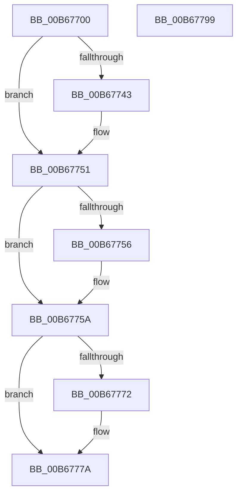

# KiStartSavingSupervisorState

- RVA: `0x00B67700`–`0x00B6779A` (길이 `154` bytes)
- VA: `0x0000000140B67700`
- 실행 섹션: `PAGELK`
- PDB 이름 있음: `예`; PDB Function 태그: `아니요`
- unwind 정보 RVA: `0x00060BC4`
- 디코드: `41`개 명령, `154/154` bytes 표시
- 미해석 바이트: `0` (있으면 어셈블리에 `.byte`로 보존)

> 이 문서는 커널 이미지의 기계어와 PDB 기호를 분석해 생성했습니다. 4번과 5번은 함수 원형과 자료형을 바이너리 사용 방식에서 추정한 C 해석이며 원본 소스 복구 결과는 아닙니다.

## 1. Dependencies

- 직접 호출 지점: **6**; 고유 호출 대상: **6**
- 직접 호출자로 확인된 함수: **0**
- RIP 상대 이미지 참조: **2**

### Outgoing calls
- `0x00B67733` → [KeAbPreAcquire](../../text/21/KeAbPreAcquire_function_00210230.md) (function, `0x00210230`)
- `0x00B6774C` → [ExfAcquirePushLockExclusiveEx](../../text/20/ExfAcquirePushLockExclusiveEx_function_0020FC90.md) (function, `0x0020FC90`)
- `0x00B6775A` → [KiUpdateSavedSupervisorState](KiUpdateSavedSupervisorState_function_00B677A0.md) (function, `0x00B677A0`)
- `0x00B67775` → [ExfTryToWakePushLock](../../text/26/ExfTryToWakePushLock_function_00265DD0.md) (function, `0x00265DD0`)
- `0x00B6777D` → [KeAbPostRelease](../../text/2E/KeAbPostRelease_function_002E1600.md) (function, `0x002E1600`)
- `0x00B67782` → [KeLeaveCriticalRegion](../../text/25/KeLeaveCriticalRegion_function_0025D8B0.md) (function, `0x0025D8B0`)

### Direct callers
- 이 함수 시작 RVA로 연결되는 직접 call은 확인되지 않았습니다. 간접 호출은 완전히 역산할 수 없습니다.

### Static image references
- `0x00B67718` → RVA `0x00F225F0` (`.data`; read)
- `0x00B67761` → RVA `0x00F225F0` (`.data`; read/write)

## 2. Other-region calls and transfers

- 다른 실행 섹션으로 향하는 call: **5**
  - `0x00B67733` → [KeAbPreAcquire](../../text/21/KeAbPreAcquire_function_00210230.md) (`PAGELK` → `.text`)
  - `0x00B6774C` → [ExfAcquirePushLockExclusiveEx](../../text/20/ExfAcquirePushLockExclusiveEx_function_0020FC90.md) (`PAGELK` → `.text`)
  - `0x00B67775` → [ExfTryToWakePushLock](../../text/26/ExfTryToWakePushLock_function_00265DD0.md) (`PAGELK` → `.text`)
  - `0x00B6777D` → [KeAbPostRelease](../../text/2E/KeAbPostRelease_function_002E1600.md) (`PAGELK` → `.text`)
  - `0x00B67782` → [KeLeaveCriticalRegion](../../text/25/KeLeaveCriticalRegion_function_0025D8B0.md) (`PAGELK` → `.text`)
- 별도 외부 분기/꼬리 이동을 확인하지 못했습니다.

## 3. Assembly (complete function range)

```asm
00B67700  48 89 5C 24 08                  mov qword ptr [rsp + 8], rbx
00B67705  48 89 74 24 10                  mov qword ptr [rsp + 0x10], rsi
00B6770A  57                              push rdi
00B6770B  48 83 EC 20                     sub rsp, 0x20
00B6770F  65 48 8B 04 25 88 01 00 00      mov rax, qword ptr gs:[0x188]
00B67718  48 8D 35 D1 AE 3B 00            lea rsi, [rip + 0x3baed1]
00B6771F  48 83 CB FF                     or rbx, 0xffffffffffffffff
00B67723  45 33 C0                        xor r8d, r8d
00B67726  33 D2                           xor edx, edx
00B67728  48 8B CE                        mov rcx, rsi
00B6772B  66 01 98 E4 01 00 00            add word ptr [rax + 0x1e4], bx
00B67732  90                              nop
00B67733  E8 F8 8A 6A FF                  call 0x140210230
00B67738  F0 48 0F BA 2E 00               lock bts qword ptr [rsi], 0
00B6773E  48 8B F8                        mov rdi, rax
00B67741  73 0E                           jae 0x140b67751
00B67743  4C 8B C6                        mov r8, rsi
00B67746  48 8B D0                        mov rdx, rax
00B67749  48 8B CE                        mov rcx, rsi
00B6774C  E8 3F 85 6A FF                  call 0x14020fc90
00B67751  48 85 FF                        test rdi, rdi
00B67754  74 04                           je 0x140b6775a
00B67756  C6 47 0A 01                     mov byte ptr [rdi + 0xa], 1
00B6775A  E8 41 00 00 00                  call 0x140b677a0
00B6775F  8B F8                           mov edi, eax
00B67761  F0 48 0F C1 1D 86 AE 3B 00      lock xadd qword ptr [rip + 0x3bae86], rbx
00B6776A  80 E3 06                        and bl, 6
00B6776D  80 FB 02                        cmp bl, 2
00B67770  75 08                           jne 0x140b6777a
00B67772  48 8B CE                        mov rcx, rsi
00B67775  E8 56 E6 6F FF                  call 0x140265dd0
00B6777A  48 8B CE                        mov rcx, rsi
00B6777D  E8 7E 9E 77 FF                  call 0x1402e1600
00B67782  E8 29 61 6F FF                  call 0x14025d8b0
00B67787  48 8B 5C 24 30                  mov rbx, qword ptr [rsp + 0x30]
00B6778C  8B C7                           mov eax, edi
00B6778E  48 8B 74 24 38                  mov rsi, qword ptr [rsp + 0x38]
00B67793  48 83 C4 20                     add rsp, 0x20
00B67797  5F                              pop rdi
00B67798  C3                              ret
00B67799  CC                              int3
```

## 4. C-style interpretation (structured pseudocode)

```c
__int64 __fastcall KiStartSavingSupervisorState(__int64 a1, int a2, int a3)
{
    __int64 result;
    __int64 v_rbx;
    __int64 v_rsp;
    unsigned __int64 v_stack_p10;
    unsigned __int64 v_stack_p8;

    v_stack_p8 = v_rbx;
    v_stack_p10 = v_rsi;
    v_rsp = (v_rsp) - (32);
    v_rbx = (v_rbx) | (-1);
    a3 = 0;
    a2 = 0;
    result = KeAbPreAcquire(v_rip + 3911377, a2, a3, a4);
    if (!(condition_is_above_or_equal)) {
        a3 = v_rip + 3911377;
        a2 = result;
        a1 = v_rip + 3911377;
        result = ExfAcquirePushLockExclusiveEx(a1, a2, a3, a4);
    }
    if (result != 0) {
        *(unsigned __int8 *)(result + 10) = 1;
    }
    result = KiUpdateSavedSupervisorState(a1, a2, a3, a4);
    v_rbx = (unsigned __int8)((v_rbx) & (6));
    if (((unsigned __int8)(v_rbx)) == 2) {
        a1 = v_rip + 3911377;
        result = ExfTryToWakePushLock(a1, a2, a3, a4);
    }
    result = KeAbPostRelease(v_rip + 3911377, a2, a3, a4);
    result = KeLeaveCriticalRegion(v_rip + 3911377, a2, a3, a4);
    v_rsp = (v_rsp) + (32);
    return (unsigned int)((unsigned int)((unsigned int)((unsigned int)(result))));
}
```

## 5. (Beta) C Style

```c
int64_t KiStartSavingSupervisorState(int64_t Arg1, int32_t Arg2, int32_t Arg3)
{
    int64_t result;
    int64_t local_rbx;
    int64_t local_rsp;
    uint64_t v_stack_p10;
    uint64_t v_stack_p8;

    v_stack_p8 = local_rbx;
    v_stack_p10 = local_rsi;
    local_rsp = (local_rsp) - (32);
    local_rbx = (local_rbx) | (-1);
    Arg3 = 0;
    Arg2 = 0;
    result = KeAbPreAcquire(v_rip + 3911377, Arg2, Arg3, a4);
    if (!(condition_is_above_or_equal)) {
        Arg3 = v_rip + 3911377;
        Arg2 = result;
        Arg1 = v_rip + 3911377;
        result = ExfAcquirePushLockExclusiveEx(Arg1, Arg2, Arg3, a4);
    }
    if (result != 0) {
        *(uint8_t *)(result + 0xA) = 1;
    }
    result = KiUpdateSavedSupervisorState(Arg1, Arg2, Arg3, a4);
    local_rbx = (uint8_t)((local_rbx) & (6));
    if (((uint8_t)(local_rbx)) == 2) {
        Arg1 = v_rip + 3911377;
        result = ExfTryToWakePushLock(Arg1, Arg2, Arg3, a4);
    }
    result = KeAbPostRelease(v_rip + 3911377, Arg2, Arg3, a4);
    result = KeLeaveCriticalRegion(v_rip + 3911377, Arg2, Arg3, a4);
    local_rsp = (local_rsp) + (32);
    return (uint32_t)((uint32_t)((uint32_t)((uint32_t)(result))));
}
```

## 6. Execution-region graph

[열기: 2D/3D 그래프와 함수 탐색 컨트롤 패널](../../../control-panel.html?section=pagelk&rva=0x00B67700&view=graph)

- 2D 그래프는 위에서 아래로 흐르고, 3D 그래프는 빈 공간을 드래그해 회전합니다. Shift+드래그는 이동, 휠은 확대·축소, 함수 노드 선택은 대상 보고서 이동입니다.

### Static fallback


