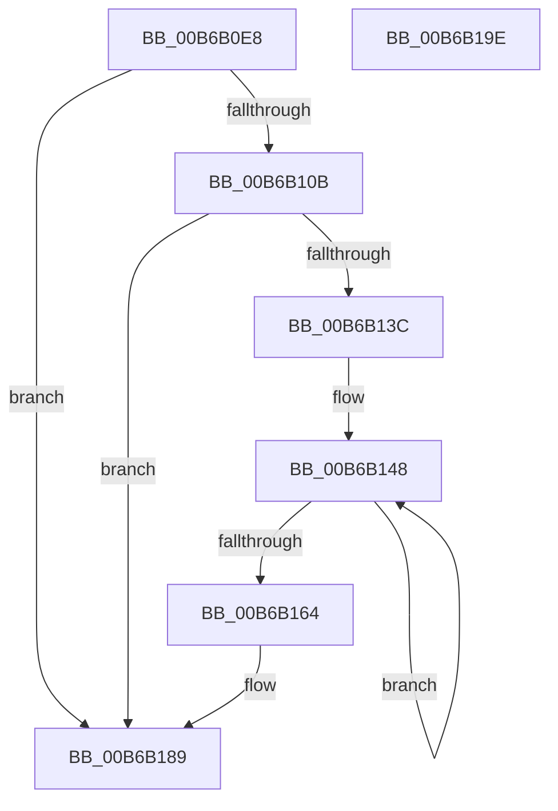

# KiUnshadowProcessorAllocation

- RVA: `0x00B6B0E8`–`0x00B6B19F` (길이 `183` bytes)
- VA: `0x0000000140B6B0E8`
- 실행 섹션: `PAGELK`
- PDB 이름 있음: `예`; PDB Function 태그: `아니요`
- unwind 정보 RVA: `0x0005C954`
- 디코드: `42`개 명령, `183/183` bytes 표시
- 미해석 바이트: `0` (있으면 어셈블리에 `.byte`로 보존)

> 이 문서는 커널 이미지의 기계어와 PDB 기호를 분석해 생성했습니다. 4번과 5번은 함수 원형과 자료형을 바이너리 사용 방식에서 추정한 C 해석이며 원본 소스 복구 결과는 아닙니다.

## 1. Dependencies

- 직접 호출 지점: **5**; 고유 호출 대상: **1**
- 직접 호출자로 확인된 함수: **2**
- RIP 상대 이미지 참조: **2**

### Outgoing calls
- `0x00B6B11B` → [MmDeleteShadowMapping](../../page/80/MmDeleteShadowMapping_function_00807D00.md) (function, `0x00807D00`)
- `0x00B6B12E` → [MmDeleteShadowMapping](../../page/80/MmDeleteShadowMapping_function_00807D00.md) (function, `0x00807D00`)
- `0x00B6B155` → [MmDeleteShadowMapping](../../page/80/MmDeleteShadowMapping_function_00807D00.md) (function, `0x00807D00`)
- `0x00B6B16E` → [MmDeleteShadowMapping](../../page/80/MmDeleteShadowMapping_function_00807D00.md) (function, `0x00807D00`)
- `0x00B6B184` → [MmDeleteShadowMapping](../../page/80/MmDeleteShadowMapping_function_00807D00.md) (function, `0x00807D00`)

### Direct callers
- [KiStartDynamicProcessor](../../page/74/KiStartDynamicProcessor_function_007456C8.md) at `0x00745CF6`
- [KeStartAllProcessors](../../init/C3/KeStartAllProcessors_function_00C36F78.md) at `0x00C37489`

### Static image references
- `0x00B6B0FC` → RVA `0x01201840` (`CFGRO`; read)
- `0x00B6B133` → RVA `0x01201841` (`CFGRO`; read)

## 2. Other-region calls and transfers

- 다른 실행 섹션으로 향하는 call: **5**
  - `0x00B6B11B` → [MmDeleteShadowMapping](../../page/80/MmDeleteShadowMapping_function_00807D00.md) (`PAGELK` → `PAGE`)
  - `0x00B6B12E` → [MmDeleteShadowMapping](../../page/80/MmDeleteShadowMapping_function_00807D00.md) (`PAGELK` → `PAGE`)
  - `0x00B6B155` → [MmDeleteShadowMapping](../../page/80/MmDeleteShadowMapping_function_00807D00.md) (`PAGELK` → `PAGE`)
  - `0x00B6B16E` → [MmDeleteShadowMapping](../../page/80/MmDeleteShadowMapping_function_00807D00.md) (`PAGELK` → `PAGE`)
  - `0x00B6B184` → [MmDeleteShadowMapping](../../page/80/MmDeleteShadowMapping_function_00807D00.md) (`PAGELK` → `PAGE`)
- 별도 외부 분기/꼬리 이동을 확인하지 못했습니다.

## 3. Assembly (complete function range)

```asm
00B6B0E8  48 89 5C 24 08                  mov qword ptr [rsp + 8], rbx
00B6B0ED  48 89 6C 24 10                  mov qword ptr [rsp + 0x10], rbp
00B6B0F2  48 89 74 24 18                  mov qword ptr [rsp + 0x18], rsi
00B6B0F7  57                              push rdi
00B6B0F8  48 83 EC 20                     sub rsp, 0x20
00B6B0FC  80 3D 3D 67 69 00 00            cmp byte ptr [rip + 0x69673d], 0
00B6B103  49 8B F8                        mov rdi, r8
00B6B106  48 8B D9                        mov rbx, rcx
00B6B109  74 7E                           je 0x140b6b189
00B6B10B  48 8B 4A 58                     mov rcx, qword ptr [rdx + 0x58]
00B6B10F  BA 00 50 00 00                  mov edx, 0x5000
00B6B114  48 81 E9 B0 2F 00 00            sub rcx, 0x2fb0
00B6B11B  E8 E0 CB C9 FF                  call 0x140807d00
00B6B120  BD 00 10 00 00                  mov ebp, 0x1000
00B6B125  48 8D 8B 80 AE 00 00            lea rcx, [rbx + 0xae80]
00B6B12C  8B D5                           mov edx, ebp
00B6B12E  E8 CD CB C9 FF                  call 0x140807d00
00B6B133  80 3D 07 67 69 00 00            cmp byte ptr [rip + 0x696707], 0
00B6B13A  74 4D                           je 0x140b6b189
00B6B13C  48 8D 9F C0 00 00 00            lea rbx, [rdi + 0xc0]
00B6B143  BE 04 00 00 00                  mov esi, 4
00B6B148  48 8B 0B                        mov rcx, qword ptr [rbx]
00B6B14B  48 8B D5                        mov rdx, rbp
00B6B14E  48 81 E9 00 20 00 00            sub rcx, 0x2000
00B6B155  E8 A6 CB C9 FF                  call 0x140807d00
00B6B15A  48 8D 5B 08                     lea rbx, [rbx + 8]
00B6B15E  48 83 EE 01                     sub rsi, 1
00B6B162  75 E4                           jne 0x140b6b148
00B6B164  48 8B 8F E0 00 00 00            mov rcx, qword ptr [rdi + 0xe0]
00B6B16B  48 8B D5                        mov rdx, rbp
00B6B16E  E8 8D CB C9 FF                  call 0x140807d00
00B6B173  48 8B 8F 88 00 00 00            mov rcx, qword ptr [rdi + 0x88]
00B6B17A  48 8B D5                        mov rdx, rbp
00B6B17D  48 81 E9 00 20 00 00            sub rcx, 0x2000
00B6B184  E8 77 CB C9 FF                  call 0x140807d00
00B6B189  48 8B 5C 24 30                  mov rbx, qword ptr [rsp + 0x30]
00B6B18E  48 8B 6C 24 38                  mov rbp, qword ptr [rsp + 0x38]
00B6B193  48 8B 74 24 40                  mov rsi, qword ptr [rsp + 0x40]
00B6B198  48 83 C4 20                     add rsp, 0x20
00B6B19C  5F                              pop rdi
00B6B19D  C3                              ret
00B6B19E  CC                              int3
```

## 4. C-style interpretation (structured pseudocode)

```c
__int64 __fastcall KiUnshadowProcessorAllocation(__int64 a1, __int64 a2, __int64 a3)
{
    __int64 result;
    __int64 v_rsi;
    __int64 v_rsp;
    unsigned __int64 v_stack_p10;
    unsigned __int64 v_stack_p18;
    unsigned __int64 v_stack_p8;

    v_stack_p8 = v_rbx;
    v_stack_p10 = v_rbp;
    v_stack_p18 = v_rsi;
    v_rsp = (v_rsp) - (32);
    if ((*(unsigned __int8 *)(v_rip + 6907709)) == 0) goto loc_00B6B189;
    a1 = (*(unsigned __int64 *)(a2 + 88)) - (0x2FB0ULL);
    result = MmDeleteShadowMapping(a1, (unsigned int)(0x5000ULL), a3, a4);
    result = MmDeleteShadowMapping(a1 + 44672, (unsigned int)((unsigned int)((unsigned int)(0x1000ULL))), a3, a4);
    if ((*(unsigned __int8 *)(v_rip + 6907655)) == 0) goto loc_00B6B189;
loc_00B6B148:
    a1 = (*(unsigned __int64 *)(a3 + 192)) - (0x2000ULL);
    result = MmDeleteShadowMapping(a1, (unsigned int)(0x1000ULL), a3, a4);
    v_rsi = (4) - (1);
    if (condition_is_not_equal) goto loc_00B6B148;
    result = MmDeleteShadowMapping(*(unsigned __int64 *)(a3 + 224), (unsigned int)(0x1000ULL), a3, a4);
    a1 = (*(unsigned __int64 *)(a3 + 136)) - (0x2000ULL);
    result = MmDeleteShadowMapping(a1, (unsigned int)(0x1000ULL), a3, a4);
loc_00B6B189:
    v_rsp = (v_rsp) + (32);
    return result;
}
```

## 5. (Beta) C Style

```c
int64_t KiUnshadowProcessorAllocation(void *Arg1, void *Arg2, void *Arg3)
{
    uint8_t *arg1 = (uint8_t *)Arg1;
    uint8_t *arg2 = (uint8_t *)Arg2;
    uint8_t *arg3 = (uint8_t *)Arg3;

    int64_t result;
    int64_t local_rsi;
    int64_t local_rsp;
    uint64_t v_stack_p10;
    uint64_t v_stack_p18;
    uint64_t v_stack_p8;

    v_stack_p8 = local_rbx;
    v_stack_p10 = local_rbp;
    v_stack_p18 = local_rsi;
    local_rsp = (local_rsp) - (32);
    if ((*(uint8_t *)(v_rip + 0x69673D)) == 0) goto loc_00B6B189;
    Arg1 = (*(uint64_t *)(arg2 + 0x58)) - (0x2FB0ULL);
    result = MmDeleteShadowMapping(Arg1, (uint32_t)(0x5000ULL), Arg3, a4);
    result = MmDeleteShadowMapping(Arg1 + 44672, (uint32_t)((uint32_t)((uint32_t)(0x1000ULL))), Arg3, a4);
    if ((*(uint8_t *)(v_rip + 0x696707)) == 0) goto loc_00B6B189;
loc_00B6B148:
    Arg1 = (*(uint64_t *)(arg3 + 0xC0)) - (0x2000ULL);
    result = MmDeleteShadowMapping(Arg1, (uint32_t)(0x1000ULL), Arg3, a4);
    local_rsi = (4) - (1);
    if (condition_is_not_equal) goto loc_00B6B148;
    result = MmDeleteShadowMapping(*(uint64_t *)(arg3 + 0xE0), (uint32_t)(0x1000ULL), Arg3, a4);
    Arg1 = (*(uint64_t *)(arg3 + 0x88)) - (0x2000ULL);
    result = MmDeleteShadowMapping(Arg1, (uint32_t)(0x1000ULL), Arg3, a4);
loc_00B6B189:
    local_rsp = (local_rsp) + (32);
    return result;
}
```

### 관측된 메모리 오프셋

구조체 형식이 확인되지 않은 접근은 인자 기준의 오프셋으로만 기록했습니다.

| 기준 인자 | 오프셋 표현 | 폭 (bit) | 접근 |
|---|---:|---:|---|
| `Arg1` | `+ 0xAE80` | `64` | `R` |
| `Arg2` | `+ 0x58` | `64` | `R` |
| `Arg3` | `+ 0x0` | `64` | `R` |
| `Arg3` | `+ 0x8` | `64` | `R` |
| `Arg3` | `+ 0x88` | `64` | `R` |
| `Arg3` | `+ 0xC0` | `64` | `R` |
| `Arg3` | `+ 0xE0` | `64` | `R` |

## 6. Execution-region graph

[열기: 2D/3D 그래프와 함수 탐색 컨트롤 패널](../../../control-panel.html?section=pagelk&rva=0x00B6B0E8&view=graph)

- 2D 그래프는 위에서 아래로 흐르고, 3D 그래프는 빈 공간을 드래그해 회전합니다. Shift+드래그는 이동, 휠은 확대·축소, 함수 노드 선택은 대상 보고서 이동입니다.

### Static fallback


