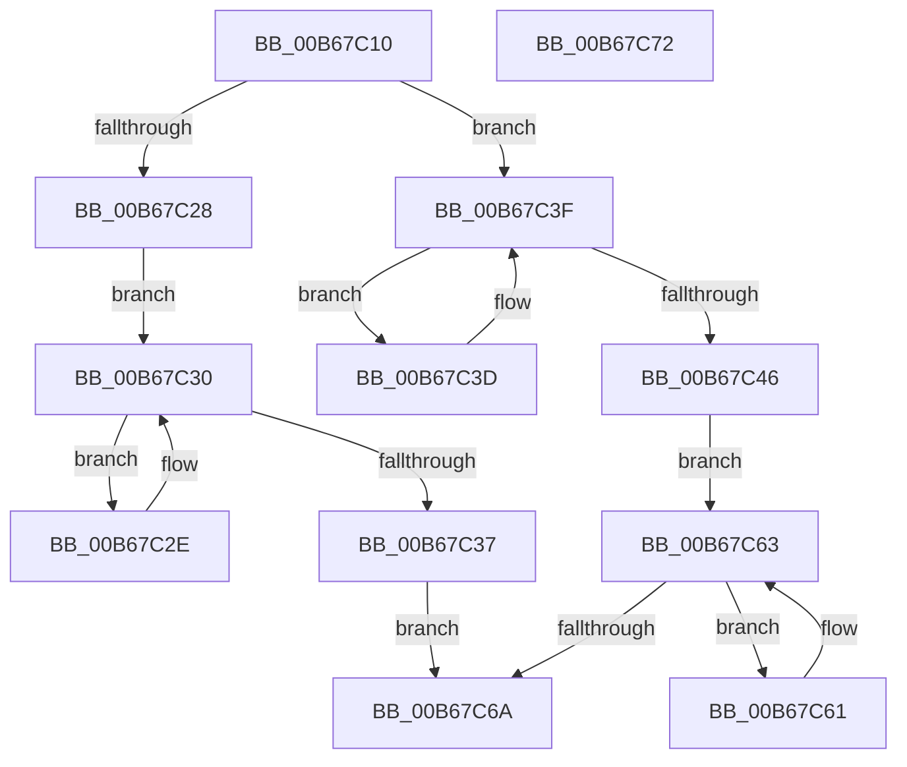

# KiUpdateNumberProcessorsIpi

- RVA: `0x00B67C10`–`0x00B67C73` (길이 `99` bytes)
- VA: `0x0000000140B67C10`
- 실행 섹션: `PAGELK`
- PDB 이름 있음: `예`; PDB Function 태그: `아니요`
- unwind 정보 RVA: `0x0005CF00`
- 디코드: `34`개 명령, `99/99` bytes 표시
- 미해석 바이트: `0` (있으면 어셈블리에 `.byte`로 보존)

> 이 문서는 커널 이미지의 기계어와 PDB 기호를 분석해 생성했습니다. 4번과 5번은 함수 원형과 자료형을 바이너리 사용 방식에서 추정한 C 해석이며 원본 소스 복구 결과는 아닙니다.

## 1. Dependencies

- 직접 호출 지점: **1**; 고유 호출 대상: **1**
- 직접 호출자로 확인된 함수: **0**
- RIP 상대 이미지 참조: **1**

### Outgoing calls
- `0x00B67C53` → [KiUpdateProcessorCount](KiUpdateProcessorCount_function_00B65D18.md) (function, `0x00B65D18`)

### Direct callers
- 이 함수 시작 RVA로 연결되는 직접 call은 확인되지 않았습니다. 간접 호출은 완전히 역산할 수 없습니다.

### Static image references
- `0x00B67C46` → RVA `0x00F231B0` (`.data`; read)

## 2. Other-region calls and transfers

- 다른 실행 섹션으로 향하는 call: **0**
- 별도 외부 분기/꼬리 이동을 확인하지 못했습니다.

## 3. Assembly (complete function range)

```asm
00B67C10  40 53                           push rbx
00B67C12  48 83 EC 20                     sub rsp, 0x20
00B67C16  65 8B 04 25 A4 01 00 00         mov eax, dword ptr gs:[0x1a4]
00B67C1E  48 8B D9                        mov rbx, rcx
00B67C21  8B 09                           mov ecx, dword ptr [rcx]
00B67C23  39 43 04                        cmp dword ptr [rbx + 4], eax
00B67C26  74 17                           je 0x140b67c3f
00B67C28  F0 FF 4B 08                     lock dec dword ptr [rbx + 8]
00B67C2C  EB 02                           jmp 0x140b67c30
00B67C2E  F3 90                           pause
00B67C30  8B 43 10                        mov eax, dword ptr [rbx + 0x10]
00B67C33  85 C0                           test eax, eax
00B67C35  74 F7                           je 0x140b67c2e
00B67C37  F0 FF 4B 0C                     lock dec dword ptr [rbx + 0xc]
00B67C3B  EB 2D                           jmp 0x140b67c6a
00B67C3D  F3 90                           pause
00B67C3F  8B 43 08                        mov eax, dword ptr [rbx + 8]
00B67C42  85 C0                           test eax, eax
00B67C44  75 F7                           jne 0x140b67c3d
00B67C46  48 8B 05 63 B5 3B 00            mov rax, qword ptr [rip + 0x3bb563]
00B67C4D  8B 14 88                        mov edx, dword ptr [rax + rcx*4]
00B67C50  C1 EA 06                        shr edx, 6
00B67C53  E8 C0 E0 FF FF                  call 0x140b65d18
00B67C58  C7 43 10 01 00 00 00            mov dword ptr [rbx + 0x10], 1
00B67C5F  EB 02                           jmp 0x140b67c63
00B67C61  F3 90                           pause
00B67C63  8B 43 0C                        mov eax, dword ptr [rbx + 0xc]
00B67C66  85 C0                           test eax, eax
00B67C68  75 F7                           jne 0x140b67c61
00B67C6A  33 C0                           xor eax, eax
00B67C6C  48 83 C4 20                     add rsp, 0x20
00B67C70  5B                              pop rbx
00B67C71  C3                              ret
00B67C72  CC                              int3
```

## 4. C-style interpretation (structured pseudocode)

```c
__int64 __fastcall KiUpdateNumberProcessorsIpi(__int64 a1)
{
    __int64 result;
    __int64 v_rsp;

    v_rsp = (v_rsp) - (32);
    if ((*(unsigned int *)(a1 + 4)) == ((unsigned int)((unsigned int)(*(unsigned int *)(gs_base + (0 + 420)))))) goto loc_00B67C3F;
    goto loc_00B67C30;
loc_00B67C2E:
loc_00B67C30:
    if ((unsigned int)((unsigned int)(*(unsigned int *)(a1 + 16))) == 0) goto loc_00B67C2E;
    goto loc_00B67C6A;
loc_00B67C3D:
loc_00B67C3F:
    if ((unsigned int)((unsigned int)(*(unsigned int *)(a1 + 8))) != 0) goto loc_00B67C3D;
    a2 = (unsigned int)(((unsigned int)(*(unsigned int *)(*(unsigned __int64 *)(v_rip + 3913059) + (unsigned int)(*(unsigned int *)(a1)) * 4))) >> (6));
    result = KiUpdateProcessorCount((unsigned int)(*(unsigned int *)(a1)), a2, a3, a4);
    *(unsigned int *)(a1 + 16) = 1;
    goto loc_00B67C63;
loc_00B67C61:
loc_00B67C63:
    if ((unsigned int)((unsigned int)(*(unsigned int *)(a1 + 12))) != 0) goto loc_00B67C61;
loc_00B67C6A:
    result = 0;
    v_rsp = (v_rsp) + (32);
    return result;
}
```

## 5. (Beta) C Style

```c
int64_t KiUpdateNumberProcessorsIpi(void *Arg1)
{
    uint8_t *arg1 = (uint8_t *)Arg1;

    int64_t result;
    int64_t local_rsp;

    local_rsp = (local_rsp) - (32);
    if ((*(uint32_t *)(arg1 + 0x4)) == ((uint32_t)((uint32_t)(*(uint32_t *)(gs_base + (0 + 0x1A4)))))) goto loc_00B67C3F;
    goto loc_00B67C30;
loc_00B67C2E:
loc_00B67C30:
    if ((uint32_t)((uint32_t)(*(uint32_t *)(arg1 + 0x10))) == 0) goto loc_00B67C2E;
    goto loc_00B67C6A;
loc_00B67C3D:
loc_00B67C3F:
    if ((uint32_t)((uint32_t)(*(uint32_t *)(arg1 + 0x8))) != 0) goto loc_00B67C3D;
    a2 = (uint32_t)(((uint32_t)(*(uint32_t *)(*(uint64_t *)(v_rip + 0x3BB563) + (uint32_t)(*(uint32_t *)(arg1)) * 4))) >> (6));
    result = KiUpdateProcessorCount((uint32_t)(*(uint32_t *)(arg1)), a2, a3, a4);
    *(uint32_t *)(arg1 + 0x10) = 1;
    goto loc_00B67C63;
loc_00B67C61:
loc_00B67C63:
    if ((uint32_t)((uint32_t)(*(uint32_t *)(arg1 + 0xC))) != 0) goto loc_00B67C61;
loc_00B67C6A:
    result = 0;
    local_rsp = (local_rsp) + (32);
    return result;
}
```

### 관측된 메모리 오프셋

구조체 형식이 확인되지 않은 접근은 인자 기준의 오프셋으로만 기록했습니다.

| 기준 인자 | 오프셋 표현 | 폭 (bit) | 접근 |
|---|---:|---:|---|
| `Arg1` | `+ 0x0` | `32` | `R` |
| `Arg1` | `+ 0x4` | `32` | `R` |
| `Arg1` | `+ 0x8` | `32` | `R` |
| `Arg1` | `+ 0x8` | `32` | `R/W` |
| `Arg1` | `+ 0xC` | `32` | `R` |
| `Arg1` | `+ 0xC` | `32` | `R/W` |
| `Arg1` | `+ 0x10` | `32` | `R` |
| `Arg1` | `+ 0x10` | `32` | `W` |

## 6. Execution-region graph

[열기: 2D/3D 그래프와 함수 탐색 컨트롤 패널](../../../control-panel.html?section=pagelk&rva=0x00B67C10&view=graph)

- 2D 그래프는 위에서 아래로 흐르고, 3D 그래프는 빈 공간을 드래그해 회전합니다. Shift+드래그는 이동, 휠은 확대·축소, 함수 노드 선택은 대상 보고서 이동입니다.

### Static fallback


