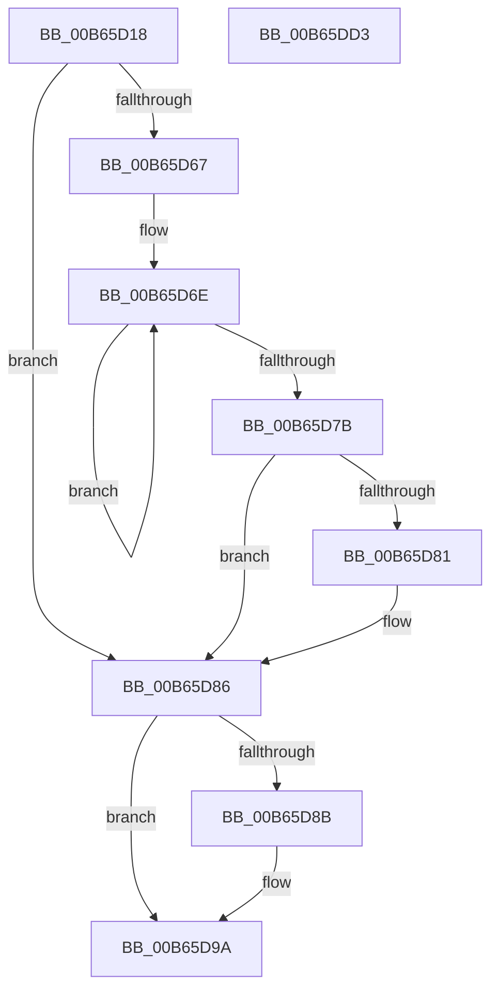

# KiUpdateProcessorCount

- RVA: `0x00B65D18`–`0x00B65DD4` (길이 `188` bytes)
- VA: `0x0000000140B65D18`
- 실행 섹션: `PAGELK`
- PDB 이름 있음: `예`; PDB Function 태그: `아니요`
- unwind 정보 RVA: `0x0005CAAC`
- 디코드: `45`개 명령, `188/188` bytes 표시
- 미해석 바이트: `0` (있으면 어셈블리에 `.byte`로 보존)

> 이 문서는 커널 이미지의 기계어와 PDB 기호를 분석해 생성했습니다. 4번과 5번은 함수 원형과 자료형을 바이너리 사용 방식에서 추정한 C 해석이며 원본 소스 복구 결과는 아닙니다.

## 1. Dependencies

- 직접 호출 지점: **3**; 고유 호출 대상: **3**
- 직접 호출자로 확인된 함수: **2**
- RIP 상대 이미지 참조: **8**

### Outgoing calls
- `0x00B65D24` → [KiGetCurrentGroupCount](../../text/5B/KiGetCurrentGroupCount_function_005BCB24.md) (function, `0x005BCB24`)
- `0x00B65D4D` → [KeAddProcessorAffinityEx](../../text/25/KeAddProcessorAffinityEx_function_0025B6F0.md) (function, `0x0025B6F0`)
- `0x00B65D81` → [KiRemoveSystemWorkPriorityKick](../../text/26/KiRemoveSystemWorkPriorityKick_function_002631D0.md) (function, `0x002631D0`)

### Direct callers
- [KiUpdateNumberProcessorsIpi](KiUpdateNumberProcessorsIpi_function_00B67C10.md) at `0x00B67C53`
- [KeStartAllProcessors](../../init/C3/KeStartAllProcessors_function_00C36F78.md) at `0x00C37391`

### Static image references
- `0x00B65D29` → RVA `0x00FC5018` (`ALMOSTRO`; write)
- `0x00B65D31` → RVA `0x00FC6A80` (`ALMOSTRO`; read)
- `0x00B65D3E` → RVA `0x00FC7120` (`ALMOSTRO`; read)
- `0x00B65D47` → RVA `0x00FC6A80` (`ALMOSTRO`; write)
- `0x00B65D8B` → RVA `0x00FC6BC7` (`ALMOSTRO`; read)
- `0x00B65D94` → RVA `0x00FC6BC7` (`ALMOSTRO`; write)
- `0x00B65D9A` → RVA `0x00FC5008` (`ALMOSTRO`; read)
- `0x00B65DC1` → RVA `0x00FC5018` (`ALMOSTRO`; read)

## 2. Other-region calls and transfers

- 다른 실행 섹션으로 향하는 call: **3**
  - `0x00B65D24` → [KiGetCurrentGroupCount](../../text/5B/KiGetCurrentGroupCount_function_005BCB24.md) (`PAGELK` → `.text`)
  - `0x00B65D4D` → [KeAddProcessorAffinityEx](../../text/25/KeAddProcessorAffinityEx_function_0025B6F0.md) (`PAGELK` → `.text`)
  - `0x00B65D81` → [KiRemoveSystemWorkPriorityKick](../../text/26/KiRemoveSystemWorkPriorityKick_function_002631D0.md) (`PAGELK` → `.text`)
- 별도 외부 분기/꼬리 이동을 확인하지 못했습니다.

## 3. Assembly (complete function range)

```asm
00B65D18  48 89 5C 24 08                  mov qword ptr [rsp + 8], rbx
00B65D1D  57                              push rdi
00B65D1E  48 83 EC 20                     sub rsp, 0x20
00B65D22  8B DA                           mov ebx, edx
00B65D24  E8 FB 6D A5 FF                  call 0x1405bcb24
00B65D29  66 89 05 E8 F2 45 00            mov word ptr [rip + 0x45f2e8], ax
00B65D30  FA                              cli
00B65D31  8B 05 49 0D 46 00               mov eax, dword ptr [rip + 0x460d49]
00B65D37  8B D1                           mov edx, ecx
00B65D39  BF 01 00 00 00                  mov edi, 1
00B65D3E  48 8D 0D DB 13 46 00            lea rcx, [rip + 0x4613db]
00B65D45  03 C7                           add eax, edi
00B65D47  89 05 33 0D 46 00               mov dword ptr [rip + 0x460d33], eax
00B65D4D  E8 9E 59 6F FF                  call 0x14025b6f0
00B65D52  65 48 8B 0C 25 20 00 00 00      mov rcx, qword ptr gs:[0x20]
00B65D5B  4C 8B 81 B8 8E 00 00            mov r8, qword ptr [rcx + 0x8eb8]
00B65D62  4D 85 C0                        test r8, r8
00B65D65  74 1F                           je 0x140b65d86
00B65D67  41 0F 0D 08                     prefetchw byte ptr [r8]
00B65D6B  41 8B 00                        mov eax, dword ptr [r8]
00B65D6E  8B D0                           mov edx, eax
00B65D70  0F BA F2 15                     btr edx, 0x15
00B65D74  F0 41 0F B1 10                  lock cmpxchg dword ptr [r8], edx
00B65D79  75 F3                           jne 0x140b65d6e
00B65D7B  0F BA E0 15                     bt eax, 0x15
00B65D7F  73 05                           jae 0x140b65d86
00B65D81  E8 4A D4 6F FF                  call 0x1402631d0
00B65D86  FB                              sti
00B65D87  85 DB                           test ebx, ebx
00B65D89  75 0F                           jne 0x140b65d9a
00B65D8B  8A 05 36 0E 46 00               mov al, byte ptr [rip + 0x460e36]
00B65D91  40 02 C7                        add al, dil
00B65D94  88 05 2D 0E 46 00               mov byte ptr [rip + 0x460e2d], al
00B65D9A  48 8B 05 67 F2 45 00            mov rax, qword ptr [rip + 0x45f267]
00B65DA1  48 8B 5C 24 30                  mov rbx, qword ptr [rsp + 0x30]
00B65DA6  01 B8 C0 03 00 00               add dword ptr [rax + 0x3c0], edi
00B65DAC  48 8B 05 55 F2 45 00            mov rax, qword ptr [rip + 0x45f255]
00B65DB3  66 01 B8 6A 03 00 00            add word ptr [rax + 0x36a], di
00B65DBA  48 8B 05 47 F2 45 00            mov rax, qword ptr [rip + 0x45f247]
00B65DC1  8A 0D 51 F2 45 00               mov cl, byte ptr [rip + 0x45f251]
00B65DC7  88 88 C4 03 00 00               mov byte ptr [rax + 0x3c4], cl
00B65DCD  48 83 C4 20                     add rsp, 0x20
00B65DD1  5F                              pop rdi
00B65DD2  C3                              ret
00B65DD3  CC                              int3
```

## 4. C-style interpretation (structured pseudocode)

```c
__int64 __fastcall KiUpdateProcessorCount(int a1, int a2)
{
    __int64 result;
    __int64 v_rsp;
    unsigned __int64 v_stack_p8;

    v_stack_p8 = v_rbx;
    v_rsp = (v_rsp) - (32);
    result = KiGetCurrentGroupCount(a1, a2, a3, a4);
    *(unsigned __int16 *)(v_rip + 4584168) = (unsigned __int16)(result);
    result = (unsigned int)(((unsigned int)(*(unsigned int *)(v_rip + 4590921))) + (1));
    *(unsigned int *)(v_rip + 4590899) = (unsigned int)(result);
    result = KeAddProcessorAffinityEx(v_rip + 4592603, (unsigned int)(a1), a3, a4);
    if (*(unsigned __int64 *)(*(unsigned __int64 *)(gs_base + (0 + 32)) + 36536) == 0) goto loc_00B65D86;
loc_00B65D6E:
    if (*(unsigned __int64 *)(*(unsigned __int64 *)(gs_base + (0 + 32)) + 36536) != 0) goto loc_00B65D6E;
    result = (unsigned int)(*(unsigned int *)(*(unsigned __int64 *)(*(unsigned __int64 *)(gs_base + (0 + 32)) + 36536)));
    if (!(condition_is_above_or_equal)) {
        result = KiRemoveSystemWorkPriorityKick(*(unsigned __int64 *)(gs_base + (0 + 32)), (unsigned int)((unsigned int)((unsigned int)(*(unsigned int *)(*(unsigned __int64 *)(*(unsigned __int64 *)(gs_base + (0 + 32)) + 36536))))), *(unsigned __int64 *)(*(unsigned __int64 *)(gs_base + (0 + 32)) + 36536), a4);
    }
    if ((unsigned int)((unsigned int)(a2)) == 0) {
        result = *(unsigned __int8 *)(v_rip + 4591158);
        result = (unsigned __int8)((result) + (1));
        *(unsigned __int8 *)(v_rip + 4591149) = (unsigned __int8)(result);
    }
    *(unsigned __int8 *)(*(unsigned __int64 *)(v_rip + 4584007) + 964) = (unsigned __int8)(*(unsigned __int8 *)(v_rip + 4584017));
    v_rsp = (v_rsp) + (32);
    return *(unsigned __int64 *)(v_rip + 4584007);
}
```

## 5. (Beta) C Style

```c
int64_t KiUpdateProcessorCount(int32_t Arg1, int32_t Arg2)
{
    int64_t result;
    int64_t local_rsp;
    uint64_t v_stack_p8;

    v_stack_p8 = local_rbx;
    local_rsp = (local_rsp) - (32);
    result = KiGetCurrentGroupCount(Arg1, Arg2, a3, a4);
    *(uint16_t *)(v_rip + 0x45F2E8) = (uint16_t)(result);
    result = (uint32_t)(((uint32_t)(*(uint32_t *)(v_rip + 0x460D49))) + (1));
    *(uint32_t *)(v_rip + 0x460D33) = (uint32_t)(result);
    result = KeAddProcessorAffinityEx(v_rip + 4592603, (uint32_t)(Arg1), a3, a4);
    if (*(uint64_t *)(*(uint64_t *)(gs_base + (0 + 0x20)) + 0x8EB8) == 0) goto loc_00B65D86;
loc_00B65D6E:
    if (*(uint64_t *)(*(uint64_t *)(gs_base + (0 + 0x20)) + 0x8EB8) != 0) goto loc_00B65D6E;
    result = (uint32_t)(*(uint32_t *)(*(uint64_t *)(*(uint64_t *)(gs_base + (0 + 0x20)) + 0x8EB8)));
    if (!(condition_is_above_or_equal)) {
        result = KiRemoveSystemWorkPriorityKick(*(uint64_t *)(gs_base + (0 + 0x20)), (uint32_t)((uint32_t)((uint32_t)(*(uint32_t *)(*(uint64_t *)(*(uint64_t *)(gs_base + (0 + 0x20)) + 0x8EB8))))), *(uint64_t *)(*(uint64_t *)(gs_base + (0 + 0x20)) + 0x8EB8), a4);
    }
    if ((uint32_t)((uint32_t)(Arg2)) == 0) {
        result = *(uint8_t *)(v_rip + 0x460E36);
        result = (uint8_t)((result) + (1));
        *(uint8_t *)(v_rip + 0x460E2D) = (uint8_t)(result);
    }
    *(uint8_t *)(*(uint64_t *)(v_rip + 0x45F247) + 0x3C4) = (uint8_t)(*(uint8_t *)(v_rip + 0x45F251));
    local_rsp = (local_rsp) + (32);
    return *(uint64_t *)(v_rip + 0x45F247);
}
```

## 6. Execution-region graph

[열기: 2D/3D 그래프와 함수 탐색 컨트롤 패널](../../../control-panel.html?section=pagelk&rva=0x00B65D18&view=graph)

- 2D 그래프는 위에서 아래로 흐르고, 3D 그래프는 빈 공간을 드래그해 회전합니다. Shift+드래그는 이동, 휠은 확대·축소, 함수 노드 선택은 대상 보고서 이동입니다.

### Static fallback


