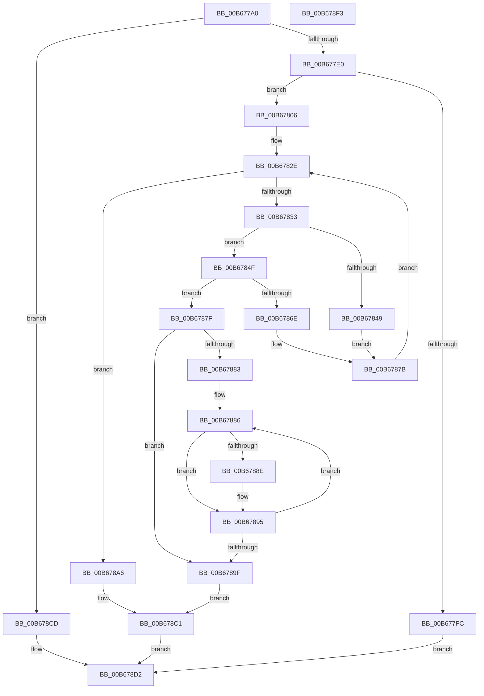

# KiUpdateSavedSupervisorState

- RVA: `0x00B677A0`–`0x00B678F4` (길이 `340` bytes)
- VA: `0x0000000140B677A0`
- 실행 섹션: `PAGELK`
- PDB 이름 있음: `예`; PDB Function 태그: `아니요`
- unwind 정보 RVA: `0x000847EC`
- 디코드: `92`개 명령, `340/340` bytes 표시
- 미해석 바이트: `0` (있으면 어셈블리에 `.byte`로 보존)

> 이 문서는 커널 이미지의 기계어와 PDB 기호를 분석해 생성했습니다. 4번과 5번은 함수 원형과 자료형을 바이너리 사용 방식에서 추정한 C 해석이며 원본 소스 복구 결과는 아닙니다.

## 1. Dependencies

- 직접 호출 지점: **6**; 고유 호출 대상: **4**
- 직접 호출자로 확인된 함수: **1**
- RIP 상대 이미지 참조: **4**

### Outgoing calls
- `0x00B677ED` → [ExAllocatePool2](../../poolcode/B8/ExAllocatePool2_function_00B820F0.md) (function, `0x00B820F0`)
- `0x00B67860` → [ExAllocatePool2](../../poolcode/B8/ExAllocatePool2_function_00B820F0.md) (function, `0x00B820F0`)
- `0x00B67876` → [memset](../../text/6C/memset_function_006C6C40.md) (function, `0x006C6C40`)
- `0x00B67890` → [ExFreePoolWithTag](../../poolcode/B8/ExFreePoolWithTag_function_00B82870.md) (function, `0x00B82870`)
- `0x00B678BC` → [KeIpiGenericCall](../../text/47/KeIpiGenericCall_function_00471720.md) (function, `0x00471720`)
- `0x00B678C6` → [ExFreePoolWithTag](../../poolcode/B8/ExFreePoolWithTag_function_00B82870.md) (function, `0x00B82870`)

### Direct callers
- [KiStartSavingSupervisorState](KiStartSavingSupervisorState_function_00B67700.md) at `0x00B6775A`

### Static image references
- `0x00B677BD` → RVA `0x00FC6A80` (`ALMOSTRO`; read)
- `0x00B67806` → RVA `0x00FC6C30` (`ALMOSTRO`; read)
- `0x00B67835` → RVA `0x00FC8C40` (`ALMOSTRO`; read)
- `0x00B678B0` → RVA `0x005BA0B0` (`KiIpiUpdateExtendedSupervisorState`; read)

## 2. Other-region calls and transfers

- 다른 실행 섹션으로 향하는 call: **6**
  - `0x00B677ED` → [ExAllocatePool2](../../poolcode/B8/ExAllocatePool2_function_00B820F0.md) (`PAGELK` → `POOLCODE`)
  - `0x00B67860` → [ExAllocatePool2](../../poolcode/B8/ExAllocatePool2_function_00B820F0.md) (`PAGELK` → `POOLCODE`)
  - `0x00B67876` → [memset](../../text/6C/memset_function_006C6C40.md) (`PAGELK` → `.text`)
  - `0x00B67890` → [ExFreePoolWithTag](../../poolcode/B8/ExFreePoolWithTag_function_00B82870.md) (`PAGELK` → `POOLCODE`)
  - `0x00B678BC` → [KeIpiGenericCall](../../text/47/KeIpiGenericCall_function_00471720.md) (`PAGELK` → `.text`)
  - `0x00B678C6` → [ExFreePoolWithTag](../../poolcode/B8/ExFreePoolWithTag_function_00B82870.md) (`PAGELK` → `POOLCODE`)
- 별도 외부 분기/꼬리 이동을 확인하지 못했습니다.

## 3. Assembly (complete function range)

```asm
00B677A0  48 8B C4                        mov rax, rsp
00B677A3  48 89 58 08                     mov qword ptr [rax + 8], rbx
00B677A7  48 89 68 10                     mov qword ptr [rax + 0x10], rbp
00B677AB  48 89 70 18                     mov qword ptr [rax + 0x18], rsi
00B677AF  48 89 78 20                     mov qword ptr [rax + 0x20], rdi
00B677B3  41 54                           push r12
00B677B5  41 56                           push r14
00B677B7  41 57                           push r15
00B677B9  48 83 EC 30                     sub rsp, 0x30
00B677BD  44 8B 35 BC F2 45 00            mov r14d, dword ptr [rip + 0x45f2bc]
00B677C4  0F 57 C0                        xorps xmm0, xmm0
00B677C7  0F 11 40 D8                     movups xmmword ptr [rax - 0x28], xmm0
00B677CB  41 8B C6                        mov eax, r14d
00B677CE  B9 FF FF FF FF                  mov ecx, 0xffffffff
00B677D3  48 C1 E0 03                     shl rax, 3
00B677D7  48 3B C1                        cmp rax, rcx
00B677DA  0F 87 ED 00 00 00               ja 0x140b678cd
00B677E0  8B D0                           mov edx, eax
00B677E2  B9 40 00 00 00                  mov ecx, 0x40
00B677E7  41 B8 58 73 68 65               mov r8d, 0x65687358
00B677ED  E8 FE A8 01 00                  call 0x140b820f0
00B677F2  33 DB                           xor ebx, ebx
00B677F4  48 8B F8                        mov rdi, rax
00B677F7  48 85 C0                        test rax, rax
00B677FA  75 0A                           jne 0x140b67806
00B677FC  BB 9A 00 00 C0                  mov ebx, 0xc000009a
00B67801  E9 CC 00 00 00                  jmp 0x140b678d2
00B67806  44 8B 25 23 F4 45 00            mov r12d, dword ptr [rip + 0x45f423]
00B6780D  48 B9 00 06 00 00 80 F7 FF FF   movabs rcx, 0xfffff78000000600
00B67817  48 B8 E8 03 00 00 80 F7 FF FF   movabs rax, 0xfffff780000003e8
00B67821  41 83 C4 7F                     add r12d, 0x7f
00B67825  8B F3                           mov esi, ebx
00B67827  8B 09                           mov ecx, dword ptr [rcx]
00B67829  2B 08                           sub ecx, dword ptr [rax]
00B6782B  44 03 E1                        add r12d, ecx
00B6782E  41 3B F6                        cmp esi, r14d
00B67831  73 73                           jae 0x140b678a6
00B67833  8B EE                           mov ebp, esi
00B67835  48 8D 05 04 14 46 00            lea rax, [rip + 0x461404]
00B6783C  48 8B 04 E8                     mov rax, qword ptr [rax + rbp*8]
00B67840  48 39 98 C0 06 00 00            cmp qword ptr [rax + 0x6c0], rbx
00B67847  74 06                           je 0x140b6784f
00B67849  48 89 1C EF                     mov qword ptr [rdi + rbp*8], rbx
00B6784D  EB 2C                           jmp 0x140b6787b
00B6784F  41 B8 53 75 70 65               mov r8d, 0x65707553
00B67855  41 8B D4                        mov edx, r12d
00B67858  B9 40 00 00 00                  mov ecx, 0x40
00B6785D  45 8B FC                        mov r15d, r12d
00B67860  E8 8B A8 01 00                  call 0x140b820f0
00B67865  48 89 04 EF                     mov qword ptr [rdi + rbp*8], rax
00B67869  48 85 C0                        test rax, rax
00B6786C  74 11                           je 0x140b6787f
00B6786E  45 8B C7                        mov r8d, r15d
00B67871  33 D2                           xor edx, edx
00B67873  48 8B C8                        mov rcx, rax
00B67876  E8 C5 F3 B5 FF                  call 0x1406c6c40
00B6787B  FF C6                           inc esi
00B6787D  EB AF                           jmp 0x140b6782e
00B6787F  85 F6                           test esi, esi
00B67881  74 1C                           je 0x140b6789f
00B67883  48 8B F7                        mov rsi, rdi
00B67886  48 8B 0E                        mov rcx, qword ptr [rsi]
00B67889  48 85 C9                        test rcx, rcx
00B6788C  74 07                           je 0x140b67895
00B6788E  33 D2                           xor edx, edx
00B67890  E8 DB AF 01 00                  call 0x140b82870
00B67895  48 83 C6 08                     add rsi, 8
00B67899  48 83 ED 01                     sub rbp, 1
00B6789D  75 E7                           jne 0x140b67886
00B6789F  BB 9A 00 00 C0                  mov ebx, 0xc000009a
00B678A4  EB 1B                           jmp 0x140b678c1
00B678A6  48 8D 54 24 20                  lea rdx, [rsp + 0x20]
00B678AB  48 89 7C 24 20                  mov qword ptr [rsp + 0x20], rdi
00B678B0  48 8D 0D F9 27 A5 FF            lea rcx, [rip - 0x5ad807]
00B678B7  44 89 74 24 28                  mov dword ptr [rsp + 0x28], r14d
00B678BC  E8 5F 9E 90 FF                  call 0x140471720
00B678C1  33 D2                           xor edx, edx
00B678C3  48 8B CF                        mov rcx, rdi
00B678C6  E8 A5 AF 01 00                  call 0x140b82870
00B678CB  EB 05                           jmp 0x140b678d2
00B678CD  BB 95 00 00 C0                  mov ebx, 0xc0000095
00B678D2  48 8B 6C 24 58                  mov rbp, qword ptr [rsp + 0x58]
00B678D7  8B C3                           mov eax, ebx
00B678D9  48 8B 5C 24 50                  mov rbx, qword ptr [rsp + 0x50]
00B678DE  48 8B 74 24 60                  mov rsi, qword ptr [rsp + 0x60]
00B678E3  48 8B 7C 24 68                  mov rdi, qword ptr [rsp + 0x68]
00B678E8  48 83 C4 30                     add rsp, 0x30
00B678EC  41 5F                           pop r15
00B678EE  41 5E                           pop r14
00B678F0  41 5C                           pop r12
00B678F2  C3                              ret
00B678F3  CC                              int3
```

## 4. C-style interpretation (structured pseudocode)

```c
__int64 __fastcall KiUpdateSavedSupervisorState(void)
{
    __int64 result;
    __int64 v_r12;
    __int64 v_rbp;
    __int64 v_rbx;
    __int64 v_rsi;
    __int64 v_rsp;
    unsigned int v_stack_m20;
    unsigned __int64 v_stack_m28;
    unsigned __int64 v_stack_p10;
    unsigned __int64 v_stack_p18;
    unsigned __int64 v_stack_p20;
    unsigned __int64 v_stack_p8;

    *(unsigned __int64 *)(v_rsp + 8) = v_rbx;
    *(unsigned __int64 *)(v_rsp + 16) = v_rbp;
    *(unsigned __int64 *)(v_rsp + 24) = v_rsi;
    *(unsigned __int64 *)(v_rsp + 32) = v_rdi;
    v_rsp = (v_rsp) - (48);
    *(unsigned __int64 *)(v_rsp - 40) = v_xmm0;
    result = ((unsigned int)((unsigned int)((unsigned int)(*(unsigned int *)(v_rip + 4584124))))) << (3);
    if (result > ((unsigned int)(0xFFFFFFFFULL))) goto loc_00B678CD;
    result = ExAllocatePool2(64, (unsigned int)((unsigned int)(result)), (unsigned int)(0x65687358ULL), a4);
    v_rbx = 0;
    if (result != 0) goto loc_00B67806;
    goto loc_00B678D2;
loc_00B67806:
    v_r12 = (unsigned int)(((unsigned int)(*(unsigned int *)(v_rip + 4584483))) + (127));
    a1 = (unsigned int)(((unsigned int)(*(unsigned int *)(64))) - (*(unsigned int *)(result)));
    v_r12 = (unsigned int)((v_r12) + ((unsigned int)(a1)));
loc_00B6782E:
    if (((unsigned int)((unsigned int)((unsigned int)((unsigned int)(0xC000009AULL))))) >= ((unsigned int)((unsigned int)(*(unsigned int *)(v_rip + 4584124))))) goto loc_00B678A6;
    if ((*(unsigned __int64 *)(*(unsigned __int64 *)(v_rip + 4592644 + (unsigned int)((unsigned int)((unsigned int)((unsigned int)((unsigned int)(0xC000009AULL))))) * 8) + 1728)) == ((unsigned int)(0xC000009AULL))) goto loc_00B6784F;
    *(unsigned __int64 *)(result + (unsigned int)((unsigned int)((unsigned int)((unsigned int)((unsigned int)(0xC000009AULL))))) * 8) = (unsigned int)(0xC000009AULL);
    goto loc_00B6787B;
loc_00B6784F:
    result = ExAllocatePool2(64, (unsigned int)((unsigned int)(v_r12)), (unsigned int)(0x65707553ULL), a4);
    *(unsigned __int64 *)(result + (unsigned int)((unsigned int)((unsigned int)((unsigned int)((unsigned int)(0xC000009AULL))))) * 8) = result;
    if (result == 0) goto loc_00B6787F;
    a2 = 0;
    result = memset(result, a2, (unsigned int)((unsigned int)((unsigned int)((unsigned int)(v_r12)))), a4);
loc_00B6787B:
    v_rsi = (unsigned int)(((unsigned int)((unsigned int)((unsigned int)(0xC000009AULL)))) + 1);
    goto loc_00B6782E;
loc_00B6787F:
    if ((unsigned int)(v_rsi) == 0) goto loc_00B6789F;
loc_00B67886:
    if (*(unsigned __int64 *)(result) != 0) {
        a2 = 0;
        result = ExFreePoolWithTag(*(unsigned __int64 *)(result), a2, (unsigned int)((unsigned int)((unsigned int)((unsigned int)(v_r12)))), a4);
    }
    v_rsi = (result) + (8);
    v_rbp = ((unsigned int)((unsigned int)((unsigned int)((unsigned int)((unsigned int)(0xC000009AULL)))))) - (1);
    if (condition_is_not_equal) goto loc_00B67886;
loc_00B6789F:
    goto loc_00B678C1;
loc_00B678A6:
    v_stack_m28 = result;
    v_stack_m20 = (unsigned int)((unsigned int)(*(unsigned int *)(v_rip + 4584124)));
    result = KeIpiGenericCall(v_rip - 5953543, v_stack_m28, (unsigned int)((unsigned int)((unsigned int)((unsigned int)(v_r12)))), a4);
loc_00B678C1:
    a2 = 0;
    result = ExFreePoolWithTag(result, a2, (unsigned int)((unsigned int)((unsigned int)((unsigned int)(v_r12)))), a4);
    goto loc_00B678D2;
loc_00B678CD:
loc_00B678D2:
    v_rsp = (v_rsp) + (48);
    return (unsigned int)((unsigned int)((unsigned int)(0xC0000095ULL)));
}
```

## 5. (Beta) C Style

```c
void KiUpdateSavedSupervisorState(void)
{
    int64_t result;
    int64_t local_r12;
    int64_t local_rbp;
    int64_t local_rbx;
    int64_t local_rsi;
    int64_t local_rsp;
    uint32_t v_stack_m20;
    uint64_t v_stack_m28;
    uint64_t v_stack_p10;
    uint64_t v_stack_p18;
    uint64_t v_stack_p20;
    uint64_t v_stack_p8;

    *(uint64_t *)(local_rsp + 0x8) = local_rbx;
    *(uint64_t *)(local_rsp + 0x10) = local_rbp;
    *(uint64_t *)(local_rsp + 0x18) = local_rsi;
    *(uint64_t *)(local_rsp + 0x20) = local_rdi;
    local_rsp = (local_rsp) - (48);
    *(uint64_t *)(local_rsp - 0x28) = v_xmm0;
    result = ((uint32_t)((uint32_t)((uint32_t)(*(uint32_t *)(v_rip + 0x45F2BC))))) << (3);
    if (result > ((uint32_t)(0xFFFFFFFFULL))) goto loc_00B678CD;
    result = ExAllocatePool2(64, (uint32_t)((uint32_t)(result)), (uint32_t)(0x65687358ULL), a4);
    local_rbx = 0;
    if (result != 0) goto loc_00B67806;
    goto loc_00B678D2;
loc_00B67806:
    local_r12 = (uint32_t)(((uint32_t)(*(uint32_t *)(v_rip + 0x45F423))) + (127));
    a1 = (uint32_t)(((uint32_t)(*(uint32_t *)(64))) - (*(uint32_t *)(result)));
    local_r12 = (uint32_t)((local_r12) + ((uint32_t)(a1)));
loc_00B6782E:
    if (((uint32_t)((uint32_t)((uint32_t)((uint32_t)(0xC000009AULL))))) >= ((uint32_t)((uint32_t)(*(uint32_t *)(v_rip + 0x45F2BC))))) goto loc_00B678A6;
    if ((*(uint64_t *)(*(uint64_t *)(v_rip + 0x461404 + (uint32_t)((uint32_t)((uint32_t)((uint32_t)((uint32_t)(0xC000009AULL))))) * 8) + 0x6C0)) == ((uint32_t)(0xC000009AULL))) goto loc_00B6784F;
    *(uint64_t *)(result + (uint32_t)((uint32_t)((uint32_t)((uint32_t)((uint32_t)(0xC000009AULL))))) * 8) = (uint32_t)(0xC000009AULL);
    goto loc_00B6787B;
loc_00B6784F:
    result = ExAllocatePool2(64, (uint32_t)((uint32_t)(local_r12)), (uint32_t)(0x65707553ULL), a4);
    *(uint64_t *)(result + (uint32_t)((uint32_t)((uint32_t)((uint32_t)((uint32_t)(0xC000009AULL))))) * 8) = result;
    if (result == 0) goto loc_00B6787F;
    a2 = 0;
    result = memset(result, a2, (uint32_t)((uint32_t)((uint32_t)((uint32_t)(local_r12)))), a4);
loc_00B6787B:
    local_rsi = (uint32_t)(((uint32_t)((uint32_t)((uint32_t)(0xC000009AULL)))) + 1);
    goto loc_00B6782E;
loc_00B6787F:
    if ((uint32_t)(local_rsi) == 0) goto loc_00B6789F;
loc_00B67886:
    if (*(uint64_t *)(result) != 0) {
        a2 = 0;
        result = ExFreePoolWithTag(*(uint64_t *)(result), a2, (uint32_t)((uint32_t)((uint32_t)((uint32_t)(local_r12)))), a4);
    }
    local_rsi = (result) + (8);
    local_rbp = ((uint32_t)((uint32_t)((uint32_t)((uint32_t)((uint32_t)(0xC000009AULL)))))) - (1);
    if (condition_is_not_equal) goto loc_00B67886;
loc_00B6789F:
    goto loc_00B678C1;
loc_00B678A6:
    v_stack_m28 = result;
    v_stack_m20 = (uint32_t)((uint32_t)(*(uint32_t *)(v_rip + 0x45F2BC)));
    result = KeIpiGenericCall(v_rip - 5953543, v_stack_m28, (uint32_t)((uint32_t)((uint32_t)((uint32_t)(local_r12)))), a4);
loc_00B678C1:
    a2 = 0;
    result = ExFreePoolWithTag(result, a2, (uint32_t)((uint32_t)((uint32_t)((uint32_t)(local_r12)))), a4);
    goto loc_00B678D2;
loc_00B678CD:
loc_00B678D2:
    local_rsp = (local_rsp) + (48);
    return (uint32_t)((uint32_t)((uint32_t)(0xC0000095ULL)));
}
```

## 6. Execution-region graph

[열기: 2D/3D 그래프와 함수 탐색 컨트롤 패널](../../../control-panel.html?section=pagelk&rva=0x00B677A0&view=graph)

- 2D 그래프는 위에서 아래로 흐르고, 3D 그래프는 빈 공간을 드래그해 회전합니다. Shift+드래그는 이동, 휠은 확대·축소, 함수 노드 선택은 대상 보고서 이동입니다.

### Static fallback


