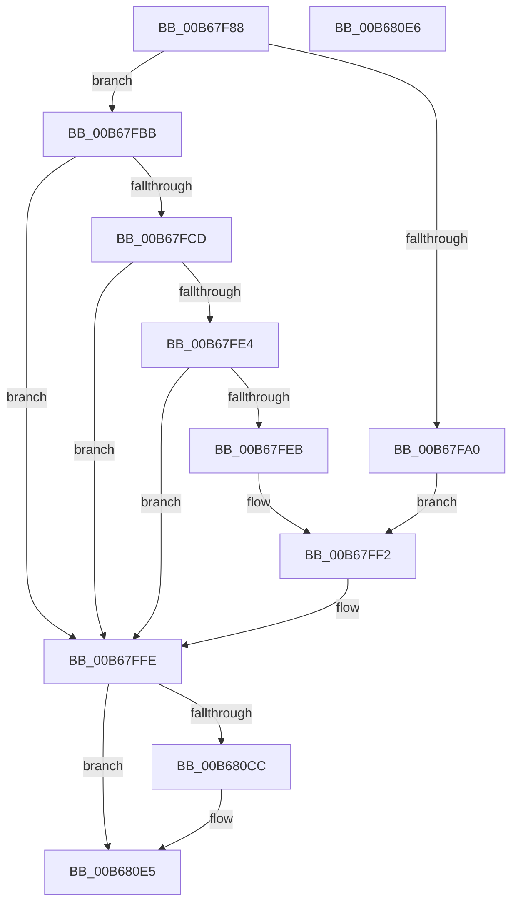

# KiWriteFixedMtrr

- RVA: `0x00B67F88`–`0x00B680E7` (길이 `351` bytes)
- VA: `0x0000000140B67F88`
- 실행 섹션: `PAGELK`
- PDB 이름 있음: `예`; PDB Function 태그: `아니요`
- unwind 정보 RVA: `0x000DB714`
- 디코드: `97`개 명령, `351/351` bytes 표시
- 미해석 바이트: `0` (있으면 어셈블리에 `.byte`로 보존)

> 이 문서는 커널 이미지의 기계어와 PDB 기호를 분석해 생성했습니다. 4번과 5번은 함수 원형과 자료형을 바이너리 사용 방식에서 추정한 C 해석이며 원본 소스 복구 결과는 아닙니다.

## 1. Dependencies

- 직접 호출 지점: **0**; 고유 호출 대상: **0**
- 직접 호출자로 확인된 함수: **1**
- RIP 상대 이미지 참조: **1**

### Outgoing calls
- 직접 디코드된 call 명령이 없습니다.

### Direct callers
- [KeLoadMTRR](../B7/KeLoadMTRR_function_00B7DDA0.md) at `0x00B7DEF8`

### Static image references
- `0x00B67F8E` → RVA `0x00F10EF1` (`.data`; read)

## 2. Other-region calls and transfers

- 다른 실행 섹션으로 향하는 call: **0**
- 별도 외부 분기/꼬리 이동을 확인하지 못했습니다.

## 3. Assembly (complete function range)

```asm
00B67F88  45 33 C0                        xor r8d, r8d
00B67F8B  41 B3 01                        mov r11b, 1
00B67F8E  44 38 1D 5C 8F 3A 00            cmp byte ptr [rip + 0x3a8f5c], r11b
00B67F95  4C 8B C9                        mov r9, rcx
00B67F98  41 BA 10 00 01 C0               mov r10d, 0xc0010010
00B67F9E  75 1B                           jne 0x140b67fbb
00B67FA0  41 8B CA                        mov ecx, r10d
00B67FA3  0F 32                           rdmsr
00B67FA5  48 C1 E2 20                     shl rdx, 0x20
00B67FA9  48 0B C2                        or rax, rdx
00B67FAC  4C 8B C0                        mov r8, rax
00B67FAF  49 0F BA F0 12                  btr r8, 0x12
00B67FB4  49 0F BA E8 13                  bts r8, 0x13
00B67FB9  EB 37                           jmp 0x140b67ff2
00B67FBB  65 48 8B 04 25 20 00 00 00      mov rax, qword ptr gs:[0x20]
00B67FC4  44 38 98 8D 00 00 00            cmp byte ptr [rax + 0x8d], r11b
00B67FCB  75 31                           jne 0x140b67ffe
00B67FCD  41 8B CA                        mov ecx, r10d
00B67FD0  0F 32                           rdmsr
00B67FD2  48 C1 E2 20                     shl rdx, 0x20
00B67FD6  48 0B C2                        or rax, rdx
00B67FD9  4C 8B C0                        mov r8, rax
00B67FDC  48 A9 00 00 0C 00               test rax, 0xc0000
00B67FE2  74 1A                           je 0x140b67ffe
00B67FE4  48 0F BA E0 18                  bt rax, 0x18
00B67FE9  72 13                           jb 0x140b67ffe
00B67FEB  49 81 E0 FF FF F3 FF            and r8, 0xfffffffffff3ffff
00B67FF2  49 8B D0                        mov rdx, r8
00B67FF5  49 8B C0                        mov rax, r8
00B67FF8  48 C1 EA 20                     shr rdx, 0x20
00B67FFC  0F 30                           wrmsr
00B67FFE  49 8B 11                        mov rdx, qword ptr [r9]
00B68001  B9 50 02 00 00                  mov ecx, 0x250
00B68006  48 8B C2                        mov rax, rdx
00B68009  48 C1 EA 20                     shr rdx, 0x20
00B6800D  0F 30                           wrmsr
00B6800F  49 8B 51 08                     mov rdx, qword ptr [r9 + 8]
00B68013  B9 58 02 00 00                  mov ecx, 0x258
00B68018  48 8B C2                        mov rax, rdx
00B6801B  48 C1 EA 20                     shr rdx, 0x20
00B6801F  0F 30                           wrmsr
00B68021  49 8B 51 10                     mov rdx, qword ptr [r9 + 0x10]
00B68025  B9 59 02 00 00                  mov ecx, 0x259
00B6802A  48 8B C2                        mov rax, rdx
00B6802D  48 C1 EA 20                     shr rdx, 0x20
00B68031  0F 30                           wrmsr
00B68033  49 8B 51 18                     mov rdx, qword ptr [r9 + 0x18]
00B68037  B9 68 02 00 00                  mov ecx, 0x268
00B6803C  48 8B C2                        mov rax, rdx
00B6803F  48 C1 EA 20                     shr rdx, 0x20
00B68043  0F 30                           wrmsr
00B68045  49 8B 51 20                     mov rdx, qword ptr [r9 + 0x20]
00B68049  B9 69 02 00 00                  mov ecx, 0x269
00B6804E  48 8B C2                        mov rax, rdx
00B68051  48 C1 EA 20                     shr rdx, 0x20
00B68055  0F 30                           wrmsr
00B68057  49 8B 51 28                     mov rdx, qword ptr [r9 + 0x28]
00B6805B  B9 6A 02 00 00                  mov ecx, 0x26a
00B68060  48 8B C2                        mov rax, rdx
00B68063  48 C1 EA 20                     shr rdx, 0x20
00B68067  0F 30                           wrmsr
00B68069  49 8B 51 30                     mov rdx, qword ptr [r9 + 0x30]
00B6806D  B9 6B 02 00 00                  mov ecx, 0x26b
00B68072  48 8B C2                        mov rax, rdx
00B68075  48 C1 EA 20                     shr rdx, 0x20
00B68079  0F 30                           wrmsr
00B6807B  49 8B 51 38                     mov rdx, qword ptr [r9 + 0x38]
00B6807F  B9 6C 02 00 00                  mov ecx, 0x26c
00B68084  48 8B C2                        mov rax, rdx
00B68087  48 C1 EA 20                     shr rdx, 0x20
00B6808B  0F 30                           wrmsr
00B6808D  49 8B 51 40                     mov rdx, qword ptr [r9 + 0x40]
00B68091  B9 6D 02 00 00                  mov ecx, 0x26d
00B68096  48 8B C2                        mov rax, rdx
00B68099  48 C1 EA 20                     shr rdx, 0x20
00B6809D  0F 30                           wrmsr
00B6809F  49 8B 51 48                     mov rdx, qword ptr [r9 + 0x48]
00B680A3  B9 6E 02 00 00                  mov ecx, 0x26e
00B680A8  48 8B C2                        mov rax, rdx
00B680AB  48 C1 EA 20                     shr rdx, 0x20
00B680AF  0F 30                           wrmsr
00B680B1  49 8B 51 50                     mov rdx, qword ptr [r9 + 0x50]
00B680B5  B9 6F 02 00 00                  mov ecx, 0x26f
00B680BA  48 8B C2                        mov rax, rdx
00B680BD  48 C1 EA 20                     shr rdx, 0x20
00B680C1  0F 30                           wrmsr
00B680C3  44 38 1D 27 8E 3A 00            cmp byte ptr [rip + 0x3a8e27], r11b
00B680CA  75 19                           jne 0x140b680e5
00B680CC  49 0F BA F0 13                  btr r8, 0x13
00B680D1  41 8B CA                        mov ecx, r10d
00B680D4  49 0F BA E8 12                  bts r8, 0x12
00B680D9  49 8B D0                        mov rdx, r8
00B680DC  49 8B C0                        mov rax, r8
00B680DF  48 C1 EA 20                     shr rdx, 0x20
00B680E3  0F 30                           wrmsr
00B680E5  C3                              ret
00B680E6  CC                              int3
```

## 4. C-style interpretation (structured pseudocode)

```c
__int64 __fastcall KiWriteFixedMtrr(__int64 a1, __int64 a2, int a3)
{
    __int64 result;

    a3 = 0;
    if ((*(unsigned __int8 *)(v_rip + 3837788)) != 1) goto loc_00B67FBB;
    a2 = (a2) << (32);
    result = (result) | (a2);
    goto loc_00B67FF2;
loc_00B67FBB:
    if ((*(unsigned __int8 *)(*(unsigned __int64 *)(gs_base + (0 + 32)) + 141)) != 1) goto loc_00B67FFE;
    a2 = (a2) << (32);
    result = (*(unsigned __int64 *)(gs_base + (0 + 32))) | (a2);
    if (((result) & (0xC0000ULL)) == 0) goto loc_00B67FFE;
    if (condition_is_below) goto loc_00B67FFE;
    a3 = (result) & (0xFFFFFFFFFFF3FFFFULL);
loc_00B67FF2:
    a2 = (a3) >> (32);
loc_00B67FFE:
    a2 = (*(unsigned __int64 *)(a1)) >> (32);
    a2 = (*(unsigned __int64 *)(a1 + 8)) >> (32);
    a2 = (*(unsigned __int64 *)(a1 + 16)) >> (32);
    a2 = (*(unsigned __int64 *)(a1 + 24)) >> (32);
    a2 = (*(unsigned __int64 *)(a1 + 32)) >> (32);
    a2 = (*(unsigned __int64 *)(a1 + 40)) >> (32);
    a2 = (*(unsigned __int64 *)(a1 + 48)) >> (32);
    a2 = (*(unsigned __int64 *)(a1 + 56)) >> (32);
    a2 = (*(unsigned __int64 *)(a1 + 64)) >> (32);
    a2 = (*(unsigned __int64 *)(a1 + 72)) >> (32);
    a2 = (*(unsigned __int64 *)(a1 + 80)) >> (32);
    result = *(unsigned __int64 *)(a1 + 80);
    if ((*(unsigned __int8 *)(v_rip + 3837479)) == 1) {
        a1 = (unsigned int)((unsigned int)(0xC0010010ULL));
        a2 = a3;
        result = a3;
        a2 = (a2) >> (32);
    }
    return result;
}
```

## 5. (Beta) C Style

```c
int64_t KiWriteFixedMtrr(void *Arg1, int64_t Arg2, int32_t Arg3)
{
    uint8_t *arg1 = (uint8_t *)Arg1;

    int64_t result;

    Arg3 = 0;
    if ((*(uint8_t *)(v_rip + 0x3A8F5C)) != 1) goto loc_00B67FBB;
    Arg2 = (Arg2) << (32);
    result = (result) | (Arg2);
    goto loc_00B67FF2;
loc_00B67FBB:
    if ((*(uint8_t *)(*(uint64_t *)(gs_base + (0 + 0x20)) + 0x8D)) != 1) goto loc_00B67FFE;
    Arg2 = (Arg2) << (32);
    result = (*(uint64_t *)(gs_base + (0 + 0x20))) | (Arg2);
    if (((result) & (0xC0000ULL)) == 0) goto loc_00B67FFE;
    if (condition_is_below) goto loc_00B67FFE;
    Arg3 = (result) & (0xFFFFFFFFFFF3FFFFULL);
loc_00B67FF2:
    Arg2 = (Arg3) >> (32);
loc_00B67FFE:
    Arg2 = (*(uint64_t *)(arg1)) >> (32);
    Arg2 = (*(uint64_t *)(arg1 + 0x8)) >> (32);
    Arg2 = (*(uint64_t *)(arg1 + 0x10)) >> (32);
    Arg2 = (*(uint64_t *)(arg1 + 0x18)) >> (32);
    Arg2 = (*(uint64_t *)(arg1 + 0x20)) >> (32);
    Arg2 = (*(uint64_t *)(arg1 + 0x28)) >> (32);
    Arg2 = (*(uint64_t *)(arg1 + 0x30)) >> (32);
    Arg2 = (*(uint64_t *)(arg1 + 0x38)) >> (32);
    Arg2 = (*(uint64_t *)(arg1 + 0x40)) >> (32);
    Arg2 = (*(uint64_t *)(arg1 + 0x48)) >> (32);
    Arg2 = (*(uint64_t *)(arg1 + 0x50)) >> (32);
    result = *(uint64_t *)(arg1 + 0x50);
    if ((*(uint8_t *)(v_rip + 0x3A8E27)) == 1) {
        Arg1 = (uint32_t)((uint32_t)(0xC0010010ULL));
        Arg2 = Arg3;
        result = Arg3;
        Arg2 = (Arg2) >> (32);
    }
    return result;
}
```

### 관측된 메모리 오프셋

구조체 형식이 확인되지 않은 접근은 인자 기준의 오프셋으로만 기록했습니다.

| 기준 인자 | 오프셋 표현 | 폭 (bit) | 접근 |
|---|---:|---:|---|
| `Arg1` | `+ 0x0` | `64` | `R` |
| `Arg1` | `+ 0x8` | `64` | `R` |
| `Arg1` | `+ 0x10` | `64` | `R` |
| `Arg1` | `+ 0x18` | `64` | `R` |
| `Arg1` | `+ 0x20` | `64` | `R` |
| `Arg1` | `+ 0x28` | `64` | `R` |
| `Arg1` | `+ 0x30` | `64` | `R` |
| `Arg1` | `+ 0x38` | `64` | `R` |
| `Arg1` | `+ 0x40` | `64` | `R` |
| `Arg1` | `+ 0x48` | `64` | `R` |
| `Arg1` | `+ 0x50` | `64` | `R` |

## 6. Execution-region graph

[열기: 2D/3D 그래프와 함수 탐색 컨트롤 패널](../../../control-panel.html?section=pagelk&rva=0x00B67F88&view=graph)

- 2D 그래프는 위에서 아래로 흐르고, 3D 그래프는 빈 공간을 드래그해 회전합니다. Shift+드래그는 이동, 휠은 확대·축소, 함수 노드 선택은 대상 보고서 이동입니다.

### Static fallback


