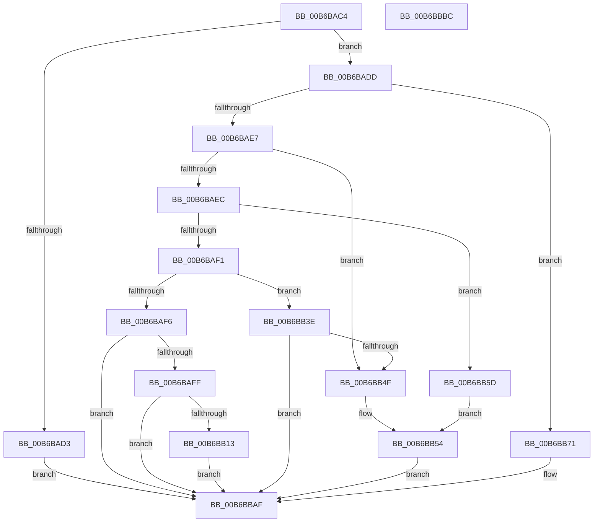

# PfSnBeginBootPhase

- RVA: `0x00B6BAC4`–`0x00B6BBBD` (길이 `249` bytes)
- VA: `0x0000000140B6BAC4`
- 실행 섹션: `PAGELK`
- PDB 이름 있음: `예`; PDB Function 태그: `아니요`
- unwind 정보 RVA: `0x0006E5F8`
- 디코드: `66`개 명령, `249/249` bytes 표시
- 미해석 바이트: `0` (있으면 어셈블리에 `.byte`로 보존)

> 이 문서는 커널 이미지의 기계어와 PDB 기호를 분석해 생성했습니다. 4번과 5번은 함수 원형과 자료형을 바이너리 사용 방식에서 추정한 C 해석이며 원본 소스 복구 결과는 아닙니다.

## 1. Dependencies

- 직접 호출 지점: **9**; 고유 호출 대상: **5**
- 직접 호출자로 확인된 함수: **3**
- RIP 상대 이미지 참조: **2**

### Outgoing calls
- `0x00B6BB02` → [PfSnAllocateEnablePrefetcherTimer](../B7/PfSnAllocateEnablePrefetcherTimer_function_00B7E1C8.md) (function, `0x00B7E1C8`)
- `0x00B6BB19` → [PfSnUpdatePrefetcherFlags](../../text/5C/PfSnUpdatePrefetcherFlags_function_005CDDF0.md) (function, `0x005CDDF0`)
- `0x00B6BB37` → [KiSetTimerEx](../../text/23/KiSetTimerEx_function_00232CB0.md) (function, `0x00232CB0`)
- `0x00B6BB46` → [PfSnUpdatePrefetcherFlags](../../text/5C/PfSnUpdatePrefetcherFlags_function_005CDDF0.md) (function, `0x005CDDF0`)
- `0x00B6BB56` → [PfSnUpdatePrefetcherFlags](../../text/5C/PfSnUpdatePrefetcherFlags_function_005CDDF0.md) (function, `0x005CDDF0`)
- `0x00B6BB65` → [PfSnUpdatePrefetcherFlags](../../text/5C/PfSnUpdatePrefetcherFlags_function_005CDDF0.md) (function, `0x005CDDF0`)
- `0x00B6BB84` → [EtwRegister](../../page/92/EtwRegister_function_00920960.md) (function, `0x00920960`)
- `0x00B6BB91` → [PfSnUpdatePrefetcherFlags](../../text/5C/PfSnUpdatePrefetcherFlags_function_005CDDF0.md) (function, `0x005CDDF0`)
- `0x00B6BBAA` → [PfSnQueueEnablePrefetcherTimer](../../page/75/PfSnQueueEnablePrefetcherTimer_function_00751E60.md) (function, `0x00751E60`)

### Direct callers
- [sub_00B27DF8](../../page/B2/Unknown_function_00B27DF8.md) at `0x00B27EAE`
- [PfPowerActionNotify](../B7/PfPowerActionNotify_function_00B7AC98.md) at `0x00B7AE36`
- [IoInitSystemPreDrivers](../../init/C2/IoInitSystemPreDrivers_function_00C2AC3C.md) at `0x00C2BD69`

### Static image references
- `0x00B6BB71` → RVA `0x00E67358` (`.data`; read)
- `0x00B6BB7D` → RVA `0x000215B8` (`.rdata`; read)

## 2. Other-region calls and transfers

- 다른 실행 섹션으로 향하는 call: **8**
  - `0x00B6BB19` → [PfSnUpdatePrefetcherFlags](../../text/5C/PfSnUpdatePrefetcherFlags_function_005CDDF0.md) (`PAGELK` → `.text`)
  - `0x00B6BB37` → [KiSetTimerEx](../../text/23/KiSetTimerEx_function_00232CB0.md) (`PAGELK` → `.text`)
  - `0x00B6BB46` → [PfSnUpdatePrefetcherFlags](../../text/5C/PfSnUpdatePrefetcherFlags_function_005CDDF0.md) (`PAGELK` → `.text`)
  - `0x00B6BB56` → [PfSnUpdatePrefetcherFlags](../../text/5C/PfSnUpdatePrefetcherFlags_function_005CDDF0.md) (`PAGELK` → `.text`)
  - `0x00B6BB65` → [PfSnUpdatePrefetcherFlags](../../text/5C/PfSnUpdatePrefetcherFlags_function_005CDDF0.md) (`PAGELK` → `.text`)
  - `0x00B6BB84` → [EtwRegister](../../page/92/EtwRegister_function_00920960.md) (`PAGELK` → `PAGE`)
  - `0x00B6BB91` → [PfSnUpdatePrefetcherFlags](../../text/5C/PfSnUpdatePrefetcherFlags_function_005CDDF0.md) (`PAGELK` → `.text`)
  - `0x00B6BBAA` → [PfSnQueueEnablePrefetcherTimer](../../page/75/PfSnQueueEnablePrefetcherTimer_function_00751E60.md) (`PAGELK` → `PAGE`)
- 별도 외부 분기/꼬리 이동을 확인하지 못했습니다.

## 3. Assembly (complete function range)

```asm
00B6BAC4  48 89 5C 24 08                  mov qword ptr [rsp + 8], rbx
00B6BAC9  57                              push rdi
00B6BACA  48 83 EC 30                     sub rsp, 0x30
00B6BACE  83 F9 05                        cmp ecx, 5
00B6BAD1  72 0A                           jb 0x140b6badd
00B6BAD3  BB 0D 00 00 C0                  mov ebx, 0xc000000d
00B6BAD8  E9 D2 00 00 00                  jmp 0x140b6bbaf
00B6BADD  33 DB                           xor ebx, ebx
00B6BADF  85 C9                           test ecx, ecx
00B6BAE1  0F 84 8A 00 00 00               je 0x140b6bb71
00B6BAE7  83 E9 01                        sub ecx, 1
00B6BAEA  74 63                           je 0x140b6bb4f
00B6BAEC  83 E9 01                        sub ecx, 1
00B6BAEF  74 6C                           je 0x140b6bb5d
00B6BAF1  83 E9 01                        sub ecx, 1
00B6BAF4  74 48                           je 0x140b6bb3e
00B6BAF6  83 F9 01                        cmp ecx, 1
00B6BAF9  0F 85 B0 00 00 00               jne 0x140b6bbaf
00B6BAFF  8D 4B 10                        lea ecx, [rbx + 0x10]
00B6BB02  E8 C1 26 01 00                  call 0x140b7e1c8
00B6BB07  48 8B F8                        mov rdi, rax
00B6BB0A  48 85 C0                        test rax, rax
00B6BB0D  0F 84 9C 00 00 00               je 0x140b6bbaf
00B6BB13  8D 53 01                        lea edx, [rbx + 1]
00B6BB16  8D 4B 10                        lea ecx, [rbx + 0x10]
00B6BB19  E8 D2 22 A6 FF                  call 0x1405cddf0
00B6BB1E  48 8D 47 40                     lea rax, [rdi + 0x40]
00B6BB22  45 33 C9                        xor r9d, r9d
00B6BB25  45 33 C0                        xor r8d, r8d
00B6BB28  48 89 44 24 20                  mov qword ptr [rsp + 0x20], rax
00B6BB2D  48 C7 C2 00 BA 3C DC            mov rdx, 0xffffffffdc3cba00
00B6BB34  48 8B CF                        mov rcx, rdi
00B6BB37  E8 74 71 6C FF                  call 0x140232cb0
00B6BB3C  EB 71                           jmp 0x140b6bbaf
00B6BB3E  BA 01 00 00 00                  mov edx, 1
00B6BB43  8D 4A 07                        lea ecx, [rdx + 7]
00B6BB46  E8 A5 22 A6 FF                  call 0x1405cddf0
00B6BB4B  A8 04                           test al, 4
00B6BB4D  74 60                           je 0x140b6bbaf
00B6BB4F  B9 01 00 00 00                  mov ecx, 1
00B6BB54  33 D2                           xor edx, edx
00B6BB56  E8 95 22 A6 FF                  call 0x1405cddf0
00B6BB5B  EB 52                           jmp 0x140b6bbaf
00B6BB5D  BA 01 00 00 00                  mov edx, 1
00B6BB62  8D 4A 03                        lea ecx, [rdx + 3]
00B6BB65  E8 86 22 A6 FF                  call 0x1405cddf0
00B6BB6A  B9 11 00 00 00                  mov ecx, 0x11
00B6BB6F  EB E3                           jmp 0x140b6bb54
00B6BB71  4C 8D 0D E0 B7 2F 00            lea r9, [rip + 0x2fb7e0]
00B6BB78  45 33 C0                        xor r8d, r8d
00B6BB7B  33 D2                           xor edx, edx
00B6BB7D  48 8D 0D 34 5A 4B FF            lea rcx, [rip - 0xb4a5cc]
00B6BB84  E8 D7 4D DB FF                  call 0x140920960
00B6BB89  BA 01 00 00 00                  mov edx, 1
00B6BB8E  8D 4A 02                        lea ecx, [rdx + 2]
00B6BB91  E8 5A 22 A6 FF                  call 0x1405cddf0
00B6BB96  48 B8 00 A2 2F 4D FF FF FF FF   movabs rax, 0xffffffff4d2fa200
00B6BBA0  48 8D 4C 24 48                  lea rcx, [rsp + 0x48]
00B6BBA5  48 89 44 24 48                  mov qword ptr [rsp + 0x48], rax
00B6BBAA  E8 B1 62 BE FF                  call 0x140751e60
00B6BBAF  8B C3                           mov eax, ebx
00B6BBB1  48 8B 5C 24 40                  mov rbx, qword ptr [rsp + 0x40]
00B6BBB6  48 83 C4 30                     add rsp, 0x30
00B6BBBA  5F                              pop rdi
00B6BBBB  C3                              ret
00B6BBBC  CC                              int3
```

## 4. C-style interpretation (structured pseudocode)

```c
__int64 __fastcall PfSnBeginBootPhase(int a1, __int64 a2, int a3, int a4)
{
    __int64 result;
    __int64 v_rbx;
    __int64 v_rsp;
    unsigned __int64 v_stack_m18;
    unsigned __int64 v_stack_p10;
    unsigned __int64 v_stack_p8;

    v_stack_p8 = v_rbx;
    v_rsp = (v_rsp) - (48);
    if (a1 < 5) goto loc_00B6BADD;
    goto loc_00B6BBAF;
loc_00B6BADD:
    v_rbx = 0;
    if (a1 == 0) goto loc_00B6BB71;
    a1 = (unsigned int)((a1) - (1));
    if (condition_is_equal) goto loc_00B6BB4F;
    a1 = (unsigned int)((a1) - (1));
    if (condition_is_equal) goto loc_00B6BB5D;
    a1 = (unsigned int)((a1) - (1));
    if (condition_is_equal) goto loc_00B6BB3E;
    if (a1 != 1) goto loc_00B6BBAF;
    result = PfSnAllocateEnablePrefetcherTimer(v_rbx + 16, a2, a3, a4);
    if (result == 0) goto loc_00B6BBAF;
    result = PfSnUpdatePrefetcherFlags(v_rbx + 16, v_rbx + 1, a3, a4);
    a4 = 0;
    a3 = 0;
    v_stack_m18 = result + 64;
    result = KiSetTimerEx(result, 0xFFFFFFFFDC3CBA00ULL, a3, a4);
    goto loc_00B6BBAF;
loc_00B6BB3E:
    result = PfSnUpdatePrefetcherFlags(1 + 7, 1, a3, a4);
    if ((((unsigned __int8)(result)) & (4)) == 0) goto loc_00B6BBAF;
loc_00B6BB4F:
loc_00B6BB54:
    a2 = 0;
    result = PfSnUpdatePrefetcherFlags(1, a2, a3, a4);
    goto loc_00B6BBAF;
loc_00B6BB5D:
    result = PfSnUpdatePrefetcherFlags(1 + 3, 1, a3, a4);
    goto loc_00B6BB54;
loc_00B6BB71:
    a3 = 0;
    a2 = 0;
    result = EtwRegister(v_rip - 11838924, a2, a3, v_rip + 3127264);
    result = PfSnUpdatePrefetcherFlags(1 + 2, 1, a3, v_rip + 3127264);
    v_stack_p10 = result;
    result = PfSnQueueEnablePrefetcherTimer(v_stack_p10, 1, a3, v_rip + 3127264);
loc_00B6BBAF:
    v_rsp = (v_rsp) + (48);
    return 0;
}
```

## 5. (Beta) C Style

```c
int64_t PfSnBeginBootPhase(int32_t Arg1, int64_t Arg2, int32_t Arg3, int32_t Arg4)
{
    int64_t result;
    int64_t local_rbx;
    int64_t local_rsp;
    uint64_t v_stack_m18;
    uint64_t v_stack_p10;
    uint64_t v_stack_p8;

    v_stack_p8 = local_rbx;
    local_rsp = (local_rsp) - (48);
    if (Arg1 < 5) goto loc_00B6BADD;
    goto loc_00B6BBAF;
loc_00B6BADD:
    local_rbx = 0;
    if (Arg1 == 0) goto loc_00B6BB71;
    Arg1 = (uint32_t)((Arg1) - (1));
    if (condition_is_equal) goto loc_00B6BB4F;
    Arg1 = (uint32_t)((Arg1) - (1));
    if (condition_is_equal) goto loc_00B6BB5D;
    Arg1 = (uint32_t)((Arg1) - (1));
    if (condition_is_equal) goto loc_00B6BB3E;
    if (Arg1 != 1) goto loc_00B6BBAF;
    result = PfSnAllocateEnablePrefetcherTimer(local_rbx + 16, Arg2, Arg3, Arg4);
    if (result == 0) goto loc_00B6BBAF;
    result = PfSnUpdatePrefetcherFlags(local_rbx + 16, local_rbx + 1, Arg3, Arg4);
    Arg4 = 0;
    Arg3 = 0;
    v_stack_m18 = result + 64;
    result = KiSetTimerEx(result, 0xFFFFFFFFDC3CBA00ULL, Arg3, Arg4);
    goto loc_00B6BBAF;
loc_00B6BB3E:
    result = PfSnUpdatePrefetcherFlags(1 + 7, 1, Arg3, Arg4);
    if ((((uint8_t)(result)) & (4)) == 0) goto loc_00B6BBAF;
loc_00B6BB4F:
loc_00B6BB54:
    Arg2 = 0;
    result = PfSnUpdatePrefetcherFlags(1, Arg2, Arg3, Arg4);
    goto loc_00B6BBAF;
loc_00B6BB5D:
    result = PfSnUpdatePrefetcherFlags(1 + 3, 1, Arg3, Arg4);
    goto loc_00B6BB54;
loc_00B6BB71:
    Arg3 = 0;
    Arg2 = 0;
    result = EtwRegister(v_rip - 11838924, Arg2, Arg3, v_rip + 3127264);
    result = PfSnUpdatePrefetcherFlags(1 + 2, 1, Arg3, v_rip + 3127264);
    v_stack_p10 = result;
    result = PfSnQueueEnablePrefetcherTimer(v_stack_p10, 1, Arg3, v_rip + 3127264);
loc_00B6BBAF:
    local_rsp = (local_rsp) + (48);
    return 0;
}
```

## 6. Execution-region graph

[열기: 2D/3D 그래프와 함수 탐색 컨트롤 패널](../../../control-panel.html?section=pagelk&rva=0x00B6BAC4&view=graph)

- 2D 그래프는 위에서 아래로 흐르고, 3D 그래프는 빈 공간을 드래그해 회전합니다. Shift+드래그는 이동, 휠은 확대·축소, 함수 노드 선택은 대상 보고서 이동입니다.

### Static fallback


