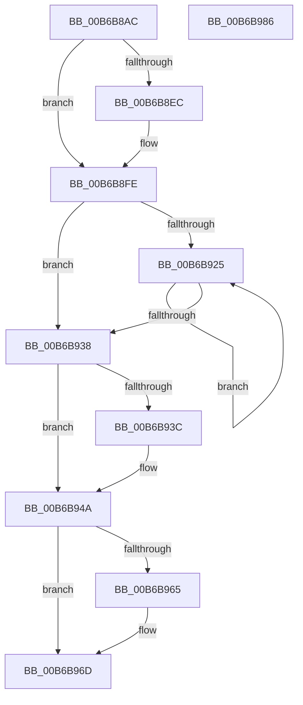

# PfTAccessTracingCleanup

- RVA: `0x00B6B8AC`–`0x00B6B987` (길이 `219` bytes)
- VA: `0x0000000140B6B8AC`
- 실행 섹션: `PAGELK`
- PDB 이름 있음: `예`; PDB Function 태그: `아니요`
- unwind 정보 RVA: `0x00060300`
- 디코드: `61`개 명령, `219/219` bytes 표시
- 미해석 바이트: `0` (있으면 어셈블리에 `.byte`로 보존)

> 이 문서는 커널 이미지의 기계어와 PDB 기호를 분석해 생성했습니다. 4번과 5번은 함수 원형과 자료형을 바이너리 사용 방식에서 추정한 C 해석이며 원본 소스 복구 결과는 아닙니다.

## 1. Dependencies

- 직접 호출 지점: **10**; 고유 호출 대상: **10**
- 직접 호출자로 확인된 함수: **3**
- RIP 상대 이미지 참조: **0**

### Outgoing calls
- `0x00B6B8D3` → [PfpPartitionReferenceParentSafe](../../text/34/PfpPartitionReferenceParentSafe_function_00343754.md) (function, `0x00343754`)
- `0x00B6B8DF` → [FsRtlAcquirePushLockExclusive](../../text/4A/FsRtlAcquirePushLockExclusive_function_004A05F4.md) (function, `0x004A05F4`)
- `0x00B6B8EC` → [KeQueryHeteroCpuPolicyThread](../../text/48/KeQueryHeteroCpuPolicyThread_function_00488A70.md) (function, `0x00488A70`)
- `0x00B6B8F9` → [MmSetAccessLogging](../../text/68/MmSetAccessLogging_function_0068A188.md) (function, `0x0068A188`)
- `0x00B6B90C` → [ExWaitForRundownProtectionRelease](../../text/2A/ExWaitForRundownProtectionRelease_function_002A4CB0.md) (function, `0x002A4CB0`)
- `0x00B6B918` → [ExpInterlockedFlushSList](../../text/6B/ExpInterlockedFlushSList_function_006BA5F0.md) (function, `0x006BA5F0`)
- `0x00B6B92E` → [MmFreeAccessPfnBuffer](../../text/47/MmFreeAccessPfnBuffer_function_004751BC.md) (function, `0x004751BC`)
- `0x00B6B952` → [PfTAccessTracingInitialize](PfTAccessTracingInitialize_function_00B6B990.md) (function, `0x00B6B990`)
- `0x00B6B95B` → [PfLockExclusiveRelease](../../text/49/PfLockExclusiveRelease_function_00491D88.md) (function, `0x00491D88`)
- `0x00B6B968` → [PfpPartitionDereferenceParent](../../text/34/PfpPartitionDereferenceParent_function_00341CDC.md) (function, `0x00341CDC`)

### Direct callers
- [PfTCleanup](../../page/75/PfTCleanup_function_00751208.md) at `0x007512D3`
- [PfTCleanup](../../page/75/PfTCleanup_function_00751208.md) at `0x00751328`
- [PfTTraceListAdd](../../page/A6/PfTTraceListAdd_function_00A60E00.md) at `0x00A60F06`
- [PfpPowerActionStartScenarioTracingCallback](PfpPowerActionStartScenarioTracingCallback_function_00B6B2E0.md) at `0x00B6B2F7`

### Static image references
- 디코드된 RIP-relative 메모리 참조가 없습니다.

## 2. Other-region calls and transfers

- 다른 실행 섹션으로 향하는 call: **9**
  - `0x00B6B8D3` → [PfpPartitionReferenceParentSafe](../../text/34/PfpPartitionReferenceParentSafe_function_00343754.md) (`PAGELK` → `.text`)
  - `0x00B6B8DF` → [FsRtlAcquirePushLockExclusive](../../text/4A/FsRtlAcquirePushLockExclusive_function_004A05F4.md) (`PAGELK` → `.text`)
  - `0x00B6B8EC` → [KeQueryHeteroCpuPolicyThread](../../text/48/KeQueryHeteroCpuPolicyThread_function_00488A70.md) (`PAGELK` → `.text`)
  - `0x00B6B8F9` → [MmSetAccessLogging](../../text/68/MmSetAccessLogging_function_0068A188.md) (`PAGELK` → `.text`)
  - `0x00B6B90C` → [ExWaitForRundownProtectionRelease](../../text/2A/ExWaitForRundownProtectionRelease_function_002A4CB0.md) (`PAGELK` → `.text`)
  - `0x00B6B918` → [ExpInterlockedFlushSList](../../text/6B/ExpInterlockedFlushSList_function_006BA5F0.md) (`PAGELK` → `.text`)
  - `0x00B6B92E` → [MmFreeAccessPfnBuffer](../../text/47/MmFreeAccessPfnBuffer_function_004751BC.md) (`PAGELK` → `.text`)
  - `0x00B6B95B` → [PfLockExclusiveRelease](../../text/49/PfLockExclusiveRelease_function_00491D88.md) (`PAGELK` → `.text`)
  - `0x00B6B968` → [PfpPartitionDereferenceParent](../../text/34/PfpPartitionDereferenceParent_function_00341CDC.md) (`PAGELK` → `.text`)
- 별도 외부 분기/꼬리 이동을 확인하지 못했습니다.

## 3. Assembly (complete function range)

```asm
00B6B8AC  48 89 5C 24 08                  mov qword ptr [rsp + 8], rbx
00B6B8B1  48 89 6C 24 10                  mov qword ptr [rsp + 0x10], rbp
00B6B8B6  48 89 74 24 18                  mov qword ptr [rsp + 0x18], rsi
00B6B8BB  57                              push rdi
00B6B8BC  41 56                           push r14
00B6B8BE  41 57                           push r15
00B6B8C0  48 83 EC 20                     sub rsp, 0x20
00B6B8C4  83 FA 04                        cmp edx, 4
00B6B8C7  41 8B E8                        mov ebp, r8d
00B6B8CA  8B DA                           mov ebx, edx
00B6B8CC  48 8B F9                        mov rdi, rcx
00B6B8CF  41 0F 94 C7                     sete r15b
00B6B8D3  E8 7C 7E 7D FF                  call 0x140343754
00B6B8D8  48 8D 4F 50                     lea rcx, [rdi + 0x50]
00B6B8DC  48 8B F0                        mov rsi, rax
00B6B8DF  E8 10 4D 93 FF                  call 0x1404a05f4
00B6B8E4  09 5F 4C                        or dword ptr [rdi + 0x4c], ebx
00B6B8E7  83 E5 01                        and ebp, 1
00B6B8EA  75 12                           jne 0x140b6b8fe
00B6B8EC  E8 7F D1 91 FF                  call 0x140488a70
00B6B8F1  44 8B C0                        mov r8d, eax
00B6B8F4  33 D2                           xor edx, edx
00B6B8F6  48 8B CE                        mov rcx, rsi
00B6B8F9  E8 8A E8 B1 FF                  call 0x14068a188
00B6B8FE  83 A7 F8 02 00 00 00            and dword ptr [rdi + 0x2f8], 0
00B6B905  48 8D 8F D8 02 00 00            lea rcx, [rdi + 0x2d8]
00B6B90C  E8 9F 93 73 FF                  call 0x1402a4cb0
00B6B911  48 8D 8F 00 03 00 00            lea rcx, [rdi + 0x300]
00B6B918  E8 D3 EC B4 FF                  call 0x1406ba5f0
00B6B91D  48 8B D8                        mov rbx, rax
00B6B920  48 85 C0                        test rax, rax
00B6B923  74 13                           je 0x140b6b938
00B6B925  48 8B CB                        mov rcx, rbx
00B6B928  41 8A D7                        mov dl, r15b
00B6B92B  48 8B 1B                        mov rbx, qword ptr [rbx]
00B6B92E  E8 89 98 90 FF                  call 0x1404751bc
00B6B933  48 85 DB                        test rbx, rbx
00B6B936  75 ED                           jne 0x140b6b925
00B6B938  85 ED                           test ebp, ebp
00B6B93A  75 0E                           jne 0x140b6b94a
00B6B93C  48 8B 06                        mov rax, qword ptr [rsi]
00B6B93F  4C 8B 80 C0 44 00 00            mov r8, qword ptr [rax + 0x44c0]
00B6B946  41 88 68 37                     mov byte ptr [r8 + 0x37], bpl
00B6B94A  BA 01 00 00 00                  mov edx, 1
00B6B94F  48 8B CF                        mov rcx, rdi
00B6B952  E8 39 00 00 00                  call 0x140b6b990
00B6B957  48 8D 4F 50                     lea rcx, [rdi + 0x50]
00B6B95B  E8 28 64 92 FF                  call 0x140491d88
00B6B960  48 85 F6                        test rsi, rsi
00B6B963  74 08                           je 0x140b6b96d
00B6B965  48 8B CE                        mov rcx, rsi
00B6B968  E8 6F 63 7D FF                  call 0x140341cdc
00B6B96D  48 8B 5C 24 40                  mov rbx, qword ptr [rsp + 0x40]
00B6B972  48 8B 6C 24 48                  mov rbp, qword ptr [rsp + 0x48]
00B6B977  48 8B 74 24 50                  mov rsi, qword ptr [rsp + 0x50]
00B6B97C  48 83 C4 20                     add rsp, 0x20
00B6B980  41 5F                           pop r15
00B6B982  41 5E                           pop r14
00B6B984  5F                              pop rdi
00B6B985  C3                              ret
00B6B986  CC                              int3
```

## 4. C-style interpretation (structured pseudocode)

```c
__int64 __fastcall PfTAccessTracingCleanup(__int64 a1, int a2, int a3)
{
    __int64 result;
    __int64 v_r15;
    __int64 v_rbp;
    __int64 v_rsp;
    unsigned __int64 v_stack_p10;
    unsigned __int64 v_stack_p18;
    unsigned __int64 v_stack_p8;

    v_stack_p8 = v_rbx;
    v_stack_p10 = v_rbp;
    v_stack_p18 = v_rsi;
    v_rsp = (v_rsp) - (32);
    v_r15 = (a2 == 4) ? 1 : 0;
    result = PfpPartitionReferenceParentSafe(a1, a2, a3, a4);
    result = FsRtlAcquirePushLockExclusive(a1 + 80, a2, a3, a4);
    v_rbp = (unsigned int)(((unsigned int)(a3)) & (1));
    if (!(condition_is_not_equal)) {
        result = KeQueryHeteroCpuPolicyThread(a1 + 80, a2, a3, a4);
        a3 = (unsigned int)(result);
        a2 = 0;
        a1 = result;
        result = MmSetAccessLogging(a1, a2, a3, a4);
    }
    result = ExWaitForRundownProtectionRelease(a1 + 728, a2, a3, a4);
    result = ExpInterlockedFlushSList(a1 + 768, a2, a3, a4);
    if (result == 0) goto loc_00B6B938;
loc_00B6B925:
    result = MmFreeAccessPfnBuffer(result, (unsigned __int8)(v_r15), a3, a4);
    if (*(unsigned __int64 *)(result) != 0) goto loc_00B6B925;
loc_00B6B938:
    if ((unsigned int)(v_rbp) == 0) {
        result = *(unsigned __int64 *)(result);
        a3 = *(unsigned __int64 *)(result + 17600);
        *(unsigned __int8 *)(a3 + 55) = (unsigned __int8)(v_rbp);
    }
    result = PfTAccessTracingInitialize(a1, 1, a3, a4);
    result = PfLockExclusiveRelease(a1 + 80, 1, a3, a4);
    if (result != 0) {
        a1 = result;
        result = PfpPartitionDereferenceParent(a1, 1, a3, a4);
    }
    v_rsp = (v_rsp) + (32);
    return result;
}
```

## 5. (Beta) C Style

```c
int64_t PfTAccessTracingCleanup(void *Arg1, int32_t Arg2, int32_t Arg3)
{
    uint8_t *arg1 = (uint8_t *)Arg1;

    int64_t result;
    int64_t local_r15;
    int64_t local_rbp;
    int64_t local_rsp;
    uint64_t v_stack_p10;
    uint64_t v_stack_p18;
    uint64_t v_stack_p8;

    v_stack_p8 = local_rbx;
    v_stack_p10 = local_rbp;
    v_stack_p18 = local_rsi;
    local_rsp = (local_rsp) - (32);
    local_r15 = (Arg2 == 4) ? 1 : 0;
    result = PfpPartitionReferenceParentSafe(Arg1, Arg2, Arg3, a4);
    result = FsRtlAcquirePushLockExclusive(Arg1 + 80, Arg2, Arg3, a4);
    local_rbp = (uint32_t)(((uint32_t)(Arg3)) & (1));
    if (!(condition_is_not_equal)) {
        result = KeQueryHeteroCpuPolicyThread(Arg1 + 80, Arg2, Arg3, a4);
        Arg3 = (uint32_t)(result);
        Arg2 = 0;
        Arg1 = result;
        result = MmSetAccessLogging(Arg1, Arg2, Arg3, a4);
    }
    result = ExWaitForRundownProtectionRelease(Arg1 + 728, Arg2, Arg3, a4);
    result = ExpInterlockedFlushSList(Arg1 + 768, Arg2, Arg3, a4);
    if (result == 0) goto loc_00B6B938;
loc_00B6B925:
    result = MmFreeAccessPfnBuffer(result, (uint8_t)(local_r15), Arg3, a4);
    if (*(uint64_t *)(result) != 0) goto loc_00B6B925;
loc_00B6B938:
    if ((uint32_t)(local_rbp) == 0) {
        result = *(uint64_t *)(result);
        Arg3 = *(uint64_t *)(result + 0x44C0);
        *(uint8_t *)(Arg3 + 0x37) = (uint8_t)(local_rbp);
    }
    result = PfTAccessTracingInitialize(Arg1, 1, Arg3, a4);
    result = PfLockExclusiveRelease(Arg1 + 80, 1, Arg3, a4);
    if (result != 0) {
        Arg1 = result;
        result = PfpPartitionDereferenceParent(Arg1, 1, Arg3, a4);
    }
    local_rsp = (local_rsp) + (32);
    return result;
}
```

### 관측된 메모리 오프셋

구조체 형식이 확인되지 않은 접근은 인자 기준의 오프셋으로만 기록했습니다.

| 기준 인자 | 오프셋 표현 | 폭 (bit) | 접근 |
|---|---:|---:|---|
| `Arg1` | `+ 0x4C` | `32` | `R/W` |
| `Arg1` | `+ 0x50` | `64` | `R` |
| `Arg1` | `+ 0x2D8` | `64` | `R` |
| `Arg1` | `+ 0x2F8` | `32` | `R/W` |
| `Arg1` | `+ 0x300` | `64` | `R` |

## 6. Execution-region graph

[열기: 2D/3D 그래프와 함수 탐색 컨트롤 패널](../../../control-panel.html?section=pagelk&rva=0x00B6B8AC&view=graph)

- 2D 그래프는 위에서 아래로 흐르고, 3D 그래프는 빈 공간을 드래그해 회전합니다. Shift+드래그는 이동, 휠은 확대·축소, 함수 노드 선택은 대상 보고서 이동입니다.

### Static fallback


