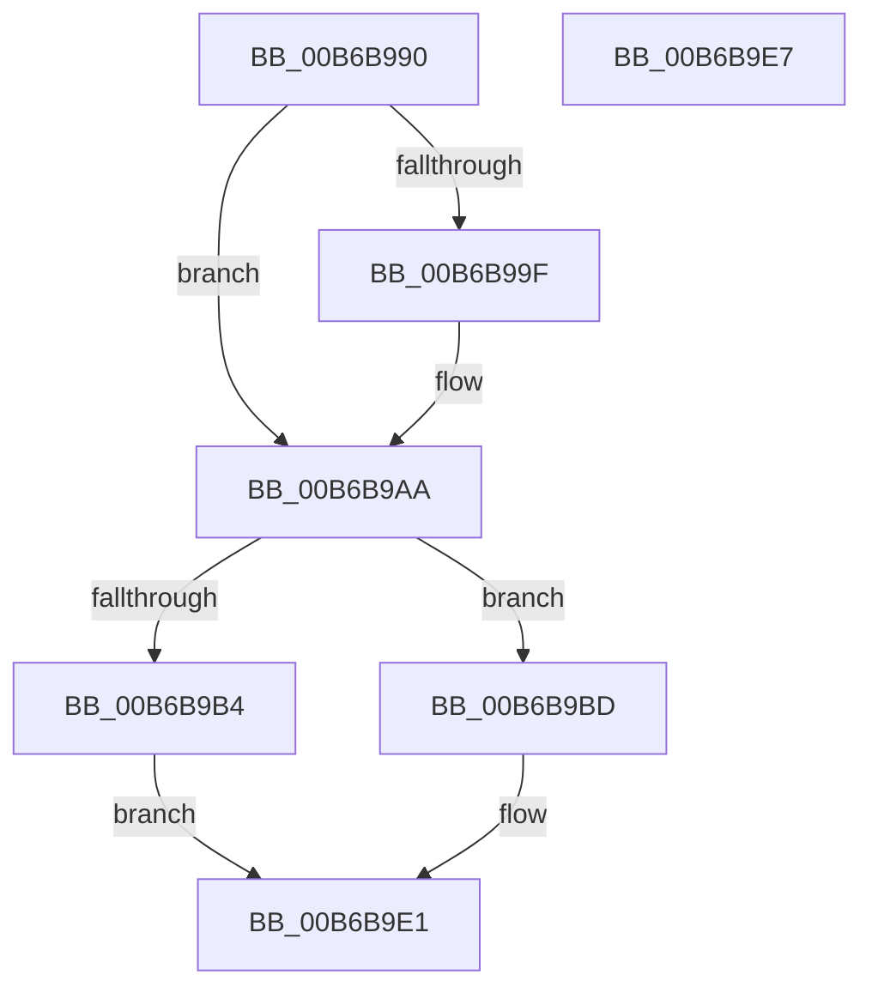

# PfTAccessTracingInitialize

- RVA: `0x00B6B990`–`0x00B6B9E8` (길이 `88` bytes)
- VA: `0x0000000140B6B990`
- 실행 섹션: `PAGELK`
- PDB 이름 있음: `예`; PDB Function 태그: `아니요`
- unwind 정보 RVA: `0x0005CF00`
- 디코드: `24`개 명령, `88/88` bytes 표시
- 미해석 바이트: `0` (있으면 어셈블리에 `.byte`로 보존)

> 이 문서는 커널 이미지의 기계어와 PDB 기호를 분석해 생성했습니다. 4번과 5번은 함수 원형과 자료형을 바이너리 사용 방식에서 추정한 C 해석이며 원본 소스 복구 결과는 아닙니다.

## 1. Dependencies

- 직접 호출 지점: **2**; 고유 호출 대상: **2**
- 직접 호출자로 확인된 함수: **2**
- RIP 상대 이미지 참조: **0**

### Outgoing calls
- `0x00B6B9CB` → [InitializeSListHead](../../text/46/InitializeSListHead_function_00468A90.md) (function, `0x00468A90`)
- `0x00B6B9DC` → [KeInitializeEvent](../../text/40/KeInitializeEvent_function_0040DD10.md) (function, `0x0040DD10`)

### Direct callers
- [PfTInitialize](../../page/75/PfTInitialize_function_00751554.md) at `0x0075165A`
- [PfTAccessTracingCleanup](PfTAccessTracingCleanup_function_00B6B8AC.md) at `0x00B6B952`

### Static image references
- 디코드된 RIP-relative 메모리 참조가 없습니다.

## 2. Other-region calls and transfers

- 다른 실행 섹션으로 향하는 call: **2**
  - `0x00B6B9CB` → [InitializeSListHead](../../text/46/InitializeSListHead_function_00468A90.md) (`PAGELK` → `.text`)
  - `0x00B6B9DC` → [KeInitializeEvent](../../text/40/KeInitializeEvent_function_0040DD10.md) (`PAGELK` → `.text`)
- 별도 외부 분기/꼬리 이동을 확인하지 못했습니다.

## 3. Assembly (complete function range)

```asm
00B6B990  40 53                           push rbx
00B6B992  48 83 EC 20                     sub rsp, 0x20
00B6B996  33 C0                           xor eax, eax
00B6B998  48 8B D9                        mov rbx, rcx
00B6B99B  85 D2                           test edx, edx
00B6B99D  75 0B                           jne 0x140b6b9aa
00B6B99F  48 89 41 50                     mov qword ptr [rcx + 0x50], rax
00B6B9A3  C7 41 4C 03 00 00 00            mov dword ptr [rcx + 0x4c], 3
00B6B9AA  89 81 F8 02 00 00               mov dword ptr [rcx + 0x2f8], eax
00B6B9B0  85 D2                           test edx, edx
00B6B9B2  74 09                           je 0x140b6b9bd
00B6B9B4  48 87 81 D8 02 00 00            xchg qword ptr [rcx + 0x2d8], rax
00B6B9BB  EB 24                           jmp 0x140b6b9e1
00B6B9BD  48 89 81 D8 02 00 00            mov qword ptr [rcx + 0x2d8], rax
00B6B9C4  48 81 C1 00 03 00 00            add rcx, 0x300
00B6B9CB  E8 C0 D0 8F FF                  call 0x140468a90
00B6B9D0  48 8D 8B E0 02 00 00            lea rcx, [rbx + 0x2e0]
00B6B9D7  45 33 C0                        xor r8d, r8d
00B6B9DA  33 D2                           xor edx, edx
00B6B9DC  E8 2F 23 8A FF                  call 0x14040dd10
00B6B9E1  48 83 C4 20                     add rsp, 0x20
00B6B9E5  5B                              pop rbx
00B6B9E6  C3                              ret
00B6B9E7  CC                              int3
```

## 4. C-style interpretation (structured pseudocode)

```c
__int64 __fastcall PfTAccessTracingInitialize(__int64 a1, int a2, int a3)
{
    __int64 result;
    __int64 v_rsp;

    v_rsp = (v_rsp) - (32);
    result = 0;
    if (a2 == 0) {
        *(unsigned __int64 *)(a1 + 80) = 0;
        *(unsigned int *)(a1 + 76) = 3;
    }
    *(unsigned int *)(a1 + 760) = 0;
    if (a2 == 0) goto loc_00B6B9BD;
    goto loc_00B6B9E1;
loc_00B6B9BD:
    *(unsigned __int64 *)(a1 + 728) = 0;
    a1 = (a1) + (768);
    result = InitializeSListHead(a1, a2, a3, a4);
    a3 = 0;
    a2 = 0;
    result = KeInitializeEvent(a1 + 736, a2, a3, a4);
loc_00B6B9E1:
    v_rsp = (v_rsp) + (32);
    return result;
}
```

## 5. (Beta) C Style

```c
int64_t PfTAccessTracingInitialize(void *Arg1, int32_t Arg2, int32_t Arg3)
{
    uint8_t *arg1 = (uint8_t *)Arg1;

    int64_t result;
    int64_t local_rsp;

    local_rsp = (local_rsp) - (32);
    result = 0;
    if (Arg2 == 0) {
        *(uint64_t *)(arg1 + 0x50) = 0;
        *(uint32_t *)(arg1 + 0x4C) = 3;
    }
    *(uint32_t *)(arg1 + 0x2F8) = 0;
    if (Arg2 == 0) goto loc_00B6B9BD;
    goto loc_00B6B9E1;
loc_00B6B9BD:
    *(uint64_t *)(arg1 + 0x2D8) = 0;
    Arg1 = (Arg1) + (768);
    result = InitializeSListHead(Arg1, Arg2, Arg3, a4);
    Arg3 = 0;
    Arg2 = 0;
    result = KeInitializeEvent(Arg1 + 736, Arg2, Arg3, a4);
loc_00B6B9E1:
    local_rsp = (local_rsp) + (32);
    return result;
}
```

### 관측된 메모리 오프셋

구조체 형식이 확인되지 않은 접근은 인자 기준의 오프셋으로만 기록했습니다.

| 기준 인자 | 오프셋 표현 | 폭 (bit) | 접근 |
|---|---:|---:|---|
| `Arg1` | `+ 0x4C` | `32` | `W` |
| `Arg1` | `+ 0x50` | `64` | `W` |
| `Arg1` | `+ 0x2D8` | `64` | `R/W` |
| `Arg1` | `+ 0x2D8` | `64` | `W` |
| `Arg1` | `+ 0x2E0` | `64` | `R` |
| `Arg1` | `+ 0x2F8` | `32` | `W` |

## 6. Execution-region graph

[열기: 2D/3D 그래프와 함수 탐색 컨트롤 패널](../../../control-panel.html?section=pagelk&rva=0x00B6B990&view=graph)

- 2D 그래프는 위에서 아래로 흐르고, 3D 그래프는 빈 공간을 드래그해 회전합니다. Shift+드래그는 이동, 휠은 확대·축소, 함수 노드 선택은 대상 보고서 이동입니다.

### Static fallback


