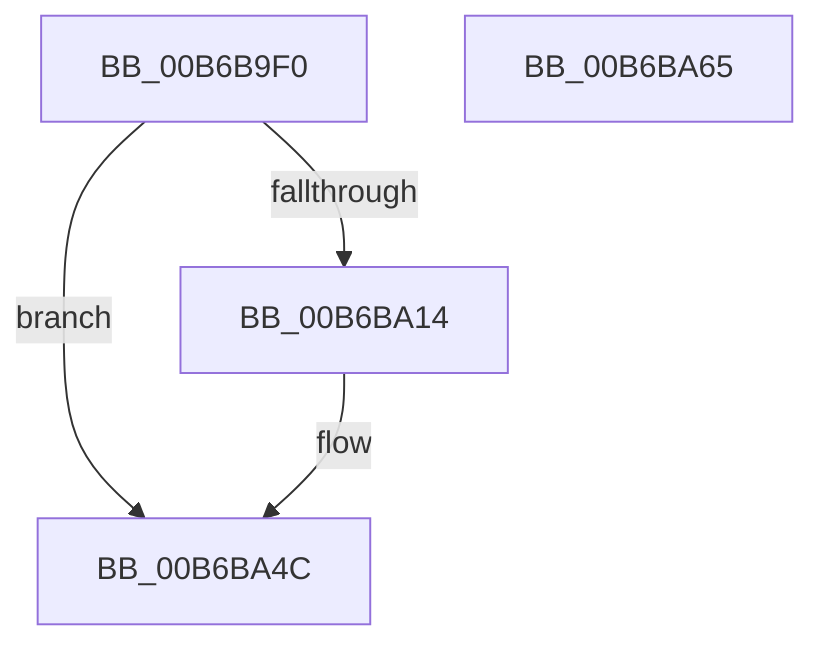

# PfTAccessTracingStart

- RVA: `0x00B6B9F0`–`0x00B6BA66` (길이 `118` bytes)
- VA: `0x0000000140B6B9F0`
- 실행 섹션: `PAGELK`
- PDB 이름 있음: `예`; PDB Function 태그: `아니요`
- unwind 정보 RVA: `0x00060BC4`
- 디코드: `31`개 명령, `118/118` bytes 표시
- 미해석 바이트: `0` (있으면 어셈블리에 `.byte`로 보존)

> 이 문서는 커널 이미지의 기계어와 PDB 기호를 분석해 생성했습니다. 4번과 5번은 함수 원형과 자료형을 바이너리 사용 방식에서 추정한 C 해석이며 원본 소스 복구 결과는 아닙니다.

## 1. Dependencies

- 직접 호출 지점: **5**; 고유 호출 대상: **5**
- 직접 호출자로 확인된 함수: **3**
- RIP 상대 이미지 참조: **0**

### Outgoing calls
- `0x00B6BA08` → [FsRtlAcquirePushLockExclusive](../../text/4A/FsRtlAcquirePushLockExclusive_function_004A05F4.md) (function, `0x004A05F4`)
- `0x00B6BA17` → [CsanRead64NoCheck](../../text/4C/CsanRead64NoCheck_function_004C82C0.md) (function, `0x004C82C0`)
- `0x00B6BA29` → [KeQueryHeteroCpuPolicyThread](../../text/48/KeQueryHeteroCpuPolicyThread_function_00488A70.md) (function, `0x00488A70`)
- `0x00B6BA39` → [MmSetAccessLogging](../../text/68/MmSetAccessLogging_function_0068A188.md) (function, `0x0068A188`)
- `0x00B6BA50` → [PfLockExclusiveRelease](../../text/49/PfLockExclusiveRelease_function_00491D88.md) (function, `0x00491D88`)

### Direct callers
- [PfTStart](../../page/75/PfTStart_function_007517AC.md) at `0x00751AB0`
- [PfTStart](../../page/75/PfTStart_function_007517AC.md) at `0x00751AF0`
- [PfGetCompletedTrace](../../page/90/PfGetCompletedTrace_function_00902950.md) at `0x00902E15`
- [PfpPowerActionStartScenarioTracingCallback](PfpPowerActionStartScenarioTracingCallback_function_00B6B2E0.md) at `0x00B6B319`

### Static image references
- 디코드된 RIP-relative 메모리 참조가 없습니다.

## 2. Other-region calls and transfers

- 다른 실행 섹션으로 향하는 call: **5**
  - `0x00B6BA08` → [FsRtlAcquirePushLockExclusive](../../text/4A/FsRtlAcquirePushLockExclusive_function_004A05F4.md) (`PAGELK` → `.text`)
  - `0x00B6BA17` → [CsanRead64NoCheck](../../text/4C/CsanRead64NoCheck_function_004C82C0.md) (`PAGELK` → `.text`)
  - `0x00B6BA29` → [KeQueryHeteroCpuPolicyThread](../../text/48/KeQueryHeteroCpuPolicyThread_function_00488A70.md) (`PAGELK` → `.text`)
  - `0x00B6BA39` → [MmSetAccessLogging](../../text/68/MmSetAccessLogging_function_0068A188.md) (`PAGELK` → `.text`)
  - `0x00B6BA50` → [PfLockExclusiveRelease](../../text/49/PfLockExclusiveRelease_function_00491D88.md) (`PAGELK` → `.text`)
- 별도 외부 분기/꼬리 이동을 확인하지 못했습니다.

## 3. Assembly (complete function range)

```asm
00B6B9F0  48 89 5C 24 08                  mov qword ptr [rsp + 8], rbx
00B6B9F5  48 89 74 24 10                  mov qword ptr [rsp + 0x10], rsi
00B6B9FA  57                              push rdi
00B6B9FB  48 83 EC 20                     sub rsp, 0x20
00B6B9FF  48 8B F9                        mov rdi, rcx
00B6BA02  8B DA                           mov ebx, edx
00B6BA04  48 83 C1 50                     add rcx, 0x50
00B6BA08  E8 E7 4B 93 FF                  call 0x1404a05f4
00B6BA0D  F7 D3                           not ebx
00B6BA0F  21 5F 4C                        and dword ptr [rdi + 0x4c], ebx
00B6BA12  75 38                           jne 0x140b6ba4c
00B6BA14  48 8B CF                        mov rcx, rdi
00B6BA17  E8 A4 C8 95 FF                  call 0x1404c82c0
00B6BA1C  48 8B D8                        mov rbx, rax
00B6BA1F  C7 87 F8 02 00 00 00 01 00 00   mov dword ptr [rdi + 0x2f8], 0x100
00B6BA29  E8 42 D0 91 FF                  call 0x140488a70
00B6BA2E  44 8B C0                        mov r8d, eax
00B6BA31  BA 01 00 00 00                  mov edx, 1
00B6BA36  48 8B CB                        mov rcx, rbx
00B6BA39  E8 4A E7 B1 FF                  call 0x14068a188
00B6BA3E  48 8B 03                        mov rax, qword ptr [rbx]
00B6BA41  48 8B 90 C0 44 00 00            mov rdx, qword ptr [rax + 0x44c0]
00B6BA48  C6 42 37 01                     mov byte ptr [rdx + 0x37], 1
00B6BA4C  48 8D 4F 50                     lea rcx, [rdi + 0x50]
00B6BA50  E8 33 63 92 FF                  call 0x140491d88
00B6BA55  48 8B 5C 24 30                  mov rbx, qword ptr [rsp + 0x30]
00B6BA5A  48 8B 74 24 38                  mov rsi, qword ptr [rsp + 0x38]
00B6BA5F  48 83 C4 20                     add rsp, 0x20
00B6BA63  5F                              pop rdi
00B6BA64  C3                              ret
00B6BA65  CC                              int3
```

## 4. C-style interpretation (structured pseudocode)

```c
__int64 __fastcall PfTAccessTracingStart(__int64 a1, int a2)
{
    __int64 result;
    __int64 v_rbx;
    __int64 v_rsp;
    unsigned __int64 v_stack_p10;
    unsigned __int64 v_stack_p8;

    v_stack_p8 = v_rbx;
    v_stack_p10 = v_rsi;
    v_rsp = (v_rsp) - (32);
    a1 = (a1) + (80);
    result = FsRtlAcquirePushLockExclusive(a1, a2, a3, a4);
    v_rbx = (unsigned int)(~((unsigned int)(a2)));
    if (!(condition_is_not_equal)) {
        a1 = a1;
        result = CsanRead64NoCheck(a1, a2, a3, a4);
        v_rbx = result;
        *(unsigned int *)(a1 + 760) = 256;
        result = KeQueryHeteroCpuPolicyThread(a1, a2, a3, a4);
        a3 = (unsigned int)(result);
        a2 = 1;
        a1 = v_rbx;
        result = MmSetAccessLogging(a1, a2, a3, a4);
        result = *(unsigned __int64 *)(v_rbx);
        a2 = *(unsigned __int64 *)(result + 17600);
        *(unsigned __int8 *)(a2 + 55) = 1;
    }
    result = PfLockExclusiveRelease(a1 + 80, a2, a3, a4);
    v_rsp = (v_rsp) + (32);
    return result;
}
```

## 5. (Beta) C Style

```c
int64_t PfTAccessTracingStart(void *Arg1, int32_t Arg2)
{
    uint8_t *arg1 = (uint8_t *)Arg1;

    int64_t result;
    int64_t local_rbx;
    int64_t local_rsp;
    uint64_t v_stack_p10;
    uint64_t v_stack_p8;

    v_stack_p8 = local_rbx;
    v_stack_p10 = local_rsi;
    local_rsp = (local_rsp) - (32);
    Arg1 = (Arg1) + (80);
    result = FsRtlAcquirePushLockExclusive(Arg1, Arg2, a3, a4);
    local_rbx = (uint32_t)(~((uint32_t)(Arg2)));
    if (!(condition_is_not_equal)) {
        Arg1 = Arg1;
        result = CsanRead64NoCheck(Arg1, Arg2, a3, a4);
        local_rbx = result;
        *(uint32_t *)(arg1 + 0x2F8) = 256;
        result = KeQueryHeteroCpuPolicyThread(Arg1, Arg2, a3, a4);
        a3 = (uint32_t)(result);
        Arg2 = 1;
        Arg1 = local_rbx;
        result = MmSetAccessLogging(Arg1, Arg2, a3, a4);
        result = *(uint64_t *)(local_rbx);
        Arg2 = *(uint64_t *)(result + 0x44C0);
        *(uint8_t *)(Arg2 + 0x37) = 1;
    }
    result = PfLockExclusiveRelease(Arg1 + 80, Arg2, a3, a4);
    local_rsp = (local_rsp) + (32);
    return result;
}
```

### 관측된 메모리 오프셋

구조체 형식이 확인되지 않은 접근은 인자 기준의 오프셋으로만 기록했습니다.

| 기준 인자 | 오프셋 표현 | 폭 (bit) | 접근 |
|---|---:|---:|---|
| `Arg1` | `+ 0x4C` | `32` | `R/W` |
| `Arg1` | `+ 0x50` | `64` | `R` |
| `Arg1` | `+ 0x2F8` | `32` | `W` |

## 6. Execution-region graph

[열기: 2D/3D 그래프와 함수 탐색 컨트롤 패널](../../../control-panel.html?section=pagelk&rva=0x00B6B9F0&view=graph)

- 2D 그래프는 위에서 아래로 흐르고, 3D 그래프는 빈 공간을 드래그해 회전합니다. Shift+드래그는 이동, 휠은 확대·축소, 함수 노드 선택은 대상 보고서 이동입니다.

### Static fallback


