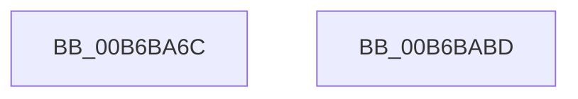

# PfTSetTracingPriority

- RVA: `0x00B6BA6C`–`0x00B6BABE` (길이 `82` bytes)
- VA: `0x0000000140B6BA6C`
- 실행 섹션: `PAGELK`
- PDB 이름 있음: `예`; PDB Function 태그: `아니요`
- unwind 정보 RVA: `0x00060BC4`
- 디코드: `24`개 명령, `82/82` bytes 표시
- 미해석 바이트: `0` (있으면 어셈블리에 `.byte`로 보존)

> 이 문서는 커널 이미지의 기계어와 PDB 기호를 분석해 생성했습니다. 4번과 5번은 함수 원형과 자료형을 바이너리 사용 방식에서 추정한 C 해석이며 원본 소스 복구 결과는 아닙니다.

## 1. Dependencies

- 직접 호출 지점: **4**; 고유 호출 대상: **4**
- 직접 호출자로 확인된 함수: **1**
- RIP 상대 이미지 참조: **0**

### Outgoing calls
- `0x00B6BA84` → [FsRtlAcquirePushLockExclusive](../../text/4A/FsRtlAcquirePushLockExclusive_function_004A05F4.md) (function, `0x004A05F4`)
- `0x00B6BA94` → [CsanRead64NoCheck](../../text/4C/CsanRead64NoCheck_function_004C82C0.md) (function, `0x004C82C0`)
- `0x00B6BA9F` → [MmSetAccessLogging](../../text/68/MmSetAccessLogging_function_0068A188.md) (function, `0x0068A188`)
- `0x00B6BAA8` → [PfLockExclusiveRelease](../../text/49/PfLockExclusiveRelease_function_00491D88.md) (function, `0x00491D88`)

### Direct callers
- [PfpLogEventRequest](../../page/AC/PfpLogEventRequest_function_00AC1278.md) at `0x00AC12D1`

### Static image references
- 디코드된 RIP-relative 메모리 참조가 없습니다.

## 2. Other-region calls and transfers

- 다른 실행 섹션으로 향하는 call: **4**
  - `0x00B6BA84` → [FsRtlAcquirePushLockExclusive](../../text/4A/FsRtlAcquirePushLockExclusive_function_004A05F4.md) (`PAGELK` → `.text`)
  - `0x00B6BA94` → [CsanRead64NoCheck](../../text/4C/CsanRead64NoCheck_function_004C82C0.md) (`PAGELK` → `.text`)
  - `0x00B6BA9F` → [MmSetAccessLogging](../../text/68/MmSetAccessLogging_function_0068A188.md) (`PAGELK` → `.text`)
  - `0x00B6BAA8` → [PfLockExclusiveRelease](../../text/49/PfLockExclusiveRelease_function_00491D88.md) (`PAGELK` → `.text`)
- 별도 외부 분기/꼬리 이동을 확인하지 못했습니다.

## 3. Assembly (complete function range)

```asm
00B6BA6C  48 89 5C 24 08                  mov qword ptr [rsp + 8], rbx
00B6BA71  48 89 74 24 10                  mov qword ptr [rsp + 0x10], rsi
00B6BA76  57                              push rdi
00B6BA77  48 83 EC 20                     sub rsp, 0x20
00B6BA7B  48 8B D9                        mov rbx, rcx
00B6BA7E  8B FA                           mov edi, edx
00B6BA80  48 83 C1 50                     add rcx, 0x50
00B6BA84  E8 6B 4B 93 FF                  call 0x1404a05f4
00B6BA89  33 D2                           xor edx, edx
00B6BA8B  48 8B CB                        mov rcx, rbx
00B6BA8E  39 53 4C                        cmp dword ptr [rbx + 0x4c], edx
00B6BA91  0F 94 C2                        sete dl
00B6BA94  E8 27 C8 95 FF                  call 0x1404c82c0
00B6BA99  48 8B C8                        mov rcx, rax
00B6BA9C  44 8B C7                        mov r8d, edi
00B6BA9F  E8 E4 E6 B1 FF                  call 0x14068a188
00B6BAA4  48 8D 4B 50                     lea rcx, [rbx + 0x50]
00B6BAA8  E8 DB 62 92 FF                  call 0x140491d88
00B6BAAD  48 8B 5C 24 30                  mov rbx, qword ptr [rsp + 0x30]
00B6BAB2  48 8B 74 24 38                  mov rsi, qword ptr [rsp + 0x38]
00B6BAB7  48 83 C4 20                     add rsp, 0x20
00B6BABB  5F                              pop rdi
00B6BABC  C3                              ret
00B6BABD  CC                              int3
```

## 4. C-style interpretation (structured pseudocode)

```c
__int64 __fastcall PfTSetTracingPriority(__int64 a1, int a2)
{
    __int64 result;
    __int64 v_rsp;
    unsigned __int64 v_stack_p10;
    unsigned __int64 v_stack_p8;

    v_stack_p8 = v_rbx;
    v_stack_p10 = v_rsi;
    v_rsp = (v_rsp) - (32);
    a1 = (a1) + (80);
    result = FsRtlAcquirePushLockExclusive(a1, a2, a3, a4);
    a2 = 0;
    a2 = ((*(unsigned int *)(a1 + 76)) == 0) ? 1 : 0;
    result = CsanRead64NoCheck(a1, a2, a3, a4);
    result = MmSetAccessLogging(result, a2, (unsigned int)((unsigned int)((unsigned int)(a2))), a4);
    result = PfLockExclusiveRelease(a1 + 80, a2, (unsigned int)((unsigned int)((unsigned int)(a2))), a4);
    v_rsp = (v_rsp) + (32);
    return result;
}
```

## 5. (Beta) C Style

```c
int64_t PfTSetTracingPriority(void *Arg1, int32_t Arg2)
{
    uint8_t *arg1 = (uint8_t *)Arg1;

    int64_t result;
    int64_t local_rsp;
    uint64_t v_stack_p10;
    uint64_t v_stack_p8;

    v_stack_p8 = local_rbx;
    v_stack_p10 = local_rsi;
    local_rsp = (local_rsp) - (32);
    Arg1 = (Arg1) + (80);
    result = FsRtlAcquirePushLockExclusive(Arg1, Arg2, a3, a4);
    Arg2 = 0;
    Arg2 = ((*(uint32_t *)(arg1 + 0x4C)) == 0) ? 1 : 0;
    result = CsanRead64NoCheck(Arg1, Arg2, a3, a4);
    result = MmSetAccessLogging(result, Arg2, (uint32_t)((uint32_t)((uint32_t)(Arg2))), a4);
    result = PfLockExclusiveRelease(Arg1 + 80, Arg2, (uint32_t)((uint32_t)((uint32_t)(Arg2))), a4);
    local_rsp = (local_rsp) + (32);
    return result;
}
```

### 관측된 메모리 오프셋

구조체 형식이 확인되지 않은 접근은 인자 기준의 오프셋으로만 기록했습니다.

| 기준 인자 | 오프셋 표현 | 폭 (bit) | 접근 |
|---|---:|---:|---|
| `Arg1` | `+ 0x4C` | `32` | `R` |
| `Arg1` | `+ 0x50` | `64` | `R` |

## 6. Execution-region graph

[열기: 2D/3D 그래프와 함수 탐색 컨트롤 패널](../../../control-panel.html?section=pagelk&rva=0x00B6BA6C&view=graph)

- 2D 그래프는 위에서 아래로 흐르고, 3D 그래프는 빈 공간을 드래그해 회전합니다. Shift+드래그는 이동, 휠은 확대·축소, 함수 노드 선택은 대상 보고서 이동입니다.

### Static fallback


