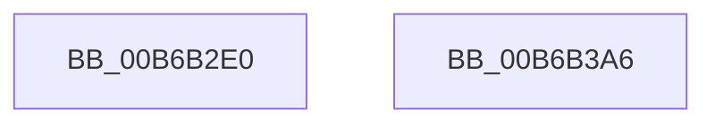

# PfpPowerActionStartScenarioTracingCallback

- RVA: `0x00B6B2E0`–`0x00B6B3A7` (길이 `199` bytes)
- VA: `0x0000000140B6B2E0`
- 실행 섹션: `PAGELK`
- PDB 이름 있음: `예`; PDB Function 태그: `아니요`
- unwind 정보 RVA: `0x00065960`
- 디코드: `49`개 명령, `199/199` bytes 표시
- 미해석 바이트: `0` (있으면 어셈블리에 `.byte`로 보존)

> 이 문서는 커널 이미지의 기계어와 PDB 기호를 분석해 생성했습니다. 4번과 5번은 함수 원형과 자료형을 바이너리 사용 방식에서 추정한 C 해석이며 원본 소스 복구 결과는 아닙니다.

## 1. Dependencies

- 직접 호출 지점: **5**; 고유 호출 대상: **5**
- 직접 호출자로 확인된 함수: **0**
- RIP 상대 이미지 참조: **1**

### Outgoing calls
- `0x00B6B2F7` → [PfTAccessTracingCleanup](PfTAccessTracingCleanup_function_00B6B8AC.md) (function, `0x00B6B8AC`)
- `0x00B6B2FF` → [CsanRead64NoCheck](../../text/4C/CsanRead64NoCheck_function_004C82C0.md) (function, `0x004C82C0`)
- `0x00B6B30C` → [MmPerformMemoryListCommand](../B7/MmPerformMemoryListCommand_function_00B7D730.md) (function, `0x00B7D730`)
- `0x00B6B319` → [PfTAccessTracingStart](PfTAccessTracingStart_function_00B6B9F0.md) (function, `0x00B6B9F0`)
- `0x00B6B396` → [PfLogEvent](../../text/34/PfLogEvent_function_00349BA8.md) (function, `0x00349BA8`)

### Direct callers
- 이 함수 시작 RVA로 연결되는 직접 call은 확인되지 않았습니다. 간접 호출은 완전히 역산할 수 없습니다.

### Static image references
- `0x00B6B38F` → RVA `0x00E670CC` (`.data`; read)

## 2. Other-region calls and transfers

- 다른 실행 섹션으로 향하는 call: **2**
  - `0x00B6B2FF` → [CsanRead64NoCheck](../../text/4C/CsanRead64NoCheck_function_004C82C0.md) (`PAGELK` → `.text`)
  - `0x00B6B396` → [PfLogEvent](../../text/34/PfLogEvent_function_00349BA8.md) (`PAGELK` → `.text`)
- 별도 외부 분기/꼬리 이동을 확인하지 못했습니다.

## 3. Assembly (complete function range)

```asm
00B6B2E0  48 89 5C 24 08                  mov qword ptr [rsp + 8], rbx
00B6B2E5  57                              push rdi
00B6B2E6  48 83 EC 40                     sub rsp, 0x40
00B6B2EA  45 33 C0                        xor r8d, r8d
00B6B2ED  48 8B DA                        mov rbx, rdx
00B6B2F0  48 8B F9                        mov rdi, rcx
00B6B2F3  41 8D 50 04                     lea edx, [r8 + 4]
00B6B2F7  E8 B0 05 00 00                  call 0x140b6b8ac
00B6B2FC  48 8B CF                        mov rcx, rdi
00B6B2FF  E8 BC CF 95 FF                  call 0x1404c82c0
00B6B304  48 8B D0                        mov rdx, rax
00B6B307  B9 01 00 00 00                  mov ecx, 1
00B6B30C  E8 1F 24 01 00                  call 0x140b7d730
00B6B311  BA 04 00 00 00                  mov edx, 4
00B6B316  48 8B CF                        mov rcx, rdi
00B6B319  E8 D2 06 00 00                  call 0x140b6b9f0
00B6B31E  48 63 43 30                     movsxd rax, dword ptr [rbx + 0x30]
00B6B322  4C 8D 4C 24 30                  lea r9, [rsp + 0x30]
00B6B327  48 89 44 24 30                  mov qword ptr [rsp + 0x30], rax
00B6B32C  33 D2                           xor edx, edx
00B6B32E  8B 43 34                        mov eax, dword ptr [rbx + 0x34]
00B6B331  0F B7 C8                        movzx ecx, ax
00B6B334  48 B8 20 03 00 00 80 F7 FF FF   movabs rax, 0xfffff78000000320
00B6B33E  C1 E1 02                        shl ecx, 2
00B6B341  48 89 54 24 38                  mov qword ptr [rsp + 0x38], rdx
00B6B346  81 E2 00 00 FC FF               and edx, 0xfffc0000
00B6B34C  0B CA                           or ecx, edx
00B6B34E  C7 44 24 20 10 00 00 00         mov dword ptr [rsp + 0x20], 0x10
00B6B356  48 8B 00                        mov rax, qword ptr [rax]
00B6B359  BA 1B 00 00 00                  mov edx, 0x1b
00B6B35E  44 8B C0                        mov r8d, eax
00B6B361  89 4C 24 38                     mov dword ptr [rsp + 0x38], ecx
00B6B365  48 B9 04 00 00 00 80 F7 FF FF   movabs rcx, 0xfffff78000000004
00B6B36F  48 C1 E8 20                     shr rax, 0x20
00B6B373  8B 09                           mov ecx, dword ptr [rcx]
00B6B375  4C 0F AF C1                     imul r8, rcx
00B6B379  48 0F AF C1                     imul rax, rcx
00B6B37D  49 C1 E8 18                     shr r8, 0x18
00B6B381  48 8B CF                        mov rcx, rdi
00B6B384  48 C1 E0 08                     shl rax, 8
00B6B388  4C 03 C0                        add r8, rax
00B6B38B  49 C1 E8 0A                     shr r8, 0xa
00B6B38F  44 03 05 36 BD 2F 00            add r8d, dword ptr [rip + 0x2fbd36]
00B6B396  E8 0D E8 7D FF                  call 0x140349ba8
00B6B39B  48 8B 5C 24 50                  mov rbx, qword ptr [rsp + 0x50]
00B6B3A0  48 83 C4 40                     add rsp, 0x40
00B6B3A4  5F                              pop rdi
00B6B3A5  C3                              ret
00B6B3A6  CC                              int3
```

## 4. C-style interpretation (structured pseudocode)

```c
__int64 __fastcall PfpPowerActionStartScenarioTracingCallback(__int64 a1, __int64 a2, int a3)
{
    __int64 result;
    __int64 v_rsp;
    unsigned __int64 v_stack_m10;
    unsigned __int64 v_stack_m18;
    unsigned int v_stack_m28;
    unsigned __int64 v_stack_p8;

    v_stack_p8 = v_rbx;
    v_rsp = (v_rsp) - (64);
    a3 = 0;
    result = PfTAccessTracingCleanup(a1, a3 + 4, a3, a4);
    result = CsanRead64NoCheck(a1, a3 + 4, a3, a4);
    result = MmPerformMemoryListCommand(1, result, a3, a4);
    result = PfTAccessTracingStart(a1, 4, a3, a4);
    v_stack_m18 = (int)(*(unsigned int *)(a2 + 48));
    a2 = 0;
    a1 = (unsigned int)(((unsigned __int16)((unsigned int)(*(unsigned int *)(a2 + 52)))) << (2));
    v_stack_m10 = 0;
    a2 = (unsigned int)((a2) & (0xFFFC0000ULL));
    a1 = (unsigned int)((a1) | ((unsigned int)(a2)));
    v_stack_m28 = 16;
    v_stack_m10 = (unsigned int)(a1);
    result = (*(unsigned __int64 *)((unsigned int)(*(unsigned int *)(a2 + 52)))) >> (32);
    a3 = ((unsigned int)((unsigned int)(*(unsigned __int64 *)((unsigned int)(*(unsigned int *)(a2 + 52)))))) * ((unsigned int)(*(unsigned int *)(a1)));
    result = (result) * ((unsigned int)(*(unsigned int *)(a1)));
    a3 = (a3) >> (24);
    result = (result) << (8);
    a3 = (a3) + (result);
    a3 = (a3) >> (10);
    a3 = (unsigned int)((a3) + (*(unsigned int *)(v_rip + 3128630)));
    result = PfLogEvent(a1, 27, a3, v_stack_m18);
    v_rsp = (v_rsp) + (64);
    return result;
}
```

## 5. (Beta) C Style

```c
int64_t PfpPowerActionStartScenarioTracingCallback(int64_t Arg1, void *Arg2, int32_t Arg3)
{
    uint8_t *arg2 = (uint8_t *)Arg2;

    int64_t result;
    int64_t local_rsp;
    uint64_t v_stack_m10;
    uint64_t v_stack_m18;
    uint32_t v_stack_m28;
    uint64_t v_stack_p8;

    v_stack_p8 = local_rbx;
    local_rsp = (local_rsp) - (64);
    Arg3 = 0;
    result = PfTAccessTracingCleanup(Arg1, Arg3 + 4, Arg3, a4);
    result = CsanRead64NoCheck(Arg1, Arg3 + 4, Arg3, a4);
    result = MmPerformMemoryListCommand(1, result, Arg3, a4);
    result = PfTAccessTracingStart(Arg1, 4, Arg3, a4);
    v_stack_m18 = (int32_t)(*(uint32_t *)(arg2 + 0x30));
    Arg2 = 0;
    Arg1 = (uint32_t)(((uint16_t)((uint32_t)(*(uint32_t *)(arg2 + 0x34)))) << (2));
    v_stack_m10 = 0;
    Arg2 = (uint32_t)((Arg2) & (0xFFFC0000ULL));
    Arg1 = (uint32_t)((Arg1) | ((uint32_t)(Arg2)));
    v_stack_m28 = 16;
    v_stack_m10 = (uint32_t)(Arg1);
    result = (*(uint64_t *)((uint32_t)(*(uint32_t *)(arg2 + 0x34)))) >> (32);
    Arg3 = ((uint32_t)((uint32_t)(*(uint64_t *)((uint32_t)(*(uint32_t *)(arg2 + 0x34)))))) * ((uint32_t)(*(uint32_t *)(Arg1)));
    result = (result) * ((uint32_t)(*(uint32_t *)(Arg1)));
    Arg3 = (Arg3) >> (24);
    result = (result) << (8);
    Arg3 = (Arg3) + (result);
    Arg3 = (Arg3) >> (10);
    Arg3 = (uint32_t)((Arg3) + (*(uint32_t *)(v_rip + 0x2FBD36)));
    result = PfLogEvent(Arg1, 27, Arg3, v_stack_m18);
    local_rsp = (local_rsp) + (64);
    return result;
}
```

### 관측된 메모리 오프셋

구조체 형식이 확인되지 않은 접근은 인자 기준의 오프셋으로만 기록했습니다.

| 기준 인자 | 오프셋 표현 | 폭 (bit) | 접근 |
|---|---:|---:|---|
| `Arg2` | `+ 0x30` | `32` | `R` |
| `Arg2` | `+ 0x34` | `32` | `R` |

## 6. Execution-region graph

[열기: 2D/3D 그래프와 함수 탐색 컨트롤 패널](../../../control-panel.html?section=pagelk&rva=0x00B6B2E0&view=graph)

- 2D 그래프는 위에서 아래로 흐르고, 3D 그래프는 빈 공간을 드래그해 회전합니다. Shift+드래그는 이동, 휠은 확대·축소, 함수 노드 선택은 대상 보고서 이동입니다.

### Static fallback


