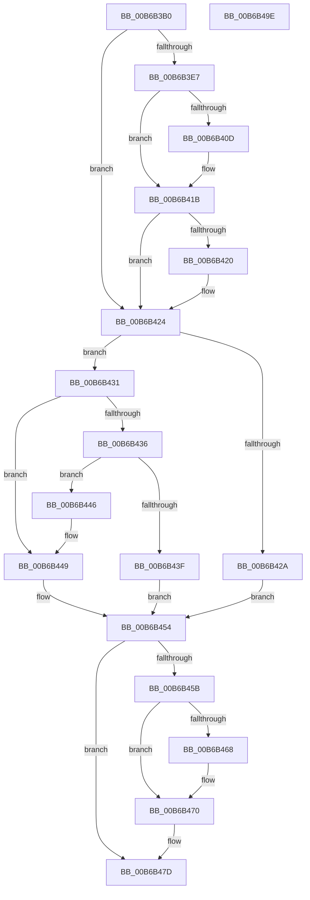

# PfpScenCtxPrefetchAbortSet

- RVA: `0x00B6B3B0`–`0x00B6B49F` (길이 `239` bytes)
- VA: `0x0000000140B6B3B0`
- 실행 섹션: `PAGELK`
- PDB 이름 있음: `예`; PDB Function 태그: `아니요`
- unwind 정보 RVA: `0x000C4D00`
- 디코드: `71`개 명령, `239/239` bytes 표시
- 미해석 바이트: `0` (있으면 어셈블리에 `.byte`로 보존)

> 이 문서는 커널 이미지의 기계어와 PDB 기호를 분석해 생성했습니다. 4번과 5번은 함수 원형과 자료형을 바이너리 사용 방식에서 추정한 C 해석이며 원본 소스 복구 결과는 아닙니다.

## 1. Dependencies

- 직접 호출 지점: **5**; 고유 호출 대상: **5**
- 직접 호출자로 확인된 함수: **3**
- RIP 상대 이미지 참조: **0**

### Outgoing calls
- `0x00B6B3FD` → [KeAbPreAcquire](../../text/21/KeAbPreAcquire_function_00210230.md) (function, `0x00210230`)
- `0x00B6B416` → [ExfAcquirePushLockExclusiveEx](../../text/20/ExfAcquirePushLockExclusiveEx_function_0020FC90.md) (function, `0x0020FC90`)
- `0x00B6B46B` → [ExfTryToWakePushLock](../../text/26/ExfTryToWakePushLock_function_00265DD0.md) (function, `0x00265DD0`)
- `0x00B6B473` → [KeAbPostRelease](../../text/2E/KeAbPostRelease_function_002E1600.md) (function, `0x002E1600`)
- `0x00B6B478` → [KeLeaveCriticalRegion](../../text/25/KeLeaveCriticalRegion_function_0025D8B0.md) (function, `0x0025D8B0`)

### Direct callers
- [PfpPrefetchRequestPerform](../../page/93/PfpPrefetchRequestPerform_function_00938F74.md) at `0x009393CC`
- [sub_00B24FD6](../../page/B2/Unknown_function_00B24FD6.md) at `0x00B25005`
- [PfpScenCtxScenarioSet](../B7/PfpScenCtxScenarioSet_function_00B7CFF0.md) at `0x00B7D0BF`

### Static image references
- 디코드된 RIP-relative 메모리 참조가 없습니다.

## 2. Other-region calls and transfers

- 다른 실행 섹션으로 향하는 call: **5**
  - `0x00B6B3FD` → [KeAbPreAcquire](../../text/21/KeAbPreAcquire_function_00210230.md) (`PAGELK` → `.text`)
  - `0x00B6B416` → [ExfAcquirePushLockExclusiveEx](../../text/20/ExfAcquirePushLockExclusiveEx_function_0020FC90.md) (`PAGELK` → `.text`)
  - `0x00B6B46B` → [ExfTryToWakePushLock](../../text/26/ExfTryToWakePushLock_function_00265DD0.md) (`PAGELK` → `.text`)
  - `0x00B6B473` → [KeAbPostRelease](../../text/2E/KeAbPostRelease_function_002E1600.md) (`PAGELK` → `.text`)
  - `0x00B6B478` → [KeLeaveCriticalRegion](../../text/25/KeLeaveCriticalRegion_function_0025D8B0.md) (`PAGELK` → `.text`)
- 별도 외부 분기/꼬리 이동을 확인하지 못했습니다.

## 3. Assembly (complete function range)

```asm
00B6B3B0  48 8B C4                        mov rax, rsp
00B6B3B3  48 89 58 08                     mov qword ptr [rax + 8], rbx
00B6B3B7  48 89 68 10                     mov qword ptr [rax + 0x10], rbp
00B6B3BB  48 89 70 18                     mov qword ptr [rax + 0x18], rsi
00B6B3BF  48 89 78 20                     mov qword ptr [rax + 0x20], rdi
00B6B3C3  41 54                           push r12
00B6B3C5  41 55                           push r13
00B6B3C7  41 56                           push r14
00B6B3C9  48 83 EC 20                     sub rsp, 0x20
00B6B3CD  48 83 CB FF                     or rbx, 0xffffffffffffffff
00B6B3D1  45 33 ED                        xor r13d, r13d
00B6B3D4  45 8B F1                        mov r14d, r9d
00B6B3D7  49 8B E8                        mov rbp, r8
00B6B3DA  44 8B E2                        mov r12d, edx
00B6B3DD  48 8B F9                        mov rdi, rcx
00B6B3E0  44 39 6C 24 60                  cmp dword ptr [rsp + 0x60], r13d
00B6B3E5  75 3D                           jne 0x140b6b424
00B6B3E7  65 48 8B 04 25 88 01 00 00      mov rax, qword ptr gs:[0x188]
00B6B3F0  45 33 C0                        xor r8d, r8d
00B6B3F3  33 D2                           xor edx, edx
00B6B3F5  66 01 98 E4 01 00 00            add word ptr [rax + 0x1e4], bx
00B6B3FC  90                              nop
00B6B3FD  E8 2E 4E 6A FF                  call 0x140210230
00B6B402  F0 48 0F BA 2F 00               lock bts qword ptr [rdi], 0
00B6B408  48 8B F0                        mov rsi, rax
00B6B40B  73 0E                           jae 0x140b6b41b
00B6B40D  4C 8B C7                        mov r8, rdi
00B6B410  48 8B D0                        mov rdx, rax
00B6B413  48 8B CF                        mov rcx, rdi
00B6B416  E8 75 48 6A FF                  call 0x14020fc90
00B6B41B  48 85 F6                        test rsi, rsi
00B6B41E  74 04                           je 0x140b6b424
00B6B420  C6 46 0A 01                     mov byte ptr [rsi + 0xa], 1
00B6B424  44 39 67 30                     cmp dword ptr [rdi + 0x30], r12d
00B6B428  74 07                           je 0x140b6b431
00B6B42A  BE 59 00 00 C0                  mov esi, 0xc0000059
00B6B42F  EB 23                           jmp 0x140b6b454
00B6B431  45 85 F6                        test r14d, r14d
00B6B434  75 13                           jne 0x140b6b449
00B6B436  8B 47 08                        mov eax, dword ptr [rdi + 8]
00B6B439  24 0C                           and al, 0xc
00B6B43B  3C 08                           cmp al, 8
00B6B43D  75 07                           jne 0x140b6b446
00B6B43F  BE 89 01 00 C0                  mov esi, 0xc0000189
00B6B444  EB 0E                           jmp 0x140b6b454
00B6B446  45 85 F6                        test r14d, r14d
00B6B449  49 0F 45 ED                     cmovne rbp, r13
00B6B44D  41 8B F5                        mov esi, r13d
00B6B450  48 89 6F 28                     mov qword ptr [rdi + 0x28], rbp
00B6B454  44 39 6C 24 60                  cmp dword ptr [rsp + 0x60], r13d
00B6B459  75 22                           jne 0x140b6b47d
00B6B45B  F0 48 0F C1 1F                  lock xadd qword ptr [rdi], rbx
00B6B460  80 E3 06                        and bl, 6
00B6B463  80 FB 02                        cmp bl, 2
00B6B466  75 08                           jne 0x140b6b470
00B6B468  48 8B CF                        mov rcx, rdi
00B6B46B  E8 60 A9 6F FF                  call 0x140265dd0
00B6B470  48 8B CF                        mov rcx, rdi
00B6B473  E8 88 61 77 FF                  call 0x1402e1600
00B6B478  E8 33 24 6F FF                  call 0x14025d8b0
00B6B47D  48 8B 5C 24 40                  mov rbx, qword ptr [rsp + 0x40]
00B6B482  8B C6                           mov eax, esi
00B6B484  48 8B 74 24 50                  mov rsi, qword ptr [rsp + 0x50]
00B6B489  48 8B 6C 24 48                  mov rbp, qword ptr [rsp + 0x48]
00B6B48E  48 8B 7C 24 58                  mov rdi, qword ptr [rsp + 0x58]
00B6B493  48 83 C4 20                     add rsp, 0x20
00B6B497  41 5E                           pop r14
00B6B499  41 5D                           pop r13
00B6B49B  41 5C                           pop r12
00B6B49D  C3                              ret
00B6B49E  CC                              int3
```

## 4. C-style interpretation (structured pseudocode)

```c
__int64 __fastcall PfpScenCtxPrefetchAbortSet(__int64 a1, int a2, __int64 a3, int a4, unsigned int a5)
{
    __int64 result;
    __int64 v_r13;
    __int64 v_rbx;
    __int64 v_rsp;
    unsigned __int64 v_stack_p10;
    unsigned __int64 v_stack_p18;
    unsigned __int64 v_stack_p20;
    unsigned __int64 v_stack_p8;

    *(unsigned __int64 *)(v_rsp + 8) = v_rbx;
    *(unsigned __int64 *)(v_rsp + 16) = v_rbp;
    *(unsigned __int64 *)(v_rsp + 24) = v_rsi;
    *(unsigned __int64 *)(v_rsp + 32) = v_rdi;
    v_rsp = (v_rsp) - (32);
    v_rbx = (v_rbx) | (-1);
    v_r13 = 0;
    if (a5 != 0) goto loc_00B6B424;
    a3 = 0;
    a2 = 0;
    result = KeAbPreAcquire(a1, a2, a3, a4);
    if (!(condition_is_above_or_equal)) {
        a3 = a1;
        a2 = result;
        a1 = a1;
        result = ExfAcquirePushLockExclusiveEx(a1, a2, a3, a4);
    }
    if (result != 0) {
        *(unsigned __int8 *)(result + 10) = 1;
    }
    if ((*(unsigned int *)(a1 + 48)) == ((unsigned int)((unsigned int)(a2)))) goto loc_00B6B431;
    goto loc_00B6B454;
loc_00B6B431:
    if ((unsigned int)((unsigned int)(a4)) != 0) goto loc_00B6B449;
    result = (unsigned __int8)(((unsigned int)(*(unsigned int *)(a1 + 8))) & (12));
    if (((unsigned __int8)(result)) != 8) goto loc_00B6B446;
    goto loc_00B6B454;
loc_00B6B446:
loc_00B6B449:
    if ((unsigned int)((unsigned int)(a4)) != 0) { a3 = 0; }
    *(unsigned __int64 *)(a1 + 40) = a3;
loc_00B6B454:
    if (a5 != 0) goto loc_00B6B47D;
    v_rbx = (unsigned __int8)((v_rbx) & (6));
    if (((unsigned __int8)(v_rbx)) == 2) {
        a1 = a1;
        result = ExfTryToWakePushLock(a1, a2, a3, a4);
    }
    result = KeAbPostRelease(a1, a2, a3, a4);
    result = KeLeaveCriticalRegion(a1, a2, a3, a4);
loc_00B6B47D:
    v_rsp = (v_rsp) + (32);
    return 0;
}
```

## 5. (Beta) C Style

```c
int64_t PfpScenCtxPrefetchAbortSet(void *Arg1, int32_t Arg2, int64_t Arg3, int32_t Arg4, uint32_t Arg5)
{
    uint8_t *arg1 = (uint8_t *)Arg1;

    int64_t result;
    int64_t local_r13;
    int64_t local_rbx;
    int64_t local_rsp;
    uint64_t v_stack_p10;
    uint64_t v_stack_p18;
    uint64_t v_stack_p20;
    uint64_t v_stack_p8;

    *(uint64_t *)(local_rsp + 0x8) = local_rbx;
    *(uint64_t *)(local_rsp + 0x10) = local_rbp;
    *(uint64_t *)(local_rsp + 0x18) = local_rsi;
    *(uint64_t *)(local_rsp + 0x20) = local_rdi;
    local_rsp = (local_rsp) - (32);
    local_rbx = (local_rbx) | (-1);
    local_r13 = 0;
    if (Arg5 != 0) goto loc_00B6B424;
    Arg3 = 0;
    Arg2 = 0;
    result = KeAbPreAcquire(Arg1, Arg2, Arg3, Arg4);
    if (!(condition_is_above_or_equal)) {
        Arg3 = Arg1;
        Arg2 = result;
        Arg1 = Arg1;
        result = ExfAcquirePushLockExclusiveEx(Arg1, Arg2, Arg3, Arg4);
    }
    if (result != 0) {
        *(uint8_t *)(result + 0xA) = 1;
    }
    if ((*(uint32_t *)(arg1 + 0x30)) == ((uint32_t)((uint32_t)(Arg2)))) goto loc_00B6B431;
    goto loc_00B6B454;
loc_00B6B431:
    if ((uint32_t)((uint32_t)(Arg4)) != 0) goto loc_00B6B449;
    result = (uint8_t)(((uint32_t)(*(uint32_t *)(arg1 + 0x8))) & (12));
    if (((uint8_t)(result)) != 8) goto loc_00B6B446;
    goto loc_00B6B454;
loc_00B6B446:
loc_00B6B449:
    if ((uint32_t)((uint32_t)(Arg4)) != 0) { Arg3 = 0; }
    *(uint64_t *)(arg1 + 0x28) = Arg3;
loc_00B6B454:
    if (Arg5 != 0) goto loc_00B6B47D;
    local_rbx = (uint8_t)((local_rbx) & (6));
    if (((uint8_t)(local_rbx)) == 2) {
        Arg1 = Arg1;
        result = ExfTryToWakePushLock(Arg1, Arg2, Arg3, Arg4);
    }
    result = KeAbPostRelease(Arg1, Arg2, Arg3, Arg4);
    result = KeLeaveCriticalRegion(Arg1, Arg2, Arg3, Arg4);
loc_00B6B47D:
    local_rsp = (local_rsp) + (32);
    return 0;
}
```

### 관측된 메모리 오프셋

구조체 형식이 확인되지 않은 접근은 인자 기준의 오프셋으로만 기록했습니다.

| 기준 인자 | 오프셋 표현 | 폭 (bit) | 접근 |
|---|---:|---:|---|
| `Arg1` | `+ 0x0` | `64` | `R/W` |
| `Arg1` | `+ 0x8` | `32` | `R` |
| `Arg1` | `+ 0x28` | `64` | `W` |
| `Arg1` | `+ 0x30` | `32` | `R` |

## 6. Execution-region graph

[열기: 2D/3D 그래프와 함수 탐색 컨트롤 패널](../../../control-panel.html?section=pagelk&rva=0x00B6B3B0&view=graph)

- 2D 그래프는 위에서 아래로 흐르고, 3D 그래프는 빈 공간을 드래그해 회전합니다. Shift+드래그는 이동, 휠은 확대·축소, 함수 노드 선택은 대상 보고서 이동입니다.

### Static fallback


