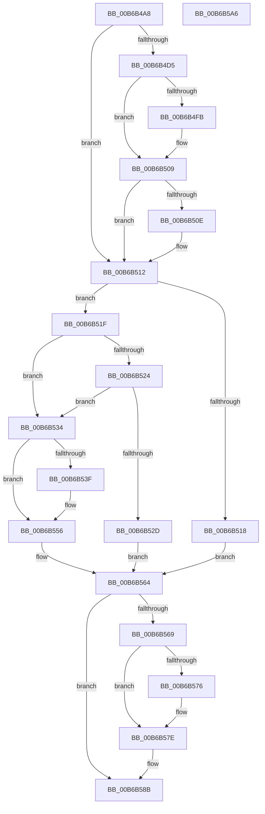

# PfpScenCtxPrefetchStateSet

- RVA: `0x00B6B4A8`–`0x00B6B5A7` (길이 `255` bytes)
- VA: `0x0000000140B6B4A8`
- 실행 섹션: `PAGELK`
- PDB 이름 있음: `예`; PDB Function 태그: `아니요`
- unwind 정보 RVA: `0x00060300`
- 디코드: `80`개 명령, `255/255` bytes 표시
- 미해석 바이트: `0` (있으면 어셈블리에 `.byte`로 보존)

> 이 문서는 커널 이미지의 기계어와 PDB 기호를 분석해 생성했습니다. 4번과 5번은 함수 원형과 자료형을 바이너리 사용 방식에서 추정한 C 해석이며 원본 소스 복구 결과는 아닙니다.

## 1. Dependencies

- 직접 호출 지점: **6**; 고유 호출 대상: **6**
- 직접 호출자로 확인된 함수: **2**
- RIP 상대 이미지 참조: **0**

### Outgoing calls
- `0x00B6B4EB` → [KeAbPreAcquire](../../text/21/KeAbPreAcquire_function_00210230.md) (function, `0x00210230`)
- `0x00B6B504` → [ExfAcquirePushLockExclusiveEx](../../text/20/ExfAcquirePushLockExclusiveEx_function_0020FC90.md) (function, `0x0020FC90`)
- `0x00B6B54A` → [KeSetEvent](../../text/33/KeSetEvent_function_0033F310.md) (function, `0x0033F310`)
- `0x00B6B579` → [ExfTryToWakePushLock](../../text/26/ExfTryToWakePushLock_function_00265DD0.md) (function, `0x00265DD0`)
- `0x00B6B581` → [KeAbPostRelease](../../text/2E/KeAbPostRelease_function_002E1600.md) (function, `0x002E1600`)
- `0x00B6B586` → [KeLeaveCriticalRegion](../../text/25/KeLeaveCriticalRegion_function_0025D8B0.md) (function, `0x0025D8B0`)

### Direct callers
- [PfSetSuperfetchInformation](../../page/AD/PfSetSuperfetchInformation_function_00ADE6E8.md) at `0x00ADE8E5`
- [PfpScenCtxScenarioSet](../B7/PfpScenCtxScenarioSet_function_00B7CFF0.md) at `0x00B7D0A2`

### Static image references
- 디코드된 RIP-relative 메모리 참조가 없습니다.

## 2. Other-region calls and transfers

- 다른 실행 섹션으로 향하는 call: **6**
  - `0x00B6B4EB` → [KeAbPreAcquire](../../text/21/KeAbPreAcquire_function_00210230.md) (`PAGELK` → `.text`)
  - `0x00B6B504` → [ExfAcquirePushLockExclusiveEx](../../text/20/ExfAcquirePushLockExclusiveEx_function_0020FC90.md) (`PAGELK` → `.text`)
  - `0x00B6B54A` → [KeSetEvent](../../text/33/KeSetEvent_function_0033F310.md) (`PAGELK` → `.text`)
  - `0x00B6B579` → [ExfTryToWakePushLock](../../text/26/ExfTryToWakePushLock_function_00265DD0.md) (`PAGELK` → `.text`)
  - `0x00B6B581` → [KeAbPostRelease](../../text/2E/KeAbPostRelease_function_002E1600.md) (`PAGELK` → `.text`)
  - `0x00B6B586` → [KeLeaveCriticalRegion](../../text/25/KeLeaveCriticalRegion_function_0025D8B0.md) (`PAGELK` → `.text`)
- 별도 외부 분기/꼬리 이동을 확인하지 못했습니다.

## 3. Assembly (complete function range)

```asm
00B6B4A8  48 89 5C 24 08                  mov qword ptr [rsp + 8], rbx
00B6B4AD  48 89 6C 24 10                  mov qword ptr [rsp + 0x10], rbp
00B6B4B2  48 89 74 24 18                  mov qword ptr [rsp + 0x18], rsi
00B6B4B7  57                              push rdi
00B6B4B8  41 56                           push r14
00B6B4BA  41 57                           push r15
00B6B4BC  48 83 EC 20                     sub rsp, 0x20
00B6B4C0  48 83 CB FF                     or rbx, 0xffffffffffffffff
00B6B4C4  45 8B F1                        mov r14d, r9d
00B6B4C7  41 8B E8                        mov ebp, r8d
00B6B4CA  44 8B FA                        mov r15d, edx
00B6B4CD  48 8B F9                        mov rdi, rcx
00B6B4D0  45 85 C9                        test r9d, r9d
00B6B4D3  75 3D                           jne 0x140b6b512
00B6B4D5  65 48 8B 04 25 88 01 00 00      mov rax, qword ptr gs:[0x188]
00B6B4DE  45 33 C0                        xor r8d, r8d
00B6B4E1  33 D2                           xor edx, edx
00B6B4E3  66 01 98 E4 01 00 00            add word ptr [rax + 0x1e4], bx
00B6B4EA  90                              nop
00B6B4EB  E8 40 4D 6A FF                  call 0x140210230
00B6B4F0  F0 48 0F BA 2F 00               lock bts qword ptr [rdi], 0
00B6B4F6  48 8B F0                        mov rsi, rax
00B6B4F9  73 0E                           jae 0x140b6b509
00B6B4FB  4C 8B C7                        mov r8, rdi
00B6B4FE  48 8B D0                        mov rdx, rax
00B6B501  48 8B CF                        mov rcx, rdi
00B6B504  E8 87 47 6A FF                  call 0x14020fc90
00B6B509  48 85 F6                        test rsi, rsi
00B6B50C  74 04                           je 0x140b6b512
00B6B50E  C6 46 0A 01                     mov byte ptr [rsi + 0xa], 1
00B6B512  44 39 7F 30                     cmp dword ptr [rdi + 0x30], r15d
00B6B516  74 07                           je 0x140b6b51f
00B6B518  BE 59 00 00 C0                  mov esi, 0xc0000059
00B6B51D  EB 45                           jmp 0x140b6b564
00B6B51F  83 FD 01                        cmp ebp, 1
00B6B522  75 10                           jne 0x140b6b534
00B6B524  8B 47 08                        mov eax, dword ptr [rdi + 8]
00B6B527  24 0C                           and al, 0xc
00B6B529  3C 08                           cmp al, 8
00B6B52B  75 07                           jne 0x140b6b534
00B6B52D  BE 89 01 00 C0                  mov esi, 0xc0000189
00B6B532  EB 30                           jmp 0x140b6b564
00B6B534  8B 4F 08                        mov ecx, dword ptr [rdi + 8]
00B6B537  8B C1                           mov eax, ecx
00B6B539  24 0C                           and al, 0xc
00B6B53B  3C 04                           cmp al, 4
00B6B53D  75 17                           jne 0x140b6b556
00B6B53F  45 33 C0                        xor r8d, r8d
00B6B542  48 8D 4F 10                     lea rcx, [rdi + 0x10]
00B6B546  41 8D 50 01                     lea edx, [r8 + 1]
00B6B54A  E8 C1 3D 7D FF                  call 0x14033f310
00B6B54F  83 67 08 F3                     and dword ptr [rdi + 8], 0xfffffff3
00B6B553  8B 4F 08                        mov ecx, dword ptr [rdi + 8]
00B6B556  8B C1                           mov eax, ecx
00B6B558  33 C5                           xor eax, ebp
00B6B55A  83 E0 03                        and eax, 3
00B6B55D  33 C1                           xor eax, ecx
00B6B55F  89 47 08                        mov dword ptr [rdi + 8], eax
00B6B562  33 F6                           xor esi, esi
00B6B564  45 85 F6                        test r14d, r14d
00B6B567  75 22                           jne 0x140b6b58b
00B6B569  F0 48 0F C1 1F                  lock xadd qword ptr [rdi], rbx
00B6B56E  80 E3 06                        and bl, 6
00B6B571  80 FB 02                        cmp bl, 2
00B6B574  75 08                           jne 0x140b6b57e
00B6B576  48 8B CF                        mov rcx, rdi
00B6B579  E8 52 A8 6F FF                  call 0x140265dd0
00B6B57E  48 8B CF                        mov rcx, rdi
00B6B581  E8 7A 60 77 FF                  call 0x1402e1600
00B6B586  E8 25 23 6F FF                  call 0x14025d8b0
00B6B58B  48 8B 5C 24 40                  mov rbx, qword ptr [rsp + 0x40]
00B6B590  8B C6                           mov eax, esi
00B6B592  48 8B 74 24 50                  mov rsi, qword ptr [rsp + 0x50]
00B6B597  48 8B 6C 24 48                  mov rbp, qword ptr [rsp + 0x48]
00B6B59C  48 83 C4 20                     add rsp, 0x20
00B6B5A0  41 5F                           pop r15
00B6B5A2  41 5E                           pop r14
00B6B5A4  5F                              pop rdi
00B6B5A5  C3                              ret
00B6B5A6  CC                              int3
```

## 4. C-style interpretation (structured pseudocode)

```c
__int64 __fastcall PfpScenCtxPrefetchStateSet(__int64 a1, int a2, int a3, int a4)
{
    __int64 result;
    __int64 v_rbx;
    __int64 v_rsi;
    __int64 v_rsp;
    unsigned __int64 v_stack_p10;
    unsigned __int64 v_stack_p18;
    unsigned __int64 v_stack_p8;

    v_stack_p8 = v_rbx;
    v_stack_p10 = v_rbp;
    v_stack_p18 = v_rsi;
    v_rsp = (v_rsp) - (32);
    v_rbx = (v_rbx) | (-1);
    if (a4 != 0) goto loc_00B6B512;
    a3 = 0;
    a2 = 0;
    result = KeAbPreAcquire(a1, a2, a3, a4);
    if (!(condition_is_above_or_equal)) {
        a3 = a1;
        a2 = result;
        a1 = a1;
        result = ExfAcquirePushLockExclusiveEx(a1, a2, a3, a4);
    }
    if (result != 0) {
        *(unsigned __int8 *)(result + 10) = 1;
    }
    if ((*(unsigned int *)(a1 + 48)) == ((unsigned int)((unsigned int)(a2)))) goto loc_00B6B51F;
    goto loc_00B6B564;
loc_00B6B51F:
    if (((unsigned int)((unsigned int)(a3))) != 1) goto loc_00B6B534;
    result = (unsigned __int8)(((unsigned int)(*(unsigned int *)(a1 + 8))) & (12));
    if (((unsigned __int8)(result)) != 8) goto loc_00B6B534;
    goto loc_00B6B564;
loc_00B6B534:
    result = (unsigned __int8)(((unsigned int)((unsigned int)((unsigned int)(*(unsigned int *)(a1 + 8))))) & (12));
    if (((unsigned __int8)(result)) == 4) {
        a3 = 0;
        a1 = a1 + 16;
        a2 = a3 + 1;
        result = KeSetEvent(a1, a2, a3, a4);
        a1 = *(unsigned int *)(a1 + 8);
    }
    result = (unsigned int)(((unsigned int)((unsigned int)(a1))) ^ ((unsigned int)((unsigned int)(a3))));
    result = (unsigned int)((result) & (3));
    result = (unsigned int)((result) ^ ((unsigned int)(a1)));
    *(unsigned int *)(a1 + 8) = (unsigned int)(result);
    v_rsi = 0;
loc_00B6B564:
    if ((unsigned int)((unsigned int)(a4)) != 0) goto loc_00B6B58B;
    v_rbx = (unsigned __int8)((v_rbx) & (6));
    if (((unsigned __int8)(v_rbx)) == 2) {
        a1 = a1;
        result = ExfTryToWakePushLock(a1, a2, a3, a4);
    }
    result = KeAbPostRelease(a1, a2, a3, a4);
    result = KeLeaveCriticalRegion(a1, a2, a3, a4);
loc_00B6B58B:
    v_rsp = (v_rsp) + (32);
    return 0;
}
```

## 5. (Beta) C Style

```c
int64_t PfpScenCtxPrefetchStateSet(void *Arg1, int32_t Arg2, int32_t Arg3, int32_t Arg4)
{
    uint8_t *arg1 = (uint8_t *)Arg1;

    int64_t result;
    int64_t local_rbx;
    int64_t local_rsi;
    int64_t local_rsp;
    uint64_t v_stack_p10;
    uint64_t v_stack_p18;
    uint64_t v_stack_p8;

    v_stack_p8 = local_rbx;
    v_stack_p10 = local_rbp;
    v_stack_p18 = local_rsi;
    local_rsp = (local_rsp) - (32);
    local_rbx = (local_rbx) | (-1);
    if (Arg4 != 0) goto loc_00B6B512;
    Arg3 = 0;
    Arg2 = 0;
    result = KeAbPreAcquire(Arg1, Arg2, Arg3, Arg4);
    if (!(condition_is_above_or_equal)) {
        Arg3 = Arg1;
        Arg2 = result;
        Arg1 = Arg1;
        result = ExfAcquirePushLockExclusiveEx(Arg1, Arg2, Arg3, Arg4);
    }
    if (result != 0) {
        *(uint8_t *)(result + 0xA) = 1;
    }
    if ((*(uint32_t *)(arg1 + 0x30)) == ((uint32_t)((uint32_t)(Arg2)))) goto loc_00B6B51F;
    goto loc_00B6B564;
loc_00B6B51F:
    if (((uint32_t)((uint32_t)(Arg3))) != 1) goto loc_00B6B534;
    result = (uint8_t)(((uint32_t)(*(uint32_t *)(arg1 + 0x8))) & (12));
    if (((uint8_t)(result)) != 8) goto loc_00B6B534;
    goto loc_00B6B564;
loc_00B6B534:
    result = (uint8_t)(((uint32_t)((uint32_t)((uint32_t)(*(uint32_t *)(arg1 + 0x8))))) & (12));
    if (((uint8_t)(result)) == 4) {
        Arg3 = 0;
        Arg1 = Arg1 + 16;
        Arg2 = Arg3 + 1;
        result = KeSetEvent(Arg1, Arg2, Arg3, Arg4);
        Arg1 = *(uint32_t *)(arg1 + 0x8);
    }
    result = (uint32_t)(((uint32_t)((uint32_t)(Arg1))) ^ ((uint32_t)((uint32_t)(Arg3))));
    result = (uint32_t)((result) & (3));
    result = (uint32_t)((result) ^ ((uint32_t)(Arg1)));
    *(uint32_t *)(arg1 + 0x8) = (uint32_t)(result);
    local_rsi = 0;
loc_00B6B564:
    if ((uint32_t)((uint32_t)(Arg4)) != 0) goto loc_00B6B58B;
    local_rbx = (uint8_t)((local_rbx) & (6));
    if (((uint8_t)(local_rbx)) == 2) {
        Arg1 = Arg1;
        result = ExfTryToWakePushLock(Arg1, Arg2, Arg3, Arg4);
    }
    result = KeAbPostRelease(Arg1, Arg2, Arg3, Arg4);
    result = KeLeaveCriticalRegion(Arg1, Arg2, Arg3, Arg4);
loc_00B6B58B:
    local_rsp = (local_rsp) + (32);
    return 0;
}
```

### 관측된 메모리 오프셋

구조체 형식이 확인되지 않은 접근은 인자 기준의 오프셋으로만 기록했습니다.

| 기준 인자 | 오프셋 표현 | 폭 (bit) | 접근 |
|---|---:|---:|---|
| `Arg1` | `+ 0x0` | `64` | `R/W` |
| `Arg1` | `+ 0x8` | `32` | `R` |
| `Arg1` | `+ 0x8` | `32` | `R/W` |
| `Arg1` | `+ 0x8` | `32` | `W` |
| `Arg1` | `+ 0x10` | `64` | `R` |
| `Arg1` | `+ 0x30` | `32` | `R` |

## 6. Execution-region graph

[열기: 2D/3D 그래프와 함수 탐색 컨트롤 패널](../../../control-panel.html?section=pagelk&rva=0x00B6B4A8&view=graph)

- 2D 그래프는 위에서 아래로 흐르고, 3D 그래프는 빈 공간을 드래그해 회전합니다. Shift+드래그는 이동, 휠은 확대·축소, 함수 노드 선택은 대상 보고서 이동입니다.

### Static fallback


