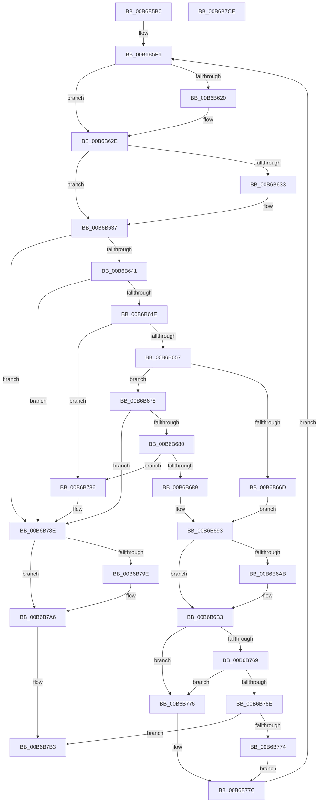

# PfpScenCtxPrefetchWait

- RVA: `0x00B6B5B0`–`0x00B6B7CF` (길이 `543` bytes)
- VA: `0x0000000140B6B5B0`
- 실행 섹션: `PAGELK`
- PDB 이름 있음: `예`; PDB Function 태그: `아니요`
- unwind 정보 RVA: `0x000CB8F8`
- 디코드: `150`개 명령, `543/543` bytes 표시
- 미해석 바이트: `0` (있으면 어셈블리에 `.byte`로 보존)

> 이 문서는 커널 이미지의 기계어와 PDB 기호를 분석해 생성했습니다. 4번과 5번은 함수 원형과 자료형을 바이너리 사용 방식에서 추정한 C 해석이며 원본 소스 복구 결과는 아닙니다.

## 1. Dependencies

- 직접 호출 지점: **12**; 고유 호출 대상: **9**
- 직접 호출자로 확인된 함수: **2**
- RIP 상대 이미지 참조: **0**

### Outgoing calls
- `0x00B6B5E1` → [PfpPartitionIterateAndCheckCanAnyDoAccessLogging](../../text/5C/PfpPartitionIterateAndCheckCanAnyDoAccessLogging_function_005CE0EC.md) (function, `0x005CE0EC`)
- `0x00B6B60F` → [KeAbPreAcquire](../../text/21/KeAbPreAcquire_function_00210230.md) (function, `0x00210230`)
- `0x00B6B629` → [ExfAcquirePushLockExclusiveEx](../../text/20/ExfAcquirePushLockExclusiveEx_function_0020FC90.md) (function, `0x0020FC90`)
- `0x00B6B65B` → [KeResetEvent](../../text/24/KeResetEvent_function_00248350.md) (function, `0x00248350`)
- `0x00B6B6AE` → [ExfTryToWakePushLock](../../text/26/ExfTryToWakePushLock_function_00265DD0.md) (function, `0x00265DD0`)
- `0x00B6B6B6` → [KeAbPostRelease](../../text/2E/KeAbPostRelease_function_002E1600.md) (function, `0x002E1600`)
- `0x00B6B6BB` → [KeLeaveCriticalRegion](../../text/25/KeLeaveCriticalRegion_function_0025D8B0.md) (function, `0x0025D8B0`)
- `0x00B6B6FC` → [KeWaitForSingleObject](../../text/20/KeWaitForSingleObject_function_0020E6B0.md) (function, `0x0020E6B0`)
- `0x00B6B789` → [PfpScenCtxWaiterTimedOut](../../text/5C/PfpScenCtxWaiterTimedOut_function_005CDB80.md) (function, `0x005CDB80`)
- `0x00B6B7A1` → [ExfTryToWakePushLock](../../text/26/ExfTryToWakePushLock_function_00265DD0.md) (function, `0x00265DD0`)
- `0x00B6B7A9` → [KeAbPostRelease](../../text/2E/KeAbPostRelease_function_002E1600.md) (function, `0x002E1600`)
- `0x00B6B7AE` → [KeLeaveCriticalRegion](../../text/25/KeLeaveCriticalRegion_function_0025D8B0.md) (function, `0x0025D8B0`)

### Direct callers
- [sub_00B47AE6](../../page/B4/Unknown_function_00B47AE6.md) at `0x00B47B96`
- [sub_00B80CFE](../B8/Unknown_function_00B80CFE.md) at `0x00B80DAD`

### Static image references
- 디코드된 RIP-relative 메모리 참조가 없습니다.

## 2. Other-region calls and transfers

- 다른 실행 섹션으로 향하는 call: **12**
  - `0x00B6B5E1` → [PfpPartitionIterateAndCheckCanAnyDoAccessLogging](../../text/5C/PfpPartitionIterateAndCheckCanAnyDoAccessLogging_function_005CE0EC.md) (`PAGELK` → `.text`)
  - `0x00B6B60F` → [KeAbPreAcquire](../../text/21/KeAbPreAcquire_function_00210230.md) (`PAGELK` → `.text`)
  - `0x00B6B629` → [ExfAcquirePushLockExclusiveEx](../../text/20/ExfAcquirePushLockExclusiveEx_function_0020FC90.md) (`PAGELK` → `.text`)
  - `0x00B6B65B` → [KeResetEvent](../../text/24/KeResetEvent_function_00248350.md) (`PAGELK` → `.text`)
  - `0x00B6B6AE` → [ExfTryToWakePushLock](../../text/26/ExfTryToWakePushLock_function_00265DD0.md) (`PAGELK` → `.text`)
  - `0x00B6B6B6` → [KeAbPostRelease](../../text/2E/KeAbPostRelease_function_002E1600.md) (`PAGELK` → `.text`)
  - `0x00B6B6BB` → [KeLeaveCriticalRegion](../../text/25/KeLeaveCriticalRegion_function_0025D8B0.md) (`PAGELK` → `.text`)
  - `0x00B6B6FC` → [KeWaitForSingleObject](../../text/20/KeWaitForSingleObject_function_0020E6B0.md) (`PAGELK` → `.text`)
  - `0x00B6B789` → [PfpScenCtxWaiterTimedOut](../../text/5C/PfpScenCtxWaiterTimedOut_function_005CDB80.md) (`PAGELK` → `.text`)
  - `0x00B6B7A1` → [ExfTryToWakePushLock](../../text/26/ExfTryToWakePushLock_function_00265DD0.md) (`PAGELK` → `.text`)
  - `0x00B6B7A9` → [KeAbPostRelease](../../text/2E/KeAbPostRelease_function_002E1600.md) (`PAGELK` → `.text`)
  - `0x00B6B7AE` → [KeLeaveCriticalRegion](../../text/25/KeLeaveCriticalRegion_function_0025D8B0.md) (`PAGELK` → `.text`)
- 별도 외부 분기/꼬리 이동을 확인하지 못했습니다.

## 3. Assembly (complete function range)

```asm
00B6B5B0  48 8B C4                        mov rax, rsp
00B6B5B3  48 89 58 20                     mov qword ptr [rax + 0x20], rbx
00B6B5B7  44 89 40 18                     mov dword ptr [rax + 0x18], r8d
00B6B5BB  89 50 10                        mov dword ptr [rax + 0x10], edx
00B6B5BE  55                              push rbp
00B6B5BF  56                              push rsi
00B6B5C0  57                              push rdi
00B6B5C1  41 54                           push r12
00B6B5C3  41 55                           push r13
00B6B5C5  41 56                           push r14
00B6B5C7  41 57                           push r15
00B6B5C9  48 83 EC 30                     sub rsp, 0x30
00B6B5CD  48 83 60 08 00                  and qword ptr [rax + 8], 0
00B6B5D2  41 8B F0                        mov esi, r8d
00B6B5D5  44 8B E2                        mov r12d, edx
00B6B5D8  48 8B E9                        mov rbp, rcx
00B6B5DB  45 33 ED                        xor r13d, r13d
00B6B5DE  45 33 FF                        xor r15d, r15d
00B6B5E1  E8 06 2B A6 FF                  call 0x1405ce0ec
00B6B5E6  F7 D8                           neg eax
00B6B5E8  45 1B F6                        sbb r14d, r14d
00B6B5EB  41 81 E6 D0 07 00 00            and r14d, 0x7d0
00B6B5F2  48 83 CF FF                     or rdi, 0xffffffffffffffff
00B6B5F6  65 48 8B 04 25 88 01 00 00      mov rax, qword ptr gs:[0x188]
00B6B5FF  45 33 C0                        xor r8d, r8d
00B6B602  33 D2                           xor edx, edx
00B6B604  48 8B CD                        mov rcx, rbp
00B6B607  66 01 B8 E4 01 00 00            add word ptr [rax + 0x1e4], di
00B6B60E  90                              nop
00B6B60F  E8 1C 4C 6A FF                  call 0x140210230
00B6B614  F0 48 0F BA 6D 00 00            lock bts qword ptr [rbp], 0
00B6B61B  48 8B D8                        mov rbx, rax
00B6B61E  73 0E                           jae 0x140b6b62e
00B6B620  4C 8B C5                        mov r8, rbp
00B6B623  48 8B D0                        mov rdx, rax
00B6B626  48 8B CD                        mov rcx, rbp
00B6B629  E8 62 46 6A FF                  call 0x14020fc90
00B6B62E  48 85 DB                        test rbx, rbx
00B6B631  74 04                           je 0x140b6b637
00B6B633  C6 43 0A 01                     mov byte ptr [rbx + 0xa], 1
00B6B637  44 39 65 30                     cmp dword ptr [rbp + 0x30], r12d
00B6B63B  0F 85 4D 01 00 00               jne 0x140b6b78e
00B6B641  8B 45 08                        mov eax, dword ptr [rbp + 8]
00B6B644  24 0C                           and al, 0xc
00B6B646  3C 08                           cmp al, 8
00B6B648  0F 84 40 01 00 00               je 0x140b6b78e
00B6B64E  45 85 ED                        test r13d, r13d
00B6B651  0F 85 2F 01 00 00               jne 0x140b6b786
00B6B657  48 8D 4D 10                     lea rcx, [rbp + 0x10]
00B6B65B  E8 F0 CC 6D FF                  call 0x140248350
00B6B660  8B 45 08                        mov eax, dword ptr [rbp + 8]
00B6B663  8B C8                           mov ecx, eax
00B6B665  83 E1 03                        and ecx, 3
00B6B668  83 F9 01                        cmp ecx, 1
00B6B66B  75 0B                           jne 0x140b6b678
00B6B66D  8B DE                           mov ebx, esi
00B6B66F  45 8D 65 02                     lea r12d, [r13 + 2]
00B6B673  41 2B DF                        sub ebx, r15d
00B6B676  EB 1B                           jmp 0x140b6b693
00B6B678  85 C9                           test ecx, ecx
00B6B67A  0F 85 0E 01 00 00               jne 0x140b6b78e
00B6B680  45 85 F6                        test r14d, r14d
00B6B683  0F 84 FD 00 00 00               je 0x140b6b786
00B6B689  41 8B DE                        mov ebx, r14d
00B6B68C  44 8D 61 01                     lea r12d, [rcx + 1]
00B6B690  45 33 F6                        xor r14d, r14d
00B6B693  83 E0 F7                        and eax, 0xfffffff7
00B6B696  83 C8 04                        or eax, 4
00B6B699  89 45 08                        mov dword ptr [rbp + 8], eax
00B6B69C  48 8B C7                        mov rax, rdi
00B6B69F  F0 48 0F C1 45 00               lock xadd qword ptr [rbp], rax
00B6B6A5  24 06                           and al, 6
00B6B6A7  3C 02                           cmp al, 2
00B6B6A9  75 08                           jne 0x140b6b6b3
00B6B6AB  48 8B CD                        mov rcx, rbp
00B6B6AE  E8 1D A7 6F FF                  call 0x140265dd0
00B6B6B3  48 8B CD                        mov rcx, rbp
00B6B6B6  E8 45 5F 77 FF                  call 0x1402e1600
00B6B6BB  E8 F0 21 6F FF                  call 0x14025d8b0
00B6B6C0  8B C3                           mov eax, ebx
00B6B6C2  48 8D 4D 10                     lea rcx, [rbp + 0x10]
00B6B6C6  48 69 D0 F0 D8 FF FF            imul rdx, rax, -0x2710
00B6B6CD  48 BB 20 03 00 00 80 F7 FF FF   movabs rbx, 0xfffff78000000320
00B6B6D7  45 33 C9                        xor r9d, r9d
00B6B6DA  48 89 54 24 70                  mov qword ptr [rsp + 0x70], rdx
00B6B6DF  45 33 C0                        xor r8d, r8d
00B6B6E2  33 D2                           xor edx, edx
00B6B6E4  48 8B 1B                        mov rbx, qword ptr [rbx]
00B6B6E7  A1 04 00 00 00 80 F7 FF FF      movabs eax, dword ptr [0xfffff78000000004]
00B6B6F0  8B F0                           mov esi, eax
00B6B6F2  48 8D 44 24 70                  lea rax, [rsp + 0x70]
00B6B6F7  48 89 44 24 20                  mov qword ptr [rsp + 0x20], rax
00B6B6FC  E8 AF 2F 6A FF                  call 0x14020e6b0
00B6B701  44 8B D8                        mov r11d, eax
00B6B704  44 8B C6                        mov r8d, esi
00B6B707  48 B8 20 03 00 00 80 F7 FF FF   movabs rax, 0xfffff78000000320
00B6B711  48 8B D3                        mov rdx, rbx
00B6B714  48 C1 EA 20                     shr rdx, 0x20
00B6B718  0F AF D6                        imul edx, esi
00B6B71B  8B B4 24 80 00 00 00            mov esi, dword ptr [rsp + 0x80]
00B6B722  48 8B 08                        mov rcx, qword ptr [rax]
00B6B725  A1 04 00 00 00 80 F7 FF FF      movabs eax, dword ptr [0xfffff78000000004]
00B6B72E  4C 8B C9                        mov r9, rcx
00B6B731  49 C1 E9 20                     shr r9, 0x20
00B6B735  44 8B D0                        mov r10d, eax
00B6B738  44 0F AF C8                     imul r9d, eax
00B6B73C  8B C1                           mov eax, ecx
00B6B73E  4C 0F AF D0                     imul r10, rax
00B6B742  44 2B CA                        sub r9d, edx
00B6B745  8B D3                           mov edx, ebx
00B6B747  4C 0F AF C2                     imul r8, rdx
00B6B74B  41 C1 E1 08                     shl r9d, 8
00B6B74F  49 C1 E8 18                     shr r8, 0x18
00B6B753  45 2B C8                        sub r9d, r8d
00B6B756  49 C1 EA 18                     shr r10, 0x18
00B6B75A  45 03 F9                        add r15d, r9d
00B6B75D  45 03 FA                        add r15d, r10d
00B6B760  41 81 FB 02 01 00 00            cmp r11d, 0x102
00B6B767  74 0D                           je 0x140b6b776
00B6B769  44 3B FE                        cmp r15d, esi
00B6B76C  73 08                           jae 0x140b6b776
00B6B76E  41 83 FC 02                     cmp r12d, 2
00B6B772  74 3F                           je 0x140b6b7b3
00B6B774  EB 06                           jmp 0x140b6b77c
00B6B776  41 BD 01 00 00 00               mov r13d, 1
00B6B77C  44 8B 64 24 78                  mov r12d, dword ptr [rsp + 0x78]
00B6B781  E9 70 FE FF FF                  jmp 0x140b6b5f6
00B6B786  48 8B CD                        mov rcx, rbp
00B6B789  E8 F2 23 A6 FF                  call 0x1405cdb80
00B6B78E  F0 48 0F C1 7D 00               lock xadd qword ptr [rbp], rdi
00B6B794  40 80 E7 06                     and dil, 6
00B6B798  40 80 FF 02                     cmp dil, 2
00B6B79C  75 08                           jne 0x140b6b7a6
00B6B79E  48 8B CD                        mov rcx, rbp
00B6B7A1  E8 2A A6 6F FF                  call 0x140265dd0
00B6B7A6  48 8B CD                        mov rcx, rbp
00B6B7A9  E8 52 5E 77 FF                  call 0x1402e1600
00B6B7AE  E8 FD 20 6F FF                  call 0x14025d8b0
00B6B7B3  48 8B 9C 24 88 00 00 00         mov rbx, qword ptr [rsp + 0x88]
00B6B7BB  41 8B C7                        mov eax, r15d
00B6B7BE  48 83 C4 30                     add rsp, 0x30
00B6B7C2  41 5F                           pop r15
00B6B7C4  41 5E                           pop r14
00B6B7C6  41 5D                           pop r13
00B6B7C8  41 5C                           pop r12
00B6B7CA  5F                              pop rdi
00B6B7CB  5E                              pop rsi
00B6B7CC  5D                              pop rbp
00B6B7CD  C3                              ret
00B6B7CE  CC                              int3
```

## 4. C-style interpretation (structured pseudocode)

```c
__int64 __fastcall PfpScenCtxPrefetchWait(__int64 a1, int a2, int a3, int a4)
{
    __int64 result;
    __int64 v_r10;
    __int64 v_r13;
    __int64 v_r14;
    __int64 v_r15;
    __int64 v_rbx;
    __int64 v_rdi;
    __int64 v_rsp;
    unsigned __int64 v_stack_m48;
    unsigned int v_stack_p10;
    unsigned int v_stack_p18;
    unsigned __int64 v_stack_p20;
    unsigned __int64 v_stack_p8;

    *(unsigned __int64 *)(v_rsp + 32) = v_rbx;
    *(unsigned int *)(v_rsp + 24) = a3;
    *(unsigned int *)(v_rsp + 16) = a2;
    v_rsp = (v_rsp) - (48);
    v_r13 = 0;
    v_r15 = 0;
    result = PfpPartitionIterateAndCheckCanAnyDoAccessLogging(a1, a2, a3, a4);
    result = (unsigned int)(-(result));
    v_r14 = (unsigned int)((v_r14) & (0x7D0ULL));
    v_rdi = (v_rdi) | (-1);
loc_00B6B5F6:
    a3 = 0;
    a2 = 0;
    result = KeAbPreAcquire(a1, a2, a3, a4);
    if (!(condition_is_above_or_equal)) {
        a3 = a1;
        a2 = result;
        a1 = a1;
        result = ExfAcquirePushLockExclusiveEx(a1, a2, a3, a4);
    }
    if (result != 0) {
        *(unsigned __int8 *)(result + 10) = 1;
    }
    if ((*(unsigned int *)(a1 + 48)) != ((unsigned int)((unsigned int)(a2)))) goto loc_00B6B78E;
    result = (unsigned __int8)(((unsigned int)(*(unsigned int *)(a1 + 8))) & (12));
    if (((unsigned __int8)(result)) == 8) goto loc_00B6B78E;
    if (0 != 0) goto loc_00B6B786;
    result = KeResetEvent(a1 + 16, a2, a3, a4);
    a1 = (unsigned int)(((unsigned int)((unsigned int)((unsigned int)(*(unsigned int *)(a1 + 8))))) & (3));
    if (((unsigned int)(a1)) != 1) goto loc_00B6B678;
    v_rbx = (unsigned int)(((unsigned int)((unsigned int)((unsigned int)(a3)))) - (0));
    goto loc_00B6B693;
loc_00B6B678:
    if ((unsigned int)(a1) != 0) goto loc_00B6B78E;
    if ((unsigned int)(v_r14) == 0) goto loc_00B6B786;
    v_r14 = 0;
loc_00B6B693:
    result = (unsigned int)(((unsigned int)(*(unsigned int *)(a1 + 8))) & (0xFFFFFFF7ULL));
    result = (unsigned int)((result) | (4));
    *(unsigned int *)(a1 + 8) = (unsigned int)(result);
    result = (unsigned __int8)((v_rdi) & (6));
    if (((unsigned __int8)(result)) == 2) {
        a1 = a1;
        result = ExfTryToWakePushLock(a1, a2, a3, a4);
    }
    result = KeAbPostRelease(a1, a2, a3, a4);
    result = KeLeaveCriticalRegion(a1, a2, a3, a4);
    a2 = (a2) * ((unsigned int)((unsigned int)((unsigned int)((unsigned int)(v_r14)))));
    a4 = 0;
    v_stack_p8 = a2;
    a3 = 0;
    a2 = 0;
    v_stack_m48 = v_stack_p8;
    result = KeWaitForSingleObject(a1 + 16, a2, a3, a4);
    a2 = (*(unsigned __int64 *)((unsigned int)((unsigned int)(v_r14)))) >> (32);
    a2 = (unsigned int)((a2) * ((unsigned int)((unsigned int)((unsigned int)((unsigned int)((unsigned int)((unsigned int)((unsigned int)(v_r14)))))))));
    a4 = (*(unsigned __int64 *)(result)) >> (32);
    a4 = (unsigned int)((a4) * ((unsigned int)(result)));
    v_r10 = ((unsigned int)((unsigned int)(result))) * ((unsigned int)((unsigned int)(*(unsigned __int64 *)(result))));
    a4 = (unsigned int)((a4) - (a2));
    a3 = ((unsigned int)((unsigned int)((unsigned int)((unsigned int)((unsigned int)((unsigned int)((unsigned int)((unsigned int)(v_r14))))))))) * ((unsigned int)((unsigned int)(*(unsigned __int64 *)((unsigned int)((unsigned int)(v_r14))))));
    a4 = (unsigned int)((a4) << (8));
    a3 = (a3) >> (24);
    a4 = (unsigned int)((a4) - (a3));
    v_r10 = (v_r10) >> (24);
    v_r15 = (unsigned int)((v_r15) + (a4));
    v_r15 = (unsigned int)((v_r15) + ((unsigned int)(v_r10)));
    if (((unsigned int)((unsigned int)((unsigned int)(result)))) == 258) goto loc_00B6B776;
    if (((unsigned int)(v_r15)) >= ((unsigned int)((unsigned int)(v_stack_p18)))) goto loc_00B6B776;
    if (((unsigned int)(a1 + 1)) == 2) goto loc_00B6B7B3;
    goto loc_00B6B77C;
loc_00B6B776:
loc_00B6B77C:
    goto loc_00B6B5F6;
loc_00B6B786:
    result = PfpScenCtxWaiterTimedOut(a1, (unsigned int)((unsigned int)(*(unsigned __int64 *)((unsigned int)((unsigned int)(v_r14))))), a3, a4);
loc_00B6B78E:
    v_rdi = (unsigned __int8)((v_rdi) & (6));
    if (((unsigned __int8)(v_rdi)) == 2) {
        a1 = a1;
        result = ExfTryToWakePushLock(a1, (unsigned int)((unsigned int)(*(unsigned __int64 *)((unsigned int)((unsigned int)(v_r14))))), a3, a4);
    }
    result = KeAbPostRelease(a1, (unsigned int)((unsigned int)(*(unsigned __int64 *)((unsigned int)((unsigned int)(v_r14))))), a3, a4);
    result = KeLeaveCriticalRegion(a1, (unsigned int)((unsigned int)(*(unsigned __int64 *)((unsigned int)((unsigned int)(v_r14))))), a3, a4);
loc_00B6B7B3:
    v_rsp = (v_rsp) + (48);
    return (unsigned int)((unsigned int)(v_r15));
}
```

## 5. (Beta) C Style

```c
int64_t PfpScenCtxPrefetchWait(void *Arg1, int32_t Arg2, int32_t Arg3, int32_t Arg4)
{
    uint8_t *arg1 = (uint8_t *)Arg1;

    int64_t result;
    int64_t local_r10;
    int64_t local_r13;
    int64_t local_r14;
    int64_t local_r15;
    int64_t local_rbx;
    int64_t local_rdi;
    int64_t local_rsp;
    uint64_t v_stack_m48;
    uint32_t v_stack_p10;
    uint32_t v_stack_p18;
    uint64_t v_stack_p20;
    uint64_t v_stack_p8;

    *(uint64_t *)(local_rsp + 0x20) = local_rbx;
    *(uint32_t *)(local_rsp + 0x18) = Arg3;
    *(uint32_t *)(local_rsp + 0x10) = Arg2;
    local_rsp = (local_rsp) - (48);
    local_r13 = 0;
    local_r15 = 0;
    result = PfpPartitionIterateAndCheckCanAnyDoAccessLogging(Arg1, Arg2, Arg3, Arg4);
    result = (uint32_t)(-(result));
    local_r14 = (uint32_t)((local_r14) & (0x7D0ULL));
    local_rdi = (local_rdi) | (-1);
loc_00B6B5F6:
    Arg3 = 0;
    Arg2 = 0;
    result = KeAbPreAcquire(Arg1, Arg2, Arg3, Arg4);
    if (!(condition_is_above_or_equal)) {
        Arg3 = Arg1;
        Arg2 = result;
        Arg1 = Arg1;
        result = ExfAcquirePushLockExclusiveEx(Arg1, Arg2, Arg3, Arg4);
    }
    if (result != 0) {
        *(uint8_t *)(result + 0xA) = 1;
    }
    if ((*(uint32_t *)(arg1 + 0x30)) != ((uint32_t)((uint32_t)(Arg2)))) goto loc_00B6B78E;
    result = (uint8_t)(((uint32_t)(*(uint32_t *)(arg1 + 0x8))) & (12));
    if (((uint8_t)(result)) == 8) goto loc_00B6B78E;
    if (0 != 0) goto loc_00B6B786;
    result = KeResetEvent(Arg1 + 16, Arg2, Arg3, Arg4);
    Arg1 = (uint32_t)(((uint32_t)((uint32_t)((uint32_t)(*(uint32_t *)(arg1 + 0x8))))) & (3));
    if (((uint32_t)(Arg1)) != 1) goto loc_00B6B678;
    local_rbx = (uint32_t)(((uint32_t)((uint32_t)((uint32_t)(Arg3)))) - (0));
    goto loc_00B6B693;
loc_00B6B678:
    if ((uint32_t)(Arg1) != 0) goto loc_00B6B78E;
    if ((uint32_t)(local_r14) == 0) goto loc_00B6B786;
    local_r14 = 0;
loc_00B6B693:
    result = (uint32_t)(((uint32_t)(*(uint32_t *)(arg1 + 0x8))) & (0xFFFFFFF7ULL));
    result = (uint32_t)((result) | (4));
    *(uint32_t *)(arg1 + 0x8) = (uint32_t)(result);
    result = (uint8_t)((local_rdi) & (6));
    if (((uint8_t)(result)) == 2) {
        Arg1 = Arg1;
        result = ExfTryToWakePushLock(Arg1, Arg2, Arg3, Arg4);
    }
    result = KeAbPostRelease(Arg1, Arg2, Arg3, Arg4);
    result = KeLeaveCriticalRegion(Arg1, Arg2, Arg3, Arg4);
    Arg2 = (Arg2) * ((uint32_t)((uint32_t)((uint32_t)((uint32_t)(local_r14)))));
    Arg4 = 0;
    v_stack_p8 = Arg2;
    Arg3 = 0;
    Arg2 = 0;
    v_stack_m48 = v_stack_p8;
    result = KeWaitForSingleObject(Arg1 + 16, Arg2, Arg3, Arg4);
    Arg2 = (*(uint64_t *)((uint32_t)((uint32_t)(local_r14)))) >> (32);
    Arg2 = (uint32_t)((Arg2) * ((uint32_t)((uint32_t)((uint32_t)((uint32_t)((uint32_t)((uint32_t)((uint32_t)(local_r14)))))))));
    Arg4 = (*(uint64_t *)(result)) >> (32);
    Arg4 = (uint32_t)((Arg4) * ((uint32_t)(result)));
    local_r10 = ((uint32_t)((uint32_t)(result))) * ((uint32_t)((uint32_t)(*(uint64_t *)(result))));
    Arg4 = (uint32_t)((Arg4) - (Arg2));
    Arg3 = ((uint32_t)((uint32_t)((uint32_t)((uint32_t)((uint32_t)((uint32_t)((uint32_t)((uint32_t)(local_r14))))))))) * ((uint32_t)((uint32_t)(*(uint64_t *)((uint32_t)((uint32_t)(local_r14))))));
    Arg4 = (uint32_t)((Arg4) << (8));
    Arg3 = (Arg3) >> (24);
    Arg4 = (uint32_t)((Arg4) - (Arg3));
    local_r10 = (local_r10) >> (24);
    local_r15 = (uint32_t)((local_r15) + (Arg4));
    local_r15 = (uint32_t)((local_r15) + ((uint32_t)(local_r10)));
    if (((uint32_t)((uint32_t)((uint32_t)(result)))) == 258) goto loc_00B6B776;
    if (((uint32_t)(local_r15)) >= ((uint32_t)((uint32_t)(v_stack_p18)))) goto loc_00B6B776;
    if (((uint32_t)(Arg1 + 1)) == 2) goto loc_00B6B7B3;
    goto loc_00B6B77C;
loc_00B6B776:
loc_00B6B77C:
    goto loc_00B6B5F6;
loc_00B6B786:
    result = PfpScenCtxWaiterTimedOut(Arg1, (uint32_t)((uint32_t)(*(uint64_t *)((uint32_t)((uint32_t)(local_r14))))), Arg3, Arg4);
loc_00B6B78E:
    local_rdi = (uint8_t)((local_rdi) & (6));
    if (((uint8_t)(local_rdi)) == 2) {
        Arg1 = Arg1;
        result = ExfTryToWakePushLock(Arg1, (uint32_t)((uint32_t)(*(uint64_t *)((uint32_t)((uint32_t)(local_r14))))), Arg3, Arg4);
    }
    result = KeAbPostRelease(Arg1, (uint32_t)((uint32_t)(*(uint64_t *)((uint32_t)((uint32_t)(local_r14))))), Arg3, Arg4);
    result = KeLeaveCriticalRegion(Arg1, (uint32_t)((uint32_t)(*(uint64_t *)((uint32_t)((uint32_t)(local_r14))))), Arg3, Arg4);
loc_00B6B7B3:
    local_rsp = (local_rsp) + (48);
    return (uint32_t)((uint32_t)(local_r15));
}
```

### 관측된 메모리 오프셋

구조체 형식이 확인되지 않은 접근은 인자 기준의 오프셋으로만 기록했습니다.

| 기준 인자 | 오프셋 표현 | 폭 (bit) | 접근 |
|---|---:|---:|---|
| `Arg1` | `+ 0x0` | `64` | `R/W` |
| `Arg1` | `+ 0x8` | `32` | `R` |
| `Arg1` | `+ 0x8` | `32` | `W` |
| `Arg1` | `+ 0x10` | `64` | `R` |
| `Arg1` | `+ 0x30` | `32` | `R` |

## 6. Execution-region graph

[열기: 2D/3D 그래프와 함수 탐색 컨트롤 패널](../../../control-panel.html?section=pagelk&rva=0x00B6B5B0&view=graph)

- 2D 그래프는 위에서 아래로 흐르고, 3D 그래프는 빈 공간을 드래그해 회전합니다. Shift+드래그는 이동, 휠은 확대·축소, 함수 노드 선택은 대상 보고서 이동입니다.

### Static fallback


