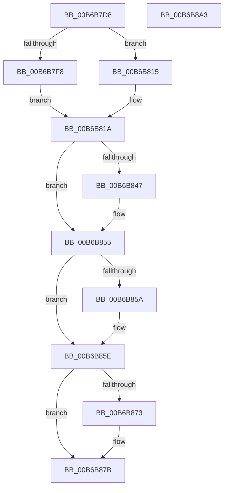

# PfpScenCtxServiceThreadSet

- RVA: `0x00B6B7D8`–`0x00B6B8A4` (길이 `204` bytes)
- VA: `0x0000000140B6B7D8`
- 실행 섹션: `PAGELK`
- PDB 이름 있음: `예`; PDB Function 태그: `아니요`
- unwind 정보 RVA: `0x0005E6B4`
- 디코드: `55`개 명령, `204/204` bytes 표시
- 미해석 바이트: `0` (있으면 어셈블리에 `.byte`로 보존)

> 이 문서는 커널 이미지의 기계어와 PDB 기호를 분석해 생성했습니다. 4번과 5번은 함수 원형과 자료형을 바이너리 사용 방식에서 추정한 C 해석이며 원본 소스 복구 결과는 아닙니다.

## 1. Dependencies

- 직접 호출 지점: **6**; 고유 호출 대상: **6**
- 직접 호출자로 확인된 함수: **1**
- RIP 상대 이미지 참조: **0**

### Outgoing calls
- `0x00B6B804` → [PsGetThreadId](../../text/45/PsGetThreadId_function_00452220.md) (function, `0x00452220`)
- `0x00B6B837` → [KeAbPreAcquire](../../text/21/KeAbPreAcquire_function_00210230.md) (function, `0x00210230`)
- `0x00B6B850` → [ExfAcquirePushLockExclusiveEx](../../text/20/ExfAcquirePushLockExclusiveEx_function_0020FC90.md) (function, `0x0020FC90`)
- `0x00B6B876` → [ExfTryToWakePushLock](../../text/26/ExfTryToWakePushLock_function_00265DD0.md) (function, `0x00265DD0`)
- `0x00B6B87E` → [KeAbPostRelease](../../text/2E/KeAbPostRelease_function_002E1600.md) (function, `0x002E1600`)
- `0x00B6B883` → [KeLeaveCriticalRegion](../../text/25/KeLeaveCriticalRegion_function_0025D8B0.md) (function, `0x0025D8B0`)

### Direct callers
- [PfSetSuperfetchInformation](../../page/AD/PfSetSuperfetchInformation_function_00ADE6E8.md) at `0x00ADF121`

### Static image references
- 디코드된 RIP-relative 메모리 참조가 없습니다.

## 2. Other-region calls and transfers

- 다른 실행 섹션으로 향하는 call: **6**
  - `0x00B6B804` → [PsGetThreadId](../../text/45/PsGetThreadId_function_00452220.md) (`PAGELK` → `.text`)
  - `0x00B6B837` → [KeAbPreAcquire](../../text/21/KeAbPreAcquire_function_00210230.md) (`PAGELK` → `.text`)
  - `0x00B6B850` → [ExfAcquirePushLockExclusiveEx](../../text/20/ExfAcquirePushLockExclusiveEx_function_0020FC90.md) (`PAGELK` → `.text`)
  - `0x00B6B876` → [ExfTryToWakePushLock](../../text/26/ExfTryToWakePushLock_function_00265DD0.md) (`PAGELK` → `.text`)
  - `0x00B6B87E` → [KeAbPostRelease](../../text/2E/KeAbPostRelease_function_002E1600.md) (`PAGELK` → `.text`)
  - `0x00B6B883` → [KeLeaveCriticalRegion](../../text/25/KeLeaveCriticalRegion_function_0025D8B0.md) (`PAGELK` → `.text`)
- 별도 외부 분기/꼬리 이동을 확인하지 못했습니다.

## 3. Assembly (complete function range)

```asm
00B6B7D8  48 8B C4                        mov rax, rsp
00B6B7DB  48 89 58 08                     mov qword ptr [rax + 8], rbx
00B6B7DF  48 89 68 10                     mov qword ptr [rax + 0x10], rbp
00B6B7E3  48 89 70 18                     mov qword ptr [rax + 0x18], rsi
00B6B7E7  48 89 78 20                     mov qword ptr [rax + 0x20], rdi
00B6B7EB  41 56                           push r14
00B6B7ED  48 83 EC 20                     sub rsp, 0x20
00B6B7F1  48 8B F1                        mov rsi, rcx
00B6B7F4  85 D2                           test edx, edx
00B6B7F6  74 1D                           je 0x140b6b815
00B6B7F8  65 48 8B 3C 25 88 01 00 00      mov rdi, qword ptr gs:[0x188]
00B6B801  48 8B CF                        mov rcx, rdi
00B6B804  E8 17 6A 8E FF                  call 0x140452220
00B6B809  48 8B BF C0 04 00 00            mov rdi, qword ptr [rdi + 0x4c0]
00B6B810  4C 8B F0                        mov r14, rax
00B6B813  EB 05                           jmp 0x140b6b81a
00B6B815  45 33 F6                        xor r14d, r14d
00B6B818  33 FF                           xor edi, edi
00B6B81A  65 48 8B 04 25 88 01 00 00      mov rax, qword ptr gs:[0x188]
00B6B823  48 83 CB FF                     or rbx, 0xffffffffffffffff
00B6B827  45 33 C0                        xor r8d, r8d
00B6B82A  33 D2                           xor edx, edx
00B6B82C  48 8B CE                        mov rcx, rsi
00B6B82F  66 01 98 E4 01 00 00            add word ptr [rax + 0x1e4], bx
00B6B836  90                              nop
00B6B837  E8 F4 49 6A FF                  call 0x140210230
00B6B83C  F0 48 0F BA 2E 00               lock bts qword ptr [rsi], 0
00B6B842  48 8B E8                        mov rbp, rax
00B6B845  73 0E                           jae 0x140b6b855
00B6B847  4C 8B C6                        mov r8, rsi
00B6B84A  48 8B D0                        mov rdx, rax
00B6B84D  48 8B CE                        mov rcx, rsi
00B6B850  E8 3B 44 6A FF                  call 0x14020fc90
00B6B855  48 85 ED                        test rbp, rbp
00B6B858  74 04                           je 0x140b6b85e
00B6B85A  C6 45 0A 01                     mov byte ptr [rbp + 0xa], 1
00B6B85E  4C 89 76 48                     mov qword ptr [rsi + 0x48], r14
00B6B862  48 89 7E 50                     mov qword ptr [rsi + 0x50], rdi
00B6B866  F0 48 0F C1 1E                  lock xadd qword ptr [rsi], rbx
00B6B86B  80 E3 06                        and bl, 6
00B6B86E  80 FB 02                        cmp bl, 2
00B6B871  75 08                           jne 0x140b6b87b
00B6B873  48 8B CE                        mov rcx, rsi
00B6B876  E8 55 A5 6F FF                  call 0x140265dd0
00B6B87B  48 8B CE                        mov rcx, rsi
00B6B87E  E8 7D 5D 77 FF                  call 0x1402e1600
00B6B883  E8 28 20 6F FF                  call 0x14025d8b0
00B6B888  48 8B 5C 24 30                  mov rbx, qword ptr [rsp + 0x30]
00B6B88D  48 8B 6C 24 38                  mov rbp, qword ptr [rsp + 0x38]
00B6B892  48 8B 74 24 40                  mov rsi, qword ptr [rsp + 0x40]
00B6B897  48 8B 7C 24 48                  mov rdi, qword ptr [rsp + 0x48]
00B6B89C  48 83 C4 20                     add rsp, 0x20
00B6B8A0  41 5E                           pop r14
00B6B8A2  C3                              ret
00B6B8A3  CC                              int3
```

## 4. C-style interpretation (structured pseudocode)

```c
__int64 __fastcall PfpScenCtxServiceThreadSet(__int64 a1, int a2, int a3)
{
    __int64 result;
    __int64 v_r14;
    __int64 v_rbx;
    __int64 v_rdi;
    __int64 v_rsp;
    unsigned __int64 v_stack_p10;
    unsigned __int64 v_stack_p18;
    unsigned __int64 v_stack_p20;
    unsigned __int64 v_stack_p8;

    *(unsigned __int64 *)(v_rsp + 8) = v_rbx;
    *(unsigned __int64 *)(v_rsp + 16) = v_rbp;
    *(unsigned __int64 *)(v_rsp + 24) = v_rsi;
    *(unsigned __int64 *)(v_rsp + 32) = v_rdi;
    v_rsp = (v_rsp) - (32);
    if (a2 == 0) goto loc_00B6B815;
    result = PsGetThreadId(*(unsigned __int64 *)(gs_base + (0 + 392)), a2, a3, a4);
    goto loc_00B6B81A;
loc_00B6B815:
    v_r14 = 0;
    v_rdi = 0;
loc_00B6B81A:
    v_rbx = (v_rbx) | (-1);
    a3 = 0;
    a2 = 0;
    result = KeAbPreAcquire(a1, a2, a3, a4);
    if (!(condition_is_above_or_equal)) {
        a3 = a1;
        a2 = result;
        a1 = a1;
        result = ExfAcquirePushLockExclusiveEx(a1, a2, a3, a4);
    }
    if (result != 0) {
        *(unsigned __int8 *)(result + 10) = 1;
    }
    *(unsigned __int64 *)(a1 + 72) = 0;
    *(unsigned __int64 *)(a1 + 80) = 0;
    v_rbx = (unsigned __int8)((v_rbx) & (6));
    if (((unsigned __int8)(v_rbx)) == 2) {
        a1 = a1;
        result = ExfTryToWakePushLock(a1, a2, a3, a4);
    }
    result = KeAbPostRelease(a1, a2, a3, a4);
    result = KeLeaveCriticalRegion(a1, a2, a3, a4);
    v_rsp = (v_rsp) + (32);
    return result;
}
```

## 5. (Beta) C Style

```c
int64_t PfpScenCtxServiceThreadSet(void *Arg1, int32_t Arg2, int32_t Arg3)
{
    uint8_t *arg1 = (uint8_t *)Arg1;

    int64_t result;
    int64_t local_r14;
    int64_t local_rbx;
    int64_t local_rdi;
    int64_t local_rsp;
    uint64_t v_stack_p10;
    uint64_t v_stack_p18;
    uint64_t v_stack_p20;
    uint64_t v_stack_p8;

    *(uint64_t *)(local_rsp + 0x8) = local_rbx;
    *(uint64_t *)(local_rsp + 0x10) = local_rbp;
    *(uint64_t *)(local_rsp + 0x18) = local_rsi;
    *(uint64_t *)(local_rsp + 0x20) = local_rdi;
    local_rsp = (local_rsp) - (32);
    if (Arg2 == 0) goto loc_00B6B815;
    result = PsGetThreadId(*(uint64_t *)(gs_base + (0 + 0x188)), Arg2, Arg3, a4);
    goto loc_00B6B81A;
loc_00B6B815:
    local_r14 = 0;
    local_rdi = 0;
loc_00B6B81A:
    local_rbx = (local_rbx) | (-1);
    Arg3 = 0;
    Arg2 = 0;
    result = KeAbPreAcquire(Arg1, Arg2, Arg3, a4);
    if (!(condition_is_above_or_equal)) {
        Arg3 = Arg1;
        Arg2 = result;
        Arg1 = Arg1;
        result = ExfAcquirePushLockExclusiveEx(Arg1, Arg2, Arg3, a4);
    }
    if (result != 0) {
        *(uint8_t *)(result + 0xA) = 1;
    }
    *(uint64_t *)(arg1 + 0x48) = 0;
    *(uint64_t *)(arg1 + 0x50) = 0;
    local_rbx = (uint8_t)((local_rbx) & (6));
    if (((uint8_t)(local_rbx)) == 2) {
        Arg1 = Arg1;
        result = ExfTryToWakePushLock(Arg1, Arg2, Arg3, a4);
    }
    result = KeAbPostRelease(Arg1, Arg2, Arg3, a4);
    result = KeLeaveCriticalRegion(Arg1, Arg2, Arg3, a4);
    local_rsp = (local_rsp) + (32);
    return result;
}
```

### 관측된 메모리 오프셋

구조체 형식이 확인되지 않은 접근은 인자 기준의 오프셋으로만 기록했습니다.

| 기준 인자 | 오프셋 표현 | 폭 (bit) | 접근 |
|---|---:|---:|---|
| `Arg1` | `+ 0x0` | `64` | `R/W` |
| `Arg1` | `+ 0x48` | `64` | `W` |
| `Arg1` | `+ 0x50` | `64` | `W` |

## 6. Execution-region graph

[열기: 2D/3D 그래프와 함수 탐색 컨트롤 패널](../../../control-panel.html?section=pagelk&rva=0x00B6B7D8&view=graph)

- 2D 그래프는 위에서 아래로 흐르고, 3D 그래프는 빈 공간을 드래그해 회전합니다. Shift+드래그는 이동, 휠은 확대·축소, 함수 노드 선택은 대상 보고서 이동입니다.

### Static fallback


