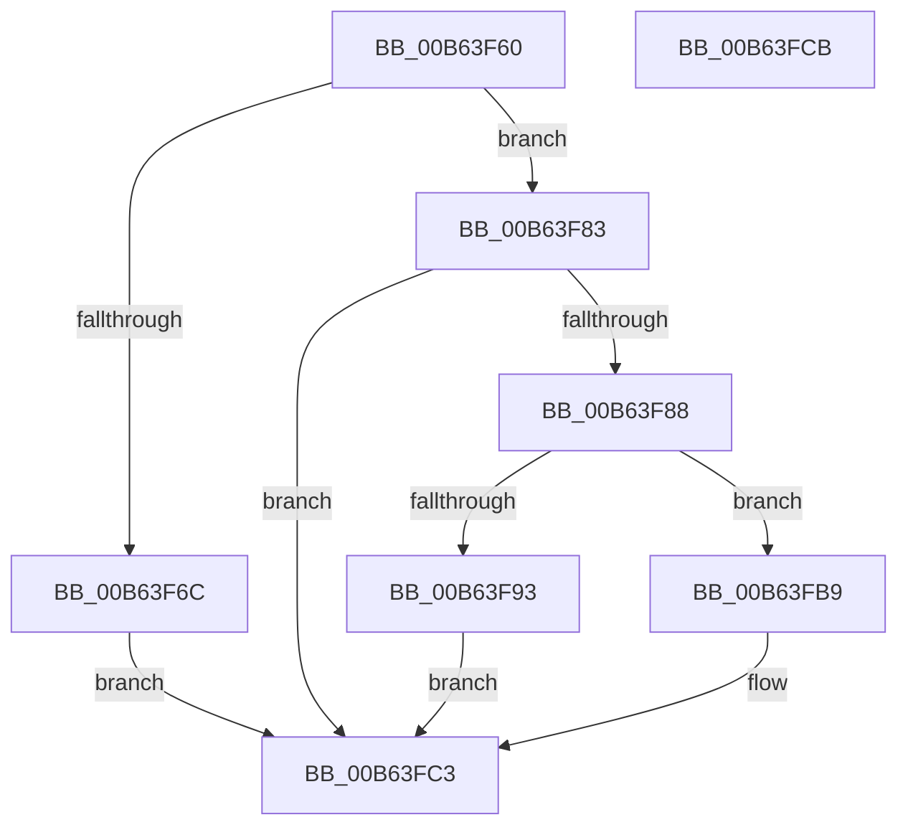

# PnprEndMirroring

- RVA: `0x00B63F60`–`0x00B63FCC` (길이 `108` bytes)
- VA: `0x0000000140B63F60`
- 실행 섹션: `PAGELK`
- PDB 이름 있음: `예`; PDB Function 태그: `아니요`
- unwind 정보 RVA: `0x0005CF00`
- 디코드: `30`개 명령, `108/108` bytes 표시
- 미해석 바이트: `0` (있으면 어셈블리에 `.byte`로 보존)

> 이 문서는 커널 이미지의 기계어와 PDB 기호를 분석해 생성했습니다. 4번과 5번은 함수 원형과 자료형을 바이너리 사용 방식에서 추정한 C 해석이며 원본 소스 복구 결과는 아닙니다.

## 1. Dependencies

- 직접 호출 지점: **5**; 고유 호출 대상: **4**
- 직접 호출자로 확인된 함수: **0**
- RIP 상대 이미지 참조: **2**

### Outgoing calls
- `0x00B63F7A` → [PnprQuiesce](../../text/5A/PnprQuiesce_function_005A8DE8.md) (function, `0x005A8DE8`)
- `0x00B63F88` → [PnprSwap](../../text/5A/PnprSwap_function_005A910C.md) (function, `0x005A910C`)
- `0x00B63FAD` → [guard_dispatch_icall](../../text/6B/guard_dispatch_icall_function_006BAAD0.md) (function, `0x006BAAD0`)
- `0x00B63FB2` → [PnprWakeProcessors](PnprWakeProcessors_function_00B65694.md) (function, `0x00B65694`)
- `0x00B63FB9` → [PnprWakeProcessors](PnprWakeProcessors_function_00B65694.md) (function, `0x00B65694`)

### Direct callers
- 이 함수 시작 RVA로 연결되는 직접 call은 확인되지 않았습니다. 간접 호출은 완전히 역산할 수 없습니다.

### Static image references
- `0x00B63F6C` → RVA `0x00F8AC38` (`.data`; read)
- `0x00B63F9F` → RVA `0x00E008E8` (`.data`; read)

## 2. Other-region calls and transfers

- 다른 실행 섹션으로 향하는 call: **3**
  - `0x00B63F7A` → [PnprQuiesce](../../text/5A/PnprQuiesce_function_005A8DE8.md) (`PAGELK` → `.text`)
  - `0x00B63F88` → [PnprSwap](../../text/5A/PnprSwap_function_005A910C.md) (`PAGELK` → `.text`)
  - `0x00B63FAD` → [guard_dispatch_icall](../../text/6B/guard_dispatch_icall_function_006BAAD0.md) (`PAGELK` → `.text`)
- 별도 외부 분기/꼬리 이동을 확인하지 못했습니다.

## 3. Assembly (complete function range)

```asm
00B63F60  40 53                           push rbx
00B63F62  48 83 EC 20                     sub rsp, 0x20
00B63F66  33 DB                           xor ebx, ebx
00B63F68  85 C9                           test ecx, ecx
00B63F6A  75 17                           jne 0x140b63f83
00B63F6C  48 8B 05 C5 6C 42 00            mov rax, qword ptr [rip + 0x426cc5]
00B63F73  C6 80 D0 00 00 00 01            mov byte ptr [rax + 0xd0], 1
00B63F7A  E8 69 4E A4 FF                  call 0x1405a8de8
00B63F7F  8B D8                           mov ebx, eax
00B63F81  EB 40                           jmp 0x140b63fc3
00B63F83  83 F9 01                        cmp ecx, 1
00B63F86  75 3B                           jne 0x140b63fc3
00B63F88  E8 7F 51 A4 FF                  call 0x1405a910c
00B63F8D  8B D8                           mov ebx, eax
00B63F8F  85 C0                           test eax, eax
00B63F91  79 26                           jns 0x140b63fb9
00B63F93  48 8B 15 9E 6C 42 00            mov rdx, qword ptr [rip + 0x426c9e]
00B63F9A  B9 03 00 00 00                  mov ecx, 3
00B63F9F  48 8B 05 42 C9 29 00            mov rax, qword ptr [rip + 0x29c942]
00B63FA6  48 8B 92 98 81 00 00            mov rdx, qword ptr [rdx + 0x8198]
00B63FAD  E8 1E 6B B5 FF                  call 0x1406baad0
00B63FB2  E8 DD 16 00 00                  call 0x140b65694
00B63FB7  EB 0A                           jmp 0x140b63fc3
00B63FB9  E8 D6 16 00 00                  call 0x140b65694
00B63FBE  BB 94 02 00 40                  mov ebx, 0x40000294
00B63FC3  8B C3                           mov eax, ebx
00B63FC5  48 83 C4 20                     add rsp, 0x20
00B63FC9  5B                              pop rbx
00B63FCA  C3                              ret
00B63FCB  CC                              int3
```

## 4. C-style interpretation (structured pseudocode)

```c
__int64 __fastcall PnprEndMirroring(int a1)
{
    __int64 result;
    __int64 v_rbx;
    __int64 v_rsp;

    v_rsp = (v_rsp) - (32);
    v_rbx = 0;
    if (a1 != 0) goto loc_00B63F83;
    *(unsigned __int8 *)(*(unsigned __int64 *)(v_rip + 4353221) + 208) = 1;
    result = PnprQuiesce(a1, a2, a3, a4);
    goto loc_00B63FC3;
loc_00B63F83:
    if (a1 != 1) goto loc_00B63FC3;
    result = PnprSwap(a1, a2, a3, a4);
    if (!sign_flag) goto loc_00B63FB9;
    result = guard_dispatch_icall(3, *(unsigned __int64 *)(*(unsigned __int64 *)(v_rip + 4353182) + 33176), a3, a4);
    result = PnprWakeProcessors(3, *(unsigned __int64 *)(*(unsigned __int64 *)(v_rip + 4353182) + 33176), a3, a4);
    goto loc_00B63FC3;
loc_00B63FB9:
    result = PnprWakeProcessors(3, *(unsigned __int64 *)(*(unsigned __int64 *)(v_rip + 4353182) + 33176), a3, a4);
loc_00B63FC3:
    v_rsp = (v_rsp) + (32);
    return (unsigned int)((unsigned int)((unsigned int)(0x40000294ULL)));
}
```

## 5. (Beta) C Style

```c
int64_t PnprEndMirroring(int32_t Arg1)
{
    int64_t result;
    int64_t local_rbx;
    int64_t local_rsp;

    local_rsp = (local_rsp) - (32);
    local_rbx = 0;
    if (Arg1 != 0) goto loc_00B63F83;
    *(uint8_t *)(*(uint64_t *)(v_rip + 0x426CC5) + 0xD0) = 1;
    result = PnprQuiesce(Arg1, a2, a3, a4);
    goto loc_00B63FC3;
loc_00B63F83:
    if (Arg1 != 1) goto loc_00B63FC3;
    result = PnprSwap(Arg1, a2, a3, a4);
    if (!sign_flag) goto loc_00B63FB9;
    result = guard_dispatch_icall(3, *(uint64_t *)(*(uint64_t *)(v_rip + 0x426C9E) + 0x8198), a3, a4);
    result = PnprWakeProcessors(3, *(uint64_t *)(*(uint64_t *)(v_rip + 0x426C9E) + 0x8198), a3, a4);
    goto loc_00B63FC3;
loc_00B63FB9:
    result = PnprWakeProcessors(3, *(uint64_t *)(*(uint64_t *)(v_rip + 0x426C9E) + 0x8198), a3, a4);
loc_00B63FC3:
    local_rsp = (local_rsp) + (32);
    return (uint32_t)((uint32_t)((uint32_t)(0x40000294ULL)));
}
```

## 6. Execution-region graph

[열기: 2D/3D 그래프와 함수 탐색 컨트롤 패널](../../../control-panel.html?section=pagelk&rva=0x00B63F60&view=graph)

- 2D 그래프는 위에서 아래로 흐르고, 3D 그래프는 빈 공간을 드래그해 회전합니다. Shift+드래그는 이동, 휠은 확대·축소, 함수 노드 선택은 대상 보고서 이동입니다.

### Static fallback


