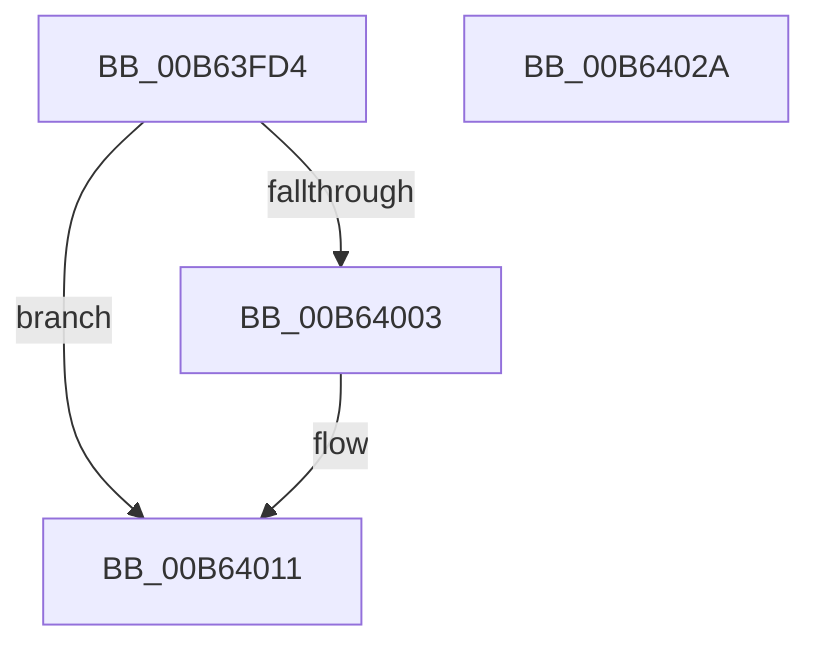

# PnprGetMillisecondCounter

- RVA: `0x00B63FD4`–`0x00B6402B` (길이 `87` bytes)
- VA: `0x0000000140B63FD4`
- 실행 섹션: `PAGELK`
- PDB 이름 있음: `예`; PDB Function 태그: `아니요`
- unwind 정보 RVA: `0x0005CAAC`
- 디코드: `24`개 명령, `87/87` bytes 표시
- 미해석 바이트: `0` (있으면 어셈블리에 `.byte`로 보존)

> 이 문서는 커널 이미지의 기계어와 PDB 기호를 분석해 생성했습니다. 4번과 5번은 함수 원형과 자료형을 바이너리 사용 방식에서 추정한 C 해석이며 원본 소스 복구 결과는 아닙니다.

## 1. Dependencies

- 직접 호출 지점: **1**; 고유 호출 대상: **1**
- 직접 호출자로 확인된 함수: **7**
- RIP 상대 이미지 참조: **4**

### Outgoing calls
- `0x00B63FEC` → [KeQueryPerformanceCounter](../../text/37/KeQueryPerformanceCounter_function_0037E7E0.md) (function, `0x0037E7E0`)

### Direct callers
- [PnprMirrorPhysicalMemory](../../text/5A/PnprMirrorPhysicalMemory_function_005A8C90.md) at `0x005A8CD6`
- [PnprSwapFinalize](../../text/5A/PnprSwapFinalize_function_005A9334.md) at `0x005A9387`
- [PnprSwapFinalize](../../text/5A/PnprSwapFinalize_function_005A9334.md) at `0x005A93E2`
- [PnpReplacePartitionUnit](../../page/73/PnpReplacePartitionUnit_function_00738550.md) at `0x00738ADE`
- [PnpReplacePartitionUnit](../../page/73/PnpReplacePartitionUnit_function_00738550.md) at `0x00738EB5`
- [PnprQuiesceDevices](PnprQuiesceDevices_function_00B649E4.md) at `0x00B649F8`
- [PnprQuiesceDevices](PnprQuiesceDevices_function_00B649E4.md) at `0x00B64B23`
- [PnprQuiesceProcessors](PnprQuiesceProcessors_function_00B64FB4.md) at `0x00B6522D`
- [PnprQuiesceProcessors](PnprQuiesceProcessors_function_00B64FB4.md) at `0x00B652AF`
- [PnprQuiesceProcessors](PnprQuiesceProcessors_function_00B64FB4.md) at `0x00B65376`
- [PnprQuiesceProcessors](PnprQuiesceProcessors_function_00B64FB4.md) at `0x00B653A2`
- [PnprWakeDevices](PnprWakeDevices_function_00B65614.md) at `0x00B65623`
- [PnprWakeDevices](PnprWakeDevices_function_00B65614.md) at `0x00B6566B`
- [PnprWakeProcessors](PnprWakeProcessors_function_00B65694.md) at `0x00B656BD`
- [PnprWakeProcessors](PnprWakeProcessors_function_00B65694.md) at `0x00B65714`

### Static image references
- `0x00B64003` → RVA `0x00E663C0` (`.data`; read)
- `0x00B64009` → RVA `0x00E663C4` (`.data`; read)
- `0x00B64016` → RVA `0x00E663C4` (`.data`; write)
- `0x00B6401E` → RVA `0x00E663C0` (`.data`; write)

## 2. Other-region calls and transfers

- 다른 실행 섹션으로 향하는 call: **1**
  - `0x00B63FEC` → [KeQueryPerformanceCounter](../../text/37/KeQueryPerformanceCounter_function_0037E7E0.md) (`PAGELK` → `.text`)
- 별도 외부 분기/꼬리 이동을 확인하지 못했습니다.

## 3. Assembly (complete function range)

```asm
00B63FD4  48 89 5C 24 08                  mov qword ptr [rsp + 8], rbx
00B63FD9  57                              push rdi
00B63FDA  48 83 EC 20                     sub rsp, 0x20
00B63FDE  8A D9                           mov bl, cl
00B63FE0  33 FF                           xor edi, edi
00B63FE2  48 8D 4C 24 38                  lea rcx, [rsp + 0x38]
00B63FE7  48 89 7C 24 38                  mov qword ptr [rsp + 0x38], rdi
00B63FEC  E8 EF A7 81 FF                  call 0x14037e7e0
00B63FF1  48 69 C0 E8 03 00 00            imul rax, rax, 0x3e8
00B63FF8  48 99                           cqo
00B63FFA  48 F7 7C 24 38                  idiv qword ptr [rsp + 0x38]
00B63FFF  84 DB                           test bl, bl
00B64001  75 0E                           jne 0x140b64011
00B64003  8B 3D B7 23 30 00               mov edi, dword ptr [rip + 0x3023b7]
00B64009  2B 3D B5 23 30 00               sub edi, dword ptr [rip + 0x3023b5]
00B6400F  03 F8                           add edi, eax
00B64011  48 8B 5C 24 30                  mov rbx, qword ptr [rsp + 0x30]
00B64016  89 05 A8 23 30 00               mov dword ptr [rip + 0x3023a8], eax
00B6401C  8B C7                           mov eax, edi
00B6401E  89 3D 9C 23 30 00               mov dword ptr [rip + 0x30239c], edi
00B64024  48 83 C4 20                     add rsp, 0x20
00B64028  5F                              pop rdi
00B64029  C3                              ret
00B6402A  CC                              int3
```

## 4. C-style interpretation (structured pseudocode)

```c
__int64 __fastcall PnprGetMillisecondCounter(unsigned __int8 a1)
{
    __int64 result;
    __int64 v_rdi;
    __int64 v_rsp;
    unsigned __int64 v_stack_p10;
    unsigned __int64 v_stack_p8;

    v_stack_p8 = v_rbx;
    v_rsp = (v_rsp) - (32);
    v_rdi = 0;
    v_stack_p10 = 0;
    result = KeQueryPerformanceCounter(v_stack_p10, a2, a3, a4);
    result = (result) * (result);
    if (a1 == 0) {
        v_rdi = *(unsigned int *)(v_rip + 3154871);
        v_rdi = (unsigned int)((v_rdi) - (*(unsigned int *)(v_rip + 3154869)));
        v_rdi = (unsigned int)((v_rdi) + ((unsigned int)(result)));
    }
    *(unsigned int *)(v_rip + 3154856) = (unsigned int)(result);
    *(unsigned int *)(v_rip + 3154844) = (unsigned int)(v_rdi);
    v_rsp = (v_rsp) + (32);
    return (unsigned int)((unsigned int)(v_rdi));
}
```

## 5. (Beta) C Style

```c
int64_t PnprGetMillisecondCounter(uint8_t Arg1)
{
    int64_t result;
    int64_t local_rdi;
    int64_t local_rsp;
    uint64_t v_stack_p10;
    uint64_t v_stack_p8;

    v_stack_p8 = local_rbx;
    local_rsp = (local_rsp) - (32);
    local_rdi = 0;
    v_stack_p10 = 0;
    result = KeQueryPerformanceCounter(v_stack_p10, a2, a3, a4);
    result = (result) * (result);
    if (Arg1 == 0) {
        local_rdi = *(uint32_t *)(v_rip + 0x3023B7);
        local_rdi = (uint32_t)((local_rdi) - (*(uint32_t *)(v_rip + 0x3023B5)));
        local_rdi = (uint32_t)((local_rdi) + ((uint32_t)(result)));
    }
    *(uint32_t *)(v_rip + 0x3023A8) = (uint32_t)(result);
    *(uint32_t *)(v_rip + 0x30239C) = (uint32_t)(local_rdi);
    local_rsp = (local_rsp) + (32);
    return (uint32_t)((uint32_t)(local_rdi));
}
```

## 6. Execution-region graph

[열기: 2D/3D 그래프와 함수 탐색 컨트롤 패널](../../../control-panel.html?section=pagelk&rva=0x00B63FD4&view=graph)

- 2D 그래프는 위에서 아래로 흐르고, 3D 그래프는 빈 공간을 드래그해 회전합니다. Shift+드래그는 이동, 휠은 확대·축소, 함수 노드 선택은 대상 보고서 이동입니다.

### Static fallback


