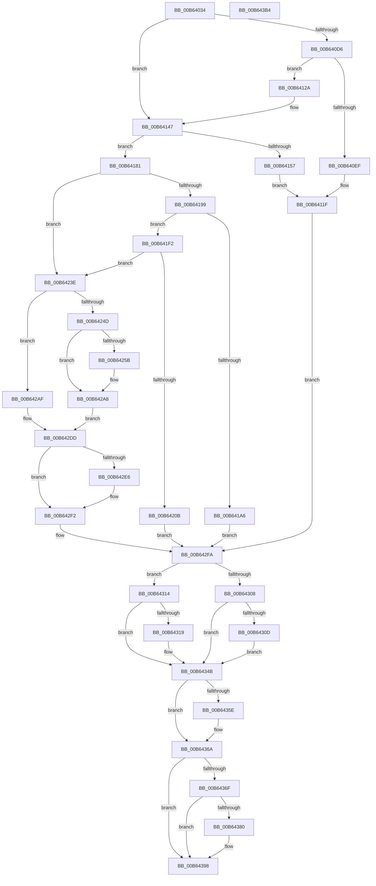

# PnprInitiateReplaceOperation

- RVA: `0x00B64034`–`0x00B643B5` (길이 `897` bytes)
- VA: `0x0000000140B64034`
- 실행 섹션: `PAGELK`
- PDB 이름 있음: `예`; PDB Function 태그: `아니요`
- unwind 정보 RVA: `0x0008CA40`
- 디코드: `216`개 명령, `897/897` bytes 표시
- 미해석 바이트: `0` (있으면 어셈블리에 `.byte`로 보존)

> 이 문서는 커널 이미지의 기계어와 PDB 기호를 분석해 생성했습니다. 4번과 5번은 함수 원형과 자료형을 바이너리 사용 방식에서 추정한 C 해석이며 원본 소스 복구 결과는 아닙니다.

## 1. Dependencies

- 직접 호출 지점: **19**; 고유 호출 대상: **13**
- 직접 호출자로 확인된 함수: **1**
- RIP 상대 이미지 참조: **8**

### Outgoing calls
- `0x00B6407A` → [KeInitializeEvent](../../text/40/KeInitializeEvent_function_0040DD10.md) (function, `0x0040DD10`)
- `0x00B64092` → [KeInitializeEvent](../../text/40/KeInitializeEvent_function_0040DD10.md) (function, `0x0040DD10`)
- `0x00B640AA` → [KeInitializeEvent](../../text/40/KeInitializeEvent_function_0040DD10.md) (function, `0x0040DD10`)
- `0x00B640C2` → [KeInitializeEvent](../../text/40/KeInitializeEvent_function_0040DD10.md) (function, `0x0040DD10`)
- `0x00B640E2` → [ExAllocatePool2](../../poolcode/B8/ExAllocatePool2_function_00B820F0.md) (function, `0x00B820F0`)
- `0x00B64142` → [ExQueueWorkItem](../../text/2F/ExQueueWorkItem_function_002F9520.md) (function, `0x002F9520`)
- `0x00B64147` → [PnprReplaceStart](../../page/73/PnprReplaceStart_function_0073A8BC.md) (function, `0x0073A8BC`)
- `0x00B641DE` → [MmDuplicateMemory](../B7/MmDuplicateMemory_function_00B74158.md) (function, `0x00B74158`)
- `0x00B64200` → [guard_dispatch_icall](../../text/6B/guard_dispatch_icall_function_006BAAD0.md) (function, `0x006BAAD0`)
- `0x00B64242` → [PnprQuiesce](../../text/5A/PnprQuiesce_function_005A8DE8.md) (function, `0x005A8DE8`)
- `0x00B64250` → [PnprSwap](../../text/5A/PnprSwap_function_005A910C.md) (function, `0x005A910C`)
- `0x00B64275` → [guard_dispatch_icall](../../text/6B/guard_dispatch_icall_function_006BAAD0.md) (function, `0x006BAAD0`)
- `0x00B642A8` → [PnprWakeProcessors](PnprWakeProcessors_function_00B65694.md) (function, `0x00B65694`)
- `0x00B642ED` → [KiLowerIrqlProcessIrqlFlags](../../text/4F/KiLowerIrqlProcessIrqlFlags_function_004F5698.md) (function, `0x004F5698`)
- `0x00B6430D` → [PnprCompleteWake](../../text/5A/PnprCompleteWake_function_005A884C.md) (function, `0x005A884C`)
- `0x00B64325` → [KeSetEvent](../../text/33/KeSetEvent_function_0033F310.md) (function, `0x0033F310`)
- `0x00B64346` → [KeWaitForSingleObject](../../text/20/KeWaitForSingleObject_function_0020E6B0.md) (function, `0x0020E6B0`)
- `0x00B64365` → [guard_dispatch_icall](../../text/6B/guard_dispatch_icall_function_006BAAD0.md) (function, `0x006BAAD0`)
- `0x00B6438E` → [guard_dispatch_icall](../../text/6B/guard_dispatch_icall_function_006BAAD0.md) (function, `0x006BAAD0`)

### Direct callers
- [PnpReplacePartitionUnit](../../page/73/PnpReplacePartitionUnit_function_00738550.md) at `0x00738E98`

### Static image references
- `0x00B6404C` → RVA `0x00F8AC38` (`.data`; read)
- `0x00B6412E` → RVA `0x00B654E0` (`PnprQuiesceWorker`; read)
- `0x00B641AB` → RVA `0x0073AA40` (`PnprStartMirroring`; read)
- `0x00B641C2` → RVA `0x00B63F60` (`PnprEndMirroring`; read)
- `0x00B641CE` → RVA `0x005A8C90` (`PnprMirrorPhysicalMemory`; read)
- `0x00B64267` → RVA `0x00E008E8` (`.data`; read)
- `0x00B642DD` → RVA `0x00FC6D20` (`ALMOSTRO`; read)
- `0x00B6435E` → RVA `0x00E008F0` (`.data`; read)

## 2. Other-region calls and transfers

- 다른 실행 섹션으로 향하는 call: **17**
  - `0x00B6407A` → [KeInitializeEvent](../../text/40/KeInitializeEvent_function_0040DD10.md) (`PAGELK` → `.text`)
  - `0x00B64092` → [KeInitializeEvent](../../text/40/KeInitializeEvent_function_0040DD10.md) (`PAGELK` → `.text`)
  - `0x00B640AA` → [KeInitializeEvent](../../text/40/KeInitializeEvent_function_0040DD10.md) (`PAGELK` → `.text`)
  - `0x00B640C2` → [KeInitializeEvent](../../text/40/KeInitializeEvent_function_0040DD10.md) (`PAGELK` → `.text`)
  - `0x00B640E2` → [ExAllocatePool2](../../poolcode/B8/ExAllocatePool2_function_00B820F0.md) (`PAGELK` → `POOLCODE`)
  - `0x00B64142` → [ExQueueWorkItem](../../text/2F/ExQueueWorkItem_function_002F9520.md) (`PAGELK` → `.text`)
  - `0x00B64147` → [PnprReplaceStart](../../page/73/PnprReplaceStart_function_0073A8BC.md) (`PAGELK` → `PAGE`)
  - `0x00B64200` → [guard_dispatch_icall](../../text/6B/guard_dispatch_icall_function_006BAAD0.md) (`PAGELK` → `.text`)
  - `0x00B64242` → [PnprQuiesce](../../text/5A/PnprQuiesce_function_005A8DE8.md) (`PAGELK` → `.text`)
  - `0x00B64250` → [PnprSwap](../../text/5A/PnprSwap_function_005A910C.md) (`PAGELK` → `.text`)
  - `0x00B64275` → [guard_dispatch_icall](../../text/6B/guard_dispatch_icall_function_006BAAD0.md) (`PAGELK` → `.text`)
  - `0x00B642ED` → [KiLowerIrqlProcessIrqlFlags](../../text/4F/KiLowerIrqlProcessIrqlFlags_function_004F5698.md) (`PAGELK` → `.text`)
  - `0x00B6430D` → [PnprCompleteWake](../../text/5A/PnprCompleteWake_function_005A884C.md) (`PAGELK` → `.text`)
  - `0x00B64325` → [KeSetEvent](../../text/33/KeSetEvent_function_0033F310.md) (`PAGELK` → `.text`)
  - `0x00B64346` → [KeWaitForSingleObject](../../text/20/KeWaitForSingleObject_function_0020E6B0.md) (`PAGELK` → `.text`)
  - `0x00B64365` → [guard_dispatch_icall](../../text/6B/guard_dispatch_icall_function_006BAAD0.md) (`PAGELK` → `.text`)
  - `0x00B6438E` → [guard_dispatch_icall](../../text/6B/guard_dispatch_icall_function_006BAAD0.md) (`PAGELK` → `.text`)
- 별도 외부 분기/꼬리 이동을 확인하지 못했습니다.

## 3. Assembly (complete function range)

```asm
00B64034  4C 8B DC                        mov r11, rsp
00B64037  49 89 5B 08                     mov qword ptr [r11 + 8], rbx
00B6403B  49 89 6B 10                     mov qword ptr [r11 + 0x10], rbp
00B6403F  49 89 73 18                     mov qword ptr [r11 + 0x18], rsi
00B64043  57                              push rdi
00B64044  41 56                           push r14
00B64046  41 57                           push r15
00B64048  48 83 EC 60                     sub rsp, 0x60
00B6404C  48 8B 0D E5 6B 42 00            mov rcx, qword ptr [rip + 0x426be5]
00B64053  0F 57 C0                        xorps xmm0, xmm0
00B64056  33 C0                           xor eax, eax
00B64058  48 81 C1 28 81 00 00            add rcx, 0x8128
00B6405F  0F 11 44 24 30                  movups xmmword ptr [rsp + 0x30], xmm0
00B64064  45 33 C0                        xor r8d, r8d
00B64067  33 D2                           xor edx, edx
00B64069  0F 11 44 24 40                  movups xmmword ptr [rsp + 0x40], xmm0
00B6406E  49 89 43 D8                     mov qword ptr [r11 - 0x28], rax
00B64072  45 32 F6                        xor r14b, r14b
00B64075  45 32 FF                        xor r15b, r15b
00B64078  33 FF                           xor edi, edi
00B6407A  E8 91 9C 8A FF                  call 0x14040dd10
00B6407F  48 8B 0D B2 6B 42 00            mov rcx, qword ptr [rip + 0x426bb2]
00B64086  45 33 C0                        xor r8d, r8d
00B64089  48 81 C1 40 81 00 00            add rcx, 0x8140
00B64090  33 D2                           xor edx, edx
00B64092  E8 79 9C 8A FF                  call 0x14040dd10
00B64097  48 8B 0D 9A 6B 42 00            mov rcx, qword ptr [rip + 0x426b9a]
00B6409E  45 33 C0                        xor r8d, r8d
00B640A1  48 81 C1 58 81 00 00            add rcx, 0x8158
00B640A8  33 D2                           xor edx, edx
00B640AA  E8 61 9C 8A FF                  call 0x14040dd10
00B640AF  48 8B 0D 82 6B 42 00            mov rcx, qword ptr [rip + 0x426b82]
00B640B6  45 33 C0                        xor r8d, r8d
00B640B9  48 81 C1 70 81 00 00            add rcx, 0x8170
00B640C0  33 D2                           xor edx, edx
00B640C2  E8 49 9C 8A FF                  call 0x14040dd10
00B640C7  48 8B 05 6A 6B 42 00            mov rax, qword ptr [rip + 0x426b6a]
00B640CE  8B 48 40                        mov ecx, dword ptr [rax + 0x40]
00B640D1  F6 C1 20                        test cl, 0x20
00B640D4  75 71                           jne 0x140b64147
00B640D6  8D 57 20                        lea edx, [rdi + 0x20]
00B640D9  41 B8 50 6E 70 51               mov r8d, 0x51706e50
00B640DF  8D 4F 40                        lea ecx, [rdi + 0x40]
00B640E2  E8 09 E0 01 00                  call 0x140b820f0
00B640E7  48 8B F8                        mov rdi, rax
00B640EA  48 85 C0                        test rax, rax
00B640ED  75 3B                           jne 0x140b6412a
00B640EF  48 8B 15 42 6B 42 00            mov rdx, qword ptr [rip + 0x426b42]
00B640F6  B8 78 06 00 00                  mov eax, 0x678
00B640FB  BB 9A 00 00 C0                  mov ebx, 0xc000009a
00B64100  8B 8A 08 82 00 00               mov ecx, dword ptr [rdx + 0x8208]
00B64106  85 C9                           test ecx, ecx
00B64108  0F 44 C8                        cmove ecx, eax
00B6410B  8B 82 0C 82 00 00               mov eax, dword ptr [rdx + 0x820c]
00B64111  89 8A 08 82 00 00               mov dword ptr [rdx + 0x8208], ecx
00B64117  85 C0                           test eax, eax
00B64119  8D 4F 0A                        lea ecx, [rdi + 0xa]
00B6411C  0F 44 C1                        cmove eax, ecx
00B6411F  89 82 0C 82 00 00               mov dword ptr [rdx + 0x820c], eax
00B64125  E9 D0 01 00 00                  jmp 0x140b642fa
00B6412A  48 83 27 00                     and qword ptr [rdi], 0
00B6412E  48 8D 05 AB 13 00 00            lea rax, [rip + 0x13ab]
00B64135  33 D2                           xor edx, edx
00B64137  48 89 47 10                     mov qword ptr [rdi + 0x10], rax
00B6413B  48 8B CF                        mov rcx, rdi
00B6413E  48 89 7F 18                     mov qword ptr [rdi + 0x18], rdi
00B64142  E8 D9 53 79 FF                  call 0x1402f9520
00B64147  E8 70 67 BD FF                  call 0x14073a8bc
00B6414C  8B D8                           mov ebx, eax
00B6414E  BE 01 00 00 00                  mov esi, 1
00B64153  85 C0                           test eax, eax
00B64155  79 2A                           jns 0x140b64181
00B64157  48 8B 15 DA 6A 42 00            mov rdx, qword ptr [rip + 0x426ada]
00B6415E  B8 87 06 00 00                  mov eax, 0x687
00B64163  8B 8A 08 82 00 00               mov ecx, dword ptr [rdx + 0x8208]
00B64169  85 C9                           test ecx, ecx
00B6416B  0F 44 C8                        cmove ecx, eax
00B6416E  8B 82 0C 82 00 00               mov eax, dword ptr [rdx + 0x820c]
00B64174  85 C0                           test eax, eax
00B64176  89 8A 08 82 00 00               mov dword ptr [rdx + 0x8208], ecx
00B6417C  0F 44 C6                        cmove eax, esi
00B6417F  EB 9E                           jmp 0x140b6411f
00B64181  48 8B 0D B0 6A 42 00            mov rcx, qword ptr [rip + 0x426ab0]
00B64188  44 8A FE                        mov r15b, sil
00B6418B  48 8B 41 18                     mov rax, qword ptr [rcx + 0x18]
00B6418F  83 78 04 00                     cmp dword ptr [rax + 4], 0
00B64193  0F 84 A5 00 00 00               je 0x140b6423e
00B64199  8B 41 40                        mov eax, dword ptr [rcx + 0x40]
00B6419C  BD 08 00 00 00                  mov ebp, 8
00B641A1  40 84 C5                        test bpl, al
00B641A4  75 4C                           jne 0x140b641f2
00B641A6  83 64 24 54 00                  and dword ptr [rsp + 0x54], 0
00B641AB  48 8D 05 8E 68 BD FF            lea rax, [rip - 0x429772]
00B641B2  48 83 64 24 48 00               and qword ptr [rsp + 0x48], 0
00B641B8  48 8D 4C 24 30                  lea rcx, [rsp + 0x30]
00B641BD  48 89 44 24 30                  mov qword ptr [rsp + 0x30], rax
00B641C2  48 8D 05 97 FD FF FF            lea rax, [rip - 0x269]
00B641C9  48 89 44 24 38                  mov qword ptr [rsp + 0x38], rax
00B641CE  48 8D 05 BB 4A A4 FF            lea rax, [rip - 0x5bb545]
00B641D5  48 89 44 24 40                  mov qword ptr [rsp + 0x40], rax
00B641DA  89 6C 24 50                     mov dword ptr [rsp + 0x50], ebp
00B641DE  E8 75 FF 00 00                  call 0x140b74158
00B641E3  33 DB                           xor ebx, ebx
00B641E5  3D 94 02 00 40                  cmp eax, 0x40000294
00B641EA  0F 45 D8                        cmovne ebx, eax
00B641ED  E9 08 01 00 00                  jmp 0x140b642fa
00B641F2  48 8B 81 E8 81 00 00            mov rax, qword ptr [rcx + 0x81e8]
00B641F9  48 8B 89 A0 81 00 00            mov rcx, qword ptr [rcx + 0x81a0]
00B64200  E8 CB 68 B5 FF                  call 0x1406baad0
00B64205  8B D8                           mov ebx, eax
00B64207  85 C0                           test eax, eax
00B64209  79 33                           jns 0x140b6423e
00B6420B  48 8B 0D 26 6A 42 00            mov rcx, qword ptr [rip + 0x426a26]
00B64212  BA CB 06 00 00                  mov edx, 0x6cb
00B64217  8B 81 08 82 00 00               mov eax, dword ptr [rcx + 0x8208]
00B6421D  85 C0                           test eax, eax
00B6421F  0F 44 C2                        cmove eax, edx
00B64222  89 81 08 82 00 00               mov dword ptr [rcx + 0x8208], eax
00B64228  8B 81 0C 82 00 00               mov eax, dword ptr [rcx + 0x820c]
00B6422E  85 C0                           test eax, eax
00B64230  0F 44 C5                        cmove eax, ebp
00B64233  89 81 0C 82 00 00               mov dword ptr [rcx + 0x820c], eax
00B64239  E9 BC 00 00 00                  jmp 0x140b642fa
00B6423E  44 0F 20 C5                     mov rbp, cr8
00B64242  E8 A1 4B A4 FF                  call 0x1405a8de8
00B64247  8B D8                           mov ebx, eax
00B64249  85 C0                           test eax, eax
00B6424B  78 62                           js 0x140b642af
00B6424D  44 8A F6                        mov r14b, sil
00B64250  E8 B7 4E A4 FF                  call 0x1405a910c
00B64255  8B D8                           mov ebx, eax
00B64257  85 C0                           test eax, eax
00B64259  79 4D                           jns 0x140b642a8
00B6425B  48 8B 15 D6 69 42 00            mov rdx, qword ptr [rip + 0x4269d6]
00B64262  B9 03 00 00 00                  mov ecx, 3
00B64267  48 8B 05 7A C6 29 00            mov rax, qword ptr [rip + 0x29c67a]
00B6426E  48 8B 92 98 81 00 00            mov rdx, qword ptr [rdx + 0x8198]
00B64275  E8 56 68 B5 FF                  call 0x1406baad0
00B6427A  48 8B 0D B7 69 42 00            mov rcx, qword ptr [rip + 0x4269b7]
00B64281  BA E2 06 00 00                  mov edx, 0x6e2
00B64286  8B 81 08 82 00 00               mov eax, dword ptr [rcx + 0x8208]
00B6428C  85 C0                           test eax, eax
00B6428E  0F 44 C2                        cmove eax, edx
00B64291  89 81 08 82 00 00               mov dword ptr [rcx + 0x8208], eax
00B64297  8B 81 0C 82 00 00               mov eax, dword ptr [rcx + 0x820c]
00B6429D  85 C0                           test eax, eax
00B6429F  0F 44 C6                        cmove eax, esi
00B642A2  89 81 0C 82 00 00               mov dword ptr [rcx + 0x820c], eax
00B642A8  E8 E7 13 00 00                  call 0x140b65694
00B642AD  EB 2E                           jmp 0x140b642dd
00B642AF  48 8B 0D 82 69 42 00            mov rcx, qword ptr [rip + 0x426982]
00B642B6  BA EC 06 00 00                  mov edx, 0x6ec
00B642BB  8B 81 08 82 00 00               mov eax, dword ptr [rcx + 0x8208]
00B642C1  85 C0                           test eax, eax
00B642C3  0F 44 C2                        cmove eax, edx
00B642C6  89 81 08 82 00 00               mov dword ptr [rcx + 0x8208], eax
00B642CC  8B 81 0C 82 00 00               mov eax, dword ptr [rcx + 0x820c]
00B642D2  85 C0                           test eax, eax
00B642D4  0F 44 C6                        cmove eax, esi
00B642D7  89 81 0C 82 00 00               mov dword ptr [rcx + 0x820c], eax
00B642DD  83 3D 3C 2A 46 00 00            cmp dword ptr [rip + 0x462a3c], 0
00B642E4  74 0C                           je 0x140b642f2
00B642E6  44 0F 20 C1                     mov rcx, cr8
00B642EA  40 8A D5                        mov dl, bpl
00B642ED  E8 A6 13 99 FF                  call 0x1404f5698
00B642F2  40 0F B6 C5                     movzx eax, bpl
00B642F6  44 0F 22 C0                     mov cr8, rax
00B642FA  48 8B 0D 37 69 42 00            mov rcx, qword ptr [rip + 0x426937]
00B64301  8B 41 40                        mov eax, dword ptr [rcx + 0x40]
00B64304  A8 20                           test al, 0x20
00B64306  74 0C                           je 0x140b64314
00B64308  45 84 F6                        test r14b, r14b
00B6430B  74 3E                           je 0x140b6434b
00B6430D  E8 3A 45 A4 FF                  call 0x1405a884c
00B64312  EB 37                           jmp 0x140b6434b
00B64314  48 85 FF                        test rdi, rdi
00B64317  74 32                           je 0x140b6434b
00B64319  48 81 C1 58 81 00 00            add rcx, 0x8158
00B64320  45 33 C0                        xor r8d, r8d
00B64323  33 D2                           xor edx, edx
00B64325  E8 E6 AF 7D FF                  call 0x14033f310
00B6432A  48 8B 0D 07 69 42 00            mov rcx, qword ptr [rip + 0x426907]
00B64331  45 33 C9                        xor r9d, r9d
00B64334  48 83 64 24 20 00               and qword ptr [rsp + 0x20], 0
00B6433A  48 81 C1 70 81 00 00            add rcx, 0x8170
00B64341  45 33 C0                        xor r8d, r8d
00B64344  33 D2                           xor edx, edx
00B64346  E8 65 A3 6A FF                  call 0x14020e6b0
00B6434B  48 8B 05 E6 68 42 00            mov rax, qword ptr [rip + 0x4268e6]
00B64352  48 8B 88 98 81 00 00            mov rcx, qword ptr [rax + 0x8198]
00B64359  48 85 C9                        test rcx, rcx
00B6435C  74 0C                           je 0x140b6436a
00B6435E  48 8B 05 8B C5 29 00            mov rax, qword ptr [rip + 0x29c58b]
00B64365  E8 66 67 B5 FF                  call 0x1406baad0
00B6436A  45 84 FF                        test r15b, r15b
00B6436D  74 29                           je 0x140b64398
00B6436F  48 8B 0D C2 68 42 00            mov rcx, qword ptr [rip + 0x4268c2]
00B64376  48 8B 41 18                     mov rax, qword ptr [rcx + 0x18]
00B6437A  83 78 04 00                     cmp dword ptr [rax + 4], 0
00B6437E  74 18                           je 0x140b64398
00B64380  48 8B 81 C8 81 00 00            mov rax, qword ptr [rcx + 0x81c8]
00B64387  48 8B 89 A0 81 00 00            mov rcx, qword ptr [rcx + 0x81a0]
00B6438E  E8 3D 67 B5 FF                  call 0x1406baad0
00B64393  85 DB                           test ebx, ebx
00B64395  0F 49 D8                        cmovns ebx, eax
00B64398  4C 8D 5C 24 60                  lea r11, [rsp + 0x60]
00B6439D  8B C3                           mov eax, ebx
00B6439F  49 8B 5B 20                     mov rbx, qword ptr [r11 + 0x20]
00B643A3  49 8B 6B 28                     mov rbp, qword ptr [r11 + 0x28]
00B643A7  49 8B 73 30                     mov rsi, qword ptr [r11 + 0x30]
00B643AB  49 8B E3                        mov rsp, r11
00B643AE  41 5F                           pop r15
00B643B0  41 5E                           pop r14
00B643B2  5F                              pop rdi
00B643B3  C3                              ret
00B643B4  CC                              int3
```

## 4. C-style interpretation (structured pseudocode)

```c
__int64 __fastcall PnprInitiateReplaceOperation(__int64 a1, int a2, int a3, int a4)
{
    __int64 result;
    __int64 v_r14;
    __int64 v_r15;
    __int64 v_rbx;
    __int64 v_rdi;
    __int64 v_rsp;
    unsigned __int64 v_stack_m18;
    unsigned int v_stack_m24;
    unsigned int v_stack_m28;
    unsigned __int64 v_stack_m30;
    unsigned __int64 v_stack_m38;
    unsigned __int64 v_stack_m40;
    unsigned __int64 v_stack_m48;
    unsigned __int64 v_stack_m58;

    *(unsigned __int64 *)(v_rsp + 8) = v_rbx;
    *(unsigned __int64 *)(v_rsp + 16) = v_rbp;
    *(unsigned __int64 *)(v_rsp + 24) = v_rsi;
    v_rsp = (v_rsp) - (96);
    result = 0;
    a1 = (*(unsigned __int64 *)(v_rip + 4352997)) + (0x8128ULL);
    v_stack_m48 = v_xmm0;
    a3 = 0;
    a2 = 0;
    v_stack_m38 = v_xmm0;
    *(unsigned __int64 *)(v_rsp - 40) = 0;
    v_r14 = 0;
    v_r15 = 0;
    v_rdi = 0;
    result = KeInitializeEvent(a1, a2, a3, a4);
    a3 = 0;
    a1 = (*(unsigned __int64 *)(v_rip + 4352946)) + (0x8140ULL);
    a2 = 0;
    result = KeInitializeEvent(a1, a2, a3, a4);
    a3 = 0;
    a1 = (*(unsigned __int64 *)(v_rip + 4352922)) + (0x8158ULL);
    a2 = 0;
    result = KeInitializeEvent(a1, a2, a3, a4);
    a3 = 0;
    a1 = (*(unsigned __int64 *)(v_rip + 4352898)) + (0x8170ULL);
    a2 = 0;
    result = KeInitializeEvent(a1, a2, a3, a4);
    if ((((unsigned __int8)((unsigned int)(*(unsigned int *)(*(unsigned __int64 *)(v_rip + 4352874) + 64)))) & (32)) != 0) goto loc_00B64147;
    result = ExAllocatePool2(v_rdi + 64, v_rdi + 32, (unsigned int)(0x51706E50ULL), a4);
    if (result != 0) goto loc_00B6412A;
    a1 = (unsigned int)(*(unsigned int *)(*(unsigned __int64 *)(v_rip + 4352834) + 33288));
    if ((unsigned int)((unsigned int)(*(unsigned int *)(*(unsigned __int64 *)(v_rip + 4352834) + 33288))) == 0) { a1 = (unsigned int)((unsigned int)(0x678ULL)); }
    *(unsigned int *)(*(unsigned __int64 *)(v_rip + 4352834) + 33288) = (unsigned int)(a1);
    result = (unsigned int)(*(unsigned int *)(*(unsigned __int64 *)(v_rip + 4352834) + 33292));
    if ((unsigned int)((unsigned int)(*(unsigned int *)(*(unsigned __int64 *)(v_rip + 4352834) + 33292))) == 0) { result = (unsigned int)(result + 10); }
loc_00B6411F:
    *(unsigned int *)(*(unsigned __int64 *)(v_rip + 4352834) + 33292) = (unsigned int)(result);
    goto loc_00B642FA;
loc_00B6412A:
    a2 = 0;
    *(unsigned __int64 *)(result + 16) = v_rip + 5035;
    *(unsigned __int64 *)(result + 24) = result;
    result = ExQueueWorkItem(result, a2, (unsigned int)(0x51706E50ULL), a4);
loc_00B64147:
    result = PnprReplaceStart(result, a2, (unsigned int)(0x51706E50ULL), a4);
    if (!sign_flag) goto loc_00B64181;
    a1 = (unsigned int)(*(unsigned int *)(*(unsigned __int64 *)(v_rip + 4352730) + 33288));
    if ((unsigned int)((unsigned int)(*(unsigned int *)(*(unsigned __int64 *)(v_rip + 4352730) + 33288))) == 0) { a1 = (unsigned int)((unsigned int)(0x687ULL)); }
    *(unsigned int *)(*(unsigned __int64 *)(v_rip + 4352730) + 33288) = (unsigned int)(a1);
    result = (unsigned int)(*(unsigned int *)(*(unsigned __int64 *)(v_rip + 4352730) + 33292));
    if ((unsigned int)((unsigned int)(*(unsigned int *)(*(unsigned __int64 *)(v_rip + 4352730) + 33292))) == 0) { result = 1; }
    goto loc_00B6411F;
loc_00B64181:
    if ((*(unsigned int *)(*(unsigned __int64 *)(*(unsigned __int64 *)(v_rip + 4352688) + 24) + 4)) == 0) goto loc_00B6423E;
    if (((8) & ((unsigned __int8)((unsigned int)(*(unsigned int *)(*(unsigned __int64 *)(v_rip + 4352688) + 64))))) != 0) goto loc_00B641F2;
    v_stack_m48 = v_rip - 4364146;
    v_stack_m40 = v_rip - 617;
    v_stack_m38 = v_rip - 6010181;
    v_stack_m28 = 8;
    result = MmDuplicateMemory(v_stack_m48, *(unsigned __int64 *)(v_rip + 4352730), (unsigned int)(0x51706E50ULL), a4);
    v_rbx = 0;
    if (((unsigned int)(result)) != 0x40000294ULL) { v_rbx = (unsigned int)(result); }
    goto loc_00B642FA;
loc_00B641F2:
    result = guard_dispatch_icall(*(unsigned __int64 *)(v_stack_m48 + 33184), *(unsigned __int64 *)(v_rip + 4352730), (unsigned int)(0x51706E50ULL), a4);
    if (!sign_flag) goto loc_00B6423E;
    result = (unsigned int)(*(unsigned int *)(*(unsigned __int64 *)(v_rip + 4352550) + 33288));
    if ((unsigned int)((unsigned int)(*(unsigned int *)(*(unsigned __int64 *)(v_rip + 4352550) + 33288))) == 0) { result = (unsigned int)((unsigned int)(0x6CBULL)); }
    *(unsigned int *)(*(unsigned __int64 *)(v_rip + 4352550) + 33288) = (unsigned int)(result);
    result = (unsigned int)(*(unsigned int *)(*(unsigned __int64 *)(v_rip + 4352550) + 33292));
    if ((unsigned int)((unsigned int)(*(unsigned int *)(*(unsigned __int64 *)(v_rip + 4352550) + 33292))) == 0) { result = 8; }
    *(unsigned int *)(*(unsigned __int64 *)(v_rip + 4352550) + 33292) = (unsigned int)(result);
    goto loc_00B642FA;
loc_00B6423E:
    result = PnprQuiesce(*(unsigned __int64 *)(v_rip + 4352550), (unsigned int)(0x6CBULL), (unsigned int)(0x51706E50ULL), a4);
    if (sign_flag) goto loc_00B642AF;
    result = PnprSwap(*(unsigned __int64 *)(v_rip + 4352550), (unsigned int)(0x6CBULL), (unsigned int)(0x51706E50ULL), a4);
    if (sign_flag) {
        a2 = *(unsigned __int64 *)(v_rip + 4352470);
        a1 = 3;
        result = *(unsigned __int64 *)(v_rip + 2737786);
        a2 = *(unsigned __int64 *)(a2 + 33176);
        result = guard_dispatch_icall(a1, a2, (unsigned int)(0x51706E50ULL), a4);
        a1 = *(unsigned __int64 *)(v_rip + 4352439);
        a2 = 0x6E2ULL;
        result = *(unsigned int *)(a1 + 33288);
        if ((unsigned int)(result) == 0) { result = a2; }
        *(unsigned int *)(a1 + 33288) = (unsigned int)(result);
        result = *(unsigned int *)(a1 + 33292);
        if ((unsigned int)(result) == 0) { result = 1; }
        *(unsigned int *)(a1 + 33292) = (unsigned int)(result);
    }
    result = PnprWakeProcessors(a1, a2, (unsigned int)(0x51706E50ULL), a4);
    goto loc_00B642DD;
loc_00B642AF:
    result = (unsigned int)(*(unsigned int *)(*(unsigned __int64 *)(v_rip + 4352386) + 33288));
    if ((unsigned int)((unsigned int)(*(unsigned int *)(*(unsigned __int64 *)(v_rip + 4352386) + 33288))) == 0) { result = (unsigned int)((unsigned int)(0x6ECULL)); }
    *(unsigned int *)(*(unsigned __int64 *)(v_rip + 4352386) + 33288) = (unsigned int)(result);
    result = (unsigned int)(*(unsigned int *)(*(unsigned __int64 *)(v_rip + 4352386) + 33292));
    if ((unsigned int)((unsigned int)(*(unsigned int *)(*(unsigned __int64 *)(v_rip + 4352386) + 33292))) == 0) { result = 1; }
    *(unsigned int *)(*(unsigned __int64 *)(v_rip + 4352386) + 33292) = (unsigned int)(result);
loc_00B642DD:
    if ((*(unsigned int *)(v_rip + 4598332)) != 0) {
        a1 = v_cr8;
        a2 = (unsigned __int8)(v_cr8);
        result = KiLowerIrqlProcessIrqlFlags(a1, a2, (unsigned int)(0x51706E50ULL), a4);
    }
loc_00B642FA:
    if ((((unsigned __int8)((unsigned int)(*(unsigned int *)(*(unsigned __int64 *)(v_rip + 4352311) + 64)))) & (32)) == 0) goto loc_00B64314;
    if (1 == 0) goto loc_00B6434B;
    result = PnprCompleteWake(*(unsigned __int64 *)(v_rip + 4352311), a2, (unsigned int)(0x51706E50ULL), a4);
    goto loc_00B6434B;
loc_00B64314:
    if (result != 0) {
        a1 = (*(unsigned __int64 *)(v_rip + 4352311)) + (0x8158ULL);
        a3 = 0;
        a2 = 0;
        result = KeSetEvent(a1, a2, a3, a4);
        a1 = *(unsigned __int64 *)(v_rip + 4352263);
        a4 = 0;
        a1 = (a1) + (0x8170ULL);
        a3 = 0;
        a2 = 0;
        result = KeWaitForSingleObject(a1, a2, a3, a4);
    }
    result = *(unsigned __int64 *)(v_rip + 4352230);
    if (*(unsigned __int64 *)(*(unsigned __int64 *)(v_rip + 4352230) + 33176) != 0) {
        result = *(unsigned __int64 *)(v_rip + 2737547);
        result = guard_dispatch_icall(*(unsigned __int64 *)(*(unsigned __int64 *)(v_rip + 4352230) + 33176), a2, a3, a4);
    }
    if (1 == 0) goto loc_00B64398;
    result = *(unsigned __int64 *)(*(unsigned __int64 *)(v_rip + 4352194) + 24);
    v_rbx = (unsigned int)((unsigned int)(result));
    if ((*(unsigned int *)(*(unsigned __int64 *)(*(unsigned __int64 *)(v_rip + 4352194) + 24) + 4)) != 0) {
        result = *(unsigned __int64 *)(*(unsigned __int64 *)(v_rip + 4352194) + 33224);
        a1 = *(unsigned __int64 *)(*(unsigned __int64 *)(v_rip + 4352194) + 33184);
        result = guard_dispatch_icall(a1, a2, a3, a4);
        v_rbx = (unsigned int)((unsigned int)(result));
        if (!sign_flag) { v_rbx = (unsigned int)(result); }
    }
    return (unsigned int)((unsigned int)(v_rbx));
}
```

## 5. (Beta) C Style

```c
int64_t PnprInitiateReplaceOperation(int64_t Arg1, int32_t Arg2, int32_t Arg3, int32_t Arg4)
{
    int64_t result;
    int64_t local_r14;
    int64_t local_r15;
    int64_t local_rbx;
    int64_t local_rdi;
    int64_t local_rsp;
    uint64_t v_stack_m18;
    uint32_t v_stack_m24;
    uint32_t v_stack_m28;
    uint64_t v_stack_m30;
    uint64_t v_stack_m38;
    uint64_t v_stack_m40;
    uint64_t v_stack_m48;
    uint64_t v_stack_m58;

    *(uint64_t *)(local_rsp + 0x8) = local_rbx;
    *(uint64_t *)(local_rsp + 0x10) = local_rbp;
    *(uint64_t *)(local_rsp + 0x18) = local_rsi;
    local_rsp = (local_rsp) - (96);
    result = 0;
    Arg1 = (*(uint64_t *)(v_rip + 0x426BE5)) + (0x8128ULL);
    v_stack_m48 = v_xmm0;
    Arg3 = 0;
    Arg2 = 0;
    v_stack_m38 = v_xmm0;
    *(uint64_t *)(local_rsp - 0x28) = 0;
    local_r14 = 0;
    local_r15 = 0;
    local_rdi = 0;
    result = KeInitializeEvent(Arg1, Arg2, Arg3, Arg4);
    Arg3 = 0;
    Arg1 = (*(uint64_t *)(v_rip + 0x426BB2)) + (0x8140ULL);
    Arg2 = 0;
    result = KeInitializeEvent(Arg1, Arg2, Arg3, Arg4);
    Arg3 = 0;
    Arg1 = (*(uint64_t *)(v_rip + 0x426B9A)) + (0x8158ULL);
    Arg2 = 0;
    result = KeInitializeEvent(Arg1, Arg2, Arg3, Arg4);
    Arg3 = 0;
    Arg1 = (*(uint64_t *)(v_rip + 0x426B82)) + (0x8170ULL);
    Arg2 = 0;
    result = KeInitializeEvent(Arg1, Arg2, Arg3, Arg4);
    if ((((uint8_t)((uint32_t)(*(uint32_t *)(*(uint64_t *)(v_rip + 0x426B6A) + 0x40)))) & (32)) != 0) goto loc_00B64147;
    result = ExAllocatePool2(local_rdi + 64, local_rdi + 32, (uint32_t)(0x51706E50ULL), Arg4);
    if (result != 0) goto loc_00B6412A;
    Arg1 = (uint32_t)(*(uint32_t *)(*(uint64_t *)(v_rip + 0x426B42) + 0x8208));
    if ((uint32_t)((uint32_t)(*(uint32_t *)(*(uint64_t *)(v_rip + 0x426B42) + 0x8208))) == 0) { Arg1 = (uint32_t)((uint32_t)(0x678ULL)); }
    *(uint32_t *)(*(uint64_t *)(v_rip + 0x426B42) + 0x8208) = (uint32_t)(Arg1);
    result = (uint32_t)(*(uint32_t *)(*(uint64_t *)(v_rip + 0x426B42) + 0x820C));
    if ((uint32_t)((uint32_t)(*(uint32_t *)(*(uint64_t *)(v_rip + 0x426B42) + 0x820C))) == 0) { result = (uint32_t)(result + 10); }
loc_00B6411F:
    *(uint32_t *)(*(uint64_t *)(v_rip + 0x426B42) + 0x820C) = (uint32_t)(result);
    goto loc_00B642FA;
loc_00B6412A:
    Arg2 = 0;
    *(uint64_t *)(result + 0x10) = v_rip + 5035;
    *(uint64_t *)(result + 0x18) = result;
    result = ExQueueWorkItem(result, Arg2, (uint32_t)(0x51706E50ULL), Arg4);
loc_00B64147:
    result = PnprReplaceStart(result, Arg2, (uint32_t)(0x51706E50ULL), Arg4);
    if (!sign_flag) goto loc_00B64181;
    Arg1 = (uint32_t)(*(uint32_t *)(*(uint64_t *)(v_rip + 0x426ADA) + 0x8208));
    if ((uint32_t)((uint32_t)(*(uint32_t *)(*(uint64_t *)(v_rip + 0x426ADA) + 0x8208))) == 0) { Arg1 = (uint32_t)((uint32_t)(0x687ULL)); }
    *(uint32_t *)(*(uint64_t *)(v_rip + 0x426ADA) + 0x8208) = (uint32_t)(Arg1);
    result = (uint32_t)(*(uint32_t *)(*(uint64_t *)(v_rip + 0x426ADA) + 0x820C));
    if ((uint32_t)((uint32_t)(*(uint32_t *)(*(uint64_t *)(v_rip + 0x426ADA) + 0x820C))) == 0) { result = 1; }
    goto loc_00B6411F;
loc_00B64181:
    if ((*(uint32_t *)(*(uint64_t *)(*(uint64_t *)(v_rip + 0x426AB0) + 0x18) + 0x4)) == 0) goto loc_00B6423E;
    if (((8) & ((uint8_t)((uint32_t)(*(uint32_t *)(*(uint64_t *)(v_rip + 0x426AB0) + 0x40))))) != 0) goto loc_00B641F2;
    v_stack_m48 = v_rip - 4364146;
    v_stack_m40 = v_rip - 617;
    v_stack_m38 = v_rip - 6010181;
    v_stack_m28 = 8;
    result = MmDuplicateMemory(v_stack_m48, *(uint64_t *)(v_rip + 0x426ADA), (uint32_t)(0x51706E50ULL), Arg4);
    local_rbx = 0;
    if (((uint32_t)(result)) != 0x40000294ULL) { local_rbx = (uint32_t)(result); }
    goto loc_00B642FA;
loc_00B641F2:
    result = guard_dispatch_icall(*(uint64_t *)(v_stack_m48 + 0x81A0), *(uint64_t *)(v_rip + 0x426ADA), (uint32_t)(0x51706E50ULL), Arg4);
    if (!sign_flag) goto loc_00B6423E;
    result = (uint32_t)(*(uint32_t *)(*(uint64_t *)(v_rip + 0x426A26) + 0x8208));
    if ((uint32_t)((uint32_t)(*(uint32_t *)(*(uint64_t *)(v_rip + 0x426A26) + 0x8208))) == 0) { result = (uint32_t)((uint32_t)(0x6CBULL)); }
    *(uint32_t *)(*(uint64_t *)(v_rip + 0x426A26) + 0x8208) = (uint32_t)(result);
    result = (uint32_t)(*(uint32_t *)(*(uint64_t *)(v_rip + 0x426A26) + 0x820C));
    if ((uint32_t)((uint32_t)(*(uint32_t *)(*(uint64_t *)(v_rip + 0x426A26) + 0x820C))) == 0) { result = 8; }
    *(uint32_t *)(*(uint64_t *)(v_rip + 0x426A26) + 0x820C) = (uint32_t)(result);
    goto loc_00B642FA;
loc_00B6423E:
    result = PnprQuiesce(*(uint64_t *)(v_rip + 0x426A26), (uint32_t)(0x6CBULL), (uint32_t)(0x51706E50ULL), Arg4);
    if (sign_flag) goto loc_00B642AF;
    result = PnprSwap(*(uint64_t *)(v_rip + 0x426A26), (uint32_t)(0x6CBULL), (uint32_t)(0x51706E50ULL), Arg4);
    if (sign_flag) {
        Arg2 = *(uint64_t *)(v_rip + 0x4269D6);
        Arg1 = 3;
        result = *(uint64_t *)(v_rip + 0x29C67A);
        Arg2 = *(uint64_t *)(Arg2 + 0x8198);
        result = guard_dispatch_icall(Arg1, Arg2, (uint32_t)(0x51706E50ULL), Arg4);
        Arg1 = *(uint64_t *)(v_rip + 0x4269B7);
        Arg2 = 0x6E2ULL;
        result = *(uint32_t *)(Arg1 + 0x8208);
        if ((uint32_t)(result) == 0) { result = Arg2; }
        *(uint32_t *)(Arg1 + 0x8208) = (uint32_t)(result);
        result = *(uint32_t *)(Arg1 + 0x820C);
        if ((uint32_t)(result) == 0) { result = 1; }
        *(uint32_t *)(Arg1 + 0x820C) = (uint32_t)(result);
    }
    result = PnprWakeProcessors(Arg1, Arg2, (uint32_t)(0x51706E50ULL), Arg4);
    goto loc_00B642DD;
loc_00B642AF:
    result = (uint32_t)(*(uint32_t *)(*(uint64_t *)(v_rip + 0x426982) + 0x8208));
    if ((uint32_t)((uint32_t)(*(uint32_t *)(*(uint64_t *)(v_rip + 0x426982) + 0x8208))) == 0) { result = (uint32_t)((uint32_t)(0x6ECULL)); }
    *(uint32_t *)(*(uint64_t *)(v_rip + 0x426982) + 0x8208) = (uint32_t)(result);
    result = (uint32_t)(*(uint32_t *)(*(uint64_t *)(v_rip + 0x426982) + 0x820C));
    if ((uint32_t)((uint32_t)(*(uint32_t *)(*(uint64_t *)(v_rip + 0x426982) + 0x820C))) == 0) { result = 1; }
    *(uint32_t *)(*(uint64_t *)(v_rip + 0x426982) + 0x820C) = (uint32_t)(result);
loc_00B642DD:
    if ((*(uint32_t *)(v_rip + 0x462A3C)) != 0) {
        Arg1 = v_cr8;
        Arg2 = (uint8_t)(v_cr8);
        result = KiLowerIrqlProcessIrqlFlags(Arg1, Arg2, (uint32_t)(0x51706E50ULL), Arg4);
    }
loc_00B642FA:
    if ((((uint8_t)((uint32_t)(*(uint32_t *)(*(uint64_t *)(v_rip + 0x426937) + 0x40)))) & (32)) == 0) goto loc_00B64314;
    if (1 == 0) goto loc_00B6434B;
    result = PnprCompleteWake(*(uint64_t *)(v_rip + 0x426937), Arg2, (uint32_t)(0x51706E50ULL), Arg4);
    goto loc_00B6434B;
loc_00B64314:
    if (result != 0) {
        Arg1 = (*(uint64_t *)(v_rip + 0x426937)) + (0x8158ULL);
        Arg3 = 0;
        Arg2 = 0;
        result = KeSetEvent(Arg1, Arg2, Arg3, Arg4);
        Arg1 = *(uint64_t *)(v_rip + 0x426907);
        Arg4 = 0;
        Arg1 = (Arg1) + (0x8170ULL);
        Arg3 = 0;
        Arg2 = 0;
        result = KeWaitForSingleObject(Arg1, Arg2, Arg3, Arg4);
    }
    result = *(uint64_t *)(v_rip + 0x4268E6);
    if (*(uint64_t *)(*(uint64_t *)(v_rip + 0x4268E6) + 0x8198) != 0) {
        result = *(uint64_t *)(v_rip + 0x29C58B);
        result = guard_dispatch_icall(*(uint64_t *)(*(uint64_t *)(v_rip + 0x4268E6) + 0x8198), Arg2, Arg3, Arg4);
    }
    if (1 == 0) goto loc_00B64398;
    result = *(uint64_t *)(*(uint64_t *)(v_rip + 0x4268C2) + 0x18);
    local_rbx = (uint32_t)((uint32_t)(result));
    if ((*(uint32_t *)(*(uint64_t *)(*(uint64_t *)(v_rip + 0x4268C2) + 0x18) + 0x4)) != 0) {
        result = *(uint64_t *)(*(uint64_t *)(v_rip + 0x4268C2) + 0x81C8);
        Arg1 = *(uint64_t *)(*(uint64_t *)(v_rip + 0x4268C2) + 0x81A0);
        result = guard_dispatch_icall(Arg1, Arg2, Arg3, Arg4);
        local_rbx = (uint32_t)((uint32_t)(result));
        if (!sign_flag) { local_rbx = (uint32_t)(result); }
    }
    return (uint32_t)((uint32_t)(local_rbx));
}
```

## 6. Execution-region graph

[열기: 2D/3D 그래프와 함수 탐색 컨트롤 패널](../../../control-panel.html?section=pagelk&rva=0x00B64034&view=graph)

- 2D 그래프는 위에서 아래로 흐르고, 3D 그래프는 빈 공간을 드래그해 회전합니다. Shift+드래그는 이동, 휠은 확대·축소, 함수 노드 선택은 대상 보고서 이동입니다.

### Static fallback


