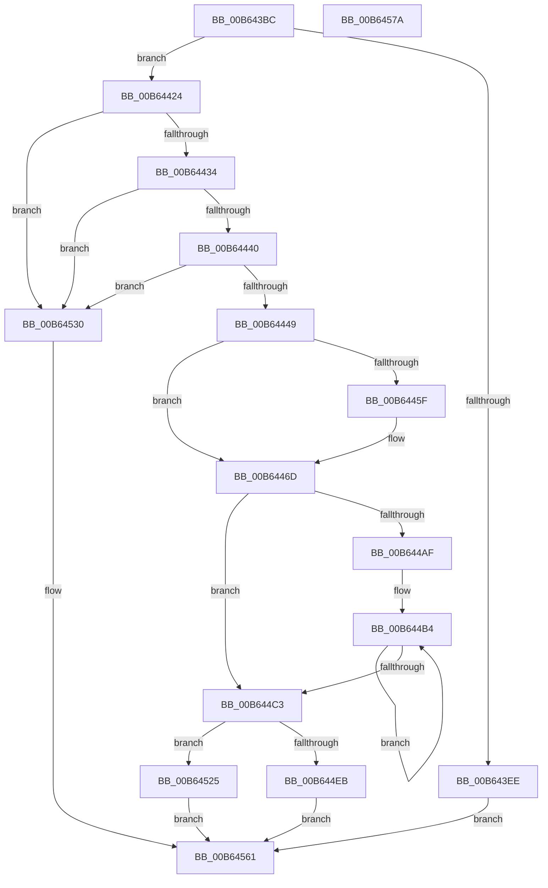

# PnprMapPhysicalPages

- RVA: `0x00B643BC`–`0x00B6457B` (길이 `447` bytes)
- VA: `0x0000000140B643BC`
- 실행 섹션: `PAGELK`
- PDB 이름 있음: `예`; PDB Function 태그: `아니요`
- unwind 정보 RVA: `0x00060300`
- 디코드: `116`개 명령, `447/447` bytes 표시
- 미해석 바이트: `0` (있으면 어셈블리에 `.byte`로 보존)

> 이 문서는 커널 이미지의 기계어와 PDB 기호를 분석해 생성했습니다. 4번과 5번은 함수 원형과 자료형을 바이너리 사용 방식에서 추정한 C 해석이며 원본 소스 복구 결과는 아닙니다.

## 1. Dependencies

- 직접 호출 지점: **2**; 고유 호출 대상: **2**
- 직접 호출자로 확인된 함수: **1**
- RIP 상대 이미지 참조: **1**

### Outgoing calls
- `0x00B64468` → [MmUnmapReservedMapping](../../text/3E/MmUnmapReservedMapping_function_003E7BE0.md) (function, `0x003E7BE0`)
- `0x00B644E1` → [MmMapLockedPagesWithReservedMapping](../../text/3E/MmMapLockedPagesWithReservedMapping_function_003E8910.md) (function, `0x003E8910`)

### Direct callers
- [PnprMapTargetSparePhysicalPages](PnprMapTargetSparePhysicalPages_function_00B64590.md) at `0x00B645DF`
- [PnprMapTargetSparePhysicalPages](PnprMapTargetSparePhysicalPages_function_00B64590.md) at `0x00B64648`

### Static image references
- `0x00B643DA` → RVA `0x00F8AC38` (`.data`; read)

## 2. Other-region calls and transfers

- 다른 실행 섹션으로 향하는 call: **2**
  - `0x00B64468` → [MmUnmapReservedMapping](../../text/3E/MmUnmapReservedMapping_function_003E7BE0.md) (`PAGELK` → `.text`)
  - `0x00B644E1` → [MmMapLockedPagesWithReservedMapping](../../text/3E/MmMapLockedPagesWithReservedMapping_function_003E8910.md) (`PAGELK` → `.text`)
- 별도 외부 분기/꼬리 이동을 확인하지 못했습니다.

## 3. Assembly (complete function range)

```asm
00B643BC  48 89 5C 24 08                  mov qword ptr [rsp + 8], rbx
00B643C1  48 89 6C 24 10                  mov qword ptr [rsp + 0x10], rbp
00B643C6  48 89 74 24 18                  mov qword ptr [rsp + 0x18], rsi
00B643CB  57                              push rdi
00B643CC  41 56                           push r14
00B643CE  41 57                           push r15
00B643D0  48 83 EC 20                     sub rsp, 0x20
00B643D4  48 8B F2                        mov rsi, rdx
00B643D7  49 8B E9                        mov rbp, r9
00B643DA  48 8B 15 57 68 42 00            mov rdx, qword ptr [rip + 0x426857]
00B643E1  4D 8B F8                        mov r15, r8
00B643E4  4C 8B F1                        mov r14, rcx
00B643E7  8B 42 40                        mov eax, dword ptr [rdx + 0x40]
00B643EA  A8 04                           test al, 4
00B643EC  75 36                           jne 0x140b64424
00B643EE  8B 82 08 82 00 00               mov eax, dword ptr [rdx + 0x8208]
00B643F4  B9 EF 0F 00 00                  mov ecx, 0xfef
00B643F9  85 C0                           test eax, eax
00B643FB  0F 44 C1                        cmove eax, ecx
00B643FE  B9 08 00 00 00                  mov ecx, 8
00B64403  89 82 08 82 00 00               mov dword ptr [rdx + 0x8208], eax
00B64409  8B 82 0C 82 00 00               mov eax, dword ptr [rdx + 0x820c]
00B6440F  85 C0                           test eax, eax
00B64411  0F 44 C1                        cmove eax, ecx
00B64414  89 82 0C 82 00 00               mov dword ptr [rdx + 0x820c], eax
00B6441A  B8 1A 00 00 C0                  mov eax, 0xc000001a
00B6441F  E9 3D 01 00 00                  jmp 0x140b64561
00B64424  33 DB                           xor ebx, ebx
00B64426  B8 FF 0F 00 00                  mov eax, 0xfff
00B6442B  48 85 F0                        test rax, rsi
00B6442E  0F 85 FC 00 00 00               jne 0x140b64530
00B64434  49 8B 38                        mov rdi, qword ptr [r8]
00B64437  48 85 FF                        test rdi, rdi
00B6443A  0F 84 F0 00 00 00               je 0x140b64530
00B64440  48 85 F8                        test rax, rdi
00B64443  0F 85 E7 00 00 00               jne 0x140b64530
00B64449  4C 8B 01                        mov r8, qword ptr [rcx]
00B6444C  B8 00 00 01 00                  mov eax, 0x10000
00B64451  48 3B F8                        cmp rdi, rax
00B64454  48 0F 47 F8                     cmova rdi, rax
00B64458  41 F6 40 0A 01                  test byte ptr [r8 + 0xa], 1
00B6445D  74 0E                           je 0x140b6446d
00B6445F  48 8B 49 08                     mov rcx, qword ptr [rcx + 8]
00B64463  BA 50 6E 70 51                  mov edx, 0x51706e50
00B64468  E8 73 37 88 FF                  call 0x1403e7be0
00B6446D  49 8B 0E                        mov rcx, qword ptr [r14]
00B64470  48 8D 87 FF 0F 00 00            lea rax, [rdi + 0xfff]
00B64477  48 C1 E8 0C                     shr rax, 0xc
00B6447B  4C 8B C7                        mov r8, rdi
00B6447E  66 83 C0 06                     add ax, 6
00B64482  48 C1 EE 0C                     shr rsi, 0xc
00B64486  66 C1 E0 03                     shl ax, 3
00B6448A  66 89 41 08                     mov word ptr [rcx + 8], ax
00B6448E  48 89 19                        mov qword ptr [rcx], rbx
00B64491  66 89 59 0A                     mov word ptr [rcx + 0xa], bx
00B64495  48 89 59 20                     mov qword ptr [rcx + 0x20], rbx
00B64499  89 59 2C                        mov dword ptr [rcx + 0x2c], ebx
00B6449C  89 79 28                        mov dword ptr [rcx + 0x28], edi
00B6449F  49 8B 06                        mov rax, qword ptr [r14]
00B644A2  48 83 C0 30                     add rax, 0x30
00B644A6  49 C1 E8 0C                     shr r8, 0xc
00B644AA  4D 85 C0                        test r8, r8
00B644AD  74 14                           je 0x140b644c3
00B644AF  B9 08 00 00 00                  mov ecx, 8
00B644B4  48 89 30                        mov qword ptr [rax], rsi
00B644B7  48 03 C1                        add rax, rcx
00B644BA  48 FF C6                        inc rsi
00B644BD  49 83 E8 01                     sub r8, 1
00B644C1  75 F1                           jne 0x140b644b4
00B644C3  49 8B 0E                        mov rcx, qword ptr [r14]
00B644C6  41 B9 01 00 00 00               mov r9d, 1
00B644CC  41 0F B7 46 10                  movzx eax, word ptr [r14 + 0x10]
00B644D1  BA 50 6E 70 51                  mov edx, 0x51706e50
00B644D6  66 09 41 0A                     or word ptr [rcx + 0xa], ax
00B644DA  4D 8B 06                        mov r8, qword ptr [r14]
00B644DD  49 8B 4E 08                     mov rcx, qword ptr [r14 + 8]
00B644E1  E8 2A 44 88 FF                  call 0x1403e8910
00B644E6  48 85 C0                        test rax, rax
00B644E9  75 3A                           jne 0x140b64525
00B644EB  48 8B 0D 46 67 42 00            mov rcx, qword ptr [rip + 0x426746]
00B644F2  BA 2E 10 00 00                  mov edx, 0x102e
00B644F7  8B 81 08 82 00 00               mov eax, dword ptr [rcx + 0x8208]
00B644FD  85 C0                           test eax, eax
00B644FF  0F 44 C2                        cmove eax, edx
00B64502  BA 0A 00 00 00                  mov edx, 0xa
00B64507  89 81 08 82 00 00               mov dword ptr [rcx + 0x8208], eax
00B6450D  8B 81 0C 82 00 00               mov eax, dword ptr [rcx + 0x820c]
00B64513  85 C0                           test eax, eax
00B64515  0F 44 C2                        cmove eax, edx
00B64518  89 81 0C 82 00 00               mov dword ptr [rcx + 0x820c], eax
00B6451E  B8 9A 00 00 C0                  mov eax, 0xc000009a
00B64523  EB 3C                           jmp 0x140b64561
00B64525  48 89 45 00                     mov qword ptr [rbp], rax
00B64529  33 C0                           xor eax, eax
00B6452B  49 89 3F                        mov qword ptr [r15], rdi
00B6452E  EB 31                           jmp 0x140b64561
00B64530  8B 82 08 82 00 00               mov eax, dword ptr [rdx + 0x8208]
00B64536  B9 F7 0F 00 00                  mov ecx, 0xff7
00B6453B  85 C0                           test eax, eax
00B6453D  0F 44 C1                        cmove eax, ecx
00B64540  B9 08 00 00 00                  mov ecx, 8
00B64545  89 82 08 82 00 00               mov dword ptr [rdx + 0x8208], eax
00B6454B  8B 82 0C 82 00 00               mov eax, dword ptr [rdx + 0x820c]
00B64551  85 C0                           test eax, eax
00B64553  0F 44 C1                        cmove eax, ecx
00B64556  89 82 0C 82 00 00               mov dword ptr [rdx + 0x820c], eax
00B6455C  B8 0D 00 00 C0                  mov eax, 0xc000000d
00B64561  48 8B 5C 24 40                  mov rbx, qword ptr [rsp + 0x40]
00B64566  48 8B 6C 24 48                  mov rbp, qword ptr [rsp + 0x48]
00B6456B  48 8B 74 24 50                  mov rsi, qword ptr [rsp + 0x50]
00B64570  48 83 C4 20                     add rsp, 0x20
00B64574  41 5F                           pop r15
00B64576  41 5E                           pop r14
00B64578  5F                              pop rdi
00B64579  C3                              ret
00B6457A  CC                              int3
```

## 4. C-style interpretation (structured pseudocode)

```c
__int64 __fastcall PnprMapPhysicalPages(__int64 a1, __int64 a2, __int64 a3, __int64 a4)
{
    __int64 result;
    __int64 v_rbx;
    __int64 v_rdi;
    __int64 v_rsi;
    __int64 v_rsp;
    unsigned __int64 v_stack_p10;
    unsigned __int64 v_stack_p18;
    unsigned __int64 v_stack_p8;

    v_stack_p8 = v_rbx;
    v_stack_p10 = v_rbp;
    v_stack_p18 = v_rsi;
    v_rsp = (v_rsp) - (32);
    if ((((unsigned __int8)((unsigned int)(*(unsigned int *)(*(unsigned __int64 *)(v_rip + 4352087) + 64)))) & (4)) != 0) goto loc_00B64424;
    result = (unsigned int)(*(unsigned int *)(*(unsigned __int64 *)(v_rip + 4352087) + 33288));
    if ((unsigned int)((unsigned int)(*(unsigned int *)(*(unsigned __int64 *)(v_rip + 4352087) + 33288))) == 0) { result = (unsigned int)((unsigned int)(0xFEFULL)); }
    *(unsigned int *)(*(unsigned __int64 *)(v_rip + 4352087) + 33288) = (unsigned int)(result);
    result = (unsigned int)(*(unsigned int *)(*(unsigned __int64 *)(v_rip + 4352087) + 33292));
    if ((unsigned int)((unsigned int)(*(unsigned int *)(*(unsigned __int64 *)(v_rip + 4352087) + 33292))) == 0) { result = 8; }
    *(unsigned int *)(*(unsigned __int64 *)(v_rip + 4352087) + 33292) = (unsigned int)(result);
    goto loc_00B64561;
loc_00B64424:
    v_rbx = 0;
    if ((((unsigned int)(0xFFFULL)) & (a2)) != 0) goto loc_00B64530;
    if (*(unsigned __int64 *)(a3) == 0) goto loc_00B64530;
    if ((((unsigned int)(0xFFFULL)) & (*(unsigned __int64 *)(a3))) != 0) goto loc_00B64530;
    v_rdi = *(unsigned __int64 *)(a3);
    if ((*(unsigned __int64 *)(a3)) > ((unsigned int)(0x10000ULL))) { v_rdi = (unsigned int)(0x10000ULL); }
    result = (unsigned int)(0x10000ULL);
    if (((*(unsigned __int8 *)(*(unsigned __int64 *)(8) + 10)) & (1)) != 0) {
        a1 = *(unsigned __int64 *)(8 + 8);
        a2 = 0x51706E50ULL;
        result = MmUnmapReservedMapping(a1, a2, *(unsigned __int64 *)(8), a4);
    }
    result = (v_rdi + 4095) >> (12);
    result = (unsigned __int16)((result) + (6));
    v_rsi = (a2) >> (12);
    result = (unsigned __int16)((result) << (3));
    *(unsigned __int16 *)(*(unsigned __int64 *)(a1) + 8) = (unsigned __int16)(result);
    *(unsigned __int64 *)(*(unsigned __int64 *)(a1)) = 0;
    *(unsigned __int16 *)(*(unsigned __int64 *)(a1) + 10) = 0;
    *(unsigned __int64 *)(*(unsigned __int64 *)(a1) + 32) = 0;
    *(unsigned int *)(*(unsigned __int64 *)(a1) + 44) = 0;
    *(unsigned int *)(*(unsigned __int64 *)(a1) + 40) = (unsigned int)(v_rdi);
    result = (*(unsigned __int64 *)(a1)) + (48);
    a3 = (v_rdi) >> (12);
    if (a3 == 0) goto loc_00B644C3;
loc_00B644B4:
    *(unsigned __int64 *)(result) = v_rsi;
    result = (result) + (8);
    v_rsi = (v_rsi) + 1;
    a3 = (a3) - (1);
    if (condition_is_not_equal) goto loc_00B644B4;
loc_00B644C3:
    result = MmMapLockedPagesWithReservedMapping(*(unsigned __int64 *)(a1 + 8), (unsigned int)(0x51706E50ULL), *(unsigned __int64 *)(a1), 1);
    if (result != 0) goto loc_00B64525;
    result = (unsigned int)(*(unsigned int *)(*(unsigned __int64 *)(v_rip + 4351814) + 33288));
    if ((unsigned int)((unsigned int)(*(unsigned int *)(*(unsigned __int64 *)(v_rip + 4351814) + 33288))) == 0) { result = (unsigned int)((unsigned int)(0x102EULL)); }
    *(unsigned int *)(*(unsigned __int64 *)(v_rip + 4351814) + 33288) = (unsigned int)(result);
    result = (unsigned int)(*(unsigned int *)(*(unsigned __int64 *)(v_rip + 4351814) + 33292));
    if ((unsigned int)((unsigned int)(*(unsigned int *)(*(unsigned __int64 *)(v_rip + 4351814) + 33292))) == 0) { result = 10; }
    *(unsigned int *)(*(unsigned __int64 *)(v_rip + 4351814) + 33292) = (unsigned int)(result);
    goto loc_00B64561;
loc_00B64525:
    *(unsigned __int64 *)(a4) = (unsigned int)(0xC000009AULL);
    result = 0;
    *(unsigned __int64 *)(a3) = v_rdi;
    goto loc_00B64561;
loc_00B64530:
    result = (unsigned int)(*(unsigned int *)(10 + 33288));
    if ((unsigned int)((unsigned int)(*(unsigned int *)(10 + 33288))) == 0) { result = (unsigned int)((unsigned int)(0xFF7ULL)); }
    *(unsigned int *)(10 + 33288) = (unsigned int)(result);
    result = (unsigned int)(*(unsigned int *)(10 + 33292));
    if ((unsigned int)((unsigned int)(*(unsigned int *)(10 + 33292))) == 0) { result = 8; }
    *(unsigned int *)(10 + 33292) = (unsigned int)(result);
loc_00B64561:
    v_rsp = (v_rsp) + (32);
    return (unsigned int)(0xC000000DULL);
}
```

## 5. (Beta) C Style

```c
int64_t PnprMapPhysicalPages(void *Arg1, int64_t Arg2, void *Arg3, void *Arg4)
{
    uint8_t *arg1 = (uint8_t *)Arg1;
    uint8_t *arg3 = (uint8_t *)Arg3;
    uint8_t *arg4 = (uint8_t *)Arg4;

    int64_t result;
    int64_t local_rbx;
    int64_t local_rdi;
    int64_t local_rsi;
    int64_t local_rsp;
    uint64_t v_stack_p10;
    uint64_t v_stack_p18;
    uint64_t v_stack_p8;

    v_stack_p8 = local_rbx;
    v_stack_p10 = local_rbp;
    v_stack_p18 = local_rsi;
    local_rsp = (local_rsp) - (32);
    if ((((uint8_t)((uint32_t)(*(uint32_t *)(*(uint64_t *)(v_rip + 0x426857) + 0x40)))) & (4)) != 0) goto loc_00B64424;
    result = (uint32_t)(*(uint32_t *)(*(uint64_t *)(v_rip + 0x426857) + 0x8208));
    if ((uint32_t)((uint32_t)(*(uint32_t *)(*(uint64_t *)(v_rip + 0x426857) + 0x8208))) == 0) { result = (uint32_t)((uint32_t)(0xFEFULL)); }
    *(uint32_t *)(*(uint64_t *)(v_rip + 0x426857) + 0x8208) = (uint32_t)(result);
    result = (uint32_t)(*(uint32_t *)(*(uint64_t *)(v_rip + 0x426857) + 0x820C));
    if ((uint32_t)((uint32_t)(*(uint32_t *)(*(uint64_t *)(v_rip + 0x426857) + 0x820C))) == 0) { result = 8; }
    *(uint32_t *)(*(uint64_t *)(v_rip + 0x426857) + 0x820C) = (uint32_t)(result);
    goto loc_00B64561;
loc_00B64424:
    local_rbx = 0;
    if ((((uint32_t)(0xFFFULL)) & (Arg2)) != 0) goto loc_00B64530;
    if (*(uint64_t *)(arg3) == 0) goto loc_00B64530;
    if ((((uint32_t)(0xFFFULL)) & (*(uint64_t *)(arg3))) != 0) goto loc_00B64530;
    local_rdi = *(uint64_t *)(arg3);
    if ((*(uint64_t *)(arg3)) > ((uint32_t)(0x10000ULL))) { local_rdi = (uint32_t)(0x10000ULL); }
    result = (uint32_t)(0x10000ULL);
    if (((*(uint8_t *)(*(uint64_t *)(8) + 0xA)) & (1)) != 0) {
        Arg1 = *(uint64_t *)(8 + 0x8);
        Arg2 = 0x51706E50ULL;
        result = MmUnmapReservedMapping(Arg1, Arg2, *(uint64_t *)(8), Arg4);
    }
    result = (local_rdi + 4095) >> (12);
    result = (uint16_t)((result) + (6));
    local_rsi = (Arg2) >> (12);
    result = (uint16_t)((result) << (3));
    *(uint16_t *)(*(uint64_t *)(arg1) + 0x8) = (uint16_t)(result);
    *(uint64_t *)(*(uint64_t *)(arg1)) = 0;
    *(uint16_t *)(*(uint64_t *)(arg1) + 0xA) = 0;
    *(uint64_t *)(*(uint64_t *)(arg1) + 0x20) = 0;
    *(uint32_t *)(*(uint64_t *)(arg1) + 0x2C) = 0;
    *(uint32_t *)(*(uint64_t *)(arg1) + 0x28) = (uint32_t)(local_rdi);
    result = (*(uint64_t *)(arg1)) + (48);
    Arg3 = (local_rdi) >> (12);
    if (Arg3 == NULL) goto loc_00B644C3;
loc_00B644B4:
    *(uint64_t *)(result) = local_rsi;
    result = (result) + (8);
    local_rsi = (local_rsi) + 1;
    Arg3 = (Arg3) - (1);
    if (condition_is_not_equal) goto loc_00B644B4;
loc_00B644C3:
    result = MmMapLockedPagesWithReservedMapping(*(uint64_t *)(arg1 + 0x8), (uint32_t)(0x51706E50ULL), *(uint64_t *)(arg1), 1);
    if (result != 0) goto loc_00B64525;
    result = (uint32_t)(*(uint32_t *)(*(uint64_t *)(v_rip + 0x426746) + 0x8208));
    if ((uint32_t)((uint32_t)(*(uint32_t *)(*(uint64_t *)(v_rip + 0x426746) + 0x8208))) == 0) { result = (uint32_t)((uint32_t)(0x102EULL)); }
    *(uint32_t *)(*(uint64_t *)(v_rip + 0x426746) + 0x8208) = (uint32_t)(result);
    result = (uint32_t)(*(uint32_t *)(*(uint64_t *)(v_rip + 0x426746) + 0x820C));
    if ((uint32_t)((uint32_t)(*(uint32_t *)(*(uint64_t *)(v_rip + 0x426746) + 0x820C))) == 0) { result = 10; }
    *(uint32_t *)(*(uint64_t *)(v_rip + 0x426746) + 0x820C) = (uint32_t)(result);
    goto loc_00B64561;
loc_00B64525:
    *(uint64_t *)(arg4) = (uint32_t)(0xC000009AULL);
    result = 0;
    *(uint64_t *)(arg3) = local_rdi;
    goto loc_00B64561;
loc_00B64530:
    result = (uint32_t)(*(uint32_t *)(10 + 0x8208));
    if ((uint32_t)((uint32_t)(*(uint32_t *)(10 + 0x8208))) == 0) { result = (uint32_t)((uint32_t)(0xFF7ULL)); }
    *(uint32_t *)(10 + 0x8208) = (uint32_t)(result);
    result = (uint32_t)(*(uint32_t *)(10 + 0x820C));
    if ((uint32_t)((uint32_t)(*(uint32_t *)(10 + 0x820C))) == 0) { result = 8; }
    *(uint32_t *)(10 + 0x820C) = (uint32_t)(result);
loc_00B64561:
    local_rsp = (local_rsp) + (32);
    return (uint32_t)(0xC000000DULL);
}
```

### 관측된 메모리 오프셋

구조체 형식이 확인되지 않은 접근은 인자 기준의 오프셋으로만 기록했습니다.

| 기준 인자 | 오프셋 표현 | 폭 (bit) | 접근 |
|---|---:|---:|---|
| `Arg1` | `+ 0x0` | `64` | `R` |
| `Arg1` | `+ 0x8` | `64` | `R` |
| `Arg1` | `+ 0x10` | `16` | `R` |
| `Arg3` | `+ 0x0` | `64` | `R` |
| `Arg3` | `+ 0x0` | `64` | `W` |
| `Arg4` | `+ 0x0` | `64` | `W` |

## 6. Execution-region graph

[열기: 2D/3D 그래프와 함수 탐색 컨트롤 패널](../../../control-panel.html?section=pagelk&rva=0x00B643BC&view=graph)

- 2D 그래프는 위에서 아래로 흐르고, 3D 그래프는 빈 공간을 드래그해 회전합니다. Shift+드래그는 이동, 휠은 확대·축소, 함수 노드 선택은 대상 보고서 이동입니다.

### Static fallback


