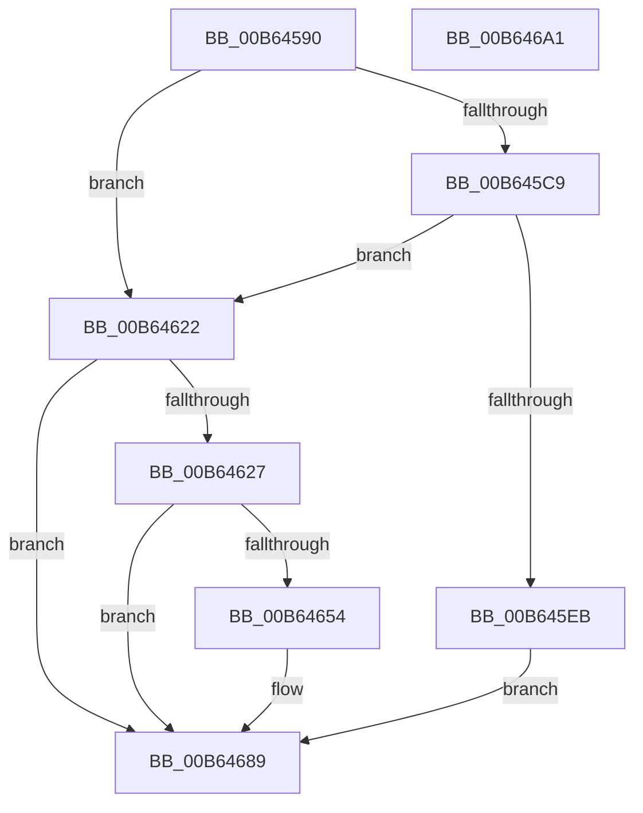

# PnprMapTargetSparePhysicalPages

- RVA: `0x00B64590`–`0x00B646A2` (길이 `274` bytes)
- VA: `0x0000000140B64590`
- 실행 섹션: `PAGELK`
- PDB 이름 있음: `예`; PDB Function 태그: `아니요`
- unwind 정보 RVA: `0x0005C954`
- 디코드: `66`개 명령, `274/274` bytes 표시
- 미해석 바이트: `0` (있으면 어셈블리에 `.byte`로 보존)

> 이 문서는 커널 이미지의 기계어와 PDB 기호를 분석해 생성했습니다. 4번과 5번은 함수 원형과 자료형을 바이너리 사용 방식에서 추정한 C 해석이며 원본 소스 복구 결과는 아닙니다.

## 1. Dependencies

- 직접 호출 지점: **2**; 고유 호출 대상: **1**
- 직접 호출자로 확인된 함수: **0**
- RIP 상대 이미지 참조: **1**

### Outgoing calls
- `0x00B645DF` → [PnprMapPhysicalPages](PnprMapPhysicalPages_function_00B643BC.md) (function, `0x00B643BC`)
- `0x00B64648` → [PnprMapPhysicalPages](PnprMapPhysicalPages_function_00B643BC.md) (function, `0x00B643BC`)

### Direct callers
- 이 함수 시작 RVA로 연결되는 직접 call은 확인되지 않았습니다. 간접 호출은 완전히 역산할 수 없습니다.

### Static image references
- `0x00B645CD` → RVA `0x00F8AC38` (`.data`; read)

## 2. Other-region calls and transfers

- 다른 실행 섹션으로 향하는 call: **0**
- 별도 외부 분기/꼬리 이동을 확인하지 못했습니다.

## 3. Assembly (complete function range)

```asm
00B64590  48 89 5C 24 08                  mov qword ptr [rsp + 8], rbx
00B64595  48 89 6C 24 10                  mov qword ptr [rsp + 0x10], rbp
00B6459A  48 89 74 24 18                  mov qword ptr [rsp + 0x18], rsi
00B6459F  57                              push rdi
00B645A0  48 83 EC 20                     sub rsp, 0x20
00B645A4  65 8B 04 25 A4 01 00 00         mov eax, dword ptr gs:[0x1a4]
00B645AC  45 33 D2                        xor r10d, r10d
00B645AF  48 BD FF FF FF FF FF FF FF 7F   movabs rbp, 0x7fffffffffffffff
00B645B9  8B F8                           mov edi, eax
00B645BB  48 8B DA                        mov rbx, rdx
00B645BE  49 8B F0                        mov rsi, r8
00B645C1  48 8B D1                        mov rdx, rcx
00B645C4  48 3B CD                        cmp rcx, rbp
00B645C7  74 59                           je 0x140b64622
00B645C9  4C 8D 14 40                     lea r10, [rax + rax*2]
00B645CD  48 8B 05 64 66 42 00            mov rax, qword ptr [rip + 0x426664]
00B645D4  48 8B 88 88 00 00 00            mov rcx, qword ptr [rax + 0x88]
00B645DB  4A 8D 0C D1                     lea rcx, [rcx + r10*8]
00B645DF  E8 D8 FD FF FF                  call 0x140b643bc
00B645E4  44 8B D0                        mov r10d, eax
00B645E7  85 C0                           test eax, eax
00B645E9  79 37                           jns 0x140b64622
00B645EB  48 8B 15 46 66 42 00            mov rdx, qword ptr [rip + 0x426646]
00B645F2  B8 87 10 00 00                  mov eax, 0x1087
00B645F7  41 B8 0A 00 00 00               mov r8d, 0xa
00B645FD  8B 8A 08 82 00 00               mov ecx, dword ptr [rdx + 0x8208]
00B64603  85 C9                           test ecx, ecx
00B64605  0F 44 C8                        cmove ecx, eax
00B64608  8B 82 0C 82 00 00               mov eax, dword ptr [rdx + 0x820c]
00B6460E  85 C0                           test eax, eax
00B64610  89 8A 08 82 00 00               mov dword ptr [rdx + 0x8208], ecx
00B64616  41 0F 44 C0                     cmove eax, r8d
00B6461A  89 82 0C 82 00 00               mov dword ptr [rdx + 0x820c], eax
00B64620  EB 67                           jmp 0x140b64689
00B64622  48 3B DD                        cmp rbx, rbp
00B64625  74 62                           je 0x140b64689
00B64627  48 8B 05 0A 66 42 00            mov rax, qword ptr [rip + 0x42660a]
00B6462E  48 8D 14 7F                     lea rdx, [rdi + rdi*2]
00B64632  4C 8B 4C 24 50                  mov r9, qword ptr [rsp + 0x50]
00B64637  4C 8B C6                        mov r8, rsi
00B6463A  48 8B 88 90 00 00 00            mov rcx, qword ptr [rax + 0x90]
00B64641  48 8D 0C D1                     lea rcx, [rcx + rdx*8]
00B64645  48 8B D3                        mov rdx, rbx
00B64648  E8 6F FD FF FF                  call 0x140b643bc
00B6464D  44 8B D0                        mov r10d, eax
00B64650  85 C0                           test eax, eax
00B64652  79 35                           jns 0x140b64689
00B64654  48 8B 0D DD 65 42 00            mov rcx, qword ptr [rip + 0x4265dd]
00B6465B  BA 93 10 00 00                  mov edx, 0x1093
00B64660  41 B8 0A 00 00 00               mov r8d, 0xa
00B64666  8B 81 08 82 00 00               mov eax, dword ptr [rcx + 0x8208]
00B6466C  85 C0                           test eax, eax
00B6466E  0F 44 C2                        cmove eax, edx
00B64671  89 81 08 82 00 00               mov dword ptr [rcx + 0x8208], eax
00B64677  8B 81 0C 82 00 00               mov eax, dword ptr [rcx + 0x820c]
00B6467D  85 C0                           test eax, eax
00B6467F  41 0F 44 C0                     cmove eax, r8d
00B64683  89 81 0C 82 00 00               mov dword ptr [rcx + 0x820c], eax
00B64689  48 8B 5C 24 30                  mov rbx, qword ptr [rsp + 0x30]
00B6468E  41 8B C2                        mov eax, r10d
00B64691  48 8B 6C 24 38                  mov rbp, qword ptr [rsp + 0x38]
00B64696  48 8B 74 24 40                  mov rsi, qword ptr [rsp + 0x40]
00B6469B  48 83 C4 20                     add rsp, 0x20
00B6469F  5F                              pop rdi
00B646A0  C3                              ret
00B646A1  CC                              int3
```

## 4. C-style interpretation (structured pseudocode)

```c
__int64 __fastcall PnprMapTargetSparePhysicalPages(__int64 a1, __int64 a2, __int64 a3, __int64 a4, __int64 a5)
{
    __int64 result;
    __int64 v_r10;
    __int64 v_rsp;
    unsigned __int64 v_stack_p10;
    unsigned __int64 v_stack_p18;
    unsigned __int64 v_stack_p8;

    v_stack_p8 = v_rbx;
    v_stack_p10 = v_rbp;
    v_stack_p18 = v_rsi;
    v_rsp = (v_rsp) - (32);
    v_r10 = 0;
    if (a1 == v_rbp) goto loc_00B64622;
    result = PnprMapPhysicalPages(*(unsigned __int64 *)(*(unsigned __int64 *)(v_rip + 4351588) + 136) + (unsigned int)(*(unsigned int *)(gs_base + (0 + 420))) + (unsigned int)(*(unsigned int *)(gs_base + (0 + 420))) * 2 * 8, a1, a3, a4);
    if (!sign_flag) goto loc_00B64622;
    a1 = (unsigned int)(*(unsigned int *)(*(unsigned __int64 *)(v_rip + 4351558) + 33288));
    if ((unsigned int)((unsigned int)(*(unsigned int *)(*(unsigned __int64 *)(v_rip + 4351558) + 33288))) == 0) { a1 = (unsigned int)((unsigned int)(0x1087ULL)); }
    *(unsigned int *)(*(unsigned __int64 *)(v_rip + 4351558) + 33288) = (unsigned int)(a1);
    result = (unsigned int)(*(unsigned int *)(*(unsigned __int64 *)(v_rip + 4351558) + 33292));
    if ((unsigned int)((unsigned int)(*(unsigned int *)(*(unsigned __int64 *)(v_rip + 4351558) + 33292))) == 0) { result = 10; }
    *(unsigned int *)(*(unsigned __int64 *)(v_rip + 4351558) + 33292) = (unsigned int)(result);
    goto loc_00B64689;
loc_00B64622:
    if (a2 == v_rbp) goto loc_00B64689;
    result = PnprMapPhysicalPages(*(unsigned __int64 *)(*(unsigned __int64 *)(v_rip + 4351498) + 144) + (unsigned int)((unsigned int)((unsigned int)(*(unsigned int *)(gs_base + (0 + 420))))) + (unsigned int)((unsigned int)((unsigned int)(*(unsigned int *)(gs_base + (0 + 420))))) * 2 * 8, a2, a3, a5);
    if (sign_flag) {
        a1 = *(unsigned __int64 *)(v_rip + 4351453);
        a2 = 0x1093ULL;
        a3 = 10;
        result = *(unsigned int *)(a1 + 33288);
        if ((unsigned int)(result) == 0) { result = (unsigned int)(a2); }
        *(unsigned int *)(a1 + 33288) = (unsigned int)(result);
        result = *(unsigned int *)(a1 + 33292);
        if ((unsigned int)(result) == 0) { result = (unsigned int)(a3); }
        *(unsigned int *)(a1 + 33292) = (unsigned int)(result);
    }
    v_rsp = (v_rsp) + (32);
    return (unsigned int)((unsigned int)((unsigned int)((unsigned int)(result))));
}
```

## 5. (Beta) C Style

```c
int64_t PnprMapTargetSparePhysicalPages(int64_t Arg1, int64_t Arg2, int64_t Arg3, int64_t Arg4, int64_t Arg5)
{
    int64_t result;
    int64_t local_r10;
    int64_t local_rsp;
    uint64_t v_stack_p10;
    uint64_t v_stack_p18;
    uint64_t v_stack_p8;

    v_stack_p8 = local_rbx;
    v_stack_p10 = local_rbp;
    v_stack_p18 = local_rsi;
    local_rsp = (local_rsp) - (32);
    local_r10 = 0;
    if (Arg1 == local_rbp) goto loc_00B64622;
    result = PnprMapPhysicalPages(*(uint64_t *)(*(uint64_t *)(v_rip + 0x426664) + 0x88) + (uint32_t)(*(uint32_t *)(gs_base + (0 + 0x1A4))) + (uint32_t)(*(uint32_t *)(gs_base + (0 + 0x1A4))) * 2 * 8, Arg1, Arg3, Arg4);
    if (!sign_flag) goto loc_00B64622;
    Arg1 = (uint32_t)(*(uint32_t *)(*(uint64_t *)(v_rip + 0x426646) + 0x8208));
    if ((uint32_t)((uint32_t)(*(uint32_t *)(*(uint64_t *)(v_rip + 0x426646) + 0x8208))) == 0) { Arg1 = (uint32_t)((uint32_t)(0x1087ULL)); }
    *(uint32_t *)(*(uint64_t *)(v_rip + 0x426646) + 0x8208) = (uint32_t)(Arg1);
    result = (uint32_t)(*(uint32_t *)(*(uint64_t *)(v_rip + 0x426646) + 0x820C));
    if ((uint32_t)((uint32_t)(*(uint32_t *)(*(uint64_t *)(v_rip + 0x426646) + 0x820C))) == 0) { result = 10; }
    *(uint32_t *)(*(uint64_t *)(v_rip + 0x426646) + 0x820C) = (uint32_t)(result);
    goto loc_00B64689;
loc_00B64622:
    if (Arg2 == local_rbp) goto loc_00B64689;
    result = PnprMapPhysicalPages(*(uint64_t *)(*(uint64_t *)(v_rip + 0x42660A) + 0x90) + (uint32_t)((uint32_t)((uint32_t)(*(uint32_t *)(gs_base + (0 + 0x1A4))))) + (uint32_t)((uint32_t)((uint32_t)(*(uint32_t *)(gs_base + (0 + 0x1A4))))) * 2 * 8, Arg2, Arg3, Arg5);
    if (sign_flag) {
        Arg1 = *(uint64_t *)(v_rip + 0x4265DD);
        Arg2 = 0x1093ULL;
        Arg3 = 10;
        result = *(uint32_t *)(Arg1 + 0x8208);
        if ((uint32_t)(result) == 0) { result = (uint32_t)(Arg2); }
        *(uint32_t *)(Arg1 + 0x8208) = (uint32_t)(result);
        result = *(uint32_t *)(Arg1 + 0x820C);
        if ((uint32_t)(result) == 0) { result = (uint32_t)(Arg3); }
        *(uint32_t *)(Arg1 + 0x820C) = (uint32_t)(result);
    }
    local_rsp = (local_rsp) + (32);
    return (uint32_t)((uint32_t)((uint32_t)((uint32_t)(result))));
}
```

## 6. Execution-region graph

[열기: 2D/3D 그래프와 함수 탐색 컨트롤 패널](../../../control-panel.html?section=pagelk&rva=0x00B64590&view=graph)

- 2D 그래프는 위에서 아래로 흐르고, 3D 그래프는 빈 공간을 드래그해 회전합니다. Shift+드래그는 이동, 휠은 확대·축소, 함수 노드 선택은 대상 보고서 이동입니다.

### Static fallback


