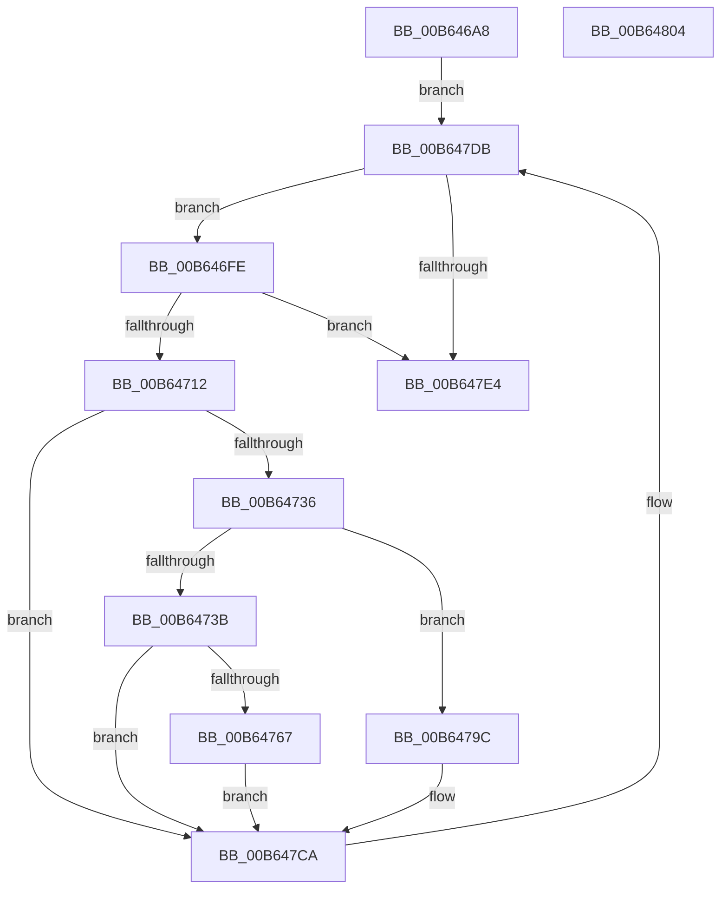

# PnprMarkOrMirrorPages

- RVA: `0x00B646A8`–`0x00B64805` (길이 `349` bytes)
- VA: `0x0000000140B646A8`
- 실행 섹션: `PAGELK`
- PDB 이름 있음: `예`; PDB Function 태그: `아니요`
- unwind 정보 RVA: `0x000AC264`
- 디코드: `92`개 명령, `349/349` bytes 표시
- 미해석 바이트: `0` (있으면 어셈블리에 `.byte`로 보존)

> 이 문서는 커널 이미지의 기계어와 PDB 기호를 분석해 생성했습니다. 4번과 5번은 함수 원형과 자료형을 바이너리 사용 방식에서 추정한 C 해석이며 원본 소스 복구 결과는 아닙니다.

## 1. Dependencies

- 직접 호출 지점: **4**; 고유 호출 대상: **4**
- 직접 호출자로 확인된 함수: **3**
- RIP 상대 이미지 참조: **1**

### Outgoing calls
- `0x00B6475E` → [guard_dispatch_icall](../../text/6B/guard_dispatch_icall_function_006BAAD0.md) (function, `0x006BAAD0`)
- `0x00B647A8` → [KeAcquireInStackQueuedSpinLock](../../text/27/KeAcquireInStackQueuedSpinLock_function_002757A0.md) (function, `0x002757A0`)
- `0x00B647BB` → [RtlClearBits](../../text/3E/RtlClearBits_function_003E1A90.md) (function, `0x003E1A90`)
- `0x00B647C5` → [KeReleaseInStackQueuedSpinLock](../../text/34/KeReleaseInStackQueuedSpinLock_function_00342CE0.md) (function, `0x00342CE0`)

### Direct callers
- [PnprMirrorPhysicalMemory](../../text/5A/PnprMirrorPhysicalMemory_function_005A8C90.md) at `0x005A8CE9`
- [PnprRecopyAddress](../../text/5A/PnprRecopyAddress_function_005A8E90.md) at `0x005A8EC1`
- [PnprRecopyMappingReserve](../../text/5A/PnprRecopyMappingReserve_function_005A8EE8.md) at `0x005A8F2B`

### Static image references
- `0x00B646C9` → RVA `0x00F8AC38` (`.data`; read)

## 2. Other-region calls and transfers

- 다른 실행 섹션으로 향하는 call: **4**
  - `0x00B6475E` → [guard_dispatch_icall](../../text/6B/guard_dispatch_icall_function_006BAAD0.md) (`PAGELK` → `.text`)
  - `0x00B647A8` → [KeAcquireInStackQueuedSpinLock](../../text/27/KeAcquireInStackQueuedSpinLock_function_002757A0.md) (`PAGELK` → `.text`)
  - `0x00B647BB` → [RtlClearBits](../../text/3E/RtlClearBits_function_003E1A90.md) (`PAGELK` → `.text`)
  - `0x00B647C5` → [KeReleaseInStackQueuedSpinLock](../../text/34/KeReleaseInStackQueuedSpinLock_function_00342CE0.md) (`PAGELK` → `.text`)
- 별도 외부 분기/꼬리 이동을 확인하지 못했습니다.

## 3. Assembly (complete function range)

```asm
00B646A8  4C 8B DC                        mov r11, rsp
00B646AB  49 89 5B 08                     mov qword ptr [r11 + 8], rbx
00B646AF  49 89 6B 10                     mov qword ptr [r11 + 0x10], rbp
00B646B3  49 89 73 18                     mov qword ptr [r11 + 0x18], rsi
00B646B7  57                              push rdi
00B646B8  41 54                           push r12
00B646BA  41 55                           push r13
00B646BC  41 56                           push r14
00B646BE  41 57                           push r15
00B646C0  48 83 EC 40                     sub rsp, 0x40
00B646C4  33 C0                           xor eax, eax
00B646C6  4C 8B F1                        mov r14, rcx
00B646C9  48 8B 0D 68 65 42 00            mov rcx, qword ptr [rip + 0x426568]
00B646D0  0F 57 C0                        xorps xmm0, xmm0
00B646D3  49 C1 EE 0C                     shr r14, 0xc
00B646D7  45 8A E0                        mov r12b, r8b
00B646DA  48 C1 EA 0C                     shr rdx, 0xc
00B646DE  0F 11 44 24 20                  movups xmmword ptr [rsp + 0x20], xmm0
00B646E3  49 89 43 C8                     mov qword ptr [r11 - 0x38], rax
00B646E7  48 8D 81 98 00 00 00            lea rax, [rcx + 0x98]
00B646EE  48 8B 30                        mov rsi, qword ptr [rax]
00B646F1  4E 8D 2C 32                     lea r13, [rdx + r14]
00B646F5  4D 8D 7D FF                     lea r15, [r13 - 1]
00B646F9  E9 DD 00 00 00                  jmp 0x140b647db
00B646FE  48 8B 6E 10                     mov rbp, qword ptr [rsi + 0x10]
00B64702  48 8B 56 18                     mov rdx, qword ptr [rsi + 0x18]
00B64706  48 03 D5                        add rdx, rbp
00B64709  4C 3B FD                        cmp r15, rbp
00B6470C  0F 82 D2 00 00 00               jb 0x140b647e4
00B64712  4C 3B F5                        cmp r14, rbp
00B64715  48 8D 42 FF                     lea rax, [rdx - 1]
00B64719  49 8B FE                        mov rdi, r14
00B6471C  49 8B DD                        mov rbx, r13
00B6471F  48 0F 46 FD                     cmovbe rdi, rbp
00B64723  4C 3B F8                        cmp r15, rax
00B64726  48 0F 43 DA                     cmovae rbx, rdx
00B6472A  48 FF CB                        dec rbx
00B6472D  48 3B FB                        cmp rdi, rbx
00B64730  0F 87 94 00 00 00               ja 0x140b647ca
00B64736  45 84 E4                        test r12b, r12b
00B64739  74 61                           je 0x140b6479c
00B6473B  48 8B 81 D0 81 00 00            mov rax, qword ptr [rcx + 0x81d0]
00B64742  48 8B 89 A0 81 00 00            mov rcx, qword ptr [rcx + 0x81a0]
00B64749  48 C1 E7 0C                     shl rdi, 0xc
00B6474D  48 C1 E3 0C                     shl rbx, 0xc
00B64751  48 8B D7                        mov rdx, rdi
00B64754  48 2B DF                        sub rbx, rdi
00B64757  4C 8D 83 00 10 00 00            lea r8, [rbx + 0x1000]
00B6475E  E8 6D 63 B5 FF                  call 0x1406baad0
00B64763  85 C0                           test eax, eax
00B64765  79 63                           jns 0x140b647ca
00B64767  48 8B 0D CA 64 42 00            mov rcx, qword ptr [rip + 0x4264ca]
00B6476E  BA 6A 0D 00 00                  mov edx, 0xd6a
00B64773  8B 81 08 82 00 00               mov eax, dword ptr [rcx + 0x8208]
00B64779  85 C0                           test eax, eax
00B6477B  0F 44 C2                        cmove eax, edx
00B6477E  BA 08 00 00 00                  mov edx, 8
00B64783  89 81 08 82 00 00               mov dword ptr [rcx + 0x8208], eax
00B64789  8B 81 0C 82 00 00               mov eax, dword ptr [rcx + 0x820c]
00B6478F  85 C0                           test eax, eax
00B64791  0F 44 C2                        cmove eax, edx
00B64794  89 81 0C 82 00 00               mov dword ptr [rcx + 0x820c], eax
00B6479A  EB 2E                           jmp 0x140b647ca
00B6479C  48 81 C1 A8 00 00 00            add rcx, 0xa8
00B647A3  48 8D 54 24 20                  lea rdx, [rsp + 0x20]
00B647A8  E8 F3 0F 71 FF                  call 0x1402757a0
00B647AD  2B DF                           sub ebx, edi
00B647AF  48 8D 4E 20                     lea rcx, [rsi + 0x20]
00B647B3  2B FD                           sub edi, ebp
00B647B5  8B D7                           mov edx, edi
00B647B7  44 8D 43 01                     lea r8d, [rbx + 1]
00B647BB  E8 D0 D2 87 FF                  call 0x1403e1a90
00B647C0  48 8D 4C 24 20                  lea rcx, [rsp + 0x20]
00B647C5  E8 16 E5 7D FF                  call 0x140342ce0
00B647CA  48 8B 0D 67 64 42 00            mov rcx, qword ptr [rip + 0x426467]
00B647D1  48 8B 36                        mov rsi, qword ptr [rsi]
00B647D4  48 8D 81 98 00 00 00            lea rax, [rcx + 0x98]
00B647DB  48 3B F0                        cmp rsi, rax
00B647DE  0F 85 1A FF FF FF               jne 0x140b646fe
00B647E4  4C 8D 5C 24 40                  lea r11, [rsp + 0x40]
00B647E9  33 C0                           xor eax, eax
00B647EB  49 8B 5B 30                     mov rbx, qword ptr [r11 + 0x30]
00B647EF  49 8B 6B 38                     mov rbp, qword ptr [r11 + 0x38]
00B647F3  49 8B 73 40                     mov rsi, qword ptr [r11 + 0x40]
00B647F7  49 8B E3                        mov rsp, r11
00B647FA  41 5F                           pop r15
00B647FC  41 5E                           pop r14
00B647FE  41 5D                           pop r13
00B64800  41 5C                           pop r12
00B64802  5F                              pop rdi
00B64803  C3                              ret
00B64804  CC                              int3
```

## 4. C-style interpretation (structured pseudocode)

```c
__int64 __fastcall PnprMarkOrMirrorPages(__int64 a1, __int64 a2, unsigned __int8 a3)
{
    __int64 result;
    __int64 v_r14;
    __int64 v_rbx;
    __int64 v_rdi;
    __int64 v_rsp;
    unsigned __int64 v_stack_m28;
    unsigned __int64 v_stack_m48;

    *(unsigned __int64 *)(v_rsp + 8) = v_rbx;
    *(unsigned __int64 *)(v_rsp + 16) = v_rbp;
    *(unsigned __int64 *)(v_rsp + 24) = v_rsi;
    v_rsp = (v_rsp) - (64);
    result = 0;
    v_r14 = (a1) >> (12);
    a2 = (a2) >> (12);
    v_stack_m48 = v_xmm0;
    *(unsigned __int64 *)(v_rsp - 56) = 0;
    goto loc_00B647DB;
loc_00B646FE:
    a2 = (*(unsigned __int64 *)(*(unsigned __int64 *)(*(unsigned __int64 *)(v_rip + 4351336) + 152) + 24)) + (*(unsigned __int64 *)(*(unsigned __int64 *)(*(unsigned __int64 *)(v_rip + 4351336) + 152) + 16));
    if ((a2 + v_r14 * 1 - 1) < (*(unsigned __int64 *)(*(unsigned __int64 *)(*(unsigned __int64 *)(v_rip + 4351336) + 152) + 16))) goto loc_00B647E4;
    v_rdi = v_r14;
    if (v_r14 <= (*(unsigned __int64 *)(*(unsigned __int64 *)(*(unsigned __int64 *)(v_rip + 4351336) + 152) + 16))) { v_rdi = *(unsigned __int64 *)(*(unsigned __int64 *)(*(unsigned __int64 *)(v_rip + 4351336) + 152) + 16); }
    v_rbx = a2 + v_r14 * 1;
    if ((a2 + v_r14 * 1 - 1) >= (a2 - 1)) { v_rbx = a2; }
    v_rbx = (v_rbx) - 1;
    if (v_rdi > v_rbx) goto loc_00B647CA;
    if (a3 == 0) goto loc_00B6479C;
    v_rdi = (v_rdi) << (12);
    v_rbx = (v_rbx) << (12);
    v_rbx = (v_rbx) - (v_rdi);
    result = guard_dispatch_icall(*(unsigned __int64 *)(*(unsigned __int64 *)(v_rip + 4351336) + 33184), v_rdi, v_rbx + 4096, a4);
    if (!sign_flag) goto loc_00B647CA;
    result = (unsigned int)(*(unsigned int *)(*(unsigned __int64 *)(v_rip + 4351178) + 33288));
    if ((unsigned int)((unsigned int)(*(unsigned int *)(*(unsigned __int64 *)(v_rip + 4351178) + 33288))) == 0) { result = (unsigned int)((unsigned int)(0xD6AULL)); }
    *(unsigned int *)(*(unsigned __int64 *)(v_rip + 4351178) + 33288) = (unsigned int)(result);
    result = (unsigned int)(*(unsigned int *)(*(unsigned __int64 *)(v_rip + 4351178) + 33292));
    if ((unsigned int)((unsigned int)(*(unsigned int *)(*(unsigned __int64 *)(v_rip + 4351178) + 33292))) == 0) { result = 8; }
    *(unsigned int *)(*(unsigned __int64 *)(v_rip + 4351178) + 33292) = (unsigned int)(result);
    goto loc_00B647CA;
loc_00B6479C:
    a1 = (*(unsigned __int64 *)(v_rip + 4351178)) + (168);
    result = KeAcquireInStackQueuedSpinLock(a1, v_stack_m48, v_rbx + 4096, a4);
    v_rbx = (unsigned int)((v_rbx) - ((unsigned int)(v_rdi)));
    v_rdi = (unsigned int)((v_rdi) - ((unsigned int)(*(unsigned __int64 *)(*(unsigned __int64 *)(*(unsigned __int64 *)(v_rip + 4351336) + 152) + 16))));
    result = RtlClearBits(*(unsigned __int64 *)(*(unsigned __int64 *)(v_rip + 4351336) + 152) + 32, (unsigned int)((unsigned int)(v_rdi)), v_rbx + 1, a4);
    result = KeReleaseInStackQueuedSpinLock(v_stack_m48, (unsigned int)((unsigned int)(v_rdi)), v_rbx + 1, a4);
loc_00B647CA:
loc_00B647DB:
    if ((*(unsigned __int64 *)(*(unsigned __int64 *)(*(unsigned __int64 *)(v_rip + 4351336) + 152))) != (*(unsigned __int64 *)(v_rip + 4351079) + 152)) goto loc_00B646FE;
loc_00B647E4:
    result = 0;
    return result;
}
```

## 5. (Beta) C Style

```c
int64_t PnprMarkOrMirrorPages(int64_t Arg1, int64_t Arg2, uint8_t Arg3)
{
    int64_t result;
    int64_t local_r14;
    int64_t local_rbx;
    int64_t local_rdi;
    int64_t local_rsp;
    uint64_t v_stack_m28;
    uint64_t v_stack_m48;

    *(uint64_t *)(local_rsp + 0x8) = local_rbx;
    *(uint64_t *)(local_rsp + 0x10) = local_rbp;
    *(uint64_t *)(local_rsp + 0x18) = local_rsi;
    local_rsp = (local_rsp) - (64);
    result = 0;
    local_r14 = (Arg1) >> (12);
    Arg2 = (Arg2) >> (12);
    v_stack_m48 = v_xmm0;
    *(uint64_t *)(local_rsp - 0x38) = 0;
    goto loc_00B647DB;
loc_00B646FE:
    Arg2 = (*(uint64_t *)(*(uint64_t *)(*(uint64_t *)(v_rip + 0x426568) + 0x98) + 0x18)) + (*(uint64_t *)(*(uint64_t *)(*(uint64_t *)(v_rip + 0x426568) + 0x98) + 0x10));
    if ((Arg2 + local_r14 * 1 - 1) < (*(uint64_t *)(*(uint64_t *)(*(uint64_t *)(v_rip + 0x426568) + 0x98) + 0x10))) goto loc_00B647E4;
    local_rdi = local_r14;
    if (local_r14 <= (*(uint64_t *)(*(uint64_t *)(*(uint64_t *)(v_rip + 0x426568) + 0x98) + 0x10))) { local_rdi = *(uint64_t *)(*(uint64_t *)(*(uint64_t *)(v_rip + 0x426568) + 0x98) + 0x10); }
    local_rbx = Arg2 + local_r14 * 1;
    if ((Arg2 + local_r14 * 1 - 1) >= (Arg2 - 1)) { local_rbx = Arg2; }
    local_rbx = (local_rbx) - 1;
    if (local_rdi > local_rbx) goto loc_00B647CA;
    if (Arg3 == 0) goto loc_00B6479C;
    local_rdi = (local_rdi) << (12);
    local_rbx = (local_rbx) << (12);
    local_rbx = (local_rbx) - (local_rdi);
    result = guard_dispatch_icall(*(uint64_t *)(*(uint64_t *)(v_rip + 0x426568) + 0x81A0), local_rdi, local_rbx + 4096, a4);
    if (!sign_flag) goto loc_00B647CA;
    result = (uint32_t)(*(uint32_t *)(*(uint64_t *)(v_rip + 0x4264CA) + 0x8208));
    if ((uint32_t)((uint32_t)(*(uint32_t *)(*(uint64_t *)(v_rip + 0x4264CA) + 0x8208))) == 0) { result = (uint32_t)((uint32_t)(0xD6AULL)); }
    *(uint32_t *)(*(uint64_t *)(v_rip + 0x4264CA) + 0x8208) = (uint32_t)(result);
    result = (uint32_t)(*(uint32_t *)(*(uint64_t *)(v_rip + 0x4264CA) + 0x820C));
    if ((uint32_t)((uint32_t)(*(uint32_t *)(*(uint64_t *)(v_rip + 0x4264CA) + 0x820C))) == 0) { result = 8; }
    *(uint32_t *)(*(uint64_t *)(v_rip + 0x4264CA) + 0x820C) = (uint32_t)(result);
    goto loc_00B647CA;
loc_00B6479C:
    Arg1 = (*(uint64_t *)(v_rip + 0x4264CA)) + (168);
    result = KeAcquireInStackQueuedSpinLock(Arg1, v_stack_m48, local_rbx + 4096, a4);
    local_rbx = (uint32_t)((local_rbx) - ((uint32_t)(local_rdi)));
    local_rdi = (uint32_t)((local_rdi) - ((uint32_t)(*(uint64_t *)(*(uint64_t *)(*(uint64_t *)(v_rip + 0x426568) + 0x98) + 0x10))));
    result = RtlClearBits(*(uint64_t *)(*(uint64_t *)(v_rip + 0x426568) + 0x98) + 32, (uint32_t)((uint32_t)(local_rdi)), local_rbx + 1, a4);
    result = KeReleaseInStackQueuedSpinLock(v_stack_m48, (uint32_t)((uint32_t)(local_rdi)), local_rbx + 1, a4);
loc_00B647CA:
loc_00B647DB:
    if ((*(uint64_t *)(*(uint64_t *)(*(uint64_t *)(v_rip + 0x426568) + 0x98))) != (*(uint64_t *)(v_rip + 0x426467) + 152)) goto loc_00B646FE;
loc_00B647E4:
    result = 0;
    return result;
}
```

## 6. Execution-region graph

[열기: 2D/3D 그래프와 함수 탐색 컨트롤 패널](../../../control-panel.html?section=pagelk&rva=0x00B646A8&view=graph)

- 2D 그래프는 위에서 아래로 흐르고, 3D 그래프는 빈 공간을 드래그해 회전합니다. Shift+드래그는 이동, 휠은 확대·축소, 함수 노드 선택은 대상 보고서 이동입니다.

### Static fallback


