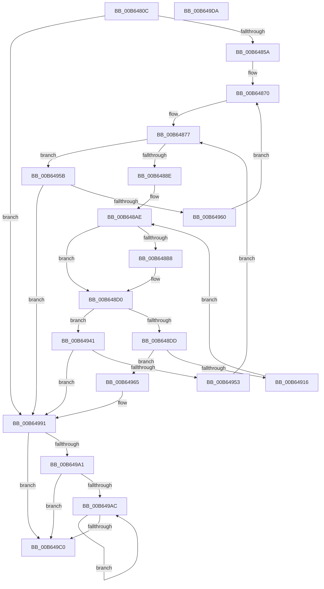

# PnprMirrorMarkedPages

- RVA: `0x00B6480C`–`0x00B649DB` (길이 `463` bytes)
- VA: `0x0000000140B6480C`
- 실행 섹션: `PAGELK`
- PDB 이름 있음: `예`; PDB Function 태그: `아니요`
- unwind 정보 RVA: `0x000C8E38`
- 디코드: `119`개 명령, `463/463` bytes 표시
- 미해석 바이트: `0` (있으면 어셈블리에 `.byte`로 보존)

> 이 문서는 커널 이미지의 기계어와 PDB 기호를 분석해 생성했습니다. 4번과 5번은 함수 원형과 자료형을 바이너리 사용 방식에서 추정한 C 해석이며 원본 소스 복구 결과는 아닙니다.

## 1. Dependencies

- 직접 호출 지점: **7**; 고유 호출 대상: **6**
- 직접 호출자로 확인된 함수: **2**
- RIP 상대 이미지 참조: **1**

### Outgoing calls
- `0x00B64899` → [KeAcquireInStackQueuedSpinLockAtDpcLevel](../../text/27/KeAcquireInStackQueuedSpinLockAtDpcLevel_function_00275740.md) (function, `0x00275740`)
- `0x00B648A9` → [RtlFindFirstRunClear](../../text/46/RtlFindFirstRunClear_function_00468C00.md) (function, `0x00468C00`)
- `0x00B648CB` → [RtlSetBits](../../text/3E/RtlSetBits_function_003E1610.md) (function, `0x003E1610`)
- `0x00B648D4` → [KeReleaseInStackQueuedSpinLockFromDpcLevel](../../text/21/KeReleaseInStackQueuedSpinLockFromDpcLevel_function_002171B0.md) (function, `0x002171B0`)
- `0x00B64904` → [guard_dispatch_icall](../../text/6B/guard_dispatch_icall_function_006BAAD0.md) (function, `0x006BAAD0`)
- `0x00B64928` → [KeAcquireInStackQueuedSpinLockAtDpcLevel](../../text/27/KeAcquireInStackQueuedSpinLockAtDpcLevel_function_00275740.md) (function, `0x00275740`)
- `0x00B64937` → [RtlFindNextForwardRunClear](../../text/3C/RtlFindNextForwardRunClear_function_003CF6A0.md) (function, `0x003CF6A0`)

### Direct callers
- [PnprSwap](../../text/5A/PnprSwap_function_005A910C.md) at `0x005A9165`
- [PnprQuiesceProcessorDpc](PnprQuiesceProcessorDpc_function_00B64B50.md) at `0x00B64E14`

### Static image references
- `0x00B6483E` → RVA `0x00F8AC38` (`.data`; read)

## 2. Other-region calls and transfers

- 다른 실행 섹션으로 향하는 call: **7**
  - `0x00B64899` → [KeAcquireInStackQueuedSpinLockAtDpcLevel](../../text/27/KeAcquireInStackQueuedSpinLockAtDpcLevel_function_00275740.md) (`PAGELK` → `.text`)
  - `0x00B648A9` → [RtlFindFirstRunClear](../../text/46/RtlFindFirstRunClear_function_00468C00.md) (`PAGELK` → `.text`)
  - `0x00B648CB` → [RtlSetBits](../../text/3E/RtlSetBits_function_003E1610.md) (`PAGELK` → `.text`)
  - `0x00B648D4` → [KeReleaseInStackQueuedSpinLockFromDpcLevel](../../text/21/KeReleaseInStackQueuedSpinLockFromDpcLevel_function_002171B0.md) (`PAGELK` → `.text`)
  - `0x00B64904` → [guard_dispatch_icall](../../text/6B/guard_dispatch_icall_function_006BAAD0.md) (`PAGELK` → `.text`)
  - `0x00B64928` → [KeAcquireInStackQueuedSpinLockAtDpcLevel](../../text/27/KeAcquireInStackQueuedSpinLockAtDpcLevel_function_00275740.md) (`PAGELK` → `.text`)
  - `0x00B64937` → [RtlFindNextForwardRunClear](../../text/3C/RtlFindNextForwardRunClear_function_003CF6A0.md) (`PAGELK` → `.text`)
- 별도 외부 분기/꼬리 이동을 확인하지 못했습니다.

## 3. Assembly (complete function range)

```asm
00B6480C  48 89 5C 24 18                  mov qword ptr [rsp + 0x18], rbx
00B64811  55                              push rbp
00B64812  56                              push rsi
00B64813  57                              push rdi
00B64814  41 54                           push r12
00B64816  41 55                           push r13
00B64818  41 56                           push r14
00B6481A  41 57                           push r15
00B6481C  48 8B EC                        mov rbp, rsp
00B6481F  48 83 EC 40                     sub rsp, 0x40
00B64823  33 C0                           xor eax, eax
00B64825  0F 57 C0                        xorps xmm0, xmm0
00B64828  21 45 40                        and dword ptr [rbp + 0x40], eax
00B6482B  33 FF                           xor edi, edi
00B6482D  48 89 45 F0                     mov qword ptr [rbp - 0x10], rax
00B64831  0F 11 45 E0                     movups xmmword ptr [rbp - 0x20], xmm0
00B64835  65 44 8B 3C 25 A4 01 00 00      mov r15d, dword ptr gs:[0x1a4]
00B6483E  48 8B 15 F3 63 42 00            mov rdx, qword ptr [rip + 0x4263f3]
00B64845  4B 8D 0C 7F                     lea rcx, [r15 + r15*2]
00B64849  48 8B 82 88 00 00 00            mov rax, qword ptr [rdx + 0x88]
00B64850  48 39 3C C8                     cmp qword ptr [rax + rcx*8], rdi
00B64854  0F 84 37 01 00 00               je 0x140b64991
00B6485A  44 3B BA B4 00 00 00            cmp r15d, dword ptr [rdx + 0xb4]
00B64861  48 8B 82 D0 81 00 00            mov rax, qword ptr [rdx + 0x81d0]
00B64868  41 0F 94 C4                     sete r12b
00B6486C  48 89 45 48                     mov qword ptr [rbp + 0x48], rax
00B64870  48 8B B2 98 00 00 00            mov rsi, qword ptr [rdx + 0x98]
00B64877  48 8B 15 BA 63 42 00            mov rdx, qword ptr [rip + 0x4263ba]
00B6487E  48 8D 82 98 00 00 00            lea rax, [rdx + 0x98]
00B64885  48 3B F0                        cmp rsi, rax
00B64888  0F 84 CD 00 00 00               je 0x140b6495b
00B6488E  48 8D 8A A8 00 00 00            lea rcx, [rdx + 0xa8]
00B64895  48 8D 55 E0                     lea rdx, [rbp - 0x20]
00B64899  E8 A2 0E 71 FF                  call 0x140275740
00B6489E  4C 8D 6E 20                     lea r13, [rsi + 0x20]
00B648A2  49 8B CD                        mov rcx, r13
00B648A5  48 8D 55 40                     lea rdx, [rbp + 0x40]
00B648A9  E8 52 43 90 FF                  call 0x140468c00
00B648AE  44 8B 75 40                     mov r14d, dword ptr [rbp + 0x40]
00B648B2  8B D8                           mov ebx, eax
00B648B4  85 C0                           test eax, eax
00B648B6  74 18                           je 0x140b648d0
00B648B8  B8 40 01 00 00                  mov eax, 0x140
00B648BD  41 8B D6                        mov edx, r14d
00B648C0  3B D8                           cmp ebx, eax
00B648C2  49 8B CD                        mov rcx, r13
00B648C5  0F 43 D8                        cmovae ebx, eax
00B648C8  44 8B C3                        mov r8d, ebx
00B648CB  E8 40 CD 87 FF                  call 0x1403e1610
00B648D0  48 8D 4D E0                     lea rcx, [rbp - 0x20]
00B648D4  E8 D7 28 6B FF                  call 0x1402171b0
00B648D9  85 DB                           test ebx, ebx
00B648DB  74 64                           je 0x140b64941
00B648DD  48 8B 0D 54 63 42 00            mov rcx, qword ptr [rip + 0x426354]
00B648E4  48 8B 56 10                     mov rdx, qword ptr [rsi + 0x10]
00B648E8  41 8B C6                        mov eax, r14d
00B648EB  48 03 D0                        add rdx, rax
00B648EE  44 8B C3                        mov r8d, ebx
00B648F1  48 8B 89 A0 81 00 00            mov rcx, qword ptr [rcx + 0x81a0]
00B648F8  48 8B 45 48                     mov rax, qword ptr [rbp + 0x48]
00B648FC  48 C1 E2 0C                     shl rdx, 0xc
00B64900  49 C1 E0 0C                     shl r8, 0xc
00B64904  E8 C7 61 B5 FF                  call 0x1406baad0
00B64909  48 8B 0D 28 63 42 00            mov rcx, qword ptr [rip + 0x426328]
00B64910  8B F8                           mov edi, eax
00B64912  85 C0                           test eax, eax
00B64914  78 4F                           js 0x140b64965
00B64916  44 03 F3                        add r14d, ebx
00B64919  48 8D 55 E0                     lea rdx, [rbp - 0x20]
00B6491D  48 81 C1 A8 00 00 00            add rcx, 0xa8
00B64924  44 89 75 40                     mov dword ptr [rbp + 0x40], r14d
00B64928  E8 13 0E 71 FF                  call 0x140275740
00B6492D  4C 8D 45 40                     lea r8, [rbp + 0x40]
00B64931  41 8B D6                        mov edx, r14d
00B64934  49 8B CD                        mov rcx, r13
00B64937  E8 64 AD 86 FF                  call 0x1403cf6a0
00B6493C  E9 6D FF FF FF                  jmp 0x140b648ae
00B64941  48 8B 05 F0 62 42 00            mov rax, qword ptr [rip + 0x4262f0]
00B64948  8B 88 C8 00 00 00               mov ecx, dword ptr [rax + 0xc8]
00B6494E  83 F9 03                        cmp ecx, 3
00B64951  74 3E                           je 0x140b64991
00B64953  48 8B 36                        mov rsi, qword ptr [rsi]
00B64956  E9 1C FF FF FF                  jmp 0x140b64877
00B6495B  45 84 E4                        test r12b, r12b
00B6495E  75 31                           jne 0x140b64991
00B64960  E9 0B FF FF FF                  jmp 0x140b64870
00B64965  8B 81 08 82 00 00               mov eax, dword ptr [rcx + 0x8208]
00B6496B  BA FA 0D 00 00                  mov edx, 0xdfa
00B64970  85 C0                           test eax, eax
00B64972  0F 44 C2                        cmove eax, edx
00B64975  BA 08 00 00 00                  mov edx, 8
00B6497A  89 81 08 82 00 00               mov dword ptr [rcx + 0x8208], eax
00B64980  8B 81 0C 82 00 00               mov eax, dword ptr [rcx + 0x820c]
00B64986  85 C0                           test eax, eax
00B64988  0F 44 C2                        cmove eax, edx
00B6498B  89 81 0C 82 00 00               mov dword ptr [rcx + 0x820c], eax
00B64991  48 8B 05 A0 62 42 00            mov rax, qword ptr [rip + 0x4262a0]
00B64998  44 3B B8 B4 00 00 00            cmp r15d, dword ptr [rax + 0xb4]
00B6499F  74 1F                           je 0x140b649c0
00B649A1  8B 80 C8 00 00 00               mov eax, dword ptr [rax + 0xc8]
00B649A7  83 F8 03                        cmp eax, 3
00B649AA  7D 14                           jge 0x140b649c0
00B649AC  F3 90                           pause
00B649AE  48 8B 05 83 62 42 00            mov rax, qword ptr [rip + 0x426283]
00B649B5  8B 88 C8 00 00 00               mov ecx, dword ptr [rax + 0xc8]
00B649BB  83 F9 03                        cmp ecx, 3
00B649BE  7C EC                           jl 0x140b649ac
00B649C0  48 8B 9C 24 90 00 00 00         mov rbx, qword ptr [rsp + 0x90]
00B649C8  8B C7                           mov eax, edi
00B649CA  48 83 C4 40                     add rsp, 0x40
00B649CE  41 5F                           pop r15
00B649D0  41 5E                           pop r14
00B649D2  41 5D                           pop r13
00B649D4  41 5C                           pop r12
00B649D6  5F                              pop rdi
00B649D7  5E                              pop rsi
00B649D8  5D                              pop rbp
00B649D9  C3                              ret
00B649DA  CC                              int3
```

## 4. C-style interpretation (structured pseudocode)

```c
__int64 __fastcall PnprMirrorMarkedPages(void)
{
    __int64 result;
    __int64 v_r12;
    __int64 v_r14;
    __int64 v_rbx;
    __int64 v_rdi;
    __int64 v_rsp;
    unsigned __int64 v_stack_m48;
    unsigned __int64 v_stack_m58;
    unsigned __int64 v_stack_p10;
    unsigned __int64 v_stack_p18;
    unsigned int v_stack_p8;

    v_stack_p18 = v_rbx;
    v_rsp = (v_rsp) - (64);
    result = 0;
    v_rdi = 0;
    v_stack_m48 = 0;
    v_stack_m58 = v_xmm0;
    if ((*(unsigned __int64 *)(*(unsigned __int64 *)(*(unsigned __int64 *)(v_rip + 4350963) + 136) + (unsigned int)(*(unsigned int *)(gs_base + (0 + 420))) + (unsigned int)(*(unsigned int *)(gs_base + (0 + 420))) * 2 * 8)) == 0) goto loc_00B64991;
    v_r12 = (((unsigned int)((unsigned int)(*(unsigned int *)(gs_base + (0 + 420))))) == (*(unsigned int *)(*(unsigned __int64 *)(v_rip + 4350963) + 180))) ? 1 : 0;
    v_stack_p10 = *(unsigned __int64 *)(*(unsigned __int64 *)(v_rip + 4350963) + 33232);
loc_00B64870:
loc_00B64877:
    if ((*(unsigned __int64 *)(*(unsigned __int64 *)(v_rip + 4350963) + 152)) == (*(unsigned __int64 *)(v_rip + 4350906) + 152)) goto loc_00B6495B;
    result = KeAcquireInStackQueuedSpinLockAtDpcLevel(*(unsigned __int64 *)(v_rip + 4350906) + 168, v_stack_m58, a3, a4);
    result = RtlFindFirstRunClear(*(unsigned __int64 *)(*(unsigned __int64 *)(v_rip + 4350963) + 152) + 32, v_stack_p8, a3, a4);
loc_00B648AE:
    v_rbx = (unsigned int)((unsigned int)(result));
    if ((unsigned int)(result) != 0) {
        result = 320;
        a2 = (unsigned int)((unsigned int)(v_stack_p8));
        a1 = *(unsigned __int64 *)(*(unsigned __int64 *)(v_rip + 4350963) + 152) + 32;
        v_rbx = (unsigned int)((unsigned int)(result));
        if (((unsigned int)((unsigned int)((unsigned int)(result)))) >= ((unsigned int)(result))) { v_rbx = (unsigned int)(result); }
        a3 = (unsigned int)(v_rbx);
        result = RtlSetBits(a1, a2, a3, a4);
    }
    result = KeReleaseInStackQueuedSpinLockFromDpcLevel(v_stack_m58, a2, a3, a4);
    if ((unsigned int)(v_rbx) == 0) goto loc_00B64941;
    a2 = (*(unsigned __int64 *)(*(unsigned __int64 *)(*(unsigned __int64 *)(v_rip + 4350963) + 152) + 16)) + ((unsigned int)((unsigned int)((unsigned int)(v_stack_p8))));
    a2 = (a2) << (12);
    a3 = ((unsigned int)((unsigned int)(v_rbx))) << (12);
    result = guard_dispatch_icall(*(unsigned __int64 *)(*(unsigned __int64 *)(v_rip + 4350804) + 33184), a2, a3, a4);
    if (sign_flag) goto loc_00B64965;
    v_r14 = (unsigned int)(((unsigned int)(v_stack_p8)) + ((unsigned int)(v_rbx)));
    a1 = (*(unsigned __int64 *)(v_rip + 4350760)) + (168);
    v_stack_p8 = (unsigned int)(v_r14);
    result = KeAcquireInStackQueuedSpinLockAtDpcLevel(a1, v_stack_m58, a3, a4);
    result = RtlFindNextForwardRunClear(*(unsigned __int64 *)(*(unsigned __int64 *)(v_rip + 4350963) + 152) + 32, (unsigned int)((unsigned int)(v_r14)), v_stack_p8, a4);
    goto loc_00B648AE;
loc_00B64941:
    if (((unsigned int)((unsigned int)(*(unsigned int *)(*(unsigned __int64 *)(v_rip + 4350704) + 200)))) == 3) goto loc_00B64991;
    goto loc_00B64877;
loc_00B6495B:
    if ((unsigned __int8)(v_r12) != 0) goto loc_00B64991;
    goto loc_00B64870;
loc_00B64965:
    result = (unsigned int)(*(unsigned int *)((unsigned int)(*(unsigned int *)(*(unsigned __int64 *)(v_rip + 4350704) + 200)) + 33288));
    if ((unsigned int)((unsigned int)(*(unsigned int *)((unsigned int)(*(unsigned int *)(*(unsigned __int64 *)(v_rip + 4350704) + 200)) + 33288))) == 0) { result = (unsigned int)((unsigned int)(0xDFAULL)); }
    *(unsigned int *)((unsigned int)(*(unsigned int *)(*(unsigned __int64 *)(v_rip + 4350704) + 200)) + 33288) = (unsigned int)(result);
    result = (unsigned int)(*(unsigned int *)((unsigned int)(*(unsigned int *)(*(unsigned __int64 *)(v_rip + 4350704) + 200)) + 33292));
    if ((unsigned int)((unsigned int)(*(unsigned int *)((unsigned int)(*(unsigned int *)(*(unsigned __int64 *)(v_rip + 4350704) + 200)) + 33292))) == 0) { result = 8; }
    *(unsigned int *)((unsigned int)(*(unsigned int *)(*(unsigned __int64 *)(v_rip + 4350704) + 200)) + 33292) = (unsigned int)(result);
loc_00B64991:
    if (((unsigned int)((unsigned int)(*(unsigned int *)(gs_base + (0 + 420))))) == (*(unsigned int *)(*(unsigned __int64 *)(v_rip + 4350624) + 180))) goto loc_00B649C0;
    if (((unsigned int)((unsigned int)(*(unsigned int *)(*(unsigned __int64 *)(v_rip + 4350624) + 200)))) >= 3) goto loc_00B649C0;
loc_00B649AC:
    if (((unsigned int)((unsigned int)(*(unsigned int *)(*(unsigned __int64 *)(v_rip + 4350595) + 200)))) < 3) goto loc_00B649AC;
loc_00B649C0:
    v_rsp = (v_rsp) + (64);
    return (unsigned int)((unsigned int)((unsigned int)((unsigned int)(result))));
}
```

## 5. (Beta) C Style

```c
void PnprMirrorMarkedPages(void)
{
    int64_t result;
    int64_t local_r12;
    int64_t local_r14;
    int64_t local_rbx;
    int64_t local_rdi;
    int64_t local_rsp;
    uint64_t v_stack_m48;
    uint64_t v_stack_m58;
    uint64_t v_stack_p10;
    uint64_t v_stack_p18;
    uint32_t v_stack_p8;

    v_stack_p18 = local_rbx;
    local_rsp = (local_rsp) - (64);
    result = 0;
    local_rdi = 0;
    v_stack_m48 = 0;
    v_stack_m58 = v_xmm0;
    if ((*(uint64_t *)(*(uint64_t *)(*(uint64_t *)(v_rip + 0x4263F3) + 0x88) + (uint32_t)(*(uint32_t *)(gs_base + (0 + 0x1A4))) + (uint32_t)(*(uint32_t *)(gs_base + (0 + 0x1A4))) * 2 * 8)) == 0) goto loc_00B64991;
    local_r12 = (((uint32_t)((uint32_t)(*(uint32_t *)(gs_base + (0 + 0x1A4))))) == (*(uint32_t *)(*(uint64_t *)(v_rip + 0x4263F3) + 0xB4))) ? 1 : 0;
    v_stack_p10 = *(uint64_t *)(*(uint64_t *)(v_rip + 0x4263F3) + 0x81D0);
loc_00B64870:
loc_00B64877:
    if ((*(uint64_t *)(*(uint64_t *)(v_rip + 0x4263F3) + 0x98)) == (*(uint64_t *)(v_rip + 0x4263BA) + 152)) goto loc_00B6495B;
    result = KeAcquireInStackQueuedSpinLockAtDpcLevel(*(uint64_t *)(v_rip + 0x4263BA) + 168, v_stack_m58, a3, a4);
    result = RtlFindFirstRunClear(*(uint64_t *)(*(uint64_t *)(v_rip + 0x4263F3) + 0x98) + 32, v_stack_p8, a3, a4);
loc_00B648AE:
    local_rbx = (uint32_t)((uint32_t)(result));
    if ((uint32_t)(result) != 0) {
        result = 320;
        a2 = (uint32_t)((uint32_t)(v_stack_p8));
        a1 = *(uint64_t *)(*(uint64_t *)(v_rip + 0x4263F3) + 0x98) + 32;
        local_rbx = (uint32_t)((uint32_t)(result));
        if (((uint32_t)((uint32_t)((uint32_t)(result)))) >= ((uint32_t)(result))) { local_rbx = (uint32_t)(result); }
        a3 = (uint32_t)(local_rbx);
        result = RtlSetBits(a1, a2, a3, a4);
    }
    result = KeReleaseInStackQueuedSpinLockFromDpcLevel(v_stack_m58, a2, a3, a4);
    if ((uint32_t)(local_rbx) == 0) goto loc_00B64941;
    a2 = (*(uint64_t *)(*(uint64_t *)(*(uint64_t *)(v_rip + 0x4263F3) + 0x98) + 0x10)) + ((uint32_t)((uint32_t)((uint32_t)(v_stack_p8))));
    a2 = (a2) << (12);
    a3 = ((uint32_t)((uint32_t)(local_rbx))) << (12);
    result = guard_dispatch_icall(*(uint64_t *)(*(uint64_t *)(v_rip + 0x426354) + 0x81A0), a2, a3, a4);
    if (sign_flag) goto loc_00B64965;
    local_r14 = (uint32_t)(((uint32_t)(v_stack_p8)) + ((uint32_t)(local_rbx)));
    a1 = (*(uint64_t *)(v_rip + 0x426328)) + (168);
    v_stack_p8 = (uint32_t)(local_r14);
    result = KeAcquireInStackQueuedSpinLockAtDpcLevel(a1, v_stack_m58, a3, a4);
    result = RtlFindNextForwardRunClear(*(uint64_t *)(*(uint64_t *)(v_rip + 0x4263F3) + 0x98) + 32, (uint32_t)((uint32_t)(local_r14)), v_stack_p8, a4);
    goto loc_00B648AE;
loc_00B64941:
    if (((uint32_t)((uint32_t)(*(uint32_t *)(*(uint64_t *)(v_rip + 0x4262F0) + 0xC8)))) == 3) goto loc_00B64991;
    goto loc_00B64877;
loc_00B6495B:
    if ((uint8_t)(local_r12) != 0) goto loc_00B64991;
    goto loc_00B64870;
loc_00B64965:
    result = (uint32_t)(*(uint32_t *)((uint32_t)(*(uint32_t *)(*(uint64_t *)(v_rip + 0x4262F0) + 0xC8)) + 0x8208));
    if ((uint32_t)((uint32_t)(*(uint32_t *)((uint32_t)(*(uint32_t *)(*(uint64_t *)(v_rip + 0x4262F0) + 0xC8)) + 0x8208))) == 0) { result = (uint32_t)((uint32_t)(0xDFAULL)); }
    *(uint32_t *)((uint32_t)(*(uint32_t *)(*(uint64_t *)(v_rip + 0x4262F0) + 0xC8)) + 0x8208) = (uint32_t)(result);
    result = (uint32_t)(*(uint32_t *)((uint32_t)(*(uint32_t *)(*(uint64_t *)(v_rip + 0x4262F0) + 0xC8)) + 0x820C));
    if ((uint32_t)((uint32_t)(*(uint32_t *)((uint32_t)(*(uint32_t *)(*(uint64_t *)(v_rip + 0x4262F0) + 0xC8)) + 0x820C))) == 0) { result = 8; }
    *(uint32_t *)((uint32_t)(*(uint32_t *)(*(uint64_t *)(v_rip + 0x4262F0) + 0xC8)) + 0x820C) = (uint32_t)(result);
loc_00B64991:
    if (((uint32_t)((uint32_t)(*(uint32_t *)(gs_base + (0 + 0x1A4))))) == (*(uint32_t *)(*(uint64_t *)(v_rip + 0x4262A0) + 0xB4))) goto loc_00B649C0;
    if (((uint32_t)((uint32_t)(*(uint32_t *)(*(uint64_t *)(v_rip + 0x4262A0) + 0xC8)))) >= 3) goto loc_00B649C0;
loc_00B649AC:
    if (((uint32_t)((uint32_t)(*(uint32_t *)(*(uint64_t *)(v_rip + 0x426283) + 0xC8)))) < 3) goto loc_00B649AC;
loc_00B649C0:
    local_rsp = (local_rsp) + (64);
    return (uint32_t)((uint32_t)((uint32_t)((uint32_t)(result))));
}
```

## 6. Execution-region graph

[열기: 2D/3D 그래프와 함수 탐색 컨트롤 패널](../../../control-panel.html?section=pagelk&rva=0x00B6480C&view=graph)

- 2D 그래프는 위에서 아래로 흐르고, 3D 그래프는 빈 공간을 드래그해 회전합니다. Shift+드래그는 이동, 휠은 확대·축소, 함수 노드 선택은 대상 보고서 이동입니다.

### Static fallback


