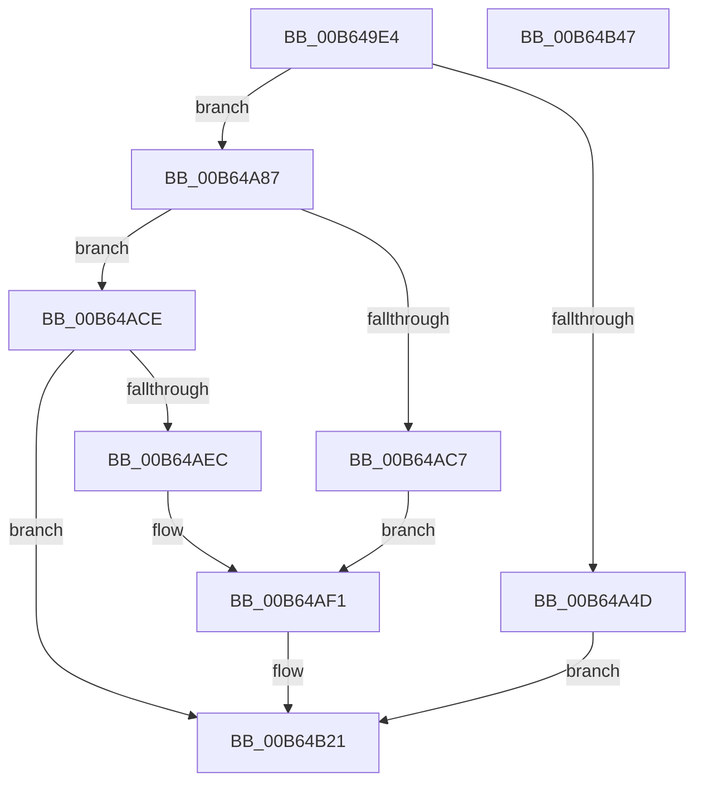

# PnprQuiesceDevices

- RVA: `0x00B649E4`–`0x00B64B48` (길이 `356` bytes)
- VA: `0x0000000140B649E4`
- 실행 섹션: `PAGELK`
- PDB 이름 있음: `예`; PDB Function 태그: `아니요`
- unwind 정보 RVA: `0x00060BC4`
- 디코드: `89`개 명령, `356/356` bytes 표시
- 미해석 바이트: `0` (있으면 어셈블리에 `.byte`로 보존)

> 이 문서는 커널 이미지의 기계어와 PDB 기호를 분석해 생성했습니다. 4번과 5번은 함수 원형과 자료형을 바이너리 사용 방식에서 추정한 C 해석이며 원본 소스 복구 결과는 아닙니다.

## 1. Dependencies

- 직접 호출 지점: **9**; 고유 호출 대상: **7**
- 직접 호출자로 확인된 함수: **2**
- RIP 상대 이미지 참조: **1**

### Outgoing calls
- `0x00B649F8` → [PnprGetMillisecondCounter](PnprGetMillisecondCounter_function_00B63FD4.md) (function, `0x00B63FD4`)
- `0x00B64A13` → [memset](../../text/6C/memset_function_006C6C40.md) (function, `0x006C6C40`)
- `0x00B64A37` → [PoBlockConsoleSwitch](../../page/AC/PoBlockConsoleSwitch_function_00ACCCA0.md) (function, `0x00ACCCA0`)
- `0x00B64A42` → [PoStartPowerStateTasks](../../page/70/PoStartPowerStateTasks_function_00702064.md) (function, `0x00702064`)
- `0x00B64A8D` → [PoStartPartitionReplace](../../page/75/PoStartPartitionReplace_function_0075E678.md) (function, `0x0075E678`)
- `0x00B64ABC` → [PoInitializeBroadcast](../../page/A4/PoInitializeBroadcast_function_00A4DD98.md) (function, `0x00A4DD98`)
- `0x00B64AD5` → [PoBroadcastSystemState](../B7/PoBroadcastSystemState_function_00B761B0.md) (function, `0x00B761B0`)
- `0x00B64AE1` → [PoBroadcastSystemState](../B7/PoBroadcastSystemState_function_00B761B0.md) (function, `0x00B761B0`)
- `0x00B64B23` → [PnprGetMillisecondCounter](PnprGetMillisecondCounter_function_00B63FD4.md) (function, `0x00B63FD4`)

### Direct callers
- [PnpReplacePartitionUnit](../../page/73/PnpReplacePartitionUnit_function_00738550.md) at `0x00738AF2`
- [PnprQuiesceWorker](PnprQuiesceWorker_function_00B654E0.md) at `0x00B6556B`

### Static image references
- `0x00B649FD` → RVA `0x00F8AC38` (`.data`; read)

## 2. Other-region calls and transfers

- 다른 실행 섹션으로 향하는 call: **5**
  - `0x00B64A13` → [memset](../../text/6C/memset_function_006C6C40.md) (`PAGELK` → `.text`)
  - `0x00B64A37` → [PoBlockConsoleSwitch](../../page/AC/PoBlockConsoleSwitch_function_00ACCCA0.md) (`PAGELK` → `PAGE`)
  - `0x00B64A42` → [PoStartPowerStateTasks](../../page/70/PoStartPowerStateTasks_function_00702064.md) (`PAGELK` → `PAGE`)
  - `0x00B64A8D` → [PoStartPartitionReplace](../../page/75/PoStartPartitionReplace_function_0075E678.md) (`PAGELK` → `PAGE`)
  - `0x00B64ABC` → [PoInitializeBroadcast](../../page/A4/PoInitializeBroadcast_function_00A4DD98.md) (`PAGELK` → `PAGE`)
- 별도 외부 분기/꼬리 이동을 확인하지 못했습니다.

## 3. Assembly (complete function range)

```asm
00B649E4  48 89 5C 24 08                  mov qword ptr [rsp + 8], rbx
00B649E9  48 89 74 24 10                  mov qword ptr [rsp + 0x10], rsi
00B649EE  57                              push rdi
00B649EF  48 83 EC 20                     sub rsp, 0x20
00B649F3  48 8B D9                        mov rbx, rcx
00B649F6  33 C9                           xor ecx, ecx
00B649F8  E8 D7 F5 FF FF                  call 0x140b63fd4
00B649FD  48 8B 15 34 62 42 00            mov rdx, qword ptr [rip + 0x426234]
00B64A04  48 8B CB                        mov rcx, rbx
00B64A07  89 82 30 82 00 00               mov dword ptr [rdx + 0x8230], eax
00B64A0D  33 D2                           xor edx, edx
00B64A0F  44 8D 42 50                     lea r8d, [rdx + 0x50]
00B64A13  E8 28 22 B6 FF                  call 0x1406c6c40
00B64A18  B8 00 00 00 88                  mov eax, 0x88000000
00B64A1D  C7 43 3C 02 00 00 00            mov dword ptr [rbx + 0x3c], 2
00B64A24  48 8D 73 28                     lea rsi, [rbx + 0x28]
00B64A28  89 03                           mov dword ptr [rbx], eax
00B64A2A  48 8B CE                        mov rcx, rsi
00B64A2D  89 43 44                        mov dword ptr [rbx + 0x44], eax
00B64A30  C7 43 40 05 00 00 00            mov dword ptr [rbx + 0x40], 5
00B64A37  E8 64 82 F6 FF                  call 0x140accca0
00B64A3C  48 8B CE                        mov rcx, rsi
00B64A3F  89 43 20                        mov dword ptr [rbx + 0x20], eax
00B64A42  E8 1D D6 B9 FF                  call 0x140702064
00B64A47  8B F8                           mov edi, eax
00B64A49  85 C0                           test eax, eax
00B64A4B  79 3A                           jns 0x140b64a87
00B64A4D  48 8B 15 E4 61 42 00            mov rdx, qword ptr [rip + 0x4261e4]
00B64A54  B8 AC 07 00 00                  mov eax, 0x7ac
00B64A59  41 B8 07 00 00 00               mov r8d, 7
00B64A5F  8B 8A 08 82 00 00               mov ecx, dword ptr [rdx + 0x8208]
00B64A65  85 C9                           test ecx, ecx
00B64A67  0F 44 C8                        cmove ecx, eax
00B64A6A  8B 82 0C 82 00 00               mov eax, dword ptr [rdx + 0x820c]
00B64A70  85 C0                           test eax, eax
00B64A72  89 8A 08 82 00 00               mov dword ptr [rdx + 0x8208], ecx
00B64A78  41 0F 44 C0                     cmove eax, r8d
00B64A7C  89 82 0C 82 00 00               mov dword ptr [rdx + 0x820c], eax
00B64A82  E9 9A 00 00 00                  jmp 0x140b64b21
00B64A87  8B 53 20                        mov edx, dword ptr [rbx + 0x20]
00B64A8A  48 8B CE                        mov rcx, rsi
00B64A8D  E8 E6 9B BF FF                  call 0x14075e678
00B64A92  B8 01 00 00 00                  mov eax, 1
00B64A97  C7 43 08 05 00 00 00            mov dword ptr [rbx + 8], 5
00B64A9E  89 43 10                        mov dword ptr [rbx + 0x10], eax
00B64AA1  48 8D 73 04                     lea rsi, [rbx + 4]
00B64AA5  89 06                           mov dword ptr [rsi], eax
00B64AA7  33 C9                           xor ecx, ecx
00B64AA9  8B 03                           mov eax, dword ptr [rbx]
00B64AAB  89 43 18                        mov dword ptr [rbx + 0x18], eax
00B64AAE  C7 43 0C 05 00 00 00            mov dword ptr [rbx + 0xc], 5
00B64AB5  C7 43 14 02 00 00 00            mov dword ptr [rbx + 0x14], 2
00B64ABC  E8 D7 92 EE FF                  call 0x140a4dd98
00B64AC1  8B F8                           mov edi, eax
00B64AC3  85 C0                           test eax, eax
00B64AC5  79 07                           jns 0x140b64ace
00B64AC7  BA C3 07 00 00                  mov edx, 0x7c3
00B64ACC  EB 23                           jmp 0x140b64af1
00B64ACE  48 8B CE                        mov rcx, rsi
00B64AD1  C6 43 1E 03                     mov byte ptr [rbx + 0x1e], 3
00B64AD5  E8 D6 16 01 00                  call 0x140b761b0
00B64ADA  48 8B CE                        mov rcx, rsi
00B64ADD  C6 43 1E 02                     mov byte ptr [rbx + 0x1e], 2
00B64AE1  E8 CA 16 01 00                  call 0x140b761b0
00B64AE6  8B F8                           mov edi, eax
00B64AE8  85 C0                           test eax, eax
00B64AEA  79 35                           jns 0x140b64b21
00B64AEC  BA D5 07 00 00                  mov edx, 0x7d5
00B64AF1  48 8B 0D 40 61 42 00            mov rcx, qword ptr [rip + 0x426140]
00B64AF8  41 B8 07 00 00 00               mov r8d, 7
00B64AFE  8B 81 08 82 00 00               mov eax, dword ptr [rcx + 0x8208]
00B64B04  85 C0                           test eax, eax
00B64B06  0F 44 C2                        cmove eax, edx
00B64B09  89 81 08 82 00 00               mov dword ptr [rcx + 0x8208], eax
00B64B0F  8B 81 0C 82 00 00               mov eax, dword ptr [rcx + 0x820c]
00B64B15  85 C0                           test eax, eax
00B64B17  41 0F 44 C0                     cmove eax, r8d
00B64B1B  89 81 0C 82 00 00               mov dword ptr [rcx + 0x820c], eax
00B64B21  33 C9                           xor ecx, ecx
00B64B23  E8 AC F4 FF FF                  call 0x140b63fd4
00B64B28  48 8B 0D 09 61 42 00            mov rcx, qword ptr [rip + 0x426109]
00B64B2F  48 8B 5C 24 30                  mov rbx, qword ptr [rsp + 0x30]
00B64B34  48 8B 74 24 38                  mov rsi, qword ptr [rsp + 0x38]
00B64B39  89 81 34 82 00 00               mov dword ptr [rcx + 0x8234], eax
00B64B3F  8B C7                           mov eax, edi
00B64B41  48 83 C4 20                     add rsp, 0x20
00B64B45  5F                              pop rdi
00B64B46  C3                              ret
00B64B47  CC                              int3
```

## 4. C-style interpretation (structured pseudocode)

```c
__int64 __fastcall PnprQuiesceDevices(__int64 a1)
{
    __int64 result;
    __int64 v_rsp;
    unsigned __int64 v_stack_p10;
    unsigned __int64 v_stack_p8;

    v_stack_p8 = v_rbx;
    v_stack_p10 = v_rsi;
    v_rsp = (v_rsp) - (32);
    a1 = 0;
    result = PnprGetMillisecondCounter(a1, a2, a3, a4);
    *(unsigned int *)(*(unsigned __int64 *)(v_rip + 4350516) + 33328) = (unsigned int)(result);
    a2 = 0;
    result = memset(0, a2, a2 + 80, a4);
    *(unsigned int *)(a1 + 60) = 2;
    *(unsigned int *)(a1) = (unsigned int)((unsigned int)(0x88000000ULL));
    *(unsigned int *)(a1 + 68) = (unsigned int)((unsigned int)(0x88000000ULL));
    *(unsigned int *)(a1 + 64) = 5;
    result = PoBlockConsoleSwitch(a1 + 40, a2, a2 + 80, a4);
    *(unsigned int *)(a1 + 32) = (unsigned int)(result);
    result = PoStartPowerStateTasks(a1 + 40, a2, a2 + 80, a4);
    if (!sign_flag) goto loc_00B64A87;
    a1 = (unsigned int)(*(unsigned int *)(*(unsigned __int64 *)(v_rip + 4350436) + 33288));
    if ((unsigned int)((unsigned int)(*(unsigned int *)(*(unsigned __int64 *)(v_rip + 4350436) + 33288))) == 0) { a1 = (unsigned int)((unsigned int)(0x7ACULL)); }
    *(unsigned int *)(*(unsigned __int64 *)(v_rip + 4350436) + 33288) = (unsigned int)(a1);
    result = (unsigned int)(*(unsigned int *)(*(unsigned __int64 *)(v_rip + 4350436) + 33292));
    if ((unsigned int)((unsigned int)(*(unsigned int *)(*(unsigned __int64 *)(v_rip + 4350436) + 33292))) == 0) { result = 7; }
    *(unsigned int *)(*(unsigned __int64 *)(v_rip + 4350436) + 33292) = (unsigned int)(result);
    goto loc_00B64B21;
loc_00B64A87:
    result = PoStartPartitionReplace(a1 + 40, (unsigned int)(*(unsigned int *)(a1 + 32)), 7, a4);
    *(unsigned int *)(a1 + 8) = 5;
    *(unsigned int *)(a1 + 16) = 1;
    *(unsigned int *)(a1 + 4) = 1;
    a1 = 0;
    *(unsigned int *)(a1 + 24) = (unsigned int)((unsigned int)(*(unsigned int *)(a1)));
    *(unsigned int *)(a1 + 12) = 5;
    *(unsigned int *)(a1 + 20) = 2;
    result = PoInitializeBroadcast(a1, (unsigned int)(*(unsigned int *)(a1 + 32)), 7, a4);
    if (!sign_flag) goto loc_00B64ACE;
    goto loc_00B64AF1;
loc_00B64ACE:
    *(unsigned __int8 *)(a1 + 30) = 3;
    result = PoBroadcastSystemState(a1 + 4, (unsigned int)(0x7C3ULL), 7, a4);
    *(unsigned __int8 *)(a1 + 30) = 2;
    result = PoBroadcastSystemState(a1 + 4, (unsigned int)(0x7C3ULL), 7, a4);
    if (!sign_flag) goto loc_00B64B21;
loc_00B64AF1:
    result = (unsigned int)(*(unsigned int *)(*(unsigned __int64 *)(v_rip + 4350272) + 33288));
    if ((unsigned int)((unsigned int)(*(unsigned int *)(*(unsigned __int64 *)(v_rip + 4350272) + 33288))) == 0) { result = (unsigned int)((unsigned int)(0x7D5ULL)); }
    *(unsigned int *)(*(unsigned __int64 *)(v_rip + 4350272) + 33288) = (unsigned int)(result);
    result = (unsigned int)(*(unsigned int *)(*(unsigned __int64 *)(v_rip + 4350272) + 33292));
    if ((unsigned int)((unsigned int)(*(unsigned int *)(*(unsigned __int64 *)(v_rip + 4350272) + 33292))) == 0) { result = 7; }
    *(unsigned int *)(*(unsigned __int64 *)(v_rip + 4350272) + 33292) = (unsigned int)(result);
loc_00B64B21:
    a1 = 0;
    result = PnprGetMillisecondCounter(a1, (unsigned int)(0x7D5ULL), 7, a4);
    *(unsigned int *)(*(unsigned __int64 *)(v_rip + 4350217) + 33332) = (unsigned int)(result);
    v_rsp = (v_rsp) + (32);
    return (unsigned int)((unsigned int)((unsigned int)((unsigned int)(result))));
}
```

## 5. (Beta) C Style

```c
int64_t PnprQuiesceDevices(void *Arg1)
{
    uint8_t *arg1 = (uint8_t *)Arg1;

    int64_t result;
    int64_t local_rsp;
    uint64_t v_stack_p10;
    uint64_t v_stack_p8;

    v_stack_p8 = local_rbx;
    v_stack_p10 = local_rsi;
    local_rsp = (local_rsp) - (32);
    Arg1 = 0;
    result = PnprGetMillisecondCounter(Arg1, a2, a3, a4);
    *(uint32_t *)(*(uint64_t *)(v_rip + 0x426234) + 0x8230) = (uint32_t)(result);
    a2 = 0;
    result = memset(0, a2, a2 + 80, a4);
    *(uint32_t *)(arg1 + 0x3C) = 2;
    *(uint32_t *)(arg1) = (uint32_t)((uint32_t)(0x88000000ULL));
    *(uint32_t *)(arg1 + 0x44) = (uint32_t)((uint32_t)(0x88000000ULL));
    *(uint32_t *)(arg1 + 0x40) = 5;
    result = PoBlockConsoleSwitch(Arg1 + 40, a2, a2 + 80, a4);
    *(uint32_t *)(arg1 + 0x20) = (uint32_t)(result);
    result = PoStartPowerStateTasks(Arg1 + 40, a2, a2 + 80, a4);
    if (!sign_flag) goto loc_00B64A87;
    Arg1 = (uint32_t)(*(uint32_t *)(*(uint64_t *)(v_rip + 0x4261E4) + 0x8208));
    if ((uint32_t)((uint32_t)(*(uint32_t *)(*(uint64_t *)(v_rip + 0x4261E4) + 0x8208))) == 0) { Arg1 = (uint32_t)((uint32_t)(0x7ACULL)); }
    *(uint32_t *)(*(uint64_t *)(v_rip + 0x4261E4) + 0x8208) = (uint32_t)(Arg1);
    result = (uint32_t)(*(uint32_t *)(*(uint64_t *)(v_rip + 0x4261E4) + 0x820C));
    if ((uint32_t)((uint32_t)(*(uint32_t *)(*(uint64_t *)(v_rip + 0x4261E4) + 0x820C))) == 0) { result = 7; }
    *(uint32_t *)(*(uint64_t *)(v_rip + 0x4261E4) + 0x820C) = (uint32_t)(result);
    goto loc_00B64B21;
loc_00B64A87:
    result = PoStartPartitionReplace(Arg1 + 40, (uint32_t)(*(uint32_t *)(arg1 + 0x20)), 7, a4);
    *(uint32_t *)(arg1 + 0x8) = 5;
    *(uint32_t *)(arg1 + 0x10) = 1;
    *(uint32_t *)(arg1 + 0x4) = 1;
    Arg1 = 0;
    *(uint32_t *)(arg1 + 0x18) = (uint32_t)((uint32_t)(*(uint32_t *)(arg1)));
    *(uint32_t *)(arg1 + 0xC) = 5;
    *(uint32_t *)(arg1 + 0x14) = 2;
    result = PoInitializeBroadcast(Arg1, (uint32_t)(*(uint32_t *)(arg1 + 0x20)), 7, a4);
    if (!sign_flag) goto loc_00B64ACE;
    goto loc_00B64AF1;
loc_00B64ACE:
    *(uint8_t *)(arg1 + 0x1E) = 3;
    result = PoBroadcastSystemState(Arg1 + 4, (uint32_t)(0x7C3ULL), 7, a4);
    *(uint8_t *)(arg1 + 0x1E) = 2;
    result = PoBroadcastSystemState(Arg1 + 4, (uint32_t)(0x7C3ULL), 7, a4);
    if (!sign_flag) goto loc_00B64B21;
loc_00B64AF1:
    result = (uint32_t)(*(uint32_t *)(*(uint64_t *)(v_rip + 0x426140) + 0x8208));
    if ((uint32_t)((uint32_t)(*(uint32_t *)(*(uint64_t *)(v_rip + 0x426140) + 0x8208))) == 0) { result = (uint32_t)((uint32_t)(0x7D5ULL)); }
    *(uint32_t *)(*(uint64_t *)(v_rip + 0x426140) + 0x8208) = (uint32_t)(result);
    result = (uint32_t)(*(uint32_t *)(*(uint64_t *)(v_rip + 0x426140) + 0x820C));
    if ((uint32_t)((uint32_t)(*(uint32_t *)(*(uint64_t *)(v_rip + 0x426140) + 0x820C))) == 0) { result = 7; }
    *(uint32_t *)(*(uint64_t *)(v_rip + 0x426140) + 0x820C) = (uint32_t)(result);
loc_00B64B21:
    Arg1 = 0;
    result = PnprGetMillisecondCounter(Arg1, (uint32_t)(0x7D5ULL), 7, a4);
    *(uint32_t *)(*(uint64_t *)(v_rip + 0x426109) + 0x8234) = (uint32_t)(result);
    local_rsp = (local_rsp) + (32);
    return (uint32_t)((uint32_t)((uint32_t)((uint32_t)(result))));
}
```

### 관측된 메모리 오프셋

구조체 형식이 확인되지 않은 접근은 인자 기준의 오프셋으로만 기록했습니다.

| 기준 인자 | 오프셋 표현 | 폭 (bit) | 접근 |
|---|---:|---:|---|
| `Arg1` | `+ 0x0` | `32` | `R` |
| `Arg1` | `+ 0x0` | `32` | `W` |
| `Arg1` | `+ 0x4` | `64` | `R` |
| `Arg1` | `+ 0x8` | `32` | `W` |
| `Arg1` | `+ 0xC` | `32` | `W` |
| `Arg1` | `+ 0x10` | `32` | `W` |
| `Arg1` | `+ 0x14` | `32` | `W` |
| `Arg1` | `+ 0x18` | `32` | `W` |
| `Arg1` | `+ 0x1E` | `8` | `W` |
| `Arg1` | `+ 0x20` | `32` | `R` |
| `Arg1` | `+ 0x20` | `32` | `W` |
| `Arg1` | `+ 0x28` | `64` | `R` |
| `Arg1` | `+ 0x3C` | `32` | `W` |
| `Arg1` | `+ 0x40` | `32` | `W` |
| `Arg1` | `+ 0x44` | `32` | `W` |

## 6. Execution-region graph

[열기: 2D/3D 그래프와 함수 탐색 컨트롤 패널](../../../control-panel.html?section=pagelk&rva=0x00B649E4&view=graph)

- 2D 그래프는 위에서 아래로 흐르고, 3D 그래프는 빈 공간을 드래그해 회전합니다. Shift+드래그는 이동, 휠은 확대·축소, 함수 노드 선택은 대상 보고서 이동입니다.

### Static fallback


